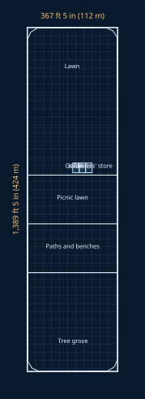

# P4-14 Staff Garden 2: plan

Footprint 367 ft 5 in (112 m) × 1,389 ft 5 in (424 m) · structural grid 32 ft 10 in (10 m)

## Levels

| Level | Floor above deck | Height | Floor area |
|---|---|---|---|
| Level 1 · Ground | 0 ft (0 mm) | 13 ft 1 in (4,000 mm) | 3,100 sq ft (288 m²) |

## Elements

| ID | Designation | Type | Name | Level(s) | Size / length | Area | Status |
|---|---|---|---|---|---|---|---|
| E001 | D5F5P4B7A2R1 | zone | Lawn | L1 | 365 ft 6 in (111 m) × 595 ft 6 in (182 m) | 215,717 sq ft (20,041 m²) | proposed |
| E002 | D5F5P4B7A2R2 | room | Kiosk | L1 | 26 ft 3 in (8,000 mm) × 39 ft 4 in (12 m) | 1,033 sq ft (96 m²) | proposed |
| E003 | D5F5P4B7A2R3 | room | Toilets | L1 | 26 ft 3 in (8,000 mm) × 39 ft 4 in (12 m) | 1,033 sq ft (96 m²) | proposed |
| E004 | D5F5P4B7A2R4 | room | Gardeners' store | L1 | 26 ft 3 in (8,000 mm) × 39 ft 4 in (12 m) | 1,033 sq ft (96 m²) | proposed |
| E005 | D5F5P4B7A2R5 | zone | Picnic lawn | L1 | 365 ft 2 in (111 m) × 197 ft 2 in (60 m) | 71,937 sq ft (6,683 m²) | proposed |
| E006 | D5F5P4B7A2R6 | zone | Paths and benches | L1 | 365 ft 2 in (111 m) × 197 ft 2 in (60 m) | 71,937 sq ft (6,683 m²) | proposed |
| E007 | D5F5P4B7A2R7 | zone | Tree grove | L1 | 365 ft 2 in (111 m) × 398 ft 4 in (121 m) | 143,780 sq ft (13,358 m²) | proposed |

## Drawings

### Level 1 · Ground

