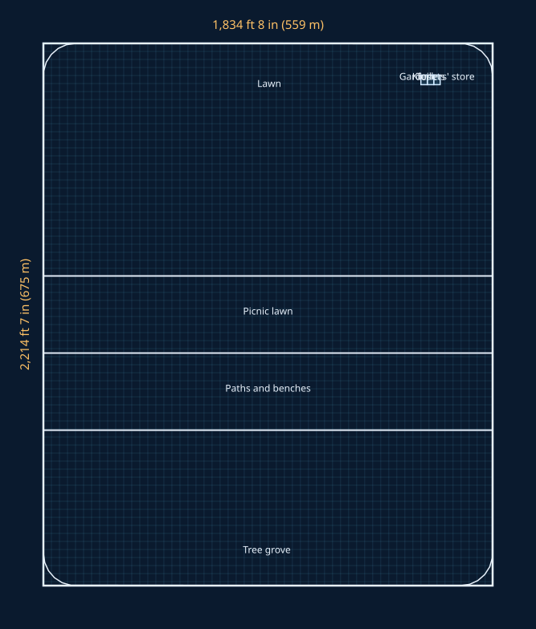

# P4-18 Staff Garden 4: plan

Footprint 1,834 ft 8 in (559 m) × 2,214 ft 7 in (675 m) · structural grid 32 ft 10 in (10 m)

## Levels

| Level | Floor above deck | Height | Floor area |
|---|---|---|---|
| Level 1 · Ground | 0 ft (0 mm) | 13 ft 1 in (4,000 mm) | 3,100 sq ft (288 m²) |

## Elements

| ID | Designation | Type | Name | Level(s) | Size / length | Area | Status |
|---|---|---|---|---|---|---|---|
| E001 | D5F5P4B3A3R1 | zone | Lawn | L1 | 1,834 ft (559 m) × 949 ft 10 in (290 m) | 1,732,716 sq ft (160,975 m²) | proposed |
| E002 | D5F5P4B3A3R2 | room | Kiosk | L1 | 26 ft 3 in (8,000 mm) × 39 ft 4 in (12 m) | 1,033 sq ft (96 m²) | proposed |
| E003 | D5F5P4B3A3R3 | room | Toilets | L1 | 26 ft 3 in (8,000 mm) × 39 ft 4 in (12 m) | 1,033 sq ft (96 m²) | proposed |
| E004 | D5F5P4B3A3R4 | room | Gardeners' store | L1 | 26 ft 3 in (8,000 mm) × 39 ft 4 in (12 m) | 1,033 sq ft (96 m²) | proposed |
| E005 | D5F5P4B3A3R5 | zone | Picnic lawn | L1 | 1,833 ft 4 in (559 m) × 315 ft (96 m) | 577,428 sq ft (53,645 m²) | proposed |
| E006 | D5F5P4B3A3R6 | zone | Paths and benches | L1 | 1,833 ft 8 in (559 m) × 315 ft (96 m) | 577,428 sq ft (53,645 m²) | proposed |
| E007 | D5F5P4B3A3R7 | zone | Tree grove | L1 | 1,833 ft 8 in (559 m) × 634 ft 10 in (194 m) | 1,155,267 sq ft (107,328 m²) | proposed |

## Drawings

### Level 1 · Ground

