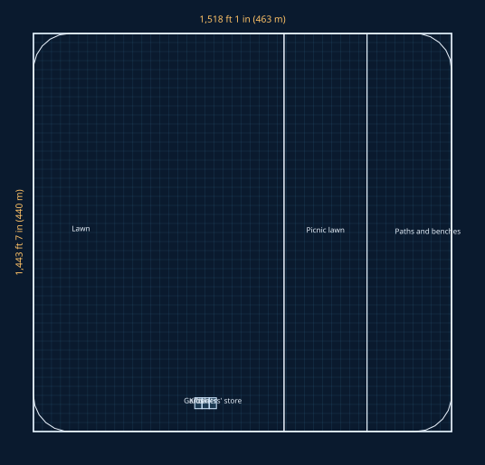

# P4-20 Staff Garden 5: plan

Footprint 1,518 ft 1 in (463 m) × 1,443 ft 7 in (440 m) · structural grid 32 ft 10 in (10 m)

## Levels

| Level | Floor above deck | Height | Floor area |
|---|---|---|---|
| Level 1 · Ground | 0 ft (0 mm) | 13 ft 1 in (4,000 mm) | 3,100 sq ft (288 m²) |

## Elements

| ID | Designation | Type | Name | Level(s) | Size / length | Area | Status |
|---|---|---|---|---|---|---|---|
| E001 | D5F5P4B5A3R1 | zone | Lawn | L1 | 909 ft 9 in (277 m) × 1,443 ft 3 in (440 m) | 1,303,933 sq ft (121,139 m²) | proposed |
| E002 | D5F5P4B5A3R2 | room | Kiosk | L1 | 26 ft 3 in (8,000 mm) × 39 ft 4 in (12 m) | 1,033 sq ft (96 m²) | proposed |
| E003 | D5F5P4B5A3R3 | room | Toilets | L1 | 26 ft 3 in (8,000 mm) × 39 ft 4 in (12 m) | 1,033 sq ft (96 m²) | proposed |
| E004 | D5F5P4B5A3R4 | room | Gardeners' store | L1 | 26 ft 3 in (8,000 mm) × 39 ft 4 in (12 m) | 1,033 sq ft (96 m²) | proposed |
| E005 | D5F5P4B5A3R5 | zone | Picnic lawn | L1 | 301 ft 2 in (92 m) × 1,442 ft 7 in (440 m) | 434,430 sq ft (40,360 m²) | proposed |
| E006 | D5F5P4B5A3R6 | zone | Paths and benches | L1 | 307 ft 1 in (94 m) × 1,442 ft 7 in (440 m) | 434,565 sq ft (40,372 m²) | proposed |

## Drawings

### Level 1 · Ground

