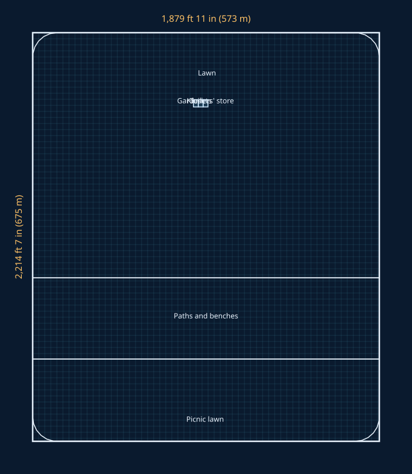

# P4-22 Staff Garden 6: plan

Footprint 1,879 ft 11 in (573 m) × 2,214 ft 7 in (675 m) · structural grid 32 ft 10 in (10 m)

## Levels

| Level | Floor above deck | Height | Floor area |
|---|---|---|---|
| Level 1 · Ground | 0 ft (0 mm) | 13 ft 1 in (4,000 mm) | 3,100 sq ft (288 m²) |

## Elements

| ID | Designation | Type | Name | Level(s) | Size / length | Area | Status |
|---|---|---|---|---|---|---|---|
| E001 | D5F5P4B7A3R1 | zone | Lawn | L1 | 1,879 ft 3 in (573 m) × 1,327 ft 9 in (405 m) | 2,485,498 sq ft (230,910 m²) | proposed |
| E002 | D5F5P4B7A3R2 | room | Kiosk | L1 | 26 ft 3 in (8,000 mm) × 39 ft 4 in (12 m) | 1,033 sq ft (96 m²) | proposed |
| E003 | D5F5P4B7A3R3 | room | Toilets | L1 | 26 ft 3 in (8,000 mm) × 39 ft 4 in (12 m) | 1,033 sq ft (96 m²) | proposed |
| E004 | D5F5P4B7A3R4 | room | Gardeners' store | L1 | 26 ft 3 in (8,000 mm) × 39 ft 4 in (12 m) | 1,033 sq ft (96 m²) | proposed |
| E005 | D5F5P4B7A3R5 | zone | Paths and benches | L1 | 1,878 ft 11 in (573 m) × 441 ft 3 in (135 m) | 828,979 sq ft (77,015 m²) | proposed |
| E006 | D5F5P4B7A3R6 | zone | Picnic lawn | L1 | 1,878 ft 11 in (573 m) × 445 ft 6 in (136 m) | 828,341 sq ft (76,955 m²) | proposed |

## Drawings

### Level 1 · Ground

