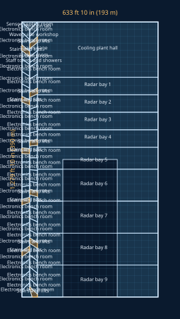
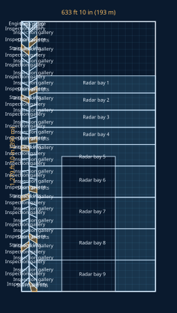

# P5-02 Starboard Sensor Hall: plan

Footprint 633 ft 10 in (193 m) × 1,279 ft 10 in (390 m) · structural grid 32 ft 10 in (10 m)

## Levels

| Level | Floor above deck | Height | Floor area |
|---|---|---|---|
| Level 1 · Array floor | 0 ft (0 mm) | 39 ft 4 in (12 m) | 634,293 sq ft (58,928 m²) |
| Level 2 · Gallery floor | 39 ft 4 in (12 m) | 16 ft 5 in (5,000 mm) | 490,003 sq ft (45,523 m²) |

## Elements

| ID | Designation | Type | Name | Level(s) | Size / length | Area | Status |
|---|---|---|---|---|---|---|---|
| E001 | D5F5P5B2A1L1R1, D5F5P5B2A1L2R1 | room | Radar bay 1 | L1, L2 | 561 ft 8 in (171 m) × 81 ft 8 in (25 m) | 45,885 sq ft (4,263 m²) | proposed |
| E002 | D5F5P5B2A1L1R2, D5F5P5B2A1L2R2 | room | Radar bay 2 | L1, L2 | 561 ft 8 in (171 m) × 81 ft 4 in (25 m) | 45,701 sq ft (4,246 m²) | proposed |
| E003 | D5F5P5B2A1L1R3, D5F5P5B2A1L2R3 | room | Radar bay 3 | L1, L2 | 561 ft 8 in (171 m) × 81 ft 8 in (25 m) | 45,885 sq ft (4,263 m²) | proposed |
| E004 | D5F5P5B2A1L1R4, D5F5P5B2A1L2R4 | room | Radar bay 4 | L1, L2 | 561 ft 8 in (171 m) × 81 ft 4 in (25 m) | 45,701 sq ft (4,246 m²) | proposed |
| E005 | D5F5P5B2A1L1R5, D5F5P5B2A1L2R5 | room | Radar bay 5 | L1, L2 | 561 ft 8 in (171 m) × 102 ft (31 m) | 45,828 sq ft (4,258 m²) | proposed |
| E006 | D5F5P5B2A1L1R6, D5F5P5B2A1L2R6 | room | Radar bay 6 | L1, L2 | 561 ft 8 in (171 m) × 148 ft 7 in (45 m) | 45,786 sq ft (4,254 m²) | proposed |
| E007 | D5F5P5B2A1L1R7, D5F5P5B2A1L2R7 | room | Radar bay 7 | L1, L2 | 561 ft 8 in (171 m) × 148 ft 11 in (45 m) | 45,887 sq ft (4,263 m²) | proposed |
| E008 | D5F5P5B2A1L1R8, D5F5P5B2A1L2R8 | room | Radar bay 8 | L1, L2 | 561 ft 8 in (171 m) × 148 ft 7 in (45 m) | 45,786 sq ft (4,254 m²) | proposed |
| E009 | D5F5P5B2A1L1R9, D5F5P5B2A1L2R9 | room | Radar bay 9 | L1, L2 | 561 ft 8 in (171 m) × 148 ft 7 in (45 m) | 45,786 sq ft (4,254 m²) | proposed |
| E010 | D5F5P5B2A1L1R10 | room | Cooling plant hall | L1 | 561 ft 8 in (171 m) × 256 ft 11 in (78 m) | 144,290 sq ft (13,405 m²) | proposed |
| E011 | D5F5P5B2A1L1R11, D5F5P5B2A1L2R10 | core | Stairs and lifts | L1, L2 | 34 ft 1 in (10 m) × 56 ft 1 in (17 m) | 896 sq ft (83 m²) | proposed |
| E012 | D5F5P5B2A1L1R12, D5F5P5B2A1L2R11 | core | Stairs and lifts | L1, L2 | 34 ft 1 in (10 m) × 43 ft 4 in (13 m) | 896 sq ft (83 m²) | proposed |
| E013 | D5F5P5B2A1L1R13, D5F5P5B2A1L2R12 | core | Stairs and lifts | L1, L2 | 34 ft 1 in (10 m) × 30 ft 6 in (9,300 mm) | 896 sq ft (83 m²) | proposed |
| E014 | D5F5P5B2A1L1R14, D5F5P5B2A1L2R13 | core | Stairs and lifts | L1, L2 | 34 ft 1 in (10 m) × 34 ft 9 in (11 m) | 896 sq ft (83 m²) | proposed |
| E015 | D5F5P5B2A1L1R15, D5F5P5B2A1L2R14 | core | Stairs and lifts | L1, L2 | 34 ft 1 in (10 m) × 47 ft 7 in (14 m) | 896 sq ft (83 m²) | proposed |
| E016 | D5F5P5B2A1L1R16, D5F5P5B2A1L2R15 | core | Stairs and lifts | L1, L2 | 35 ft 5 in (11 m) × 46 ft 11 in (14 m) | 896 sq ft (83 m²) | proposed |
| E017 | D5F5P5B2A1L1R17, D5F5P5B2A1L2R16 | core | Stairs and lifts | L1, L2 | 34 ft 1 in (10 m) × 49 ft 10 in (15 m) | 896 sq ft (83 m²) | proposed |
| E018 | D5F5P5B2A1L1R18, D5F5P5B2A1L2R17 | core | Stairs and lifts | L1, L2 | 34 ft 1 in (10 m) × 36 ft 9 in (11 m) | 890 sq ft (83 m²) | proposed |
| E019 | D5F5P5B2A1L1R19, D5F5P5B2A1L2R18 | core | Stairs and lifts | L1, L2 | 34 ft 1 in (10 m) × 28 ft 7 in (8,700 mm) | 896 sq ft (83 m²) | proposed |
| E020 | D5F5P5B2A1L1R20, D5F5P5B2A1L2R19 | core | Stairs and lifts | L1, L2 | 34 ft 1 in (10 m) × 41 ft 4 in (13 m) | 896 sq ft (83 m²) | proposed |
| E021 | D5F5P5B2A1L1R21, D5F5P5B2A1L2R20 | core | Stairs and lifts | L1, L2 | 34 ft 1 in (10 m) × 54 ft 2 in (16 m) | 901 sq ft (84 m²) | proposed |
| E022 | D5F5P5B2A1L1R22 | room | Sensor control room | L1 | 71 ft 10 in (22 m) × 34 ft 1 in (10 m) | 1,293 sq ft (120 m²) | proposed |
| E023 | D5F5P5B2A1L1R23 | room | Calibration lab | L1 | 34 ft 1 in (10 m) × 64 ft 8 in (20 m) | 1,075 sq ft (100 m²) | proposed |
| E024 | D5F5P5B2A1L1R24 | room | Waveguide workshop | L1 | 34 ft 1 in (10 m) × 65 ft 11 in (20 m) | 1,175 sq ft (109 m²) | proposed |
| E025 | D5F5P5B2A1L1R25 | room | Spares cage | L1 | 34 ft 1 in (10 m) × 65 ft 11 in (20 m) | 1,287 sq ft (120 m²) | proposed |
| E026 | D5F5P5B2A1L1R26 | room | Locker room | L1 | 34 ft 1 in (10 m) × 54 ft 6 in (17 m) | 957 sq ft (89 m²) | proposed |
| E027 | D5F5P5B2A1L1R27 | room | Staff toilets and showers | L1 | 34 ft 1 in (10 m) × 47 ft 3 in (14 m) | 756 sq ft (70 m²) | proposed |
| E028 | D5F5P5B2A1L1R28 | room | Electronics bench room | L1 | 34 ft 1 in (10 m) × 79 ft 5 in (24 m) | 1,931 sq ft (179 m²) | proposed |
| E029 | D5F5P5B2A1L1R29 | room | Electronics bench room | L1 | 34 ft 1 in (10 m) × 82 ft (25 m) | 2,133 sq ft (198 m²) | proposed |
| E030 | D5F5P5B2A1L1R30 | room | Electronics bench room | L1 | 34 ft 1 in (10 m) × 71 ft 2 in (22 m) | 1,931 sq ft (179 m²) | proposed |
| E031 | D5F5P5B2A1L1R31 | room | Electronics bench room | L1 | 34 ft 1 in (10 m) × 68 ft 3 in (21 m) | 1,931 sq ft (179 m²) | proposed |
| E032 | D5F5P5B2A1L1R32 | room | Electronics bench room | L1 | 34 ft 1 in (10 m) × 65 ft 3 in (20 m) | 1,931 sq ft (179 m²) | proposed |
| E033 | D5F5P5B2A1L1R33 | room | Electronics bench room | L1 | 34 ft 1 in (10 m) × 43 ft 4 in (13 m) | 1,271 sq ft (118 m²) | proposed |
| E034 | D5F5P5B2A1L1R34 | room | Electronics bench room | L1 | 34 ft 1 in (10 m) × 58 ft 9 in (18 m) | 1,937 sq ft (180 m²) | proposed |
| E035 | D5F5P5B2A1L1R35 | room | Electronics bench room | L1 | 34 ft 1 in (10 m) × 58 ft 1 in (18 m) | 1,931 sq ft (179 m²) | proposed |
| E036 | D5F5P5B2A1L1R36 | room | Electronics bench room | L1 | 34 ft 1 in (10 m) × 60 ft 8 in (18 m) | 1,925 sq ft (179 m²) | proposed |
| E037 | D5F5P5B2A1L1R37 | room | Electronics bench room | L1 | 34 ft 1 in (10 m) × 44 ft 3 in (14 m) | 1,276 sq ft (119 m²) | proposed |
| E038 | D5F5P5B2A1L1R38 | room | Electronics bench room | L1 | 34 ft 1 in (10 m) × 67 ft 7 in (21 m) | 1,937 sq ft (180 m²) | proposed |
| E039 | D5F5P5B2A1L1R39 | room | Electronics bench room | L1 | 34 ft 1 in (10 m) × 70 ft 6 in (22 m) | 1,925 sq ft (179 m²) | proposed |
| E040 | D5F5P5B2A1L1R40 | room | Electronics bench room | L1 | 34 ft 1 in (10 m) × 73 ft 10 in (22 m) | 1,931 sq ft (179 m²) | proposed |
| E041 | D5F5P5B2A1L1R41 | room | Electronics bench room | L1 | 34 ft 1 in (10 m) × 57 ft 1 in (17 m) | 1,276 sq ft (119 m²) | proposed |
| E042 | D5F5P5B2A1L1R42 | room | Electronics bench room | L1 | 34 ft 1 in (10 m) × 80 ft 1 in (24 m) | 1,925 sq ft (179 m²) | proposed |
| E043 | D5F5P5B2A1L1R43 | room | Electronics bench room | L1 | 34 ft 1 in (10 m) × 83 ft 8 in (26 m) | 1,937 sq ft (180 m²) | proposed |
| E044 | D5F5P5B2A1L1R44 | room | Electronics bench room | L1 | 34 ft 1 in (10 m) × 86 ft 7 in (26 m) | 1,931 sq ft (179 m²) | proposed |
| E045 | D5F5P5B2A1L1R45 | room | Electronics bench room | L1 | 34 ft 1 in (10 m) × 69 ft 11 in (21 m) | 1,276 sq ft (119 m²) | proposed |
| E046 | D5F5P5B2A1L1R46 | room | Electronics bench room | L1 | 47 ft 3 in (14 m) × 65 ft 3 in (20 m) | 1,937 sq ft (180 m²) | proposed |
| E047 | D5F5P5B2A1L1R47 | room | Electronics bench room | L1 | 34 ft 1 in (10 m) × 87 ft 7 in (27 m) | 1,931 sq ft (179 m²) | proposed |
| E048 | D5F5P5B2A1L1R48 | room | Electronics bench room | L1 | 34 ft 1 in (10 m) × 84 ft 4 in (26 m) | 1,931 sq ft (179 m²) | proposed |
| E049 | D5F5P5B2A1L1R49 | room | Electronics bench room | L1 | 34 ft 1 in (10 m) × 62 ft 8 in (19 m) | 1,276 sq ft (119 m²) | proposed |
| E050 | D5F5P5B2A1L1R50 | room | Electronics bench room | L1 | 34 ft 1 in (10 m) × 77 ft 9 in (24 m) | 1,925 sq ft (179 m²) | proposed |
| E051 | D5F5P5B2A1L1R51 | room | Electronics bench room | L1 | 34 ft 1 in (10 m) × 74 ft 10 in (23 m) | 1,937 sq ft (180 m²) | proposed |
| E052 | D5F5P5B2A1L1R52 | room | Electronics bench room | L1 | 34 ft 1 in (10 m) × 71 ft 6 in (22 m) | 1,931 sq ft (179 m²) | proposed |
| E053 | D5F5P5B2A1L1R53 | room | Electronics bench room | L1 | 34 ft 1 in (10 m) × 49 ft 10 in (15 m) | 1,276 sq ft (119 m²) | proposed |
| E054 | D5F5P5B2A1L1R54 | room | Electronics bench room | L1 | 34 ft 1 in (10 m) × 65 ft (20 m) | 1,931 sq ft (179 m²) | proposed |
| E055 | D5F5P5B2A1L1R55 | room | Electronics bench room | L1 | 34 ft 1 in (10 m) × 62 ft (19 m) | 1,931 sq ft (179 m²) | proposed |
| E056 | D5F5P5B2A1L1R56 | room | Electronics bench room | L1 | 34 ft 1 in (10 m) × 58 ft 9 in (18 m) | 1,931 sq ft (179 m²) | proposed |
| E057 | D5F5P5B2A1L1R57 | room | Electronics bench room | L1 | 34 ft 1 in (10 m) × 38 ft 5 in (12 m) | 1,276 sq ft (119 m²) | proposed |
| E058 | D5F5P5B2A1L1R58 | room | Electronics bench room | L1 | 34 ft 1 in (10 m) × 61 ft (19 m) | 1,931 sq ft (179 m²) | proposed |
| E059 | D5F5P5B2A1L1R59 | room | Electronics bench room | L1 | 34 ft 1 in (10 m) × 64 ft (20 m) | 1,925 sq ft (179 m²) | proposed |
| E060 | D5F5P5B2A1L1R60 | room | Electronics bench room | L1 | 34 ft 1 in (10 m) × 67 ft 3 in (20 m) | 1,931 sq ft (179 m²) | proposed |
| E061 | D5F5P5B2A1L1R61 | room | Electronics bench room | L1 | 34 ft 1 in (10 m) × 50 ft 10 in (15 m) | 1,282 sq ft (119 m²) | proposed |
| E062 | D5F5P5B2A1L1R62 | room | Electronics bench room | L1 | 34 ft 1 in (10 m) × 73 ft 10 in (22 m) | 1,931 sq ft (179 m²) | proposed |
| E063 | D5F5P5B2A1L1R63 | room | Electronics bench room | L1 | 34 ft 1 in (10 m) × 76 ft 9 in (23 m) | 1,925 sq ft (179 m²) | proposed |
| E064 | D5F5P5B2A1L1R64 | room | Electronics bench room | L1 | 34 ft 1 in (10 m) × 80 ft 1 in (24 m) | 1,931 sq ft (179 m²) | proposed |
| E065 | D5F5P5B2A1L1R65 | room | Electronics bench room | L1 | 34 ft 1 in (10 m) × 63 ft 4 in (19 m) | 1,276 sq ft (119 m²) | proposed |
| E066 | D5F5P5B2A1L1R66 | room | Electronics bench room | L1 | 34 ft 1 in (10 m) × 86 ft 7 in (26 m) | 1,925 sq ft (179 m²) | proposed |
| E067 | D5F5P5B2A1L1R67 | room | Electronics bench room | L1 | 34 ft 1 in (10 m) × 80 ft 1 in (24 m) | 1,606 sq ft (149 m²) | proposed |
| E068 | D5F5P5B2A1L2R21 | room | Engineers' office | L2 | 36 ft 1 in (11 m) × 34 ft 1 in (10 m) | 644 sq ft (60 m²) | proposed |
| E069 | D5F5P5B2A1L2R22 | room | Data room | L2 | 36 ft 5 in (11 m) × 40 ft (12 m) | 862 sq ft (80 m²) | proposed |
| E070 | D5F5P5B2A1L2R23 | room | Tea point | L2 | 34 ft 1 in (10 m) × 45 ft 7 in (14 m) | 414 sq ft (38 m²) | proposed |
| E071 | D5F5P5B2A1L2R24 | room | Inspection gallery | L2 | 34 ft 1 in (10 m) × 79 ft 5 in (24 m) | 1,623 sq ft (151 m²) | proposed |
| E072 | D5F5P5B2A1L2R25 | room | Inspection gallery | L2 | 34 ft 1 in (10 m) × 84 ft (26 m) | 1,925 sq ft (179 m²) | proposed |
| E073 | D5F5P5B2A1L2R26 | room | Inspection gallery | L2 | 34 ft 1 in (10 m) × 81 ft (25 m) | 1,931 sq ft (179 m²) | proposed |
| E074 | D5F5P5B2A1L2R27 | room | Inspection gallery | L2 | 34 ft 1 in (10 m) × 78 ft 1 in (24 m) | 1,931 sq ft (179 m²) | proposed |
| E075 | D5F5P5B2A1L2R28 | room | Inspection gallery | L2 | 34 ft 1 in (10 m) × 56 ft 5 in (17 m) | 1,276 sq ft (119 m²) | proposed |
| E076 | D5F5P5B2A1L2R29 | room | Inspection gallery | L2 | 34 ft 1 in (10 m) × 71 ft 2 in (22 m) | 1,931 sq ft (179 m²) | proposed |
| E077 | D5F5P5B2A1L2R30 | room | Inspection gallery | L2 | 34 ft 1 in (10 m) × 68 ft 3 in (21 m) | 1,931 sq ft (179 m²) | proposed |
| E078 | D5F5P5B2A1L2R31 | room | Inspection gallery | L2 | 34 ft 1 in (10 m) × 65 ft 3 in (20 m) | 1,931 sq ft (179 m²) | proposed |
| E079 | D5F5P5B2A1L2R32 | room | Inspection gallery | L2 | 34 ft 1 in (10 m) × 43 ft 4 in (13 m) | 1,271 sq ft (118 m²) | proposed |
| E080 | D5F5P5B2A1L2R33 | room | Inspection gallery | L2 | 34 ft 1 in (10 m) × 58 ft 9 in (18 m) | 1,937 sq ft (180 m²) | proposed |
| E081 | D5F5P5B2A1L2R34 | room | Inspection gallery | L2 | 34 ft 1 in (10 m) × 58 ft 1 in (18 m) | 1,931 sq ft (179 m²) | proposed |
| E082 | D5F5P5B2A1L2R35 | room | Inspection gallery | L2 | 34 ft 1 in (10 m) × 60 ft 8 in (18 m) | 1,925 sq ft (179 m²) | proposed |
| E083 | D5F5P5B2A1L2R36 | room | Inspection gallery | L2 | 34 ft 1 in (10 m) × 44 ft 3 in (14 m) | 1,276 sq ft (119 m²) | proposed |
| E084 | D5F5P5B2A1L2R37 | room | Inspection gallery | L2 | 34 ft 1 in (10 m) × 67 ft 7 in (21 m) | 1,937 sq ft (180 m²) | proposed |
| E085 | D5F5P5B2A1L2R38 | room | Inspection gallery | L2 | 34 ft 1 in (10 m) × 70 ft 6 in (22 m) | 1,925 sq ft (179 m²) | proposed |
| E086 | D5F5P5B2A1L2R39 | room | Inspection gallery | L2 | 34 ft 1 in (10 m) × 73 ft 10 in (22 m) | 1,931 sq ft (179 m²) | proposed |
| E087 | D5F5P5B2A1L2R40 | room | Inspection gallery | L2 | 34 ft 1 in (10 m) × 57 ft 1 in (17 m) | 1,276 sq ft (119 m²) | proposed |
| E088 | D5F5P5B2A1L2R41 | room | Inspection gallery | L2 | 34 ft 1 in (10 m) × 80 ft 1 in (24 m) | 1,925 sq ft (179 m²) | proposed |
| E089 | D5F5P5B2A1L2R42 | room | Inspection gallery | L2 | 34 ft 1 in (10 m) × 83 ft 8 in (26 m) | 1,937 sq ft (180 m²) | proposed |
| E090 | D5F5P5B2A1L2R43 | room | Inspection gallery | L2 | 34 ft 1 in (10 m) × 86 ft 7 in (26 m) | 1,931 sq ft (179 m²) | proposed |
| E091 | D5F5P5B2A1L2R44 | room | Inspection gallery | L2 | 34 ft 1 in (10 m) × 69 ft 11 in (21 m) | 1,276 sq ft (119 m²) | proposed |
| E092 | D5F5P5B2A1L2R45 | room | Inspection gallery | L2 | 47 ft 3 in (14 m) × 65 ft 3 in (20 m) | 1,937 sq ft (180 m²) | proposed |
| E093 | D5F5P5B2A1L2R46 | room | Inspection gallery | L2 | 34 ft 1 in (10 m) × 87 ft 7 in (27 m) | 1,931 sq ft (179 m²) | proposed |
| E094 | D5F5P5B2A1L2R47 | room | Inspection gallery | L2 | 34 ft 1 in (10 m) × 84 ft 4 in (26 m) | 1,931 sq ft (179 m²) | proposed |
| E095 | D5F5P5B2A1L2R48 | room | Inspection gallery | L2 | 34 ft 1 in (10 m) × 62 ft 8 in (19 m) | 1,276 sq ft (119 m²) | proposed |
| E096 | D5F5P5B2A1L2R49 | room | Inspection gallery | L2 | 34 ft 1 in (10 m) × 77 ft 9 in (24 m) | 1,925 sq ft (179 m²) | proposed |
| E097 | D5F5P5B2A1L2R50 | room | Inspection gallery | L2 | 34 ft 1 in (10 m) × 74 ft 10 in (23 m) | 1,937 sq ft (180 m²) | proposed |
| E098 | D5F5P5B2A1L2R51 | room | Inspection gallery | L2 | 34 ft 1 in (10 m) × 71 ft 6 in (22 m) | 1,931 sq ft (179 m²) | proposed |
| E099 | D5F5P5B2A1L2R52 | room | Inspection gallery | L2 | 34 ft 1 in (10 m) × 49 ft 10 in (15 m) | 1,276 sq ft (119 m²) | proposed |
| E100 | D5F5P5B2A1L2R53 | room | Inspection gallery | L2 | 34 ft 1 in (10 m) × 65 ft (20 m) | 1,931 sq ft (179 m²) | proposed |
| E101 | D5F5P5B2A1L2R54 | room | Inspection gallery | L2 | 34 ft 1 in (10 m) × 62 ft (19 m) | 1,931 sq ft (179 m²) | proposed |
| E102 | D5F5P5B2A1L2R55 | room | Inspection gallery | L2 | 34 ft 1 in (10 m) × 58 ft 9 in (18 m) | 1,931 sq ft (179 m²) | proposed |
| E103 | D5F5P5B2A1L2R56 | room | Inspection gallery | L2 | 34 ft 1 in (10 m) × 38 ft 5 in (12 m) | 1,276 sq ft (119 m²) | proposed |
| E104 | D5F5P5B2A1L2R57 | room | Inspection gallery | L2 | 34 ft 1 in (10 m) × 61 ft (19 m) | 1,931 sq ft (179 m²) | proposed |
| E105 | D5F5P5B2A1L2R58 | room | Inspection gallery | L2 | 34 ft 1 in (10 m) × 64 ft (20 m) | 1,925 sq ft (179 m²) | proposed |
| E106 | D5F5P5B2A1L2R59 | room | Inspection gallery | L2 | 34 ft 1 in (10 m) × 67 ft 3 in (20 m) | 1,931 sq ft (179 m²) | proposed |
| E107 | D5F5P5B2A1L2R60 | room | Inspection gallery | L2 | 34 ft 1 in (10 m) × 50 ft 10 in (15 m) | 1,282 sq ft (119 m²) | proposed |
| E108 | D5F5P5B2A1L2R61 | room | Inspection gallery | L2 | 34 ft 1 in (10 m) × 73 ft 10 in (22 m) | 1,931 sq ft (179 m²) | proposed |
| E109 | D5F5P5B2A1L2R62 | room | Inspection gallery | L2 | 34 ft 1 in (10 m) × 76 ft 9 in (23 m) | 1,925 sq ft (179 m²) | proposed |
| E110 | D5F5P5B2A1L2R63 | room | Inspection gallery | L2 | 34 ft 1 in (10 m) × 80 ft 1 in (24 m) | 1,931 sq ft (179 m²) | proposed |
| E111 | D5F5P5B2A1L2R64 | room | Inspection gallery | L2 | 34 ft 1 in (10 m) × 63 ft 4 in (19 m) | 1,276 sq ft (119 m²) | proposed |
| E112 | D5F5P5B2A1L2R65 | room | Inspection gallery | L2 | 34 ft 1 in (10 m) × 86 ft 7 in (26 m) | 1,925 sq ft (179 m²) | proposed |
| E113 | D5F5P5B2A1L2R66 | room | Inspection gallery | L2 | 34 ft 1 in (10 m) × 80 ft 1 in (24 m) | 1,606 sq ft (149 m²) | proposed |

## Drawings

### Level 1 · Array floor

### Level 2 · Gallery floor

