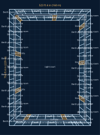
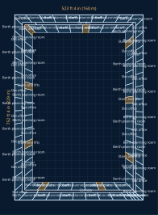

# P5-03 Gate Traffic Desk: plan

Footprint 523 ft 4 in (160 m) × 752 ft 4 in (229 m) · structural grid 32 ft 10 in (10 m)

## Levels

| Level | Floor above deck | Height | Floor area |
|---|---|---|---|
| Level 1 · Ground floor | 0 ft (0 mm) | 15 ft 9 in (4,800 mm) | 133,671 sq ft (12,418 m²) |
| Level 2 · Office floor 1 | 15 ft 9 in (4,800 mm) | 13 ft 9 in (4,200 mm) | 133,671 sq ft (12,418 m²) |
| Level 3 · Office floor 2 | 29 ft 6 in (9,000 mm) | 13 ft 9 in (4,200 mm) | 133,671 sq ft (12,418 m²) |

## Elements

| ID | Designation | Type | Name | Level(s) | Size / length | Area | Status |
|---|---|---|---|---|---|---|---|
| E001 | D5F5P5B3A1L1R1 | zone | Light court | L1 | 378 ft 11 in (116 m) × 607 ft 11 in (185 m) | 230,371 sq ft (21,402 m²) | proposed |
| E002 | D5F5P5B3A1L1R2 | zone | Corridor | L1 | 402 ft 3 in (123 m) × 9 ft 10 in (3,000 mm) | 3,875 sq ft (360 m²) | proposed |
| E003 | D5F5P5B3A1L1R3 | zone | Corridor | L1 | 65 ft 11 in (20 m) × 341 ft 2 in (104 m) | 3,875 sq ft (360 m²) | proposed |
| E004 | D5F5P5B3A1L1R4 | zone | Corridor | L1 | 58 ft 9 in (18 m) × 348 ft 9 in (106 m) | 3,875 sq ft (360 m²) | proposed |
| E005 | D5F5P5B3A1L1R5 | zone | Corridor | L1 | 402 ft 3 in (123 m) × 9 ft 10 in (3,000 mm) | 3,875 sq ft (360 m²) | proposed |
| E006 | D5F5P5B3A1L1R6 | zone | Corridor | L1 | 17 ft 1 in (5,200 mm) × 391 ft 9 in (119 m) | 3,875 sq ft (360 m²) | proposed |
| E007 | D5F5P5B3A1L1R7 | zone | Corridor | L1 | 9 ft 10 in (3,000 mm) × 299 ft 6 in (91 m) | 2,893 sq ft (269 m²) | proposed |
| E008 | D5F5P5B3A1L1R8, D5F5P5B3A1L2R1, D5F5P5B3A1L3R1 | core | Stairs and lifts | L1, L2, L3 | 39 ft 8 in (12 m) × 31 ft 2 in (9,500 mm) | 818 sq ft (76 m²) | proposed |
| E009 | D5F5P5B3A1L1R9, D5F5P5B3A1L2R2, D5F5P5B3A1L3R2 | core | Stairs and lifts | L1, L2, L3 | 48 ft 3 in (15 m) × 31 ft 2 in (9,500 mm) | 818 sq ft (76 m²) | proposed |
| E010 | D5F5P5B3A1L1R10, D5F5P5B3A1L2R3, D5F5P5B3A1L3R3 | core | Stairs and lifts | L1, L2, L3 | 31 ft 2 in (9,500 mm) × 40 ft 8 in (12 m) | 818 sq ft (76 m²) | proposed |
| E011 | D5F5P5B3A1L1R11, D5F5P5B3A1L2R4, D5F5P5B3A1L3R4 | core | Stairs and lifts | L1, L2, L3 | 31 ft 2 in (9,500 mm) × 34 ft 9 in (11 m) | 818 sq ft (76 m²) | proposed |
| E012 | D5F5P5B3A1L1R12, D5F5P5B3A1L2R5, D5F5P5B3A1L3R5 | core | Stairs and lifts | L1, L2, L3 | 43 ft 4 in (13 m) × 43 ft 8 in (13 m) | 818 sq ft (76 m²) | proposed |
| E013 | D5F5P5B3A1L1R13, D5F5P5B3A1L2R6, D5F5P5B3A1L3R6 | core | Stairs and lifts | L1, L2, L3 | 30 ft 6 in (9,300 mm) × 31 ft 2 in (9,500 mm) | 818 sq ft (76 m²) | proposed |
| E014 | D5F5P5B3A1L1R14, D5F5P5B3A1L2R7, D5F5P5B3A1L3R7 | core | Stairs and lifts | L1, L2, L3 | 31 ft 2 in (9,500 mm) × 51 ft 10 in (16 m) | 818 sq ft (76 m²) | proposed |
| E015 | D5F5P5B3A1L1R15, D5F5P5B3A1L2R8, D5F5P5B3A1L3R8 | core | Stairs and lifts | L1, L2, L3 | 31 ft 2 in (9,500 mm) × 29 ft 2 in (8,900 mm) | 818 sq ft (76 m²) | proposed |
| E016 | D5F5P5B3A1L1R16, D5F5P5B3A1L2R9, D5F5P5B3A1L3R9 | core | Stairs and lifts | L1, L2, L3 | 31 ft 2 in (9,500 mm) × 45 ft 11 in (14 m) | 818 sq ft (76 m²) | proposed |
| E017 | D5F5P5B3A1L1R17 | room | Gate slot desk | L1 | 69 ft 11 in (21 m) × 31 ft 2 in (9,500 mm) | 1,288 sq ft (120 m²) | proposed |
| E018 | D5F5P5B3A1L1R18 | room | Gate status board room | L1 | 51 ft 10 in (16 m) × 31 ft 2 in (9,500 mm) | 864 sq ft (80 m²) | proposed |
| E019 | D5F5P5B3A1L1R19 | room | Reception | L1 | 35 ft 5 in (11 m) × 31 ft 2 in (9,500 mm) | 435 sq ft (40 m²) | proposed |
| E020 | D5F5P5B3A1L1R20 | room | Toilets | L1 | 40 ft (12 m) × 31 ft 2 in (9,500 mm) | 644 sq ft (60 m²) | proposed |
| E021 | D5F5P5B3A1L1R21 | room | Slot office | L1 | 66 ft 7 in (20 m) × 31 ft 2 in (9,500 mm) | 1,616 sq ft (150 m²) | proposed |
| E022 | D5F5P5B3A1L1R22 | room | Berth planning room | L1 | 60 ft (18 m) × 31 ft 2 in (9,500 mm) | 1,616 sq ft (150 m²) | proposed |
| E023 | D5F5P5B3A1L1R23 | room | Slot office | L1 | 54 ft 9 in (17 m) × 31 ft 2 in (9,500 mm) | 1,605 sq ft (149 m²) | proposed |
| E024 | D5F5P5B3A1L1R24 | room | Berth planning room | L1 | 56 ft 9 in (17 m) × 31 ft 2 in (9,500 mm) | 1,616 sq ft (150 m²) | proposed |
| E025 | D5F5P5B3A1L1R25 | room | Slot office | L1 | 63 ft 4 in (19 m) × 31 ft 2 in (9,500 mm) | 1,616 sq ft (150 m²) | proposed |
| E026 | D5F5P5B3A1L1R26 | room | Berth planning room | L1 | 69 ft 11 in (21 m) × 31 ft 2 in (9,500 mm) | 1,616 sq ft (150 m²) | proposed |
| E027 | D5F5P5B3A1L1R27 | room | Slot office | L1 | 76 ft 5 in (23 m) × 31 ft 2 in (9,500 mm) | 1,616 sq ft (150 m²) | proposed |
| E028 | D5F5P5B3A1L1R28 | room | Berth planning room | L1 | 55 ft 5 in (17 m) × 56 ft 1 in (17 m) | 1,616 sq ft (150 m²) | proposed |
| E029 | D5F5P5B3A1L1R29 | room | Slot office | L1 | 31 ft 2 in (9,500 mm) × 78 ft 9 in (24 m) | 1,616 sq ft (150 m²) | proposed |
| E030 | D5F5P5B3A1L1R30 | room | Berth planning room | L1 | 31 ft 2 in (9,500 mm) × 74 ft 2 in (23 m) | 1,616 sq ft (150 m²) | proposed |
| E031 | D5F5P5B3A1L1R31 | room | Slot office | L1 | 31 ft 2 in (9,500 mm) × 69 ft 7 in (21 m) | 1,616 sq ft (150 m²) | proposed |
| E032 | D5F5P5B3A1L1R32 | room | Berth planning room | L1 | 31 ft 2 in (9,500 mm) × 65 ft (20 m) | 1,611 sq ft (150 m²) | proposed |
| E033 | D5F5P5B3A1L1R33 | room | Slot office | L1 | 31 ft 2 in (9,500 mm) × 60 ft 8 in (18 m) | 1,616 sq ft (150 m²) | proposed |
| E034 | D5F5P5B3A1L1R34 | room | Berth planning room | L1 | 31 ft 2 in (9,500 mm) × 56 ft 1 in (17 m) | 1,616 sq ft (150 m²) | proposed |
| E035 | D5F5P5B3A1L1R35 | room | Slot office | L1 | 31 ft 2 in (9,500 mm) × 53 ft 10 in (16 m) | 1,611 sq ft (150 m²) | proposed |
| E036 | D5F5P5B3A1L1R36 | room | Berth planning room | L1 | 31 ft 2 in (9,500 mm) × 56 ft 5 in (17 m) | 1,616 sq ft (150 m²) | proposed |
| E037 | D5F5P5B3A1L1R37 | room | Slot office | L1 | 31 ft 2 in (9,500 mm) × 61 ft (19 m) | 1,616 sq ft (150 m²) | proposed |
| E038 | D5F5P5B3A1L1R38 | room | Berth planning room | L1 | 31 ft 2 in (9,500 mm) × 65 ft 7 in (20 m) | 1,616 sq ft (150 m²) | proposed |
| E039 | D5F5P5B3A1L1R39 | room | Slot office | L1 | 31 ft 2 in (9,500 mm) × 69 ft 11 in (21 m) | 1,611 sq ft (150 m²) | proposed |
| E040 | D5F5P5B3A1L1R40 | room | Berth planning room | L1 | 31 ft 2 in (9,500 mm) × 74 ft 6 in (23 m) | 1,616 sq ft (150 m²) | proposed |
| E041 | D5F5P5B3A1L1R41 | room | Slot office | L1 | 31 ft 2 in (9,500 mm) × 79 ft 1 in (24 m) | 1,616 sq ft (150 m²) | proposed |
| E042 | D5F5P5B3A1L1R42 | room | Berth planning room | L1 | 59 ft 5 in (18 m) × 52 ft 2 in (16 m) | 1,616 sq ft (150 m²) | proposed |
| E043 | D5F5P5B3A1L1R43 | room | Slot office | L1 | 76 ft 1 in (23 m) × 31 ft 2 in (9,500 mm) | 1,616 sq ft (150 m²) | proposed |
| E044 | D5F5P5B3A1L1R44 | room | Berth planning room | L1 | 69 ft 3 in (21 m) × 31 ft 2 in (9,500 mm) | 1,611 sq ft (150 m²) | proposed |
| E045 | D5F5P5B3A1L1R45 | room | Slot office | L1 | 62 ft 8 in (19 m) × 31 ft 2 in (9,500 mm) | 1,616 sq ft (150 m²) | proposed |
| E046 | D5F5P5B3A1L1R46 | room | Berth planning room | L1 | 56 ft 1 in (17 m) × 31 ft 2 in (9,500 mm) | 1,616 sq ft (150 m²) | proposed |
| E047 | D5F5P5B3A1L1R47 | room | Slot office | L1 | 55 ft 1 in (17 m) × 31 ft 2 in (9,500 mm) | 1,616 sq ft (150 m²) | proposed |
| E048 | D5F5P5B3A1L1R48 | room | Berth planning room | L1 | 60 ft 8 in (18 m) × 31 ft 2 in (9,500 mm) | 1,616 sq ft (150 m²) | proposed |
| E049 | D5F5P5B3A1L1R49 | room | Slot office | L1 | 67 ft 3 in (20 m) × 31 ft 2 in (9,500 mm) | 1,616 sq ft (150 m²) | proposed |
| E050 | D5F5P5B3A1L1R50 | room | Berth planning room | L1 | 73 ft 6 in (22 m) × 31 ft 2 in (9,500 mm) | 1,611 sq ft (150 m²) | proposed |
| E051 | D5F5P5B3A1L1R51 | room | Slot office | L1 | 75 ft 9 in (23 m) × 35 ft 1 in (11 m) | 1,616 sq ft (150 m²) | proposed |
| E052 | D5F5P5B3A1L1R52 | room | Berth planning room | L1 | 31 ft 2 in (9,500 mm) × 80 ft 5 in (24 m) | 1,616 sq ft (150 m²) | proposed |
| E053 | D5F5P5B3A1L1R53 | room | Slot office | L1 | 31 ft 2 in (9,500 mm) × 75 ft 9 in (23 m) | 1,616 sq ft (150 m²) | proposed |
| E054 | D5F5P5B3A1L1R54 | room | Berth planning room | L1 | 31 ft 2 in (9,500 mm) × 71 ft 2 in (22 m) | 1,611 sq ft (150 m²) | proposed |
| E055 | D5F5P5B3A1L1R55 | room | Slot office | L1 | 31 ft 2 in (9,500 mm) × 66 ft 11 in (20 m) | 1,616 sq ft (150 m²) | proposed |
| E056 | D5F5P5B3A1L1R56 | room | Berth planning room | L1 | 31 ft 2 in (9,500 mm) × 62 ft 4 in (19 m) | 1,616 sq ft (150 m²) | proposed |
| E057 | D5F5P5B3A1L1R57 | room | Slot office | L1 | 31 ft 2 in (9,500 mm) × 57 ft 9 in (18 m) | 1,611 sq ft (150 m²) | proposed |
| E058 | D5F5P5B3A1L1R58 | room | Berth planning room | L1 | 31 ft 2 in (9,500 mm) × 54 ft 2 in (16 m) | 1,616 sq ft (150 m²) | proposed |
| E059 | D5F5P5B3A1L1R59 | room | Slot office | L1 | 31 ft 2 in (9,500 mm) × 54 ft 9 in (17 m) | 1,621 sq ft (151 m²) | proposed |
| E060 | D5F5P5B3A1L1R60 | room | Berth planning room | L1 | 31 ft 2 in (9,500 mm) × 59 ft 1 in (18 m) | 1,616 sq ft (150 m²) | proposed |
| E061 | D5F5P5B3A1L1R61 | room | Slot office | L1 | 31 ft 2 in (9,500 mm) × 63 ft 4 in (19 m) | 1,611 sq ft (150 m²) | proposed |
| E062 | D5F5P5B3A1L1R62 | room | Berth planning room | L1 | 31 ft 2 in (9,500 mm) × 67 ft 11 in (21 m) | 1,616 sq ft (150 m²) | proposed |
| E063 | D5F5P5B3A1L1R63 | room | Slot office | L1 | 31 ft 2 in (9,500 mm) × 72 ft 6 in (22 m) | 1,616 sq ft (150 m²) | proposed |
| E064 | D5F5P5B3A1L1R64 | room | Berth planning room | L1 | 31 ft 2 in (9,500 mm) × 76 ft 9 in (23 m) | 1,611 sq ft (150 m²) | proposed |
| E065 | D5F5P5B3A1L1R65 | room | Slot office | L1 | 31 ft 2 in (9,500 mm) × 72 ft 10 in (22 m) | 1,360 sq ft (126 m²) | proposed |
| E066 | D5F5P5B3A1L1R66 | room | Berth planning room | L1 | 79 ft 1 in (24 m) × 31 ft 2 in (9,500 mm) | 1,616 sq ft (150 m²) | proposed |
| E067 | D5F5P5B3A1L1R67 | room | Slot office | L1 | 70 ft 10 in (22 m) × 31 ft 2 in (9,500 mm) | 1,605 sq ft (149 m²) | proposed |
| E068 | D5F5P5B3A1L1R68 | room | Berth planning room | L1 | 59 ft 5 in (18 m) × 31 ft 2 in (9,500 mm) | 1,616 sq ft (150 m²) | proposed |
| E069 | D5F5P5B3A1L1R69 | room | Slot office | L1 | 55 ft 9 in (17 m) × 31 ft 2 in (9,500 mm) | 1,616 sq ft (150 m²) | proposed |
| E070 | D5F5P5B3A1L1R70 | room | Berth planning room | L1 | 60 ft (18 m) × 31 ft 2 in (9,500 mm) | 1,616 sq ft (150 m²) | proposed |
| E071 | D5F5P5B3A1L1R71 | room | Slot office | L1 | 67 ft 7 in (21 m) × 31 ft 2 in (9,500 mm) | 1,605 sq ft (149 m²) | proposed |
| E072 | D5F5P5B3A1L1R72 | room | Berth planning room | L1 | 74 ft 10 in (23 m) × 35 ft 5 in (11 m) | 1,616 sq ft (150 m²) | proposed |
| E073 | D5F5P5B3A1L1R73 | room | Slot office | L1 | 31 ft 2 in (9,500 mm) × 79 ft 9 in (24 m) | 1,611 sq ft (150 m²) | proposed |
| E074 | D5F5P5B3A1L1R74 | room | Berth planning room | L1 | 31 ft 2 in (9,500 mm) × 75 ft 2 in (23 m) | 1,621 sq ft (151 m²) | proposed |
| E075 | D5F5P5B3A1L1R75 | room | Slot office | L1 | 31 ft 2 in (9,500 mm) × 69 ft 7 in (21 m) | 1,600 sq ft (149 m²) | proposed |
| E076 | D5F5P5B3A1L1R76 | room | Berth planning room | L1 | 31 ft 2 in (9,500 mm) × 62 ft 4 in (19 m) | 1,616 sq ft (150 m²) | proposed |
| E077 | D5F5P5B3A1L1R77 | room | Slot office | L1 | 31 ft 2 in (9,500 mm) × 57 ft 1 in (17 m) | 1,611 sq ft (150 m²) | proposed |
| E078 | D5F5P5B3A1L1R78 | room | Berth planning room | L1 | 31 ft 2 in (9,500 mm) × 54 ft 6 in (17 m) | 1,621 sq ft (151 m²) | proposed |
| E079 | D5F5P5B3A1L1R79 | room | Slot office | L1 | 31 ft 2 in (9,500 mm) × 56 ft 1 in (17 m) | 1,605 sq ft (149 m²) | proposed |
| E080 | D5F5P5B3A1L1R80 | room | Berth planning room | L1 | 31 ft 2 in (9,500 mm) × 64 ft (20 m) | 1,611 sq ft (150 m²) | proposed |
| E081 | D5F5P5B3A1L1R81 | room | Slot office | L1 | 31 ft 2 in (9,500 mm) × 69 ft 3 in (21 m) | 1,616 sq ft (150 m²) | proposed |
| E082 | D5F5P5B3A1L1R82 | room | Berth planning room | L1 | 31 ft 2 in (9,500 mm) × 74 ft 2 in (23 m) | 1,616 sq ft (150 m²) | proposed |
| E083 | D5F5P5B3A1L1R83 | room | Slot office | L1 | 31 ft 2 in (9,500 mm) × 78 ft 9 in (24 m) | 1,605 sq ft (149 m²) | proposed |
| E084 | D5F5P5B3A1L1R84 | room | Berth planning room | L1 | 77 ft 1 in (23 m) × 31 ft 2 in (9,500 mm) | 1,616 sq ft (150 m²) | proposed |
| E085 | D5F5P5B3A1L1R85 | room | Slot office | L1 | 69 ft 3 in (21 m) × 31 ft 2 in (9,500 mm) | 1,616 sq ft (150 m²) | proposed |
| E086 | D5F5P5B3A1L1R86 | room | Berth planning room | L1 | 61 ft 4 in (19 m) × 31 ft 2 in (9,500 mm) | 1,616 sq ft (150 m²) | proposed |
| E087 | D5F5P5B3A1L1R87 | room | Slot office | L1 | 55 ft 5 in (17 m) × 31 ft 2 in (9,500 mm) | 1,605 sq ft (149 m²) | proposed |
| E088 | D5F5P5B3A1L1R88 | room | Berth planning room | L1 | 62 ft (19 m) × 31 ft 2 in (9,500 mm) | 1,616 sq ft (150 m²) | proposed |
| E089 | D5F5P5B3A1L1R89 | room | Slot office | L1 | 69 ft 11 in (21 m) × 31 ft 2 in (9,500 mm) | 1,611 sq ft (150 m²) | proposed |
| E090 | D5F5P5B3A1L1R90 | room | Berth planning room | L1 | 77 ft 9 in (24 m) × 31 ft 2 in (9,500 mm) | 1,611 sq ft (150 m²) | proposed |
| E091 | D5F5P5B3A1L1R91 | room | Slot office | L1 | 39 ft 1 in (12 m) × 72 ft 2 in (22 m) | 1,611 sq ft (150 m²) | proposed |
| E092 | D5F5P5B3A1L1R92 | room | Berth planning room | L1 | 31 ft 2 in (9,500 mm) × 73 ft 6 in (22 m) | 1,611 sq ft (150 m²) | proposed |
| E093 | D5F5P5B3A1L1R93 | room | Slot office | L1 | 31 ft 2 in (9,500 mm) × 68 ft 7 in (21 m) | 1,616 sq ft (150 m²) | proposed |
| E094 | D5F5P5B3A1L1R94 | room | Berth planning room | L1 | 31 ft 2 in (9,500 mm) × 63 ft 8 in (19 m) | 1,616 sq ft (150 m²) | proposed |
| E095 | D5F5P5B3A1L1R95 | room | Slot office | L1 | 31 ft 2 in (9,500 mm) × 58 ft 5 in (18 m) | 1,605 sq ft (149 m²) | proposed |
| E096 | D5F5P5B3A1L1R96 | room | Berth planning room | L1 | 31 ft 2 in (9,500 mm) × 54 ft 6 in (17 m) | 1,616 sq ft (150 m²) | proposed |
| E097 | D5F5P5B3A1L1R97 | room | Slot office | L1 | 31 ft 2 in (9,500 mm) × 57 ft 9 in (18 m) | 1,611 sq ft (150 m²) | proposed |
| E098 | D5F5P5B3A1L1R98 | room | Berth planning room | L1 | 31 ft 2 in (9,500 mm) × 63 ft (19 m) | 1,621 sq ft (151 m²) | proposed |
| E099 | D5F5P5B3A1L1R99 | room | Slot office | L1 | 31 ft 2 in (9,500 mm) × 67 ft 3 in (20 m) | 1,600 sq ft (149 m²) | proposed |
| E100 | D5F5P5B3A1L1R100 | room | Berth planning room | L1 | 31 ft 2 in (9,500 mm) × 75 ft 6 in (23 m) | 1,616 sq ft (150 m²) | proposed |
| E101 | D5F5P5B3A1L1R101 | room | Slot office | L1 | 31 ft 2 in (9,500 mm) × 80 ft 5 in (24 m) | 1,611 sq ft (150 m²) | proposed |
| E102 | D5F5P5B3A1L2R10, D5F5P5B3A1L3R10 | zone | Corridor | L2, L3 | 402 ft 3 in (123 m) × 9 ft 10 in (3,000 mm) | 3,875 sq ft (360 m²) | proposed |
| E103 | D5F5P5B3A1L2R11, D5F5P5B3A1L3R11 | zone | Corridor | L2, L3 | 65 ft 11 in (20 m) × 341 ft 2 in (104 m) | 3,875 sq ft (360 m²) | proposed |
| E104 | D5F5P5B3A1L2R12, D5F5P5B3A1L3R12 | zone | Corridor | L2, L3 | 58 ft 9 in (18 m) × 348 ft 9 in (106 m) | 3,875 sq ft (360 m²) | proposed |
| E105 | D5F5P5B3A1L2R13, D5F5P5B3A1L3R13 | zone | Corridor | L2, L3 | 402 ft 3 in (123 m) × 9 ft 10 in (3,000 mm) | 3,875 sq ft (360 m²) | proposed |
| E106 | D5F5P5B3A1L2R14, D5F5P5B3A1L3R14 | zone | Corridor | L2, L3 | 17 ft 1 in (5,200 mm) × 391 ft 9 in (119 m) | 3,875 sq ft (360 m²) | proposed |
| E107 | D5F5P5B3A1L2R15, D5F5P5B3A1L3R15 | zone | Corridor | L2, L3 | 9 ft 10 in (3,000 mm) × 299 ft 6 in (91 m) | 2,893 sq ft (269 m²) | proposed |
| E108 | D5F5P5B3A1L2R16, D5F5P5B3A1L3R16 | room | Meeting room | L2, L3 | 44 ft (13 m) × 31 ft 2 in (9,500 mm) | 429 sq ft (40 m²) | proposed |
| E109 | D5F5P5B3A1L2R17, D5F5P5B3A1L3R17 | room | Meeting room | L2, L3 | 42 ft 4 in (13 m) × 31 ft 2 in (9,500 mm) | 435 sq ft (40 m²) | proposed |
| E110 | D5F5P5B3A1L2R18, D5F5P5B3A1L3R18 | room | Tea point | L2, L3 | 37 ft 9 in (12 m) × 31 ft 2 in (9,500 mm) | 337 sq ft (31 m²) | proposed |
| E111 | D5F5P5B3A1L2R19, D5F5P5B3A1L3R19 | room | Staff toilets and showers | L2, L3 | 48 ft 11 in (15 m) × 31 ft 2 in (9,500 mm) | 752 sq ft (70 m²) | proposed |
| E112 | D5F5P5B3A1L2R20, D5F5P5B3A1L3R20 | room | Slot office | L2, L3 | 71 ft 10 in (22 m) × 31 ft 2 in (9,500 mm) | 1,616 sq ft (150 m²) | proposed |
| E113 | D5F5P5B3A1L2R21, D5F5P5B3A1L3R21 | room | Berth planning room | L2, L3 | 65 ft 3 in (20 m) × 31 ft 2 in (9,500 mm) | 1,616 sq ft (150 m²) | proposed |
| E114 | D5F5P5B3A1L2R22, D5F5P5B3A1L3R22 | room | Slot office | L2, L3 | 58 ft 9 in (18 m) × 31 ft 2 in (9,500 mm) | 1,616 sq ft (150 m²) | proposed |
| E115 | D5F5P5B3A1L2R23, D5F5P5B3A1L3R23 | room | Berth planning room | L2, L3 | 55 ft 1 in (17 m) × 31 ft 2 in (9,500 mm) | 1,616 sq ft (150 m²) | proposed |
| E116 | D5F5P5B3A1L2R24, D5F5P5B3A1L3R24 | room | Slot office | L2, L3 | 58 ft 1 in (18 m) × 31 ft 2 in (9,500 mm) | 1,616 sq ft (150 m²) | proposed |
| E117 | D5F5P5B3A1L2R25, D5F5P5B3A1L3R25 | room | Berth planning room | L2, L3 | 64 ft 8 in (20 m) × 31 ft 2 in (9,500 mm) | 1,611 sq ft (150 m²) | proposed |
| E118 | D5F5P5B3A1L2R26, D5F5P5B3A1L3R26 | room | Slot office | L2, L3 | 71 ft 6 in (22 m) × 31 ft 2 in (9,500 mm) | 1,616 sq ft (150 m²) | proposed |
| E119 | D5F5P5B3A1L2R27, D5F5P5B3A1L3R27 | room | Berth planning room | L2, L3 | 77 ft 9 in (24 m) × 31 ft 2 in (9,500 mm) | 1,611 sq ft (150 m²) | proposed |
| E120 | D5F5P5B3A1L2R28, D5F5P5B3A1L3R28 | room | Slot office | L2, L3 | 45 ft 3 in (14 m) × 66 ft 3 in (20 m) | 1,616 sq ft (150 m²) | proposed |
| E121 | D5F5P5B3A1L2R29, D5F5P5B3A1L3R29 | room | Berth planning room | L2, L3 | 31 ft 2 in (9,500 mm) × 77 ft 5 in (24 m) | 1,616 sq ft (150 m²) | proposed |
| E122 | D5F5P5B3A1L2R30, D5F5P5B3A1L3R30 | room | Slot office | L2, L3 | 31 ft 2 in (9,500 mm) × 72 ft 10 in (22 m) | 1,611 sq ft (150 m²) | proposed |
| E123 | D5F5P5B3A1L2R31, D5F5P5B3A1L3R31 | room | Berth planning room | L2, L3 | 31 ft 2 in (9,500 mm) × 68 ft 11 in (21 m) | 1,621 sq ft (151 m²) | proposed |
| E124 | D5F5P5B3A1L2R32, D5F5P5B3A1L3R32 | room | Slot office | L2, L3 | 31 ft 2 in (9,500 mm) × 64 ft 4 in (20 m) | 1,616 sq ft (150 m²) | proposed |
| E125 | D5F5P5B3A1L2R33, D5F5P5B3A1L3R33 | room | Berth planning room | L2, L3 | 31 ft 2 in (9,500 mm) × 59 ft 9 in (18 m) | 1,616 sq ft (150 m²) | proposed |
| E126 | D5F5P5B3A1L2R34, D5F5P5B3A1L3R34 | room | Slot office | L2, L3 | 31 ft 2 in (9,500 mm) × 55 ft 1 in (17 m) | 1,611 sq ft (150 m²) | proposed |
| E127 | D5F5P5B3A1L2R35, D5F5P5B3A1L3R35 | room | Berth planning room | L2, L3 | 31 ft 2 in (9,500 mm) × 54 ft 2 in (16 m) | 1,616 sq ft (150 m²) | proposed |
| E128 | D5F5P5B3A1L2R36, D5F5P5B3A1L3R36 | room | Slot office | L2, L3 | 31 ft 2 in (9,500 mm) × 57 ft 5 in (18 m) | 1,616 sq ft (150 m²) | proposed |
| E129 | D5F5P5B3A1L2R37, D5F5P5B3A1L3R37 | room | Berth planning room | L2, L3 | 31 ft 2 in (9,500 mm) × 62 ft (19 m) | 1,616 sq ft (150 m²) | proposed |
| E130 | D5F5P5B3A1L2R38, D5F5P5B3A1L3R38 | room | Slot office | L2, L3 | 31 ft 2 in (9,500 mm) × 66 ft 3 in (20 m) | 1,611 sq ft (150 m²) | proposed |
| E131 | D5F5P5B3A1L2R39, D5F5P5B3A1L3R39 | room | Berth planning room | L2, L3 | 31 ft 2 in (9,500 mm) × 70 ft 10 in (22 m) | 1,616 sq ft (150 m²) | proposed |
| E132 | D5F5P5B3A1L2R40, D5F5P5B3A1L3R40 | room | Slot office | L2, L3 | 31 ft 2 in (9,500 mm) × 75 ft 6 in (23 m) | 1,616 sq ft (150 m²) | proposed |
| E133 | D5F5P5B3A1L2R41, D5F5P5B3A1L3R41 | room | Berth planning room | L2, L3 | 31 ft 2 in (9,500 mm) × 79 ft 9 in (24 m) | 1,611 sq ft (150 m²) | proposed |
| E134 | D5F5P5B3A1L2R42, D5F5P5B3A1L3R42 | room | Slot office | L2, L3 | 69 ft 7 in (21 m) × 41 ft 8 in (13 m) | 1,621 sq ft (151 m²) | proposed |
| E135 | D5F5P5B3A1L2R43, D5F5P5B3A1L3R43 | room | Berth planning room | L2, L3 | 74 ft 6 in (23 m) × 31 ft 2 in (9,500 mm) | 1,616 sq ft (150 m²) | proposed |
| E136 | D5F5P5B3A1L2R44, D5F5P5B3A1L3R44 | room | Slot office | L2, L3 | 67 ft 11 in (21 m) × 31 ft 2 in (9,500 mm) | 1,611 sq ft (150 m²) | proposed |
| E137 | D5F5P5B3A1L2R45, D5F5P5B3A1L3R45 | room | Berth planning room | L2, L3 | 61 ft 8 in (19 m) × 31 ft 2 in (9,500 mm) | 1,616 sq ft (150 m²) | proposed |
| E138 | D5F5P5B3A1L2R46, D5F5P5B3A1L3R46 | room | Slot office | L2, L3 | 55 ft 1 in (17 m) × 31 ft 2 in (9,500 mm) | 1,611 sq ft (150 m²) | proposed |
| E139 | D5F5P5B3A1L2R47, D5F5P5B3A1L3R47 | room | Berth planning room | L2, L3 | 55 ft 5 in (17 m) × 31 ft 2 in (9,500 mm) | 1,616 sq ft (150 m²) | proposed |
| E140 | D5F5P5B3A1L2R48, D5F5P5B3A1L3R48 | room | Slot office | L2, L3 | 62 ft (19 m) × 31 ft 2 in (9,500 mm) | 1,616 sq ft (150 m²) | proposed |
| E141 | D5F5P5B3A1L2R49, D5F5P5B3A1L3R49 | room | Berth planning room | L2, L3 | 68 ft 7 in (21 m) × 31 ft 2 in (9,500 mm) | 1,616 sq ft (150 m²) | proposed |
| E142 | D5F5P5B3A1L2R50, D5F5P5B3A1L3R50 | room | Slot office | L2, L3 | 75 ft 2 in (23 m) × 31 ft 2 in (9,500 mm) | 1,616 sq ft (150 m²) | proposed |
| E143 | D5F5P5B3A1L2R51, D5F5P5B3A1L3R51 | room | Berth planning room | L2, L3 | 65 ft 7 in (20 m) × 45 ft 7 in (14 m) | 1,616 sq ft (150 m²) | proposed |
| E144 | D5F5P5B3A1L2R52, D5F5P5B3A1L3R52 | room | Slot office | L2, L3 | 31 ft 2 in (9,500 mm) × 79 ft 5 in (24 m) | 1,611 sq ft (150 m²) | proposed |
| E145 | D5F5P5B3A1L2R53, D5F5P5B3A1L3R53 | room | Berth planning room | L2, L3 | 31 ft 2 in (9,500 mm) × 75 ft 2 in (23 m) | 1,616 sq ft (150 m²) | proposed |
| E146 | D5F5P5B3A1L2R54, D5F5P5B3A1L3R54 | room | Slot office | L2, L3 | 31 ft 2 in (9,500 mm) × 70 ft 6 in (22 m) | 1,616 sq ft (150 m²) | proposed |
| E147 | D5F5P5B3A1L2R55, D5F5P5B3A1L3R55 | room | Berth planning room | L2, L3 | 31 ft 2 in (9,500 mm) × 65 ft 11 in (20 m) | 1,616 sq ft (150 m²) | proposed |
| E148 | D5F5P5B3A1L2R56, D5F5P5B3A1L3R56 | room | Slot office | L2, L3 | 31 ft 2 in (9,500 mm) × 61 ft 4 in (19 m) | 1,611 sq ft (150 m²) | proposed |
| E149 | D5F5P5B3A1L2R57, D5F5P5B3A1L3R57 | room | Berth planning room | L2, L3 | 31 ft 2 in (9,500 mm) × 57 ft 1 in (17 m) | 1,616 sq ft (150 m²) | proposed |
| E150 | D5F5P5B3A1L2R58, D5F5P5B3A1L3R58 | room | Slot office | L2, L3 | 31 ft 2 in (9,500 mm) × 54 ft 2 in (16 m) | 1,616 sq ft (150 m²) | proposed |
| E151 | D5F5P5B3A1L2R59, D5F5P5B3A1L3R59 | room | Berth planning room | L2, L3 | 31 ft 2 in (9,500 mm) × 55 ft 9 in (17 m) | 1,616 sq ft (150 m²) | proposed |
| E152 | D5F5P5B3A1L2R60, D5F5P5B3A1L3R60 | room | Slot office | L2, L3 | 31 ft 2 in (9,500 mm) × 60 ft (18 m) | 1,611 sq ft (150 m²) | proposed |
| E153 | D5F5P5B3A1L2R61, D5F5P5B3A1L3R61 | room | Berth planning room | L2, L3 | 31 ft 2 in (9,500 mm) × 64 ft 8 in (20 m) | 1,621 sq ft (151 m²) | proposed |
| E154 | D5F5P5B3A1L2R62, D5F5P5B3A1L3R62 | room | Slot office | L2, L3 | 31 ft 2 in (9,500 mm) × 68 ft 11 in (21 m) | 1,616 sq ft (150 m²) | proposed |
| E155 | D5F5P5B3A1L2R63, D5F5P5B3A1L3R63 | room | Berth planning room | L2, L3 | 31 ft 2 in (9,500 mm) × 73 ft 2 in (22 m) | 1,611 sq ft (150 m²) | proposed |
| E156 | D5F5P5B3A1L2R64, D5F5P5B3A1L3R64 | room | Slot office | L2, L3 | 31 ft 2 in (9,500 mm) × 77 ft 9 in (24 m) | 1,616 sq ft (150 m²) | proposed |
| E157 | D5F5P5B3A1L2R65, D5F5P5B3A1L3R65 | room | Berth planning room | L2, L3 | 31 ft 2 in (9,500 mm) × 62 ft 4 in (19 m) | 1,017 sq ft (95 m²) | proposed |
| E158 | D5F5P5B3A1L2R66, D5F5P5B3A1L3R66 | room | Slot office | L2, L3 | 79 ft 1 in (24 m) × 31 ft 2 in (9,500 mm) | 1,616 sq ft (150 m²) | proposed |
| E159 | D5F5P5B3A1L2R67, D5F5P5B3A1L3R67 | room | Berth planning room | L2, L3 | 70 ft 10 in (22 m) × 31 ft 2 in (9,500 mm) | 1,605 sq ft (149 m²) | proposed |
| E160 | D5F5P5B3A1L2R68, D5F5P5B3A1L3R68 | room | Slot office | L2, L3 | 59 ft 5 in (18 m) × 31 ft 2 in (9,500 mm) | 1,616 sq ft (150 m²) | proposed |
| E161 | D5F5P5B3A1L2R69, D5F5P5B3A1L3R69 | room | Berth planning room | L2, L3 | 55 ft 9 in (17 m) × 31 ft 2 in (9,500 mm) | 1,616 sq ft (150 m²) | proposed |
| E162 | D5F5P5B3A1L2R70, D5F5P5B3A1L3R70 | room | Slot office | L2, L3 | 60 ft (18 m) × 31 ft 2 in (9,500 mm) | 1,616 sq ft (150 m²) | proposed |
| E163 | D5F5P5B3A1L2R71, D5F5P5B3A1L3R71 | room | Berth planning room | L2, L3 | 67 ft 7 in (21 m) × 31 ft 2 in (9,500 mm) | 1,605 sq ft (149 m²) | proposed |
| E164 | D5F5P5B3A1L2R72, D5F5P5B3A1L3R72 | room | Slot office | L2, L3 | 74 ft 10 in (23 m) × 35 ft 5 in (11 m) | 1,616 sq ft (150 m²) | proposed |
| E165 | D5F5P5B3A1L2R73, D5F5P5B3A1L3R73 | room | Berth planning room | L2, L3 | 31 ft 2 in (9,500 mm) × 79 ft 9 in (24 m) | 1,611 sq ft (150 m²) | proposed |
| E166 | D5F5P5B3A1L2R74, D5F5P5B3A1L3R74 | room | Slot office | L2, L3 | 31 ft 2 in (9,500 mm) × 75 ft 2 in (23 m) | 1,621 sq ft (151 m²) | proposed |
| E167 | D5F5P5B3A1L2R75, D5F5P5B3A1L3R75 | room | Berth planning room | L2, L3 | 31 ft 2 in (9,500 mm) × 69 ft 7 in (21 m) | 1,600 sq ft (149 m²) | proposed |
| E168 | D5F5P5B3A1L2R76, D5F5P5B3A1L3R76 | room | Slot office | L2, L3 | 31 ft 2 in (9,500 mm) × 62 ft 4 in (19 m) | 1,616 sq ft (150 m²) | proposed |
| E169 | D5F5P5B3A1L2R77, D5F5P5B3A1L3R77 | room | Berth planning room | L2, L3 | 31 ft 2 in (9,500 mm) × 57 ft 1 in (17 m) | 1,611 sq ft (150 m²) | proposed |
| E170 | D5F5P5B3A1L2R78, D5F5P5B3A1L3R78 | room | Slot office | L2, L3 | 31 ft 2 in (9,500 mm) × 54 ft 6 in (17 m) | 1,621 sq ft (151 m²) | proposed |
| E171 | D5F5P5B3A1L2R79, D5F5P5B3A1L3R79 | room | Berth planning room | L2, L3 | 31 ft 2 in (9,500 mm) × 56 ft 1 in (17 m) | 1,605 sq ft (149 m²) | proposed |
| E172 | D5F5P5B3A1L2R80, D5F5P5B3A1L3R80 | room | Slot office | L2, L3 | 31 ft 2 in (9,500 mm) × 64 ft (20 m) | 1,611 sq ft (150 m²) | proposed |
| E173 | D5F5P5B3A1L2R81, D5F5P5B3A1L3R81 | room | Berth planning room | L2, L3 | 31 ft 2 in (9,500 mm) × 69 ft 3 in (21 m) | 1,616 sq ft (150 m²) | proposed |
| E174 | D5F5P5B3A1L2R82, D5F5P5B3A1L3R82 | room | Slot office | L2, L3 | 31 ft 2 in (9,500 mm) × 74 ft 2 in (23 m) | 1,616 sq ft (150 m²) | proposed |
| E175 | D5F5P5B3A1L2R83, D5F5P5B3A1L3R83 | room | Berth planning room | L2, L3 | 31 ft 2 in (9,500 mm) × 78 ft 9 in (24 m) | 1,605 sq ft (149 m²) | proposed |
| E176 | D5F5P5B3A1L2R84, D5F5P5B3A1L3R84 | room | Slot office | L2, L3 | 77 ft 1 in (23 m) × 31 ft 2 in (9,500 mm) | 1,616 sq ft (150 m²) | proposed |
| E177 | D5F5P5B3A1L2R85, D5F5P5B3A1L3R85 | room | Berth planning room | L2, L3 | 69 ft 3 in (21 m) × 31 ft 2 in (9,500 mm) | 1,616 sq ft (150 m²) | proposed |
| E178 | D5F5P5B3A1L2R86, D5F5P5B3A1L3R86 | room | Slot office | L2, L3 | 61 ft 4 in (19 m) × 31 ft 2 in (9,500 mm) | 1,616 sq ft (150 m²) | proposed |
| E179 | D5F5P5B3A1L2R87, D5F5P5B3A1L3R87 | room | Berth planning room | L2, L3 | 55 ft 5 in (17 m) × 31 ft 2 in (9,500 mm) | 1,605 sq ft (149 m²) | proposed |
| E180 | D5F5P5B3A1L2R88, D5F5P5B3A1L3R88 | room | Slot office | L2, L3 | 62 ft (19 m) × 31 ft 2 in (9,500 mm) | 1,616 sq ft (150 m²) | proposed |
| E181 | D5F5P5B3A1L2R89, D5F5P5B3A1L3R89 | room | Berth planning room | L2, L3 | 69 ft 11 in (21 m) × 31 ft 2 in (9,500 mm) | 1,611 sq ft (150 m²) | proposed |
| E182 | D5F5P5B3A1L2R90, D5F5P5B3A1L3R90 | room | Slot office | L2, L3 | 77 ft 9 in (24 m) × 31 ft 2 in (9,500 mm) | 1,611 sq ft (150 m²) | proposed |
| E183 | D5F5P5B3A1L2R91, D5F5P5B3A1L3R91 | room | Berth planning room | L2, L3 | 39 ft 1 in (12 m) × 72 ft 2 in (22 m) | 1,611 sq ft (150 m²) | proposed |
| E184 | D5F5P5B3A1L2R92, D5F5P5B3A1L3R92 | room | Slot office | L2, L3 | 31 ft 2 in (9,500 mm) × 73 ft 6 in (22 m) | 1,611 sq ft (150 m²) | proposed |
| E185 | D5F5P5B3A1L2R93, D5F5P5B3A1L3R93 | room | Berth planning room | L2, L3 | 31 ft 2 in (9,500 mm) × 68 ft 7 in (21 m) | 1,616 sq ft (150 m²) | proposed |
| E186 | D5F5P5B3A1L2R94, D5F5P5B3A1L3R94 | room | Slot office | L2, L3 | 31 ft 2 in (9,500 mm) × 63 ft 8 in (19 m) | 1,616 sq ft (150 m²) | proposed |
| E187 | D5F5P5B3A1L2R95, D5F5P5B3A1L3R95 | room | Berth planning room | L2, L3 | 31 ft 2 in (9,500 mm) × 58 ft 5 in (18 m) | 1,605 sq ft (149 m²) | proposed |
| E188 | D5F5P5B3A1L2R96, D5F5P5B3A1L3R96 | room | Slot office | L2, L3 | 31 ft 2 in (9,500 mm) × 54 ft 6 in (17 m) | 1,616 sq ft (150 m²) | proposed |
| E189 | D5F5P5B3A1L2R97, D5F5P5B3A1L3R97 | room | Berth planning room | L2, L3 | 31 ft 2 in (9,500 mm) × 57 ft 9 in (18 m) | 1,611 sq ft (150 m²) | proposed |
| E190 | D5F5P5B3A1L2R98, D5F5P5B3A1L3R98 | room | Slot office | L2, L3 | 31 ft 2 in (9,500 mm) × 63 ft (19 m) | 1,621 sq ft (151 m²) | proposed |
| E191 | D5F5P5B3A1L2R99, D5F5P5B3A1L3R99 | room | Berth planning room | L2, L3 | 31 ft 2 in (9,500 mm) × 67 ft 3 in (20 m) | 1,600 sq ft (149 m²) | proposed |
| E192 | D5F5P5B3A1L2R100, D5F5P5B3A1L3R100 | room | Slot office | L2, L3 | 31 ft 2 in (9,500 mm) × 75 ft 6 in (23 m) | 1,616 sq ft (150 m²) | proposed |
| E193 | D5F5P5B3A1L2R101, D5F5P5B3A1L3R101 | room | Berth planning room | L2, L3 | 31 ft 2 in (9,500 mm) × 80 ft 5 in (24 m) | 1,611 sq ft (150 m²) | proposed |

## Drawings

### Level 1 · Ground floor

### Level 2 · Office floor 1

### Level 3 · Office floor 2

