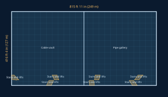
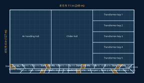
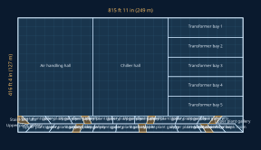

# P5-07 Starboard Approach Utility Plant: plan

Footprint 815 ft 11 in (249 m) × 416 ft 4 in (127 m) · structural grid 32 ft 10 in (10 m)

## Levels

| Level | Floor above deck | Height | Floor area |
|---|---|---|---|
| Level B1 · Pipe and cable basement | −16 ft 5 in (5,000 mm) | 16 ft 5 in (5,000 mm) | 339,709 sq ft (31,560 m²) |
| Level 1 · Plant floor | 0 ft (0 mm) | 26 ft 3 in (8,000 mm) | 332,083 sq ft (30,851 m²) |
| Level 2 · Upper plant deck | 26 ft 3 in (8,000 mm) | 19 ft 8 in (6,000 mm) | 332,083 sq ft (30,851 m²) |

## Elements

| ID | Designation | Type | Name | Level(s) | Size / length | Area | Status |
|---|---|---|---|---|---|---|---|
| E001 | D5F5P5B7A1L1R1, D5F5P5B7A1L2R1 | room | Transformer bay 1 | L1, L2 | 272 ft (83 m) × 71 ft 6 in (22 m) | 19,453 sq ft (1,807 m²) | proposed |
| E002 | D5F5P5B7A1L1R2, D5F5P5B7A1L2R2 | room | Transformer bay 2 | L1, L2 | 272 ft (83 m) × 71 ft 6 in (22 m) | 19,453 sq ft (1,807 m²) | proposed |
| E003 | D5F5P5B7A1L1R3, D5F5P5B7A1L2R3 | room | Transformer bay 3 | L1, L2 | 272 ft (83 m) × 71 ft 2 in (22 m) | 19,364 sq ft (1,799 m²) | proposed |
| E004 | D5F5P5B7A1L1R4, D5F5P5B7A1L2R4 | room | Transformer bay 4 | L1, L2 | 272 ft (83 m) × 71 ft 6 in (22 m) | 19,453 sq ft (1,807 m²) | proposed |
| E005 | D5F5P5B7A1L1R5, D5F5P5B7A1L2R5 | room | Transformer bay 5 | L1, L2 | 272 ft (83 m) × 71 ft 6 in (22 m) | 19,453 sq ft (1,807 m²) | proposed |
| E006 | D5F5P5B7A1L1R6, D5F5P5B7A1L2R6 | room | Chiller hall | L1, L2 | 272 ft (83 m) × 357 ft 3 in (109 m) | 97,175 sq ft (9,028 m²) | proposed |
| E007 | D5F5P5B7A1L1R7, D5F5P5B7A1L2R7 | room | Air handling hall | L1, L2 | 272 ft (83 m) × 357 ft 3 in (109 m) | 97,175 sq ft (9,028 m²) | proposed |
| E008 | D5F5P5B7A1LB1R1, D5F5P5B7A1L1R8, D5F5P5B7A1L2R8 | core | Stairs and lifts | LB1, L1, L2 | 45 ft 11 in (14 m) × 27 ft 11 in (8,500 mm) | 732 sq ft (68 m²) | proposed |
| E009 | D5F5P5B7A1LB1R2, D5F5P5B7A1L1R9, D5F5P5B7A1L2R9 | core | Stairs and lifts | LB1, L1, L2 | 29 ft 6 in (9,000 mm) × 27 ft 11 in (8,500 mm) | 732 sq ft (68 m²) | proposed |
| E010 | D5F5P5B7A1LB1R3, D5F5P5B7A1L1R10, D5F5P5B7A1L2R10 | core | Stairs and lifts | LB1, L1, L2 | 40 ft (12 m) × 27 ft 11 in (8,500 mm) | 737 sq ft (68 m²) | proposed |
| E011 | D5F5P5B7A1LB1R4, D5F5P5B7A1L1R11, D5F5P5B7A1L2R11 | core | Stairs and lifts | LB1, L1, L2 | 40 ft 8 in (12 m) × 29 ft 2 in (8,900 mm) | 732 sq ft (68 m²) | proposed |
| E012 | D5F5P5B7A1LB1R5, D5F5P5B7A1L1R12, D5F5P5B7A1L2R12 | core | Stairs and lifts | LB1, L1, L2 | 37 ft 9 in (12 m) × 27 ft 11 in (8,500 mm) | 732 sq ft (68 m²) | proposed |
| E013 | D5F5P5B7A1LB1R6, D5F5P5B7A1L1R13, D5F5P5B7A1L2R13 | core | Stairs and lifts | LB1, L1, L2 | 31 ft 10 in (9,700 mm) × 27 ft 11 in (8,500 mm) | 737 sq ft (68 m²) | proposed |
| E014 | D5F5P5B7A1LB1R7, D5F5P5B7A1L1R14, D5F5P5B7A1L2R14 | core | Stairs and lifts | LB1, L1, L2 | 48 ft 3 in (15 m) × 27 ft 11 in (8,500 mm) | 732 sq ft (68 m²) | proposed |
| E015 | D5F5P5B7A1L1R15 | room | Control room | L1 | 72 ft 6 in (22 m) × 27 ft 11 in (8,500 mm) | 1,285 sq ft (119 m²) | proposed |
| E016 | D5F5P5B7A1L1R16 | room | Switch room | L1 | 80 ft 9 in (25 m) × 27 ft 11 in (8,500 mm) | 1,615 sq ft (150 m²) | proposed |
| E017 | D5F5P5B7A1L1R17 | room | Battery room | L1 | 78 ft 1 in (24 m) × 27 ft 11 in (8,500 mm) | 1,715 sq ft (159 m²) | proposed |
| E018 | D5F5P5B7A1L1R18 | room | Water pump room | L1 | 88 ft 3 in (27 m) × 27 ft 11 in (8,500 mm) | 2,136 sq ft (198 m²) | proposed |
| E019 | D5F5P5B7A1L1R19 | room | Water treatment room | L1 | 76 ft 1 in (23 m) × 27 ft 11 in (8,500 mm) | 1,940 sq ft (180 m²) | proposed |
| E020 | D5F5P5B7A1L1R20 | room | Workshop | L1 | 55 ft 9 in (17 m) × 27 ft 11 in (8,500 mm) | 1,500 sq ft (139 m²) | proposed |
| E021 | D5F5P5B7A1L1R21 | room | Locker room | L1 | 37 ft 5 in (11 m) × 27 ft 11 in (8,500 mm) | 961 sq ft (89 m²) | proposed |
| E022 | D5F5P5B7A1L1R22 | room | Staff toilets and showers | L1 | 32 ft 2 in (9,800 mm) × 27 ft 11 in (8,500 mm) | 750 sq ft (70 m²) | proposed |
| E023 | D5F5P5B7A1L1R23 | room | Spares store | L1 | 71 ft 6 in (22 m) × 27 ft 11 in (8,500 mm) | 1,761 sq ft (164 m²) | proposed |
| E024 | D5F5P5B7A1L1R24 | room | Spares store | L1 | 41 ft (12 m) × 27 ft 11 in (8,500 mm) | 819 sq ft (76 m²) | proposed |
| E025 | D5F5P5B7A1L1R25 | room | Spares store | L1 | 79 ft 9 in (24 m) × 27 ft 11 in (8,500 mm) | 1,757 sq ft (163 m²) | proposed |
| E026 | D5F5P5B7A1L1R26 | room | Spares store | L1 | 84 ft 4 in (26 m) × 27 ft 11 in (8,500 mm) | 1,757 sq ft (163 m²) | proposed |
| E027 | D5F5P5B7A1L1R27 | room | Spares store | L1 | 89 ft 7 in (27 m) × 34 ft 1 in (10 m) | 2,283 sq ft (212 m²) | proposed |
| E028 | D5F5P5B7A1L1R28 | room | Spares store | L1 | 87 ft 11 in (27 m) × 27 ft 11 in (8,500 mm) | 1,757 sq ft (163 m²) | proposed |
| E029 | D5F5P5B7A1L1R29 | room | Spares store | L1 | 83 ft 8 in (26 m) × 27 ft 11 in (8,500 mm) | 1,761 sq ft (164 m²) | proposed |
| E030 | D5F5P5B7A1L1R30 | room | Spares store | L1 | 97 ft 1 in (30 m) × 27 ft 11 in (8,500 mm) | 2,278 sq ft (212 m²) | proposed |
| E031 | D5F5P5B7A1L1R31 | room | Spares store | L1 | 71 ft 2 in (22 m) × 27 ft 11 in (8,500 mm) | 1,757 sq ft (163 m²) | proposed |
| E032 | D5F5P5B7A1L1R32 | room | Spares store | L1 | 66 ft 7 in (20 m) × 27 ft 11 in (8,500 mm) | 1,757 sq ft (163 m²) | proposed |
| E033 | D5F5P5B7A1L1R33 | room | Spares store | L1 | 84 ft 8 in (26 m) × 27 ft 11 in (8,500 mm) | 2,278 sq ft (212 m²) | proposed |
| E034 | D5F5P5B7A1L1R34 | room | Spares store | L1 | 71 ft 6 in (22 m) × 27 ft 11 in (8,500 mm) | 1,757 sq ft (163 m²) | proposed |
| E035 | D5F5P5B7A1L1R35 | room | Spares store | L1 | 75 ft 9 in (23 m) × 27 ft 11 in (8,500 mm) | 1,752 sq ft (163 m²) | proposed |
| E036 | D5F5P5B7A1L1R36 | room | Spares store | L1 | 99 ft 9 in (30 m) × 27 ft 11 in (8,500 mm) | 2,278 sq ft (212 m²) | proposed |
| E037 | D5F5P5B7A1L1R37 | room | Spares store | L1 | 88 ft 3 in (27 m) × 27 ft 11 in (8,500 mm) | 1,761 sq ft (164 m²) | proposed |
| E038 | D5F5P5B7A1L1R38 | room | Spares store | L1 | 37 ft 5 in (11 m) × 59 ft 1 in (18 m) | 1,144 sq ft (106 m²) | proposed |
| E039 | D5F5P5B7A1L2R15 | room | Filter bank room | L2 | 87 ft 3 in (27 m) × 27 ft 11 in (8,500 mm) | 1,715 sq ft (159 m²) | proposed |
| E040 | D5F5P5B7A1L2R16 | room | Ductwork gallery | L2 | 64 ft 8 in (20 m) × 27 ft 11 in (8,500 mm) | 1,185 sq ft (110 m²) | proposed |
| E041 | D5F5P5B7A1L2R17 | room | Crew rest room | L2 | 33 ft 6 in (10 m) × 27 ft 11 in (8,500 mm) | 425 sq ft (40 m²) | proposed |
| E042 | D5F5P5B7A1L2R18 | room | Upper plant gallery | L2 | 96 ft 2 in (29 m) × 27 ft 11 in (8,500 mm) | 2,269 sq ft (211 m²) | proposed |
| E043 | D5F5P5B7A1L2R19 | room | Upper plant gallery | L2 | 119 ft 1 in (36 m) × 27 ft 11 in (8,500 mm) | 3,097 sq ft (288 m²) | proposed |
| E044 | D5F5P5B7A1L2R20 | room | Upper plant gallery | L2 | 84 ft 4 in (26 m) × 27 ft 11 in (8,500 mm) | 2,269 sq ft (211 m²) | proposed |
| E045 | D5F5P5B7A1L2R21 | room | Upper plant gallery | L2 | 87 ft 7 in (27 m) × 27 ft 11 in (8,500 mm) | 2,264 sq ft (210 m²) | proposed |
| E046 | D5F5P5B7A1L2R22 | room | Upper plant gallery | L2 | 56 ft 1 in (17 m) × 27 ft 11 in (8,500 mm) | 1,258 sq ft (117 m²) | proposed |
| E047 | D5F5P5B7A1L2R23 | room | Upper plant gallery | L2 | 98 ft 5 in (30 m) × 27 ft 11 in (8,500 mm) | 2,260 sq ft (210 m²) | proposed |
| E048 | D5F5P5B7A1L2R24 | room | Upper plant gallery | L2 | 104 ft 8 in (32 m) × 27 ft 11 in (8,500 mm) | 2,269 sq ft (211 m²) | proposed |
| E049 | D5F5P5B7A1L2R25 | room | Upper plant gallery | L2 | 54 ft 6 in (17 m) × 34 ft 1 in (10 m) | 1,267 sq ft (118 m²) | proposed |
| E050 | D5F5P5B7A1L2R26 | room | Upper plant gallery | L2 | 105 ft 8 in (32 m) × 27 ft 11 in (8,500 mm) | 2,269 sq ft (211 m²) | proposed |
| E051 | D5F5P5B7A1L2R27 | room | Upper plant gallery | L2 | 99 ft 9 in (30 m) × 27 ft 11 in (8,500 mm) | 2,269 sq ft (211 m²) | proposed |
| E052 | D5F5P5B7A1L2R28 | room | Upper plant gallery | L2 | 59 ft 1 in (18 m) × 27 ft 11 in (8,500 mm) | 1,258 sq ft (117 m²) | proposed |
| E053 | D5F5P5B7A1L2R29 | room | Upper plant gallery | L2 | 88 ft 11 in (27 m) × 27 ft 11 in (8,500 mm) | 2,269 sq ft (211 m²) | proposed |
| E054 | D5F5P5B7A1L2R30 | room | Upper plant gallery | L2 | 84 ft (26 m) × 27 ft 11 in (8,500 mm) | 2,264 sq ft (210 m²) | proposed |
| E055 | D5F5P5B7A1L2R31 | room | Upper plant gallery | L2 | 47 ft 11 in (15 m) × 27 ft 11 in (8,500 mm) | 1,258 sq ft (117 m²) | proposed |
| E056 | D5F5P5B7A1L2R32 | room | Upper plant gallery | L2 | 90 ft 3 in (28 m) × 27 ft 11 in (8,500 mm) | 2,264 sq ft (210 m²) | proposed |
| E057 | D5F5P5B7A1L2R33 | room | Upper plant gallery | L2 | 96 ft 2 in (29 m) × 27 ft 11 in (8,500 mm) | 2,269 sq ft (211 m²) | proposed |
| E058 | D5F5P5B7A1L2R34 | room | Upper plant gallery | L2 | 64 ft 4 in (20 m) × 27 ft 11 in (8,500 mm) | 1,253 sq ft (116 m²) | proposed |
| E059 | D5F5P5B7A1L2R35 | room | Upper plant gallery | L2 | 98 ft 5 in (30 m) × 59 ft 1 in (18 m) | 2,905 sq ft (270 m²) | proposed |
| E060 | D5F5P5B7A1LB1R8 | room | Cable vault | LB1 | 407 ft 10 in (124 m) × 416 ft 4 in (127 m) | 169,786 sq ft (15,774 m²) | proposed |
| E061 | D5F5P5B7A1LB1R9 | room | Pipe gallery | LB1 | 408 ft 2 in (124 m) × 416 ft 4 in (127 m) | 169,923 sq ft (15,786 m²) | proposed |

## Drawings

### Level B1 · Pipe and cable basement

### Level 1 · Plant floor

### Level 2 · Upper plant deck

