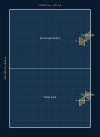
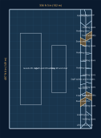
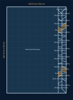

# P5-08 Starboard Approach Service Shaft: plan

Footprint 336 ft 3 in (102 m) × 487 ft 6 in (149 m) · structural grid 32 ft 10 in (10 m)

## Levels

| Level | Floor above deck | Height | Floor area |
|---|---|---|---|
| Level B1 · Service layer landing | −19 ft 8 in (6,000 mm) | 19 ft 8 in (6,000 mm) | 163,951 sq ft (15,232 m²) |
| Level 1 · Lift landing | 0 ft (0 mm) | 29 ft 6 in (9,000 mm) | 160,511 sq ft (14,912 m²) |
| Level 2 · Winding room | 29 ft 6 in (9,000 mm) | 19 ft 8 in (6,000 mm) | 160,511 sq ft (14,912 m²) |

## Elements

| ID | Designation | Type | Name | Level(s) | Size / length | Area | Status |
|---|---|---|---|---|---|---|---|
| E001 | D5F5P5B8A1L1R1, D5F5P5B8A1L2R1 | room | Shaft and lift landing | L1, L2 | 290 ft 4 in (88 m) × 487 ft 6 in (149 m) | 141,557 sq ft (13,151 m²) | proposed |
| E002 |  | fixture | Goods lift cage | L1 | 86 ft 11 in (26 m) × 292 ft 8 in (89 m) | 25,444 sq ft (2,364 m²) | proposed |
| E003 |  | fixture | Crew lift and stair | L1 | 58 ft 1 in (18 m) × 194 ft 11 in (59 m) | 11,317 sq ft (1,051 m²) | proposed |
| E004 | D5F5P5B8A1LB1R1, D5F5P5B8A1L1R2, D5F5P5B8A1L2R2 | core | Stairs and lifts | LB1, L1, L2 | 21 ft 8 in (6,600 mm) × 38 ft 9 in (12 m) | 568 sq ft (53 m²) | proposed |
| E005 | D5F5P5B8A1LB1R2, D5F5P5B8A1L1R3, D5F5P5B8A1L2R3 | core | Stairs and lifts | LB1, L1, L2 | 21 ft 8 in (6,600 mm) × 36 ft 5 in (11 m) | 568 sq ft (53 m²) | proposed |
| E006 | D5F5P5B8A1LB1R3, D5F5P5B8A1L1R4, D5F5P5B8A1L2R4 | core | Stairs and lifts | LB1, L1, L2 | 21 ft 8 in (6,600 mm) × 38 ft 9 in (12 m) | 568 sq ft (53 m²) | proposed |
| E007 | D5F5P5B8A1LB1R4, D5F5P5B8A1L1R5, D5F5P5B8A1L2R5 | core | Stairs and lifts | LB1, L1, L2 | 21 ft 8 in (6,600 mm) × 36 ft 5 in (11 m) | 568 sq ft (53 m²) | proposed |
| E008 | D5F5P5B8A1L1R6 | room | Lift control room | L1 | 45 ft 11 in (14 m) × 22 ft 4 in (6,800 mm) | 540 sq ft (50 m²) | proposed |
| E009 | D5F5P5B8A1L1R7 | room | Loading bay | L1 | 21 ft 8 in (6,600 mm) × 102 ft 4 in (31 m) | 1,833 sq ft (170 m²) | proposed |
| E010 | D5F5P5B8A1L1R8 | room | Crew check-in | L1 | 21 ft 8 in (6,600 mm) × 30 ft 2 in (9,200 mm) | 430 sq ft (40 m²) | proposed |
| E011 | D5F5P5B8A1L1R9 | room | Tool store | L1 | 21 ft 8 in (6,600 mm) × 46 ft 11 in (14 m) | 853 sq ft (79 m²) | proposed |
| E012 | D5F5P5B8A1L1R10 | room | Staff toilets and showers | L1 | 21 ft 8 in (6,600 mm) × 38 ft 9 in (12 m) | 749 sq ft (70 m²) | proposed |
| E013 | D5F5P5B8A1L1R11 | room | Holding store | L1 | 21 ft 8 in (6,600 mm) × 62 ft (19 m) | 1,282 sq ft (119 m²) | proposed |
| E014 | D5F5P5B8A1L1R12 | room | Holding store | L1 | 21 ft 8 in (6,600 mm) × 71 ft 6 in (22 m) | 1,421 sq ft (132 m²) | proposed |
| E015 | D5F5P5B8A1L1R13 | room | Holding store | L1 | 21 ft 8 in (6,600 mm) × 73 ft 6 in (22 m) | 1,282 sq ft (119 m²) | proposed |
| E016 | D5F5P5B8A1L1R14 | room | Holding store | L1 | 22 ft 8 in (6,900 mm) × 69 ft 7 in (21 m) | 1,286 sq ft (119 m²) | proposed |
| E017 | D5F5P5B8A1L1R15 | room | Holding store | L1 | 28 ft 7 in (8,700 mm) × 64 ft (20 m) | 1,286 sq ft (119 m²) | proposed |
| E018 | D5F5P5B8A1L1R16 | room | Holding store | L1 | 21 ft 8 in (6,600 mm) × 56 ft 9 in (17 m) | 888 sq ft (82 m²) | proposed |
| E019 | D5F5P5B8A1L1R17 | room | Holding store | L1 | 21 ft 8 in (6,600 mm) × 67 ft 7 in (21 m) | 1,282 sq ft (119 m²) | proposed |
| E020 | D5F5P5B8A1L1R18 | room | Holding store | L1 | 21 ft 8 in (6,600 mm) × 62 ft 4 in (19 m) | 1,286 sq ft (119 m²) | proposed |
| E021 | D5F5P5B8A1L1R19 | room | Holding store | L1 | 21 ft 8 in (6,600 mm) × 62 ft (19 m) | 1,282 sq ft (119 m²) | proposed |
| E022 | D5F5P5B8A1L1R20 | room | Holding store | L1 | 21 ft 8 in (6,600 mm) × 47 ft 11 in (15 m) | 884 sq ft (82 m²) | proposed |
| E023 | D5F5P5B8A1L1R21 | room | Holding store | L1 | 21 ft 8 in (6,600 mm) × 73 ft 6 in (22 m) | 1,282 sq ft (119 m²) | proposed |
| E024 | D5F5P5B8A1L1R22 | room | Holding store | L1 | 21 ft 8 in (6,600 mm) × 69 ft 7 in (21 m) | 1,087 sq ft (101 m²) | proposed |
| E025 | D5F5P5B8A1L2R6 | room | Winding machinery | L2 | 45 ft 11 in (14 m) × 69 ft 7 in (21 m) | 1,609 sq ft (149 m²) | proposed |
| E026 | D5F5P5B8A1L2R7 | room | Shaft ventilation fans | L2 | 21 ft 8 in (6,600 mm) × 50 ft 10 in (15 m) | 764 sq ft (71 m²) | proposed |
| E027 | D5F5P5B8A1L2R8 | room | Machine gallery | L2 | 21 ft 8 in (6,600 mm) × 55 ft 5 in (17 m) | 1,002 sq ft (93 m²) | proposed |
| E028 | D5F5P5B8A1L2R9 | room | Machine gallery | L2 | 21 ft 8 in (6,600 mm) × 51 ft 6 in (16 m) | 1,005 sq ft (93 m²) | proposed |
| E029 | D5F5P5B8A1L2R10 | room | Machine gallery | L2 | 21 ft 8 in (6,600 mm) × 48 ft 7 in (15 m) | 1,002 sq ft (93 m²) | proposed |
| E030 | D5F5P5B8A1L2R11 | room | Machine gallery | L2 | 21 ft 8 in (6,600 mm) × 50 ft 2 in (15 m) | 1,005 sq ft (93 m²) | proposed |
| E031 | D5F5P5B8A1L2R12 | room | Machine gallery | L2 | 21 ft 8 in (6,600 mm) × 40 ft 8 in (12 m) | 721 sq ft (67 m²) | proposed |
| E032 | D5F5P5B8A1L2R13 | room | Machine gallery | L2 | 21 ft 8 in (6,600 mm) × 60 ft (18 m) | 1,005 sq ft (93 m²) | proposed |
| E033 | D5F5P5B8A1L2R14 | room | Machine gallery | L2 | 21 ft 8 in (6,600 mm) × 64 ft 4 in (20 m) | 1,002 sq ft (93 m²) | proposed |
| E034 | D5F5P5B8A1L2R15 | room | Machine gallery | L2 | 45 ft 11 in (14 m) × 37 ft 9 in (12 m) | 1,012 sq ft (94 m²) | proposed |
| E035 | D5F5P5B8A1L2R16 | room | Machine gallery | L2 | 21 ft 8 in (6,600 mm) × 65 ft 3 in (20 m) | 1,002 sq ft (93 m²) | proposed |
| E036 | D5F5P5B8A1L2R17 | room | Machine gallery | L2 | 21 ft 8 in (6,600 mm) × 48 ft 7 in (15 m) | 721 sq ft (67 m²) | proposed |
| E037 | D5F5P5B8A1L2R18 | room | Machine gallery | L2 | 21 ft 8 in (6,600 mm) × 55 ft 5 in (17 m) | 1,002 sq ft (93 m²) | proposed |
| E038 | D5F5P5B8A1L2R19 | room | Machine gallery | L2 | 21 ft 8 in (6,600 mm) × 51 ft 6 in (16 m) | 1,005 sq ft (93 m²) | proposed |
| E039 | D5F5P5B8A1L2R20 | room | Machine gallery | L2 | 21 ft 8 in (6,600 mm) × 48 ft 7 in (15 m) | 1,002 sq ft (93 m²) | proposed |
| E040 | D5F5P5B8A1L2R21 | room | Machine gallery | L2 | 21 ft 8 in (6,600 mm) × 50 ft 2 in (15 m) | 1,005 sq ft (93 m²) | proposed |
| E041 | D5F5P5B8A1L2R22 | room | Machine gallery | L2 | 21 ft 8 in (6,600 mm) × 40 ft 8 in (12 m) | 721 sq ft (67 m²) | proposed |
| E042 | D5F5P5B8A1L2R23 | room | Machine gallery | L2 | 21 ft 8 in (6,600 mm) × 60 ft (18 m) | 1,005 sq ft (93 m²) | proposed |
| E043 | D5F5P5B8A1L2R24 | room | Machine gallery | L2 | 21 ft 8 in (6,600 mm) × 81 ft 8 in (25 m) | 1,364 sq ft (127 m²) | proposed |
| E044 | D5F5P5B8A1LB1R5 | room | Service layer landing | LB1 | 336 ft 3 in (102 m) × 243 ft 9 in (74 m) | 81,975 sq ft (7,616 m²) | proposed |
| E045 | D5F5P5B8A1LB1R6 | room | Tunnel portal | LB1 | 336 ft 3 in (102 m) × 243 ft 9 in (74 m) | 81,975 sq ft (7,616 m²) | proposed |

## Drawings

### Level B1 · Service layer landing

### Level 1 · Lift landing

### Level 2 · Winding room

