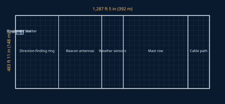

# P5-12 Antenna Field 4: plan

Footprint 1,287 ft 5 in (392 m) × 483 ft 11 in (148 m) · structural grid 32 ft 10 in (10 m)

## Levels

| Level | Floor above deck | Height | Floor area |
|---|---|---|---|
| Level 1 · Field | 0 ft (0 mm) | 13 ft 1 in (4,000 mm) | 1,206 sq ft (112 m²) |

## Elements

| ID | Designation | Type | Name | Level(s) | Size / length | Area | Status |
|---|---|---|---|---|---|---|---|
| E001 | D5F5P5B6A2R1 | zone | Direction-finding ring | L1 | 286 ft 1 in (87 m) × 483 ft 11 in (148 m) | 138,445 sq ft (12,862 m²) | proposed |
| E002 | D5F5P5B6A2R2 | room | Equipment hut | L1 | 30 ft 6 in (9,300 mm) × 26 ft 3 in (8,000 mm) | 801 sq ft (74 m²) | proposed |
| E003 | D5F5P5B6A2R3 | room | Engineers' shelter | L1 | 15 ft 5 in (4,700 mm) × 26 ft 3 in (8,000 mm) | 405 sq ft (38 m²) | proposed |
| E004 | D5F5P5B6A2R4 | zone | Beacon antennas | L1 | 286 ft 1 in (87 m) × 483 ft 11 in (148 m) | 138,445 sq ft (12,862 m²) | proposed |
| E005 | D5F5P5B6A2R5 | zone | Weather sensors | L1 | 143 ft 1 in (44 m) × 483 ft 11 in (148 m) | 69,223 sq ft (6,431 m²) | proposed |
| E006 | D5F5P5B6A2R6 | zone | Mast row | L1 | 429 ft 2 in (131 m) × 483 ft 11 in (148 m) | 207,668 sq ft (19,293 m²) | proposed |
| E007 | D5F5P5B6A2R7 | zone | Cable path | L1 | 143 ft 1 in (44 m) × 483 ft 11 in (148 m) | 69,223 sq ft (6,431 m²) | proposed |

## Drawings

### Level 1 · Field

