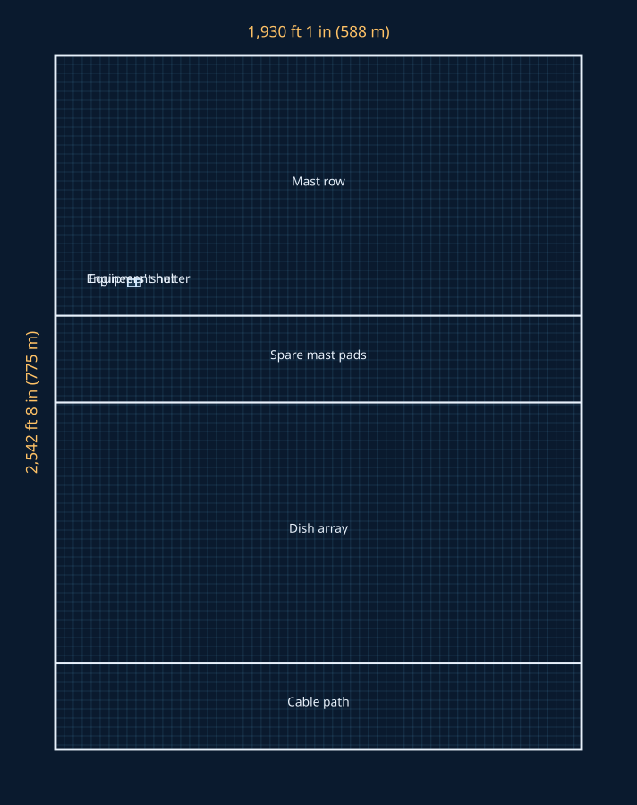

# P5-16 Antenna Field 8: plan

Footprint 1,930 ft 1 in (588 m) × 2,542 ft 8 in (775 m) · structural grid 32 ft 10 in (10 m)

## Levels

| Level | Floor above deck | Height | Floor area |
|---|---|---|---|
| Level 1 · Field | 0 ft (0 mm) | 13 ft 1 in (4,000 mm) | 1,206 sq ft (112 m²) |

## Elements

| ID | Designation | Type | Name | Level(s) | Size / length | Area | Status |
|---|---|---|---|---|---|---|---|
| E001 | D5F5P5B2A3R1 | zone | Mast row | L1 | 1,930 ft 1 in (588 m) × 953 ft 5 in (291 m) | 1,840,198 sq ft (170,960 m²) | proposed |
| E002 | D5F5P5B2A3R2 | room | Equipment hut | L1 | 30 ft 6 in (9,300 mm) × 26 ft 3 in (8,000 mm) | 801 sq ft (74 m²) | proposed |
| E003 | D5F5P5B2A3R3 | room | Engineers' shelter | L1 | 15 ft 5 in (4,700 mm) × 26 ft 3 in (8,000 mm) | 405 sq ft (38 m²) | proposed |
| E004 | D5F5P5B2A3R4 | zone | Spare mast pads | L1 | 1,930 ft 1 in (588 m) × 317 ft 11 in (97 m) | 613,610 sq ft (57,006 m²) | proposed |
| E005 | D5F5P5B2A3R5 | zone | Dish array | L1 | 1,930 ft 1 in (588 m) × 953 ft 5 in (291 m) | 1,840,198 sq ft (170,960 m²) | proposed |
| E006 | D5F5P5B2A3R6 | zone | Cable path | L1 | 1,930 ft 1 in (588 m) × 317 ft 11 in (97 m) | 613,610 sq ft (57,006 m²) | proposed |

## Drawings

### Level 1 · Field

