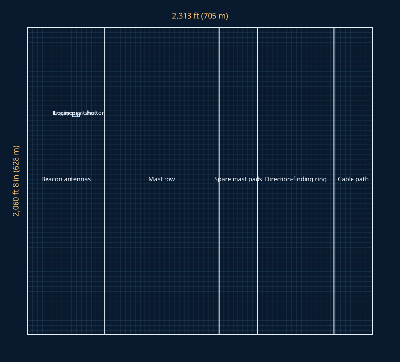

# P5-21 Antenna Field 13: plan

Footprint 2,313 ft (705 m) × 2,060 ft 8 in (628 m) · structural grid 32 ft 10 in (10 m)

## Levels

| Level | Floor above deck | Height | Floor area |
|---|---|---|---|
| Level 1 · Field | 0 ft (0 mm) | 13 ft 1 in (4,000 mm) | 1,206 sq ft (112 m²) |

## Elements

| ID | Designation | Type | Name | Level(s) | Size / length | Area | Status |
|---|---|---|---|---|---|---|---|
| E001 | D5F5P5B7A3R1 | zone | Beacon antennas | L1 | 514 ft 1 in (157 m) × 2,060 ft 8 in (628 m) | 1,059,419 sq ft (98,423 m²) | proposed |
| E002 | D5F5P5B7A3R2 | room | Equipment hut | L1 | 30 ft 10 in (9,400 mm) × 26 ft 3 in (8,000 mm) | 809 sq ft (75 m²) | proposed |
| E003 | D5F5P5B7A3R3 | room | Engineers' shelter | L1 | 15 ft 1 in (4,600 mm) × 26 ft 3 in (8,000 mm) | 396 sq ft (37 m²) | proposed |
| E004 | D5F5P5B7A3R4 | zone | Mast row | L1 | 771 ft (235 m) × 2,060 ft 8 in (628 m) | 1,588,791 sq ft (147,604 m²) | proposed |
| E005 | D5F5P5B7A3R5 | zone | Spare mast pads | L1 | 256 ft 11 in (78 m) × 2,060 ft 8 in (628 m) | 529,372 sq ft (49,180 m²) | proposed |
| E006 | D5F5P5B7A3R6 | zone | Direction-finding ring | L1 | 514 ft 1 in (157 m) × 2,060 ft 8 in (628 m) | 1,059,419 sq ft (98,423 m²) | proposed |
| E007 | D5F5P5B7A3R7 | zone | Cable path | L1 | 256 ft 11 in (78 m) × 2,060 ft 8 in (628 m) | 529,372 sq ft (49,180 m²) | proposed |

## Drawings

### Level 1 · Field

