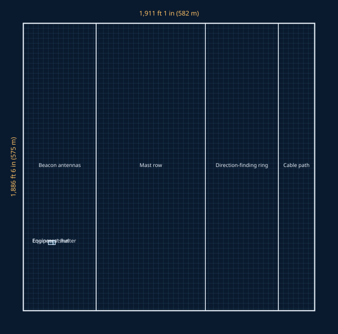

# P5-22 Antenna Field 14: plan

Footprint 1,911 ft 1 in (582 m) × 1,886 ft 6 in (575 m) · structural grid 32 ft 10 in (10 m)

## Levels

| Level | Floor above deck | Height | Floor area |
|---|---|---|---|
| Level 1 · Field | 0 ft (0 mm) | 13 ft 1 in (4,000 mm) | 1,206 sq ft (112 m²) |

## Elements

| ID | Designation | Type | Name | Level(s) | Size / length | Area | Status |
|---|---|---|---|---|---|---|---|
| E001 | D5F5P5B8A3R1 | zone | Beacon antennas | L1 | 477 ft 8 in (146 m) × 1,886 ft 6 in (575 m) | 901,155 sq ft (83,720 m²) | proposed |
| E002 | D5F5P5B8A3R2 | room | Equipment hut | L1 | 30 ft 10 in (9,400 mm) × 26 ft 3 in (8,000 mm) | 809 sq ft (75 m²) | proposed |
| E003 | D5F5P5B8A3R3 | room | Engineers' shelter | L1 | 15 ft 1 in (4,600 mm) × 26 ft 3 in (8,000 mm) | 396 sq ft (37 m²) | proposed |
| E004 | D5F5P5B8A3R4 | zone | Mast row | L1 | 716 ft 10 in (219 m) × 1,886 ft 6 in (575 m) | 1,352,351 sq ft (125,638 m²) | proposed |
| E005 | D5F5P5B8A3R5 | zone | Direction-finding ring | L1 | 477 ft 8 in (146 m) × 1,886 ft 6 in (575 m) | 901,155 sq ft (83,720 m²) | proposed |
| E006 | D5F5P5B8A3R6 | zone | Cable path | L1 | 238 ft 10 in (73 m) × 1,886 ft 6 in (575 m) | 450,577 sq ft (41,860 m²) | proposed |

## Drawings

### Level 1 · Field

