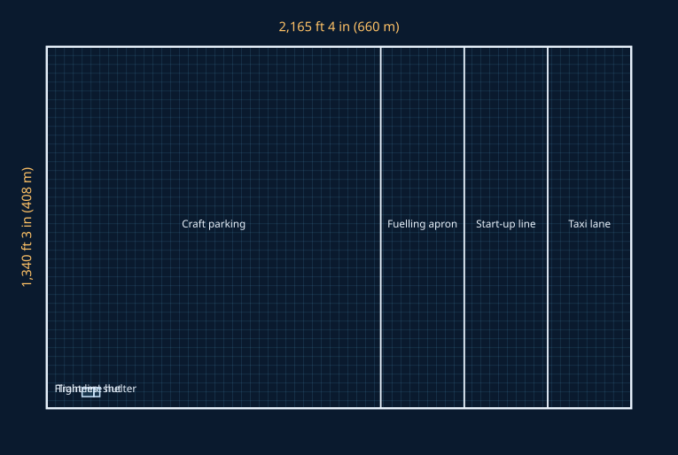

# P1-03 Training Flight Line: plan

Footprint 2,165 ft 4 in (660 m) × 1,340 ft 3 in (408 m) · structural grid 32 ft 10 in (10 m)

## Levels

| Level | Floor above deck | Height | Floor area |
|---|---|---|---|
| Level 1 · Line | 0 ft (0 mm) | 13 ft 1 in (4,000 mm) | 2,153 sq ft (200 m²) |

## Elements

| ID | Designation | Type | Name | Level(s) | Size / length | Area | Status |
|---|---|---|---|---|---|---|---|
| E001 | D5F6P1B5A1R1 | zone | Craft parking | L1 | 1,237 ft 2 in (377 m) × 1,340 ft 3 in (408 m) | 1,658,130 sq ft (154,045 m²) | proposed |
| E002 | D5F6P1B5A1R2 | room | Flight line hut | L1 | 43 ft 8 in (13 m) × 32 ft 10 in (10 m) | 1,432 sq ft (133 m²) | proposed |
| E003 | D5F6P1B5A1R3 | room | Trainees' shelter | L1 | 22 ft (6,700 mm) × 32 ft 10 in (10 m) | 721 sq ft (67 m²) | proposed |
| E004 | D5F6P1B5A1R4 | zone | Fuelling apron | L1 | 309 ft 5 in (94 m) × 1,340 ft 3 in (408 m) | 414,643 sq ft (38,522 m²) | proposed |
| E005 | D5F6P1B5A1R5 | zone | Start-up line | L1 | 309 ft 5 in (94 m) × 1,340 ft 3 in (408 m) | 414,643 sq ft (38,522 m²) | proposed |
| E006 | D5F6P1B5A1R6 | zone | Taxi lane | L1 | 309 ft 5 in (94 m) × 1,340 ft 3 in (408 m) | 414,643 sq ft (38,522 m²) | proposed |

## Drawings

### Level 1 · Line

