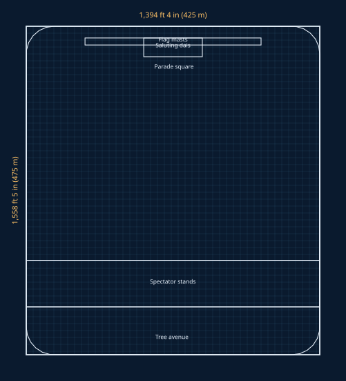

# P1-07 Cadet Parade Ground: plan

Footprint 1,394 ft 4 in (425 m) × 1,558 ft 5 in (475 m) · structural grid 32 ft 10 in (10 m)

## Levels

| Level | Floor above deck | Height | Floor area |
|---|---|---|---|
| Level 1 · Ground | 0 ft (0 mm) | 13 ft 1 in (4,000 mm) | — |

## Elements

| ID | Designation | Type | Name | Level(s) | Size / length | Area | Status |
|---|---|---|---|---|---|---|---|
| E001 | D5F6P1B8A1R1 | zone | Parade square | L1 | 1,394 ft (425 m) × 1,110 ft 7 in (338 m) | 1,538,771 sq ft (142,957 m²) | proposed |
| E002 |  | fixture | Saluting dais | L1 | 278 ft 7 in (85 m) × 88 ft 11 in (27 m) | 24,765 sq ft (2,301 m²) | proposed |
| E003 |  | fixture | Flag masts | L1 | 836 ft 3 in (255 m) × 33 ft 6 in (10 m) | 27,986 sq ft (2,600 m²) | proposed |
| E004 | D5F6P1B8A1R2 | zone | Spectator stands | L1 | 1,393 ft 4 in (425 m) × 220 ft 10 in (67 m) | 307,585 sq ft (28,576 m²) | proposed |
| E005 | D5F6P1B8A1R3 | zone | Tree avenue | L1 | 1,393 ft 1 in (425 m) × 227 ft (69 m) | 307,965 sq ft (28,611 m²) | proposed |

## Drawings

### Level 1 · Ground

