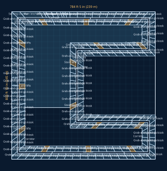

# P1-13 School Canteen: plan

Footprint 784 ft 5 in (239 m) × 803 ft 10 in (245 m) · structural grid 32 ft 10 in (10 m)

## Levels

| Level | Floor above deck | Height | Floor area |
|---|---|---|---|
| Level 1 · Dining floor | 0 ft (0 mm) | 17 ft 9 in (5,400 mm) | 366,046 sq ft (34,007 m²) |

## Elements

| ID | Designation | Type | Name | Level(s) | Size / length | Area | Status |
|---|---|---|---|---|---|---|---|
| E001 | D5F6P1B15A1R1 | room | Dining hall | L1 | 640 ft 1 in (195 m) × 450 ft 6 in (137 m) | 149,558 sq ft (13,894 m²) | proposed |
| E002 | D5F6P1B15A1R2 | zone | Terrace court | L1 | 640 ft 1 in (195 m) × 209 ft (64 m) | 89,745 sq ft (8,338 m²) | proposed |
| E003 | D5F6P1B15A1R3 | zone | Corridor | L1 | 399 ft 3 in (122 m) × 9 ft 10 in (3,000 mm) | 3,875 sq ft (360 m²) | proposed |
| E004 | D5F6P1B15A1R4 | zone | Corridor | L1 | 324 ft 2 in (99 m) × 80 ft 9 in (25 m) | 3,875 sq ft (360 m²) | proposed |
| E005 | D5F6P1B15A1R5 | zone | Corridor | L1 | 309 ft 9 in (94 m) × 99 ft 5 in (30 m) | 3,875 sq ft (360 m²) | proposed |
| E006 | D5F6P1B15A1R6 | zone | Corridor | L1 | 102 ft 4 in (31 m) × 308 ft 9 in (94 m) | 3,875 sq ft (360 m²) | proposed |
| E007 | D5F6P1B15A1R7 | zone | Corridor | L1 | 311 ft (95 m) × 100 ft 1 in (30 m) | 3,875 sq ft (360 m²) | proposed |
| E008 | D5F6P1B15A1R8 | zone | Corridor | L1 | 141 ft 5 in (43 m) × 178 ft 10 in (54 m) | 3,875 sq ft (360 m²) | proposed |
| E009 | D5F6P1B15A1R9 | zone | Corridor | L1 | 398 ft 11 in (122 m) × 9 ft 10 in (3,000 mm) | 3,875 sq ft (360 m²) | proposed |
| E010 | D5F6P1B15A1R10 | zone | Corridor | L1 | 192 ft 3 in (59 m) × 215 ft 7 in (66 m) | 3,875 sq ft (360 m²) | proposed |
| E011 | D5F6P1B15A1R11 | zone | Corridor | L1 | 9 ft 10 in (3,000 mm) × 398 ft 11 in (122 m) | 3,875 sq ft (360 m²) | proposed |
| E012 | D5F6P1B15A1R12 | zone | Corridor | L1 | 9 ft 10 in (3,000 mm) × 137 ft 6 in (42 m) | 1,272 sq ft (118 m²) | proposed |
| E013 | D5F6P1B15A1R13 | core | Stairs and lifts | L1 | 46 ft 7 in (14 m) × 31 ft 2 in (9,500 mm) | 818 sq ft (76 m²) | proposed |
| E014 | D5F6P1B15A1R14 | core | Stairs and lifts | L1 | 27 ft 7 in (8,400 mm) × 31 ft 2 in (9,500 mm) | 818 sq ft (76 m²) | proposed |
| E015 | D5F6P1B15A1R15 | core | Stairs and lifts | L1 | 49 ft 6 in (15 m) × 31 ft 2 in (9,500 mm) | 823 sq ft (76 m²) | proposed |
| E016 | D5F6P1B15A1R16 | core | Stairs and lifts | L1 | 57 ft 5 in (18 m) × 31 ft 2 in (9,500 mm) | 818 sq ft (76 m²) | proposed |
| E017 | D5F6P1B15A1R17 | core | Stairs and lifts | L1 | 57 ft 5 in (18 m) × 31 ft 2 in (9,500 mm) | 818 sq ft (76 m²) | proposed |
| E018 | D5F6P1B15A1R18 | core | Stairs and lifts | L1 | 31 ft 2 in (9,500 mm) × 44 ft (13 m) | 823 sq ft (76 m²) | proposed |
| E019 | D5F6P1B15A1R19 | core | Stairs and lifts | L1 | 31 ft 2 in (9,500 mm) × 42 ft 4 in (13 m) | 818 sq ft (76 m²) | proposed |
| E020 | D5F6P1B15A1R20 | core | Stairs and lifts | L1 | 57 ft 5 in (18 m) × 31 ft 2 in (9,500 mm) | 818 sq ft (76 m²) | proposed |
| E021 | D5F6P1B15A1R21 | core | Stairs and lifts | L1 | 57 ft 5 in (18 m) × 31 ft 2 in (9,500 mm) | 818 sq ft (76 m²) | proposed |
| E022 | D5F6P1B15A1R22 | core | Stairs and lifts | L1 | 50 ft 2 in (15 m) × 31 ft 2 in (9,500 mm) | 813 sq ft (76 m²) | proposed |
| E023 | D5F6P1B15A1R23 | core | Stairs and lifts | L1 | 28 ft 7 in (8,700 mm) × 31 ft 2 in (9,500 mm) | 813 sq ft (76 m²) | proposed |
| E024 | D5F6P1B15A1R24 | core | Stairs and lifts | L1 | 45 ft 3 in (14 m) × 31 ft 2 in (9,500 mm) | 813 sq ft (76 m²) | proposed |
| E025 | D5F6P1B15A1R25 | core | Stairs and lifts | L1 | 31 ft 2 in (9,500 mm) × 47 ft 11 in (15 m) | 818 sq ft (76 m²) | proposed |
| E026 | D5F6P1B15A1R26 | core | Stairs and lifts | L1 | 31 ft 2 in (9,500 mm) × 27 ft 3 in (8,300 mm) | 813 sq ft (76 m²) | proposed |
| E027 | D5F6P1B15A1R27 | core | Stairs and lifts | L1 | 31 ft 2 in (9,500 mm) × 46 ft 11 in (14 m) | 818 sq ft (76 m²) | proposed |
| E028 | D5F6P1B15A1R28 | room | Serving counter | L1 | 70 ft 10 in (22 m) × 31 ft 2 in (9,500 mm) | 1,294 sq ft (120 m²) | proposed |
| E029 | D5F6P1B15A1R29 | room | Main kitchen | L1 | 127 ft (39 m) × 31 ft 2 in (9,500 mm) | 3,226 sq ft (300 m²) | proposed |
| E030 | D5F6P1B15A1R30 | room | Cold room | L1 | 39 ft 1 in (12 m) × 31 ft 2 in (9,500 mm) | 644 sq ft (60 m²) | proposed |
| E031 | D5F6P1B15A1R31 | room | Freezer room | L1 | 30 ft 10 in (9,400 mm) × 31 ft 2 in (9,500 mm) | 435 sq ft (40 m²) | proposed |
| E032 | D5F6P1B15A1R32 | room | Dry store | L1 | 42 ft 8 in (13 m) × 31 ft 2 in (9,500 mm) | 859 sq ft (80 m²) | proposed |
| E033 | D5F6P1B15A1R33 | room | Dishwash room | L1 | 40 ft 4 in (12 m) × 31 ft 2 in (9,500 mm) | 859 sq ft (80 m²) | proposed |
| E034 | D5F6P1B15A1R34 | room | Goods-in bay | L1 | 31 ft 10 in (9,700 mm) × 31 ft 2 in (9,500 mm) | 649 sq ft (60 m²) | proposed |
| E035 | D5F6P1B15A1R35 | room | Waste and recycling room | L1 | 20 ft 8 in (6,300 mm) × 31 ft 2 in (9,500 mm) | 343 sq ft (32 m²) | proposed |
| E036 | D5F6P1B15A1R36 | room | Training meals counter | L1 | 22 ft 4 in (6,800 mm) × 31 ft 2 in (9,500 mm) | 429 sq ft (40 m²) | proposed |
| E037 | D5F6P1B15A1R37 | room | Toilets | L1 | 27 ft 7 in (8,400 mm) × 31 ft 2 in (9,500 mm) | 639 sq ft (59 m²) | proposed |
| E038 | D5F6P1B15A1R38 | room | Grab-and-go kiosk | L1 | 46 ft 3 in (14 m) × 31 ft 2 in (9,500 mm) | 1,299 sq ft (121 m²) | proposed |
| E039 | D5F6P1B15A1R39 | room | Grab-and-go kiosk | L1 | 43 ft 4 in (13 m) × 31 ft 2 in (9,500 mm) | 1,294 sq ft (120 m²) | proposed |
| E040 | D5F6P1B15A1R40 | room | Grab-and-go kiosk | L1 | 43 ft 8 in (13 m) × 31 ft 2 in (9,500 mm) | 1,288 sq ft (120 m²) | proposed |
| E041 | D5F6P1B15A1R41 | room | Grab-and-go kiosk | L1 | 47 ft 3 in (14 m) × 31 ft 2 in (9,500 mm) | 1,294 sq ft (120 m²) | proposed |
| E042 | D5F6P1B15A1R42 | room | Grab-and-go kiosk | L1 | 50 ft 6 in (15 m) × 31 ft 2 in (9,500 mm) | 1,288 sq ft (120 m²) | proposed |
| E043 | D5F6P1B15A1R43 | room | Grab-and-go kiosk | L1 | 54 ft 2 in (16 m) × 31 ft 2 in (9,500 mm) | 1,294 sq ft (120 m²) | proposed |
| E044 | D5F6P1B15A1R44 | room | Grab-and-go kiosk | L1 | 57 ft 5 in (18 m) × 31 ft 2 in (9,500 mm) | 1,288 sq ft (120 m²) | proposed |
| E045 | D5F6P1B15A1R45 | room | Grab-and-go kiosk | L1 | 61 ft (19 m) × 31 ft 2 in (9,500 mm) | 1,294 sq ft (120 m²) | proposed |
| E046 | D5F6P1B15A1R46 | room | Grab-and-go kiosk | L1 | 64 ft 4 in (20 m) × 31 ft 2 in (9,500 mm) | 1,288 sq ft (120 m²) | proposed |
| E047 | D5F6P1B15A1R47 | room | Grab-and-go kiosk | L1 | 67 ft 11 in (21 m) × 31 ft 2 in (9,500 mm) | 1,294 sq ft (120 m²) | proposed |
| E048 | D5F6P1B15A1R48 | room | Grab-and-go kiosk | L1 | 67 ft 7 in (21 m) × 34 ft 1 in (10 m) | 1,294 sq ft (120 m²) | proposed |
| E049 | D5F6P1B15A1R49 | room | Grab-and-go kiosk | L1 | 31 ft 2 in (9,500 mm) × 65 ft 3 in (20 m) | 1,294 sq ft (120 m²) | proposed |
| E050 | D5F6P1B15A1R50 | room | Grab-and-go kiosk | L1 | 31 ft 2 in (9,500 mm) × 52 ft 10 in (16 m) | 1,288 sq ft (120 m²) | proposed |
| E051 | D5F6P1B15A1R51 | room | Grab-and-go kiosk | L1 | 31 ft 2 in (9,500 mm) × 47 ft 7 in (14 m) | 1,294 sq ft (120 m²) | proposed |
| E052 | D5F6P1B15A1R52 | room | Grab-and-go kiosk | L1 | 31 ft 2 in (9,500 mm) × 54 ft 6 in (17 m) | 1,294 sq ft (120 m²) | proposed |
| E053 | D5F6P1B15A1R53 | room | Grab-and-go kiosk | L1 | 32 ft 2 in (9,800 mm) × 65 ft 7 in (20 m) | 1,294 sq ft (120 m²) | proposed |
| E054 | D5F6P1B15A1R54 | room | Grab-and-go kiosk | L1 | 72 ft 6 in (22 m) × 31 ft 2 in (9,500 mm) | 1,288 sq ft (120 m²) | proposed |
| E055 | D5F6P1B15A1R55 | room | Grab-and-go kiosk | L1 | 72 ft 6 in (22 m) × 31 ft 2 in (9,500 mm) | 1,288 sq ft (120 m²) | proposed |
| E056 | D5F6P1B15A1R56 | room | Grab-and-go kiosk | L1 | 72 ft 6 in (22 m) × 31 ft 2 in (9,500 mm) | 1,288 sq ft (120 m²) | proposed |
| E057 | D5F6P1B15A1R57 | room | Grab-and-go kiosk | L1 | 72 ft 10 in (22 m) × 31 ft 2 in (9,500 mm) | 1,299 sq ft (121 m²) | proposed |
| E058 | D5F6P1B15A1R58 | room | Grab-and-go kiosk | L1 | 72 ft 6 in (22 m) × 31 ft 2 in (9,500 mm) | 1,288 sq ft (120 m²) | proposed |
| E059 | D5F6P1B15A1R59 | room | Grab-and-go kiosk | L1 | 72 ft 6 in (22 m) × 31 ft 2 in (9,500 mm) | 1,288 sq ft (120 m²) | proposed |
| E060 | D5F6P1B15A1R60 | room | Grab-and-go kiosk | L1 | 72 ft 10 in (22 m) × 31 ft 2 in (9,500 mm) | 1,299 sq ft (121 m²) | proposed |
| E061 | D5F6P1B15A1R61 | room | Grab-and-go kiosk | L1 | 72 ft 6 in (22 m) × 31 ft 2 in (9,500 mm) | 1,288 sq ft (120 m²) | proposed |
| E062 | D5F6P1B15A1R62 | room | Grab-and-go kiosk | L1 | 72 ft 6 in (22 m) × 31 ft 2 in (9,500 mm) | 1,288 sq ft (120 m²) | proposed |
| E063 | D5F6P1B15A1R63 | room | Grab-and-go kiosk | L1 | 49 ft 10 in (15 m) × 52 ft 2 in (16 m) | 1,299 sq ft (121 m²) | proposed |
| E064 | D5F6P1B15A1R64 | room | Grab-and-go kiosk | L1 | 31 ft 2 in (9,500 mm) × 65 ft (20 m) | 1,288 sq ft (120 m²) | proposed |
| E065 | D5F6P1B15A1R65 | room | Grab-and-go kiosk | L1 | 31 ft 2 in (9,500 mm) × 57 ft 9 in (18 m) | 1,294 sq ft (120 m²) | proposed |
| E066 | D5F6P1B15A1R66 | room | Grab-and-go kiosk | L1 | 31 ft 2 in (9,500 mm) × 50 ft 2 in (15 m) | 1,288 sq ft (120 m²) | proposed |
| E067 | D5F6P1B15A1R67 | room | Grab-and-go kiosk | L1 | 31 ft 2 in (9,500 mm) × 45 ft 3 in (14 m) | 1,294 sq ft (120 m²) | proposed |
| E068 | D5F6P1B15A1R68 | room | Grab-and-go kiosk | L1 | 31 ft 2 in (9,500 mm) × 47 ft 3 in (14 m) | 1,288 sq ft (120 m²) | proposed |
| E069 | D5F6P1B15A1R69 | room | Grab-and-go kiosk | L1 | 31 ft 2 in (9,500 mm) × 54 ft 9 in (17 m) | 1,294 sq ft (120 m²) | proposed |
| E070 | D5F6P1B15A1R70 | room | Grab-and-go kiosk | L1 | 31 ft 2 in (9,500 mm) × 62 ft (19 m) | 1,294 sq ft (120 m²) | proposed |
| E071 | D5F6P1B15A1R71 | room | Grab-and-go kiosk | L1 | 32 ft 10 in (10 m) × 67 ft 3 in (20 m) | 1,288 sq ft (120 m²) | proposed |
| E072 | D5F6P1B15A1R72 | room | Grab-and-go kiosk | L1 | 72 ft 10 in (22 m) × 31 ft 2 in (9,500 mm) | 1,299 sq ft (121 m²) | proposed |
| E073 | D5F6P1B15A1R73 | room | Grab-and-go kiosk | L1 | 72 ft 6 in (22 m) × 31 ft 2 in (9,500 mm) | 1,288 sq ft (120 m²) | proposed |
| E074 | D5F6P1B15A1R74 | room | Grab-and-go kiosk | L1 | 72 ft 6 in (22 m) × 31 ft 2 in (9,500 mm) | 1,288 sq ft (120 m²) | proposed |
| E075 | D5F6P1B15A1R75 | room | Grab-and-go kiosk | L1 | 72 ft 6 in (22 m) × 31 ft 2 in (9,500 mm) | 1,288 sq ft (120 m²) | proposed |
| E076 | D5F6P1B15A1R76 | room | Grab-and-go kiosk | L1 | 72 ft 10 in (22 m) × 31 ft 2 in (9,500 mm) | 1,299 sq ft (121 m²) | proposed |
| E077 | D5F6P1B15A1R77 | room | Grab-and-go kiosk | L1 | 72 ft 6 in (22 m) × 31 ft 2 in (9,500 mm) | 1,288 sq ft (120 m²) | proposed |
| E078 | D5F6P1B15A1R78 | room | Grab-and-go kiosk | L1 | 72 ft 6 in (22 m) × 31 ft 2 in (9,500 mm) | 1,288 sq ft (120 m²) | proposed |
| E079 | D5F6P1B15A1R79 | room | Grab-and-go kiosk | L1 | 72 ft 10 in (22 m) × 31 ft 2 in (9,500 mm) | 1,299 sq ft (121 m²) | proposed |
| E080 | D5F6P1B15A1R80 | room | Grab-and-go kiosk | L1 | 72 ft 6 in (22 m) × 31 ft 2 in (9,500 mm) | 1,288 sq ft (120 m²) | proposed |
| E081 | D5F6P1B15A1R81 | room | Grab-and-go kiosk | L1 | 48 ft 11 in (15 m) × 51 ft 6 in (16 m) | 1,294 sq ft (120 m²) | proposed |
| E082 | D5F6P1B15A1R82 | room | Grab-and-go kiosk | L1 | 31 ft 2 in (9,500 mm) × 59 ft 5 in (18 m) | 1,288 sq ft (120 m²) | proposed |
| E083 | D5F6P1B15A1R83 | room | Grab-and-go kiosk | L1 | 31 ft 2 in (9,500 mm) × 47 ft 7 in (14 m) | 1,294 sq ft (120 m²) | proposed |
| E084 | D5F6P1B15A1R84 | room | Grab-and-go kiosk | L1 | 31 ft 2 in (9,500 mm) × 47 ft 11 in (15 m) | 1,288 sq ft (120 m²) | proposed |
| E085 | D5F6P1B15A1R85 | room | Grab-and-go kiosk | L1 | 31 ft 2 in (9,500 mm) × 60 ft 4 in (18 m) | 1,294 sq ft (120 m²) | proposed |
| E086 | D5F6P1B15A1R86 | room | Grab-and-go kiosk | L1 | 51 ft 2 in (16 m) × 48 ft 7 in (15 m) | 1,294 sq ft (120 m²) | proposed |
| E087 | D5F6P1B15A1R87 | room | Grab-and-go kiosk | L1 | 68 ft 11 in (21 m) × 31 ft 2 in (9,500 mm) | 1,288 sq ft (120 m²) | proposed |
| E088 | D5F6P1B15A1R88 | room | Grab-and-go kiosk | L1 | 65 ft 7 in (20 m) × 31 ft 2 in (9,500 mm) | 1,294 sq ft (120 m²) | proposed |
| E089 | D5F6P1B15A1R89 | room | Grab-and-go kiosk | L1 | 62 ft 4 in (19 m) × 31 ft 2 in (9,500 mm) | 1,294 sq ft (120 m²) | proposed |
| E090 | D5F6P1B15A1R90 | room | Grab-and-go kiosk | L1 | 59 ft 1 in (18 m) × 31 ft 2 in (9,500 mm) | 1,294 sq ft (120 m²) | proposed |
| E091 | D5F6P1B15A1R91 | room | Grab-and-go kiosk | L1 | 55 ft 5 in (17 m) × 31 ft 2 in (9,500 mm) | 1,288 sq ft (120 m²) | proposed |
| E092 | D5F6P1B15A1R92 | room | Grab-and-go kiosk | L1 | 52 ft 2 in (16 m) × 31 ft 2 in (9,500 mm) | 1,294 sq ft (120 m²) | proposed |
| E093 | D5F6P1B15A1R93 | room | Grab-and-go kiosk | L1 | 48 ft 7 in (15 m) × 31 ft 2 in (9,500 mm) | 1,288 sq ft (120 m²) | proposed |
| E094 | D5F6P1B15A1R94 | room | Grab-and-go kiosk | L1 | 45 ft 3 in (14 m) × 31 ft 2 in (9,500 mm) | 1,294 sq ft (120 m²) | proposed |
| E095 | D5F6P1B15A1R95 | room | Grab-and-go kiosk | L1 | 43 ft (13 m) × 31 ft 2 in (9,500 mm) | 1,288 sq ft (120 m²) | proposed |
| E096 | D5F6P1B15A1R96 | room | Grab-and-go kiosk | L1 | 44 ft 7 in (14 m) × 31 ft 2 in (9,500 mm) | 1,294 sq ft (120 m²) | proposed |
| E097 | D5F6P1B15A1R97 | room | Grab-and-go kiosk | L1 | 48 ft 3 in (15 m) × 31 ft 2 in (9,500 mm) | 1,294 sq ft (120 m²) | proposed |
| E098 | D5F6P1B15A1R98 | room | Grab-and-go kiosk | L1 | 51 ft 6 in (16 m) × 31 ft 2 in (9,500 mm) | 1,288 sq ft (120 m²) | proposed |
| E099 | D5F6P1B15A1R99 | room | Grab-and-go kiosk | L1 | 55 ft 1 in (17 m) × 31 ft 2 in (9,500 mm) | 1,294 sq ft (120 m²) | proposed |
| E100 | D5F6P1B15A1R100 | room | Grab-and-go kiosk | L1 | 58 ft 5 in (18 m) × 31 ft 2 in (9,500 mm) | 1,294 sq ft (120 m²) | proposed |
| E101 | D5F6P1B15A1R101 | room | Grab-and-go kiosk | L1 | 61 ft 8 in (19 m) × 31 ft 2 in (9,500 mm) | 1,294 sq ft (120 m²) | proposed |
| E102 | D5F6P1B15A1R102 | room | Grab-and-go kiosk | L1 | 65 ft (20 m) × 31 ft 2 in (9,500 mm) | 1,288 sq ft (120 m²) | proposed |
| E103 | D5F6P1B15A1R103 | room | Grab-and-go kiosk | L1 | 68 ft 7 in (21 m) × 31 ft 2 in (9,500 mm) | 1,294 sq ft (120 m²) | proposed |
| E104 | D5F6P1B15A1R104 | room | Grab-and-go kiosk | L1 | 57 ft 9 in (18 m) × 44 ft 3 in (14 m) | 1,288 sq ft (120 m²) | proposed |
| E105 | D5F6P1B15A1R105 | room | Grab-and-go kiosk | L1 | 31 ft 2 in (9,500 mm) × 69 ft 11 in (21 m) | 1,294 sq ft (120 m²) | proposed |
| E106 | D5F6P1B15A1R106 | room | Grab-and-go kiosk | L1 | 31 ft 2 in (9,500 mm) × 66 ft 3 in (20 m) | 1,288 sq ft (120 m²) | proposed |
| E107 | D5F6P1B15A1R107 | room | Grab-and-go kiosk | L1 | 31 ft 2 in (9,500 mm) × 63 ft 4 in (19 m) | 1,299 sq ft (121 m²) | proposed |
| E108 | D5F6P1B15A1R108 | room | Grab-and-go kiosk | L1 | 31 ft 2 in (9,500 mm) × 59 ft 9 in (18 m) | 1,288 sq ft (120 m²) | proposed |
| E109 | D5F6P1B15A1R109 | room | Grab-and-go kiosk | L1 | 31 ft 2 in (9,500 mm) × 56 ft 5 in (17 m) | 1,288 sq ft (120 m²) | proposed |
| E110 | D5F6P1B15A1R110 | room | Grab-and-go kiosk | L1 | 31 ft 2 in (9,500 mm) × 53 ft 2 in (16 m) | 1,294 sq ft (120 m²) | proposed |
| E111 | D5F6P1B15A1R111 | room | Grab-and-go kiosk | L1 | 31 ft 2 in (9,500 mm) × 49 ft 6 in (15 m) | 1,288 sq ft (120 m²) | proposed |
| E112 | D5F6P1B15A1R112 | room | Grab-and-go kiosk | L1 | 31 ft 2 in (9,500 mm) × 46 ft 7 in (14 m) | 1,299 sq ft (121 m²) | proposed |
| E113 | D5F6P1B15A1R113 | room | Grab-and-go kiosk | L1 | 31 ft 2 in (9,500 mm) × 43 ft (13 m) | 1,288 sq ft (120 m²) | proposed |
| E114 | D5F6P1B15A1R114 | room | Grab-and-go kiosk | L1 | 31 ft 2 in (9,500 mm) × 43 ft (13 m) | 1,288 sq ft (120 m²) | proposed |
| E115 | D5F6P1B15A1R115 | room | Grab-and-go kiosk | L1 | 31 ft 2 in (9,500 mm) × 46 ft 7 in (14 m) | 1,294 sq ft (120 m²) | proposed |
| E116 | D5F6P1B15A1R116 | room | Grab-and-go kiosk | L1 | 31 ft 2 in (9,500 mm) × 49 ft 10 in (15 m) | 1,294 sq ft (120 m²) | proposed |
| E117 | D5F6P1B15A1R117 | room | Grab-and-go kiosk | L1 | 31 ft 2 in (9,500 mm) × 53 ft 2 in (16 m) | 1,294 sq ft (120 m²) | proposed |
| E118 | D5F6P1B15A1R118 | room | Grab-and-go kiosk | L1 | 31 ft 2 in (9,500 mm) × 56 ft 5 in (17 m) | 1,288 sq ft (120 m²) | proposed |
| E119 | D5F6P1B15A1R119 | room | Grab-and-go kiosk | L1 | 31 ft 2 in (9,500 mm) × 59 ft 9 in (18 m) | 1,288 sq ft (120 m²) | proposed |
| E120 | D5F6P1B15A1R120 | room | Grab-and-go kiosk | L1 | 31 ft 2 in (9,500 mm) × 63 ft 4 in (19 m) | 1,294 sq ft (120 m²) | proposed |
| E121 | D5F6P1B15A1R121 | room | Grab-and-go kiosk | L1 | 31 ft 2 in (9,500 mm) × 66 ft 7 in (20 m) | 1,294 sq ft (120 m²) | proposed |
| E122 | D5F6P1B15A1R122 | room | Grab-and-go kiosk | L1 | 31 ft 2 in (9,500 mm) × 83 ft 4 in (25 m) | 1,697 sq ft (158 m²) | proposed |
| E123 | D5F6P1B15A1R123 | room | Grab-and-go kiosk | L1 | 70 ft 6 in (22 m) × 31 ft 2 in (9,500 mm) | 1,288 sq ft (120 m²) | proposed |
| E124 | D5F6P1B15A1R124 | room | Grab-and-go kiosk | L1 | 66 ft 11 in (20 m) × 31 ft 2 in (9,500 mm) | 1,294 sq ft (120 m²) | proposed |
| E125 | D5F6P1B15A1R125 | room | Grab-and-go kiosk | L1 | 43 ft 8 in (13 m) × 31 ft 2 in (9,500 mm) | 654 sq ft (61 m²) | proposed |
| E126 | D5F6P1B15A1R126 | room | Grab-and-go kiosk | L1 | 58 ft 9 in (18 m) × 31 ft 2 in (9,500 mm) | 1,294 sq ft (120 m²) | proposed |
| E127 | D5F6P1B15A1R127 | room | Grab-and-go kiosk | L1 | 54 ft 9 in (17 m) × 31 ft 2 in (9,500 mm) | 1,288 sq ft (120 m²) | proposed |
| E128 | D5F6P1B15A1R128 | room | Grab-and-go kiosk | L1 | 50 ft 10 in (16 m) × 31 ft 2 in (9,500 mm) | 1,288 sq ft (120 m²) | proposed |
| E129 | D5F6P1B15A1R129 | room | Grab-and-go kiosk | L1 | 47 ft 3 in (14 m) × 31 ft 2 in (9,500 mm) | 1,299 sq ft (121 m²) | proposed |
| E130 | D5F6P1B15A1R130 | room | Grab-and-go kiosk | L1 | 43 ft 4 in (13 m) × 31 ft 2 in (9,500 mm) | 1,288 sq ft (120 m²) | proposed |
| E131 | D5F6P1B15A1R131 | room | Grab-and-go kiosk | L1 | 45 ft 11 in (14 m) × 31 ft 2 in (9,500 mm) | 1,288 sq ft (120 m²) | proposed |
| E132 | D5F6P1B15A1R132 | room | Grab-and-go kiosk | L1 | 49 ft 10 in (15 m) × 31 ft 2 in (9,500 mm) | 1,294 sq ft (120 m²) | proposed |
| E133 | D5F6P1B15A1R133 | room | Grab-and-go kiosk | L1 | 53 ft 6 in (16 m) × 31 ft 2 in (9,500 mm) | 1,288 sq ft (120 m²) | proposed |
| E134 | D5F6P1B15A1R134 | room | Grab-and-go kiosk | L1 | 57 ft 9 in (18 m) × 31 ft 2 in (9,500 mm) | 1,299 sq ft (121 m²) | proposed |
| E135 | D5F6P1B15A1R135 | room | Grab-and-go kiosk | L1 | 61 ft 4 in (19 m) × 31 ft 2 in (9,500 mm) | 1,288 sq ft (120 m²) | proposed |
| E136 | D5F6P1B15A1R136 | room | Grab-and-go kiosk | L1 | 67 ft 7 in (21 m) × 31 ft 2 in (9,500 mm) | 1,288 sq ft (120 m²) | proposed |
| E137 | D5F6P1B15A1R137 | room | Grab-and-go kiosk | L1 | 61 ft 8 in (19 m) × 38 ft 5 in (12 m) | 1,294 sq ft (120 m²) | proposed |
| E138 | D5F6P1B15A1R138 | room | Grab-and-go kiosk | L1 | 31 ft 2 in (9,500 mm) × 57 ft 9 in (18 m) | 1,288 sq ft (120 m²) | proposed |
| E139 | D5F6P1B15A1R139 | room | Grab-and-go kiosk | L1 | 31 ft 2 in (9,500 mm) × 51 ft 6 in (16 m) | 1,294 sq ft (120 m²) | proposed |
| E140 | D5F6P1B15A1R140 | room | Grab-and-go kiosk | L1 | 37 ft 1 in (11 m) × 58 ft 1 in (18 m) | 1,294 sq ft (120 m²) | proposed |
| E141 | D5F6P1B15A1R141 | room | Grab-and-go kiosk | L1 | 72 ft 10 in (22 m) × 31 ft 2 in (9,500 mm) | 1,299 sq ft (121 m²) | proposed |
| E142 | D5F6P1B15A1R142 | room | Grab-and-go kiosk | L1 | 72 ft 6 in (22 m) × 31 ft 2 in (9,500 mm) | 1,288 sq ft (120 m²) | proposed |
| E143 | D5F6P1B15A1R143 | room | Grab-and-go kiosk | L1 | 72 ft 6 in (22 m) × 31 ft 2 in (9,500 mm) | 1,288 sq ft (120 m²) | proposed |
| E144 | D5F6P1B15A1R144 | room | Grab-and-go kiosk | L1 | 72 ft 10 in (22 m) × 31 ft 2 in (9,500 mm) | 1,299 sq ft (121 m²) | proposed |
| E145 | D5F6P1B15A1R145 | room | Grab-and-go kiosk | L1 | 72 ft 6 in (22 m) × 31 ft 2 in (9,500 mm) | 1,288 sq ft (120 m²) | proposed |
| E146 | D5F6P1B15A1R146 | room | Grab-and-go kiosk | L1 | 72 ft 10 in (22 m) × 31 ft 2 in (9,500 mm) | 1,299 sq ft (121 m²) | proposed |
| E147 | D5F6P1B15A1R147 | room | Grab-and-go kiosk | L1 | 72 ft 6 in (22 m) × 31 ft 2 in (9,500 mm) | 1,288 sq ft (120 m²) | proposed |
| E148 | D5F6P1B15A1R148 | room | Grab-and-go kiosk | L1 | 72 ft 6 in (22 m) × 31 ft 2 in (9,500 mm) | 1,288 sq ft (120 m²) | proposed |
| E149 | D5F6P1B15A1R149 | room | Grab-and-go kiosk | L1 | 32 ft 10 in (10 m) × 68 ft 3 in (21 m) | 1,294 sq ft (120 m²) | proposed |
| E150 | D5F6P1B15A1R150 | room | Grab-and-go kiosk | L1 | 31 ft 2 in (9,500 mm) × 64 ft (20 m) | 1,294 sq ft (120 m²) | proposed |
| E151 | D5F6P1B15A1R151 | room | Grab-and-go kiosk | L1 | 31 ft 2 in (9,500 mm) × 54 ft 2 in (16 m) | 1,288 sq ft (120 m²) | proposed |
| E152 | D5F6P1B15A1R152 | room | Grab-and-go kiosk | L1 | 31 ft 2 in (9,500 mm) × 48 ft 3 in (15 m) | 1,288 sq ft (120 m²) | proposed |
| E153 | D5F6P1B15A1R153 | room | Grab-and-go kiosk | L1 | 31 ft 2 in (9,500 mm) × 44 ft 7 in (14 m) | 1,294 sq ft (120 m²) | proposed |
| E154 | D5F6P1B15A1R154 | room | Grab-and-go kiosk | L1 | 31 ft 2 in (9,500 mm) × 46 ft 7 in (14 m) | 1,294 sq ft (120 m²) | proposed |
| E155 | D5F6P1B15A1R155 | room | Grab-and-go kiosk | L1 | 31 ft 2 in (9,500 mm) × 52 ft 6 in (16 m) | 1,294 sq ft (120 m²) | proposed |
| E156 | D5F6P1B15A1R156 | room | Grab-and-go kiosk | L1 | 31 ft 2 in (9,500 mm) × 62 ft 4 in (19 m) | 1,294 sq ft (120 m²) | proposed |
| E157 | D5F6P1B15A1R157 | room | Grab-and-go kiosk | L1 | 31 ft 2 in (9,500 mm) × 68 ft 3 in (21 m) | 1,294 sq ft (120 m²) | proposed |
| E158 | D5F6P1B15A1R158 | room | Grab-and-go kiosk | L1 | 62 ft 8 in (19 m) × 40 ft 4 in (12 m) | 1,288 sq ft (120 m²) | proposed |
| E159 | D5F6P1B15A1R159 | room | Grab-and-go kiosk | L1 | 72 ft 6 in (22 m) × 31 ft 2 in (9,500 mm) | 1,288 sq ft (120 m²) | proposed |
| E160 | D5F6P1B15A1R160 | room | Grab-and-go kiosk | L1 | 72 ft 10 in (22 m) × 31 ft 2 in (9,500 mm) | 1,299 sq ft (121 m²) | proposed |
| E161 | D5F6P1B15A1R161 | room | Grab-and-go kiosk | L1 | 72 ft 6 in (22 m) × 31 ft 2 in (9,500 mm) | 1,288 sq ft (120 m²) | proposed |
| E162 | D5F6P1B15A1R162 | room | Grab-and-go kiosk | L1 | 72 ft 10 in (22 m) × 31 ft 2 in (9,500 mm) | 1,299 sq ft (121 m²) | proposed |
| E163 | D5F6P1B15A1R163 | room | Grab-and-go kiosk | L1 | 72 ft 6 in (22 m) × 31 ft 2 in (9,500 mm) | 1,288 sq ft (120 m²) | proposed |
| E164 | D5F6P1B15A1R164 | room | Grab-and-go kiosk | L1 | 72 ft 6 in (22 m) × 31 ft 2 in (9,500 mm) | 1,288 sq ft (120 m²) | proposed |
| E165 | D5F6P1B15A1R165 | room | Grab-and-go kiosk | L1 | 72 ft 10 in (22 m) × 31 ft 2 in (9,500 mm) | 1,299 sq ft (121 m²) | proposed |
| E166 | D5F6P1B15A1R166 | room | Grab-and-go kiosk | L1 | 48 ft 7 in (15 m) × 49 ft 3 in (15 m) | 1,288 sq ft (120 m²) | proposed |
| E167 | D5F6P1B15A1R167 | room | Grab-and-go kiosk | L1 | 31 ft 2 in (9,500 mm) × 51 ft 6 in (16 m) | 1,294 sq ft (120 m²) | proposed |
| E168 | D5F6P1B15A1R168 | room | Grab-and-go kiosk | L1 | 31 ft 2 in (9,500 mm) × 52 ft 2 in (16 m) | 1,288 sq ft (120 m²) | proposed |
| E169 | D5F6P1B15A1R169 | room | Grab-and-go kiosk | L1 | 50 ft 6 in (15 m) × 47 ft 3 in (14 m) | 1,294 sq ft (120 m²) | proposed |
| E170 | D5F6P1B15A1R170 | room | Grab-and-go kiosk | L1 | 68 ft 11 in (21 m) × 31 ft 2 in (9,500 mm) | 1,294 sq ft (120 m²) | proposed |
| E171 | D5F6P1B15A1R171 | room | Grab-and-go kiosk | L1 | 62 ft 8 in (19 m) × 31 ft 2 in (9,500 mm) | 1,299 sq ft (121 m²) | proposed |
| E172 | D5F6P1B15A1R172 | room | Grab-and-go kiosk | L1 | 58 ft 5 in (18 m) × 31 ft 2 in (9,500 mm) | 1,288 sq ft (120 m²) | proposed |
| E173 | D5F6P1B15A1R173 | room | Grab-and-go kiosk | L1 | 54 ft 9 in (17 m) × 31 ft 2 in (9,500 mm) | 1,294 sq ft (120 m²) | proposed |
| E174 | D5F6P1B15A1R174 | room | Grab-and-go kiosk | L1 | 50 ft 10 in (16 m) × 31 ft 2 in (9,500 mm) | 1,288 sq ft (120 m²) | proposed |
| E175 | D5F6P1B15A1R175 | room | Grab-and-go kiosk | L1 | 47 ft 3 in (14 m) × 31 ft 2 in (9,500 mm) | 1,294 sq ft (120 m²) | proposed |
| E176 | D5F6P1B15A1R176 | room | Grab-and-go kiosk | L1 | 43 ft 8 in (13 m) × 31 ft 2 in (9,500 mm) | 1,299 sq ft (121 m²) | proposed |
| E177 | D5F6P1B15A1R177 | room | Grab-and-go kiosk | L1 | 45 ft 11 in (14 m) × 31 ft 2 in (9,500 mm) | 1,288 sq ft (120 m²) | proposed |
| E178 | D5F6P1B15A1R178 | room | Grab-and-go kiosk | L1 | 49 ft 10 in (15 m) × 31 ft 2 in (9,500 mm) | 1,294 sq ft (120 m²) | proposed |
| E179 | D5F6P1B15A1R179 | room | Grab-and-go kiosk | L1 | 53 ft 6 in (16 m) × 31 ft 2 in (9,500 mm) | 1,288 sq ft (120 m²) | proposed |
| E180 | D5F6P1B15A1R180 | room | Grab-and-go kiosk | L1 | 57 ft 5 in (18 m) × 31 ft 2 in (9,500 mm) | 1,288 sq ft (120 m²) | proposed |
| E181 | D5F6P1B15A1R181 | room | Grab-and-go kiosk | L1 | 64 ft (20 m) × 31 ft 2 in (9,500 mm) | 1,294 sq ft (120 m²) | proposed |
| E182 | D5F6P1B15A1R182 | room | Grab-and-go kiosk | L1 | 67 ft 11 in (21 m) × 31 ft 2 in (9,500 mm) | 1,294 sq ft (120 m²) | proposed |
| E183 | D5F6P1B15A1R183 | room | Grab-and-go kiosk | L1 | 61 ft 8 in (19 m) × 40 ft (12 m) | 1,288 sq ft (120 m²) | proposed |
| E184 | D5F6P1B15A1R184 | room | Grab-and-go kiosk | L1 | 31 ft 2 in (9,500 mm) × 69 ft 11 in (21 m) | 1,294 sq ft (120 m²) | proposed |
| E185 | D5F6P1B15A1R185 | room | Grab-and-go kiosk | L1 | 31 ft 2 in (9,500 mm) × 66 ft 3 in (20 m) | 1,294 sq ft (120 m²) | proposed |
| E186 | D5F6P1B15A1R186 | room | Grab-and-go kiosk | L1 | 31 ft 2 in (9,500 mm) × 60 ft (18 m) | 1,294 sq ft (120 m²) | proposed |
| E187 | D5F6P1B15A1R187 | room | Grab-and-go kiosk | L1 | 31 ft 2 in (9,500 mm) × 56 ft 5 in (17 m) | 1,294 sq ft (120 m²) | proposed |
| E188 | D5F6P1B15A1R188 | room | Grab-and-go kiosk | L1 | 31 ft 2 in (9,500 mm) × 52 ft 6 in (16 m) | 1,288 sq ft (120 m²) | proposed |
| E189 | D5F6P1B15A1R189 | room | Grab-and-go kiosk | L1 | 31 ft 2 in (9,500 mm) × 48 ft 11 in (15 m) | 1,294 sq ft (120 m²) | proposed |
| E190 | D5F6P1B15A1R190 | room | Grab-and-go kiosk | L1 | 31 ft 2 in (9,500 mm) × 44 ft 11 in (14 m) | 1,288 sq ft (120 m²) | proposed |
| E191 | D5F6P1B15A1R191 | room | Grab-and-go kiosk | L1 | 31 ft 2 in (9,500 mm) × 44 ft (13 m) | 1,294 sq ft (120 m²) | proposed |
| E192 | D5F6P1B15A1R192 | room | Grab-and-go kiosk | L1 | 31 ft 2 in (9,500 mm) × 47 ft 7 in (14 m) | 1,288 sq ft (120 m²) | proposed |
| E193 | D5F6P1B15A1R193 | room | Grab-and-go kiosk | L1 | 31 ft 2 in (9,500 mm) × 51 ft 6 in (16 m) | 1,294 sq ft (120 m²) | proposed |
| E194 | D5F6P1B15A1R194 | room | Grab-and-go kiosk | L1 | 31 ft 2 in (9,500 mm) × 55 ft 1 in (17 m) | 1,294 sq ft (120 m²) | proposed |
| E195 | D5F6P1B15A1R195 | room | Grab-and-go kiosk | L1 | 31 ft 2 in (9,500 mm) × 58 ft 9 in (18 m) | 1,288 sq ft (120 m²) | proposed |
| E196 | D5F6P1B15A1R196 | room | Grab-and-go kiosk | L1 | 31 ft 2 in (9,500 mm) × 65 ft (20 m) | 1,288 sq ft (120 m²) | proposed |
| E197 | D5F6P1B15A1R197 | room | Grab-and-go kiosk | L1 | 31 ft 2 in (9,500 mm) × 68 ft 11 in (21 m) | 1,294 sq ft (120 m²) | proposed |
| E198 | D5F6P1B15A1R198 | room | Grab-and-go kiosk | L1 | 31 ft 2 in (9,500 mm) × 51 ft 2 in (16 m) | 654 sq ft (61 m²) | proposed |

## Drawings

### Level 1 · Dining floor

