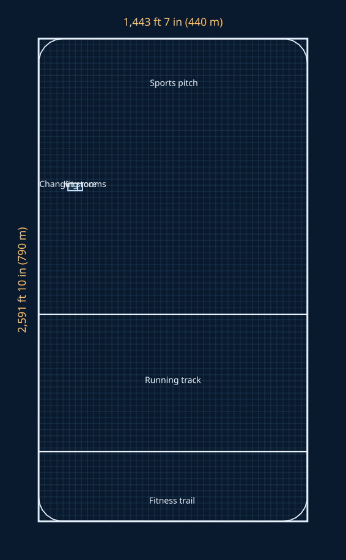

# P1-14 School Sports Field: plan

Footprint 1,443 ft 7 in (440 m) × 2,591 ft 10 in (790 m) · structural grid 32 ft 10 in (10 m)

## Levels

| Level | Floor above deck | Height | Floor area |
|---|---|---|---|
| Level 1 · Ground | 0 ft (0 mm) | 13 ft 1 in (4,000 mm) | 3,100 sq ft (288 m²) |

## Elements

| ID | Designation | Type | Name | Level(s) | Size / length | Area | Status |
|---|---|---|---|---|---|---|---|
| E001 | D5F6P1B19A1R1 | zone | Sports pitch | L1 | 1,442 ft 11 in (440 m) × 1,480 ft 4 in (451 m) | 2,126,665 sq ft (197,574 m²) | proposed |
| E002 | D5F6P1B19A1R2 | room | Changing rooms | L1 | 52 ft 6 in (16 m) × 39 ft 4 in (12 m) | 2,067 sq ft (192 m²) | proposed |
| E003 | D5F6P1B19A1R3 | room | Kit store | L1 | 26 ft 3 in (8,000 mm) × 39 ft 4 in (12 m) | 1,033 sq ft (96 m²) | proposed |
| E004 | D5F6P1B19A1R4 | zone | Running track | L1 | 1,442 ft 11 in (440 m) × 737 ft 2 in (225 m) | 1,063,239 sq ft (98,778 m²) | proposed |
| E005 | D5F6P1B19A1R5 | zone | Fitness trail | L1 | 1,442 ft 3 in (440 m) × 374 ft 4 in (114 m) | 531,564 sq ft (49,384 m²) | proposed |

## Drawings

### Level 1 · Ground

