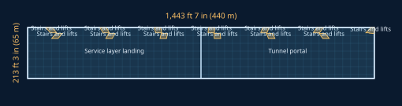
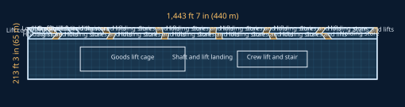
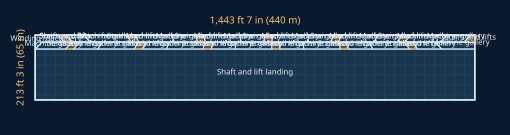

# P1-17 Flight School Service Shaft: plan

Footprint 1,443 ft 7 in (440 m) × 213 ft 3 in (65 m) · structural grid 32 ft 10 in (10 m)

## Levels

| Level | Floor above deck | Height | Floor area |
|---|---|---|---|
| Level B1 · Service layer landing | −19 ft 8 in (6,000 mm) | 19 ft 8 in (6,000 mm) | 307,848 sq ft (28,600 m²) |
| Level 1 · Lift landing | 0 ft (0 mm) | 29 ft 6 in (9,000 mm) | 296,781 sq ft (27,572 m²) |
| Level 2 · Winding room | 29 ft 6 in (9,000 mm) | 19 ft 8 in (6,000 mm) | 296,781 sq ft (27,572 m²) |

## Elements

| ID | Designation | Type | Name | Level(s) | Size / length | Area | Status |
|---|---|---|---|---|---|---|---|
| E001 | D5F6P1B19A2L1R1, D5F6P1B19A2L2R1 | room | Shaft and lift landing | L1, L2 | 1,443 ft 7 in (440 m) × 167 ft 4 in (51 m) | 241,542 sq ft (22,440 m²) | proposed |
| E002 |  | fixture | Goods lift cage | L1 | 433 ft 1 in (132 m) × 100 ft 5 in (31 m) | 43,478 sq ft (4,039 m²) | proposed |
| E003 |  | fixture | Crew lift and stair | L1 | 288 ft 9 in (88 m) × 66 ft 11 in (20 m) | 19,323 sq ft (1,795 m²) | proposed |
| E004 | D5F6P1B19A2LB1R1, D5F6P1B19A2L1R2, D5F6P1B19A2L2R2 | core | Stairs and lifts | LB1, L1, L2 | 45 ft 3 in (14 m) × 21 ft 8 in (6,600 mm) | 568 sq ft (53 m²) | proposed |
| E005 | D5F6P1B19A2LB1R2, D5F6P1B19A2L1R3, D5F6P1B19A2L2R3 | core | Stairs and lifts | LB1, L1, L2 | 38 ft 9 in (12 m) × 21 ft 8 in (6,600 mm) | 572 sq ft (53 m²) | proposed |
| E006 | D5F6P1B19A2LB1R3, D5F6P1B19A2L1R4, D5F6P1B19A2L2R4 | core | Stairs and lifts | LB1, L1, L2 | 31 ft 6 in (9,600 mm) × 21 ft 8 in (6,600 mm) | 565 sq ft (52 m²) | proposed |
| E007 | D5F6P1B19A2LB1R4, D5F6P1B19A2L1R5, D5F6P1B19A2L2R5 | core | Stairs and lifts | LB1, L1, L2 | 27 ft 7 in (8,400 mm) × 21 ft 8 in (6,600 mm) | 568 sq ft (53 m²) | proposed |
| E008 | D5F6P1B19A2LB1R5, D5F6P1B19A2L1R6, D5F6P1B19A2L2R6 | core | Stairs and lifts | LB1, L1, L2 | 34 ft 5 in (10 m) × 21 ft 8 in (6,600 mm) | 568 sq ft (53 m²) | proposed |
| E009 | D5F6P1B19A2LB1R6, D5F6P1B19A2L1R7, D5F6P1B19A2L2R7 | core | Stairs and lifts | LB1, L1, L2 | 41 ft (12 m) × 21 ft 8 in (6,600 mm) | 565 sq ft (52 m²) | proposed |
| E010 | D5F6P1B19A2LB1R7, D5F6P1B19A2L1R8, D5F6P1B19A2L2R8 | core | Stairs and lifts | LB1, L1, L2 | 34 ft 9 in (11 m) × 24 ft 11 in (7,600 mm) | 572 sq ft (53 m²) | proposed |
| E011 | D5F6P1B19A2LB1R8, D5F6P1B19A2L1R9, D5F6P1B19A2L2R9 | core | Stairs and lifts | LB1, L1, L2 | 42 ft (13 m) × 21 ft 8 in (6,600 mm) | 568 sq ft (53 m²) | proposed |
| E012 | D5F6P1B19A2LB1R9, D5F6P1B19A2L1R10, D5F6P1B19A2L2R10 | core | Stairs and lifts | LB1, L1, L2 | 35 ft 1 in (11 m) × 21 ft 8 in (6,600 mm) | 568 sq ft (53 m²) | proposed |
| E013 | D5F6P1B19A2LB1R10, D5F6P1B19A2L1R11, D5F6P1B19A2L2R11 | core | Stairs and lifts | LB1, L1, L2 | 28 ft 3 in (8,600 mm) × 21 ft 8 in (6,600 mm) | 568 sq ft (53 m²) | proposed |
| E014 | D5F6P1B19A2LB1R11, D5F6P1B19A2L1R12, D5F6P1B19A2L2R12 | core | Stairs and lifts | LB1, L1, L2 | 31 ft 2 in (9,500 mm) × 21 ft 8 in (6,600 mm) | 572 sq ft (53 m²) | proposed |
| E015 | D5F6P1B19A2LB1R12, D5F6P1B19A2L1R13, D5F6P1B19A2L2R13 | core | Stairs and lifts | LB1, L1, L2 | 37 ft 9 in (12 m) × 21 ft 8 in (6,600 mm) | 568 sq ft (53 m²) | proposed |
| E016 | D5F6P1B19A2LB1R13, D5F6P1B19A2L1R14, D5F6P1B19A2L2R14 | core | Stairs and lifts | LB1, L1, L2 | 44 ft 7 in (14 m) × 21 ft 8 in (6,600 mm) | 568 sq ft (53 m²) | proposed |
| E017 | D5F6P1B19A2L1R15 | room | Lift control room | L1 | 22 ft 4 in (6,800 mm) × 45 ft 11 in (14 m) | 540 sq ft (50 m²) | proposed |
| E018 | D5F6P1B19A2L1R16 | room | Loading bay | L1 | 93 ft 10 in (29 m) × 21 ft 8 in (6,600 mm) | 1,588 sq ft (148 m²) | proposed |
| E019 | D5F6P1B19A2L1R17 | room | Crew check-in | L1 | 38 ft 1 in (12 m) × 21 ft 8 in (6,600 mm) | 426 sq ft (40 m²) | proposed |
| E020 | D5F6P1B19A2L1R18 | room | Tool store | L1 | 57 ft 1 in (17 m) × 21 ft 8 in (6,600 mm) | 860 sq ft (80 m²) | proposed |
| E021 | D5F6P1B19A2L1R19 | room | Staff toilets and showers | L1 | 50 ft 10 in (16 m) × 21 ft 8 in (6,600 mm) | 749 sq ft (70 m²) | proposed |
| E022 | D5F6P1B19A2L1R20 | room | Holding store | L1 | 116 ft 6 in (35 m) × 21 ft 8 in (6,600 mm) | 2,213 sq ft (206 m²) | proposed |
| E023 | D5F6P1B19A2L1R21 | room | Holding store | L1 | 205 ft 1 in (62 m) × 21 ft 8 in (6,600 mm) | 4,248 sq ft (395 m²) | proposed |
| E024 | D5F6P1B19A2L1R22 | room | Holding store | L1 | 199 ft 2 in (61 m) × 21 ft 8 in (6,600 mm) | 4,248 sq ft (395 m²) | proposed |
| E025 | D5F6P1B19A2L1R23 | room | Holding store | L1 | 201 ft 1 in (61 m) × 21 ft 8 in (6,600 mm) | 4,252 sq ft (395 m²) | proposed |
| E026 | D5F6P1B19A2L1R24 | room | Holding store | L1 | 207 ft 8 in (63 m) × 21 ft 8 in (6,600 mm) | 4,248 sq ft (395 m²) | proposed |
| E027 | D5F6P1B19A2L1R25 | room | Holding store | L1 | 214 ft 7 in (65 m) × 21 ft 8 in (6,600 mm) | 4,248 sq ft (395 m²) | proposed |
| E028 | D5F6P1B19A2L1R26 | room | Holding store | L1 | 204 ft 1 in (62 m) × 23 ft (7,000 mm) | 4,252 sq ft (395 m²) | proposed |
| E029 | D5F6P1B19A2L1R27 | room | Holding store | L1 | 208 ft 8 in (64 m) × 21 ft 8 in (6,600 mm) | 4,252 sq ft (395 m²) | proposed |
| E030 | D5F6P1B19A2L1R28 | room | Holding store | L1 | 201 ft 5 in (61 m) × 21 ft 8 in (6,600 mm) | 4,245 sq ft (394 m²) | proposed |
| E031 | D5F6P1B19A2L1R29 | room | Holding store | L1 | 199 ft 2 in (61 m) × 21 ft 8 in (6,600 mm) | 4,248 sq ft (395 m²) | proposed |
| E032 | D5F6P1B19A2L1R30 | room | Holding store | L1 | 204 ft 5 in (62 m) × 21 ft 8 in (6,600 mm) | 4,248 sq ft (395 m²) | proposed |
| E033 | D5F6P1B19A2L1R31 | room | Holding store | L1 | 210 ft 11 in (64 m) × 21 ft 8 in (6,600 mm) | 4,245 sq ft (394 m²) | proposed |
| E034 | D5F6P1B19A2L1R32 | room | Holding store | L1 | 118 ft 5 in (36 m) × 21 ft 8 in (6,600 mm) | 2,128 sq ft (198 m²) | proposed |
| E035 | D5F6P1B19A2L2R15 | room | Winding machinery | L2 | 94 ft 6 in (29 m) × 45 ft 11 in (14 m) | 2,128 sq ft (198 m²) | proposed |
| E036 | D5F6P1B19A2L2R16 | room | Shaft ventilation fans | L2 | 77 ft 1 in (24 m) × 21 ft 8 in (6,600 mm) | 1,286 sq ft (119 m²) | proposed |
| E037 | D5F6P1B19A2L2R17 | room | Machine gallery | L2 | 151 ft 7 in (46 m) × 21 ft 8 in (6,600 mm) | 2,962 sq ft (275 m²) | proposed |
| E038 | D5F6P1B19A2L2R18 | room | Machine gallery | L2 | 128 ft 7 in (39 m) × 21 ft 8 in (6,600 mm) | 2,565 sq ft (238 m²) | proposed |
| E039 | D5F6P1B19A2L2R19 | room | Machine gallery | L2 | 85 ft (26 m) × 21 ft 8 in (6,600 mm) | 1,684 sq ft (156 m²) | proposed |
| E040 | D5F6P1B19A2L2R20 | room | Machine gallery | L2 | 121 ft 9 in (37 m) × 21 ft 8 in (6,600 mm) | 2,568 sq ft (239 m²) | proposed |
| E041 | D5F6P1B19A2L2R21 | room | Machine gallery | L2 | 78 ft 9 in (24 m) × 21 ft 8 in (6,600 mm) | 1,680 sq ft (156 m²) | proposed |
| E042 | D5F6P1B19A2L2R22 | room | Machine gallery | L2 | 122 ft 1 in (37 m) × 21 ft 8 in (6,600 mm) | 2,568 sq ft (239 m²) | proposed |
| E043 | D5F6P1B19A2L2R23 | room | Machine gallery | L2 | 84 ft 4 in (26 m) × 21 ft 8 in (6,600 mm) | 1,684 sq ft (156 m²) | proposed |
| E044 | D5F6P1B19A2L2R24 | room | Machine gallery | L2 | 128 ft 11 in (39 m) × 21 ft 8 in (6,600 mm) | 2,565 sq ft (238 m²) | proposed |
| E045 | D5F6P1B19A2L2R25 | room | Machine gallery | L2 | 91 ft 2 in (28 m) × 21 ft 8 in (6,600 mm) | 1,684 sq ft (156 m²) | proposed |
| E046 | D5F6P1B19A2L2R26 | room | Machine gallery | L2 | 135 ft 10 in (41 m) × 21 ft 8 in (6,600 mm) | 2,568 sq ft (239 m²) | proposed |
| E047 | D5F6P1B19A2L2R27 | room | Machine gallery | L2 | 97 ft 9 in (30 m) × 21 ft 8 in (6,600 mm) | 1,680 sq ft (156 m²) | proposed |
| E048 | D5F6P1B19A2L2R28 | room | Machine gallery | L2 | 127 ft 7 in (39 m) × 23 ft (7,000 mm) | 2,572 sq ft (239 m²) | proposed |
| E049 | D5F6P1B19A2L2R29 | room | Machine gallery | L2 | 94 ft 10 in (29 m) × 21 ft 8 in (6,600 mm) | 1,680 sq ft (156 m²) | proposed |
| E050 | D5F6P1B19A2L2R30 | room | Machine gallery | L2 | 132 ft 3 in (40 m) × 21 ft 8 in (6,600 mm) | 2,568 sq ft (239 m²) | proposed |
| E051 | D5F6P1B19A2L2R31 | room | Machine gallery | L2 | 88 ft 3 in (27 m) × 21 ft 8 in (6,600 mm) | 1,684 sq ft (156 m²) | proposed |
| E052 | D5F6P1B19A2L2R32 | room | Machine gallery | L2 | 125 ft (38 m) × 21 ft 8 in (6,600 mm) | 2,565 sq ft (238 m²) | proposed |
| E053 | D5F6P1B19A2L2R33 | room | Machine gallery | L2 | 81 ft (25 m) × 21 ft 8 in (6,600 mm) | 1,680 sq ft (156 m²) | proposed |
| E054 | D5F6P1B19A2L2R34 | room | Machine gallery | L2 | 120 ft 5 in (37 m) × 21 ft 8 in (6,600 mm) | 2,568 sq ft (239 m²) | proposed |
| E055 | D5F6P1B19A2L2R35 | room | Machine gallery | L2 | 80 ft 9 in (25 m) × 21 ft 8 in (6,600 mm) | 1,680 sq ft (156 m²) | proposed |
| E056 | D5F6P1B19A2L2R36 | room | Machine gallery | L2 | 125 ft 4 in (38 m) × 21 ft 8 in (6,600 mm) | 2,565 sq ft (238 m²) | proposed |
| E057 | D5F6P1B19A2L2R37 | room | Machine gallery | L2 | 87 ft 7 in (27 m) × 21 ft 8 in (6,600 mm) | 1,684 sq ft (156 m²) | proposed |
| E058 | D5F6P1B19A2L2R38 | room | Machine gallery | L2 | 132 ft 3 in (40 m) × 21 ft 8 in (6,600 mm) | 2,565 sq ft (238 m²) | proposed |
| E059 | D5F6P1B19A2L2R39 | room | Machine gallery | L2 | 94 ft 6 in (29 m) × 21 ft 8 in (6,600 mm) | 1,680 sq ft (156 m²) | proposed |
| E060 | D5F6P1B19A2L2R40 | room | Machine gallery | L2 | 118 ft 5 in (36 m) × 21 ft 8 in (6,600 mm) | 2,128 sq ft (198 m²) | proposed |
| E061 | D5F6P1B19A2LB1R14 | room | Service layer landing | LB1 | 721 ft 9 in (220 m) × 213 ft 3 in (65 m) | 153,924 sq ft (14,300 m²) | proposed |
| E062 | D5F6P1B19A2LB1R15 | room | Tunnel portal | LB1 | 721 ft 9 in (220 m) × 213 ft 3 in (65 m) | 153,924 sq ft (14,300 m²) | proposed |

## Drawings

### Level B1 · Service layer landing

### Level 1 · Lift landing

### Level 2 · Winding room

