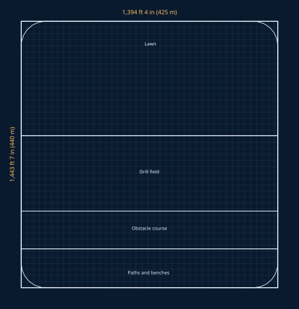

# P1-19 Training Field 1: plan

Footprint 1,394 ft 4 in (425 m) × 1,443 ft 7 in (440 m) · structural grid 32 ft 10 in (10 m)

## Levels

| Level | Floor above deck | Height | Floor area |
|---|---|---|---|
| Level 1 · Ground | 0 ft (0 mm) | 13 ft 1 in (4,000 mm) | — |

## Elements

| ID | Designation | Type | Name | Level(s) | Size / length | Area | Status |
|---|---|---|---|---|---|---|---|
| E001 | D5F6P1B7A1R1 | zone | Lawn | L1 | 1,393 ft 8 in (425 m) × 619 ft 5 in (189 m) | 854,586 sq ft (79,394 m²) | proposed |
| E002 | D5F6P1B7A1R2 | zone | Drill field | L1 | 1,393 ft 4 in (425 m) × 409 ft 1 in (125 m) | 569,923 sq ft (52,948 m²) | proposed |
| E003 | D5F6P1B7A1R3 | zone | Obstacle course | L1 | 1,393 ft 4 in (425 m) × 204 ft 5 in (62 m) | 284,733 sq ft (26,453 m²) | proposed |
| E004 | D5F6P1B7A1R4 | zone | Paths and benches | L1 | 1,393 ft 1 in (425 m) × 210 ft 8 in (64 m) | 285,113 sq ft (26,488 m²) | proposed |

## Drawings

### Level 1 · Ground

