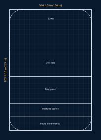

# P1-21 Training Field 2: plan

Footprint 544 ft 3 in (166 m) × 803 ft 10 in (245 m) · structural grid 32 ft 10 in (10 m)

## Levels

| Level | Floor above deck | Height | Floor area |
|---|---|---|---|
| Level 1 · Ground | 0 ft (0 mm) | 13 ft 1 in (4,000 mm) | — |

## Elements

| ID | Designation | Type | Name | Level(s) | Size / length | Area | Status |
|---|---|---|---|---|---|---|---|
| E001 | D5F6P1B15A2R1 | zone | Lawn | L1 | 543 ft 8 in (166 m) × 269 ft 8 in (82 m) | 143,418 sq ft (13,324 m²) | proposed |
| E002 | D5F6P1B15A2R2 | zone | Drill field | L1 | 543 ft 8 in (166 m) × 176 ft 2 in (54 m) | 95,720 sq ft (8,893 m²) | proposed |
| E003 | D5F6P1B15A2R3 | zone | Tree grove | L1 | 543 ft 8 in (166 m) × 176 ft 2 in (54 m) | 95,749 sq ft (8,895 m²) | proposed |
| E004 | D5F6P1B15A2R4 | zone | Obstacle course | L1 | 543 ft 8 in (166 m) × 87 ft 11 in (27 m) | 47,786 sq ft (4,439 m²) | proposed |
| E005 | D5F6P1B15A2R5 | zone | Paths and benches | L1 | 543 ft 4 in (166 m) × 93 ft 10 in (29 m) | 47,845 sq ft (4,445 m²) | proposed |

## Drawings

### Level 1 · Ground

