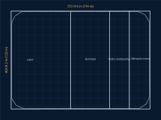

# P1-23 Training Field 3: plan

Footprint 572 ft 6 in (174 m) × 404 ft 2 in (123 m) · structural grid 32 ft 10 in (10 m)

## Levels

| Level | Floor above deck | Height | Floor area |
|---|---|---|---|
| Level 1 · Ground | 0 ft (0 mm) | 13 ft 1 in (4,000 mm) | — |

## Elements

| ID | Designation | Type | Name | Level(s) | Size / length | Area | Status |
|---|---|---|---|---|---|---|---|
| E001 | D5F6P1B17A2R1 | zone | Lawn | L1 | 245 ft 5 in (75 m) × 401 ft 11 in (122 m) | 96,645 sq ft (8,979 m²) | proposed |
| E002 | D5F6P1B17A2R2 | zone | Drill field | L1 | 160 ft 5 in (49 m) × 401 ft 11 in (122 m) | 64,373 sq ft (5,980 m²) | proposed |
| E003 | D5F6P1B17A2R3 | zone | Paths and benches | L1 | 80 ft 5 in (24 m) × 401 ft 7 in (122 m) | 32,252 sq ft (2,996 m²) | proposed |
| E004 | D5F6P1B17A2R4 | zone | Obstacle course | L1 | 85 ft (26 m) × 401 ft 3 in (122 m) | 32,255 sq ft (2,997 m²) | proposed |

## Drawings

### Level 1 · Ground

