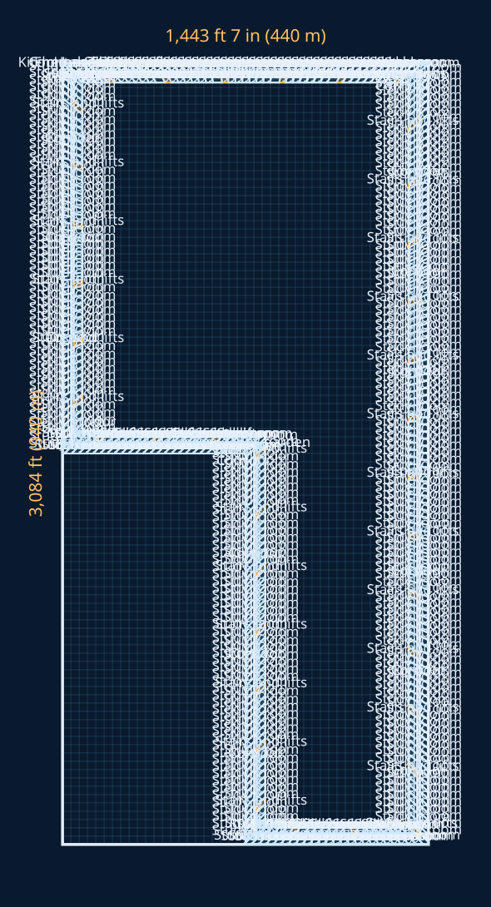

# P1-24 Cadet House 4: plan

Footprint 1,443 ft 7 in (440 m) × 3,084 ft (940 m) · structural grid 32 ft 10 in (10 m)

## Levels

| Level | Floor above deck | Height | Floor area |
|---|---|---|---|
| Level 1 · Ground floor | 0 ft (0 mm) | 14 ft 9 in (4,500 mm) | 568,745 sq ft (52,838 m²) |
| Level 2 · Bedroom floor 1 | 14 ft 9 in (4,500 mm) | 10 ft 6 in (3,200 mm) | 568,745 sq ft (52,838 m²) |
| Level 3 · Bedroom floor 2 | 25 ft 3 in (7,700 mm) | 10 ft 6 in (3,200 mm) | 568,745 sq ft (52,838 m²) |
| Level 4 · Bedroom floor 3 | 35 ft 9 in (11 m) | 10 ft 6 in (3,200 mm) | 568,745 sq ft (52,838 m²) |
| Level 5 · Bedroom floor 4 | 46 ft 3 in (14 m) | 10 ft 6 in (3,200 mm) | 568,745 sq ft (52,838 m²) |
| Level 6 · Bedroom floor 5 | 56 ft 9 in (17 m) | 10 ft 6 in (3,200 mm) | 568,745 sq ft (52,838 m²) |

## Elements

| ID | Designation | Type | Name | Level(s) | Size / length | Area | Status |
|---|---|---|---|---|---|---|---|
| E001 | D5F6P1B20A1L1R1 | zone | Residents' garden | L1 | 1,286 ft 1 in (392 m) × 2,926 ft 6 in (892 m) | 2,650,764 sq ft (246,264 m²) | proposed |
| E002 | D5F6P1B20A1L1R2 | zone | Corridor | L1 | 400 ft 7 in (122 m) × 9 ft 10 in (3,000 mm) | 3,875 sq ft (360 m²) | proposed |
| E003 | D5F6P1B20A1L1R3 | zone | Corridor | L1 | 396 ft 4 in (121 m) × 9 ft 10 in (3,000 mm) | 3,875 sq ft (360 m²) | proposed |
| E004 | D5F6P1B20A1L1R4 | zone | Corridor | L1 | 398 ft (121 m) × 9 ft 10 in (3,000 mm) | 3,875 sq ft (360 m²) | proposed |
| E005 | D5F6P1B20A1L1R5 | zone | Corridor | L1 | 192 ft 3 in (59 m) × 219 ft 2 in (67 m) | 3,875 sq ft (360 m²) | proposed |
| E006 | D5F6P1B20A1L1R6 | zone | Corridor | L1 | 9 ft 10 in (3,000 mm) × 400 ft 11 in (122 m) | 3,875 sq ft (360 m²) | proposed |
| E007 | D5F6P1B20A1L1R7 | zone | Corridor | L1 | 9 ft 10 in (3,000 mm) × 398 ft 4 in (121 m) | 3,875 sq ft (360 m²) | proposed |
| E008 | D5F6P1B20A1L1R8 | zone | Corridor | L1 | 9 ft 10 in (3,000 mm) × 395 ft 8 in (121 m) | 3,875 sq ft (360 m²) | proposed |
| E009 | D5F6P1B20A1L1R9 | zone | Corridor | L1 | 9 ft 10 in (3,000 mm) × 395 ft (120 m) | 3,875 sq ft (360 m²) | proposed |
| E010 | D5F6P1B20A1L1R10 | zone | Corridor | L1 | 9 ft 10 in (3,000 mm) × 397 ft (121 m) | 3,875 sq ft (360 m²) | proposed |
| E011 | D5F6P1B20A1L1R11 | zone | Corridor | L1 | 9 ft 10 in (3,000 mm) × 399 ft 7 in (122 m) | 3,875 sq ft (360 m²) | proposed |
| E012 | D5F6P1B20A1L1R12 | zone | Corridor | L1 | 9 ft 10 in (3,000 mm) × 402 ft 3 in (123 m) | 3,875 sq ft (360 m²) | proposed |
| E013 | D5F6P1B20A1L1R13 | zone | Corridor | L1 | 359 ft 11 in (110 m) × 49 ft 3 in (15 m) | 3,875 sq ft (360 m²) | proposed |
| E014 | D5F6P1B20A1L1R14 | zone | Corridor | L1 | 294 ft 3 in (90 m) × 114 ft 10 in (35 m) | 3,875 sq ft (360 m²) | proposed |
| E015 | D5F6P1B20A1L1R15 | zone | Corridor | L1 | 9 ft 10 in (3,000 mm) × 403 ft 7 in (123 m) | 3,875 sq ft (360 m²) | proposed |
| E016 | D5F6P1B20A1L1R16 | zone | Corridor | L1 | 9 ft 10 in (3,000 mm) × 403 ft 7 in (123 m) | 3,875 sq ft (360 m²) | proposed |
| E017 | D5F6P1B20A1L1R17 | zone | Corridor | L1 | 9 ft 10 in (3,000 mm) × 403 ft 7 in (123 m) | 3,875 sq ft (360 m²) | proposed |
| E018 | D5F6P1B20A1L1R18 | zone | Corridor | L1 | 147 ft 8 in (45 m) × 265 ft 9 in (81 m) | 3,875 sq ft (360 m²) | proposed |
| E019 | D5F6P1B20A1L1R19 | zone | Corridor | L1 | 403 ft 7 in (123 m) × 9 ft 10 in (3,000 mm) | 3,875 sq ft (360 m²) | proposed |
| E020 | D5F6P1B20A1L1R20 | zone | Corridor | L1 | 200 ft 2 in (61 m) × 211 ft 11 in (65 m) | 3,875 sq ft (360 m²) | proposed |
| E021 | D5F6P1B20A1L1R21 | zone | Corridor | L1 | 9 ft 10 in (3,000 mm) × 398 ft 4 in (121 m) | 3,875 sq ft (360 m²) | proposed |
| E022 | D5F6P1B20A1L1R22 | zone | Corridor | L1 | 9 ft 10 in (3,000 mm) × 396 ft 4 in (121 m) | 3,875 sq ft (360 m²) | proposed |
| E023 | D5F6P1B20A1L1R23 | zone | Corridor | L1 | 9 ft 10 in (3,000 mm) × 399 ft 7 in (122 m) | 3,875 sq ft (360 m²) | proposed |
| E024 | D5F6P1B20A1L1R24 | zone | Corridor | L1 | 9 ft 10 in (3,000 mm) × 87 ft 11 in (27 m) | 775 sq ft (72 m²) | proposed |
| E025 | D5F6P1B20A1L1R25, D5F6P1B20A1L2R1, D5F6P1B20A1L3R1, D5F6P1B20A1L4R1, D5F6P1B20A1L5R1, D5F6P1B20A1L6R1 | core | Stairs and lifts | L1, L2, L3, L4, L5, L6 | 54 ft 6 in (17 m) × 34 ft 5 in (10 m) | 899 sq ft (83 m²) | proposed |
| E026 | D5F6P1B20A1L1R26, D5F6P1B20A1L2R2, D5F6P1B20A1L3R2, D5F6P1B20A1L4R2, D5F6P1B20A1L5R2, D5F6P1B20A1L6R2 | core | Stairs and lifts | L1, L2, L3, L4, L5, L6 | 42 ft 4 in (13 m) × 34 ft 5 in (10 m) | 899 sq ft (83 m²) | proposed |
| E027 | D5F6P1B20A1L1R27, D5F6P1B20A1L2R3, D5F6P1B20A1L3R3, D5F6P1B20A1L4R3, D5F6P1B20A1L5R3, D5F6P1B20A1L6R3 | core | Stairs and lifts | L1, L2, L3, L4, L5, L6 | 30 ft 6 in (9,300 mm) × 34 ft 5 in (10 m) | 904 sq ft (84 m²) | proposed |
| E028 | D5F6P1B20A1L1R28, D5F6P1B20A1L2R4, D5F6P1B20A1L3R4, D5F6P1B20A1L4R4, D5F6P1B20A1L5R4, D5F6P1B20A1L6R4 | core | Stairs and lifts | L1, L2, L3, L4, L5, L6 | 33 ft 10 in (10 m) × 34 ft 5 in (10 m) | 899 sq ft (83 m²) | proposed |
| E029 | D5F6P1B20A1L1R29, D5F6P1B20A1L2R5, D5F6P1B20A1L3R5, D5F6P1B20A1L4R5, D5F6P1B20A1L5R5, D5F6P1B20A1L6R5 | core | Stairs and lifts | L1, L2, L3, L4, L5, L6 | 45 ft 11 in (14 m) × 34 ft 5 in (10 m) | 899 sq ft (83 m²) | proposed |
| E030 | D5F6P1B20A1L1R30, D5F6P1B20A1L2R6, D5F6P1B20A1L3R6, D5F6P1B20A1L4R6, D5F6P1B20A1L5R6, D5F6P1B20A1L6R6 | core | Stairs and lifts | L1, L2, L3, L4, L5, L6 | 58 ft 1 in (18 m) × 34 ft 5 in (10 m) | 899 sq ft (83 m²) | proposed |
| E031 | D5F6P1B20A1L1R31, D5F6P1B20A1L2R7, D5F6P1B20A1L3R7, D5F6P1B20A1L4R7, D5F6P1B20A1L5R7, D5F6P1B20A1L6R7 | core | Stairs and lifts | L1, L2, L3, L4, L5, L6 | 34 ft 5 in (10 m) × 56 ft 5 in (17 m) | 904 sq ft (84 m²) | proposed |
| E032 | D5F6P1B20A1L1R32, D5F6P1B20A1L2R8, D5F6P1B20A1L3R8, D5F6P1B20A1L4R8, D5F6P1B20A1L5R8, D5F6P1B20A1L6R8 | core | Stairs and lifts | L1, L2, L3, L4, L5, L6 | 34 ft 5 in (10 m) × 50 ft 10 in (16 m) | 904 sq ft (84 m²) | proposed |
| E033 | D5F6P1B20A1L1R33, D5F6P1B20A1L2R9, D5F6P1B20A1L3R9, D5F6P1B20A1L4R9, D5F6P1B20A1L5R9, D5F6P1B20A1L6R9 | core | Stairs and lifts | L1, L2, L3, L4, L5, L6 | 34 ft 5 in (10 m) × 45 ft 11 in (14 m) | 910 sq ft (85 m²) | proposed |
| E034 | D5F6P1B20A1L1R34, D5F6P1B20A1L2R10, D5F6P1B20A1L3R10, D5F6P1B20A1L4R10, D5F6P1B20A1L5R10, D5F6P1B20A1L6R10 | core | Stairs and lifts | L1, L2, L3, L4, L5, L6 | 34 ft 5 in (10 m) × 40 ft 4 in (12 m) | 904 sq ft (84 m²) | proposed |
| E035 | D5F6P1B20A1L1R35, D5F6P1B20A1L2R11, D5F6P1B20A1L3R11, D5F6P1B20A1L4R11, D5F6P1B20A1L5R11, D5F6P1B20A1L6R11 | core | Stairs and lifts | L1, L2, L3, L4, L5, L6 | 34 ft 5 in (10 m) × 34 ft 9 in (11 m) | 904 sq ft (84 m²) | proposed |
| E036 | D5F6P1B20A1L1R36, D5F6P1B20A1L2R12, D5F6P1B20A1L3R12, D5F6P1B20A1L4R12, D5F6P1B20A1L5R12, D5F6P1B20A1L6R12 | core | Stairs and lifts | L1, L2, L3, L4, L5, L6 | 34 ft 5 in (10 m) × 29 ft 6 in (9,000 mm) | 904 sq ft (84 m²) | proposed |
| E037 | D5F6P1B20A1L1R37, D5F6P1B20A1L2R13, D5F6P1B20A1L3R13, D5F6P1B20A1L4R13, D5F6P1B20A1L5R13, D5F6P1B20A1L6R13 | core | Stairs and lifts | L1, L2, L3, L4, L5, L6 | 34 ft 5 in (10 m) × 28 ft 7 in (8,700 mm) | 904 sq ft (84 m²) | proposed |
| E038 | D5F6P1B20A1L1R38, D5F6P1B20A1L2R14, D5F6P1B20A1L3R14, D5F6P1B20A1L4R14, D5F6P1B20A1L5R14, D5F6P1B20A1L6R14 | core | Stairs and lifts | L1, L2, L3, L4, L5, L6 | 34 ft 5 in (10 m) × 33 ft 10 in (10 m) | 910 sq ft (85 m²) | proposed |
| E039 | D5F6P1B20A1L1R39, D5F6P1B20A1L2R15, D5F6P1B20A1L3R15, D5F6P1B20A1L4R15, D5F6P1B20A1L5R15, D5F6P1B20A1L6R15 | core | Stairs and lifts | L1, L2, L3, L4, L5, L6 | 34 ft 5 in (10 m) × 39 ft 1 in (12 m) | 904 sq ft (84 m²) | proposed |
| E040 | D5F6P1B20A1L1R40, D5F6P1B20A1L2R16, D5F6P1B20A1L3R16, D5F6P1B20A1L4R16, D5F6P1B20A1L5R16, D5F6P1B20A1L6R16 | core | Stairs and lifts | L1, L2, L3, L4, L5, L6 | 34 ft 5 in (10 m) × 44 ft 7 in (14 m) | 904 sq ft (84 m²) | proposed |
| E041 | D5F6P1B20A1L1R41, D5F6P1B20A1L2R17, D5F6P1B20A1L3R17, D5F6P1B20A1L4R17, D5F6P1B20A1L5R17, D5F6P1B20A1L6R17 | core | Stairs and lifts | L1, L2, L3, L4, L5, L6 | 34 ft 5 in (10 m) × 49 ft 10 in (15 m) | 904 sq ft (84 m²) | proposed |
| E042 | D5F6P1B20A1L1R42, D5F6P1B20A1L2R18, D5F6P1B20A1L3R18, D5F6P1B20A1L4R18, D5F6P1B20A1L5R18, D5F6P1B20A1L6R18 | core | Stairs and lifts | L1, L2, L3, L4, L5, L6 | 34 ft 5 in (10 m) × 55 ft 5 in (17 m) | 904 sq ft (84 m²) | proposed |
| E043 | D5F6P1B20A1L1R43, D5F6P1B20A1L2R19, D5F6P1B20A1L3R19, D5F6P1B20A1L4R19, D5F6P1B20A1L5R19, D5F6P1B20A1L6R19 | core | Stairs and lifts | L1, L2, L3, L4, L5, L6 | 46 ft 11 in (14 m) × 47 ft 7 in (14 m) | 904 sq ft (84 m²) | proposed |
| E044 | D5F6P1B20A1L1R44, D5F6P1B20A1L2R20, D5F6P1B20A1L3R20, D5F6P1B20A1L4R20, D5F6P1B20A1L5R20, D5F6P1B20A1L6R20 | core | Stairs and lifts | L1, L2, L3, L4, L5, L6 | 34 ft 1 in (10 m) × 34 ft 5 in (10 m) | 904 sq ft (84 m²) | proposed |
| E045 | D5F6P1B20A1L1R45, D5F6P1B20A1L2R21, D5F6P1B20A1L3R21, D5F6P1B20A1L4R21, D5F6P1B20A1L5R21, D5F6P1B20A1L6R21 | core | Stairs and lifts | L1, L2, L3, L4, L5, L6 | 44 ft 11 in (14 m) × 34 ft 5 in (10 m) | 899 sq ft (83 m²) | proposed |
| E046 | D5F6P1B20A1L1R46, D5F6P1B20A1L2R22, D5F6P1B20A1L3R22, D5F6P1B20A1L4R22, D5F6P1B20A1L5R22, D5F6P1B20A1L6R22 | core | Stairs and lifts | L1, L2, L3, L4, L5, L6 | 34 ft 5 in (10 m) × 60 ft 8 in (18 m) | 904 sq ft (84 m²) | proposed |
| E047 | D5F6P1B20A1L1R47, D5F6P1B20A1L2R23, D5F6P1B20A1L3R23, D5F6P1B20A1L4R23, D5F6P1B20A1L5R23, D5F6P1B20A1L6R23 | core | Stairs and lifts | L1, L2, L3, L4, L5, L6 | 34 ft 5 in (10 m) × 60 ft 8 in (18 m) | 904 sq ft (84 m²) | proposed |
| E048 | D5F6P1B20A1L1R48, D5F6P1B20A1L2R24, D5F6P1B20A1L3R24, D5F6P1B20A1L4R24, D5F6P1B20A1L5R24, D5F6P1B20A1L6R24 | core | Stairs and lifts | L1, L2, L3, L4, L5, L6 | 34 ft 5 in (10 m) × 60 ft 8 in (18 m) | 904 sq ft (84 m²) | proposed |
| E049 | D5F6P1B20A1L1R49, D5F6P1B20A1L2R25, D5F6P1B20A1L3R25, D5F6P1B20A1L4R25, D5F6P1B20A1L5R25, D5F6P1B20A1L6R25 | core | Stairs and lifts | L1, L2, L3, L4, L5, L6 | 34 ft 5 in (10 m) × 60 ft 8 in (18 m) | 904 sq ft (84 m²) | proposed |
| E050 | D5F6P1B20A1L1R50, D5F6P1B20A1L2R26, D5F6P1B20A1L3R26, D5F6P1B20A1L4R26, D5F6P1B20A1L5R26, D5F6P1B20A1L6R26 | core | Stairs and lifts | L1, L2, L3, L4, L5, L6 | 34 ft 5 in (10 m) × 60 ft 8 in (18 m) | 904 sq ft (84 m²) | proposed |
| E051 | D5F6P1B20A1L1R51, D5F6P1B20A1L2R27, D5F6P1B20A1L3R27, D5F6P1B20A1L4R27, D5F6P1B20A1L5R27, D5F6P1B20A1L6R27 | core | Stairs and lifts | L1, L2, L3, L4, L5, L6 | 34 ft 5 in (10 m) × 60 ft 8 in (18 m) | 904 sq ft (84 m²) | proposed |
| E052 | D5F6P1B20A1L1R52, D5F6P1B20A1L2R28, D5F6P1B20A1L3R28, D5F6P1B20A1L4R28, D5F6P1B20A1L5R28, D5F6P1B20A1L6R28 | core | Stairs and lifts | L1, L2, L3, L4, L5, L6 | 34 ft 5 in (10 m) × 60 ft 8 in (18 m) | 904 sq ft (84 m²) | proposed |
| E053 | D5F6P1B20A1L1R53, D5F6P1B20A1L2R29, D5F6P1B20A1L3R29, D5F6P1B20A1L4R29, D5F6P1B20A1L5R29, D5F6P1B20A1L6R29 | core | Stairs and lifts | L1, L2, L3, L4, L5, L6 | 60 ft 8 in (18 m) × 34 ft 5 in (10 m) | 904 sq ft (84 m²) | proposed |
| E054 | D5F6P1B20A1L1R54, D5F6P1B20A1L2R30, D5F6P1B20A1L3R30, D5F6P1B20A1L4R30, D5F6P1B20A1L5R30, D5F6P1B20A1L6R30 | core | Stairs and lifts | L1, L2, L3, L4, L5, L6 | 60 ft 8 in (18 m) × 34 ft 5 in (10 m) | 904 sq ft (84 m²) | proposed |
| E055 | D5F6P1B20A1L1R55, D5F6P1B20A1L2R31, D5F6P1B20A1L3R31, D5F6P1B20A1L4R31, D5F6P1B20A1L5R31, D5F6P1B20A1L6R31 | core | Stairs and lifts | L1, L2, L3, L4, L5, L6 | 60 ft 8 in (18 m) × 34 ft 5 in (10 m) | 904 sq ft (84 m²) | proposed |
| E056 | D5F6P1B20A1L1R56, D5F6P1B20A1L2R32, D5F6P1B20A1L3R32, D5F6P1B20A1L4R32, D5F6P1B20A1L5R32, D5F6P1B20A1L6R32 | core | Stairs and lifts | L1, L2, L3, L4, L5, L6 | 34 ft 5 in (10 m) × 53 ft 6 in (16 m) | 904 sq ft (84 m²) | proposed |
| E057 | D5F6P1B20A1L1R57, D5F6P1B20A1L2R33, D5F6P1B20A1L3R33, D5F6P1B20A1L4R33, D5F6P1B20A1L5R33, D5F6P1B20A1L6R33 | core | Stairs and lifts | L1, L2, L3, L4, L5, L6 | 34 ft 5 in (10 m) × 42 ft 4 in (13 m) | 904 sq ft (84 m²) | proposed |
| E058 | D5F6P1B20A1L1R58, D5F6P1B20A1L2R34, D5F6P1B20A1L3R34, D5F6P1B20A1L4R34, D5F6P1B20A1L5R34, D5F6P1B20A1L6R34 | core | Stairs and lifts | L1, L2, L3, L4, L5, L6 | 34 ft 5 in (10 m) × 31 ft 2 in (9,500 mm) | 904 sq ft (84 m²) | proposed |
| E059 | D5F6P1B20A1L1R59, D5F6P1B20A1L2R35, D5F6P1B20A1L3R35, D5F6P1B20A1L4R35, D5F6P1B20A1L5R35, D5F6P1B20A1L6R35 | core | Stairs and lifts | L1, L2, L3, L4, L5, L6 | 34 ft 5 in (10 m) × 32 ft 10 in (10 m) | 904 sq ft (84 m²) | proposed |
| E060 | D5F6P1B20A1L1R60, D5F6P1B20A1L2R36, D5F6P1B20A1L3R36, D5F6P1B20A1L4R36, D5F6P1B20A1L5R36, D5F6P1B20A1L6R36 | core | Stairs and lifts | L1, L2, L3, L4, L5, L6 | 34 ft 5 in (10 m) × 43 ft 8 in (13 m) | 904 sq ft (84 m²) | proposed |
| E061 | D5F6P1B20A1L1R61, D5F6P1B20A1L2R37, D5F6P1B20A1L3R37, D5F6P1B20A1L4R37, D5F6P1B20A1L5R37, D5F6P1B20A1L6R37 | core | Stairs and lifts | L1, L2, L3, L4, L5, L6 | 34 ft 5 in (10 m) × 55 ft 1 in (17 m) | 904 sq ft (84 m²) | proposed |
| E062 | D5F6P1B20A1L1R62 | room | Front desk | L1 | 46 ft 7 in (14 m) × 34 ft 5 in (10 m) | 429 sq ft (40 m²) | proposed |
| E063 | D5F6P1B20A1L1R63 | room | Common room | L1 | 94 ft 10 in (29 m) × 34 ft 5 in (10 m) | 2,153 sq ft (200 m²) | proposed |
| E064 | D5F6P1B20A1L1R64 | room | Laundry | L1 | 49 ft 3 in (15 m) × 34 ft 5 in (10 m) | 650 sq ft (60 m²) | proposed |
| E065 | D5F6P1B20A1L1R65 | room | Kitchen and dining room | L1 | 90 ft 11 in (28 m) × 34 ft 5 in (10 m) | 2,153 sq ft (200 m²) | proposed |
| E066 | D5F6P1B20A1L1R66 | room | Toilets | L1 | 44 ft 11 in (14 m) × 34 ft 5 in (10 m) | 639 sq ft (59 m²) | proposed |
| E067 | D5F6P1B20A1L1R67 | room | Housemaster's flat | L1 | 53 ft 6 in (16 m) × 34 ft 5 in (10 m) | 972 sq ft (90 m²) | proposed |
| E068 | D5F6P1B20A1L1R68 | room | Study room | L1 | 52 ft 2 in (16 m) × 34 ft 5 in (10 m) | 972 sq ft (90 m²) | proposed |
| E069 | D5F6P1B20A1L1R69 | room | Study room | L1 | 50 ft 6 in (15 m) × 34 ft 5 in (10 m) | 966 sq ft (90 m²) | proposed |
| E070 | D5F6P1B20A1L1R70 | room | Study room | L1 | 49 ft 3 in (15 m) × 34 ft 5 in (10 m) | 972 sq ft (90 m²) | proposed |
| E071 | D5F6P1B20A1L1R71 | room | Study room | L1 | 47 ft 7 in (14 m) × 34 ft 5 in (10 m) | 961 sq ft (89 m²) | proposed |
| E072 | D5F6P1B20A1L1R72 | room | Study room | L1 | 46 ft 7 in (14 m) × 34 ft 5 in (10 m) | 972 sq ft (90 m²) | proposed |
| E073 | D5F6P1B20A1L1R73 | room | Study room | L1 | 45 ft 3 in (14 m) × 34 ft 5 in (10 m) | 972 sq ft (90 m²) | proposed |
| E074 | D5F6P1B20A1L1R74 | room | Study room | L1 | 43 ft 8 in (13 m) × 34 ft 5 in (10 m) | 966 sq ft (90 m²) | proposed |
| E075 | D5F6P1B20A1L1R75 | room | Study room | L1 | 42 ft 4 in (13 m) × 34 ft 5 in (10 m) | 972 sq ft (90 m²) | proposed |
| E076 | D5F6P1B20A1L1R76 | room | Study room | L1 | 40 ft 8 in (12 m) × 34 ft 5 in (10 m) | 961 sq ft (89 m²) | proposed |
| E077 | D5F6P1B20A1L1R77 | room | Study room | L1 | 39 ft 8 in (12 m) × 34 ft 5 in (10 m) | 972 sq ft (90 m²) | proposed |
| E078 | D5F6P1B20A1L1R78 | room | Study room | L1 | 38 ft 5 in (12 m) × 34 ft 5 in (10 m) | 972 sq ft (90 m²) | proposed |
| E079 | D5F6P1B20A1L1R79 | room | Study room | L1 | 36 ft 9 in (11 m) × 34 ft 5 in (10 m) | 966 sq ft (90 m²) | proposed |
| E080 | D5F6P1B20A1L1R80 | room | Study room | L1 | 35 ft 5 in (11 m) × 34 ft 5 in (10 m) | 972 sq ft (90 m²) | proposed |
| E081 | D5F6P1B20A1L1R81 | room | Study room | L1 | 34 ft 1 in (10 m) × 34 ft 5 in (10 m) | 972 sq ft (90 m²) | proposed |
| E082 | D5F6P1B20A1L1R82 | room | Study room | L1 | 32 ft 6 in (9,900 mm) × 34 ft 5 in (10 m) | 961 sq ft (89 m²) | proposed |
| E083 | D5F6P1B20A1L1R83 | room | Study room | L1 | 31 ft 6 in (9,600 mm) × 34 ft 5 in (10 m) | 972 sq ft (90 m²) | proposed |
| E084 | D5F6P1B20A1L1R84 | room | Study room | L1 | 29 ft 10 in (9,100 mm) × 34 ft 5 in (10 m) | 966 sq ft (90 m²) | proposed |
| E085 | D5F6P1B20A1L1R85 | room | Study room | L1 | 28 ft 10 in (8,800 mm) × 34 ft 5 in (10 m) | 972 sq ft (90 m²) | proposed |
| E086 | D5F6P1B20A1L1R86 | room | Study room | L1 | 29 ft 2 in (8,900 mm) × 34 ft 5 in (10 m) | 972 sq ft (90 m²) | proposed |
| E087 | D5F6P1B20A1L1R87 | room | Study room | L1 | 30 ft 2 in (9,200 mm) × 34 ft 5 in (10 m) | 961 sq ft (89 m²) | proposed |
| E088 | D5F6P1B20A1L1R88 | room | Study room | L1 | 31 ft 10 in (9,700 mm) × 34 ft 5 in (10 m) | 972 sq ft (90 m²) | proposed |
| E089 | D5F6P1B20A1L1R89 | room | Study room | L1 | 33 ft 2 in (10 m) × 34 ft 5 in (10 m) | 972 sq ft (90 m²) | proposed |
| E090 | D5F6P1B20A1L1R90 | room | Study room | L1 | 34 ft 5 in (10 m) × 34 ft 5 in (10 m) | 966 sq ft (90 m²) | proposed |
| E091 | D5F6P1B20A1L1R91 | room | Study room | L1 | 36 ft 1 in (11 m) × 34 ft 5 in (10 m) | 972 sq ft (90 m²) | proposed |
| E092 | D5F6P1B20A1L1R92 | room | Study room | L1 | 37 ft 1 in (11 m) × 34 ft 5 in (10 m) | 961 sq ft (89 m²) | proposed |
| E093 | D5F6P1B20A1L1R93 | room | Study room | L1 | 38 ft 9 in (12 m) × 34 ft 5 in (10 m) | 972 sq ft (90 m²) | proposed |
| E094 | D5F6P1B20A1L1R94 | room | Study room | L1 | 40 ft (12 m) × 34 ft 5 in (10 m) | 972 sq ft (90 m²) | proposed |
| E095 | D5F6P1B20A1L1R95 | room | Study room | L1 | 41 ft 4 in (13 m) × 34 ft 5 in (10 m) | 966 sq ft (90 m²) | proposed |
| E096 | D5F6P1B20A1L1R96 | room | Study room | L1 | 43 ft (13 m) × 34 ft 5 in (10 m) | 972 sq ft (90 m²) | proposed |
| E097 | D5F6P1B20A1L1R97 | room | Study room | L1 | 44 ft (13 m) × 34 ft 5 in (10 m) | 961 sq ft (89 m²) | proposed |
| E098 | D5F6P1B20A1L1R98 | room | Study room | L1 | 45 ft 7 in (14 m) × 34 ft 5 in (10 m) | 972 sq ft (90 m²) | proposed |
| E099 | D5F6P1B20A1L1R99 | room | Study room | L1 | 46 ft 11 in (14 m) × 34 ft 5 in (10 m) | 972 sq ft (90 m²) | proposed |
| E100 | D5F6P1B20A1L1R100 | room | Study room | L1 | 48 ft 3 in (15 m) × 34 ft 5 in (10 m) | 966 sq ft (90 m²) | proposed |
| E101 | D5F6P1B20A1L1R101 | room | Study room | L1 | 49 ft 10 in (15 m) × 34 ft 5 in (10 m) | 972 sq ft (90 m²) | proposed |
| E102 | D5F6P1B20A1L1R102 | room | Study room | L1 | 51 ft 2 in (16 m) × 34 ft 5 in (10 m) | 972 sq ft (90 m²) | proposed |
| E103 | D5F6P1B20A1L1R103 | room | Study room | L1 | 52 ft 2 in (16 m) × 34 ft 5 in (10 m) | 961 sq ft (89 m²) | proposed |
| E104 | D5F6P1B20A1L1R104 | room | Study room | L1 | 53 ft 10 in (16 m) × 34 ft 5 in (10 m) | 972 sq ft (90 m²) | proposed |
| E105 | D5F6P1B20A1L1R105 | room | Study room | L1 | 55 ft 1 in (17 m) × 34 ft 5 in (10 m) | 966 sq ft (90 m²) | proposed |
| E106 | D5F6P1B20A1L1R106 | room | Study room | L1 | 56 ft 9 in (17 m) × 34 ft 5 in (10 m) | 972 sq ft (90 m²) | proposed |
| E107 | D5F6P1B20A1L1R107 | room | Study room | L1 | 58 ft 1 in (18 m) × 34 ft 5 in (10 m) | 972 sq ft (90 m²) | proposed |
| E108 | D5F6P1B20A1L1R108 | room | Study room | L1 | 59 ft 1 in (18 m) × 34 ft 5 in (10 m) | 961 sq ft (89 m²) | proposed |
| E109 | D5F6P1B20A1L1R109 | room | Study room | L1 | 60 ft 8 in (18 m) × 34 ft 5 in (10 m) | 972 sq ft (90 m²) | proposed |
| E110 | D5F6P1B20A1L1R110 | room | Study room | L1 | 58 ft 9 in (18 m) × 37 ft 9 in (12 m) | 972 sq ft (90 m²) | proposed |
| E111 | D5F6P1B20A1L1R111 | room | Study room | L1 | 34 ft 5 in (10 m) × 62 ft (19 m) | 966 sq ft (90 m²) | proposed |
| E112 | D5F6P1B20A1L1R112 | room | Study room | L1 | 34 ft 5 in (10 m) × 61 ft 4 in (19 m) | 966 sq ft (90 m²) | proposed |
| E113 | D5F6P1B20A1L1R113 | room | Study room | L1 | 34 ft 5 in (10 m) × 61 ft (19 m) | 972 sq ft (90 m²) | proposed |
| E114 | D5F6P1B20A1L1R114 | room | Study room | L1 | 34 ft 5 in (10 m) × 60 ft 4 in (18 m) | 972 sq ft (90 m²) | proposed |
| E115 | D5F6P1B20A1L1R115 | room | Study room | L1 | 34 ft 5 in (10 m) × 59 ft 5 in (18 m) | 961 sq ft (89 m²) | proposed |
| E116 | D5F6P1B20A1L1R116 | room | Study room | L1 | 34 ft 5 in (10 m) × 59 ft 1 in (18 m) | 972 sq ft (90 m²) | proposed |
| E117 | D5F6P1B20A1L1R117 | room | Study room | L1 | 34 ft 5 in (10 m) × 58 ft 5 in (18 m) | 972 sq ft (90 m²) | proposed |
| E118 | D5F6P1B20A1L1R118 | room | Study room | L1 | 34 ft 5 in (10 m) × 57 ft 9 in (18 m) | 966 sq ft (90 m²) | proposed |
| E119 | D5F6P1B20A1L1R119 | room | Study room | L1 | 34 ft 5 in (10 m) × 57 ft 1 in (17 m) | 966 sq ft (90 m²) | proposed |
| E120 | D5F6P1B20A1L1R120 | room | Study room | L1 | 34 ft 5 in (10 m) × 56 ft 5 in (17 m) | 972 sq ft (90 m²) | proposed |
| E121 | D5F6P1B20A1L1R121 | room | Study room | L1 | 34 ft 5 in (10 m) × 55 ft 9 in (17 m) | 966 sq ft (90 m²) | proposed |
| E122 | D5F6P1B20A1L1R122 | room | Study room | L1 | 34 ft 5 in (10 m) × 55 ft 5 in (17 m) | 972 sq ft (90 m²) | proposed |
| E123 | D5F6P1B20A1L1R123 | room | Study room | L1 | 34 ft 5 in (10 m) × 54 ft 6 in (17 m) | 966 sq ft (90 m²) | proposed |
| E124 | D5F6P1B20A1L1R124 | room | Study room | L1 | 34 ft 5 in (10 m) × 53 ft 10 in (16 m) | 966 sq ft (90 m²) | proposed |
| E125 | D5F6P1B20A1L1R125 | room | Study room | L1 | 34 ft 5 in (10 m) × 53 ft 6 in (16 m) | 972 sq ft (90 m²) | proposed |
| E126 | D5F6P1B20A1L1R126 | room | Study room | L1 | 34 ft 5 in (10 m) × 52 ft 10 in (16 m) | 972 sq ft (90 m²) | proposed |
| E127 | D5F6P1B20A1L1R127 | room | Study room | L1 | 34 ft 5 in (10 m) × 51 ft 10 in (16 m) | 961 sq ft (89 m²) | proposed |
| E128 | D5F6P1B20A1L1R128 | room | Study room | L1 | 34 ft 5 in (10 m) × 51 ft 6 in (16 m) | 972 sq ft (90 m²) | proposed |
| E129 | D5F6P1B20A1L1R129 | room | Study room | L1 | 34 ft 5 in (10 m) × 50 ft 10 in (16 m) | 972 sq ft (90 m²) | proposed |
| E130 | D5F6P1B20A1L1R130 | room | Study room | L1 | 34 ft 5 in (10 m) × 50 ft 2 in (15 m) | 972 sq ft (90 m²) | proposed |
| E131 | D5F6P1B20A1L1R131 | room | Study room | L1 | 34 ft 5 in (10 m) × 49 ft 3 in (15 m) | 961 sq ft (89 m²) | proposed |
| E132 | D5F6P1B20A1L1R132 | room | Study room | L1 | 34 ft 5 in (10 m) × 48 ft 11 in (15 m) | 972 sq ft (90 m²) | proposed |
| E133 | D5F6P1B20A1L1R133 | room | Study room | L1 | 34 ft 5 in (10 m) × 48 ft 3 in (15 m) | 972 sq ft (90 m²) | proposed |
| E134 | D5F6P1B20A1L1R134 | room | Study room | L1 | 34 ft 5 in (10 m) × 47 ft 7 in (14 m) | 966 sq ft (90 m²) | proposed |
| E135 | D5F6P1B20A1L1R135 | room | Study room | L1 | 34 ft 5 in (10 m) × 46 ft 11 in (14 m) | 966 sq ft (90 m²) | proposed |
| E136 | D5F6P1B20A1L1R136 | room | Study room | L1 | 34 ft 5 in (10 m) × 46 ft 3 in (14 m) | 972 sq ft (90 m²) | proposed |
| E137 | D5F6P1B20A1L1R137 | room | Study room | L1 | 34 ft 5 in (10 m) × 45 ft 7 in (14 m) | 966 sq ft (90 m²) | proposed |
| E138 | D5F6P1B20A1L1R138 | room | Study room | L1 | 34 ft 5 in (10 m) × 45 ft 3 in (14 m) | 972 sq ft (90 m²) | proposed |
| E139 | D5F6P1B20A1L1R139 | room | Study room | L1 | 34 ft 5 in (10 m) × 44 ft 3 in (14 m) | 966 sq ft (90 m²) | proposed |
| E140 | D5F6P1B20A1L1R140 | room | Study room | L1 | 34 ft 5 in (10 m) × 43 ft 8 in (13 m) | 966 sq ft (90 m²) | proposed |
| E141 | D5F6P1B20A1L1R141 | room | Study room | L1 | 34 ft 5 in (10 m) × 43 ft 4 in (13 m) | 972 sq ft (90 m²) | proposed |
| E142 | D5F6P1B20A1L1R142 | room | Study room | L1 | 34 ft 5 in (10 m) × 42 ft 8 in (13 m) | 972 sq ft (90 m²) | proposed |
| E143 | D5F6P1B20A1L1R143 | room | Study room | L1 | 34 ft 5 in (10 m) × 41 ft 8 in (13 m) | 961 sq ft (89 m²) | proposed |
| E144 | D5F6P1B20A1L1R144 | room | Study room | L1 | 34 ft 5 in (10 m) × 41 ft 4 in (13 m) | 972 sq ft (90 m²) | proposed |
| E145 | D5F6P1B20A1L1R145 | room | Study room | L1 | 34 ft 5 in (10 m) × 40 ft 8 in (12 m) | 972 sq ft (90 m²) | proposed |
| E146 | D5F6P1B20A1L1R146 | room | Study room | L1 | 34 ft 5 in (10 m) × 40 ft (12 m) | 966 sq ft (90 m²) | proposed |
| E147 | D5F6P1B20A1L1R147 | room | Study room | L1 | 34 ft 5 in (10 m) × 39 ft 4 in (12 m) | 966 sq ft (90 m²) | proposed |
| E148 | D5F6P1B20A1L1R148 | room | Study room | L1 | 34 ft 5 in (10 m) × 38 ft 9 in (12 m) | 972 sq ft (90 m²) | proposed |
| E149 | D5F6P1B20A1L1R149 | room | Study room | L1 | 34 ft 5 in (10 m) × 38 ft 1 in (12 m) | 966 sq ft (90 m²) | proposed |
| E150 | D5F6P1B20A1L1R150 | room | Study room | L1 | 34 ft 5 in (10 m) × 37 ft 5 in (11 m) | 966 sq ft (90 m²) | proposed |
| E151 | D5F6P1B20A1L1R151 | room | Study room | L1 | 34 ft 5 in (10 m) × 36 ft 9 in (11 m) | 972 sq ft (90 m²) | proposed |
| E152 | D5F6P1B20A1L1R152 | room | Study room | L1 | 34 ft 5 in (10 m) × 36 ft 1 in (11 m) | 972 sq ft (90 m²) | proposed |
| E153 | D5F6P1B20A1L1R153 | room | Study room | L1 | 34 ft 5 in (10 m) × 35 ft 5 in (11 m) | 966 sq ft (90 m²) | proposed |
| E154 | D5F6P1B20A1L1R154 | room | Study room | L1 | 34 ft 5 in (10 m) × 34 ft 9 in (11 m) | 966 sq ft (90 m²) | proposed |
| E155 | D5F6P1B20A1L1R155 | room | Study room | L1 | 34 ft 5 in (10 m) × 34 ft 1 in (10 m) | 972 sq ft (90 m²) | proposed |
| E156 | D5F6P1B20A1L1R156 | room | Study room | L1 | 34 ft 5 in (10 m) × 33 ft 6 in (10 m) | 966 sq ft (90 m²) | proposed |
| E157 | D5F6P1B20A1L1R157 | room | Study room | L1 | 34 ft 5 in (10 m) × 33 ft 2 in (10 m) | 972 sq ft (90 m²) | proposed |
| E158 | D5F6P1B20A1L1R158 | room | Study room | L1 | 34 ft 5 in (10 m) × 32 ft 2 in (9,800 mm) | 966 sq ft (90 m²) | proposed |
| E159 | D5F6P1B20A1L1R159 | room | Study room | L1 | 34 ft 5 in (10 m) × 31 ft 6 in (9,600 mm) | 966 sq ft (90 m²) | proposed |
| E160 | D5F6P1B20A1L1R160 | room | Study room | L1 | 34 ft 5 in (10 m) × 31 ft 2 in (9,500 mm) | 972 sq ft (90 m²) | proposed |
| E161 | D5F6P1B20A1L1R161 | room | Study room | L1 | 34 ft 5 in (10 m) × 30 ft 6 in (9,300 mm) | 972 sq ft (90 m²) | proposed |
| E162 | D5F6P1B20A1L1R162 | room | Study room | L1 | 34 ft 5 in (10 m) × 29 ft 6 in (9,000 mm) | 961 sq ft (89 m²) | proposed |
| E163 | D5F6P1B20A1L1R163 | room | Study room | L1 | 34 ft 5 in (10 m) × 29 ft 2 in (8,900 mm) | 972 sq ft (90 m²) | proposed |
| E164 | D5F6P1B20A1L1R164 | room | Study room | L1 | 34 ft 5 in (10 m) × 28 ft 7 in (8,700 mm) | 972 sq ft (90 m²) | proposed |
| E165 | D5F6P1B20A1L1R165 | room | Study room | L1 | 34 ft 5 in (10 m) × 28 ft 3 in (8,600 mm) | 966 sq ft (90 m²) | proposed |
| E166 | D5F6P1B20A1L1R166 | room | Study room | L1 | 34 ft 5 in (10 m) × 28 ft 10 in (8,800 mm) | 966 sq ft (90 m²) | proposed |
| E167 | D5F6P1B20A1L1R167 | room | Study room | L1 | 34 ft 5 in (10 m) × 29 ft 10 in (9,100 mm) | 972 sq ft (90 m²) | proposed |
| E168 | D5F6P1B20A1L1R168 | room | Study room | L1 | 34 ft 5 in (10 m) × 30 ft 2 in (9,200 mm) | 966 sq ft (90 m²) | proposed |
| E169 | D5F6P1B20A1L1R169 | room | Study room | L1 | 34 ft 5 in (10 m) × 30 ft 10 in (9,400 mm) | 972 sq ft (90 m²) | proposed |
| E170 | D5F6P1B20A1L1R170 | room | Study room | L1 | 34 ft 5 in (10 m) × 31 ft 6 in (9,600 mm) | 966 sq ft (90 m²) | proposed |
| E171 | D5F6P1B20A1L1R171 | room | Study room | L1 | 34 ft 5 in (10 m) × 32 ft 6 in (9,900 mm) | 972 sq ft (90 m²) | proposed |
| E172 | D5F6P1B20A1L1R172 | room | Study room | L1 | 34 ft 5 in (10 m) × 32 ft 10 in (10 m) | 966 sq ft (90 m²) | proposed |
| E173 | D5F6P1B20A1L1R173 | room | Study room | L1 | 34 ft 5 in (10 m) × 33 ft 6 in (10 m) | 972 sq ft (90 m²) | proposed |
| E174 | D5F6P1B20A1L1R174 | room | Study room | L1 | 34 ft 5 in (10 m) × 34 ft 1 in (10 m) | 966 sq ft (90 m²) | proposed |
| E175 | D5F6P1B20A1L1R175 | room | Study room | L1 | 34 ft 5 in (10 m) × 34 ft 9 in (11 m) | 966 sq ft (90 m²) | proposed |
| E176 | D5F6P1B20A1L1R176 | room | Study room | L1 | 34 ft 5 in (10 m) × 35 ft 5 in (11 m) | 972 sq ft (90 m²) | proposed |
| E177 | D5F6P1B20A1L1R177 | room | Study room | L1 | 34 ft 5 in (10 m) × 36 ft 1 in (11 m) | 972 sq ft (90 m²) | proposed |
| E178 | D5F6P1B20A1L1R178 | room | Study room | L1 | 34 ft 5 in (10 m) × 36 ft 5 in (11 m) | 961 sq ft (89 m²) | proposed |
| E179 | D5F6P1B20A1L1R179 | room | Study room | L1 | 34 ft 5 in (10 m) × 37 ft 5 in (11 m) | 972 sq ft (90 m²) | proposed |
| E180 | D5F6P1B20A1L1R180 | room | Study room | L1 | 34 ft 5 in (10 m) × 38 ft 1 in (12 m) | 972 sq ft (90 m²) | proposed |
| E181 | D5F6P1B20A1L1R181 | room | Study room | L1 | 34 ft 5 in (10 m) × 38 ft 5 in (12 m) | 966 sq ft (90 m²) | proposed |
| E182 | D5F6P1B20A1L1R182 | room | Study room | L1 | 34 ft 5 in (10 m) × 39 ft 1 in (12 m) | 966 sq ft (90 m²) | proposed |
| E183 | D5F6P1B20A1L1R183 | room | Study room | L1 | 34 ft 5 in (10 m) × 40 ft (12 m) | 972 sq ft (90 m²) | proposed |
| E184 | D5F6P1B20A1L1R184 | room | Study room | L1 | 34 ft 5 in (10 m) × 40 ft 4 in (12 m) | 966 sq ft (90 m²) | proposed |
| E185 | D5F6P1B20A1L1R185 | room | Study room | L1 | 34 ft 5 in (10 m) × 41 ft (12 m) | 972 sq ft (90 m²) | proposed |
| E186 | D5F6P1B20A1L1R186 | room | Study room | L1 | 34 ft 5 in (10 m) × 41 ft 8 in (13 m) | 966 sq ft (90 m²) | proposed |
| E187 | D5F6P1B20A1L1R187 | room | Study room | L1 | 34 ft 5 in (10 m) × 42 ft 4 in (13 m) | 966 sq ft (90 m²) | proposed |
| E188 | D5F6P1B20A1L1R188 | room | Study room | L1 | 34 ft 5 in (10 m) × 43 ft (13 m) | 972 sq ft (90 m²) | proposed |
| E189 | D5F6P1B20A1L1R189 | room | Study room | L1 | 34 ft 5 in (10 m) × 43 ft 8 in (13 m) | 972 sq ft (90 m²) | proposed |
| E190 | D5F6P1B20A1L1R190 | room | Study room | L1 | 34 ft 5 in (10 m) × 44 ft (13 m) | 961 sq ft (89 m²) | proposed |
| E191 | D5F6P1B20A1L1R191 | room | Study room | L1 | 34 ft 5 in (10 m) × 44 ft 11 in (14 m) | 972 sq ft (90 m²) | proposed |
| E192 | D5F6P1B20A1L1R192 | room | Study room | L1 | 34 ft 5 in (10 m) × 45 ft 7 in (14 m) | 972 sq ft (90 m²) | proposed |
| E193 | D5F6P1B20A1L1R193 | room | Study room | L1 | 34 ft 5 in (10 m) × 46 ft 3 in (14 m) | 972 sq ft (90 m²) | proposed |
| E194 | D5F6P1B20A1L1R194 | room | Study room | L1 | 34 ft 5 in (10 m) × 46 ft 7 in (14 m) | 961 sq ft (89 m²) | proposed |
| E195 | D5F6P1B20A1L1R195 | room | Study room | L1 | 34 ft 5 in (10 m) × 47 ft 7 in (14 m) | 972 sq ft (90 m²) | proposed |
| E196 | D5F6P1B20A1L1R196 | room | Study room | L1 | 34 ft 5 in (10 m) × 48 ft 3 in (15 m) | 972 sq ft (90 m²) | proposed |
| E197 | D5F6P1B20A1L1R197 | room | Study room | L1 | 34 ft 5 in (10 m) × 48 ft 7 in (15 m) | 966 sq ft (90 m²) | proposed |
| E198 | D5F6P1B20A1L1R198 | room | Study room | L1 | 34 ft 5 in (10 m) × 49 ft 3 in (15 m) | 966 sq ft (90 m²) | proposed |
| E199 | D5F6P1B20A1L1R199 | room | Study room | L1 | 34 ft 5 in (10 m) × 50 ft 2 in (15 m) | 972 sq ft (90 m²) | proposed |
| E200 | D5F6P1B20A1L1R200 | room | Study room | L1 | 34 ft 5 in (10 m) × 50 ft 6 in (15 m) | 966 sq ft (90 m²) | proposed |
| E201 | D5F6P1B20A1L1R201 | room | Study room | L1 | 34 ft 5 in (10 m) × 51 ft 2 in (16 m) | 972 sq ft (90 m²) | proposed |
| E202 | D5F6P1B20A1L1R202 | room | Study room | L1 | 34 ft 5 in (10 m) × 51 ft 10 in (16 m) | 966 sq ft (90 m²) | proposed |
| E203 | D5F6P1B20A1L1R203 | room | Study room | L1 | 34 ft 5 in (10 m) × 52 ft 6 in (16 m) | 966 sq ft (90 m²) | proposed |
| E204 | D5F6P1B20A1L1R204 | room | Study room | L1 | 34 ft 5 in (10 m) × 53 ft 2 in (16 m) | 972 sq ft (90 m²) | proposed |
| E205 | D5F6P1B20A1L1R205 | room | Study room | L1 | 34 ft 5 in (10 m) × 53 ft 10 in (16 m) | 972 sq ft (90 m²) | proposed |
| E206 | D5F6P1B20A1L1R206 | room | Study room | L1 | 34 ft 5 in (10 m) × 54 ft 2 in (16 m) | 961 sq ft (89 m²) | proposed |
| E207 | D5F6P1B20A1L1R207 | room | Study room | L1 | 34 ft 5 in (10 m) × 55 ft 1 in (17 m) | 972 sq ft (90 m²) | proposed |
| E208 | D5F6P1B20A1L1R208 | room | Study room | L1 | 34 ft 5 in (10 m) × 55 ft 9 in (17 m) | 972 sq ft (90 m²) | proposed |
| E209 | D5F6P1B20A1L1R209 | room | Study room | L1 | 34 ft 5 in (10 m) × 56 ft 1 in (17 m) | 966 sq ft (90 m²) | proposed |
| E210 | D5F6P1B20A1L1R210 | room | Study room | L1 | 34 ft 5 in (10 m) × 56 ft 9 in (17 m) | 966 sq ft (90 m²) | proposed |
| E211 | D5F6P1B20A1L1R211 | room | Study room | L1 | 34 ft 5 in (10 m) × 57 ft 9 in (18 m) | 972 sq ft (90 m²) | proposed |
| E212 | D5F6P1B20A1L1R212 | room | Study room | L1 | 34 ft 5 in (10 m) × 58 ft 1 in (18 m) | 966 sq ft (90 m²) | proposed |
| E213 | D5F6P1B20A1L1R213 | room | Study room | L1 | 34 ft 5 in (10 m) × 58 ft 9 in (18 m) | 966 sq ft (90 m²) | proposed |
| E214 | D5F6P1B20A1L1R214 | room | Study room | L1 | 34 ft 5 in (10 m) × 59 ft 9 in (18 m) | 972 sq ft (90 m²) | proposed |
| E215 | D5F6P1B20A1L1R215 | room | Study room | L1 | 34 ft 5 in (10 m) × 60 ft 4 in (18 m) | 972 sq ft (90 m²) | proposed |
| E216 | D5F6P1B20A1L1R216 | room | Study room | L1 | 34 ft 5 in (10 m) × 60 ft 8 in (18 m) | 966 sq ft (90 m²) | proposed |
| E217 | D5F6P1B20A1L1R217 | room | Study room | L1 | 34 ft 5 in (10 m) × 61 ft 4 in (19 m) | 966 sq ft (90 m²) | proposed |
| E218 | D5F6P1B20A1L1R218 | room | Study room | L1 | 34 ft 5 in (10 m) × 62 ft 4 in (19 m) | 972 sq ft (90 m²) | proposed |
| E219 | D5F6P1B20A1L1R219 | room | Study room | L1 | 52 ft 6 in (16 m) × 43 ft 8 in (13 m) | 972 sq ft (90 m²) | proposed |
| E220 | D5F6P1B20A1L1R220 | room | Study room | L1 | 59 ft 1 in (18 m) × 34 ft 5 in (10 m) | 966 sq ft (90 m²) | proposed |
| E221 | D5F6P1B20A1L1R221 | room | Study room | L1 | 56 ft 5 in (17 m) × 34 ft 5 in (10 m) | 972 sq ft (90 m²) | proposed |
| E222 | D5F6P1B20A1L1R222 | room | Study room | L1 | 53 ft 6 in (16 m) × 34 ft 5 in (10 m) | 966 sq ft (90 m²) | proposed |
| E223 | D5F6P1B20A1L1R223 | room | Study room | L1 | 50 ft 6 in (15 m) × 34 ft 5 in (10 m) | 966 sq ft (90 m²) | proposed |
| E224 | D5F6P1B20A1L1R224 | room | Study room | L1 | 47 ft 11 in (15 m) × 34 ft 5 in (10 m) | 972 sq ft (90 m²) | proposed |
| E225 | D5F6P1B20A1L1R225 | room | Study room | L1 | 44 ft 11 in (14 m) × 34 ft 5 in (10 m) | 966 sq ft (90 m²) | proposed |
| E226 | D5F6P1B20A1L1R226 | room | Study room | L1 | 42 ft 4 in (13 m) × 34 ft 5 in (10 m) | 972 sq ft (90 m²) | proposed |
| E227 | D5F6P1B20A1L1R227 | room | Study room | L1 | 39 ft 4 in (12 m) × 34 ft 5 in (10 m) | 966 sq ft (90 m²) | proposed |
| E228 | D5F6P1B20A1L1R228 | room | Study room | L1 | 36 ft 5 in (11 m) × 34 ft 5 in (10 m) | 966 sq ft (90 m²) | proposed |
| E229 | D5F6P1B20A1L1R229 | room | Study room | L1 | 33 ft 10 in (10 m) × 34 ft 5 in (10 m) | 972 sq ft (90 m²) | proposed |
| E230 | D5F6P1B20A1L1R230 | room | Study room | L1 | 30 ft 10 in (9,400 mm) × 34 ft 5 in (10 m) | 966 sq ft (90 m²) | proposed |
| E231 | D5F6P1B20A1L1R231 | room | Study room | L1 | 29 ft 6 in (9,000 mm) × 34 ft 5 in (10 m) | 972 sq ft (90 m²) | proposed |
| E232 | D5F6P1B20A1L1R232 | room | Study room | L1 | 30 ft 10 in (9,400 mm) × 34 ft 5 in (10 m) | 966 sq ft (90 m²) | proposed |
| E233 | D5F6P1B20A1L1R233 | room | Study room | L1 | 33 ft 10 in (10 m) × 34 ft 5 in (10 m) | 972 sq ft (90 m²) | proposed |
| E234 | D5F6P1B20A1L1R234 | room | Study room | L1 | 36 ft 5 in (11 m) × 34 ft 5 in (10 m) | 966 sq ft (90 m²) | proposed |
| E235 | D5F6P1B20A1L1R235 | room | Study room | L1 | 39 ft 4 in (12 m) × 34 ft 5 in (10 m) | 966 sq ft (90 m²) | proposed |
| E236 | D5F6P1B20A1L1R236 | room | Study room | L1 | 42 ft 4 in (13 m) × 34 ft 5 in (10 m) | 972 sq ft (90 m²) | proposed |
| E237 | D5F6P1B20A1L1R237 | room | Study room | L1 | 44 ft 11 in (14 m) × 34 ft 5 in (10 m) | 966 sq ft (90 m²) | proposed |
| E238 | D5F6P1B20A1L1R238 | room | Study room | L1 | 47 ft 11 in (15 m) × 34 ft 5 in (10 m) | 972 sq ft (90 m²) | proposed |
| E239 | D5F6P1B20A1L1R239 | room | Study room | L1 | 50 ft 6 in (15 m) × 34 ft 5 in (10 m) | 966 sq ft (90 m²) | proposed |
| E240 | D5F6P1B20A1L1R240 | room | Study room | L1 | 53 ft 6 in (16 m) × 34 ft 5 in (10 m) | 972 sq ft (90 m²) | proposed |
| E241 | D5F6P1B20A1L1R241 | room | Study room | L1 | 56 ft 1 in (17 m) × 34 ft 5 in (10 m) | 966 sq ft (90 m²) | proposed |
| E242 | D5F6P1B20A1L1R242 | room | Study room | L1 | 59 ft 1 in (18 m) × 34 ft 5 in (10 m) | 966 sq ft (90 m²) | proposed |
| E243 | D5F6P1B20A1L1R243 | room | Study room | L1 | 55 ft 1 in (17 m) × 41 ft (12 m) | 972 sq ft (90 m²) | proposed |
| E244 | D5F6P1B20A1L1R244 | room | Study room | L1 | 34 ft 5 in (10 m) × 62 ft 4 in (19 m) | 961 sq ft (89 m²) | proposed |
| E245 | D5F6P1B20A1L1R245 | room | Study room | L1 | 34 ft 5 in (10 m) × 62 ft 8 in (19 m) | 972 sq ft (90 m²) | proposed |
| E246 | D5F6P1B20A1L1R246 | room | Study room | L1 | 34 ft 5 in (10 m) × 62 ft 8 in (19 m) | 972 sq ft (90 m²) | proposed |
| E247 | D5F6P1B20A1L1R247 | room | Study room | L1 | 34 ft 5 in (10 m) × 62 ft 8 in (19 m) | 972 sq ft (90 m²) | proposed |
| E248 | D5F6P1B20A1L1R248 | room | Study room | L1 | 34 ft 5 in (10 m) × 62 ft 4 in (19 m) | 961 sq ft (89 m²) | proposed |
| E249 | D5F6P1B20A1L1R249 | room | Study room | L1 | 34 ft 5 in (10 m) × 62 ft 8 in (19 m) | 972 sq ft (90 m²) | proposed |
| E250 | D5F6P1B20A1L1R250 | room | Study room | L1 | 34 ft 5 in (10 m) × 62 ft 8 in (19 m) | 972 sq ft (90 m²) | proposed |
| E251 | D5F6P1B20A1L1R251 | room | Study room | L1 | 34 ft 5 in (10 m) × 62 ft 4 in (19 m) | 961 sq ft (89 m²) | proposed |
| E252 | D5F6P1B20A1L1R252 | room | Study room | L1 | 34 ft 5 in (10 m) × 62 ft 8 in (19 m) | 972 sq ft (90 m²) | proposed |
| E253 | D5F6P1B20A1L1R253 | room | Study room | L1 | 34 ft 5 in (10 m) × 62 ft 8 in (19 m) | 972 sq ft (90 m²) | proposed |
| E254 | D5F6P1B20A1L1R254 | room | Study room | L1 | 34 ft 5 in (10 m) × 62 ft 8 in (19 m) | 972 sq ft (90 m²) | proposed |
| E255 | D5F6P1B20A1L1R255 | room | Study room | L1 | 34 ft 5 in (10 m) × 62 ft 4 in (19 m) | 961 sq ft (89 m²) | proposed |
| E256 | D5F6P1B20A1L1R256 | room | Study room | L1 | 34 ft 5 in (10 m) × 62 ft 8 in (19 m) | 972 sq ft (90 m²) | proposed |
| E257 | D5F6P1B20A1L1R257 | room | Study room | L1 | 34 ft 5 in (10 m) × 62 ft 8 in (19 m) | 972 sq ft (90 m²) | proposed |
| E258 | D5F6P1B20A1L1R258 | room | Study room | L1 | 34 ft 5 in (10 m) × 62 ft 4 in (19 m) | 961 sq ft (89 m²) | proposed |
| E259 | D5F6P1B20A1L1R259 | room | Study room | L1 | 34 ft 5 in (10 m) × 62 ft 8 in (19 m) | 972 sq ft (90 m²) | proposed |
| E260 | D5F6P1B20A1L1R260 | room | Study room | L1 | 34 ft 5 in (10 m) × 62 ft 8 in (19 m) | 972 sq ft (90 m²) | proposed |
| E261 | D5F6P1B20A1L1R261 | room | Study room | L1 | 34 ft 5 in (10 m) × 62 ft 8 in (19 m) | 972 sq ft (90 m²) | proposed |
| E262 | D5F6P1B20A1L1R262 | room | Study room | L1 | 34 ft 5 in (10 m) × 62 ft 4 in (19 m) | 961 sq ft (89 m²) | proposed |
| E263 | D5F6P1B20A1L1R263 | room | Study room | L1 | 34 ft 5 in (10 m) × 62 ft 8 in (19 m) | 972 sq ft (90 m²) | proposed |
| E264 | D5F6P1B20A1L1R264 | room | Study room | L1 | 34 ft 5 in (10 m) × 62 ft 8 in (19 m) | 972 sq ft (90 m²) | proposed |
| E265 | D5F6P1B20A1L1R265 | room | Study room | L1 | 34 ft 5 in (10 m) × 62 ft 4 in (19 m) | 961 sq ft (89 m²) | proposed |
| E266 | D5F6P1B20A1L1R266 | room | Study room | L1 | 34 ft 5 in (10 m) × 62 ft 8 in (19 m) | 972 sq ft (90 m²) | proposed |
| E267 | D5F6P1B20A1L1R267 | room | Study room | L1 | 34 ft 5 in (10 m) × 62 ft 8 in (19 m) | 972 sq ft (90 m²) | proposed |
| E268 | D5F6P1B20A1L1R268 | room | Study room | L1 | 34 ft 5 in (10 m) × 62 ft 8 in (19 m) | 972 sq ft (90 m²) | proposed |
| E269 | D5F6P1B20A1L1R269 | room | Study room | L1 | 34 ft 5 in (10 m) × 62 ft 4 in (19 m) | 961 sq ft (89 m²) | proposed |
| E270 | D5F6P1B20A1L1R270 | room | Study room | L1 | 34 ft 5 in (10 m) × 62 ft 8 in (19 m) | 972 sq ft (90 m²) | proposed |
| E271 | D5F6P1B20A1L1R271 | room | Study room | L1 | 34 ft 5 in (10 m) × 62 ft 8 in (19 m) | 972 sq ft (90 m²) | proposed |
| E272 | D5F6P1B20A1L1R272 | room | Study room | L1 | 34 ft 5 in (10 m) × 62 ft 4 in (19 m) | 961 sq ft (89 m²) | proposed |
| E273 | D5F6P1B20A1L1R273 | room | Study room | L1 | 34 ft 5 in (10 m) × 62 ft 8 in (19 m) | 972 sq ft (90 m²) | proposed |
| E274 | D5F6P1B20A1L1R274 | room | Study room | L1 | 34 ft 5 in (10 m) × 62 ft 8 in (19 m) | 972 sq ft (90 m²) | proposed |
| E275 | D5F6P1B20A1L1R275 | room | Study room | L1 | 34 ft 5 in (10 m) × 62 ft 8 in (19 m) | 972 sq ft (90 m²) | proposed |
| E276 | D5F6P1B20A1L1R276 | room | Study room | L1 | 34 ft 5 in (10 m) × 62 ft 4 in (19 m) | 961 sq ft (89 m²) | proposed |
| E277 | D5F6P1B20A1L1R277 | room | Study room | L1 | 34 ft 5 in (10 m) × 62 ft 8 in (19 m) | 972 sq ft (90 m²) | proposed |
| E278 | D5F6P1B20A1L1R278 | room | Study room | L1 | 34 ft 5 in (10 m) × 62 ft 8 in (19 m) | 972 sq ft (90 m²) | proposed |
| E279 | D5F6P1B20A1L1R279 | room | Study room | L1 | 34 ft 5 in (10 m) × 62 ft 4 in (19 m) | 961 sq ft (89 m²) | proposed |
| E280 | D5F6P1B20A1L1R280 | room | Study room | L1 | 34 ft 5 in (10 m) × 62 ft 8 in (19 m) | 972 sq ft (90 m²) | proposed |
| E281 | D5F6P1B20A1L1R281 | room | Study room | L1 | 34 ft 5 in (10 m) × 62 ft 8 in (19 m) | 972 sq ft (90 m²) | proposed |
| E282 | D5F6P1B20A1L1R282 | room | Study room | L1 | 34 ft 5 in (10 m) × 62 ft 8 in (19 m) | 972 sq ft (90 m²) | proposed |
| E283 | D5F6P1B20A1L1R283 | room | Study room | L1 | 34 ft 5 in (10 m) × 62 ft 4 in (19 m) | 961 sq ft (89 m²) | proposed |
| E284 | D5F6P1B20A1L1R284 | room | Study room | L1 | 34 ft 5 in (10 m) × 62 ft 8 in (19 m) | 972 sq ft (90 m²) | proposed |
| E285 | D5F6P1B20A1L1R285 | room | Study room | L1 | 34 ft 5 in (10 m) × 62 ft 8 in (19 m) | 972 sq ft (90 m²) | proposed |
| E286 | D5F6P1B20A1L1R286 | room | Study room | L1 | 34 ft 5 in (10 m) × 62 ft 4 in (19 m) | 961 sq ft (89 m²) | proposed |
| E287 | D5F6P1B20A1L1R287 | room | Study room | L1 | 34 ft 5 in (10 m) × 62 ft 8 in (19 m) | 972 sq ft (90 m²) | proposed |
| E288 | D5F6P1B20A1L1R288 | room | Study room | L1 | 34 ft 5 in (10 m) × 62 ft 8 in (19 m) | 972 sq ft (90 m²) | proposed |
| E289 | D5F6P1B20A1L1R289 | room | Study room | L1 | 34 ft 5 in (10 m) × 62 ft 8 in (19 m) | 972 sq ft (90 m²) | proposed |
| E290 | D5F6P1B20A1L1R290 | room | Study room | L1 | 34 ft 5 in (10 m) × 62 ft 4 in (19 m) | 961 sq ft (89 m²) | proposed |
| E291 | D5F6P1B20A1L1R291 | room | Study room | L1 | 34 ft 5 in (10 m) × 62 ft 8 in (19 m) | 972 sq ft (90 m²) | proposed |
| E292 | D5F6P1B20A1L1R292 | room | Study room | L1 | 34 ft 5 in (10 m) × 62 ft 8 in (19 m) | 972 sq ft (90 m²) | proposed |
| E293 | D5F6P1B20A1L1R293 | room | Study room | L1 | 34 ft 5 in (10 m) × 62 ft 4 in (19 m) | 961 sq ft (89 m²) | proposed |
| E294 | D5F6P1B20A1L1R294 | room | Study room | L1 | 34 ft 5 in (10 m) × 62 ft 8 in (19 m) | 972 sq ft (90 m²) | proposed |
| E295 | D5F6P1B20A1L1R295 | room | Study room | L1 | 34 ft 5 in (10 m) × 62 ft 8 in (19 m) | 972 sq ft (90 m²) | proposed |
| E296 | D5F6P1B20A1L1R296 | room | Study room | L1 | 34 ft 5 in (10 m) × 62 ft 8 in (19 m) | 972 sq ft (90 m²) | proposed |
| E297 | D5F6P1B20A1L1R297 | room | Study room | L1 | 34 ft 5 in (10 m) × 62 ft 4 in (19 m) | 961 sq ft (89 m²) | proposed |
| E298 | D5F6P1B20A1L1R298 | room | Study room | L1 | 45 ft 7 in (14 m) × 51 ft 6 in (16 m) | 972 sq ft (90 m²) | proposed |
| E299 | D5F6P1B20A1L1R299 | room | Study room | L1 | 62 ft 8 in (19 m) × 34 ft 5 in (10 m) | 972 sq ft (90 m²) | proposed |
| E300 | D5F6P1B20A1L1R300 | room | Study room | L1 | 62 ft 4 in (19 m) × 34 ft 5 in (10 m) | 961 sq ft (89 m²) | proposed |
| E301 | D5F6P1B20A1L1R301 | room | Study room | L1 | 62 ft 8 in (19 m) × 34 ft 5 in (10 m) | 972 sq ft (90 m²) | proposed |
| E302 | D5F6P1B20A1L1R302 | room | Study room | L1 | 62 ft 8 in (19 m) × 34 ft 5 in (10 m) | 972 sq ft (90 m²) | proposed |
| E303 | D5F6P1B20A1L1R303 | room | Study room | L1 | 62 ft 8 in (19 m) × 34 ft 5 in (10 m) | 972 sq ft (90 m²) | proposed |
| E304 | D5F6P1B20A1L1R304 | room | Study room | L1 | 62 ft 4 in (19 m) × 34 ft 5 in (10 m) | 961 sq ft (89 m²) | proposed |
| E305 | D5F6P1B20A1L1R305 | room | Study room | L1 | 62 ft 8 in (19 m) × 34 ft 5 in (10 m) | 972 sq ft (90 m²) | proposed |
| E306 | D5F6P1B20A1L1R306 | room | Study room | L1 | 62 ft 8 in (19 m) × 34 ft 5 in (10 m) | 972 sq ft (90 m²) | proposed |
| E307 | D5F6P1B20A1L1R307 | room | Study room | L1 | 62 ft 4 in (19 m) × 34 ft 5 in (10 m) | 961 sq ft (89 m²) | proposed |
| E308 | D5F6P1B20A1L1R308 | room | Study room | L1 | 62 ft 8 in (19 m) × 34 ft 5 in (10 m) | 972 sq ft (90 m²) | proposed |
| E309 | D5F6P1B20A1L1R309 | room | Study room | L1 | 62 ft 8 in (19 m) × 34 ft 5 in (10 m) | 972 sq ft (90 m²) | proposed |
| E310 | D5F6P1B20A1L1R310 | room | Study room | L1 | 62 ft 8 in (19 m) × 34 ft 5 in (10 m) | 972 sq ft (90 m²) | proposed |
| E311 | D5F6P1B20A1L1R311 | room | Study room | L1 | 62 ft 4 in (19 m) × 34 ft 5 in (10 m) | 961 sq ft (89 m²) | proposed |
| E312 | D5F6P1B20A1L1R312 | room | Study room | L1 | 62 ft 8 in (19 m) × 34 ft 5 in (10 m) | 972 sq ft (90 m²) | proposed |
| E313 | D5F6P1B20A1L1R313 | room | Study room | L1 | 62 ft 8 in (19 m) × 34 ft 5 in (10 m) | 972 sq ft (90 m²) | proposed |
| E314 | D5F6P1B20A1L1R314 | room | Study room | L1 | 62 ft 4 in (19 m) × 34 ft 5 in (10 m) | 961 sq ft (89 m²) | proposed |
| E315 | D5F6P1B20A1L1R315 | room | Study room | L1 | 62 ft 8 in (19 m) × 34 ft 5 in (10 m) | 972 sq ft (90 m²) | proposed |
| E316 | D5F6P1B20A1L1R316 | room | Study room | L1 | 62 ft 8 in (19 m) × 34 ft 5 in (10 m) | 972 sq ft (90 m²) | proposed |
| E317 | D5F6P1B20A1L1R317 | room | Study room | L1 | 62 ft 8 in (19 m) × 34 ft 5 in (10 m) | 972 sq ft (90 m²) | proposed |
| E318 | D5F6P1B20A1L1R318 | room | Study room | L1 | 62 ft 4 in (19 m) × 34 ft 5 in (10 m) | 961 sq ft (89 m²) | proposed |
| E319 | D5F6P1B20A1L1R319 | room | Study room | L1 | 62 ft 8 in (19 m) × 34 ft 5 in (10 m) | 972 sq ft (90 m²) | proposed |
| E320 | D5F6P1B20A1L1R320 | room | Study room | L1 | 62 ft 8 in (19 m) × 34 ft 5 in (10 m) | 972 sq ft (90 m²) | proposed |
| E321 | D5F6P1B20A1L1R321 | room | Study room | L1 | 62 ft 4 in (19 m) × 34 ft 5 in (10 m) | 961 sq ft (89 m²) | proposed |
| E322 | D5F6P1B20A1L1R322 | room | Study room | L1 | 62 ft 8 in (19 m) × 34 ft 5 in (10 m) | 972 sq ft (90 m²) | proposed |
| E323 | D5F6P1B20A1L1R323 | room | Study room | L1 | 62 ft 8 in (19 m) × 34 ft 5 in (10 m) | 972 sq ft (90 m²) | proposed |
| E324 | D5F6P1B20A1L1R324 | room | Study room | L1 | 42 ft (13 m) × 54 ft 6 in (17 m) | 966 sq ft (90 m²) | proposed |
| E325 | D5F6P1B20A1L1R325 | room | Study room | L1 | 34 ft 5 in (10 m) × 61 ft (19 m) | 972 sq ft (90 m²) | proposed |
| E326 | D5F6P1B20A1L1R326 | room | Study room | L1 | 34 ft 5 in (10 m) × 59 ft 9 in (18 m) | 966 sq ft (90 m²) | proposed |
| E327 | D5F6P1B20A1L1R327 | room | Study room | L1 | 34 ft 5 in (10 m) × 58 ft 5 in (18 m) | 966 sq ft (90 m²) | proposed |
| E328 | D5F6P1B20A1L1R328 | room | Study room | L1 | 34 ft 5 in (10 m) × 57 ft 1 in (17 m) | 972 sq ft (90 m²) | proposed |
| E329 | D5F6P1B20A1L1R329 | room | Study room | L1 | 34 ft 5 in (10 m) × 55 ft 9 in (17 m) | 966 sq ft (90 m²) | proposed |
| E330 | D5F6P1B20A1L1R330 | room | Study room | L1 | 34 ft 5 in (10 m) × 54 ft 9 in (17 m) | 972 sq ft (90 m²) | proposed |
| E331 | D5F6P1B20A1L1R331 | room | Study room | L1 | 34 ft 5 in (10 m) × 53 ft 2 in (16 m) | 966 sq ft (90 m²) | proposed |
| E332 | D5F6P1B20A1L1R332 | room | Study room | L1 | 34 ft 5 in (10 m) × 51 ft 10 in (16 m) | 966 sq ft (90 m²) | proposed |
| E333 | D5F6P1B20A1L1R333 | room | Study room | L1 | 34 ft 5 in (10 m) × 50 ft 10 in (16 m) | 972 sq ft (90 m²) | proposed |
| E334 | D5F6P1B20A1L1R334 | room | Study room | L1 | 34 ft 5 in (10 m) × 49 ft 6 in (15 m) | 972 sq ft (90 m²) | proposed |
| E335 | D5F6P1B20A1L1R335 | room | Study room | L1 | 34 ft 5 in (10 m) × 48 ft 3 in (15 m) | 966 sq ft (90 m²) | proposed |
| E336 | D5F6P1B20A1L1R336 | room | Study room | L1 | 34 ft 5 in (10 m) × 46 ft 11 in (14 m) | 966 sq ft (90 m²) | proposed |
| E337 | D5F6P1B20A1L1R337 | room | Study room | L1 | 34 ft 5 in (10 m) × 45 ft 7 in (14 m) | 972 sq ft (90 m²) | proposed |
| E338 | D5F6P1B20A1L1R338 | room | Study room | L1 | 34 ft 5 in (10 m) × 44 ft 3 in (14 m) | 966 sq ft (90 m²) | proposed |
| E339 | D5F6P1B20A1L1R339 | room | Study room | L1 | 34 ft 5 in (10 m) × 43 ft 4 in (13 m) | 972 sq ft (90 m²) | proposed |
| E340 | D5F6P1B20A1L1R340 | room | Study room | L1 | 34 ft 5 in (10 m) × 41 ft 8 in (13 m) | 966 sq ft (90 m²) | proposed |
| E341 | D5F6P1B20A1L1R341 | room | Study room | L1 | 34 ft 5 in (10 m) × 40 ft 4 in (12 m) | 966 sq ft (90 m²) | proposed |
| E342 | D5F6P1B20A1L1R342 | room | Study room | L1 | 34 ft 5 in (10 m) × 39 ft 4 in (12 m) | 972 sq ft (90 m²) | proposed |
| E343 | D5F6P1B20A1L1R343 | room | Study room | L1 | 34 ft 5 in (10 m) × 38 ft 1 in (12 m) | 972 sq ft (90 m²) | proposed |
| E344 | D5F6P1B20A1L1R344 | room | Study room | L1 | 34 ft 5 in (10 m) × 36 ft 5 in (11 m) | 966 sq ft (90 m²) | proposed |
| E345 | D5F6P1B20A1L1R345 | room | Study room | L1 | 34 ft 5 in (10 m) × 35 ft 1 in (11 m) | 966 sq ft (90 m²) | proposed |
| E346 | D5F6P1B20A1L1R346 | room | Study room | L1 | 34 ft 5 in (10 m) × 34 ft 1 in (10 m) | 972 sq ft (90 m²) | proposed |
| E347 | D5F6P1B20A1L1R347 | room | Study room | L1 | 34 ft 5 in (10 m) × 32 ft 10 in (10 m) | 972 sq ft (90 m²) | proposed |
| E348 | D5F6P1B20A1L1R348 | room | Study room | L1 | 34 ft 5 in (10 m) × 31 ft 2 in (9,500 mm) | 961 sq ft (89 m²) | proposed |
| E349 | D5F6P1B20A1L1R349 | room | Study room | L1 | 34 ft 5 in (10 m) × 30 ft 2 in (9,200 mm) | 972 sq ft (90 m²) | proposed |
| E350 | D5F6P1B20A1L1R350 | room | Study room | L1 | 34 ft 5 in (10 m) × 28 ft 10 in (8,800 mm) | 972 sq ft (90 m²) | proposed |
| E351 | D5F6P1B20A1L1R351 | room | Study room | L1 | 34 ft 5 in (10 m) × 28 ft 7 in (8,700 mm) | 966 sq ft (90 m²) | proposed |
| E352 | D5F6P1B20A1L1R352 | room | Study room | L1 | 34 ft 5 in (10 m) × 29 ft 10 in (9,100 mm) | 966 sq ft (90 m²) | proposed |
| E353 | D5F6P1B20A1L1R353 | room | Study room | L1 | 34 ft 5 in (10 m) × 31 ft 6 in (9,600 mm) | 972 sq ft (90 m²) | proposed |
| E354 | D5F6P1B20A1L1R354 | room | Study room | L1 | 34 ft 5 in (10 m) × 32 ft 6 in (9,900 mm) | 966 sq ft (90 m²) | proposed |
| E355 | D5F6P1B20A1L1R355 | room | Study room | L1 | 34 ft 5 in (10 m) × 33 ft 10 in (10 m) | 972 sq ft (90 m²) | proposed |
| E356 | D5F6P1B20A1L1R356 | room | Study room | L1 | 34 ft 5 in (10 m) × 35 ft 1 in (11 m) | 966 sq ft (90 m²) | proposed |
| E357 | D5F6P1B20A1L1R357 | room | Study room | L1 | 34 ft 5 in (10 m) × 36 ft 5 in (11 m) | 966 sq ft (90 m²) | proposed |
| E358 | D5F6P1B20A1L1R358 | room | Study room | L1 | 34 ft 5 in (10 m) × 37 ft 9 in (12 m) | 972 sq ft (90 m²) | proposed |
| E359 | D5F6P1B20A1L1R359 | room | Study room | L1 | 34 ft 5 in (10 m) × 39 ft 1 in (12 m) | 972 sq ft (90 m²) | proposed |
| E360 | D5F6P1B20A1L1R360 | room | Study room | L1 | 34 ft 5 in (10 m) × 40 ft (12 m) | 961 sq ft (89 m²) | proposed |
| E361 | D5F6P1B20A1L1R361 | room | Study room | L1 | 34 ft 5 in (10 m) × 41 ft 8 in (13 m) | 972 sq ft (90 m²) | proposed |
| E362 | D5F6P1B20A1L1R362 | room | Study room | L1 | 34 ft 5 in (10 m) × 43 ft (13 m) | 972 sq ft (90 m²) | proposed |
| E363 | D5F6P1B20A1L1R363 | room | Study room | L1 | 34 ft 5 in (10 m) × 44 ft (13 m) | 966 sq ft (90 m²) | proposed |
| E364 | D5F6P1B20A1L1R364 | room | Study room | L1 | 34 ft 5 in (10 m) × 45 ft 3 in (14 m) | 966 sq ft (90 m²) | proposed |
| E365 | D5F6P1B20A1L1R365 | room | Study room | L1 | 34 ft 5 in (10 m) × 46 ft 11 in (14 m) | 972 sq ft (90 m²) | proposed |
| E366 | D5F6P1B20A1L1R366 | room | Study room | L1 | 34 ft 5 in (10 m) × 47 ft 11 in (15 m) | 966 sq ft (90 m²) | proposed |
| E367 | D5F6P1B20A1L1R367 | room | Study room | L1 | 34 ft 5 in (10 m) × 49 ft 3 in (15 m) | 972 sq ft (90 m²) | proposed |
| E368 | D5F6P1B20A1L1R368 | room | Study room | L1 | 34 ft 5 in (10 m) × 50 ft 6 in (15 m) | 966 sq ft (90 m²) | proposed |
| E369 | D5F6P1B20A1L1R369 | room | Study room | L1 | 34 ft 5 in (10 m) × 51 ft 10 in (16 m) | 966 sq ft (90 m²) | proposed |
| E370 | D5F6P1B20A1L1R370 | room | Study room | L1 | 34 ft 5 in (10 m) × 53 ft 2 in (16 m) | 972 sq ft (90 m²) | proposed |
| E371 | D5F6P1B20A1L1R371 | room | Study room | L1 | 34 ft 5 in (10 m) × 54 ft 6 in (17 m) | 972 sq ft (90 m²) | proposed |
| E372 | D5F6P1B20A1L1R372 | room | Study room | L1 | 34 ft 5 in (10 m) × 55 ft 5 in (17 m) | 961 sq ft (89 m²) | proposed |
| E373 | D5F6P1B20A1L1R373 | room | Study room | L1 | 34 ft 5 in (10 m) × 57 ft 1 in (17 m) | 972 sq ft (90 m²) | proposed |
| E374 | D5F6P1B20A1L1R374 | room | Study room | L1 | 34 ft 5 in (10 m) × 58 ft 5 in (18 m) | 972 sq ft (90 m²) | proposed |
| E375 | D5F6P1B20A1L1R375 | room | Study room | L1 | 34 ft 5 in (10 m) × 59 ft 5 in (18 m) | 966 sq ft (90 m²) | proposed |
| E376 | D5F6P1B20A1L1R376 | room | Study room | L1 | 34 ft 5 in (10 m) × 60 ft 8 in (18 m) | 966 sq ft (90 m²) | proposed |
| E377 | D5F6P1B20A1L1R377 | room | Study room | L1 | 34 ft 5 in (10 m) × 58 ft 9 in (18 m) | 853 sq ft (79 m²) | proposed |
| E378 | D5F6P1B20A1L1R378 | room | Study room | L1 | 61 ft 8 in (19 m) × 34 ft 5 in (10 m) | 966 sq ft (90 m²) | proposed |
| E379 | D5F6P1B20A1L1R379 | room | Study room | L1 | 60 ft 4 in (18 m) × 34 ft 5 in (10 m) | 972 sq ft (90 m²) | proposed |
| E380 | D5F6P1B20A1L1R380 | room | Study room | L1 | 58 ft 9 in (18 m) × 34 ft 5 in (10 m) | 966 sq ft (90 m²) | proposed |
| E381 | D5F6P1B20A1L1R381 | room | Study room | L1 | 47 ft 11 in (15 m) × 34 ft 5 in (10 m) | 633 sq ft (59 m²) | proposed |
| E382 | D5F6P1B20A1L1R382 | room | Study room | L1 | 55 ft 1 in (17 m) × 34 ft 5 in (10 m) | 972 sq ft (90 m²) | proposed |
| E383 | D5F6P1B20A1L1R383 | room | Study room | L1 | 53 ft 6 in (16 m) × 34 ft 5 in (10 m) | 966 sq ft (90 m²) | proposed |
| E384 | D5F6P1B20A1L1R384 | room | Study room | L1 | 52 ft 2 in (16 m) × 34 ft 5 in (10 m) | 972 sq ft (90 m²) | proposed |
| E385 | D5F6P1B20A1L1R385 | room | Study room | L1 | 50 ft 6 in (15 m) × 34 ft 5 in (10 m) | 966 sq ft (90 m²) | proposed |
| E386 | D5F6P1B20A1L1R386 | room | Study room | L1 | 49 ft 3 in (15 m) × 34 ft 5 in (10 m) | 972 sq ft (90 m²) | proposed |
| E387 | D5F6P1B20A1L1R387 | room | Study room | L1 | 47 ft 7 in (14 m) × 34 ft 5 in (10 m) | 966 sq ft (90 m²) | proposed |
| E388 | D5F6P1B20A1L1R388 | room | Study room | L1 | 54 ft 6 in (17 m) × 34 ft 5 in (10 m) | 1,260 sq ft (117 m²) | proposed |
| E389 | D5F6P1B20A1L1R389 | room | Study room | L1 | 43 ft (13 m) × 34 ft 5 in (10 m) | 972 sq ft (90 m²) | proposed |
| E390 | D5F6P1B20A1L1R390 | room | Study room | L1 | 41 ft 4 in (13 m) × 34 ft 5 in (10 m) | 966 sq ft (90 m²) | proposed |
| E391 | D5F6P1B20A1L1R391 | room | Study room | L1 | 40 ft (12 m) × 34 ft 5 in (10 m) | 972 sq ft (90 m²) | proposed |
| E392 | D5F6P1B20A1L1R392 | room | Study room | L1 | 38 ft 5 in (12 m) × 34 ft 5 in (10 m) | 966 sq ft (90 m²) | proposed |
| E393 | D5F6P1B20A1L1R393 | room | Study room | L1 | 37 ft 1 in (11 m) × 34 ft 5 in (10 m) | 972 sq ft (90 m²) | proposed |
| E394 | D5F6P1B20A1L1R394 | room | Study room | L1 | 35 ft 5 in (11 m) × 34 ft 5 in (10 m) | 961 sq ft (89 m²) | proposed |
| E395 | D5F6P1B20A1L1R395 | room | Study room | L1 | 42 ft 8 in (13 m) × 34 ft 5 in (10 m) | 1,260 sq ft (117 m²) | proposed |
| E396 | D5F6P1B20A1L1R396 | room | Study room | L1 | 30 ft 10 in (9,400 mm) × 34 ft 5 in (10 m) | 972 sq ft (90 m²) | proposed |
| E397 | D5F6P1B20A1L1R397 | room | Study room | L1 | 29 ft 2 in (8,900 mm) × 34 ft 5 in (10 m) | 961 sq ft (89 m²) | proposed |
| E398 | D5F6P1B20A1L1R398 | room | Study room | L1 | 28 ft 10 in (8,800 mm) × 34 ft 5 in (10 m) | 972 sq ft (90 m²) | proposed |
| E399 | D5F6P1B20A1L1R399 | room | Study room | L1 | 29 ft 6 in (9,000 mm) × 34 ft 5 in (10 m) | 966 sq ft (90 m²) | proposed |
| E400 | D5F6P1B20A1L1R400 | room | Study room | L1 | 31 ft 2 in (9,500 mm) × 34 ft 5 in (10 m) | 972 sq ft (90 m²) | proposed |
| E401 | D5F6P1B20A1L1R401 | room | Study room | L1 | 32 ft 6 in (9,900 mm) × 34 ft 5 in (10 m) | 966 sq ft (90 m²) | proposed |
| E402 | D5F6P1B20A1L1R402 | room | Study room | L1 | 42 ft 8 in (13 m) × 34 ft 5 in (10 m) | 1,260 sq ft (117 m²) | proposed |
| E403 | D5F6P1B20A1L1R403 | room | Study room | L1 | 37 ft 5 in (11 m) × 34 ft 5 in (10 m) | 972 sq ft (90 m²) | proposed |
| E404 | D5F6P1B20A1L1R404 | room | Study room | L1 | 38 ft 9 in (12 m) × 34 ft 5 in (10 m) | 966 sq ft (90 m²) | proposed |
| E405 | D5F6P1B20A1L1R405 | room | Study room | L1 | 40 ft 4 in (12 m) × 34 ft 5 in (10 m) | 972 sq ft (90 m²) | proposed |
| E406 | D5F6P1B20A1L1R406 | room | Study room | L1 | 41 ft 8 in (13 m) × 34 ft 5 in (10 m) | 966 sq ft (90 m²) | proposed |
| E407 | D5F6P1B20A1L1R407 | room | Study room | L1 | 43 ft 4 in (13 m) × 34 ft 5 in (10 m) | 972 sq ft (90 m²) | proposed |
| E408 | D5F6P1B20A1L1R408 | room | Study room | L1 | 44 ft 7 in (14 m) × 34 ft 5 in (10 m) | 966 sq ft (90 m²) | proposed |
| E409 | D5F6P1B20A1L1R409 | room | Study room | L1 | 54 ft 9 in (17 m) × 34 ft 5 in (10 m) | 1,260 sq ft (117 m²) | proposed |
| E410 | D5F6P1B20A1L1R410 | room | Study room | L1 | 49 ft 6 in (15 m) × 34 ft 5 in (10 m) | 972 sq ft (90 m²) | proposed |
| E411 | D5F6P1B20A1L1R411 | room | Study room | L1 | 50 ft 10 in (16 m) × 34 ft 5 in (10 m) | 966 sq ft (90 m²) | proposed |
| E412 | D5F6P1B20A1L1R412 | room | Study room | L1 | 52 ft 6 in (16 m) × 34 ft 5 in (10 m) | 972 sq ft (90 m²) | proposed |
| E413 | D5F6P1B20A1L1R413 | room | Study room | L1 | 53 ft 10 in (16 m) × 34 ft 5 in (10 m) | 966 sq ft (90 m²) | proposed |
| E414 | D5F6P1B20A1L1R414 | room | Study room | L1 | 55 ft 5 in (17 m) × 34 ft 5 in (10 m) | 972 sq ft (90 m²) | proposed |
| E415 | D5F6P1B20A1L1R415 | room | Study room | L1 | 56 ft 9 in (17 m) × 34 ft 5 in (10 m) | 966 sq ft (90 m²) | proposed |
| E416 | D5F6P1B20A1L1R416 | room | Study room | L1 | 66 ft 11 in (20 m) × 34 ft 5 in (10 m) | 1,260 sq ft (117 m²) | proposed |
| E417 | D5F6P1B20A1L1R417 | room | Study room | L1 | 61 ft 8 in (19 m) × 34 ft 5 in (10 m) | 972 sq ft (90 m²) | proposed |
| E418 | D5F6P1B20A1L1R418 | room | Study room | L1 | 40 ft 8 in (12 m) × 55 ft 9 in (17 m) | 966 sq ft (90 m²) | proposed |
| E419 | D5F6P1B20A1L1R419 | room | Study room | L1 | 34 ft 5 in (10 m) × 61 ft 8 in (19 m) | 972 sq ft (90 m²) | proposed |
| E420 | D5F6P1B20A1L1R420 | room | Study room | L1 | 34 ft 5 in (10 m) × 61 ft (19 m) | 966 sq ft (90 m²) | proposed |
| E421 | D5F6P1B20A1L1R421 | room | Study room | L1 | 34 ft 5 in (10 m) × 60 ft 8 in (18 m) | 972 sq ft (90 m²) | proposed |
| E422 | D5F6P1B20A1L1R422 | room | Study room | L1 | 34 ft 5 in (10 m) × 59 ft 9 in (18 m) | 966 sq ft (90 m²) | proposed |
| E423 | D5F6P1B20A1L1R423 | room | Study room | L1 | 34 ft 5 in (10 m) × 67 ft 3 in (21 m) | 1,255 sq ft (117 m²) | proposed |
| E424 | D5F6P1B20A1L1R424 | room | Study room | L1 | 34 ft 5 in (10 m) × 57 ft 9 in (18 m) | 972 sq ft (90 m²) | proposed |
| E425 | D5F6P1B20A1L1R425 | room | Study room | L1 | 34 ft 5 in (10 m) × 57 ft 1 in (17 m) | 972 sq ft (90 m²) | proposed |
| E426 | D5F6P1B20A1L1R426 | room | Study room | L1 | 34 ft 5 in (10 m) × 56 ft 1 in (17 m) | 961 sq ft (89 m²) | proposed |
| E427 | D5F6P1B20A1L1R427 | room | Study room | L1 | 34 ft 5 in (10 m) × 55 ft 9 in (17 m) | 972 sq ft (90 m²) | proposed |
| E428 | D5F6P1B20A1L1R428 | room | Study room | L1 | 34 ft 5 in (10 m) × 55 ft 1 in (17 m) | 972 sq ft (90 m²) | proposed |
| E429 | D5F6P1B20A1L1R429 | room | Study room | L1 | 34 ft 5 in (10 m) × 54 ft 2 in (16 m) | 961 sq ft (89 m²) | proposed |
| E430 | D5F6P1B20A1L1R430 | room | Study room | L1 | 34 ft 5 in (10 m) × 62 ft (19 m) | 1,260 sq ft (117 m²) | proposed |
| E431 | D5F6P1B20A1L1R431 | room | Study room | L1 | 34 ft 5 in (10 m) × 52 ft 2 in (16 m) | 966 sq ft (90 m²) | proposed |
| E432 | D5F6P1B20A1L1R432 | room | Study room | L1 | 34 ft 5 in (10 m) × 51 ft 10 in (16 m) | 972 sq ft (90 m²) | proposed |
| E433 | D5F6P1B20A1L1R433 | room | Study room | L1 | 34 ft 5 in (10 m) × 51 ft 2 in (16 m) | 972 sq ft (90 m²) | proposed |
| E434 | D5F6P1B20A1L1R434 | room | Study room | L1 | 34 ft 5 in (10 m) × 50 ft 2 in (15 m) | 966 sq ft (90 m²) | proposed |
| E435 | D5F6P1B20A1L1R435 | room | Study room | L1 | 34 ft 5 in (10 m) × 49 ft 6 in (15 m) | 966 sq ft (90 m²) | proposed |
| E436 | D5F6P1B20A1L1R436 | room | Study room | L1 | 34 ft 5 in (10 m) × 49 ft 3 in (15 m) | 972 sq ft (90 m²) | proposed |
| E437 | D5F6P1B20A1L1R437 | room | Study room | L1 | 34 ft 5 in (10 m) × 56 ft 5 in (17 m) | 1,249 sq ft (116 m²) | proposed |
| E438 | D5F6P1B20A1L1R438 | room | Study room | L1 | 34 ft 5 in (10 m) × 46 ft 11 in (14 m) | 966 sq ft (90 m²) | proposed |
| E439 | D5F6P1B20A1L1R439 | room | Study room | L1 | 34 ft 5 in (10 m) × 46 ft 3 in (14 m) | 972 sq ft (90 m²) | proposed |
| E440 | D5F6P1B20A1L1R440 | room | Study room | L1 | 34 ft 5 in (10 m) × 45 ft 7 in (14 m) | 966 sq ft (90 m²) | proposed |
| E441 | D5F6P1B20A1L1R441 | room | Study room | L1 | 34 ft 5 in (10 m) × 44 ft 11 in (14 m) | 966 sq ft (90 m²) | proposed |
| E442 | D5F6P1B20A1L1R442 | room | Study room | L1 | 34 ft 5 in (10 m) × 44 ft 3 in (14 m) | 972 sq ft (90 m²) | proposed |
| E443 | D5F6P1B20A1L1R443 | room | Study room | L1 | 34 ft 5 in (10 m) × 43 ft 8 in (13 m) | 972 sq ft (90 m²) | proposed |
| E444 | D5F6P1B20A1L1R444 | room | Study room | L1 | 34 ft 5 in (10 m) × 51 ft 2 in (16 m) | 1,255 sq ft (117 m²) | proposed |
| E445 | D5F6P1B20A1L1R445 | room | Study room | L1 | 34 ft 5 in (10 m) × 41 ft 4 in (13 m) | 966 sq ft (90 m²) | proposed |
| E446 | D5F6P1B20A1L1R446 | room | Study room | L1 | 34 ft 5 in (10 m) × 40 ft 8 in (12 m) | 966 sq ft (90 m²) | proposed |
| E447 | D5F6P1B20A1L1R447 | room | Study room | L1 | 34 ft 5 in (10 m) × 40 ft 4 in (12 m) | 972 sq ft (90 m²) | proposed |
| E448 | D5F6P1B20A1L1R448 | room | Study room | L1 | 34 ft 5 in (10 m) × 39 ft 8 in (12 m) | 972 sq ft (90 m²) | proposed |
| E449 | D5F6P1B20A1L1R449 | room | Study room | L1 | 34 ft 5 in (10 m) × 38 ft 9 in (12 m) | 966 sq ft (90 m²) | proposed |
| E450 | D5F6P1B20A1L1R450 | room | Study room | L1 | 34 ft 5 in (10 m) × 38 ft 1 in (12 m) | 966 sq ft (90 m²) | proposed |
| E451 | D5F6P1B20A1L1R451 | room | Study room | L1 | 34 ft 5 in (10 m) × 45 ft 11 in (14 m) | 1,260 sq ft (117 m²) | proposed |
| E452 | D5F6P1B20A1L1R452 | room | Study room | L1 | 34 ft 5 in (10 m) × 36 ft 1 in (11 m) | 966 sq ft (90 m²) | proposed |
| E453 | D5F6P1B20A1L1R453 | room | Study room | L1 | 34 ft 5 in (10 m) × 35 ft 5 in (11 m) | 966 sq ft (90 m²) | proposed |
| E454 | D5F6P1B20A1L1R454 | room | Study room | L1 | 34 ft 5 in (10 m) × 34 ft 9 in (11 m) | 972 sq ft (90 m²) | proposed |
| E455 | D5F6P1B20A1L1R455 | room | Study room | L1 | 34 ft 5 in (10 m) × 34 ft 1 in (10 m) | 966 sq ft (90 m²) | proposed |
| E456 | D5F6P1B20A1L1R456 | room | Study room | L1 | 34 ft 5 in (10 m) × 33 ft 10 in (10 m) | 972 sq ft (90 m²) | proposed |
| E457 | D5F6P1B20A1L1R457 | room | Study room | L1 | 34 ft 5 in (10 m) × 32 ft 10 in (10 m) | 966 sq ft (90 m²) | proposed |
| E458 | D5F6P1B20A1L1R458 | room | Study room | L1 | 34 ft 5 in (10 m) × 40 ft 4 in (12 m) | 1,255 sq ft (117 m²) | proposed |
| E459 | D5F6P1B20A1L1R459 | room | Study room | L1 | 34 ft 5 in (10 m) × 30 ft 10 in (9,400 mm) | 972 sq ft (90 m²) | proposed |
| E460 | D5F6P1B20A1L1R460 | room | Study room | L1 | 34 ft 5 in (10 m) × 30 ft 2 in (9,200 mm) | 972 sq ft (90 m²) | proposed |
| E461 | D5F6P1B20A1L1R461 | room | Study room | L1 | 34 ft 5 in (10 m) × 29 ft 2 in (8,900 mm) | 961 sq ft (89 m²) | proposed |
| E462 | D5F6P1B20A1L1R462 | room | Study room | L1 | 34 ft 5 in (10 m) × 28 ft 10 in (8,800 mm) | 972 sq ft (90 m²) | proposed |
| E463 | D5F6P1B20A1L1R463 | room | Study room | L1 | 34 ft 5 in (10 m) × 28 ft 7 in (8,700 mm) | 972 sq ft (90 m²) | proposed |
| E464 | D5F6P1B20A1L1R464 | room | Study room | L1 | 34 ft 5 in (10 m) × 28 ft 7 in (8,700 mm) | 961 sq ft (89 m²) | proposed |
| E465 | D5F6P1B20A1L1R465 | room | Study room | L1 | 34 ft 5 in (10 m) × 38 ft 1 in (12 m) | 1,260 sq ft (117 m²) | proposed |
| E466 | D5F6P1B20A1L1R466 | room | Study room | L1 | 34 ft 5 in (10 m) × 31 ft 2 in (9,500 mm) | 972 sq ft (90 m²) | proposed |
| E467 | D5F6P1B20A1L1R467 | room | Study room | L1 | 34 ft 5 in (10 m) × 31 ft 6 in (9,600 mm) | 966 sq ft (90 m²) | proposed |
| E468 | D5F6P1B20A1L1R468 | room | Study room | L1 | 34 ft 5 in (10 m) × 32 ft 2 in (9,800 mm) | 966 sq ft (90 m²) | proposed |
| E469 | D5F6P1B20A1L1R469 | room | Study room | L1 | 34 ft 5 in (10 m) × 33 ft 2 in (10 m) | 972 sq ft (90 m²) | proposed |
| E470 | D5F6P1B20A1L1R470 | room | Study room | L1 | 34 ft 5 in (10 m) × 33 ft 6 in (10 m) | 966 sq ft (90 m²) | proposed |
| E471 | D5F6P1B20A1L1R471 | room | Study room | L1 | 34 ft 5 in (10 m) × 34 ft 1 in (10 m) | 972 sq ft (90 m²) | proposed |
| E472 | D5F6P1B20A1L1R472 | room | Study room | L1 | 34 ft 5 in (10 m) × 43 ft (13 m) | 1,249 sq ft (116 m²) | proposed |
| E473 | D5F6P1B20A1L1R473 | room | Study room | L1 | 34 ft 5 in (10 m) × 36 ft 1 in (11 m) | 966 sq ft (90 m²) | proposed |
| E474 | D5F6P1B20A1L1R474 | room | Study room | L1 | 34 ft 5 in (10 m) × 37 ft 1 in (11 m) | 972 sq ft (90 m²) | proposed |
| E475 | D5F6P1B20A1L1R475 | room | Study room | L1 | 34 ft 5 in (10 m) × 37 ft 9 in (12 m) | 972 sq ft (90 m²) | proposed |
| E476 | D5F6P1B20A1L1R476 | room | Study room | L1 | 34 ft 5 in (10 m) × 38 ft 1 in (12 m) | 961 sq ft (89 m²) | proposed |
| E477 | D5F6P1B20A1L1R477 | room | Study room | L1 | 34 ft 5 in (10 m) × 39 ft 1 in (12 m) | 972 sq ft (90 m²) | proposed |
| E478 | D5F6P1B20A1L1R478 | room | Study room | L1 | 34 ft 5 in (10 m) × 39 ft 8 in (12 m) | 972 sq ft (90 m²) | proposed |
| E479 | D5F6P1B20A1L1R479 | room | Study room | L1 | 34 ft 5 in (10 m) × 48 ft 7 in (15 m) | 1,255 sq ft (117 m²) | proposed |
| E480 | D5F6P1B20A1L1R480 | room | Study room | L1 | 34 ft 5 in (10 m) × 41 ft 8 in (13 m) | 966 sq ft (90 m²) | proposed |
| E481 | D5F6P1B20A1L1R481 | room | Study room | L1 | 34 ft 5 in (10 m) × 42 ft 4 in (13 m) | 966 sq ft (90 m²) | proposed |
| E482 | D5F6P1B20A1L1R482 | room | Study room | L1 | 34 ft 5 in (10 m) × 43 ft (13 m) | 972 sq ft (90 m²) | proposed |
| E483 | D5F6P1B20A1L1R483 | room | Study room | L1 | 34 ft 5 in (10 m) × 43 ft 8 in (13 m) | 972 sq ft (90 m²) | proposed |
| E484 | D5F6P1B20A1L1R484 | room | Study room | L1 | 34 ft 5 in (10 m) × 44 ft 3 in (14 m) | 966 sq ft (90 m²) | proposed |
| E485 | D5F6P1B20A1L1R485 | room | Study room | L1 | 34 ft 5 in (10 m) × 44 ft 11 in (14 m) | 966 sq ft (90 m²) | proposed |
| E486 | D5F6P1B20A1L1R486 | room | Study room | L1 | 34 ft 5 in (10 m) × 54 ft 2 in (16 m) | 1,260 sq ft (117 m²) | proposed |
| E487 | D5F6P1B20A1L1R487 | room | Study room | L1 | 34 ft 5 in (10 m) × 46 ft 11 in (14 m) | 966 sq ft (90 m²) | proposed |
| E488 | D5F6P1B20A1L1R488 | room | Study room | L1 | 34 ft 5 in (10 m) × 47 ft 7 in (14 m) | 966 sq ft (90 m²) | proposed |
| E489 | D5F6P1B20A1L1R489 | room | Study room | L1 | 34 ft 5 in (10 m) × 48 ft 7 in (15 m) | 972 sq ft (90 m²) | proposed |
| E490 | D5F6P1B20A1L1R490 | room | Study room | L1 | 34 ft 5 in (10 m) × 48 ft 11 in (15 m) | 966 sq ft (90 m²) | proposed |
| E491 | D5F6P1B20A1L1R491 | room | Study room | L1 | 34 ft 5 in (10 m) × 49 ft 6 in (15 m) | 972 sq ft (90 m²) | proposed |
| E492 | D5F6P1B20A1L1R492 | room | Study room | L1 | 34 ft 5 in (10 m) × 50 ft 2 in (15 m) | 966 sq ft (90 m²) | proposed |
| E493 | D5F6P1B20A1L1R493 | room | Study room | L1 | 34 ft 5 in (10 m) × 59 ft 5 in (18 m) | 1,255 sq ft (117 m²) | proposed |
| E494 | D5F6P1B20A1L1R494 | room | Study room | L1 | 34 ft 5 in (10 m) × 52 ft 6 in (16 m) | 972 sq ft (90 m²) | proposed |
| E495 | D5F6P1B20A1L1R495 | room | Study room | L1 | 34 ft 5 in (10 m) × 53 ft 2 in (16 m) | 972 sq ft (90 m²) | proposed |
| E496 | D5F6P1B20A1L1R496 | room | Study room | L1 | 34 ft 5 in (10 m) × 53 ft 6 in (16 m) | 961 sq ft (89 m²) | proposed |
| E497 | D5F6P1B20A1L1R497 | room | Study room | L1 | 34 ft 5 in (10 m) × 54 ft 6 in (17 m) | 972 sq ft (90 m²) | proposed |
| E498 | D5F6P1B20A1L1R498 | room | Study room | L1 | 34 ft 5 in (10 m) × 55 ft 1 in (17 m) | 972 sq ft (90 m²) | proposed |
| E499 | D5F6P1B20A1L1R499 | room | Study room | L1 | 34 ft 5 in (10 m) × 55 ft 9 in (17 m) | 966 sq ft (90 m²) | proposed |
| E500 | D5F6P1B20A1L1R500 | room | Study room | L1 | 34 ft 5 in (10 m) × 65 ft (20 m) | 1,255 sq ft (117 m²) | proposed |
| E501 | D5F6P1B20A1L1R501 | room | Study room | L1 | 34 ft 5 in (10 m) × 58 ft 1 in (18 m) | 972 sq ft (90 m²) | proposed |
| E502 | D5F6P1B20A1L1R502 | room | Study room | L1 | 34 ft 5 in (10 m) × 58 ft 5 in (18 m) | 966 sq ft (90 m²) | proposed |
| E503 | D5F6P1B20A1L1R503 | room | Study room | L1 | 34 ft 5 in (10 m) × 59 ft 1 in (18 m) | 966 sq ft (90 m²) | proposed |
| E504 | D5F6P1B20A1L1R504 | room | Study room | L1 | 34 ft 5 in (10 m) × 60 ft (18 m) | 972 sq ft (90 m²) | proposed |
| E505 | D5F6P1B20A1L1R505 | room | Study room | L1 | 34 ft 5 in (10 m) × 60 ft 4 in (18 m) | 966 sq ft (90 m²) | proposed |
| E506 | D5F6P1B20A1L1R506 | room | Study room | L1 | 34 ft 5 in (10 m) × 61 ft (19 m) | 972 sq ft (90 m²) | proposed |
| E507 | D5F6P1B20A1L1R507 | room | Study room | L1 | 34 ft 5 in (10 m) × 70 ft 3 in (21 m) | 1,255 sq ft (117 m²) | proposed |
| E508 | D5F6P1B20A1L1R508 | room | Study room | L1 | 59 ft 5 in (18 m) × 34 ft 5 in (10 m) | 966 sq ft (90 m²) | proposed |
| E509 | D5F6P1B20A1L1R509 | room | Study room | L1 | 56 ft 1 in (17 m) × 34 ft 5 in (10 m) | 972 sq ft (90 m²) | proposed |
| E510 | D5F6P1B20A1L1R510 | room | Study room | L1 | 52 ft 10 in (16 m) × 34 ft 5 in (10 m) | 966 sq ft (90 m²) | proposed |
| E511 | D5F6P1B20A1L1R511 | room | Study room | L1 | 49 ft 10 in (15 m) × 34 ft 5 in (10 m) | 972 sq ft (90 m²) | proposed |
| E512 | D5F6P1B20A1L1R512 | room | Study room | L1 | 46 ft 7 in (14 m) × 34 ft 5 in (10 m) | 972 sq ft (90 m²) | proposed |
| E513 | D5F6P1B20A1L1R513 | room | Study room | L1 | 43 ft (13 m) × 34 ft 5 in (10 m) | 961 sq ft (89 m²) | proposed |
| E514 | D5F6P1B20A1L1R514 | room | Study room | L1 | 47 ft 11 in (15 m) × 34 ft 5 in (10 m) | 1,260 sq ft (117 m²) | proposed |
| E515 | D5F6P1B20A1L1R515 | room | Study room | L1 | 32 ft 10 in (10 m) × 34 ft 5 in (10 m) | 966 sq ft (90 m²) | proposed |
| E516 | D5F6P1B20A1L1R516 | room | Study room | L1 | 29 ft 10 in (9,100 mm) × 34 ft 5 in (10 m) | 972 sq ft (90 m²) | proposed |
| E517 | D5F6P1B20A1L1R517 | room | Study room | L1 | 29 ft 10 in (9,100 mm) × 34 ft 5 in (10 m) | 966 sq ft (90 m²) | proposed |
| E518 | D5F6P1B20A1L1R518 | room | Study room | L1 | 33 ft 2 in (10 m) × 34 ft 5 in (10 m) | 972 sq ft (90 m²) | proposed |
| E519 | D5F6P1B20A1L1R519 | room | Study room | L1 | 36 ft 5 in (11 m) × 34 ft 5 in (10 m) | 966 sq ft (90 m²) | proposed |
| E520 | D5F6P1B20A1L1R520 | room | Study room | L1 | 39 ft 8 in (12 m) × 34 ft 5 in (10 m) | 966 sq ft (90 m²) | proposed |
| E521 | D5F6P1B20A1L1R521 | room | Study room | L1 | 51 ft 10 in (16 m) × 34 ft 5 in (10 m) | 1,260 sq ft (117 m²) | proposed |
| E522 | D5F6P1B20A1L1R522 | room | Study room | L1 | 50 ft 2 in (15 m) × 34 ft 5 in (10 m) | 972 sq ft (90 m²) | proposed |
| E523 | D5F6P1B20A1L1R523 | room | Study room | L1 | 53 ft 6 in (16 m) × 34 ft 5 in (10 m) | 972 sq ft (90 m²) | proposed |
| E524 | D5F6P1B20A1L1R524 | room | Study room | L1 | 56 ft 5 in (17 m) × 34 ft 5 in (10 m) | 966 sq ft (90 m²) | proposed |
| E525 | D5F6P1B20A1L1R525 | room | Study room | L1 | 59 ft 9 in (18 m) × 34 ft 5 in (10 m) | 966 sq ft (90 m²) | proposed |
| E526 | D5F6P1B20A1L1R526 | room | Study room | L1 | 44 ft 3 in (14 m) × 52 ft 2 in (16 m) | 966 sq ft (90 m²) | proposed |
| E527 | D5F6P1B20A1L1R527 | room | Study room | L1 | 34 ft 5 in (10 m) × 62 ft 8 in (19 m) | 972 sq ft (90 m²) | proposed |
| E528 | D5F6P1B20A1L1R528 | room | Study room | L1 | 34 ft 5 in (10 m) × 70 ft 10 in (22 m) | 1,255 sq ft (117 m²) | proposed |
| E529 | D5F6P1B20A1L1R529 | room | Study room | L1 | 34 ft 5 in (10 m) × 62 ft 8 in (19 m) | 972 sq ft (90 m²) | proposed |
| E530 | D5F6P1B20A1L1R530 | room | Study room | L1 | 34 ft 5 in (10 m) × 62 ft 8 in (19 m) | 972 sq ft (90 m²) | proposed |
| E531 | D5F6P1B20A1L1R531 | room | Study room | L1 | 34 ft 5 in (10 m) × 62 ft 4 in (19 m) | 961 sq ft (89 m²) | proposed |
| E532 | D5F6P1B20A1L1R532 | room | Study room | L1 | 34 ft 5 in (10 m) × 62 ft 8 in (19 m) | 972 sq ft (90 m²) | proposed |
| E533 | D5F6P1B20A1L1R533 | room | Study room | L1 | 34 ft 5 in (10 m) × 62 ft 8 in (19 m) | 972 sq ft (90 m²) | proposed |
| E534 | D5F6P1B20A1L1R534 | room | Study room | L1 | 34 ft 5 in (10 m) × 62 ft 8 in (19 m) | 972 sq ft (90 m²) | proposed |
| E535 | D5F6P1B20A1L1R535 | room | Study room | L1 | 34 ft 5 in (10 m) × 70 ft 10 in (22 m) | 1,255 sq ft (117 m²) | proposed |
| E536 | D5F6P1B20A1L1R536 | room | Study room | L1 | 34 ft 5 in (10 m) × 62 ft 4 in (19 m) | 961 sq ft (89 m²) | proposed |
| E537 | D5F6P1B20A1L1R537 | room | Study room | L1 | 34 ft 5 in (10 m) × 62 ft 8 in (19 m) | 972 sq ft (90 m²) | proposed |
| E538 | D5F6P1B20A1L1R538 | room | Study room | L1 | 34 ft 5 in (10 m) × 62 ft 8 in (19 m) | 972 sq ft (90 m²) | proposed |
| E539 | D5F6P1B20A1L1R539 | room | Study room | L1 | 34 ft 5 in (10 m) × 62 ft 4 in (19 m) | 961 sq ft (89 m²) | proposed |
| E540 | D5F6P1B20A1L1R540 | room | Study room | L1 | 34 ft 5 in (10 m) × 62 ft 8 in (19 m) | 972 sq ft (90 m²) | proposed |
| E541 | D5F6P1B20A1L1R541 | room | Study room | L1 | 34 ft 5 in (10 m) × 62 ft 8 in (19 m) | 972 sq ft (90 m²) | proposed |
| E542 | D5F6P1B20A1L1R542 | room | Study room | L1 | 34 ft 5 in (10 m) × 70 ft 10 in (22 m) | 1,255 sq ft (117 m²) | proposed |
| E543 | D5F6P1B20A1L1R543 | room | Study room | L1 | 34 ft 5 in (10 m) × 62 ft 8 in (19 m) | 972 sq ft (90 m²) | proposed |
| E544 | D5F6P1B20A1L1R544 | room | Study room | L1 | 34 ft 5 in (10 m) × 62 ft 4 in (19 m) | 961 sq ft (89 m²) | proposed |
| E545 | D5F6P1B20A1L1R545 | room | Study room | L1 | 34 ft 5 in (10 m) × 62 ft 8 in (19 m) | 972 sq ft (90 m²) | proposed |
| E546 | D5F6P1B20A1L1R546 | room | Study room | L1 | 34 ft 5 in (10 m) × 62 ft 8 in (19 m) | 972 sq ft (90 m²) | proposed |
| E547 | D5F6P1B20A1L1R547 | room | Study room | L1 | 34 ft 5 in (10 m) × 62 ft 8 in (19 m) | 972 sq ft (90 m²) | proposed |
| E548 | D5F6P1B20A1L1R548 | room | Study room | L1 | 34 ft 5 in (10 m) × 62 ft 4 in (19 m) | 961 sq ft (89 m²) | proposed |
| E549 | D5F6P1B20A1L1R549 | room | Study room | L1 | 34 ft 5 in (10 m) × 70 ft 10 in (22 m) | 1,255 sq ft (117 m²) | proposed |
| E550 | D5F6P1B20A1L1R550 | room | Study room | L1 | 34 ft 5 in (10 m) × 62 ft 8 in (19 m) | 972 sq ft (90 m²) | proposed |
| E551 | D5F6P1B20A1L1R551 | room | Study room | L1 | 34 ft 5 in (10 m) × 62 ft 8 in (19 m) | 972 sq ft (90 m²) | proposed |
| E552 | D5F6P1B20A1L1R552 | room | Study room | L1 | 34 ft 5 in (10 m) × 62 ft 8 in (19 m) | 972 sq ft (90 m²) | proposed |
| E553 | D5F6P1B20A1L1R553 | room | Study room | L1 | 34 ft 5 in (10 m) × 62 ft 4 in (19 m) | 961 sq ft (89 m²) | proposed |
| E554 | D5F6P1B20A1L1R554 | room | Study room | L1 | 34 ft 5 in (10 m) × 62 ft 8 in (19 m) | 972 sq ft (90 m²) | proposed |
| E555 | D5F6P1B20A1L1R555 | room | Study room | L1 | 34 ft 5 in (10 m) × 62 ft 8 in (19 m) | 972 sq ft (90 m²) | proposed |
| E556 | D5F6P1B20A1L1R556 | room | Study room | L1 | 34 ft 5 in (10 m) × 70 ft 10 in (22 m) | 1,255 sq ft (117 m²) | proposed |
| E557 | D5F6P1B20A1L1R557 | room | Study room | L1 | 34 ft 5 in (10 m) × 62 ft 8 in (19 m) | 972 sq ft (90 m²) | proposed |
| E558 | D5F6P1B20A1L1R558 | room | Study room | L1 | 34 ft 5 in (10 m) × 62 ft 4 in (19 m) | 961 sq ft (89 m²) | proposed |
| E559 | D5F6P1B20A1L1R559 | room | Study room | L1 | 34 ft 5 in (10 m) × 62 ft 8 in (19 m) | 972 sq ft (90 m²) | proposed |
| E560 | D5F6P1B20A1L1R560 | room | Study room | L1 | 34 ft 5 in (10 m) × 62 ft 8 in (19 m) | 972 sq ft (90 m²) | proposed |
| E561 | D5F6P1B20A1L1R561 | room | Study room | L1 | 34 ft 5 in (10 m) × 62 ft 4 in (19 m) | 961 sq ft (89 m²) | proposed |
| E562 | D5F6P1B20A1L1R562 | room | Study room | L1 | 34 ft 5 in (10 m) × 62 ft 8 in (19 m) | 972 sq ft (90 m²) | proposed |
| E563 | D5F6P1B20A1L1R563 | room | Study room | L1 | 34 ft 5 in (10 m) × 70 ft 10 in (22 m) | 1,255 sq ft (117 m²) | proposed |
| E564 | D5F6P1B20A1L1R564 | room | Study room | L1 | 34 ft 5 in (10 m) × 62 ft 8 in (19 m) | 972 sq ft (90 m²) | proposed |
| E565 | D5F6P1B20A1L1R565 | room | Study room | L1 | 34 ft 5 in (10 m) × 62 ft 8 in (19 m) | 972 sq ft (90 m²) | proposed |
| E566 | D5F6P1B20A1L1R566 | room | Study room | L1 | 34 ft 5 in (10 m) × 62 ft 4 in (19 m) | 961 sq ft (89 m²) | proposed |
| E567 | D5F6P1B20A1L1R567 | room | Study room | L1 | 34 ft 5 in (10 m) × 62 ft 8 in (19 m) | 972 sq ft (90 m²) | proposed |
| E568 | D5F6P1B20A1L1R568 | room | Study room | L1 | 34 ft 5 in (10 m) × 62 ft 8 in (19 m) | 972 sq ft (90 m²) | proposed |
| E569 | D5F6P1B20A1L1R569 | room | Study room | L1 | 34 ft 5 in (10 m) × 62 ft 8 in (19 m) | 972 sq ft (90 m²) | proposed |
| E570 | D5F6P1B20A1L1R570 | room | Study room | L1 | 34 ft 5 in (10 m) × 70 ft 10 in (22 m) | 1,255 sq ft (117 m²) | proposed |
| E571 | D5F6P1B20A1L1R571 | room | Study room | L1 | 34 ft 5 in (10 m) × 62 ft 4 in (19 m) | 961 sq ft (89 m²) | proposed |
| E572 | D5F6P1B20A1L1R572 | room | Study room | L1 | 45 ft 11 in (14 m) × 51 ft 2 in (16 m) | 972 sq ft (90 m²) | proposed |
| E573 | D5F6P1B20A1L1R573 | room | Study room | L1 | 62 ft 8 in (19 m) × 34 ft 5 in (10 m) | 972 sq ft (90 m²) | proposed |
| E574 | D5F6P1B20A1L1R574 | room | Study room | L1 | 62 ft 8 in (19 m) × 34 ft 5 in (10 m) | 972 sq ft (90 m²) | proposed |
| E575 | D5F6P1B20A1L1R575 | room | Study room | L1 | 62 ft 4 in (19 m) × 34 ft 5 in (10 m) | 961 sq ft (89 m²) | proposed |
| E576 | D5F6P1B20A1L1R576 | room | Study room | L1 | 62 ft 8 in (19 m) × 34 ft 5 in (10 m) | 972 sq ft (90 m²) | proposed |
| E577 | D5F6P1B20A1L1R577 | room | Study room | L1 | 70 ft 10 in (22 m) × 34 ft 5 in (10 m) | 1,255 sq ft (117 m²) | proposed |
| E578 | D5F6P1B20A1L1R578 | room | Study room | L1 | 62 ft 8 in (19 m) × 34 ft 5 in (10 m) | 972 sq ft (90 m²) | proposed |
| E579 | D5F6P1B20A1L1R579 | room | Study room | L1 | 62 ft 4 in (19 m) × 34 ft 5 in (10 m) | 961 sq ft (89 m²) | proposed |
| E580 | D5F6P1B20A1L1R580 | room | Study room | L1 | 62 ft 8 in (19 m) × 34 ft 5 in (10 m) | 972 sq ft (90 m²) | proposed |
| E581 | D5F6P1B20A1L1R581 | room | Study room | L1 | 62 ft 8 in (19 m) × 34 ft 5 in (10 m) | 972 sq ft (90 m²) | proposed |
| E582 | D5F6P1B20A1L1R582 | room | Study room | L1 | 62 ft 8 in (19 m) × 34 ft 5 in (10 m) | 972 sq ft (90 m²) | proposed |
| E583 | D5F6P1B20A1L1R583 | room | Study room | L1 | 62 ft 4 in (19 m) × 34 ft 5 in (10 m) | 961 sq ft (89 m²) | proposed |
| E584 | D5F6P1B20A1L1R584 | room | Study room | L1 | 70 ft 10 in (22 m) × 34 ft 5 in (10 m) | 1,255 sq ft (117 m²) | proposed |
| E585 | D5F6P1B20A1L1R585 | room | Study room | L1 | 62 ft 8 in (19 m) × 34 ft 5 in (10 m) | 972 sq ft (90 m²) | proposed |
| E586 | D5F6P1B20A1L1R586 | room | Study room | L1 | 62 ft 8 in (19 m) × 34 ft 5 in (10 m) | 972 sq ft (90 m²) | proposed |
| E587 | D5F6P1B20A1L1R587 | room | Study room | L1 | 62 ft 8 in (19 m) × 34 ft 5 in (10 m) | 972 sq ft (90 m²) | proposed |
| E588 | D5F6P1B20A1L1R588 | room | Study room | L1 | 62 ft 4 in (19 m) × 34 ft 5 in (10 m) | 961 sq ft (89 m²) | proposed |
| E589 | D5F6P1B20A1L1R589 | room | Study room | L1 | 62 ft 8 in (19 m) × 34 ft 5 in (10 m) | 972 sq ft (90 m²) | proposed |
| E590 | D5F6P1B20A1L1R590 | room | Study room | L1 | 62 ft 8 in (19 m) × 34 ft 5 in (10 m) | 972 sq ft (90 m²) | proposed |
| E591 | D5F6P1B20A1L1R591 | room | Study room | L1 | 70 ft 10 in (22 m) × 34 ft 5 in (10 m) | 1,255 sq ft (117 m²) | proposed |
| E592 | D5F6P1B20A1L1R592 | room | Study room | L1 | 62 ft 8 in (19 m) × 34 ft 5 in (10 m) | 972 sq ft (90 m²) | proposed |
| E593 | D5F6P1B20A1L1R593 | room | Study room | L1 | 62 ft 4 in (19 m) × 34 ft 5 in (10 m) | 961 sq ft (89 m²) | proposed |
| E594 | D5F6P1B20A1L1R594 | room | Study room | L1 | 50 ft 6 in (15 m) × 46 ft 3 in (14 m) | 972 sq ft (90 m²) | proposed |
| E595 | D5F6P1B20A1L1R595 | room | Study room | L1 | 34 ft 5 in (10 m) × 61 ft 4 in (19 m) | 972 sq ft (90 m²) | proposed |
| E596 | D5F6P1B20A1L1R596 | room | Study room | L1 | 34 ft 5 in (10 m) × 59 ft 9 in (18 m) | 961 sq ft (89 m²) | proposed |
| E597 | D5F6P1B20A1L1R597 | room | Study room | L1 | 34 ft 5 in (10 m) × 58 ft 9 in (18 m) | 972 sq ft (90 m²) | proposed |
| E598 | D5F6P1B20A1L1R598 | room | Study room | L1 | 34 ft 5 in (10 m) × 65 ft 3 in (20 m) | 1,255 sq ft (117 m²) | proposed |
| E599 | D5F6P1B20A1L1R599 | room | Study room | L1 | 34 ft 5 in (10 m) × 54 ft 2 in (16 m) | 972 sq ft (90 m²) | proposed |
| E600 | D5F6P1B20A1L1R600 | room | Study room | L1 | 34 ft 5 in (10 m) × 52 ft 10 in (16 m) | 972 sq ft (90 m²) | proposed |
| E601 | D5F6P1B20A1L1R601 | room | Study room | L1 | 34 ft 5 in (10 m) × 51 ft 2 in (16 m) | 961 sq ft (89 m²) | proposed |
| E602 | D5F6P1B20A1L1R602 | room | Study room | L1 | 34 ft 5 in (10 m) × 50 ft 2 in (15 m) | 972 sq ft (90 m²) | proposed |
| E603 | D5F6P1B20A1L1R603 | room | Study room | L1 | 34 ft 5 in (10 m) × 48 ft 11 in (15 m) | 972 sq ft (90 m²) | proposed |
| E604 | D5F6P1B20A1L1R604 | room | Study room | L1 | 34 ft 5 in (10 m) × 47 ft 3 in (14 m) | 966 sq ft (90 m²) | proposed |
| E605 | D5F6P1B20A1L1R605 | room | Study room | L1 | 34 ft 5 in (10 m) × 54 ft 2 in (16 m) | 1,260 sq ft (117 m²) | proposed |
| E606 | D5F6P1B20A1L1R606 | room | Study room | L1 | 34 ft 5 in (10 m) × 42 ft 8 in (13 m) | 961 sq ft (89 m²) | proposed |
| E607 | D5F6P1B20A1L1R607 | room | Study room | L1 | 34 ft 5 in (10 m) × 41 ft 8 in (13 m) | 972 sq ft (90 m²) | proposed |
| E608 | D5F6P1B20A1L1R608 | room | Study room | L1 | 34 ft 5 in (10 m) × 40 ft 4 in (12 m) | 972 sq ft (90 m²) | proposed |
| E609 | D5F6P1B20A1L1R609 | room | Study room | L1 | 34 ft 5 in (10 m) × 38 ft 9 in (12 m) | 966 sq ft (90 m²) | proposed |
| E610 | D5F6P1B20A1L1R610 | room | Study room | L1 | 34 ft 5 in (10 m) × 37 ft 5 in (11 m) | 972 sq ft (90 m²) | proposed |
| E611 | D5F6P1B20A1L1R611 | room | Study room | L1 | 34 ft 5 in (10 m) × 36 ft 1 in (11 m) | 966 sq ft (90 m²) | proposed |
| E612 | D5F6P1B20A1L1R612 | room | Study room | L1 | 34 ft 5 in (10 m) × 43 ft (13 m) | 1,255 sq ft (117 m²) | proposed |
| E613 | D5F6P1B20A1L1R613 | room | Study room | L1 | 34 ft 5 in (10 m) × 31 ft 10 in (9,700 mm) | 972 sq ft (90 m²) | proposed |
| E614 | D5F6P1B20A1L1R614 | room | Study room | L1 | 34 ft 5 in (10 m) × 30 ft 2 in (9,200 mm) | 966 sq ft (90 m²) | proposed |
| E615 | D5F6P1B20A1L1R615 | room | Study room | L1 | 34 ft 5 in (10 m) × 28 ft 10 in (8,800 mm) | 966 sq ft (90 m²) | proposed |
| E616 | D5F6P1B20A1L1R616 | room | Study room | L1 | 34 ft 5 in (10 m) × 28 ft 10 in (8,800 mm) | 972 sq ft (90 m²) | proposed |
| E617 | D5F6P1B20A1L1R617 | room | Study room | L1 | 34 ft 5 in (10 m) × 29 ft 10 in (9,100 mm) | 966 sq ft (90 m²) | proposed |
| E618 | D5F6P1B20A1L1R618 | room | Study room | L1 | 34 ft 5 in (10 m) × 31 ft 6 in (9,600 mm) | 972 sq ft (90 m²) | proposed |
| E619 | D5F6P1B20A1L1R619 | room | Study room | L1 | 34 ft 5 in (10 m) × 41 ft 4 in (13 m) | 1,255 sq ft (117 m²) | proposed |
| E620 | D5F6P1B20A1L1R620 | room | Study room | L1 | 34 ft 5 in (10 m) × 35 ft 9 in (11 m) | 966 sq ft (90 m²) | proposed |
| E621 | D5F6P1B20A1L1R621 | room | Study room | L1 | 34 ft 5 in (10 m) × 37 ft 1 in (11 m) | 972 sq ft (90 m²) | proposed |
| E622 | D5F6P1B20A1L1R622 | room | Study room | L1 | 34 ft 5 in (10 m) × 38 ft 5 in (12 m) | 966 sq ft (90 m²) | proposed |
| E623 | D5F6P1B20A1L1R623 | room | Study room | L1 | 34 ft 5 in (10 m) × 40 ft (12 m) | 972 sq ft (90 m²) | proposed |
| E624 | D5F6P1B20A1L1R624 | room | Study room | L1 | 34 ft 5 in (10 m) × 41 ft 4 in (13 m) | 966 sq ft (90 m²) | proposed |
| E625 | D5F6P1B20A1L1R625 | room | Study room | L1 | 34 ft 5 in (10 m) × 42 ft 8 in (13 m) | 966 sq ft (90 m²) | proposed |
| E626 | D5F6P1B20A1L1R626 | room | Study room | L1 | 34 ft 5 in (10 m) × 52 ft 6 in (16 m) | 1,260 sq ft (117 m²) | proposed |
| E627 | D5F6P1B20A1L1R627 | room | Study room | L1 | 34 ft 5 in (10 m) × 46 ft 11 in (14 m) | 966 sq ft (90 m²) | proposed |
| E628 | D5F6P1B20A1L1R628 | room | Study room | L1 | 34 ft 5 in (10 m) × 48 ft 7 in (15 m) | 972 sq ft (90 m²) | proposed |
| E629 | D5F6P1B20A1L1R629 | room | Study room | L1 | 34 ft 5 in (10 m) × 49 ft 10 in (15 m) | 972 sq ft (90 m²) | proposed |
| E630 | D5F6P1B20A1L1R630 | room | Study room | L1 | 34 ft 5 in (10 m) × 50 ft 10 in (16 m) | 961 sq ft (89 m²) | proposed |
| E631 | D5F6P1B20A1L1R631 | room | Study room | L1 | 34 ft 5 in (10 m) × 52 ft 6 in (16 m) | 972 sq ft (90 m²) | proposed |
| E632 | D5F6P1B20A1L1R632 | room | Study room | L1 | 34 ft 5 in (10 m) × 53 ft 10 in (16 m) | 966 sq ft (90 m²) | proposed |
| E633 | D5F6P1B20A1L1R633 | room | Study room | L1 | 34 ft 5 in (10 m) × 64 ft (20 m) | 1,260 sq ft (117 m²) | proposed |
| E634 | D5F6P1B20A1L1R634 | room | Study room | L1 | 34 ft 5 in (10 m) × 58 ft 5 in (18 m) | 972 sq ft (90 m²) | proposed |
| E635 | D5F6P1B20A1L1R635 | room | Study room | L1 | 34 ft 5 in (10 m) × 59 ft 5 in (18 m) | 961 sq ft (89 m²) | proposed |
| E636 | D5F6P1B20A1L1R636 | room | Study room | L1 | 34 ft 5 in (10 m) × 61 ft (19 m) | 972 sq ft (90 m²) | proposed |
| E637 | D5F6P1B20A1L1R637 | room | Study room | L1 | 34 ft 5 in (10 m) × 52 ft 2 in (16 m) | 627 sq ft (58 m²) | proposed |
| E638 | D5F6P1B20A1L2R38, D5F6P1B20A1L3R38, D5F6P1B20A1L4R38, D5F6P1B20A1L5R38, D5F6P1B20A1L6R38 | zone | Corridor | L2, L3, L4, L5, L6 | 400 ft 7 in (122 m) × 9 ft 10 in (3,000 mm) | 3,875 sq ft (360 m²) | proposed |
| E639 | D5F6P1B20A1L2R39, D5F6P1B20A1L3R39, D5F6P1B20A1L4R39, D5F6P1B20A1L5R39, D5F6P1B20A1L6R39 | zone | Corridor | L2, L3, L4, L5, L6 | 396 ft 4 in (121 m) × 9 ft 10 in (3,000 mm) | 3,875 sq ft (360 m²) | proposed |
| E640 | D5F6P1B20A1L2R40, D5F6P1B20A1L3R40, D5F6P1B20A1L4R40, D5F6P1B20A1L5R40, D5F6P1B20A1L6R40 | zone | Corridor | L2, L3, L4, L5, L6 | 398 ft (121 m) × 9 ft 10 in (3,000 mm) | 3,875 sq ft (360 m²) | proposed |
| E641 | D5F6P1B20A1L2R41, D5F6P1B20A1L3R41, D5F6P1B20A1L4R41, D5F6P1B20A1L5R41, D5F6P1B20A1L6R41 | zone | Corridor | L2, L3, L4, L5, L6 | 192 ft 3 in (59 m) × 219 ft 2 in (67 m) | 3,875 sq ft (360 m²) | proposed |
| E642 | D5F6P1B20A1L2R42, D5F6P1B20A1L3R42, D5F6P1B20A1L4R42, D5F6P1B20A1L5R42, D5F6P1B20A1L6R42 | zone | Corridor | L2, L3, L4, L5, L6 | 9 ft 10 in (3,000 mm) × 400 ft 11 in (122 m) | 3,875 sq ft (360 m²) | proposed |
| E643 | D5F6P1B20A1L2R43, D5F6P1B20A1L3R43, D5F6P1B20A1L4R43, D5F6P1B20A1L5R43, D5F6P1B20A1L6R43 | zone | Corridor | L2, L3, L4, L5, L6 | 9 ft 10 in (3,000 mm) × 398 ft 4 in (121 m) | 3,875 sq ft (360 m²) | proposed |
| E644 | D5F6P1B20A1L2R44, D5F6P1B20A1L3R44, D5F6P1B20A1L4R44, D5F6P1B20A1L5R44, D5F6P1B20A1L6R44 | zone | Corridor | L2, L3, L4, L5, L6 | 9 ft 10 in (3,000 mm) × 395 ft 8 in (121 m) | 3,875 sq ft (360 m²) | proposed |
| E645 | D5F6P1B20A1L2R45, D5F6P1B20A1L3R45, D5F6P1B20A1L4R45, D5F6P1B20A1L5R45, D5F6P1B20A1L6R45 | zone | Corridor | L2, L3, L4, L5, L6 | 9 ft 10 in (3,000 mm) × 395 ft (120 m) | 3,875 sq ft (360 m²) | proposed |
| E646 | D5F6P1B20A1L2R46, D5F6P1B20A1L3R46, D5F6P1B20A1L4R46, D5F6P1B20A1L5R46, D5F6P1B20A1L6R46 | zone | Corridor | L2, L3, L4, L5, L6 | 9 ft 10 in (3,000 mm) × 397 ft (121 m) | 3,875 sq ft (360 m²) | proposed |
| E647 | D5F6P1B20A1L2R47, D5F6P1B20A1L3R47, D5F6P1B20A1L4R47, D5F6P1B20A1L5R47, D5F6P1B20A1L6R47 | zone | Corridor | L2, L3, L4, L5, L6 | 9 ft 10 in (3,000 mm) × 399 ft 7 in (122 m) | 3,875 sq ft (360 m²) | proposed |
| E648 | D5F6P1B20A1L2R48, D5F6P1B20A1L3R48, D5F6P1B20A1L4R48, D5F6P1B20A1L5R48, D5F6P1B20A1L6R48 | zone | Corridor | L2, L3, L4, L5, L6 | 9 ft 10 in (3,000 mm) × 402 ft 3 in (123 m) | 3,875 sq ft (360 m²) | proposed |
| E649 | D5F6P1B20A1L2R49, D5F6P1B20A1L3R49, D5F6P1B20A1L4R49, D5F6P1B20A1L5R49, D5F6P1B20A1L6R49 | zone | Corridor | L2, L3, L4, L5, L6 | 359 ft 11 in (110 m) × 49 ft 3 in (15 m) | 3,875 sq ft (360 m²) | proposed |
| E650 | D5F6P1B20A1L2R50, D5F6P1B20A1L3R50, D5F6P1B20A1L4R50, D5F6P1B20A1L5R50, D5F6P1B20A1L6R50 | zone | Corridor | L2, L3, L4, L5, L6 | 294 ft 3 in (90 m) × 114 ft 10 in (35 m) | 3,875 sq ft (360 m²) | proposed |
| E651 | D5F6P1B20A1L2R51, D5F6P1B20A1L3R51, D5F6P1B20A1L4R51, D5F6P1B20A1L5R51, D5F6P1B20A1L6R51 | zone | Corridor | L2, L3, L4, L5, L6 | 9 ft 10 in (3,000 mm) × 403 ft 7 in (123 m) | 3,875 sq ft (360 m²) | proposed |
| E652 | D5F6P1B20A1L2R52, D5F6P1B20A1L3R52, D5F6P1B20A1L4R52, D5F6P1B20A1L5R52, D5F6P1B20A1L6R52 | zone | Corridor | L2, L3, L4, L5, L6 | 9 ft 10 in (3,000 mm) × 403 ft 7 in (123 m) | 3,875 sq ft (360 m²) | proposed |
| E653 | D5F6P1B20A1L2R53, D5F6P1B20A1L3R53, D5F6P1B20A1L4R53, D5F6P1B20A1L5R53, D5F6P1B20A1L6R53 | zone | Corridor | L2, L3, L4, L5, L6 | 9 ft 10 in (3,000 mm) × 403 ft 7 in (123 m) | 3,875 sq ft (360 m²) | proposed |
| E654 | D5F6P1B20A1L2R54, D5F6P1B20A1L3R54, D5F6P1B20A1L4R54, D5F6P1B20A1L5R54, D5F6P1B20A1L6R54 | zone | Corridor | L2, L3, L4, L5, L6 | 147 ft 8 in (45 m) × 265 ft 9 in (81 m) | 3,875 sq ft (360 m²) | proposed |
| E655 | D5F6P1B20A1L2R55, D5F6P1B20A1L3R55, D5F6P1B20A1L4R55, D5F6P1B20A1L5R55, D5F6P1B20A1L6R55 | zone | Corridor | L2, L3, L4, L5, L6 | 403 ft 7 in (123 m) × 9 ft 10 in (3,000 mm) | 3,875 sq ft (360 m²) | proposed |
| E656 | D5F6P1B20A1L2R56, D5F6P1B20A1L3R56, D5F6P1B20A1L4R56, D5F6P1B20A1L5R56, D5F6P1B20A1L6R56 | zone | Corridor | L2, L3, L4, L5, L6 | 200 ft 2 in (61 m) × 211 ft 11 in (65 m) | 3,875 sq ft (360 m²) | proposed |
| E657 | D5F6P1B20A1L2R57, D5F6P1B20A1L3R57, D5F6P1B20A1L4R57, D5F6P1B20A1L5R57, D5F6P1B20A1L6R57 | zone | Corridor | L2, L3, L4, L5, L6 | 9 ft 10 in (3,000 mm) × 398 ft 4 in (121 m) | 3,875 sq ft (360 m²) | proposed |
| E658 | D5F6P1B20A1L2R58, D5F6P1B20A1L3R58, D5F6P1B20A1L4R58, D5F6P1B20A1L5R58, D5F6P1B20A1L6R58 | zone | Corridor | L2, L3, L4, L5, L6 | 9 ft 10 in (3,000 mm) × 396 ft 4 in (121 m) | 3,875 sq ft (360 m²) | proposed |
| E659 | D5F6P1B20A1L2R59, D5F6P1B20A1L3R59, D5F6P1B20A1L4R59, D5F6P1B20A1L5R59, D5F6P1B20A1L6R59 | zone | Corridor | L2, L3, L4, L5, L6 | 9 ft 10 in (3,000 mm) × 399 ft 7 in (122 m) | 3,875 sq ft (360 m²) | proposed |
| E660 | D5F6P1B20A1L2R60, D5F6P1B20A1L3R60, D5F6P1B20A1L4R60, D5F6P1B20A1L5R60, D5F6P1B20A1L6R60 | zone | Corridor | L2, L3, L4, L5, L6 | 9 ft 10 in (3,000 mm) × 87 ft 11 in (27 m) | 775 sq ft (72 m²) | proposed |
| E661 | D5F6P1B20A1L2R61, D5F6P1B20A1L3R61, D5F6P1B20A1L4R61, D5F6P1B20A1L5R61, D5F6P1B20A1L6R61 | room | Shared kitchen | L2, L3, L4, L5, L6 | 46 ft 3 in (14 m) × 34 ft 5 in (10 m) | 418 sq ft (39 m²) | proposed |
| E662 | D5F6P1B20A1L2R62, D5F6P1B20A1L3R62, D5F6P1B20A1L4R62, D5F6P1B20A1L5R62, D5F6P1B20A1L6R62 | room | Bathroom | L2, L3, L4, L5, L6 | 45 ft 7 in (14 m) × 34 ft 5 in (10 m) | 413 sq ft (38 m²) | proposed |
| E663 | D5F6P1B20A1L2R63, D5F6P1B20A1L3R63, D5F6P1B20A1L4R63, D5F6P1B20A1L5R63, D5F6P1B20A1L6R63 | room | Bathroom | L2, L3, L4, L5, L6 | 45 ft 3 in (14 m) × 34 ft 5 in (10 m) | 418 sq ft (39 m²) | proposed |
| E664 | D5F6P1B20A1L2R64, D5F6P1B20A1L3R64, D5F6P1B20A1L4R64, D5F6P1B20A1L5R64, D5F6P1B20A1L6R64 | room | Bedroom | L2, L3, L4, L5, L6 | 45 ft 7 in (14 m) × 34 ft 5 in (10 m) | 452 sq ft (42 m²) | proposed |
| E665 | D5F6P1B20A1L2R65, D5F6P1B20A1L3R65, D5F6P1B20A1L4R65, D5F6P1B20A1L5R65, D5F6P1B20A1L6R65 | room | Bedroom | L2, L3, L4, L5, L6 | 44 ft 11 in (14 m) × 34 ft 5 in (10 m) | 452 sq ft (42 m²) | proposed |
| E666 | D5F6P1B20A1L2R66, D5F6P1B20A1L3R66, D5F6P1B20A1L4R66, D5F6P1B20A1L5R66, D5F6P1B20A1L6R66 | room | Bedroom | L2, L3, L4, L5, L6 | 44 ft 3 in (14 m) × 34 ft 5 in (10 m) | 452 sq ft (42 m²) | proposed |
| E667 | D5F6P1B20A1L2R67, D5F6P1B20A1L3R67, D5F6P1B20A1L4R67, D5F6P1B20A1L5R67, D5F6P1B20A1L6R67 | room | Bedroom | L2, L3, L4, L5, L6 | 43 ft 8 in (13 m) × 34 ft 5 in (10 m) | 452 sq ft (42 m²) | proposed |
| E668 | D5F6P1B20A1L2R68, D5F6P1B20A1L3R68, D5F6P1B20A1L4R68, D5F6P1B20A1L5R68, D5F6P1B20A1L6R68 | room | Bedroom | L2, L3, L4, L5, L6 | 43 ft (13 m) × 34 ft 5 in (10 m) | 452 sq ft (42 m²) | proposed |
| E669 | D5F6P1B20A1L2R69, D5F6P1B20A1L3R69, D5F6P1B20A1L4R69, D5F6P1B20A1L5R69, D5F6P1B20A1L6R69 | room | Bedroom | L2, L3, L4, L5, L6 | 42 ft 4 in (13 m) × 34 ft 5 in (10 m) | 452 sq ft (42 m²) | proposed |
| E670 | D5F6P1B20A1L2R70, D5F6P1B20A1L3R70, D5F6P1B20A1L4R70, D5F6P1B20A1L5R70, D5F6P1B20A1L6R70 | room | Bedroom | L2, L3, L4, L5, L6 | 41 ft 8 in (13 m) × 34 ft 5 in (10 m) | 452 sq ft (42 m²) | proposed |
| E671 | D5F6P1B20A1L2R71, D5F6P1B20A1L3R71, D5F6P1B20A1L4R71, D5F6P1B20A1L5R71, D5F6P1B20A1L6R71 | room | Bedroom | L2, L3, L4, L5, L6 | 41 ft (12 m) × 34 ft 5 in (10 m) | 452 sq ft (42 m²) | proposed |
| E672 | D5F6P1B20A1L2R72, D5F6P1B20A1L3R72, D5F6P1B20A1L4R72, D5F6P1B20A1L5R72, D5F6P1B20A1L6R72 | room | Bedroom | L2, L3, L4, L5, L6 | 40 ft 4 in (12 m) × 34 ft 5 in (10 m) | 452 sq ft (42 m²) | proposed |
| E673 | D5F6P1B20A1L2R73, D5F6P1B20A1L3R73, D5F6P1B20A1L4R73, D5F6P1B20A1L5R73, D5F6P1B20A1L6R73 | room | Bedroom | L2, L3, L4, L5, L6 | 39 ft 8 in (12 m) × 34 ft 5 in (10 m) | 452 sq ft (42 m²) | proposed |
| E674 | D5F6P1B20A1L2R74, D5F6P1B20A1L3R74, D5F6P1B20A1L4R74, D5F6P1B20A1L5R74, D5F6P1B20A1L6R74 | room | Bedroom | L2, L3, L4, L5, L6 | 39 ft 1 in (12 m) × 34 ft 5 in (10 m) | 452 sq ft (42 m²) | proposed |
| E675 | D5F6P1B20A1L2R75, D5F6P1B20A1L3R75, D5F6P1B20A1L4R75, D5F6P1B20A1L5R75, D5F6P1B20A1L6R75 | room | Bedroom | L2, L3, L4, L5, L6 | 38 ft 5 in (12 m) × 34 ft 5 in (10 m) | 452 sq ft (42 m²) | proposed |
| E676 | D5F6P1B20A1L2R76, D5F6P1B20A1L3R76, D5F6P1B20A1L4R76, D5F6P1B20A1L5R76, D5F6P1B20A1L6R76 | room | Bedroom | L2, L3, L4, L5, L6 | 37 ft 9 in (12 m) × 34 ft 5 in (10 m) | 452 sq ft (42 m²) | proposed |
| E677 | D5F6P1B20A1L2R77, D5F6P1B20A1L3R77, D5F6P1B20A1L4R77, D5F6P1B20A1L5R77, D5F6P1B20A1L6R77 | room | Bedroom | L2, L3, L4, L5, L6 | 37 ft 1 in (11 m) × 34 ft 5 in (10 m) | 452 sq ft (42 m²) | proposed |
| E678 | D5F6P1B20A1L2R78, D5F6P1B20A1L3R78, D5F6P1B20A1L4R78, D5F6P1B20A1L5R78, D5F6P1B20A1L6R78 | room | Bedroom | L2, L3, L4, L5, L6 | 36 ft 5 in (11 m) × 34 ft 5 in (10 m) | 452 sq ft (42 m²) | proposed |
| E679 | D5F6P1B20A1L2R79, D5F6P1B20A1L3R79, D5F6P1B20A1L4R79, D5F6P1B20A1L5R79, D5F6P1B20A1L6R79 | room | Bedroom | L2, L3, L4, L5, L6 | 35 ft 9 in (11 m) × 34 ft 5 in (10 m) | 452 sq ft (42 m²) | proposed |
| E680 | D5F6P1B20A1L2R80, D5F6P1B20A1L3R80, D5F6P1B20A1L4R80, D5F6P1B20A1L5R80, D5F6P1B20A1L6R80 | room | Bedroom | L2, L3, L4, L5, L6 | 35 ft 1 in (11 m) × 34 ft 5 in (10 m) | 452 sq ft (42 m²) | proposed |
| E681 | D5F6P1B20A1L2R81, D5F6P1B20A1L3R81, D5F6P1B20A1L4R81, D5F6P1B20A1L5R81, D5F6P1B20A1L6R81 | room | Bedroom | L2, L3, L4, L5, L6 | 34 ft 5 in (10 m) × 34 ft 5 in (10 m) | 452 sq ft (42 m²) | proposed |
| E682 | D5F6P1B20A1L2R82, D5F6P1B20A1L3R82, D5F6P1B20A1L4R82, D5F6P1B20A1L5R82, D5F6P1B20A1L6R82 | room | Bedroom | L2, L3, L4, L5, L6 | 33 ft 10 in (10 m) × 34 ft 5 in (10 m) | 452 sq ft (42 m²) | proposed |
| E683 | D5F6P1B20A1L2R83, D5F6P1B20A1L3R83, D5F6P1B20A1L4R83, D5F6P1B20A1L5R83, D5F6P1B20A1L6R83 | room | Bedroom | L2, L3, L4, L5, L6 | 33 ft 2 in (10 m) × 34 ft 5 in (10 m) | 452 sq ft (42 m²) | proposed |
| E684 | D5F6P1B20A1L2R84, D5F6P1B20A1L3R84, D5F6P1B20A1L4R84, D5F6P1B20A1L5R84, D5F6P1B20A1L6R84 | room | Bedroom | L2, L3, L4, L5, L6 | 32 ft 6 in (9,900 mm) × 34 ft 5 in (10 m) | 446 sq ft (41 m²) | proposed |
| E685 | D5F6P1B20A1L2R85, D5F6P1B20A1L3R85, D5F6P1B20A1L4R85, D5F6P1B20A1L5R85, D5F6P1B20A1L6R85 | room | Bedroom | L2, L3, L4, L5, L6 | 32 ft 2 in (9,800 mm) × 34 ft 5 in (10 m) | 452 sq ft (42 m²) | proposed |
| E686 | D5F6P1B20A1L2R86, D5F6P1B20A1L3R86, D5F6P1B20A1L4R86, D5F6P1B20A1L5R86, D5F6P1B20A1L6R86 | room | Bedroom | L2, L3, L4, L5, L6 | 31 ft 6 in (9,600 mm) × 34 ft 5 in (10 m) | 452 sq ft (42 m²) | proposed |
| E687 | D5F6P1B20A1L2R87, D5F6P1B20A1L3R87, D5F6P1B20A1L4R87, D5F6P1B20A1L5R87, D5F6P1B20A1L6R87 | room | Bedroom | L2, L3, L4, L5, L6 | 30 ft 10 in (9,400 mm) × 34 ft 5 in (10 m) | 452 sq ft (42 m²) | proposed |
| E688 | D5F6P1B20A1L2R88, D5F6P1B20A1L3R88, D5F6P1B20A1L4R88, D5F6P1B20A1L5R88, D5F6P1B20A1L6R88 | room | Bedroom | L2, L3, L4, L5, L6 | 30 ft 2 in (9,200 mm) × 34 ft 5 in (10 m) | 452 sq ft (42 m²) | proposed |
| E689 | D5F6P1B20A1L2R89, D5F6P1B20A1L3R89, D5F6P1B20A1L4R89, D5F6P1B20A1L5R89, D5F6P1B20A1L6R89 | room | Bedroom | L2, L3, L4, L5, L6 | 29 ft 6 in (9,000 mm) × 34 ft 5 in (10 m) | 452 sq ft (42 m²) | proposed |
| E690 | D5F6P1B20A1L2R90, D5F6P1B20A1L3R90, D5F6P1B20A1L4R90, D5F6P1B20A1L5R90, D5F6P1B20A1L6R90 | room | Bedroom | L2, L3, L4, L5, L6 | 28 ft 10 in (8,800 mm) × 34 ft 5 in (10 m) | 452 sq ft (42 m²) | proposed |
| E691 | D5F6P1B20A1L2R91, D5F6P1B20A1L3R91, D5F6P1B20A1L4R91, D5F6P1B20A1L5R91, D5F6P1B20A1L6R91 | room | Bedroom | L2, L3, L4, L5, L6 | 28 ft 3 in (8,600 mm) × 34 ft 5 in (10 m) | 452 sq ft (42 m²) | proposed |
| E692 | D5F6P1B20A1L2R92, D5F6P1B20A1L3R92, D5F6P1B20A1L4R92, D5F6P1B20A1L5R92, D5F6P1B20A1L6R92 | room | Bedroom | L2, L3, L4, L5, L6 | 27 ft 7 in (8,400 mm) × 34 ft 5 in (10 m) | 452 sq ft (42 m²) | proposed |
| E693 | D5F6P1B20A1L2R93, D5F6P1B20A1L3R93, D5F6P1B20A1L4R93, D5F6P1B20A1L5R93, D5F6P1B20A1L6R93 | room | Bedroom | L2, L3, L4, L5, L6 | 26 ft 11 in (8,200 mm) × 34 ft 5 in (10 m) | 452 sq ft (42 m²) | proposed |
| E694 | D5F6P1B20A1L2R94, D5F6P1B20A1L3R94, D5F6P1B20A1L4R94, D5F6P1B20A1L5R94, D5F6P1B20A1L6R94 | room | Bedroom | L2, L3, L4, L5, L6 | 26 ft 3 in (8,000 mm) × 34 ft 5 in (10 m) | 452 sq ft (42 m²) | proposed |
| E695 | D5F6P1B20A1L2R95, D5F6P1B20A1L3R95, D5F6P1B20A1L4R95, D5F6P1B20A1L5R95, D5F6P1B20A1L6R95 | room | Bedroom | L2, L3, L4, L5, L6 | 25 ft 7 in (7,800 mm) × 34 ft 5 in (10 m) | 452 sq ft (42 m²) | proposed |
| E696 | D5F6P1B20A1L2R96, D5F6P1B20A1L3R96, D5F6P1B20A1L4R96, D5F6P1B20A1L5R96, D5F6P1B20A1L6R96 | room | Bedroom | L2, L3, L4, L5, L6 | 24 ft 11 in (7,600 mm) × 34 ft 5 in (10 m) | 452 sq ft (42 m²) | proposed |
| E697 | D5F6P1B20A1L2R97, D5F6P1B20A1L3R97, D5F6P1B20A1L4R97, D5F6P1B20A1L5R97, D5F6P1B20A1L6R97 | room | Bedroom | L2, L3, L4, L5, L6 | 24 ft 3 in (7,400 mm) × 34 ft 5 in (10 m) | 452 sq ft (42 m²) | proposed |
| E698 | D5F6P1B20A1L2R98, D5F6P1B20A1L3R98, D5F6P1B20A1L4R98, D5F6P1B20A1L5R98, D5F6P1B20A1L6R98 | room | Bedroom | L2, L3, L4, L5, L6 | 23 ft 7 in (7,200 mm) × 34 ft 5 in (10 m) | 452 sq ft (42 m²) | proposed |
| E699 | D5F6P1B20A1L2R99, D5F6P1B20A1L3R99, D5F6P1B20A1L4R99, D5F6P1B20A1L5R99, D5F6P1B20A1L6R99 | room | Bedroom | L2, L3, L4, L5, L6 | 23 ft (7,000 mm) × 34 ft 5 in (10 m) | 452 sq ft (42 m²) | proposed |
| E700 | D5F6P1B20A1L2R100, D5F6P1B20A1L3R100, D5F6P1B20A1L4R100, D5F6P1B20A1L5R100, D5F6P1B20A1L6R100 | room | Bedroom | L2, L3, L4, L5, L6 | 22 ft 4 in (6,800 mm) × 34 ft 5 in (10 m) | 452 sq ft (42 m²) | proposed |
| E701 | D5F6P1B20A1L2R101, D5F6P1B20A1L3R101, D5F6P1B20A1L4R101, D5F6P1B20A1L5R101, D5F6P1B20A1L6R101 | room | Bedroom | L2, L3, L4, L5, L6 | 21 ft 8 in (6,600 mm) × 34 ft 5 in (10 m) | 452 sq ft (42 m²) | proposed |
| E702 | D5F6P1B20A1L2R102, D5F6P1B20A1L3R102, D5F6P1B20A1L4R102, D5F6P1B20A1L5R102, D5F6P1B20A1L6R102 | room | Bedroom | L2, L3, L4, L5, L6 | 21 ft (6,400 mm) × 34 ft 5 in (10 m) | 452 sq ft (42 m²) | proposed |
| E703 | D5F6P1B20A1L2R103, D5F6P1B20A1L3R103, D5F6P1B20A1L4R103, D5F6P1B20A1L5R103, D5F6P1B20A1L6R103 | room | Bedroom | L2, L3, L4, L5, L6 | 20 ft 4 in (6,200 mm) × 34 ft 5 in (10 m) | 452 sq ft (42 m²) | proposed |
| E704 | D5F6P1B20A1L2R104, D5F6P1B20A1L3R104, D5F6P1B20A1L4R104, D5F6P1B20A1L5R104, D5F6P1B20A1L6R104 | room | Bedroom | L2, L3, L4, L5, L6 | 19 ft 8 in (6,000 mm) × 34 ft 5 in (10 m) | 452 sq ft (42 m²) | proposed |
| E705 | D5F6P1B20A1L2R105, D5F6P1B20A1L3R105, D5F6P1B20A1L4R105, D5F6P1B20A1L5R105, D5F6P1B20A1L6R105 | room | Bedroom | L2, L3, L4, L5, L6 | 19 ft (5,800 mm) × 34 ft 5 in (10 m) | 452 sq ft (42 m²) | proposed |
| E706 | D5F6P1B20A1L2R106, D5F6P1B20A1L3R106, D5F6P1B20A1L4R106, D5F6P1B20A1L5R106, D5F6P1B20A1L6R106 | room | Bedroom | L2, L3, L4, L5, L6 | 18 ft 8 in (5,700 mm) × 34 ft 5 in (10 m) | 458 sq ft (43 m²) | proposed |
| E707 | D5F6P1B20A1L2R107, D5F6P1B20A1L3R107, D5F6P1B20A1L4R107, D5F6P1B20A1L5R107, D5F6P1B20A1L6R107 | room | Bedroom | L2, L3, L4, L5, L6 | 18 ft 1 in (5,500 mm) × 34 ft 5 in (10 m) | 452 sq ft (42 m²) | proposed |
| E708 | D5F6P1B20A1L2R108, D5F6P1B20A1L3R108, D5F6P1B20A1L4R108, D5F6P1B20A1L5R108, D5F6P1B20A1L6R108 | room | Bedroom | L2, L3, L4, L5, L6 | 17 ft 5 in (5,300 mm) × 34 ft 5 in (10 m) | 452 sq ft (42 m²) | proposed |
| E709 | D5F6P1B20A1L2R109, D5F6P1B20A1L3R109, D5F6P1B20A1L4R109, D5F6P1B20A1L5R109, D5F6P1B20A1L6R109 | room | Bedroom | L2, L3, L4, L5, L6 | 16 ft 9 in (5,100 mm) × 34 ft 5 in (10 m) | 452 sq ft (42 m²) | proposed |
| E710 | D5F6P1B20A1L2R110, D5F6P1B20A1L3R110, D5F6P1B20A1L4R110, D5F6P1B20A1L5R110, D5F6P1B20A1L6R110 | room | Bedroom | L2, L3, L4, L5, L6 | 16 ft 1 in (4,900 mm) × 34 ft 5 in (10 m) | 452 sq ft (42 m²) | proposed |
| E711 | D5F6P1B20A1L2R111, D5F6P1B20A1L3R111, D5F6P1B20A1L4R111, D5F6P1B20A1L5R111, D5F6P1B20A1L6R111 | room | Bedroom | L2, L3, L4, L5, L6 | 15 ft 5 in (4,700 mm) × 34 ft 5 in (10 m) | 452 sq ft (42 m²) | proposed |
| E712 | D5F6P1B20A1L2R112, D5F6P1B20A1L3R112, D5F6P1B20A1L4R112, D5F6P1B20A1L5R112, D5F6P1B20A1L6R112 | room | Bedroom | L2, L3, L4, L5, L6 | 14 ft 9 in (4,500 mm) × 34 ft 5 in (10 m) | 452 sq ft (42 m²) | proposed |
| E713 | D5F6P1B20A1L2R113, D5F6P1B20A1L3R113, D5F6P1B20A1L4R113, D5F6P1B20A1L5R113, D5F6P1B20A1L6R113 | room | Bedroom | L2, L3, L4, L5, L6 | 14 ft 1 in (4,300 mm) × 34 ft 5 in (10 m) | 452 sq ft (42 m²) | proposed |
| E714 | D5F6P1B20A1L2R114, D5F6P1B20A1L3R114, D5F6P1B20A1L4R114, D5F6P1B20A1L5R114, D5F6P1B20A1L6R114 | room | Bedroom | L2, L3, L4, L5, L6 | 13 ft 5 in (4,100 mm) × 34 ft 5 in (10 m) | 452 sq ft (42 m²) | proposed |
| E715 | D5F6P1B20A1L2R115, D5F6P1B20A1L3R115, D5F6P1B20A1L4R115, D5F6P1B20A1L5R115, D5F6P1B20A1L6R115 | room | Bedroom | L2, L3, L4, L5, L6 | 13 ft 5 in (4,100 mm) × 34 ft 5 in (10 m) | 452 sq ft (42 m²) | proposed |
| E716 | D5F6P1B20A1L2R116, D5F6P1B20A1L3R116, D5F6P1B20A1L4R116, D5F6P1B20A1L5R116, D5F6P1B20A1L6R116 | room | Bedroom | L2, L3, L4, L5, L6 | 14 ft 1 in (4,300 mm) × 34 ft 5 in (10 m) | 452 sq ft (42 m²) | proposed |
| E717 | D5F6P1B20A1L2R117, D5F6P1B20A1L3R117, D5F6P1B20A1L4R117, D5F6P1B20A1L5R117, D5F6P1B20A1L6R117 | room | Bedroom | L2, L3, L4, L5, L6 | 14 ft 9 in (4,500 mm) × 34 ft 5 in (10 m) | 452 sq ft (42 m²) | proposed |
| E718 | D5F6P1B20A1L2R118, D5F6P1B20A1L3R118, D5F6P1B20A1L4R118, D5F6P1B20A1L5R118, D5F6P1B20A1L6R118 | room | Bedroom | L2, L3, L4, L5, L6 | 15 ft 5 in (4,700 mm) × 34 ft 5 in (10 m) | 452 sq ft (42 m²) | proposed |
| E719 | D5F6P1B20A1L2R119, D5F6P1B20A1L3R119, D5F6P1B20A1L4R119, D5F6P1B20A1L5R119, D5F6P1B20A1L6R119 | room | Bedroom | L2, L3, L4, L5, L6 | 16 ft 1 in (4,900 mm) × 34 ft 5 in (10 m) | 452 sq ft (42 m²) | proposed |
| E720 | D5F6P1B20A1L2R120, D5F6P1B20A1L3R120, D5F6P1B20A1L4R120, D5F6P1B20A1L5R120, D5F6P1B20A1L6R120 | room | Bedroom | L2, L3, L4, L5, L6 | 16 ft 9 in (5,100 mm) × 34 ft 5 in (10 m) | 452 sq ft (42 m²) | proposed |
| E721 | D5F6P1B20A1L2R121, D5F6P1B20A1L3R121, D5F6P1B20A1L4R121, D5F6P1B20A1L5R121, D5F6P1B20A1L6R121 | room | Bedroom | L2, L3, L4, L5, L6 | 17 ft 5 in (5,300 mm) × 34 ft 5 in (10 m) | 452 sq ft (42 m²) | proposed |
| E722 | D5F6P1B20A1L2R122, D5F6P1B20A1L3R122, D5F6P1B20A1L4R122, D5F6P1B20A1L5R122, D5F6P1B20A1L6R122 | room | Bedroom | L2, L3, L4, L5, L6 | 18 ft 1 in (5,500 mm) × 34 ft 5 in (10 m) | 452 sq ft (42 m²) | proposed |
| E723 | D5F6P1B20A1L2R123, D5F6P1B20A1L3R123, D5F6P1B20A1L4R123, D5F6P1B20A1L5R123, D5F6P1B20A1L6R123 | room | Bedroom | L2, L3, L4, L5, L6 | 18 ft 8 in (5,700 mm) × 34 ft 5 in (10 m) | 452 sq ft (42 m²) | proposed |
| E724 | D5F6P1B20A1L2R124, D5F6P1B20A1L3R124, D5F6P1B20A1L4R124, D5F6P1B20A1L5R124, D5F6P1B20A1L6R124 | room | Bedroom | L2, L3, L4, L5, L6 | 19 ft 4 in (5,900 mm) × 34 ft 5 in (10 m) | 452 sq ft (42 m²) | proposed |
| E725 | D5F6P1B20A1L2R125, D5F6P1B20A1L3R125, D5F6P1B20A1L4R125, D5F6P1B20A1L5R125, D5F6P1B20A1L6R125 | room | Bedroom | L2, L3, L4, L5, L6 | 20 ft (6,100 mm) × 34 ft 5 in (10 m) | 452 sq ft (42 m²) | proposed |
| E726 | D5F6P1B20A1L2R126, D5F6P1B20A1L3R126, D5F6P1B20A1L4R126, D5F6P1B20A1L5R126, D5F6P1B20A1L6R126 | room | Bedroom | L2, L3, L4, L5, L6 | 20 ft 8 in (6,300 mm) × 34 ft 5 in (10 m) | 452 sq ft (42 m²) | proposed |
| E727 | D5F6P1B20A1L2R127, D5F6P1B20A1L3R127, D5F6P1B20A1L4R127, D5F6P1B20A1L5R127, D5F6P1B20A1L6R127 | room | Bedroom | L2, L3, L4, L5, L6 | 21 ft 4 in (6,500 mm) × 34 ft 5 in (10 m) | 452 sq ft (42 m²) | proposed |
| E728 | D5F6P1B20A1L2R128, D5F6P1B20A1L3R128, D5F6P1B20A1L4R128, D5F6P1B20A1L5R128, D5F6P1B20A1L6R128 | room | Bedroom | L2, L3, L4, L5, L6 | 22 ft (6,700 mm) × 34 ft 5 in (10 m) | 452 sq ft (42 m²) | proposed |
| E729 | D5F6P1B20A1L2R129, D5F6P1B20A1L3R129, D5F6P1B20A1L4R129, D5F6P1B20A1L5R129, D5F6P1B20A1L6R129 | room | Bedroom | L2, L3, L4, L5, L6 | 22 ft 4 in (6,800 mm) × 34 ft 5 in (10 m) | 446 sq ft (41 m²) | proposed |
| E730 | D5F6P1B20A1L2R130, D5F6P1B20A1L3R130, D5F6P1B20A1L4R130, D5F6P1B20A1L5R130, D5F6P1B20A1L6R130 | room | Bedroom | L2, L3, L4, L5, L6 | 23 ft (7,000 mm) × 34 ft 5 in (10 m) | 452 sq ft (42 m²) | proposed |
| E731 | D5F6P1B20A1L2R131, D5F6P1B20A1L3R131, D5F6P1B20A1L4R131, D5F6P1B20A1L5R131, D5F6P1B20A1L6R131 | room | Bedroom | L2, L3, L4, L5, L6 | 23 ft 7 in (7,200 mm) × 34 ft 5 in (10 m) | 452 sq ft (42 m²) | proposed |
| E732 | D5F6P1B20A1L2R132, D5F6P1B20A1L3R132, D5F6P1B20A1L4R132, D5F6P1B20A1L5R132, D5F6P1B20A1L6R132 | room | Bedroom | L2, L3, L4, L5, L6 | 24 ft 3 in (7,400 mm) × 34 ft 5 in (10 m) | 452 sq ft (42 m²) | proposed |
| E733 | D5F6P1B20A1L2R133, D5F6P1B20A1L3R133, D5F6P1B20A1L4R133, D5F6P1B20A1L5R133, D5F6P1B20A1L6R133 | room | Bedroom | L2, L3, L4, L5, L6 | 24 ft 11 in (7,600 mm) × 34 ft 5 in (10 m) | 452 sq ft (42 m²) | proposed |
| E734 | D5F6P1B20A1L2R134, D5F6P1B20A1L3R134, D5F6P1B20A1L4R134, D5F6P1B20A1L5R134, D5F6P1B20A1L6R134 | room | Bedroom | L2, L3, L4, L5, L6 | 25 ft 7 in (7,800 mm) × 34 ft 5 in (10 m) | 452 sq ft (42 m²) | proposed |
| E735 | D5F6P1B20A1L2R135, D5F6P1B20A1L3R135, D5F6P1B20A1L4R135, D5F6P1B20A1L5R135, D5F6P1B20A1L6R135 | room | Bedroom | L2, L3, L4, L5, L6 | 26 ft 3 in (8,000 mm) × 34 ft 5 in (10 m) | 452 sq ft (42 m²) | proposed |
| E736 | D5F6P1B20A1L2R136, D5F6P1B20A1L3R136, D5F6P1B20A1L4R136, D5F6P1B20A1L5R136, D5F6P1B20A1L6R136 | room | Bedroom | L2, L3, L4, L5, L6 | 26 ft 11 in (8,200 mm) × 34 ft 5 in (10 m) | 452 sq ft (42 m²) | proposed |
| E737 | D5F6P1B20A1L2R137, D5F6P1B20A1L3R137, D5F6P1B20A1L4R137, D5F6P1B20A1L5R137, D5F6P1B20A1L6R137 | room | Bedroom | L2, L3, L4, L5, L6 | 27 ft 7 in (8,400 mm) × 34 ft 5 in (10 m) | 452 sq ft (42 m²) | proposed |
| E738 | D5F6P1B20A1L2R138, D5F6P1B20A1L3R138, D5F6P1B20A1L4R138, D5F6P1B20A1L5R138, D5F6P1B20A1L6R138 | room | Bedroom | L2, L3, L4, L5, L6 | 28 ft 3 in (8,600 mm) × 34 ft 5 in (10 m) | 452 sq ft (42 m²) | proposed |
| E739 | D5F6P1B20A1L2R139, D5F6P1B20A1L3R139, D5F6P1B20A1L4R139, D5F6P1B20A1L5R139, D5F6P1B20A1L6R139 | room | Bedroom | L2, L3, L4, L5, L6 | 28 ft 10 in (8,800 mm) × 34 ft 5 in (10 m) | 452 sq ft (42 m²) | proposed |
| E740 | D5F6P1B20A1L2R140, D5F6P1B20A1L3R140, D5F6P1B20A1L4R140, D5F6P1B20A1L5R140, D5F6P1B20A1L6R140 | room | Bedroom | L2, L3, L4, L5, L6 | 29 ft 6 in (9,000 mm) × 34 ft 5 in (10 m) | 452 sq ft (42 m²) | proposed |
| E741 | D5F6P1B20A1L2R141, D5F6P1B20A1L3R141, D5F6P1B20A1L4R141, D5F6P1B20A1L5R141, D5F6P1B20A1L6R141 | room | Bedroom | L2, L3, L4, L5, L6 | 30 ft 2 in (9,200 mm) × 34 ft 5 in (10 m) | 452 sq ft (42 m²) | proposed |
| E742 | D5F6P1B20A1L2R142, D5F6P1B20A1L3R142, D5F6P1B20A1L4R142, D5F6P1B20A1L5R142, D5F6P1B20A1L6R142 | room | Bedroom | L2, L3, L4, L5, L6 | 30 ft 10 in (9,400 mm) × 34 ft 5 in (10 m) | 452 sq ft (42 m²) | proposed |
| E743 | D5F6P1B20A1L2R143, D5F6P1B20A1L3R143, D5F6P1B20A1L4R143, D5F6P1B20A1L5R143, D5F6P1B20A1L6R143 | room | Bedroom | L2, L3, L4, L5, L6 | 31 ft 6 in (9,600 mm) × 34 ft 5 in (10 m) | 452 sq ft (42 m²) | proposed |
| E744 | D5F6P1B20A1L2R144, D5F6P1B20A1L3R144, D5F6P1B20A1L4R144, D5F6P1B20A1L5R144, D5F6P1B20A1L6R144 | room | Bedroom | L2, L3, L4, L5, L6 | 32 ft 2 in (9,800 mm) × 34 ft 5 in (10 m) | 452 sq ft (42 m²) | proposed |
| E745 | D5F6P1B20A1L2R145, D5F6P1B20A1L3R145, D5F6P1B20A1L4R145, D5F6P1B20A1L5R145, D5F6P1B20A1L6R145 | room | Bedroom | L2, L3, L4, L5, L6 | 32 ft 10 in (10 m) × 34 ft 5 in (10 m) | 452 sq ft (42 m²) | proposed |
| E746 | D5F6P1B20A1L2R146, D5F6P1B20A1L3R146, D5F6P1B20A1L4R146, D5F6P1B20A1L5R146, D5F6P1B20A1L6R146 | room | Bedroom | L2, L3, L4, L5, L6 | 33 ft 6 in (10 m) × 34 ft 5 in (10 m) | 452 sq ft (42 m²) | proposed |
| E747 | D5F6P1B20A1L2R147, D5F6P1B20A1L3R147, D5F6P1B20A1L4R147, D5F6P1B20A1L5R147, D5F6P1B20A1L6R147 | room | Bedroom | L2, L3, L4, L5, L6 | 34 ft 1 in (10 m) × 34 ft 5 in (10 m) | 452 sq ft (42 m²) | proposed |
| E748 | D5F6P1B20A1L2R148, D5F6P1B20A1L3R148, D5F6P1B20A1L4R148, D5F6P1B20A1L5R148, D5F6P1B20A1L6R148 | room | Bedroom | L2, L3, L4, L5, L6 | 34 ft 9 in (11 m) × 34 ft 5 in (10 m) | 452 sq ft (42 m²) | proposed |
| E749 | D5F6P1B20A1L2R149, D5F6P1B20A1L3R149, D5F6P1B20A1L4R149, D5F6P1B20A1L5R149, D5F6P1B20A1L6R149 | room | Bedroom | L2, L3, L4, L5, L6 | 35 ft 5 in (11 m) × 34 ft 5 in (10 m) | 452 sq ft (42 m²) | proposed |
| E750 | D5F6P1B20A1L2R150, D5F6P1B20A1L3R150, D5F6P1B20A1L4R150, D5F6P1B20A1L5R150, D5F6P1B20A1L6R150 | room | Bedroom | L2, L3, L4, L5, L6 | 36 ft 1 in (11 m) × 34 ft 5 in (10 m) | 452 sq ft (42 m²) | proposed |
| E751 | D5F6P1B20A1L2R151, D5F6P1B20A1L3R151, D5F6P1B20A1L4R151, D5F6P1B20A1L5R151, D5F6P1B20A1L6R151 | room | Bedroom | L2, L3, L4, L5, L6 | 36 ft 9 in (11 m) × 34 ft 5 in (10 m) | 458 sq ft (43 m²) | proposed |
| E752 | D5F6P1B20A1L2R152, D5F6P1B20A1L3R152, D5F6P1B20A1L4R152, D5F6P1B20A1L5R152, D5F6P1B20A1L6R152 | room | Bedroom | L2, L3, L4, L5, L6 | 37 ft 1 in (11 m) × 34 ft 5 in (10 m) | 452 sq ft (42 m²) | proposed |
| E753 | D5F6P1B20A1L2R153, D5F6P1B20A1L3R153, D5F6P1B20A1L4R153, D5F6P1B20A1L5R153, D5F6P1B20A1L6R153 | room | Bedroom | L2, L3, L4, L5, L6 | 37 ft 9 in (12 m) × 34 ft 5 in (10 m) | 452 sq ft (42 m²) | proposed |
| E754 | D5F6P1B20A1L2R154, D5F6P1B20A1L3R154, D5F6P1B20A1L4R154, D5F6P1B20A1L5R154, D5F6P1B20A1L6R154 | room | Bedroom | L2, L3, L4, L5, L6 | 38 ft 5 in (12 m) × 34 ft 5 in (10 m) | 452 sq ft (42 m²) | proposed |
| E755 | D5F6P1B20A1L2R155, D5F6P1B20A1L3R155, D5F6P1B20A1L4R155, D5F6P1B20A1L5R155, D5F6P1B20A1L6R155 | room | Bedroom | L2, L3, L4, L5, L6 | 39 ft 1 in (12 m) × 34 ft 5 in (10 m) | 452 sq ft (42 m²) | proposed |
| E756 | D5F6P1B20A1L2R156, D5F6P1B20A1L3R156, D5F6P1B20A1L4R156, D5F6P1B20A1L5R156, D5F6P1B20A1L6R156 | room | Bedroom | L2, L3, L4, L5, L6 | 39 ft 8 in (12 m) × 34 ft 5 in (10 m) | 452 sq ft (42 m²) | proposed |
| E757 | D5F6P1B20A1L2R157, D5F6P1B20A1L3R157, D5F6P1B20A1L4R157, D5F6P1B20A1L5R157, D5F6P1B20A1L6R157 | room | Bedroom | L2, L3, L4, L5, L6 | 40 ft 4 in (12 m) × 34 ft 5 in (10 m) | 452 sq ft (42 m²) | proposed |
| E758 | D5F6P1B20A1L2R158, D5F6P1B20A1L3R158, D5F6P1B20A1L4R158, D5F6P1B20A1L5R158, D5F6P1B20A1L6R158 | room | Bedroom | L2, L3, L4, L5, L6 | 41 ft (12 m) × 34 ft 5 in (10 m) | 452 sq ft (42 m²) | proposed |
| E759 | D5F6P1B20A1L2R159, D5F6P1B20A1L3R159, D5F6P1B20A1L4R159, D5F6P1B20A1L5R159, D5F6P1B20A1L6R159 | room | Bedroom | L2, L3, L4, L5, L6 | 41 ft 8 in (13 m) × 34 ft 5 in (10 m) | 452 sq ft (42 m²) | proposed |
| E760 | D5F6P1B20A1L2R160, D5F6P1B20A1L3R160, D5F6P1B20A1L4R160, D5F6P1B20A1L5R160, D5F6P1B20A1L6R160 | room | Bedroom | L2, L3, L4, L5, L6 | 42 ft 4 in (13 m) × 34 ft 5 in (10 m) | 452 sq ft (42 m²) | proposed |
| E761 | D5F6P1B20A1L2R161, D5F6P1B20A1L3R161, D5F6P1B20A1L4R161, D5F6P1B20A1L5R161, D5F6P1B20A1L6R161 | room | Bedroom | L2, L3, L4, L5, L6 | 43 ft (13 m) × 34 ft 5 in (10 m) | 452 sq ft (42 m²) | proposed |
| E762 | D5F6P1B20A1L2R162, D5F6P1B20A1L3R162, D5F6P1B20A1L4R162, D5F6P1B20A1L5R162, D5F6P1B20A1L6R162 | room | Bedroom | L2, L3, L4, L5, L6 | 43 ft 8 in (13 m) × 34 ft 5 in (10 m) | 452 sq ft (42 m²) | proposed |
| E763 | D5F6P1B20A1L2R163, D5F6P1B20A1L3R163, D5F6P1B20A1L4R163, D5F6P1B20A1L5R163, D5F6P1B20A1L6R163 | room | Bedroom | L2, L3, L4, L5, L6 | 44 ft 3 in (14 m) × 34 ft 5 in (10 m) | 452 sq ft (42 m²) | proposed |
| E764 | D5F6P1B20A1L2R164, D5F6P1B20A1L3R164, D5F6P1B20A1L4R164, D5F6P1B20A1L5R164, D5F6P1B20A1L6R164 | room | Bedroom | L2, L3, L4, L5, L6 | 44 ft 11 in (14 m) × 34 ft 5 in (10 m) | 452 sq ft (42 m²) | proposed |
| E765 | D5F6P1B20A1L2R165, D5F6P1B20A1L3R165, D5F6P1B20A1L4R165, D5F6P1B20A1L5R165, D5F6P1B20A1L6R165 | room | Bedroom | L2, L3, L4, L5, L6 | 45 ft 7 in (14 m) × 34 ft 5 in (10 m) | 452 sq ft (42 m²) | proposed |
| E766 | D5F6P1B20A1L2R166, D5F6P1B20A1L3R166, D5F6P1B20A1L4R166, D5F6P1B20A1L5R166, D5F6P1B20A1L6R166 | room | Bedroom | L2, L3, L4, L5, L6 | 46 ft 3 in (14 m) × 34 ft 5 in (10 m) | 452 sq ft (42 m²) | proposed |
| E767 | D5F6P1B20A1L2R167, D5F6P1B20A1L3R167, D5F6P1B20A1L4R167, D5F6P1B20A1L5R167, D5F6P1B20A1L6R167 | room | Bedroom | L2, L3, L4, L5, L6 | 46 ft 11 in (14 m) × 34 ft 5 in (10 m) | 452 sq ft (42 m²) | proposed |
| E768 | D5F6P1B20A1L2R168, D5F6P1B20A1L3R168, D5F6P1B20A1L4R168, D5F6P1B20A1L5R168, D5F6P1B20A1L6R168 | room | Bedroom | L2, L3, L4, L5, L6 | 42 ft 4 in (13 m) × 39 ft 4 in (12 m) | 446 sq ft (41 m²) | proposed |
| E769 | D5F6P1B20A1L2R169, D5F6P1B20A1L3R169, D5F6P1B20A1L4R169, D5F6P1B20A1L5R169, D5F6P1B20A1L6R169 | room | Bedroom | L2, L3, L4, L5, L6 | 34 ft 5 in (10 m) × 47 ft 7 in (14 m) | 458 sq ft (43 m²) | proposed |
| E770 | D5F6P1B20A1L2R170, D5F6P1B20A1L3R170, D5F6P1B20A1L4R170, D5F6P1B20A1L5R170, D5F6P1B20A1L6R170 | room | Bedroom | L2, L3, L4, L5, L6 | 34 ft 5 in (10 m) × 46 ft 11 in (14 m) | 446 sq ft (41 m²) | proposed |
| E771 | D5F6P1B20A1L2R171, D5F6P1B20A1L3R171, D5F6P1B20A1L4R171, D5F6P1B20A1L5R171, D5F6P1B20A1L6R171 | room | Bedroom | L2, L3, L4, L5, L6 | 34 ft 5 in (10 m) × 46 ft 11 in (14 m) | 458 sq ft (43 m²) | proposed |
| E772 | D5F6P1B20A1L2R172, D5F6P1B20A1L3R172, D5F6P1B20A1L4R172, D5F6P1B20A1L5R172, D5F6P1B20A1L6R172 | room | Bedroom | L2, L3, L4, L5, L6 | 34 ft 5 in (10 m) × 46 ft 3 in (14 m) | 446 sq ft (41 m²) | proposed |
| E773 | D5F6P1B20A1L2R173, D5F6P1B20A1L3R173, D5F6P1B20A1L4R173, D5F6P1B20A1L5R173, D5F6P1B20A1L6R173 | room | Bedroom | L2, L3, L4, L5, L6 | 34 ft 5 in (10 m) × 46 ft 3 in (14 m) | 458 sq ft (43 m²) | proposed |
| E774 | D5F6P1B20A1L2R174, D5F6P1B20A1L3R174, D5F6P1B20A1L4R174, D5F6P1B20A1L5R174, D5F6P1B20A1L6R174 | room | Bedroom | L2, L3, L4, L5, L6 | 34 ft 5 in (10 m) × 45 ft 7 in (14 m) | 446 sq ft (41 m²) | proposed |
| E775 | D5F6P1B20A1L2R175, D5F6P1B20A1L3R175, D5F6P1B20A1L4R175, D5F6P1B20A1L5R175, D5F6P1B20A1L6R175 | room | Bedroom | L2, L3, L4, L5, L6 | 34 ft 5 in (10 m) × 45 ft 7 in (14 m) | 458 sq ft (43 m²) | proposed |
| E776 | D5F6P1B20A1L2R176, D5F6P1B20A1L3R176, D5F6P1B20A1L4R176, D5F6P1B20A1L5R176, D5F6P1B20A1L6R176 | room | Bedroom | L2, L3, L4, L5, L6 | 34 ft 5 in (10 m) × 44 ft 11 in (14 m) | 446 sq ft (41 m²) | proposed |
| E777 | D5F6P1B20A1L2R177, D5F6P1B20A1L3R177, D5F6P1B20A1L4R177, D5F6P1B20A1L5R177, D5F6P1B20A1L6R177 | room | Bedroom | L2, L3, L4, L5, L6 | 34 ft 5 in (10 m) × 44 ft 11 in (14 m) | 452 sq ft (42 m²) | proposed |
| E778 | D5F6P1B20A1L2R178, D5F6P1B20A1L3R178, D5F6P1B20A1L4R178, D5F6P1B20A1L5R178, D5F6P1B20A1L6R178 | room | Bedroom | L2, L3, L4, L5, L6 | 34 ft 5 in (10 m) × 44 ft 11 in (14 m) | 458 sq ft (43 m²) | proposed |
| E779 | D5F6P1B20A1L2R179, D5F6P1B20A1L3R179, D5F6P1B20A1L4R179, D5F6P1B20A1L5R179, D5F6P1B20A1L6R179 | room | Bedroom | L2, L3, L4, L5, L6 | 34 ft 5 in (10 m) × 44 ft 3 in (14 m) | 446 sq ft (41 m²) | proposed |
| E780 | D5F6P1B20A1L2R180, D5F6P1B20A1L3R180, D5F6P1B20A1L4R180, D5F6P1B20A1L5R180, D5F6P1B20A1L6R180 | room | Bedroom | L2, L3, L4, L5, L6 | 34 ft 5 in (10 m) × 44 ft 3 in (14 m) | 458 sq ft (43 m²) | proposed |
| E781 | D5F6P1B20A1L2R181, D5F6P1B20A1L3R181, D5F6P1B20A1L4R181, D5F6P1B20A1L5R181, D5F6P1B20A1L6R181 | room | Bedroom | L2, L3, L4, L5, L6 | 34 ft 5 in (10 m) × 43 ft 8 in (13 m) | 446 sq ft (41 m²) | proposed |
| E782 | D5F6P1B20A1L2R182, D5F6P1B20A1L3R182, D5F6P1B20A1L4R182, D5F6P1B20A1L5R182, D5F6P1B20A1L6R182 | room | Bedroom | L2, L3, L4, L5, L6 | 34 ft 5 in (10 m) × 43 ft 8 in (13 m) | 458 sq ft (43 m²) | proposed |
| E783 | D5F6P1B20A1L2R183, D5F6P1B20A1L3R183, D5F6P1B20A1L4R183, D5F6P1B20A1L5R183, D5F6P1B20A1L6R183 | room | Bedroom | L2, L3, L4, L5, L6 | 34 ft 5 in (10 m) × 43 ft (13 m) | 446 sq ft (41 m²) | proposed |
| E784 | D5F6P1B20A1L2R184, D5F6P1B20A1L3R184, D5F6P1B20A1L4R184, D5F6P1B20A1L5R184, D5F6P1B20A1L6R184 | room | Bedroom | L2, L3, L4, L5, L6 | 34 ft 5 in (10 m) × 43 ft (13 m) | 458 sq ft (43 m²) | proposed |
| E785 | D5F6P1B20A1L2R185, D5F6P1B20A1L3R185, D5F6P1B20A1L4R185, D5F6P1B20A1L5R185, D5F6P1B20A1L6R185 | room | Bedroom | L2, L3, L4, L5, L6 | 34 ft 5 in (10 m) × 42 ft 4 in (13 m) | 446 sq ft (41 m²) | proposed |
| E786 | D5F6P1B20A1L2R186, D5F6P1B20A1L3R186, D5F6P1B20A1L4R186, D5F6P1B20A1L5R186, D5F6P1B20A1L6R186 | room | Bedroom | L2, L3, L4, L5, L6 | 34 ft 5 in (10 m) × 42 ft 4 in (13 m) | 458 sq ft (43 m²) | proposed |
| E787 | D5F6P1B20A1L2R187, D5F6P1B20A1L3R187, D5F6P1B20A1L4R187, D5F6P1B20A1L5R187, D5F6P1B20A1L6R187 | room | Bedroom | L2, L3, L4, L5, L6 | 34 ft 5 in (10 m) × 41 ft 8 in (13 m) | 446 sq ft (41 m²) | proposed |
| E788 | D5F6P1B20A1L2R188, D5F6P1B20A1L3R188, D5F6P1B20A1L4R188, D5F6P1B20A1L5R188, D5F6P1B20A1L6R188 | room | Bedroom | L2, L3, L4, L5, L6 | 34 ft 5 in (10 m) × 41 ft 8 in (13 m) | 452 sq ft (42 m²) | proposed |
| E789 | D5F6P1B20A1L2R189, D5F6P1B20A1L3R189, D5F6P1B20A1L4R189, D5F6P1B20A1L5R189, D5F6P1B20A1L6R189 | room | Bedroom | L2, L3, L4, L5, L6 | 34 ft 5 in (10 m) × 41 ft 8 in (13 m) | 458 sq ft (43 m²) | proposed |
| E790 | D5F6P1B20A1L2R190, D5F6P1B20A1L3R190, D5F6P1B20A1L4R190, D5F6P1B20A1L5R190, D5F6P1B20A1L6R190 | room | Bedroom | L2, L3, L4, L5, L6 | 34 ft 5 in (10 m) × 41 ft (12 m) | 446 sq ft (41 m²) | proposed |
| E791 | D5F6P1B20A1L2R191, D5F6P1B20A1L3R191, D5F6P1B20A1L4R191, D5F6P1B20A1L5R191, D5F6P1B20A1L6R191 | room | Bedroom | L2, L3, L4, L5, L6 | 34 ft 5 in (10 m) × 41 ft (12 m) | 458 sq ft (43 m²) | proposed |
| E792 | D5F6P1B20A1L2R192, D5F6P1B20A1L3R192, D5F6P1B20A1L4R192, D5F6P1B20A1L5R192, D5F6P1B20A1L6R192 | room | Bedroom | L2, L3, L4, L5, L6 | 34 ft 5 in (10 m) × 40 ft 4 in (12 m) | 446 sq ft (41 m²) | proposed |
| E793 | D5F6P1B20A1L2R193, D5F6P1B20A1L3R193, D5F6P1B20A1L4R193, D5F6P1B20A1L5R193, D5F6P1B20A1L6R193 | room | Bedroom | L2, L3, L4, L5, L6 | 34 ft 5 in (10 m) × 40 ft 4 in (12 m) | 458 sq ft (43 m²) | proposed |
| E794 | D5F6P1B20A1L2R194, D5F6P1B20A1L3R194, D5F6P1B20A1L4R194, D5F6P1B20A1L5R194, D5F6P1B20A1L6R194 | room | Bedroom | L2, L3, L4, L5, L6 | 34 ft 5 in (10 m) × 39 ft 8 in (12 m) | 446 sq ft (41 m²) | proposed |
| E795 | D5F6P1B20A1L2R195, D5F6P1B20A1L3R195, D5F6P1B20A1L4R195, D5F6P1B20A1L5R195, D5F6P1B20A1L6R195 | room | Bedroom | L2, L3, L4, L5, L6 | 34 ft 5 in (10 m) × 39 ft 8 in (12 m) | 458 sq ft (43 m²) | proposed |
| E796 | D5F6P1B20A1L2R196, D5F6P1B20A1L3R196, D5F6P1B20A1L4R196, D5F6P1B20A1L5R196, D5F6P1B20A1L6R196 | room | Bedroom | L2, L3, L4, L5, L6 | 34 ft 5 in (10 m) × 39 ft 1 in (12 m) | 446 sq ft (41 m²) | proposed |
| E797 | D5F6P1B20A1L2R197, D5F6P1B20A1L3R197, D5F6P1B20A1L4R197, D5F6P1B20A1L5R197, D5F6P1B20A1L6R197 | room | Bedroom | L2, L3, L4, L5, L6 | 34 ft 5 in (10 m) × 39 ft 1 in (12 m) | 458 sq ft (43 m²) | proposed |
| E798 | D5F6P1B20A1L2R198, D5F6P1B20A1L3R198, D5F6P1B20A1L4R198, D5F6P1B20A1L5R198, D5F6P1B20A1L6R198 | room | Bedroom | L2, L3, L4, L5, L6 | 34 ft 5 in (10 m) × 38 ft 9 in (12 m) | 452 sq ft (42 m²) | proposed |
| E799 | D5F6P1B20A1L2R199, D5F6P1B20A1L3R199, D5F6P1B20A1L4R199, D5F6P1B20A1L5R199, D5F6P1B20A1L6R199 | room | Bedroom | L2, L3, L4, L5, L6 | 34 ft 5 in (10 m) × 38 ft 5 in (12 m) | 446 sq ft (41 m²) | proposed |
| E800 | D5F6P1B20A1L2R200, D5F6P1B20A1L3R200, D5F6P1B20A1L4R200, D5F6P1B20A1L5R200, D5F6P1B20A1L6R200 | room | Bedroom | L2, L3, L4, L5, L6 | 34 ft 5 in (10 m) × 38 ft 5 in (12 m) | 458 sq ft (43 m²) | proposed |
| E801 | D5F6P1B20A1L2R201, D5F6P1B20A1L3R201, D5F6P1B20A1L4R201, D5F6P1B20A1L5R201, D5F6P1B20A1L6R201 | room | Bedroom | L2, L3, L4, L5, L6 | 34 ft 5 in (10 m) × 37 ft 9 in (12 m) | 446 sq ft (41 m²) | proposed |
| E802 | D5F6P1B20A1L2R202, D5F6P1B20A1L3R202, D5F6P1B20A1L4R202, D5F6P1B20A1L5R202, D5F6P1B20A1L6R202 | room | Bedroom | L2, L3, L4, L5, L6 | 34 ft 5 in (10 m) × 37 ft 9 in (12 m) | 458 sq ft (43 m²) | proposed |
| E803 | D5F6P1B20A1L2R203, D5F6P1B20A1L3R203, D5F6P1B20A1L4R203, D5F6P1B20A1L5R203, D5F6P1B20A1L6R203 | room | Bedroom | L2, L3, L4, L5, L6 | 34 ft 5 in (10 m) × 37 ft 1 in (11 m) | 446 sq ft (41 m²) | proposed |
| E804 | D5F6P1B20A1L2R204, D5F6P1B20A1L3R204, D5F6P1B20A1L4R204, D5F6P1B20A1L5R204, D5F6P1B20A1L6R204 | room | Bedroom | L2, L3, L4, L5, L6 | 34 ft 5 in (10 m) × 37 ft 1 in (11 m) | 458 sq ft (43 m²) | proposed |
| E805 | D5F6P1B20A1L2R205, D5F6P1B20A1L3R205, D5F6P1B20A1L4R205, D5F6P1B20A1L5R205, D5F6P1B20A1L6R205 | room | Bedroom | L2, L3, L4, L5, L6 | 34 ft 5 in (10 m) × 36 ft 5 in (11 m) | 446 sq ft (41 m²) | proposed |
| E806 | D5F6P1B20A1L2R206, D5F6P1B20A1L3R206, D5F6P1B20A1L4R206, D5F6P1B20A1L5R206, D5F6P1B20A1L6R206 | room | Bedroom | L2, L3, L4, L5, L6 | 34 ft 5 in (10 m) × 36 ft 5 in (11 m) | 458 sq ft (43 m²) | proposed |
| E807 | D5F6P1B20A1L2R207, D5F6P1B20A1L3R207, D5F6P1B20A1L4R207, D5F6P1B20A1L5R207, D5F6P1B20A1L6R207 | room | Bedroom | L2, L3, L4, L5, L6 | 34 ft 5 in (10 m) × 35 ft 9 in (11 m) | 446 sq ft (41 m²) | proposed |
| E808 | D5F6P1B20A1L2R208, D5F6P1B20A1L3R208, D5F6P1B20A1L4R208, D5F6P1B20A1L5R208, D5F6P1B20A1L6R208 | room | Bedroom | L2, L3, L4, L5, L6 | 34 ft 5 in (10 m) × 35 ft 9 in (11 m) | 452 sq ft (42 m²) | proposed |
| E809 | D5F6P1B20A1L2R209, D5F6P1B20A1L3R209, D5F6P1B20A1L4R209, D5F6P1B20A1L5R209, D5F6P1B20A1L6R209 | room | Bedroom | L2, L3, L4, L5, L6 | 34 ft 5 in (10 m) × 35 ft 9 in (11 m) | 458 sq ft (43 m²) | proposed |
| E810 | D5F6P1B20A1L2R210, D5F6P1B20A1L3R210, D5F6P1B20A1L4R210, D5F6P1B20A1L5R210, D5F6P1B20A1L6R210 | room | Bedroom | L2, L3, L4, L5, L6 | 34 ft 5 in (10 m) × 35 ft 1 in (11 m) | 446 sq ft (41 m²) | proposed |
| E811 | D5F6P1B20A1L2R211, D5F6P1B20A1L3R211, D5F6P1B20A1L4R211, D5F6P1B20A1L5R211, D5F6P1B20A1L6R211 | room | Bedroom | L2, L3, L4, L5, L6 | 34 ft 5 in (10 m) × 35 ft 1 in (11 m) | 458 sq ft (43 m²) | proposed |
| E812 | D5F6P1B20A1L2R212, D5F6P1B20A1L3R212, D5F6P1B20A1L4R212, D5F6P1B20A1L5R212, D5F6P1B20A1L6R212 | room | Bedroom | L2, L3, L4, L5, L6 | 34 ft 5 in (10 m) × 34 ft 5 in (10 m) | 446 sq ft (41 m²) | proposed |
| E813 | D5F6P1B20A1L2R213, D5F6P1B20A1L3R213, D5F6P1B20A1L4R213, D5F6P1B20A1L5R213, D5F6P1B20A1L6R213 | room | Bedroom | L2, L3, L4, L5, L6 | 34 ft 5 in (10 m) × 34 ft 5 in (10 m) | 458 sq ft (43 m²) | proposed |
| E814 | D5F6P1B20A1L2R214, D5F6P1B20A1L3R214, D5F6P1B20A1L4R214, D5F6P1B20A1L5R214, D5F6P1B20A1L6R214 | room | Bedroom | L2, L3, L4, L5, L6 | 34 ft 5 in (10 m) × 33 ft 10 in (10 m) | 446 sq ft (41 m²) | proposed |
| E815 | D5F6P1B20A1L2R215, D5F6P1B20A1L3R215, D5F6P1B20A1L4R215, D5F6P1B20A1L5R215, D5F6P1B20A1L6R215 | room | Bedroom | L2, L3, L4, L5, L6 | 34 ft 5 in (10 m) × 33 ft 10 in (10 m) | 458 sq ft (43 m²) | proposed |
| E816 | D5F6P1B20A1L2R216, D5F6P1B20A1L3R216, D5F6P1B20A1L4R216, D5F6P1B20A1L5R216, D5F6P1B20A1L6R216 | room | Bedroom | L2, L3, L4, L5, L6 | 34 ft 5 in (10 m) × 33 ft 2 in (10 m) | 446 sq ft (41 m²) | proposed |
| E817 | D5F6P1B20A1L2R217, D5F6P1B20A1L3R217, D5F6P1B20A1L4R217, D5F6P1B20A1L5R217, D5F6P1B20A1L6R217 | room | Bedroom | L2, L3, L4, L5, L6 | 34 ft 5 in (10 m) × 33 ft 2 in (10 m) | 458 sq ft (43 m²) | proposed |
| E818 | D5F6P1B20A1L2R218, D5F6P1B20A1L3R218, D5F6P1B20A1L4R218, D5F6P1B20A1L5R218, D5F6P1B20A1L6R218 | room | Bedroom | L2, L3, L4, L5, L6 | 34 ft 5 in (10 m) × 32 ft 6 in (9,900 mm) | 446 sq ft (41 m²) | proposed |
| E819 | D5F6P1B20A1L2R219, D5F6P1B20A1L3R219, D5F6P1B20A1L4R219, D5F6P1B20A1L5R219, D5F6P1B20A1L6R219 | room | Bedroom | L2, L3, L4, L5, L6 | 34 ft 5 in (10 m) × 32 ft 6 in (9,900 mm) | 452 sq ft (42 m²) | proposed |
| E820 | D5F6P1B20A1L2R220, D5F6P1B20A1L3R220, D5F6P1B20A1L4R220, D5F6P1B20A1L5R220, D5F6P1B20A1L6R220 | room | Bedroom | L2, L3, L4, L5, L6 | 34 ft 5 in (10 m) × 32 ft 6 in (9,900 mm) | 458 sq ft (43 m²) | proposed |
| E821 | D5F6P1B20A1L2R221, D5F6P1B20A1L3R221, D5F6P1B20A1L4R221, D5F6P1B20A1L5R221, D5F6P1B20A1L6R221 | room | Bedroom | L2, L3, L4, L5, L6 | 34 ft 5 in (10 m) × 31 ft 10 in (9,700 mm) | 446 sq ft (41 m²) | proposed |
| E822 | D5F6P1B20A1L2R222, D5F6P1B20A1L3R222, D5F6P1B20A1L4R222, D5F6P1B20A1L5R222, D5F6P1B20A1L6R222 | room | Bedroom | L2, L3, L4, L5, L6 | 34 ft 5 in (10 m) × 31 ft 10 in (9,700 mm) | 458 sq ft (43 m²) | proposed |
| E823 | D5F6P1B20A1L2R223, D5F6P1B20A1L3R223, D5F6P1B20A1L4R223, D5F6P1B20A1L5R223, D5F6P1B20A1L6R223 | room | Bedroom | L2, L3, L4, L5, L6 | 34 ft 5 in (10 m) × 31 ft 2 in (9,500 mm) | 446 sq ft (41 m²) | proposed |
| E824 | D5F6P1B20A1L2R224, D5F6P1B20A1L3R224, D5F6P1B20A1L4R224, D5F6P1B20A1L5R224, D5F6P1B20A1L6R224 | room | Bedroom | L2, L3, L4, L5, L6 | 34 ft 5 in (10 m) × 31 ft 2 in (9,500 mm) | 458 sq ft (43 m²) | proposed |
| E825 | D5F6P1B20A1L2R225, D5F6P1B20A1L3R225, D5F6P1B20A1L4R225, D5F6P1B20A1L5R225, D5F6P1B20A1L6R225 | room | Bedroom | L2, L3, L4, L5, L6 | 34 ft 5 in (10 m) × 30 ft 6 in (9,300 mm) | 446 sq ft (41 m²) | proposed |
| E826 | D5F6P1B20A1L2R226, D5F6P1B20A1L3R226, D5F6P1B20A1L4R226, D5F6P1B20A1L5R226, D5F6P1B20A1L6R226 | room | Bedroom | L2, L3, L4, L5, L6 | 34 ft 5 in (10 m) × 30 ft 6 in (9,300 mm) | 458 sq ft (43 m²) | proposed |
| E827 | D5F6P1B20A1L2R227, D5F6P1B20A1L3R227, D5F6P1B20A1L4R227, D5F6P1B20A1L5R227, D5F6P1B20A1L6R227 | room | Bedroom | L2, L3, L4, L5, L6 | 34 ft 5 in (10 m) × 29 ft 10 in (9,100 mm) | 446 sq ft (41 m²) | proposed |
| E828 | D5F6P1B20A1L2R228, D5F6P1B20A1L3R228, D5F6P1B20A1L4R228, D5F6P1B20A1L5R228, D5F6P1B20A1L6R228 | room | Bedroom | L2, L3, L4, L5, L6 | 34 ft 5 in (10 m) × 29 ft 10 in (9,100 mm) | 458 sq ft (43 m²) | proposed |
| E829 | D5F6P1B20A1L2R229, D5F6P1B20A1L3R229, D5F6P1B20A1L4R229, D5F6P1B20A1L5R229, D5F6P1B20A1L6R229 | room | Bedroom | L2, L3, L4, L5, L6 | 34 ft 5 in (10 m) × 29 ft 6 in (9,000 mm) | 452 sq ft (42 m²) | proposed |
| E830 | D5F6P1B20A1L2R230, D5F6P1B20A1L3R230, D5F6P1B20A1L4R230, D5F6P1B20A1L5R230, D5F6P1B20A1L6R230 | room | Bedroom | L2, L3, L4, L5, L6 | 34 ft 5 in (10 m) × 29 ft 2 in (8,900 mm) | 446 sq ft (41 m²) | proposed |
| E831 | D5F6P1B20A1L2R231, D5F6P1B20A1L3R231, D5F6P1B20A1L4R231, D5F6P1B20A1L5R231, D5F6P1B20A1L6R231 | room | Bedroom | L2, L3, L4, L5, L6 | 34 ft 5 in (10 m) × 29 ft 2 in (8,900 mm) | 458 sq ft (43 m²) | proposed |
| E832 | D5F6P1B20A1L2R232, D5F6P1B20A1L3R232, D5F6P1B20A1L4R232, D5F6P1B20A1L5R232, D5F6P1B20A1L6R232 | room | Bedroom | L2, L3, L4, L5, L6 | 34 ft 5 in (10 m) × 28 ft 7 in (8,700 mm) | 446 sq ft (41 m²) | proposed |
| E833 | D5F6P1B20A1L2R233, D5F6P1B20A1L3R233, D5F6P1B20A1L4R233, D5F6P1B20A1L5R233, D5F6P1B20A1L6R233 | room | Bedroom | L2, L3, L4, L5, L6 | 34 ft 5 in (10 m) × 28 ft 7 in (8,700 mm) | 458 sq ft (43 m²) | proposed |
| E834 | D5F6P1B20A1L2R234, D5F6P1B20A1L3R234, D5F6P1B20A1L4R234, D5F6P1B20A1L5R234, D5F6P1B20A1L6R234 | room | Bedroom | L2, L3, L4, L5, L6 | 34 ft 5 in (10 m) × 27 ft 11 in (8,500 mm) | 446 sq ft (41 m²) | proposed |
| E835 | D5F6P1B20A1L2R235, D5F6P1B20A1L3R235, D5F6P1B20A1L4R235, D5F6P1B20A1L5R235, D5F6P1B20A1L6R235 | room | Bedroom | L2, L3, L4, L5, L6 | 34 ft 5 in (10 m) × 27 ft 11 in (8,500 mm) | 458 sq ft (43 m²) | proposed |
| E836 | D5F6P1B20A1L2R236, D5F6P1B20A1L3R236, D5F6P1B20A1L4R236, D5F6P1B20A1L5R236, D5F6P1B20A1L6R236 | room | Bedroom | L2, L3, L4, L5, L6 | 34 ft 5 in (10 m) × 27 ft 3 in (8,300 mm) | 446 sq ft (41 m²) | proposed |
| E837 | D5F6P1B20A1L2R237, D5F6P1B20A1L3R237, D5F6P1B20A1L4R237, D5F6P1B20A1L5R237, D5F6P1B20A1L6R237 | room | Bedroom | L2, L3, L4, L5, L6 | 34 ft 5 in (10 m) × 27 ft 3 in (8,300 mm) | 458 sq ft (43 m²) | proposed |
| E838 | D5F6P1B20A1L2R238, D5F6P1B20A1L3R238, D5F6P1B20A1L4R238, D5F6P1B20A1L5R238, D5F6P1B20A1L6R238 | room | Bedroom | L2, L3, L4, L5, L6 | 34 ft 5 in (10 m) × 26 ft 7 in (8,100 mm) | 446 sq ft (41 m²) | proposed |
| E839 | D5F6P1B20A1L2R239, D5F6P1B20A1L3R239, D5F6P1B20A1L4R239, D5F6P1B20A1L5R239, D5F6P1B20A1L6R239 | room | Bedroom | L2, L3, L4, L5, L6 | 34 ft 5 in (10 m) × 26 ft 7 in (8,100 mm) | 458 sq ft (43 m²) | proposed |
| E840 | D5F6P1B20A1L2R240, D5F6P1B20A1L3R240, D5F6P1B20A1L4R240, D5F6P1B20A1L5R240, D5F6P1B20A1L6R240 | room | Bedroom | L2, L3, L4, L5, L6 | 34 ft 5 in (10 m) × 26 ft 3 in (8,000 mm) | 452 sq ft (42 m²) | proposed |
| E841 | D5F6P1B20A1L2R241, D5F6P1B20A1L3R241, D5F6P1B20A1L4R241, D5F6P1B20A1L5R241, D5F6P1B20A1L6R241 | room | Bedroom | L2, L3, L4, L5, L6 | 34 ft 5 in (10 m) × 25 ft 11 in (7,900 mm) | 446 sq ft (41 m²) | proposed |
| E842 | D5F6P1B20A1L2R242, D5F6P1B20A1L3R242, D5F6P1B20A1L4R242, D5F6P1B20A1L5R242, D5F6P1B20A1L6R242 | room | Bedroom | L2, L3, L4, L5, L6 | 34 ft 5 in (10 m) × 25 ft 11 in (7,900 mm) | 458 sq ft (43 m²) | proposed |
| E843 | D5F6P1B20A1L2R243, D5F6P1B20A1L3R243, D5F6P1B20A1L4R243, D5F6P1B20A1L5R243, D5F6P1B20A1L6R243 | room | Bedroom | L2, L3, L4, L5, L6 | 34 ft 5 in (10 m) × 25 ft 3 in (7,700 mm) | 446 sq ft (41 m²) | proposed |
| E844 | D5F6P1B20A1L2R244, D5F6P1B20A1L3R244, D5F6P1B20A1L4R244, D5F6P1B20A1L5R244, D5F6P1B20A1L6R244 | room | Bedroom | L2, L3, L4, L5, L6 | 34 ft 5 in (10 m) × 25 ft 3 in (7,700 mm) | 458 sq ft (43 m²) | proposed |
| E845 | D5F6P1B20A1L2R245, D5F6P1B20A1L3R245, D5F6P1B20A1L4R245, D5F6P1B20A1L5R245, D5F6P1B20A1L6R245 | room | Bedroom | L2, L3, L4, L5, L6 | 34 ft 5 in (10 m) × 24 ft 7 in (7,500 mm) | 446 sq ft (41 m²) | proposed |
| E846 | D5F6P1B20A1L2R246, D5F6P1B20A1L3R246, D5F6P1B20A1L4R246, D5F6P1B20A1L5R246, D5F6P1B20A1L6R246 | room | Bedroom | L2, L3, L4, L5, L6 | 34 ft 5 in (10 m) × 24 ft 7 in (7,500 mm) | 458 sq ft (43 m²) | proposed |
| E847 | D5F6P1B20A1L2R247, D5F6P1B20A1L3R247, D5F6P1B20A1L4R247, D5F6P1B20A1L5R247, D5F6P1B20A1L6R247 | room | Bedroom | L2, L3, L4, L5, L6 | 34 ft 5 in (10 m) × 23 ft 11 in (7,300 mm) | 446 sq ft (41 m²) | proposed |
| E848 | D5F6P1B20A1L2R248, D5F6P1B20A1L3R248, D5F6P1B20A1L4R248, D5F6P1B20A1L5R248, D5F6P1B20A1L6R248 | room | Bedroom | L2, L3, L4, L5, L6 | 34 ft 5 in (10 m) × 23 ft 11 in (7,300 mm) | 458 sq ft (43 m²) | proposed |
| E849 | D5F6P1B20A1L2R249, D5F6P1B20A1L3R249, D5F6P1B20A1L4R249, D5F6P1B20A1L5R249, D5F6P1B20A1L6R249 | room | Bedroom | L2, L3, L4, L5, L6 | 34 ft 5 in (10 m) × 23 ft 4 in (7,100 mm) | 446 sq ft (41 m²) | proposed |
| E850 | D5F6P1B20A1L2R250, D5F6P1B20A1L3R250, D5F6P1B20A1L4R250, D5F6P1B20A1L5R250, D5F6P1B20A1L6R250 | room | Bedroom | L2, L3, L4, L5, L6 | 34 ft 5 in (10 m) × 23 ft 4 in (7,100 mm) | 452 sq ft (42 m²) | proposed |
| E851 | D5F6P1B20A1L2R251, D5F6P1B20A1L3R251, D5F6P1B20A1L4R251, D5F6P1B20A1L5R251, D5F6P1B20A1L6R251 | room | Bedroom | L2, L3, L4, L5, L6 | 34 ft 5 in (10 m) × 23 ft 4 in (7,100 mm) | 458 sq ft (43 m²) | proposed |
| E852 | D5F6P1B20A1L2R252, D5F6P1B20A1L3R252, D5F6P1B20A1L4R252, D5F6P1B20A1L5R252, D5F6P1B20A1L6R252 | room | Bedroom | L2, L3, L4, L5, L6 | 34 ft 5 in (10 m) × 22 ft 8 in (6,900 mm) | 446 sq ft (41 m²) | proposed |
| E853 | D5F6P1B20A1L2R253, D5F6P1B20A1L3R253, D5F6P1B20A1L4R253, D5F6P1B20A1L5R253, D5F6P1B20A1L6R253 | room | Bedroom | L2, L3, L4, L5, L6 | 34 ft 5 in (10 m) × 22 ft 8 in (6,900 mm) | 458 sq ft (43 m²) | proposed |
| E854 | D5F6P1B20A1L2R254, D5F6P1B20A1L3R254, D5F6P1B20A1L4R254, D5F6P1B20A1L5R254, D5F6P1B20A1L6R254 | room | Bedroom | L2, L3, L4, L5, L6 | 34 ft 5 in (10 m) × 22 ft (6,700 mm) | 446 sq ft (41 m²) | proposed |
| E855 | D5F6P1B20A1L2R255, D5F6P1B20A1L3R255, D5F6P1B20A1L4R255, D5F6P1B20A1L5R255, D5F6P1B20A1L6R255 | room | Bedroom | L2, L3, L4, L5, L6 | 34 ft 5 in (10 m) × 22 ft (6,700 mm) | 458 sq ft (43 m²) | proposed |
| E856 | D5F6P1B20A1L2R256, D5F6P1B20A1L3R256, D5F6P1B20A1L4R256, D5F6P1B20A1L5R256, D5F6P1B20A1L6R256 | room | Bedroom | L2, L3, L4, L5, L6 | 34 ft 5 in (10 m) × 21 ft 4 in (6,500 mm) | 446 sq ft (41 m²) | proposed |
| E857 | D5F6P1B20A1L2R257, D5F6P1B20A1L3R257, D5F6P1B20A1L4R257, D5F6P1B20A1L5R257, D5F6P1B20A1L6R257 | room | Bedroom | L2, L3, L4, L5, L6 | 34 ft 5 in (10 m) × 21 ft 4 in (6,500 mm) | 458 sq ft (43 m²) | proposed |
| E858 | D5F6P1B20A1L2R258, D5F6P1B20A1L3R258, D5F6P1B20A1L4R258, D5F6P1B20A1L5R258, D5F6P1B20A1L6R258 | room | Bedroom | L2, L3, L4, L5, L6 | 34 ft 5 in (10 m) × 20 ft 8 in (6,300 mm) | 446 sq ft (41 m²) | proposed |
| E859 | D5F6P1B20A1L2R259, D5F6P1B20A1L3R259, D5F6P1B20A1L4R259, D5F6P1B20A1L5R259, D5F6P1B20A1L6R259 | room | Bedroom | L2, L3, L4, L5, L6 | 34 ft 5 in (10 m) × 20 ft 8 in (6,300 mm) | 458 sq ft (43 m²) | proposed |
| E860 | D5F6P1B20A1L2R260, D5F6P1B20A1L3R260, D5F6P1B20A1L4R260, D5F6P1B20A1L5R260, D5F6P1B20A1L6R260 | room | Bedroom | L2, L3, L4, L5, L6 | 34 ft 5 in (10 m) × 20 ft 4 in (6,200 mm) | 452 sq ft (42 m²) | proposed |
| E861 | D5F6P1B20A1L2R261, D5F6P1B20A1L3R261, D5F6P1B20A1L4R261, D5F6P1B20A1L5R261, D5F6P1B20A1L6R261 | room | Bedroom | L2, L3, L4, L5, L6 | 34 ft 5 in (10 m) × 20 ft (6,100 mm) | 446 sq ft (41 m²) | proposed |
| E862 | D5F6P1B20A1L2R262, D5F6P1B20A1L3R262, D5F6P1B20A1L4R262, D5F6P1B20A1L5R262, D5F6P1B20A1L6R262 | room | Bedroom | L2, L3, L4, L5, L6 | 34 ft 5 in (10 m) × 20 ft (6,100 mm) | 458 sq ft (43 m²) | proposed |
| E863 | D5F6P1B20A1L2R263, D5F6P1B20A1L3R263, D5F6P1B20A1L4R263, D5F6P1B20A1L5R263, D5F6P1B20A1L6R263 | room | Bedroom | L2, L3, L4, L5, L6 | 34 ft 5 in (10 m) × 19 ft 4 in (5,900 mm) | 446 sq ft (41 m²) | proposed |
| E864 | D5F6P1B20A1L2R264, D5F6P1B20A1L3R264, D5F6P1B20A1L4R264, D5F6P1B20A1L5R264, D5F6P1B20A1L6R264 | room | Bedroom | L2, L3, L4, L5, L6 | 34 ft 5 in (10 m) × 19 ft 4 in (5,900 mm) | 458 sq ft (43 m²) | proposed |
| E865 | D5F6P1B20A1L2R265, D5F6P1B20A1L3R265, D5F6P1B20A1L4R265, D5F6P1B20A1L5R265, D5F6P1B20A1L6R265 | room | Bedroom | L2, L3, L4, L5, L6 | 34 ft 5 in (10 m) × 18 ft 8 in (5,700 mm) | 446 sq ft (41 m²) | proposed |
| E866 | D5F6P1B20A1L2R266, D5F6P1B20A1L3R266, D5F6P1B20A1L4R266, D5F6P1B20A1L5R266, D5F6P1B20A1L6R266 | room | Bedroom | L2, L3, L4, L5, L6 | 34 ft 5 in (10 m) × 18 ft 8 in (5,700 mm) | 458 sq ft (43 m²) | proposed |
| E867 | D5F6P1B20A1L2R267, D5F6P1B20A1L3R267, D5F6P1B20A1L4R267, D5F6P1B20A1L5R267, D5F6P1B20A1L6R267 | room | Bedroom | L2, L3, L4, L5, L6 | 34 ft 5 in (10 m) × 18 ft 1 in (5,500 mm) | 446 sq ft (41 m²) | proposed |
| E868 | D5F6P1B20A1L2R268, D5F6P1B20A1L3R268, D5F6P1B20A1L4R268, D5F6P1B20A1L5R268, D5F6P1B20A1L6R268 | room | Bedroom | L2, L3, L4, L5, L6 | 34 ft 5 in (10 m) × 18 ft 1 in (5,500 mm) | 458 sq ft (43 m²) | proposed |
| E869 | D5F6P1B20A1L2R269, D5F6P1B20A1L3R269, D5F6P1B20A1L4R269, D5F6P1B20A1L5R269, D5F6P1B20A1L6R269 | room | Bedroom | L2, L3, L4, L5, L6 | 34 ft 5 in (10 m) × 17 ft 5 in (5,300 mm) | 446 sq ft (41 m²) | proposed |
| E870 | D5F6P1B20A1L2R270, D5F6P1B20A1L3R270, D5F6P1B20A1L4R270, D5F6P1B20A1L5R270, D5F6P1B20A1L6R270 | room | Bedroom | L2, L3, L4, L5, L6 | 34 ft 5 in (10 m) × 17 ft 5 in (5,300 mm) | 458 sq ft (43 m²) | proposed |
| E871 | D5F6P1B20A1L2R271, D5F6P1B20A1L3R271, D5F6P1B20A1L4R271, D5F6P1B20A1L5R271, D5F6P1B20A1L6R271 | room | Bedroom | L2, L3, L4, L5, L6 | 34 ft 5 in (10 m) × 17 ft 1 in (5,200 mm) | 452 sq ft (42 m²) | proposed |
| E872 | D5F6P1B20A1L2R272, D5F6P1B20A1L3R272, D5F6P1B20A1L4R272, D5F6P1B20A1L5R272, D5F6P1B20A1L6R272 | room | Bedroom | L2, L3, L4, L5, L6 | 34 ft 5 in (10 m) × 16 ft 9 in (5,100 mm) | 446 sq ft (41 m²) | proposed |
| E873 | D5F6P1B20A1L2R273, D5F6P1B20A1L3R273, D5F6P1B20A1L4R273, D5F6P1B20A1L5R273, D5F6P1B20A1L6R273 | room | Bedroom | L2, L3, L4, L5, L6 | 34 ft 5 in (10 m) × 16 ft 9 in (5,100 mm) | 458 sq ft (43 m²) | proposed |
| E874 | D5F6P1B20A1L2R274, D5F6P1B20A1L3R274, D5F6P1B20A1L4R274, D5F6P1B20A1L5R274, D5F6P1B20A1L6R274 | room | Bedroom | L2, L3, L4, L5, L6 | 34 ft 5 in (10 m) × 16 ft 1 in (4,900 mm) | 446 sq ft (41 m²) | proposed |
| E875 | D5F6P1B20A1L2R275, D5F6P1B20A1L3R275, D5F6P1B20A1L4R275, D5F6P1B20A1L5R275, D5F6P1B20A1L6R275 | room | Bedroom | L2, L3, L4, L5, L6 | 34 ft 5 in (10 m) × 16 ft 1 in (4,900 mm) | 458 sq ft (43 m²) | proposed |
| E876 | D5F6P1B20A1L2R276, D5F6P1B20A1L3R276, D5F6P1B20A1L4R276, D5F6P1B20A1L5R276, D5F6P1B20A1L6R276 | room | Bedroom | L2, L3, L4, L5, L6 | 34 ft 5 in (10 m) × 15 ft 5 in (4,700 mm) | 446 sq ft (41 m²) | proposed |
| E877 | D5F6P1B20A1L2R277, D5F6P1B20A1L3R277, D5F6P1B20A1L4R277, D5F6P1B20A1L5R277, D5F6P1B20A1L6R277 | room | Bedroom | L2, L3, L4, L5, L6 | 34 ft 5 in (10 m) × 15 ft 5 in (4,700 mm) | 458 sq ft (43 m²) | proposed |
| E878 | D5F6P1B20A1L2R278, D5F6P1B20A1L3R278, D5F6P1B20A1L4R278, D5F6P1B20A1L5R278, D5F6P1B20A1L6R278 | room | Bedroom | L2, L3, L4, L5, L6 | 34 ft 5 in (10 m) × 14 ft 9 in (4,500 mm) | 446 sq ft (41 m²) | proposed |
| E879 | D5F6P1B20A1L2R279, D5F6P1B20A1L3R279, D5F6P1B20A1L4R279, D5F6P1B20A1L5R279, D5F6P1B20A1L6R279 | room | Bedroom | L2, L3, L4, L5, L6 | 34 ft 5 in (10 m) × 14 ft 9 in (4,500 mm) | 458 sq ft (43 m²) | proposed |
| E880 | D5F6P1B20A1L2R280, D5F6P1B20A1L3R280, D5F6P1B20A1L4R280, D5F6P1B20A1L5R280, D5F6P1B20A1L6R280 | room | Bedroom | L2, L3, L4, L5, L6 | 34 ft 5 in (10 m) × 14 ft 1 in (4,300 mm) | 446 sq ft (41 m²) | proposed |
| E881 | D5F6P1B20A1L2R281, D5F6P1B20A1L3R281, D5F6P1B20A1L4R281, D5F6P1B20A1L5R281, D5F6P1B20A1L6R281 | room | Bedroom | L2, L3, L4, L5, L6 | 34 ft 5 in (10 m) × 14 ft 1 in (4,300 mm) | 452 sq ft (42 m²) | proposed |
| E882 | D5F6P1B20A1L2R282, D5F6P1B20A1L3R282, D5F6P1B20A1L4R282, D5F6P1B20A1L5R282, D5F6P1B20A1L6R282 | room | Bedroom | L2, L3, L4, L5, L6 | 34 ft 5 in (10 m) × 14 ft 1 in (4,300 mm) | 458 sq ft (43 m²) | proposed |
| E883 | D5F6P1B20A1L2R283, D5F6P1B20A1L3R283, D5F6P1B20A1L4R283, D5F6P1B20A1L5R283, D5F6P1B20A1L6R283 | room | Bedroom | L2, L3, L4, L5, L6 | 34 ft 5 in (10 m) × 13 ft 5 in (4,100 mm) | 446 sq ft (41 m²) | proposed |
| E884 | D5F6P1B20A1L2R284, D5F6P1B20A1L3R284, D5F6P1B20A1L4R284, D5F6P1B20A1L5R284, D5F6P1B20A1L6R284 | room | Bedroom | L2, L3, L4, L5, L6 | 34 ft 5 in (10 m) × 13 ft 5 in (4,100 mm) | 458 sq ft (43 m²) | proposed |
| E885 | D5F6P1B20A1L2R285, D5F6P1B20A1L3R285, D5F6P1B20A1L4R285, D5F6P1B20A1L5R285, D5F6P1B20A1L6R285 | room | Bedroom | L2, L3, L4, L5, L6 | 34 ft 5 in (10 m) × 13 ft 1 in (4,000 mm) | 446 sq ft (41 m²) | proposed |
| E886 | D5F6P1B20A1L2R286, D5F6P1B20A1L3R286, D5F6P1B20A1L4R286, D5F6P1B20A1L5R286, D5F6P1B20A1L6R286 | room | Bedroom | L2, L3, L4, L5, L6 | 34 ft 5 in (10 m) × 13 ft 9 in (4,200 mm) | 458 sq ft (43 m²) | proposed |
| E887 | D5F6P1B20A1L2R287, D5F6P1B20A1L3R287, D5F6P1B20A1L4R287, D5F6P1B20A1L5R287, D5F6P1B20A1L6R287 | room | Bedroom | L2, L3, L4, L5, L6 | 34 ft 5 in (10 m) × 13 ft 9 in (4,200 mm) | 446 sq ft (41 m²) | proposed |
| E888 | D5F6P1B20A1L2R288, D5F6P1B20A1L3R288, D5F6P1B20A1L4R288, D5F6P1B20A1L5R288, D5F6P1B20A1L6R288 | room | Bedroom | L2, L3, L4, L5, L6 | 34 ft 5 in (10 m) × 14 ft 5 in (4,400 mm) | 458 sq ft (43 m²) | proposed |
| E889 | D5F6P1B20A1L2R289, D5F6P1B20A1L3R289, D5F6P1B20A1L4R289, D5F6P1B20A1L5R289, D5F6P1B20A1L6R289 | room | Bedroom | L2, L3, L4, L5, L6 | 34 ft 5 in (10 m) × 14 ft 5 in (4,400 mm) | 446 sq ft (41 m²) | proposed |
| E890 | D5F6P1B20A1L2R290, D5F6P1B20A1L3R290, D5F6P1B20A1L4R290, D5F6P1B20A1L5R290, D5F6P1B20A1L6R290 | room | Bedroom | L2, L3, L4, L5, L6 | 34 ft 5 in (10 m) × 15 ft 1 in (4,600 mm) | 458 sq ft (43 m²) | proposed |
| E891 | D5F6P1B20A1L2R291, D5F6P1B20A1L3R291, D5F6P1B20A1L4R291, D5F6P1B20A1L5R291, D5F6P1B20A1L6R291 | room | Bedroom | L2, L3, L4, L5, L6 | 34 ft 5 in (10 m) × 15 ft 1 in (4,600 mm) | 446 sq ft (41 m²) | proposed |
| E892 | D5F6P1B20A1L2R292, D5F6P1B20A1L3R292, D5F6P1B20A1L4R292, D5F6P1B20A1L5R292, D5F6P1B20A1L6R292 | room | Bedroom | L2, L3, L4, L5, L6 | 34 ft 5 in (10 m) × 15 ft 5 in (4,700 mm) | 452 sq ft (42 m²) | proposed |
| E893 | D5F6P1B20A1L2R293, D5F6P1B20A1L3R293, D5F6P1B20A1L4R293, D5F6P1B20A1L5R293, D5F6P1B20A1L6R293 | room | Bedroom | L2, L3, L4, L5, L6 | 34 ft 5 in (10 m) × 15 ft 9 in (4,800 mm) | 458 sq ft (43 m²) | proposed |
| E894 | D5F6P1B20A1L2R294, D5F6P1B20A1L3R294, D5F6P1B20A1L4R294, D5F6P1B20A1L5R294, D5F6P1B20A1L6R294 | room | Bedroom | L2, L3, L4, L5, L6 | 34 ft 5 in (10 m) × 15 ft 9 in (4,800 mm) | 446 sq ft (41 m²) | proposed |
| E895 | D5F6P1B20A1L2R295, D5F6P1B20A1L3R295, D5F6P1B20A1L4R295, D5F6P1B20A1L5R295, D5F6P1B20A1L6R295 | room | Bedroom | L2, L3, L4, L5, L6 | 34 ft 5 in (10 m) × 16 ft 5 in (5,000 mm) | 458 sq ft (43 m²) | proposed |
| E896 | D5F6P1B20A1L2R296, D5F6P1B20A1L3R296, D5F6P1B20A1L4R296, D5F6P1B20A1L5R296, D5F6P1B20A1L6R296 | room | Bedroom | L2, L3, L4, L5, L6 | 34 ft 5 in (10 m) × 16 ft 5 in (5,000 mm) | 446 sq ft (41 m²) | proposed |
| E897 | D5F6P1B20A1L2R297, D5F6P1B20A1L3R297, D5F6P1B20A1L4R297, D5F6P1B20A1L5R297, D5F6P1B20A1L6R297 | room | Bedroom | L2, L3, L4, L5, L6 | 34 ft 5 in (10 m) × 17 ft 1 in (5,200 mm) | 458 sq ft (43 m²) | proposed |
| E898 | D5F6P1B20A1L2R298, D5F6P1B20A1L3R298, D5F6P1B20A1L4R298, D5F6P1B20A1L5R298, D5F6P1B20A1L6R298 | room | Bedroom | L2, L3, L4, L5, L6 | 34 ft 5 in (10 m) × 17 ft 1 in (5,200 mm) | 446 sq ft (41 m²) | proposed |
| E899 | D5F6P1B20A1L2R299, D5F6P1B20A1L3R299, D5F6P1B20A1L4R299, D5F6P1B20A1L5R299, D5F6P1B20A1L6R299 | room | Bedroom | L2, L3, L4, L5, L6 | 34 ft 5 in (10 m) × 17 ft 9 in (5,400 mm) | 458 sq ft (43 m²) | proposed |
| E900 | D5F6P1B20A1L2R300, D5F6P1B20A1L3R300, D5F6P1B20A1L4R300, D5F6P1B20A1L5R300, D5F6P1B20A1L6R300 | room | Bedroom | L2, L3, L4, L5, L6 | 34 ft 5 in (10 m) × 17 ft 9 in (5,400 mm) | 446 sq ft (41 m²) | proposed |
| E901 | D5F6P1B20A1L2R301, D5F6P1B20A1L3R301, D5F6P1B20A1L4R301, D5F6P1B20A1L5R301, D5F6P1B20A1L6R301 | room | Bedroom | L2, L3, L4, L5, L6 | 34 ft 5 in (10 m) × 18 ft 4 in (5,600 mm) | 458 sq ft (43 m²) | proposed |
| E902 | D5F6P1B20A1L2R302, D5F6P1B20A1L3R302, D5F6P1B20A1L4R302, D5F6P1B20A1L5R302, D5F6P1B20A1L6R302 | room | Bedroom | L2, L3, L4, L5, L6 | 34 ft 5 in (10 m) × 18 ft 4 in (5,600 mm) | 452 sq ft (42 m²) | proposed |
| E903 | D5F6P1B20A1L2R303, D5F6P1B20A1L3R303, D5F6P1B20A1L4R303, D5F6P1B20A1L5R303, D5F6P1B20A1L6R303 | room | Bedroom | L2, L3, L4, L5, L6 | 34 ft 5 in (10 m) × 18 ft 4 in (5,600 mm) | 446 sq ft (41 m²) | proposed |
| E904 | D5F6P1B20A1L2R304, D5F6P1B20A1L3R304, D5F6P1B20A1L4R304, D5F6P1B20A1L5R304, D5F6P1B20A1L6R304 | room | Bedroom | L2, L3, L4, L5, L6 | 34 ft 5 in (10 m) × 19 ft (5,800 mm) | 458 sq ft (43 m²) | proposed |
| E905 | D5F6P1B20A1L2R305, D5F6P1B20A1L3R305, D5F6P1B20A1L4R305, D5F6P1B20A1L5R305, D5F6P1B20A1L6R305 | room | Bedroom | L2, L3, L4, L5, L6 | 34 ft 5 in (10 m) × 19 ft (5,800 mm) | 446 sq ft (41 m²) | proposed |
| E906 | D5F6P1B20A1L2R306, D5F6P1B20A1L3R306, D5F6P1B20A1L4R306, D5F6P1B20A1L5R306, D5F6P1B20A1L6R306 | room | Bedroom | L2, L3, L4, L5, L6 | 34 ft 5 in (10 m) × 19 ft 8 in (6,000 mm) | 458 sq ft (43 m²) | proposed |
| E907 | D5F6P1B20A1L2R307, D5F6P1B20A1L3R307, D5F6P1B20A1L4R307, D5F6P1B20A1L5R307, D5F6P1B20A1L6R307 | room | Bedroom | L2, L3, L4, L5, L6 | 34 ft 5 in (10 m) × 19 ft 8 in (6,000 mm) | 446 sq ft (41 m²) | proposed |
| E908 | D5F6P1B20A1L2R308, D5F6P1B20A1L3R308, D5F6P1B20A1L4R308, D5F6P1B20A1L5R308, D5F6P1B20A1L6R308 | room | Bedroom | L2, L3, L4, L5, L6 | 34 ft 5 in (10 m) × 20 ft 4 in (6,200 mm) | 458 sq ft (43 m²) | proposed |
| E909 | D5F6P1B20A1L2R309, D5F6P1B20A1L3R309, D5F6P1B20A1L4R309, D5F6P1B20A1L5R309, D5F6P1B20A1L6R309 | room | Bedroom | L2, L3, L4, L5, L6 | 34 ft 5 in (10 m) × 20 ft 4 in (6,200 mm) | 446 sq ft (41 m²) | proposed |
| E910 | D5F6P1B20A1L2R310, D5F6P1B20A1L3R310, D5F6P1B20A1L4R310, D5F6P1B20A1L5R310, D5F6P1B20A1L6R310 | room | Bedroom | L2, L3, L4, L5, L6 | 34 ft 5 in (10 m) × 21 ft (6,400 mm) | 458 sq ft (43 m²) | proposed |
| E911 | D5F6P1B20A1L2R311, D5F6P1B20A1L3R311, D5F6P1B20A1L4R311, D5F6P1B20A1L5R311, D5F6P1B20A1L6R311 | room | Bedroom | L2, L3, L4, L5, L6 | 34 ft 5 in (10 m) × 21 ft (6,400 mm) | 446 sq ft (41 m²) | proposed |
| E912 | D5F6P1B20A1L2R312, D5F6P1B20A1L3R312, D5F6P1B20A1L4R312, D5F6P1B20A1L5R312, D5F6P1B20A1L6R312 | room | Bedroom | L2, L3, L4, L5, L6 | 34 ft 5 in (10 m) × 21 ft 4 in (6,500 mm) | 452 sq ft (42 m²) | proposed |
| E913 | D5F6P1B20A1L2R313, D5F6P1B20A1L3R313, D5F6P1B20A1L4R313, D5F6P1B20A1L5R313, D5F6P1B20A1L6R313 | room | Bedroom | L2, L3, L4, L5, L6 | 34 ft 5 in (10 m) × 21 ft 8 in (6,600 mm) | 458 sq ft (43 m²) | proposed |
| E914 | D5F6P1B20A1L2R314, D5F6P1B20A1L3R314, D5F6P1B20A1L4R314, D5F6P1B20A1L5R314, D5F6P1B20A1L6R314 | room | Bedroom | L2, L3, L4, L5, L6 | 34 ft 5 in (10 m) × 21 ft 8 in (6,600 mm) | 446 sq ft (41 m²) | proposed |
| E915 | D5F6P1B20A1L2R315, D5F6P1B20A1L3R315, D5F6P1B20A1L4R315, D5F6P1B20A1L5R315, D5F6P1B20A1L6R315 | room | Bedroom | L2, L3, L4, L5, L6 | 34 ft 5 in (10 m) × 22 ft 4 in (6,800 mm) | 458 sq ft (43 m²) | proposed |
| E916 | D5F6P1B20A1L2R316, D5F6P1B20A1L3R316, D5F6P1B20A1L4R316, D5F6P1B20A1L5R316, D5F6P1B20A1L6R316 | room | Bedroom | L2, L3, L4, L5, L6 | 34 ft 5 in (10 m) × 22 ft 4 in (6,800 mm) | 446 sq ft (41 m²) | proposed |
| E917 | D5F6P1B20A1L2R317, D5F6P1B20A1L3R317, D5F6P1B20A1L4R317, D5F6P1B20A1L5R317, D5F6P1B20A1L6R317 | room | Bedroom | L2, L3, L4, L5, L6 | 34 ft 5 in (10 m) × 23 ft (7,000 mm) | 458 sq ft (43 m²) | proposed |
| E918 | D5F6P1B20A1L2R318, D5F6P1B20A1L3R318, D5F6P1B20A1L4R318, D5F6P1B20A1L5R318, D5F6P1B20A1L6R318 | room | Bedroom | L2, L3, L4, L5, L6 | 34 ft 5 in (10 m) × 23 ft (7,000 mm) | 446 sq ft (41 m²) | proposed |
| E919 | D5F6P1B20A1L2R319, D5F6P1B20A1L3R319, D5F6P1B20A1L4R319, D5F6P1B20A1L5R319, D5F6P1B20A1L6R319 | room | Bedroom | L2, L3, L4, L5, L6 | 34 ft 5 in (10 m) × 23 ft 7 in (7,200 mm) | 458 sq ft (43 m²) | proposed |
| E920 | D5F6P1B20A1L2R320, D5F6P1B20A1L3R320, D5F6P1B20A1L4R320, D5F6P1B20A1L5R320, D5F6P1B20A1L6R320 | room | Bedroom | L2, L3, L4, L5, L6 | 34 ft 5 in (10 m) × 23 ft 7 in (7,200 mm) | 446 sq ft (41 m²) | proposed |
| E921 | D5F6P1B20A1L2R321, D5F6P1B20A1L3R321, D5F6P1B20A1L4R321, D5F6P1B20A1L5R321, D5F6P1B20A1L6R321 | room | Bedroom | L2, L3, L4, L5, L6 | 34 ft 5 in (10 m) × 24 ft 3 in (7,400 mm) | 458 sq ft (43 m²) | proposed |
| E922 | D5F6P1B20A1L2R322, D5F6P1B20A1L3R322, D5F6P1B20A1L4R322, D5F6P1B20A1L5R322, D5F6P1B20A1L6R322 | room | Bedroom | L2, L3, L4, L5, L6 | 34 ft 5 in (10 m) × 24 ft 3 in (7,400 mm) | 446 sq ft (41 m²) | proposed |
| E923 | D5F6P1B20A1L2R323, D5F6P1B20A1L3R323, D5F6P1B20A1L4R323, D5F6P1B20A1L5R323, D5F6P1B20A1L6R323 | room | Bedroom | L2, L3, L4, L5, L6 | 34 ft 5 in (10 m) × 24 ft 7 in (7,500 mm) | 452 sq ft (42 m²) | proposed |
| E924 | D5F6P1B20A1L2R324, D5F6P1B20A1L3R324, D5F6P1B20A1L4R324, D5F6P1B20A1L5R324, D5F6P1B20A1L6R324 | room | Bedroom | L2, L3, L4, L5, L6 | 34 ft 5 in (10 m) × 24 ft 11 in (7,600 mm) | 458 sq ft (43 m²) | proposed |
| E925 | D5F6P1B20A1L2R325, D5F6P1B20A1L3R325, D5F6P1B20A1L4R325, D5F6P1B20A1L5R325, D5F6P1B20A1L6R325 | room | Bedroom | L2, L3, L4, L5, L6 | 34 ft 5 in (10 m) × 24 ft 11 in (7,600 mm) | 446 sq ft (41 m²) | proposed |
| E926 | D5F6P1B20A1L2R326, D5F6P1B20A1L3R326, D5F6P1B20A1L4R326, D5F6P1B20A1L5R326, D5F6P1B20A1L6R326 | room | Bedroom | L2, L3, L4, L5, L6 | 34 ft 5 in (10 m) × 25 ft 7 in (7,800 mm) | 458 sq ft (43 m²) | proposed |
| E927 | D5F6P1B20A1L2R327, D5F6P1B20A1L3R327, D5F6P1B20A1L4R327, D5F6P1B20A1L5R327, D5F6P1B20A1L6R327 | room | Bedroom | L2, L3, L4, L5, L6 | 34 ft 5 in (10 m) × 25 ft 7 in (7,800 mm) | 446 sq ft (41 m²) | proposed |
| E928 | D5F6P1B20A1L2R328, D5F6P1B20A1L3R328, D5F6P1B20A1L4R328, D5F6P1B20A1L5R328, D5F6P1B20A1L6R328 | room | Bedroom | L2, L3, L4, L5, L6 | 34 ft 5 in (10 m) × 26 ft 3 in (8,000 mm) | 458 sq ft (43 m²) | proposed |
| E929 | D5F6P1B20A1L2R329, D5F6P1B20A1L3R329, D5F6P1B20A1L4R329, D5F6P1B20A1L5R329, D5F6P1B20A1L6R329 | room | Bedroom | L2, L3, L4, L5, L6 | 34 ft 5 in (10 m) × 26 ft 3 in (8,000 mm) | 446 sq ft (41 m²) | proposed |
| E930 | D5F6P1B20A1L2R330, D5F6P1B20A1L3R330, D5F6P1B20A1L4R330, D5F6P1B20A1L5R330, D5F6P1B20A1L6R330 | room | Bedroom | L2, L3, L4, L5, L6 | 34 ft 5 in (10 m) × 26 ft 11 in (8,200 mm) | 458 sq ft (43 m²) | proposed |
| E931 | D5F6P1B20A1L2R331, D5F6P1B20A1L3R331, D5F6P1B20A1L4R331, D5F6P1B20A1L5R331, D5F6P1B20A1L6R331 | room | Bedroom | L2, L3, L4, L5, L6 | 34 ft 5 in (10 m) × 26 ft 11 in (8,200 mm) | 446 sq ft (41 m²) | proposed |
| E932 | D5F6P1B20A1L2R332, D5F6P1B20A1L3R332, D5F6P1B20A1L4R332, D5F6P1B20A1L5R332, D5F6P1B20A1L6R332 | room | Bedroom | L2, L3, L4, L5, L6 | 34 ft 5 in (10 m) × 27 ft 7 in (8,400 mm) | 458 sq ft (43 m²) | proposed |
| E933 | D5F6P1B20A1L2R333, D5F6P1B20A1L3R333, D5F6P1B20A1L4R333, D5F6P1B20A1L5R333, D5F6P1B20A1L6R333 | room | Bedroom | L2, L3, L4, L5, L6 | 34 ft 5 in (10 m) × 27 ft 7 in (8,400 mm) | 452 sq ft (42 m²) | proposed |
| E934 | D5F6P1B20A1L2R334, D5F6P1B20A1L3R334, D5F6P1B20A1L4R334, D5F6P1B20A1L5R334, D5F6P1B20A1L6R334 | room | Bedroom | L2, L3, L4, L5, L6 | 34 ft 5 in (10 m) × 27 ft 7 in (8,400 mm) | 446 sq ft (41 m²) | proposed |
| E935 | D5F6P1B20A1L2R335, D5F6P1B20A1L3R335, D5F6P1B20A1L4R335, D5F6P1B20A1L5R335, D5F6P1B20A1L6R335 | room | Bedroom | L2, L3, L4, L5, L6 | 34 ft 5 in (10 m) × 28 ft 3 in (8,600 mm) | 458 sq ft (43 m²) | proposed |
| E936 | D5F6P1B20A1L2R336, D5F6P1B20A1L3R336, D5F6P1B20A1L4R336, D5F6P1B20A1L5R336, D5F6P1B20A1L6R336 | room | Bedroom | L2, L3, L4, L5, L6 | 34 ft 5 in (10 m) × 28 ft 3 in (8,600 mm) | 446 sq ft (41 m²) | proposed |
| E937 | D5F6P1B20A1L2R337, D5F6P1B20A1L3R337, D5F6P1B20A1L4R337, D5F6P1B20A1L5R337, D5F6P1B20A1L6R337 | room | Bedroom | L2, L3, L4, L5, L6 | 34 ft 5 in (10 m) × 28 ft 10 in (8,800 mm) | 458 sq ft (43 m²) | proposed |
| E938 | D5F6P1B20A1L2R338, D5F6P1B20A1L3R338, D5F6P1B20A1L4R338, D5F6P1B20A1L5R338, D5F6P1B20A1L6R338 | room | Bedroom | L2, L3, L4, L5, L6 | 34 ft 5 in (10 m) × 28 ft 10 in (8,800 mm) | 446 sq ft (41 m²) | proposed |
| E939 | D5F6P1B20A1L2R339, D5F6P1B20A1L3R339, D5F6P1B20A1L4R339, D5F6P1B20A1L5R339, D5F6P1B20A1L6R339 | room | Bedroom | L2, L3, L4, L5, L6 | 34 ft 5 in (10 m) × 29 ft 6 in (9,000 mm) | 458 sq ft (43 m²) | proposed |
| E940 | D5F6P1B20A1L2R340, D5F6P1B20A1L3R340, D5F6P1B20A1L4R340, D5F6P1B20A1L5R340, D5F6P1B20A1L6R340 | room | Bedroom | L2, L3, L4, L5, L6 | 34 ft 5 in (10 m) × 29 ft 6 in (9,000 mm) | 446 sq ft (41 m²) | proposed |
| E941 | D5F6P1B20A1L2R341, D5F6P1B20A1L3R341, D5F6P1B20A1L4R341, D5F6P1B20A1L5R341, D5F6P1B20A1L6R341 | room | Bedroom | L2, L3, L4, L5, L6 | 34 ft 5 in (10 m) × 30 ft 2 in (9,200 mm) | 458 sq ft (43 m²) | proposed |
| E942 | D5F6P1B20A1L2R342, D5F6P1B20A1L3R342, D5F6P1B20A1L4R342, D5F6P1B20A1L5R342, D5F6P1B20A1L6R342 | room | Bedroom | L2, L3, L4, L5, L6 | 34 ft 5 in (10 m) × 30 ft 2 in (9,200 mm) | 446 sq ft (41 m²) | proposed |
| E943 | D5F6P1B20A1L2R343, D5F6P1B20A1L3R343, D5F6P1B20A1L4R343, D5F6P1B20A1L5R343, D5F6P1B20A1L6R343 | room | Bedroom | L2, L3, L4, L5, L6 | 34 ft 5 in (10 m) × 30 ft 6 in (9,300 mm) | 452 sq ft (42 m²) | proposed |
| E944 | D5F6P1B20A1L2R344, D5F6P1B20A1L3R344, D5F6P1B20A1L4R344, D5F6P1B20A1L5R344, D5F6P1B20A1L6R344 | room | Bedroom | L2, L3, L4, L5, L6 | 34 ft 5 in (10 m) × 30 ft 10 in (9,400 mm) | 458 sq ft (43 m²) | proposed |
| E945 | D5F6P1B20A1L2R345, D5F6P1B20A1L3R345, D5F6P1B20A1L4R345, D5F6P1B20A1L5R345, D5F6P1B20A1L6R345 | room | Bedroom | L2, L3, L4, L5, L6 | 34 ft 5 in (10 m) × 30 ft 10 in (9,400 mm) | 446 sq ft (41 m²) | proposed |
| E946 | D5F6P1B20A1L2R346, D5F6P1B20A1L3R346, D5F6P1B20A1L4R346, D5F6P1B20A1L5R346, D5F6P1B20A1L6R346 | room | Bedroom | L2, L3, L4, L5, L6 | 34 ft 5 in (10 m) × 31 ft 6 in (9,600 mm) | 458 sq ft (43 m²) | proposed |
| E947 | D5F6P1B20A1L2R347, D5F6P1B20A1L3R347, D5F6P1B20A1L4R347, D5F6P1B20A1L5R347, D5F6P1B20A1L6R347 | room | Bedroom | L2, L3, L4, L5, L6 | 34 ft 5 in (10 m) × 31 ft 6 in (9,600 mm) | 446 sq ft (41 m²) | proposed |
| E948 | D5F6P1B20A1L2R348, D5F6P1B20A1L3R348, D5F6P1B20A1L4R348, D5F6P1B20A1L5R348, D5F6P1B20A1L6R348 | room | Bedroom | L2, L3, L4, L5, L6 | 34 ft 5 in (10 m) × 32 ft 2 in (9,800 mm) | 458 sq ft (43 m²) | proposed |
| E949 | D5F6P1B20A1L2R349, D5F6P1B20A1L3R349, D5F6P1B20A1L4R349, D5F6P1B20A1L5R349, D5F6P1B20A1L6R349 | room | Bedroom | L2, L3, L4, L5, L6 | 34 ft 5 in (10 m) × 32 ft 2 in (9,800 mm) | 446 sq ft (41 m²) | proposed |
| E950 | D5F6P1B20A1L2R350, D5F6P1B20A1L3R350, D5F6P1B20A1L4R350, D5F6P1B20A1L5R350, D5F6P1B20A1L6R350 | room | Bedroom | L2, L3, L4, L5, L6 | 34 ft 5 in (10 m) × 32 ft 10 in (10 m) | 458 sq ft (43 m²) | proposed |
| E951 | D5F6P1B20A1L2R351, D5F6P1B20A1L3R351, D5F6P1B20A1L4R351, D5F6P1B20A1L5R351, D5F6P1B20A1L6R351 | room | Bedroom | L2, L3, L4, L5, L6 | 34 ft 5 in (10 m) × 32 ft 10 in (10 m) | 446 sq ft (41 m²) | proposed |
| E952 | D5F6P1B20A1L2R352, D5F6P1B20A1L3R352, D5F6P1B20A1L4R352, D5F6P1B20A1L5R352, D5F6P1B20A1L6R352 | room | Bedroom | L2, L3, L4, L5, L6 | 34 ft 5 in (10 m) × 33 ft 6 in (10 m) | 458 sq ft (43 m²) | proposed |
| E953 | D5F6P1B20A1L2R353, D5F6P1B20A1L3R353, D5F6P1B20A1L4R353, D5F6P1B20A1L5R353, D5F6P1B20A1L6R353 | room | Bedroom | L2, L3, L4, L5, L6 | 34 ft 5 in (10 m) × 33 ft 6 in (10 m) | 446 sq ft (41 m²) | proposed |
| E954 | D5F6P1B20A1L2R354, D5F6P1B20A1L3R354, D5F6P1B20A1L4R354, D5F6P1B20A1L5R354, D5F6P1B20A1L6R354 | room | Bedroom | L2, L3, L4, L5, L6 | 34 ft 5 in (10 m) × 33 ft 10 in (10 m) | 452 sq ft (42 m²) | proposed |
| E955 | D5F6P1B20A1L2R355, D5F6P1B20A1L3R355, D5F6P1B20A1L4R355, D5F6P1B20A1L5R355, D5F6P1B20A1L6R355 | room | Bedroom | L2, L3, L4, L5, L6 | 34 ft 5 in (10 m) × 34 ft 1 in (10 m) | 458 sq ft (43 m²) | proposed |
| E956 | D5F6P1B20A1L2R356, D5F6P1B20A1L3R356, D5F6P1B20A1L4R356, D5F6P1B20A1L5R356, D5F6P1B20A1L6R356 | room | Bedroom | L2, L3, L4, L5, L6 | 34 ft 5 in (10 m) × 34 ft 1 in (10 m) | 446 sq ft (41 m²) | proposed |
| E957 | D5F6P1B20A1L2R357, D5F6P1B20A1L3R357, D5F6P1B20A1L4R357, D5F6P1B20A1L5R357, D5F6P1B20A1L6R357 | room | Bedroom | L2, L3, L4, L5, L6 | 34 ft 5 in (10 m) × 34 ft 9 in (11 m) | 458 sq ft (43 m²) | proposed |
| E958 | D5F6P1B20A1L2R358, D5F6P1B20A1L3R358, D5F6P1B20A1L4R358, D5F6P1B20A1L5R358, D5F6P1B20A1L6R358 | room | Bedroom | L2, L3, L4, L5, L6 | 34 ft 5 in (10 m) × 34 ft 9 in (11 m) | 446 sq ft (41 m²) | proposed |
| E959 | D5F6P1B20A1L2R359, D5F6P1B20A1L3R359, D5F6P1B20A1L4R359, D5F6P1B20A1L5R359, D5F6P1B20A1L6R359 | room | Bedroom | L2, L3, L4, L5, L6 | 34 ft 5 in (10 m) × 35 ft 5 in (11 m) | 458 sq ft (43 m²) | proposed |
| E960 | D5F6P1B20A1L2R360, D5F6P1B20A1L3R360, D5F6P1B20A1L4R360, D5F6P1B20A1L5R360, D5F6P1B20A1L6R360 | room | Bedroom | L2, L3, L4, L5, L6 | 34 ft 5 in (10 m) × 35 ft 5 in (11 m) | 446 sq ft (41 m²) | proposed |
| E961 | D5F6P1B20A1L2R361, D5F6P1B20A1L3R361, D5F6P1B20A1L4R361, D5F6P1B20A1L5R361, D5F6P1B20A1L6R361 | room | Bedroom | L2, L3, L4, L5, L6 | 34 ft 5 in (10 m) × 36 ft 1 in (11 m) | 458 sq ft (43 m²) | proposed |
| E962 | D5F6P1B20A1L2R362, D5F6P1B20A1L3R362, D5F6P1B20A1L4R362, D5F6P1B20A1L5R362, D5F6P1B20A1L6R362 | room | Bedroom | L2, L3, L4, L5, L6 | 34 ft 5 in (10 m) × 36 ft 1 in (11 m) | 446 sq ft (41 m²) | proposed |
| E963 | D5F6P1B20A1L2R363, D5F6P1B20A1L3R363, D5F6P1B20A1L4R363, D5F6P1B20A1L5R363, D5F6P1B20A1L6R363 | room | Bedroom | L2, L3, L4, L5, L6 | 34 ft 5 in (10 m) × 36 ft 9 in (11 m) | 458 sq ft (43 m²) | proposed |
| E964 | D5F6P1B20A1L2R364, D5F6P1B20A1L3R364, D5F6P1B20A1L4R364, D5F6P1B20A1L5R364, D5F6P1B20A1L6R364 | room | Bedroom | L2, L3, L4, L5, L6 | 34 ft 5 in (10 m) × 36 ft 9 in (11 m) | 452 sq ft (42 m²) | proposed |
| E965 | D5F6P1B20A1L2R365, D5F6P1B20A1L3R365, D5F6P1B20A1L4R365, D5F6P1B20A1L5R365, D5F6P1B20A1L6R365 | room | Bedroom | L2, L3, L4, L5, L6 | 34 ft 5 in (10 m) × 36 ft 9 in (11 m) | 446 sq ft (41 m²) | proposed |
| E966 | D5F6P1B20A1L2R366, D5F6P1B20A1L3R366, D5F6P1B20A1L4R366, D5F6P1B20A1L5R366, D5F6P1B20A1L6R366 | room | Bedroom | L2, L3, L4, L5, L6 | 34 ft 5 in (10 m) × 37 ft 5 in (11 m) | 458 sq ft (43 m²) | proposed |
| E967 | D5F6P1B20A1L2R367, D5F6P1B20A1L3R367, D5F6P1B20A1L4R367, D5F6P1B20A1L5R367, D5F6P1B20A1L6R367 | room | Bedroom | L2, L3, L4, L5, L6 | 34 ft 5 in (10 m) × 37 ft 5 in (11 m) | 446 sq ft (41 m²) | proposed |
| E968 | D5F6P1B20A1L2R368, D5F6P1B20A1L3R368, D5F6P1B20A1L4R368, D5F6P1B20A1L5R368, D5F6P1B20A1L6R368 | room | Bedroom | L2, L3, L4, L5, L6 | 34 ft 5 in (10 m) × 38 ft 1 in (12 m) | 458 sq ft (43 m²) | proposed |
| E969 | D5F6P1B20A1L2R369, D5F6P1B20A1L3R369, D5F6P1B20A1L4R369, D5F6P1B20A1L5R369, D5F6P1B20A1L6R369 | room | Bedroom | L2, L3, L4, L5, L6 | 34 ft 5 in (10 m) × 38 ft 1 in (12 m) | 446 sq ft (41 m²) | proposed |
| E970 | D5F6P1B20A1L2R370, D5F6P1B20A1L3R370, D5F6P1B20A1L4R370, D5F6P1B20A1L5R370, D5F6P1B20A1L6R370 | room | Bedroom | L2, L3, L4, L5, L6 | 34 ft 5 in (10 m) × 38 ft 9 in (12 m) | 458 sq ft (43 m²) | proposed |
| E971 | D5F6P1B20A1L2R371, D5F6P1B20A1L3R371, D5F6P1B20A1L4R371, D5F6P1B20A1L5R371, D5F6P1B20A1L6R371 | room | Bedroom | L2, L3, L4, L5, L6 | 34 ft 5 in (10 m) × 38 ft 9 in (12 m) | 446 sq ft (41 m²) | proposed |
| E972 | D5F6P1B20A1L2R372, D5F6P1B20A1L3R372, D5F6P1B20A1L4R372, D5F6P1B20A1L5R372, D5F6P1B20A1L6R372 | room | Bedroom | L2, L3, L4, L5, L6 | 34 ft 5 in (10 m) × 39 ft 4 in (12 m) | 458 sq ft (43 m²) | proposed |
| E973 | D5F6P1B20A1L2R373, D5F6P1B20A1L3R373, D5F6P1B20A1L4R373, D5F6P1B20A1L5R373, D5F6P1B20A1L6R373 | room | Bedroom | L2, L3, L4, L5, L6 | 34 ft 5 in (10 m) × 39 ft 4 in (12 m) | 446 sq ft (41 m²) | proposed |
| E974 | D5F6P1B20A1L2R374, D5F6P1B20A1L3R374, D5F6P1B20A1L4R374, D5F6P1B20A1L5R374, D5F6P1B20A1L6R374 | room | Bedroom | L2, L3, L4, L5, L6 | 34 ft 5 in (10 m) × 40 ft (12 m) | 458 sq ft (43 m²) | proposed |
| E975 | D5F6P1B20A1L2R375, D5F6P1B20A1L3R375, D5F6P1B20A1L4R375, D5F6P1B20A1L5R375, D5F6P1B20A1L6R375 | room | Bedroom | L2, L3, L4, L5, L6 | 34 ft 5 in (10 m) × 40 ft (12 m) | 452 sq ft (42 m²) | proposed |
| E976 | D5F6P1B20A1L2R376, D5F6P1B20A1L3R376, D5F6P1B20A1L4R376, D5F6P1B20A1L5R376, D5F6P1B20A1L6R376 | room | Bedroom | L2, L3, L4, L5, L6 | 34 ft 5 in (10 m) × 40 ft (12 m) | 446 sq ft (41 m²) | proposed |
| E977 | D5F6P1B20A1L2R377, D5F6P1B20A1L3R377, D5F6P1B20A1L4R377, D5F6P1B20A1L5R377, D5F6P1B20A1L6R377 | room | Bedroom | L2, L3, L4, L5, L6 | 34 ft 5 in (10 m) × 40 ft 8 in (12 m) | 458 sq ft (43 m²) | proposed |
| E978 | D5F6P1B20A1L2R378, D5F6P1B20A1L3R378, D5F6P1B20A1L4R378, D5F6P1B20A1L5R378, D5F6P1B20A1L6R378 | room | Bedroom | L2, L3, L4, L5, L6 | 34 ft 5 in (10 m) × 40 ft 8 in (12 m) | 446 sq ft (41 m²) | proposed |
| E979 | D5F6P1B20A1L2R379, D5F6P1B20A1L3R379, D5F6P1B20A1L4R379, D5F6P1B20A1L5R379, D5F6P1B20A1L6R379 | room | Bedroom | L2, L3, L4, L5, L6 | 34 ft 5 in (10 m) × 41 ft 4 in (13 m) | 458 sq ft (43 m²) | proposed |
| E980 | D5F6P1B20A1L2R380, D5F6P1B20A1L3R380, D5F6P1B20A1L4R380, D5F6P1B20A1L5R380, D5F6P1B20A1L6R380 | room | Bedroom | L2, L3, L4, L5, L6 | 34 ft 5 in (10 m) × 41 ft 4 in (13 m) | 446 sq ft (41 m²) | proposed |
| E981 | D5F6P1B20A1L2R381, D5F6P1B20A1L3R381, D5F6P1B20A1L4R381, D5F6P1B20A1L5R381, D5F6P1B20A1L6R381 | room | Bedroom | L2, L3, L4, L5, L6 | 34 ft 5 in (10 m) × 42 ft (13 m) | 458 sq ft (43 m²) | proposed |
| E982 | D5F6P1B20A1L2R382, D5F6P1B20A1L3R382, D5F6P1B20A1L4R382, D5F6P1B20A1L5R382, D5F6P1B20A1L6R382 | room | Bedroom | L2, L3, L4, L5, L6 | 34 ft 5 in (10 m) × 42 ft (13 m) | 446 sq ft (41 m²) | proposed |
| E983 | D5F6P1B20A1L2R383, D5F6P1B20A1L3R383, D5F6P1B20A1L4R383, D5F6P1B20A1L5R383, D5F6P1B20A1L6R383 | room | Bedroom | L2, L3, L4, L5, L6 | 34 ft 5 in (10 m) × 42 ft 8 in (13 m) | 458 sq ft (43 m²) | proposed |
| E984 | D5F6P1B20A1L2R384, D5F6P1B20A1L3R384, D5F6P1B20A1L4R384, D5F6P1B20A1L5R384, D5F6P1B20A1L6R384 | room | Bedroom | L2, L3, L4, L5, L6 | 34 ft 5 in (10 m) × 42 ft 8 in (13 m) | 446 sq ft (41 m²) | proposed |
| E985 | D5F6P1B20A1L2R385, D5F6P1B20A1L3R385, D5F6P1B20A1L4R385, D5F6P1B20A1L5R385, D5F6P1B20A1L6R385 | room | Bedroom | L2, L3, L4, L5, L6 | 34 ft 5 in (10 m) × 43 ft (13 m) | 452 sq ft (42 m²) | proposed |
| E986 | D5F6P1B20A1L2R386, D5F6P1B20A1L3R386, D5F6P1B20A1L4R386, D5F6P1B20A1L5R386, D5F6P1B20A1L6R386 | room | Bedroom | L2, L3, L4, L5, L6 | 34 ft 5 in (10 m) × 43 ft 4 in (13 m) | 458 sq ft (43 m²) | proposed |
| E987 | D5F6P1B20A1L2R387, D5F6P1B20A1L3R387, D5F6P1B20A1L4R387, D5F6P1B20A1L5R387, D5F6P1B20A1L6R387 | room | Bedroom | L2, L3, L4, L5, L6 | 34 ft 5 in (10 m) × 43 ft 4 in (13 m) | 446 sq ft (41 m²) | proposed |
| E988 | D5F6P1B20A1L2R388, D5F6P1B20A1L3R388, D5F6P1B20A1L4R388, D5F6P1B20A1L5R388, D5F6P1B20A1L6R388 | room | Bedroom | L2, L3, L4, L5, L6 | 34 ft 5 in (10 m) × 44 ft (13 m) | 458 sq ft (43 m²) | proposed |
| E989 | D5F6P1B20A1L2R389, D5F6P1B20A1L3R389, D5F6P1B20A1L4R389, D5F6P1B20A1L5R389, D5F6P1B20A1L6R389 | room | Bedroom | L2, L3, L4, L5, L6 | 34 ft 5 in (10 m) × 44 ft (13 m) | 446 sq ft (41 m²) | proposed |
| E990 | D5F6P1B20A1L2R390, D5F6P1B20A1L3R390, D5F6P1B20A1L4R390, D5F6P1B20A1L5R390, D5F6P1B20A1L6R390 | room | Bedroom | L2, L3, L4, L5, L6 | 34 ft 5 in (10 m) × 44 ft 7 in (14 m) | 458 sq ft (43 m²) | proposed |
| E991 | D5F6P1B20A1L2R391, D5F6P1B20A1L3R391, D5F6P1B20A1L4R391, D5F6P1B20A1L5R391, D5F6P1B20A1L6R391 | room | Bedroom | L2, L3, L4, L5, L6 | 34 ft 5 in (10 m) × 44 ft 7 in (14 m) | 446 sq ft (41 m²) | proposed |
| E992 | D5F6P1B20A1L2R392, D5F6P1B20A1L3R392, D5F6P1B20A1L4R392, D5F6P1B20A1L5R392, D5F6P1B20A1L6R392 | room | Bedroom | L2, L3, L4, L5, L6 | 34 ft 5 in (10 m) × 45 ft 3 in (14 m) | 458 sq ft (43 m²) | proposed |
| E993 | D5F6P1B20A1L2R393, D5F6P1B20A1L3R393, D5F6P1B20A1L4R393, D5F6P1B20A1L5R393, D5F6P1B20A1L6R393 | room | Bedroom | L2, L3, L4, L5, L6 | 34 ft 5 in (10 m) × 45 ft 3 in (14 m) | 446 sq ft (41 m²) | proposed |
| E994 | D5F6P1B20A1L2R394, D5F6P1B20A1L3R394, D5F6P1B20A1L4R394, D5F6P1B20A1L5R394, D5F6P1B20A1L6R394 | room | Bedroom | L2, L3, L4, L5, L6 | 34 ft 5 in (10 m) × 45 ft 11 in (14 m) | 458 sq ft (43 m²) | proposed |
| E995 | D5F6P1B20A1L2R395, D5F6P1B20A1L3R395, D5F6P1B20A1L4R395, D5F6P1B20A1L5R395, D5F6P1B20A1L6R395 | room | Bedroom | L2, L3, L4, L5, L6 | 34 ft 5 in (10 m) × 45 ft 11 in (14 m) | 452 sq ft (42 m²) | proposed |
| E996 | D5F6P1B20A1L2R396, D5F6P1B20A1L3R396, D5F6P1B20A1L4R396, D5F6P1B20A1L5R396, D5F6P1B20A1L6R396 | room | Bedroom | L2, L3, L4, L5, L6 | 34 ft 5 in (10 m) × 45 ft 11 in (14 m) | 446 sq ft (41 m²) | proposed |
| E997 | D5F6P1B20A1L2R397, D5F6P1B20A1L3R397, D5F6P1B20A1L4R397, D5F6P1B20A1L5R397, D5F6P1B20A1L6R397 | room | Bedroom | L2, L3, L4, L5, L6 | 34 ft 5 in (10 m) × 46 ft 7 in (14 m) | 458 sq ft (43 m²) | proposed |
| E998 | D5F6P1B20A1L2R398, D5F6P1B20A1L3R398, D5F6P1B20A1L4R398, D5F6P1B20A1L5R398, D5F6P1B20A1L6R398 | room | Bedroom | L2, L3, L4, L5, L6 | 34 ft 5 in (10 m) × 46 ft 7 in (14 m) | 446 sq ft (41 m²) | proposed |
| E999 | D5F6P1B20A1L2R399, D5F6P1B20A1L3R399, D5F6P1B20A1L4R399, D5F6P1B20A1L5R399, D5F6P1B20A1L6R399 | room | Bedroom | L2, L3, L4, L5, L6 | 34 ft 5 in (10 m) × 47 ft 3 in (14 m) | 458 sq ft (43 m²) | proposed |
| E1000 | D5F6P1B20A1L2R400, D5F6P1B20A1L3R400, D5F6P1B20A1L4R400, D5F6P1B20A1L5R400, D5F6P1B20A1L6R400 | room | Bedroom | L2, L3, L4, L5, L6 | 34 ft 5 in (10 m) × 47 ft 3 in (14 m) | 446 sq ft (41 m²) | proposed |
| E1001 | D5F6P1B20A1L2R401, D5F6P1B20A1L3R401, D5F6P1B20A1L4R401, D5F6P1B20A1L5R401, D5F6P1B20A1L6R401 | room | Bedroom | L2, L3, L4, L5, L6 | 46 ft 11 in (14 m) × 34 ft 5 in (10 m) | 452 sq ft (42 m²) | proposed |
| E1002 | D5F6P1B20A1L2R402, D5F6P1B20A1L3R402, D5F6P1B20A1L4R402, D5F6P1B20A1L5R402, D5F6P1B20A1L6R402 | room | Bedroom | L2, L3, L4, L5, L6 | 45 ft 7 in (14 m) × 34 ft 5 in (10 m) | 452 sq ft (42 m²) | proposed |
| E1003 | D5F6P1B20A1L2R403, D5F6P1B20A1L3R403, D5F6P1B20A1L4R403, D5F6P1B20A1L5R403, D5F6P1B20A1L6R403 | room | Bedroom | L2, L3, L4, L5, L6 | 44 ft 3 in (14 m) × 34 ft 5 in (10 m) | 452 sq ft (42 m²) | proposed |
| E1004 | D5F6P1B20A1L2R404, D5F6P1B20A1L3R404, D5F6P1B20A1L4R404, D5F6P1B20A1L5R404, D5F6P1B20A1L6R404 | room | Bedroom | L2, L3, L4, L5, L6 | 43 ft (13 m) × 34 ft 5 in (10 m) | 452 sq ft (42 m²) | proposed |
| E1005 | D5F6P1B20A1L2R405, D5F6P1B20A1L3R405, D5F6P1B20A1L4R405, D5F6P1B20A1L5R405, D5F6P1B20A1L6R405 | room | Bedroom | L2, L3, L4, L5, L6 | 41 ft 8 in (13 m) × 34 ft 5 in (10 m) | 452 sq ft (42 m²) | proposed |
| E1006 | D5F6P1B20A1L2R406, D5F6P1B20A1L3R406, D5F6P1B20A1L4R406, D5F6P1B20A1L5R406, D5F6P1B20A1L6R406 | room | Bedroom | L2, L3, L4, L5, L6 | 40 ft 4 in (12 m) × 34 ft 5 in (10 m) | 452 sq ft (42 m²) | proposed |
| E1007 | D5F6P1B20A1L2R407, D5F6P1B20A1L3R407, D5F6P1B20A1L4R407, D5F6P1B20A1L5R407, D5F6P1B20A1L6R407 | room | Bedroom | L2, L3, L4, L5, L6 | 39 ft 1 in (12 m) × 34 ft 5 in (10 m) | 452 sq ft (42 m²) | proposed |
| E1008 | D5F6P1B20A1L2R408, D5F6P1B20A1L3R408, D5F6P1B20A1L4R408, D5F6P1B20A1L5R408, D5F6P1B20A1L6R408 | room | Bedroom | L2, L3, L4, L5, L6 | 37 ft 9 in (12 m) × 34 ft 5 in (10 m) | 452 sq ft (42 m²) | proposed |
| E1009 | D5F6P1B20A1L2R409, D5F6P1B20A1L3R409, D5F6P1B20A1L4R409, D5F6P1B20A1L5R409, D5F6P1B20A1L6R409 | room | Bedroom | L2, L3, L4, L5, L6 | 36 ft 5 in (11 m) × 34 ft 5 in (10 m) | 452 sq ft (42 m²) | proposed |
| E1010 | D5F6P1B20A1L2R410, D5F6P1B20A1L3R410, D5F6P1B20A1L4R410, D5F6P1B20A1L5R410, D5F6P1B20A1L6R410 | room | Bedroom | L2, L3, L4, L5, L6 | 35 ft 1 in (11 m) × 34 ft 5 in (10 m) | 452 sq ft (42 m²) | proposed |
| E1011 | D5F6P1B20A1L2R411, D5F6P1B20A1L3R411, D5F6P1B20A1L4R411, D5F6P1B20A1L5R411, D5F6P1B20A1L6R411 | room | Bedroom | L2, L3, L4, L5, L6 | 33 ft 10 in (10 m) × 34 ft 5 in (10 m) | 452 sq ft (42 m²) | proposed |
| E1012 | D5F6P1B20A1L2R412, D5F6P1B20A1L3R412, D5F6P1B20A1L4R412, D5F6P1B20A1L5R412, D5F6P1B20A1L6R412 | room | Bedroom | L2, L3, L4, L5, L6 | 32 ft 6 in (9,900 mm) × 34 ft 5 in (10 m) | 452 sq ft (42 m²) | proposed |
| E1013 | D5F6P1B20A1L2R413, D5F6P1B20A1L3R413, D5F6P1B20A1L4R413, D5F6P1B20A1L5R413, D5F6P1B20A1L6R413 | room | Bedroom | L2, L3, L4, L5, L6 | 31 ft 2 in (9,500 mm) × 34 ft 5 in (10 m) | 452 sq ft (42 m²) | proposed |
| E1014 | D5F6P1B20A1L2R414, D5F6P1B20A1L3R414, D5F6P1B20A1L4R414, D5F6P1B20A1L5R414, D5F6P1B20A1L6R414 | room | Bedroom | L2, L3, L4, L5, L6 | 29 ft 10 in (9,100 mm) × 34 ft 5 in (10 m) | 452 sq ft (42 m²) | proposed |
| E1015 | D5F6P1B20A1L2R415, D5F6P1B20A1L3R415, D5F6P1B20A1L4R415, D5F6P1B20A1L5R415, D5F6P1B20A1L6R415 | room | Bedroom | L2, L3, L4, L5, L6 | 28 ft 7 in (8,700 mm) × 34 ft 5 in (10 m) | 452 sq ft (42 m²) | proposed |
| E1016 | D5F6P1B20A1L2R416, D5F6P1B20A1L3R416, D5F6P1B20A1L4R416, D5F6P1B20A1L5R416, D5F6P1B20A1L6R416 | room | Bedroom | L2, L3, L4, L5, L6 | 27 ft 3 in (8,300 mm) × 34 ft 5 in (10 m) | 452 sq ft (42 m²) | proposed |
| E1017 | D5F6P1B20A1L2R417, D5F6P1B20A1L3R417, D5F6P1B20A1L4R417, D5F6P1B20A1L5R417, D5F6P1B20A1L6R417 | room | Bedroom | L2, L3, L4, L5, L6 | 25 ft 11 in (7,900 mm) × 34 ft 5 in (10 m) | 452 sq ft (42 m²) | proposed |
| E1018 | D5F6P1B20A1L2R418, D5F6P1B20A1L3R418, D5F6P1B20A1L4R418, D5F6P1B20A1L5R418, D5F6P1B20A1L6R418 | room | Bedroom | L2, L3, L4, L5, L6 | 24 ft 7 in (7,500 mm) × 34 ft 5 in (10 m) | 452 sq ft (42 m²) | proposed |
| E1019 | D5F6P1B20A1L2R419, D5F6P1B20A1L3R419, D5F6P1B20A1L4R419, D5F6P1B20A1L5R419, D5F6P1B20A1L6R419 | room | Bedroom | L2, L3, L4, L5, L6 | 23 ft 4 in (7,100 mm) × 34 ft 5 in (10 m) | 452 sq ft (42 m²) | proposed |
| E1020 | D5F6P1B20A1L2R420, D5F6P1B20A1L3R420, D5F6P1B20A1L4R420, D5F6P1B20A1L5R420, D5F6P1B20A1L6R420 | room | Bedroom | L2, L3, L4, L5, L6 | 22 ft (6,700 mm) × 34 ft 5 in (10 m) | 452 sq ft (42 m²) | proposed |
| E1021 | D5F6P1B20A1L2R421, D5F6P1B20A1L3R421, D5F6P1B20A1L4R421, D5F6P1B20A1L5R421, D5F6P1B20A1L6R421 | room | Bedroom | L2, L3, L4, L5, L6 | 20 ft 8 in (6,300 mm) × 34 ft 5 in (10 m) | 452 sq ft (42 m²) | proposed |
| E1022 | D5F6P1B20A1L2R422, D5F6P1B20A1L3R422, D5F6P1B20A1L4R422, D5F6P1B20A1L5R422, D5F6P1B20A1L6R422 | room | Bedroom | L2, L3, L4, L5, L6 | 19 ft 4 in (5,900 mm) × 34 ft 5 in (10 m) | 452 sq ft (42 m²) | proposed |
| E1023 | D5F6P1B20A1L2R423, D5F6P1B20A1L3R423, D5F6P1B20A1L4R423, D5F6P1B20A1L5R423, D5F6P1B20A1L6R423 | room | Bedroom | L2, L3, L4, L5, L6 | 18 ft 1 in (5,500 mm) × 34 ft 5 in (10 m) | 452 sq ft (42 m²) | proposed |
| E1024 | D5F6P1B20A1L2R424, D5F6P1B20A1L3R424, D5F6P1B20A1L4R424, D5F6P1B20A1L5R424, D5F6P1B20A1L6R424 | room | Bedroom | L2, L3, L4, L5, L6 | 16 ft 9 in (5,100 mm) × 34 ft 5 in (10 m) | 452 sq ft (42 m²) | proposed |
| E1025 | D5F6P1B20A1L2R425, D5F6P1B20A1L3R425, D5F6P1B20A1L4R425, D5F6P1B20A1L5R425, D5F6P1B20A1L6R425 | room | Bedroom | L2, L3, L4, L5, L6 | 15 ft 5 in (4,700 mm) × 34 ft 5 in (10 m) | 452 sq ft (42 m²) | proposed |
| E1026 | D5F6P1B20A1L2R426, D5F6P1B20A1L3R426, D5F6P1B20A1L4R426, D5F6P1B20A1L5R426, D5F6P1B20A1L6R426 | room | Bedroom | L2, L3, L4, L5, L6 | 14 ft 1 in (4,300 mm) × 34 ft 5 in (10 m) | 452 sq ft (42 m²) | proposed |
| E1027 | D5F6P1B20A1L2R427, D5F6P1B20A1L3R427, D5F6P1B20A1L4R427, D5F6P1B20A1L5R427, D5F6P1B20A1L6R427 | room | Bedroom | L2, L3, L4, L5, L6 | 13 ft 9 in (4,200 mm) × 34 ft 5 in (10 m) | 452 sq ft (42 m²) | proposed |
| E1028 | D5F6P1B20A1L2R428, D5F6P1B20A1L3R428, D5F6P1B20A1L4R428, D5F6P1B20A1L5R428, D5F6P1B20A1L6R428 | room | Bedroom | L2, L3, L4, L5, L6 | 14 ft 9 in (4,500 mm) × 34 ft 5 in (10 m) | 452 sq ft (42 m²) | proposed |
| E1029 | D5F6P1B20A1L2R429, D5F6P1B20A1L3R429, D5F6P1B20A1L4R429, D5F6P1B20A1L5R429, D5F6P1B20A1L6R429 | room | Bedroom | L2, L3, L4, L5, L6 | 16 ft 1 in (4,900 mm) × 34 ft 5 in (10 m) | 452 sq ft (42 m²) | proposed |
| E1030 | D5F6P1B20A1L2R430, D5F6P1B20A1L3R430, D5F6P1B20A1L4R430, D5F6P1B20A1L5R430, D5F6P1B20A1L6R430 | room | Bedroom | L2, L3, L4, L5, L6 | 17 ft 5 in (5,300 mm) × 34 ft 5 in (10 m) | 452 sq ft (42 m²) | proposed |
| E1031 | D5F6P1B20A1L2R431, D5F6P1B20A1L3R431, D5F6P1B20A1L4R431, D5F6P1B20A1L5R431, D5F6P1B20A1L6R431 | room | Bedroom | L2, L3, L4, L5, L6 | 18 ft 8 in (5,700 mm) × 34 ft 5 in (10 m) | 452 sq ft (42 m²) | proposed |
| E1032 | D5F6P1B20A1L2R432, D5F6P1B20A1L3R432, D5F6P1B20A1L4R432, D5F6P1B20A1L5R432, D5F6P1B20A1L6R432 | room | Bedroom | L2, L3, L4, L5, L6 | 20 ft (6,100 mm) × 34 ft 5 in (10 m) | 452 sq ft (42 m²) | proposed |
| E1033 | D5F6P1B20A1L2R433, D5F6P1B20A1L3R433, D5F6P1B20A1L4R433, D5F6P1B20A1L5R433, D5F6P1B20A1L6R433 | room | Bedroom | L2, L3, L4, L5, L6 | 21 ft 4 in (6,500 mm) × 34 ft 5 in (10 m) | 452 sq ft (42 m²) | proposed |
| E1034 | D5F6P1B20A1L2R434, D5F6P1B20A1L3R434, D5F6P1B20A1L4R434, D5F6P1B20A1L5R434, D5F6P1B20A1L6R434 | room | Bedroom | L2, L3, L4, L5, L6 | 22 ft 8 in (6,900 mm) × 34 ft 5 in (10 m) | 452 sq ft (42 m²) | proposed |
| E1035 | D5F6P1B20A1L2R435, D5F6P1B20A1L3R435, D5F6P1B20A1L4R435, D5F6P1B20A1L5R435, D5F6P1B20A1L6R435 | room | Bedroom | L2, L3, L4, L5, L6 | 23 ft 11 in (7,300 mm) × 34 ft 5 in (10 m) | 452 sq ft (42 m²) | proposed |
| E1036 | D5F6P1B20A1L2R436, D5F6P1B20A1L3R436, D5F6P1B20A1L4R436, D5F6P1B20A1L5R436, D5F6P1B20A1L6R436 | room | Bedroom | L2, L3, L4, L5, L6 | 25 ft 3 in (7,700 mm) × 34 ft 5 in (10 m) | 452 sq ft (42 m²) | proposed |
| E1037 | D5F6P1B20A1L2R437, D5F6P1B20A1L3R437, D5F6P1B20A1L4R437, D5F6P1B20A1L5R437, D5F6P1B20A1L6R437 | room | Bedroom | L2, L3, L4, L5, L6 | 26 ft 7 in (8,100 mm) × 34 ft 5 in (10 m) | 452 sq ft (42 m²) | proposed |
| E1038 | D5F6P1B20A1L2R438, D5F6P1B20A1L3R438, D5F6P1B20A1L4R438, D5F6P1B20A1L5R438, D5F6P1B20A1L6R438 | room | Bedroom | L2, L3, L4, L5, L6 | 27 ft 11 in (8,500 mm) × 34 ft 5 in (10 m) | 452 sq ft (42 m²) | proposed |
| E1039 | D5F6P1B20A1L2R439, D5F6P1B20A1L3R439, D5F6P1B20A1L4R439, D5F6P1B20A1L5R439, D5F6P1B20A1L6R439 | room | Bedroom | L2, L3, L4, L5, L6 | 29 ft 2 in (8,900 mm) × 34 ft 5 in (10 m) | 452 sq ft (42 m²) | proposed |
| E1040 | D5F6P1B20A1L2R440, D5F6P1B20A1L3R440, D5F6P1B20A1L4R440, D5F6P1B20A1L5R440, D5F6P1B20A1L6R440 | room | Bedroom | L2, L3, L4, L5, L6 | 30 ft 6 in (9,300 mm) × 34 ft 5 in (10 m) | 452 sq ft (42 m²) | proposed |
| E1041 | D5F6P1B20A1L2R441, D5F6P1B20A1L3R441, D5F6P1B20A1L4R441, D5F6P1B20A1L5R441, D5F6P1B20A1L6R441 | room | Bedroom | L2, L3, L4, L5, L6 | 31 ft 10 in (9,700 mm) × 34 ft 5 in (10 m) | 452 sq ft (42 m²) | proposed |
| E1042 | D5F6P1B20A1L2R442, D5F6P1B20A1L3R442, D5F6P1B20A1L4R442, D5F6P1B20A1L5R442, D5F6P1B20A1L6R442 | room | Bedroom | L2, L3, L4, L5, L6 | 33 ft 2 in (10 m) × 34 ft 5 in (10 m) | 452 sq ft (42 m²) | proposed |
| E1043 | D5F6P1B20A1L2R443, D5F6P1B20A1L3R443, D5F6P1B20A1L4R443, D5F6P1B20A1L5R443, D5F6P1B20A1L6R443 | room | Bedroom | L2, L3, L4, L5, L6 | 34 ft 5 in (10 m) × 34 ft 5 in (10 m) | 452 sq ft (42 m²) | proposed |
| E1044 | D5F6P1B20A1L2R444, D5F6P1B20A1L3R444, D5F6P1B20A1L4R444, D5F6P1B20A1L5R444, D5F6P1B20A1L6R444 | room | Bedroom | L2, L3, L4, L5, L6 | 35 ft 9 in (11 m) × 34 ft 5 in (10 m) | 452 sq ft (42 m²) | proposed |
| E1045 | D5F6P1B20A1L2R445, D5F6P1B20A1L3R445, D5F6P1B20A1L4R445, D5F6P1B20A1L5R445, D5F6P1B20A1L6R445 | room | Bedroom | L2, L3, L4, L5, L6 | 37 ft 1 in (11 m) × 34 ft 5 in (10 m) | 452 sq ft (42 m²) | proposed |
| E1046 | D5F6P1B20A1L2R446, D5F6P1B20A1L3R446, D5F6P1B20A1L4R446, D5F6P1B20A1L5R446, D5F6P1B20A1L6R446 | room | Bedroom | L2, L3, L4, L5, L6 | 38 ft 5 in (12 m) × 34 ft 5 in (10 m) | 452 sq ft (42 m²) | proposed |
| E1047 | D5F6P1B20A1L2R447, D5F6P1B20A1L3R447, D5F6P1B20A1L4R447, D5F6P1B20A1L5R447, D5F6P1B20A1L6R447 | room | Bedroom | L2, L3, L4, L5, L6 | 39 ft 8 in (12 m) × 34 ft 5 in (10 m) | 452 sq ft (42 m²) | proposed |
| E1048 | D5F6P1B20A1L2R448, D5F6P1B20A1L3R448, D5F6P1B20A1L4R448, D5F6P1B20A1L5R448, D5F6P1B20A1L6R448 | room | Bedroom | L2, L3, L4, L5, L6 | 41 ft (12 m) × 34 ft 5 in (10 m) | 452 sq ft (42 m²) | proposed |
| E1049 | D5F6P1B20A1L2R449, D5F6P1B20A1L3R449, D5F6P1B20A1L4R449, D5F6P1B20A1L5R449, D5F6P1B20A1L6R449 | room | Bedroom | L2, L3, L4, L5, L6 | 42 ft 4 in (13 m) × 34 ft 5 in (10 m) | 452 sq ft (42 m²) | proposed |
| E1050 | D5F6P1B20A1L2R450, D5F6P1B20A1L3R450, D5F6P1B20A1L4R450, D5F6P1B20A1L5R450, D5F6P1B20A1L6R450 | room | Bedroom | L2, L3, L4, L5, L6 | 44 ft (13 m) × 34 ft 5 in (10 m) | 458 sq ft (43 m²) | proposed |
| E1051 | D5F6P1B20A1L2R451, D5F6P1B20A1L3R451, D5F6P1B20A1L4R451, D5F6P1B20A1L5R451, D5F6P1B20A1L6R451 | room | Bedroom | L2, L3, L4, L5, L6 | 45 ft 3 in (14 m) × 34 ft 5 in (10 m) | 452 sq ft (42 m²) | proposed |
| E1052 | D5F6P1B20A1L2R452, D5F6P1B20A1L3R452, D5F6P1B20A1L4R452, D5F6P1B20A1L5R452, D5F6P1B20A1L6R452 | room | Bedroom | L2, L3, L4, L5, L6 | 46 ft 7 in (14 m) × 34 ft 5 in (10 m) | 452 sq ft (42 m²) | proposed |
| E1053 | D5F6P1B20A1L2R453, D5F6P1B20A1L3R453, D5F6P1B20A1L4R453, D5F6P1B20A1L5R453, D5F6P1B20A1L6R453 | room | Bedroom | L2, L3, L4, L5, L6 | 39 ft 1 in (12 m) × 42 ft 8 in (13 m) | 446 sq ft (41 m²) | proposed |
| E1054 | D5F6P1B20A1L2R454, D5F6P1B20A1L3R454, D5F6P1B20A1L4R454, D5F6P1B20A1L5R454, D5F6P1B20A1L6R454 | room | Bedroom | L2, L3, L4, L5, L6 | 34 ft 5 in (10 m) × 47 ft 7 in (14 m) | 452 sq ft (42 m²) | proposed |
| E1055 | D5F6P1B20A1L2R455, D5F6P1B20A1L3R455, D5F6P1B20A1L4R455, D5F6P1B20A1L5R455, D5F6P1B20A1L6R455 | room | Bedroom | L2, L3, L4, L5, L6 | 34 ft 5 in (10 m) × 47 ft 7 in (14 m) | 452 sq ft (42 m²) | proposed |
| E1056 | D5F6P1B20A1L2R456, D5F6P1B20A1L3R456, D5F6P1B20A1L4R456, D5F6P1B20A1L5R456, D5F6P1B20A1L6R456 | room | Bedroom | L2, L3, L4, L5, L6 | 34 ft 5 in (10 m) × 47 ft 7 in (14 m) | 452 sq ft (42 m²) | proposed |
| E1057 | D5F6P1B20A1L2R457, D5F6P1B20A1L3R457, D5F6P1B20A1L4R457, D5F6P1B20A1L5R457, D5F6P1B20A1L6R457 | room | Bedroom | L2, L3, L4, L5, L6 | 34 ft 5 in (10 m) × 47 ft 7 in (14 m) | 452 sq ft (42 m²) | proposed |
| E1058 | D5F6P1B20A1L2R458, D5F6P1B20A1L3R458, D5F6P1B20A1L4R458, D5F6P1B20A1L5R458, D5F6P1B20A1L6R458 | room | Bedroom | L2, L3, L4, L5, L6 | 34 ft 5 in (10 m) × 47 ft 7 in (14 m) | 452 sq ft (42 m²) | proposed |
| E1059 | D5F6P1B20A1L2R459, D5F6P1B20A1L3R459, D5F6P1B20A1L4R459, D5F6P1B20A1L5R459, D5F6P1B20A1L6R459 | room | Bedroom | L2, L3, L4, L5, L6 | 34 ft 5 in (10 m) × 47 ft 7 in (14 m) | 452 sq ft (42 m²) | proposed |
| E1060 | D5F6P1B20A1L2R460, D5F6P1B20A1L3R460, D5F6P1B20A1L4R460, D5F6P1B20A1L5R460, D5F6P1B20A1L6R460 | room | Bedroom | L2, L3, L4, L5, L6 | 34 ft 5 in (10 m) × 47 ft 7 in (14 m) | 452 sq ft (42 m²) | proposed |
| E1061 | D5F6P1B20A1L2R461, D5F6P1B20A1L3R461, D5F6P1B20A1L4R461, D5F6P1B20A1L5R461, D5F6P1B20A1L6R461 | room | Bedroom | L2, L3, L4, L5, L6 | 34 ft 5 in (10 m) × 47 ft 7 in (14 m) | 452 sq ft (42 m²) | proposed |
| E1062 | D5F6P1B20A1L2R462, D5F6P1B20A1L3R462, D5F6P1B20A1L4R462, D5F6P1B20A1L5R462, D5F6P1B20A1L6R462 | room | Bedroom | L2, L3, L4, L5, L6 | 34 ft 5 in (10 m) × 47 ft 7 in (14 m) | 452 sq ft (42 m²) | proposed |
| E1063 | D5F6P1B20A1L2R463, D5F6P1B20A1L3R463, D5F6P1B20A1L4R463, D5F6P1B20A1L5R463, D5F6P1B20A1L6R463 | room | Bedroom | L2, L3, L4, L5, L6 | 34 ft 5 in (10 m) × 47 ft 7 in (14 m) | 452 sq ft (42 m²) | proposed |
| E1064 | D5F6P1B20A1L2R464, D5F6P1B20A1L3R464, D5F6P1B20A1L4R464, D5F6P1B20A1L5R464, D5F6P1B20A1L6R464 | room | Bedroom | L2, L3, L4, L5, L6 | 34 ft 5 in (10 m) × 47 ft 7 in (14 m) | 452 sq ft (42 m²) | proposed |
| E1065 | D5F6P1B20A1L2R465, D5F6P1B20A1L3R465, D5F6P1B20A1L4R465, D5F6P1B20A1L5R465, D5F6P1B20A1L6R465 | room | Bedroom | L2, L3, L4, L5, L6 | 34 ft 5 in (10 m) × 47 ft 7 in (14 m) | 452 sq ft (42 m²) | proposed |
| E1066 | D5F6P1B20A1L2R466, D5F6P1B20A1L3R466, D5F6P1B20A1L4R466, D5F6P1B20A1L5R466, D5F6P1B20A1L6R466 | room | Bedroom | L2, L3, L4, L5, L6 | 34 ft 5 in (10 m) × 47 ft 7 in (14 m) | 452 sq ft (42 m²) | proposed |
| E1067 | D5F6P1B20A1L2R467, D5F6P1B20A1L3R467, D5F6P1B20A1L4R467, D5F6P1B20A1L5R467, D5F6P1B20A1L6R467 | room | Bedroom | L2, L3, L4, L5, L6 | 34 ft 5 in (10 m) × 47 ft 7 in (14 m) | 452 sq ft (42 m²) | proposed |
| E1068 | D5F6P1B20A1L2R468, D5F6P1B20A1L3R468, D5F6P1B20A1L4R468, D5F6P1B20A1L5R468, D5F6P1B20A1L6R468 | room | Bedroom | L2, L3, L4, L5, L6 | 34 ft 5 in (10 m) × 47 ft 7 in (14 m) | 452 sq ft (42 m²) | proposed |
| E1069 | D5F6P1B20A1L2R469, D5F6P1B20A1L3R469, D5F6P1B20A1L4R469, D5F6P1B20A1L5R469, D5F6P1B20A1L6R469 | room | Bedroom | L2, L3, L4, L5, L6 | 34 ft 5 in (10 m) × 47 ft 7 in (14 m) | 452 sq ft (42 m²) | proposed |
| E1070 | D5F6P1B20A1L2R470, D5F6P1B20A1L3R470, D5F6P1B20A1L4R470, D5F6P1B20A1L5R470, D5F6P1B20A1L6R470 | room | Bedroom | L2, L3, L4, L5, L6 | 34 ft 5 in (10 m) × 47 ft 7 in (14 m) | 452 sq ft (42 m²) | proposed |
| E1071 | D5F6P1B20A1L2R471, D5F6P1B20A1L3R471, D5F6P1B20A1L4R471, D5F6P1B20A1L5R471, D5F6P1B20A1L6R471 | room | Bedroom | L2, L3, L4, L5, L6 | 34 ft 5 in (10 m) × 47 ft 7 in (14 m) | 452 sq ft (42 m²) | proposed |
| E1072 | D5F6P1B20A1L2R472, D5F6P1B20A1L3R472, D5F6P1B20A1L4R472, D5F6P1B20A1L5R472, D5F6P1B20A1L6R472 | room | Bedroom | L2, L3, L4, L5, L6 | 34 ft 5 in (10 m) × 47 ft 7 in (14 m) | 452 sq ft (42 m²) | proposed |
| E1073 | D5F6P1B20A1L2R473, D5F6P1B20A1L3R473, D5F6P1B20A1L4R473, D5F6P1B20A1L5R473, D5F6P1B20A1L6R473 | room | Bedroom | L2, L3, L4, L5, L6 | 34 ft 5 in (10 m) × 47 ft 7 in (14 m) | 452 sq ft (42 m²) | proposed |
| E1074 | D5F6P1B20A1L2R474, D5F6P1B20A1L3R474, D5F6P1B20A1L4R474, D5F6P1B20A1L5R474, D5F6P1B20A1L6R474 | room | Bedroom | L2, L3, L4, L5, L6 | 34 ft 5 in (10 m) × 47 ft 7 in (14 m) | 452 sq ft (42 m²) | proposed |
| E1075 | D5F6P1B20A1L2R475, D5F6P1B20A1L3R475, D5F6P1B20A1L4R475, D5F6P1B20A1L5R475, D5F6P1B20A1L6R475 | room | Bedroom | L2, L3, L4, L5, L6 | 34 ft 5 in (10 m) × 47 ft 7 in (14 m) | 452 sq ft (42 m²) | proposed |
| E1076 | D5F6P1B20A1L2R476, D5F6P1B20A1L3R476, D5F6P1B20A1L4R476, D5F6P1B20A1L5R476, D5F6P1B20A1L6R476 | room | Bedroom | L2, L3, L4, L5, L6 | 34 ft 5 in (10 m) × 47 ft 7 in (14 m) | 452 sq ft (42 m²) | proposed |
| E1077 | D5F6P1B20A1L2R477, D5F6P1B20A1L3R477, D5F6P1B20A1L4R477, D5F6P1B20A1L5R477, D5F6P1B20A1L6R477 | room | Bedroom | L2, L3, L4, L5, L6 | 34 ft 5 in (10 m) × 47 ft 7 in (14 m) | 452 sq ft (42 m²) | proposed |
| E1078 | D5F6P1B20A1L2R478, D5F6P1B20A1L3R478, D5F6P1B20A1L4R478, D5F6P1B20A1L5R478, D5F6P1B20A1L6R478 | room | Bedroom | L2, L3, L4, L5, L6 | 34 ft 5 in (10 m) × 47 ft 7 in (14 m) | 452 sq ft (42 m²) | proposed |
| E1079 | D5F6P1B20A1L2R479, D5F6P1B20A1L3R479, D5F6P1B20A1L4R479, D5F6P1B20A1L5R479, D5F6P1B20A1L6R479 | room | Bedroom | L2, L3, L4, L5, L6 | 34 ft 5 in (10 m) × 47 ft 7 in (14 m) | 452 sq ft (42 m²) | proposed |
| E1080 | D5F6P1B20A1L2R480, D5F6P1B20A1L3R480, D5F6P1B20A1L4R480, D5F6P1B20A1L5R480, D5F6P1B20A1L6R480 | room | Bedroom | L2, L3, L4, L5, L6 | 34 ft 5 in (10 m) × 47 ft 7 in (14 m) | 452 sq ft (42 m²) | proposed |
| E1081 | D5F6P1B20A1L2R481, D5F6P1B20A1L3R481, D5F6P1B20A1L4R481, D5F6P1B20A1L5R481, D5F6P1B20A1L6R481 | room | Bedroom | L2, L3, L4, L5, L6 | 34 ft 5 in (10 m) × 47 ft 7 in (14 m) | 452 sq ft (42 m²) | proposed |
| E1082 | D5F6P1B20A1L2R482, D5F6P1B20A1L3R482, D5F6P1B20A1L4R482, D5F6P1B20A1L5R482, D5F6P1B20A1L6R482 | room | Bedroom | L2, L3, L4, L5, L6 | 34 ft 5 in (10 m) × 47 ft 7 in (14 m) | 452 sq ft (42 m²) | proposed |
| E1083 | D5F6P1B20A1L2R483, D5F6P1B20A1L3R483, D5F6P1B20A1L4R483, D5F6P1B20A1L5R483, D5F6P1B20A1L6R483 | room | Bedroom | L2, L3, L4, L5, L6 | 34 ft 5 in (10 m) × 47 ft 7 in (14 m) | 452 sq ft (42 m²) | proposed |
| E1084 | D5F6P1B20A1L2R484, D5F6P1B20A1L3R484, D5F6P1B20A1L4R484, D5F6P1B20A1L5R484, D5F6P1B20A1L6R484 | room | Bedroom | L2, L3, L4, L5, L6 | 34 ft 5 in (10 m) × 47 ft 7 in (14 m) | 452 sq ft (42 m²) | proposed |
| E1085 | D5F6P1B20A1L2R485, D5F6P1B20A1L3R485, D5F6P1B20A1L4R485, D5F6P1B20A1L5R485, D5F6P1B20A1L6R485 | room | Bedroom | L2, L3, L4, L5, L6 | 34 ft 5 in (10 m) × 47 ft 7 in (14 m) | 452 sq ft (42 m²) | proposed |
| E1086 | D5F6P1B20A1L2R486, D5F6P1B20A1L3R486, D5F6P1B20A1L4R486, D5F6P1B20A1L5R486, D5F6P1B20A1L6R486 | room | Bedroom | L2, L3, L4, L5, L6 | 34 ft 5 in (10 m) × 47 ft 7 in (14 m) | 452 sq ft (42 m²) | proposed |
| E1087 | D5F6P1B20A1L2R487, D5F6P1B20A1L3R487, D5F6P1B20A1L4R487, D5F6P1B20A1L5R487, D5F6P1B20A1L6R487 | room | Bedroom | L2, L3, L4, L5, L6 | 34 ft 5 in (10 m) × 47 ft 7 in (14 m) | 452 sq ft (42 m²) | proposed |
| E1088 | D5F6P1B20A1L2R488, D5F6P1B20A1L3R488, D5F6P1B20A1L4R488, D5F6P1B20A1L5R488, D5F6P1B20A1L6R488 | room | Bedroom | L2, L3, L4, L5, L6 | 34 ft 5 in (10 m) × 47 ft 7 in (14 m) | 452 sq ft (42 m²) | proposed |
| E1089 | D5F6P1B20A1L2R489, D5F6P1B20A1L3R489, D5F6P1B20A1L4R489, D5F6P1B20A1L5R489, D5F6P1B20A1L6R489 | room | Bedroom | L2, L3, L4, L5, L6 | 34 ft 5 in (10 m) × 47 ft 7 in (14 m) | 452 sq ft (42 m²) | proposed |
| E1090 | D5F6P1B20A1L2R490, D5F6P1B20A1L3R490, D5F6P1B20A1L4R490, D5F6P1B20A1L5R490, D5F6P1B20A1L6R490 | room | Bedroom | L2, L3, L4, L5, L6 | 34 ft 5 in (10 m) × 47 ft 7 in (14 m) | 452 sq ft (42 m²) | proposed |
| E1091 | D5F6P1B20A1L2R491, D5F6P1B20A1L3R491, D5F6P1B20A1L4R491, D5F6P1B20A1L5R491, D5F6P1B20A1L6R491 | room | Bedroom | L2, L3, L4, L5, L6 | 34 ft 5 in (10 m) × 47 ft 7 in (14 m) | 452 sq ft (42 m²) | proposed |
| E1092 | D5F6P1B20A1L2R492, D5F6P1B20A1L3R492, D5F6P1B20A1L4R492, D5F6P1B20A1L5R492, D5F6P1B20A1L6R492 | room | Bedroom | L2, L3, L4, L5, L6 | 34 ft 5 in (10 m) × 47 ft 7 in (14 m) | 452 sq ft (42 m²) | proposed |
| E1093 | D5F6P1B20A1L2R493, D5F6P1B20A1L3R493, D5F6P1B20A1L4R493, D5F6P1B20A1L5R493, D5F6P1B20A1L6R493 | room | Bedroom | L2, L3, L4, L5, L6 | 34 ft 5 in (10 m) × 47 ft 7 in (14 m) | 452 sq ft (42 m²) | proposed |
| E1094 | D5F6P1B20A1L2R494, D5F6P1B20A1L3R494, D5F6P1B20A1L4R494, D5F6P1B20A1L5R494, D5F6P1B20A1L6R494 | room | Bedroom | L2, L3, L4, L5, L6 | 34 ft 5 in (10 m) × 47 ft 7 in (14 m) | 452 sq ft (42 m²) | proposed |
| E1095 | D5F6P1B20A1L2R495, D5F6P1B20A1L3R495, D5F6P1B20A1L4R495, D5F6P1B20A1L5R495, D5F6P1B20A1L6R495 | room | Bedroom | L2, L3, L4, L5, L6 | 34 ft 5 in (10 m) × 47 ft 7 in (14 m) | 452 sq ft (42 m²) | proposed |
| E1096 | D5F6P1B20A1L2R496, D5F6P1B20A1L3R496, D5F6P1B20A1L4R496, D5F6P1B20A1L5R496, D5F6P1B20A1L6R496 | room | Bedroom | L2, L3, L4, L5, L6 | 34 ft 5 in (10 m) × 47 ft 7 in (14 m) | 452 sq ft (42 m²) | proposed |
| E1097 | D5F6P1B20A1L2R497, D5F6P1B20A1L3R497, D5F6P1B20A1L4R497, D5F6P1B20A1L5R497, D5F6P1B20A1L6R497 | room | Bedroom | L2, L3, L4, L5, L6 | 34 ft 5 in (10 m) × 47 ft 7 in (14 m) | 452 sq ft (42 m²) | proposed |
| E1098 | D5F6P1B20A1L2R498, D5F6P1B20A1L3R498, D5F6P1B20A1L4R498, D5F6P1B20A1L5R498, D5F6P1B20A1L6R498 | room | Bedroom | L2, L3, L4, L5, L6 | 34 ft 5 in (10 m) × 47 ft 7 in (14 m) | 452 sq ft (42 m²) | proposed |
| E1099 | D5F6P1B20A1L2R499, D5F6P1B20A1L3R499, D5F6P1B20A1L4R499, D5F6P1B20A1L5R499, D5F6P1B20A1L6R499 | room | Bedroom | L2, L3, L4, L5, L6 | 34 ft 5 in (10 m) × 47 ft 7 in (14 m) | 452 sq ft (42 m²) | proposed |
| E1100 | D5F6P1B20A1L2R500, D5F6P1B20A1L3R500, D5F6P1B20A1L4R500, D5F6P1B20A1L5R500, D5F6P1B20A1L6R500 | room | Bedroom | L2, L3, L4, L5, L6 | 34 ft 5 in (10 m) × 47 ft 7 in (14 m) | 452 sq ft (42 m²) | proposed |
| E1101 | D5F6P1B20A1L2R501, D5F6P1B20A1L3R501, D5F6P1B20A1L4R501, D5F6P1B20A1L5R501, D5F6P1B20A1L6R501 | room | Bedroom | L2, L3, L4, L5, L6 | 34 ft 5 in (10 m) × 47 ft 7 in (14 m) | 452 sq ft (42 m²) | proposed |
| E1102 | D5F6P1B20A1L2R502, D5F6P1B20A1L3R502, D5F6P1B20A1L4R502, D5F6P1B20A1L5R502, D5F6P1B20A1L6R502 | room | Bedroom | L2, L3, L4, L5, L6 | 34 ft 5 in (10 m) × 47 ft 7 in (14 m) | 452 sq ft (42 m²) | proposed |
| E1103 | D5F6P1B20A1L2R503, D5F6P1B20A1L3R503, D5F6P1B20A1L4R503, D5F6P1B20A1L5R503, D5F6P1B20A1L6R503 | room | Bedroom | L2, L3, L4, L5, L6 | 34 ft 5 in (10 m) × 47 ft 7 in (14 m) | 452 sq ft (42 m²) | proposed |
| E1104 | D5F6P1B20A1L2R504, D5F6P1B20A1L3R504, D5F6P1B20A1L4R504, D5F6P1B20A1L5R504, D5F6P1B20A1L6R504 | room | Bedroom | L2, L3, L4, L5, L6 | 34 ft 5 in (10 m) × 47 ft 7 in (14 m) | 452 sq ft (42 m²) | proposed |
| E1105 | D5F6P1B20A1L2R505, D5F6P1B20A1L3R505, D5F6P1B20A1L4R505, D5F6P1B20A1L5R505, D5F6P1B20A1L6R505 | room | Bedroom | L2, L3, L4, L5, L6 | 34 ft 5 in (10 m) × 47 ft 7 in (14 m) | 452 sq ft (42 m²) | proposed |
| E1106 | D5F6P1B20A1L2R506, D5F6P1B20A1L3R506, D5F6P1B20A1L4R506, D5F6P1B20A1L5R506, D5F6P1B20A1L6R506 | room | Bedroom | L2, L3, L4, L5, L6 | 34 ft 5 in (10 m) × 47 ft 7 in (14 m) | 452 sq ft (42 m²) | proposed |
| E1107 | D5F6P1B20A1L2R507, D5F6P1B20A1L3R507, D5F6P1B20A1L4R507, D5F6P1B20A1L5R507, D5F6P1B20A1L6R507 | room | Bedroom | L2, L3, L4, L5, L6 | 34 ft 5 in (10 m) × 47 ft 7 in (14 m) | 452 sq ft (42 m²) | proposed |
| E1108 | D5F6P1B20A1L2R508, D5F6P1B20A1L3R508, D5F6P1B20A1L4R508, D5F6P1B20A1L5R508, D5F6P1B20A1L6R508 | room | Bedroom | L2, L3, L4, L5, L6 | 34 ft 5 in (10 m) × 47 ft 7 in (14 m) | 452 sq ft (42 m²) | proposed |
| E1109 | D5F6P1B20A1L2R509, D5F6P1B20A1L3R509, D5F6P1B20A1L4R509, D5F6P1B20A1L5R509, D5F6P1B20A1L6R509 | room | Bedroom | L2, L3, L4, L5, L6 | 34 ft 5 in (10 m) × 47 ft 7 in (14 m) | 452 sq ft (42 m²) | proposed |
| E1110 | D5F6P1B20A1L2R510, D5F6P1B20A1L3R510, D5F6P1B20A1L4R510, D5F6P1B20A1L5R510, D5F6P1B20A1L6R510 | room | Bedroom | L2, L3, L4, L5, L6 | 34 ft 5 in (10 m) × 47 ft 7 in (14 m) | 452 sq ft (42 m²) | proposed |
| E1111 | D5F6P1B20A1L2R511, D5F6P1B20A1L3R511, D5F6P1B20A1L4R511, D5F6P1B20A1L5R511, D5F6P1B20A1L6R511 | room | Bedroom | L2, L3, L4, L5, L6 | 34 ft 5 in (10 m) × 47 ft 7 in (14 m) | 452 sq ft (42 m²) | proposed |
| E1112 | D5F6P1B20A1L2R512, D5F6P1B20A1L3R512, D5F6P1B20A1L4R512, D5F6P1B20A1L5R512, D5F6P1B20A1L6R512 | room | Bedroom | L2, L3, L4, L5, L6 | 34 ft 5 in (10 m) × 47 ft 7 in (14 m) | 452 sq ft (42 m²) | proposed |
| E1113 | D5F6P1B20A1L2R513, D5F6P1B20A1L3R513, D5F6P1B20A1L4R513, D5F6P1B20A1L5R513, D5F6P1B20A1L6R513 | room | Bedroom | L2, L3, L4, L5, L6 | 34 ft 5 in (10 m) × 47 ft 7 in (14 m) | 452 sq ft (42 m²) | proposed |
| E1114 | D5F6P1B20A1L2R514, D5F6P1B20A1L3R514, D5F6P1B20A1L4R514, D5F6P1B20A1L5R514, D5F6P1B20A1L6R514 | room | Bedroom | L2, L3, L4, L5, L6 | 34 ft 5 in (10 m) × 47 ft 7 in (14 m) | 452 sq ft (42 m²) | proposed |
| E1115 | D5F6P1B20A1L2R515, D5F6P1B20A1L3R515, D5F6P1B20A1L4R515, D5F6P1B20A1L5R515, D5F6P1B20A1L6R515 | room | Bedroom | L2, L3, L4, L5, L6 | 34 ft 5 in (10 m) × 47 ft 7 in (14 m) | 452 sq ft (42 m²) | proposed |
| E1116 | D5F6P1B20A1L2R516, D5F6P1B20A1L3R516, D5F6P1B20A1L4R516, D5F6P1B20A1L5R516, D5F6P1B20A1L6R516 | room | Bedroom | L2, L3, L4, L5, L6 | 34 ft 5 in (10 m) × 47 ft 7 in (14 m) | 452 sq ft (42 m²) | proposed |
| E1117 | D5F6P1B20A1L2R517, D5F6P1B20A1L3R517, D5F6P1B20A1L4R517, D5F6P1B20A1L5R517, D5F6P1B20A1L6R517 | room | Bedroom | L2, L3, L4, L5, L6 | 34 ft 5 in (10 m) × 47 ft 7 in (14 m) | 452 sq ft (42 m²) | proposed |
| E1118 | D5F6P1B20A1L2R518, D5F6P1B20A1L3R518, D5F6P1B20A1L4R518, D5F6P1B20A1L5R518, D5F6P1B20A1L6R518 | room | Bedroom | L2, L3, L4, L5, L6 | 34 ft 5 in (10 m) × 47 ft 7 in (14 m) | 452 sq ft (42 m²) | proposed |
| E1119 | D5F6P1B20A1L2R519, D5F6P1B20A1L3R519, D5F6P1B20A1L4R519, D5F6P1B20A1L5R519, D5F6P1B20A1L6R519 | room | Bedroom | L2, L3, L4, L5, L6 | 34 ft 5 in (10 m) × 47 ft 7 in (14 m) | 452 sq ft (42 m²) | proposed |
| E1120 | D5F6P1B20A1L2R520, D5F6P1B20A1L3R520, D5F6P1B20A1L4R520, D5F6P1B20A1L5R520, D5F6P1B20A1L6R520 | room | Bedroom | L2, L3, L4, L5, L6 | 34 ft 5 in (10 m) × 47 ft 7 in (14 m) | 452 sq ft (42 m²) | proposed |
| E1121 | D5F6P1B20A1L2R521, D5F6P1B20A1L3R521, D5F6P1B20A1L4R521, D5F6P1B20A1L5R521, D5F6P1B20A1L6R521 | room | Bedroom | L2, L3, L4, L5, L6 | 34 ft 5 in (10 m) × 47 ft 7 in (14 m) | 452 sq ft (42 m²) | proposed |
| E1122 | D5F6P1B20A1L2R522, D5F6P1B20A1L3R522, D5F6P1B20A1L4R522, D5F6P1B20A1L5R522, D5F6P1B20A1L6R522 | room | Bedroom | L2, L3, L4, L5, L6 | 34 ft 5 in (10 m) × 47 ft 7 in (14 m) | 452 sq ft (42 m²) | proposed |
| E1123 | D5F6P1B20A1L2R523, D5F6P1B20A1L3R523, D5F6P1B20A1L4R523, D5F6P1B20A1L5R523, D5F6P1B20A1L6R523 | room | Bedroom | L2, L3, L4, L5, L6 | 34 ft 5 in (10 m) × 47 ft 7 in (14 m) | 452 sq ft (42 m²) | proposed |
| E1124 | D5F6P1B20A1L2R524, D5F6P1B20A1L3R524, D5F6P1B20A1L4R524, D5F6P1B20A1L5R524, D5F6P1B20A1L6R524 | room | Bedroom | L2, L3, L4, L5, L6 | 34 ft 5 in (10 m) × 47 ft 7 in (14 m) | 452 sq ft (42 m²) | proposed |
| E1125 | D5F6P1B20A1L2R525, D5F6P1B20A1L3R525, D5F6P1B20A1L4R525, D5F6P1B20A1L5R525, D5F6P1B20A1L6R525 | room | Bedroom | L2, L3, L4, L5, L6 | 34 ft 5 in (10 m) × 47 ft 7 in (14 m) | 452 sq ft (42 m²) | proposed |
| E1126 | D5F6P1B20A1L2R526, D5F6P1B20A1L3R526, D5F6P1B20A1L4R526, D5F6P1B20A1L5R526, D5F6P1B20A1L6R526 | room | Bedroom | L2, L3, L4, L5, L6 | 34 ft 5 in (10 m) × 47 ft 7 in (14 m) | 452 sq ft (42 m²) | proposed |
| E1127 | D5F6P1B20A1L2R527, D5F6P1B20A1L3R527, D5F6P1B20A1L4R527, D5F6P1B20A1L5R527, D5F6P1B20A1L6R527 | room | Bedroom | L2, L3, L4, L5, L6 | 34 ft 5 in (10 m) × 47 ft 7 in (14 m) | 452 sq ft (42 m²) | proposed |
| E1128 | D5F6P1B20A1L2R528, D5F6P1B20A1L3R528, D5F6P1B20A1L4R528, D5F6P1B20A1L5R528, D5F6P1B20A1L6R528 | room | Bedroom | L2, L3, L4, L5, L6 | 34 ft 5 in (10 m) × 47 ft 7 in (14 m) | 452 sq ft (42 m²) | proposed |
| E1129 | D5F6P1B20A1L2R529, D5F6P1B20A1L3R529, D5F6P1B20A1L4R529, D5F6P1B20A1L5R529, D5F6P1B20A1L6R529 | room | Bedroom | L2, L3, L4, L5, L6 | 34 ft 5 in (10 m) × 47 ft 7 in (14 m) | 452 sq ft (42 m²) | proposed |
| E1130 | D5F6P1B20A1L2R530, D5F6P1B20A1L3R530, D5F6P1B20A1L4R530, D5F6P1B20A1L5R530, D5F6P1B20A1L6R530 | room | Bedroom | L2, L3, L4, L5, L6 | 34 ft 5 in (10 m) × 47 ft 7 in (14 m) | 452 sq ft (42 m²) | proposed |
| E1131 | D5F6P1B20A1L2R531, D5F6P1B20A1L3R531, D5F6P1B20A1L4R531, D5F6P1B20A1L5R531, D5F6P1B20A1L6R531 | room | Bedroom | L2, L3, L4, L5, L6 | 34 ft 5 in (10 m) × 47 ft 7 in (14 m) | 452 sq ft (42 m²) | proposed |
| E1132 | D5F6P1B20A1L2R532, D5F6P1B20A1L3R532, D5F6P1B20A1L4R532, D5F6P1B20A1L5R532, D5F6P1B20A1L6R532 | room | Bedroom | L2, L3, L4, L5, L6 | 34 ft 5 in (10 m) × 47 ft 7 in (14 m) | 452 sq ft (42 m²) | proposed |
| E1133 | D5F6P1B20A1L2R533, D5F6P1B20A1L3R533, D5F6P1B20A1L4R533, D5F6P1B20A1L5R533, D5F6P1B20A1L6R533 | room | Bedroom | L2, L3, L4, L5, L6 | 34 ft 5 in (10 m) × 47 ft 7 in (14 m) | 452 sq ft (42 m²) | proposed |
| E1134 | D5F6P1B20A1L2R534, D5F6P1B20A1L3R534, D5F6P1B20A1L4R534, D5F6P1B20A1L5R534, D5F6P1B20A1L6R534 | room | Bedroom | L2, L3, L4, L5, L6 | 34 ft 5 in (10 m) × 47 ft 7 in (14 m) | 452 sq ft (42 m²) | proposed |
| E1135 | D5F6P1B20A1L2R535, D5F6P1B20A1L3R535, D5F6P1B20A1L4R535, D5F6P1B20A1L5R535, D5F6P1B20A1L6R535 | room | Bedroom | L2, L3, L4, L5, L6 | 34 ft 5 in (10 m) × 47 ft 7 in (14 m) | 452 sq ft (42 m²) | proposed |
| E1136 | D5F6P1B20A1L2R536, D5F6P1B20A1L3R536, D5F6P1B20A1L4R536, D5F6P1B20A1L5R536, D5F6P1B20A1L6R536 | room | Bedroom | L2, L3, L4, L5, L6 | 34 ft 5 in (10 m) × 47 ft 7 in (14 m) | 452 sq ft (42 m²) | proposed |
| E1137 | D5F6P1B20A1L2R537, D5F6P1B20A1L3R537, D5F6P1B20A1L4R537, D5F6P1B20A1L5R537, D5F6P1B20A1L6R537 | room | Bedroom | L2, L3, L4, L5, L6 | 34 ft 5 in (10 m) × 47 ft 7 in (14 m) | 452 sq ft (42 m²) | proposed |
| E1138 | D5F6P1B20A1L2R538, D5F6P1B20A1L3R538, D5F6P1B20A1L4R538, D5F6P1B20A1L5R538, D5F6P1B20A1L6R538 | room | Bedroom | L2, L3, L4, L5, L6 | 34 ft 5 in (10 m) × 47 ft 7 in (14 m) | 452 sq ft (42 m²) | proposed |
| E1139 | D5F6P1B20A1L2R539, D5F6P1B20A1L3R539, D5F6P1B20A1L4R539, D5F6P1B20A1L5R539, D5F6P1B20A1L6R539 | room | Bedroom | L2, L3, L4, L5, L6 | 34 ft 5 in (10 m) × 47 ft 7 in (14 m) | 452 sq ft (42 m²) | proposed |
| E1140 | D5F6P1B20A1L2R540, D5F6P1B20A1L3R540, D5F6P1B20A1L4R540, D5F6P1B20A1L5R540, D5F6P1B20A1L6R540 | room | Bedroom | L2, L3, L4, L5, L6 | 34 ft 5 in (10 m) × 47 ft 7 in (14 m) | 452 sq ft (42 m²) | proposed |
| E1141 | D5F6P1B20A1L2R541, D5F6P1B20A1L3R541, D5F6P1B20A1L4R541, D5F6P1B20A1L5R541, D5F6P1B20A1L6R541 | room | Bedroom | L2, L3, L4, L5, L6 | 34 ft 5 in (10 m) × 47 ft 7 in (14 m) | 452 sq ft (42 m²) | proposed |
| E1142 | D5F6P1B20A1L2R542, D5F6P1B20A1L3R542, D5F6P1B20A1L4R542, D5F6P1B20A1L5R542, D5F6P1B20A1L6R542 | room | Bedroom | L2, L3, L4, L5, L6 | 34 ft 5 in (10 m) × 47 ft 7 in (14 m) | 452 sq ft (42 m²) | proposed |
| E1143 | D5F6P1B20A1L2R543, D5F6P1B20A1L3R543, D5F6P1B20A1L4R543, D5F6P1B20A1L5R543, D5F6P1B20A1L6R543 | room | Bedroom | L2, L3, L4, L5, L6 | 34 ft 5 in (10 m) × 47 ft 7 in (14 m) | 452 sq ft (42 m²) | proposed |
| E1144 | D5F6P1B20A1L2R544, D5F6P1B20A1L3R544, D5F6P1B20A1L4R544, D5F6P1B20A1L5R544, D5F6P1B20A1L6R544 | room | Bedroom | L2, L3, L4, L5, L6 | 34 ft 5 in (10 m) × 47 ft 7 in (14 m) | 452 sq ft (42 m²) | proposed |
| E1145 | D5F6P1B20A1L2R545, D5F6P1B20A1L3R545, D5F6P1B20A1L4R545, D5F6P1B20A1L5R545, D5F6P1B20A1L6R545 | room | Bedroom | L2, L3, L4, L5, L6 | 34 ft 5 in (10 m) × 47 ft 7 in (14 m) | 452 sq ft (42 m²) | proposed |
| E1146 | D5F6P1B20A1L2R546, D5F6P1B20A1L3R546, D5F6P1B20A1L4R546, D5F6P1B20A1L5R546, D5F6P1B20A1L6R546 | room | Bedroom | L2, L3, L4, L5, L6 | 34 ft 5 in (10 m) × 47 ft 7 in (14 m) | 452 sq ft (42 m²) | proposed |
| E1147 | D5F6P1B20A1L2R547, D5F6P1B20A1L3R547, D5F6P1B20A1L4R547, D5F6P1B20A1L5R547, D5F6P1B20A1L6R547 | room | Bedroom | L2, L3, L4, L5, L6 | 34 ft 5 in (10 m) × 47 ft 7 in (14 m) | 452 sq ft (42 m²) | proposed |
| E1148 | D5F6P1B20A1L2R548, D5F6P1B20A1L3R548, D5F6P1B20A1L4R548, D5F6P1B20A1L5R548, D5F6P1B20A1L6R548 | room | Bedroom | L2, L3, L4, L5, L6 | 34 ft 5 in (10 m) × 47 ft 7 in (14 m) | 452 sq ft (42 m²) | proposed |
| E1149 | D5F6P1B20A1L2R549, D5F6P1B20A1L3R549, D5F6P1B20A1L4R549, D5F6P1B20A1L5R549, D5F6P1B20A1L6R549 | room | Bedroom | L2, L3, L4, L5, L6 | 34 ft 5 in (10 m) × 47 ft 7 in (14 m) | 452 sq ft (42 m²) | proposed |
| E1150 | D5F6P1B20A1L2R550, D5F6P1B20A1L3R550, D5F6P1B20A1L4R550, D5F6P1B20A1L5R550, D5F6P1B20A1L6R550 | room | Bedroom | L2, L3, L4, L5, L6 | 34 ft 5 in (10 m) × 47 ft 7 in (14 m) | 452 sq ft (42 m²) | proposed |
| E1151 | D5F6P1B20A1L2R551, D5F6P1B20A1L3R551, D5F6P1B20A1L4R551, D5F6P1B20A1L5R551, D5F6P1B20A1L6R551 | room | Bedroom | L2, L3, L4, L5, L6 | 34 ft 5 in (10 m) × 47 ft 7 in (14 m) | 452 sq ft (42 m²) | proposed |
| E1152 | D5F6P1B20A1L2R552, D5F6P1B20A1L3R552, D5F6P1B20A1L4R552, D5F6P1B20A1L5R552, D5F6P1B20A1L6R552 | room | Bedroom | L2, L3, L4, L5, L6 | 34 ft 5 in (10 m) × 47 ft 7 in (14 m) | 452 sq ft (42 m²) | proposed |
| E1153 | D5F6P1B20A1L2R553, D5F6P1B20A1L3R553, D5F6P1B20A1L4R553, D5F6P1B20A1L5R553, D5F6P1B20A1L6R553 | room | Bedroom | L2, L3, L4, L5, L6 | 34 ft 5 in (10 m) × 47 ft 7 in (14 m) | 452 sq ft (42 m²) | proposed |
| E1154 | D5F6P1B20A1L2R554, D5F6P1B20A1L3R554, D5F6P1B20A1L4R554, D5F6P1B20A1L5R554, D5F6P1B20A1L6R554 | room | Bedroom | L2, L3, L4, L5, L6 | 34 ft 5 in (10 m) × 47 ft 7 in (14 m) | 452 sq ft (42 m²) | proposed |
| E1155 | D5F6P1B20A1L2R555, D5F6P1B20A1L3R555, D5F6P1B20A1L4R555, D5F6P1B20A1L5R555, D5F6P1B20A1L6R555 | room | Bedroom | L2, L3, L4, L5, L6 | 34 ft 5 in (10 m) × 47 ft 7 in (14 m) | 452 sq ft (42 m²) | proposed |
| E1156 | D5F6P1B20A1L2R556, D5F6P1B20A1L3R556, D5F6P1B20A1L4R556, D5F6P1B20A1L5R556, D5F6P1B20A1L6R556 | room | Bedroom | L2, L3, L4, L5, L6 | 34 ft 5 in (10 m) × 47 ft 7 in (14 m) | 452 sq ft (42 m²) | proposed |
| E1157 | D5F6P1B20A1L2R557, D5F6P1B20A1L3R557, D5F6P1B20A1L4R557, D5F6P1B20A1L5R557, D5F6P1B20A1L6R557 | room | Bedroom | L2, L3, L4, L5, L6 | 34 ft 5 in (10 m) × 47 ft 7 in (14 m) | 452 sq ft (42 m²) | proposed |
| E1158 | D5F6P1B20A1L2R558, D5F6P1B20A1L3R558, D5F6P1B20A1L4R558, D5F6P1B20A1L5R558, D5F6P1B20A1L6R558 | room | Bedroom | L2, L3, L4, L5, L6 | 34 ft 5 in (10 m) × 47 ft 7 in (14 m) | 452 sq ft (42 m²) | proposed |
| E1159 | D5F6P1B20A1L2R559, D5F6P1B20A1L3R559, D5F6P1B20A1L4R559, D5F6P1B20A1L5R559, D5F6P1B20A1L6R559 | room | Bedroom | L2, L3, L4, L5, L6 | 34 ft 5 in (10 m) × 47 ft 7 in (14 m) | 452 sq ft (42 m²) | proposed |
| E1160 | D5F6P1B20A1L2R560, D5F6P1B20A1L3R560, D5F6P1B20A1L4R560, D5F6P1B20A1L5R560, D5F6P1B20A1L6R560 | room | Bedroom | L2, L3, L4, L5, L6 | 34 ft 5 in (10 m) × 47 ft 7 in (14 m) | 452 sq ft (42 m²) | proposed |
| E1161 | D5F6P1B20A1L2R561, D5F6P1B20A1L3R561, D5F6P1B20A1L4R561, D5F6P1B20A1L5R561, D5F6P1B20A1L6R561 | room | Bedroom | L2, L3, L4, L5, L6 | 34 ft 5 in (10 m) × 47 ft 7 in (14 m) | 452 sq ft (42 m²) | proposed |
| E1162 | D5F6P1B20A1L2R562, D5F6P1B20A1L3R562, D5F6P1B20A1L4R562, D5F6P1B20A1L5R562, D5F6P1B20A1L6R562 | room | Bedroom | L2, L3, L4, L5, L6 | 34 ft 5 in (10 m) × 47 ft 7 in (14 m) | 452 sq ft (42 m²) | proposed |
| E1163 | D5F6P1B20A1L2R563, D5F6P1B20A1L3R563, D5F6P1B20A1L4R563, D5F6P1B20A1L5R563, D5F6P1B20A1L6R563 | room | Bedroom | L2, L3, L4, L5, L6 | 34 ft 5 in (10 m) × 47 ft 7 in (14 m) | 452 sq ft (42 m²) | proposed |
| E1164 | D5F6P1B20A1L2R564, D5F6P1B20A1L3R564, D5F6P1B20A1L4R564, D5F6P1B20A1L5R564, D5F6P1B20A1L6R564 | room | Bedroom | L2, L3, L4, L5, L6 | 34 ft 5 in (10 m) × 47 ft 7 in (14 m) | 452 sq ft (42 m²) | proposed |
| E1165 | D5F6P1B20A1L2R565, D5F6P1B20A1L3R565, D5F6P1B20A1L4R565, D5F6P1B20A1L5R565, D5F6P1B20A1L6R565 | room | Bedroom | L2, L3, L4, L5, L6 | 34 ft 5 in (10 m) × 47 ft 7 in (14 m) | 452 sq ft (42 m²) | proposed |
| E1166 | D5F6P1B20A1L2R566, D5F6P1B20A1L3R566, D5F6P1B20A1L4R566, D5F6P1B20A1L5R566, D5F6P1B20A1L6R566 | room | Bedroom | L2, L3, L4, L5, L6 | 34 ft 5 in (10 m) × 47 ft 7 in (14 m) | 452 sq ft (42 m²) | proposed |
| E1167 | D5F6P1B20A1L2R567, D5F6P1B20A1L3R567, D5F6P1B20A1L4R567, D5F6P1B20A1L5R567, D5F6P1B20A1L6R567 | room | Bedroom | L2, L3, L4, L5, L6 | 34 ft 5 in (10 m) × 47 ft 7 in (14 m) | 452 sq ft (42 m²) | proposed |
| E1168 | D5F6P1B20A1L2R568, D5F6P1B20A1L3R568, D5F6P1B20A1L4R568, D5F6P1B20A1L5R568, D5F6P1B20A1L6R568 | room | Bedroom | L2, L3, L4, L5, L6 | 34 ft 5 in (10 m) × 47 ft 7 in (14 m) | 452 sq ft (42 m²) | proposed |
| E1169 | D5F6P1B20A1L2R569, D5F6P1B20A1L3R569, D5F6P1B20A1L4R569, D5F6P1B20A1L5R569, D5F6P1B20A1L6R569 | room | Bedroom | L2, L3, L4, L5, L6 | 34 ft 5 in (10 m) × 47 ft 7 in (14 m) | 452 sq ft (42 m²) | proposed |
| E1170 | D5F6P1B20A1L2R570, D5F6P1B20A1L3R570, D5F6P1B20A1L4R570, D5F6P1B20A1L5R570, D5F6P1B20A1L6R570 | room | Bedroom | L2, L3, L4, L5, L6 | 36 ft 1 in (11 m) × 45 ft 11 in (14 m) | 452 sq ft (42 m²) | proposed |
| E1171 | D5F6P1B20A1L2R571, D5F6P1B20A1L3R571, D5F6P1B20A1L4R571, D5F6P1B20A1L5R571, D5F6P1B20A1L6R571 | room | Bedroom | L2, L3, L4, L5, L6 | 47 ft 7 in (14 m) × 34 ft 5 in (10 m) | 452 sq ft (42 m²) | proposed |
| E1172 | D5F6P1B20A1L2R572, D5F6P1B20A1L3R572, D5F6P1B20A1L4R572, D5F6P1B20A1L5R572, D5F6P1B20A1L6R572 | room | Bedroom | L2, L3, L4, L5, L6 | 47 ft 7 in (14 m) × 34 ft 5 in (10 m) | 452 sq ft (42 m²) | proposed |
| E1173 | D5F6P1B20A1L2R573, D5F6P1B20A1L3R573, D5F6P1B20A1L4R573, D5F6P1B20A1L5R573, D5F6P1B20A1L6R573 | room | Bedroom | L2, L3, L4, L5, L6 | 47 ft 7 in (14 m) × 34 ft 5 in (10 m) | 452 sq ft (42 m²) | proposed |
| E1174 | D5F6P1B20A1L2R574, D5F6P1B20A1L3R574, D5F6P1B20A1L4R574, D5F6P1B20A1L5R574, D5F6P1B20A1L6R574 | room | Bedroom | L2, L3, L4, L5, L6 | 47 ft 7 in (14 m) × 34 ft 5 in (10 m) | 452 sq ft (42 m²) | proposed |
| E1175 | D5F6P1B20A1L2R575, D5F6P1B20A1L3R575, D5F6P1B20A1L4R575, D5F6P1B20A1L5R575, D5F6P1B20A1L6R575 | room | Bedroom | L2, L3, L4, L5, L6 | 47 ft 7 in (14 m) × 34 ft 5 in (10 m) | 452 sq ft (42 m²) | proposed |
| E1176 | D5F6P1B20A1L2R576, D5F6P1B20A1L3R576, D5F6P1B20A1L4R576, D5F6P1B20A1L5R576, D5F6P1B20A1L6R576 | room | Bedroom | L2, L3, L4, L5, L6 | 47 ft 7 in (14 m) × 34 ft 5 in (10 m) | 452 sq ft (42 m²) | proposed |
| E1177 | D5F6P1B20A1L2R577, D5F6P1B20A1L3R577, D5F6P1B20A1L4R577, D5F6P1B20A1L5R577, D5F6P1B20A1L6R577 | room | Bedroom | L2, L3, L4, L5, L6 | 47 ft 7 in (14 m) × 34 ft 5 in (10 m) | 452 sq ft (42 m²) | proposed |
| E1178 | D5F6P1B20A1L2R578, D5F6P1B20A1L3R578, D5F6P1B20A1L4R578, D5F6P1B20A1L5R578, D5F6P1B20A1L6R578 | room | Bedroom | L2, L3, L4, L5, L6 | 47 ft 7 in (14 m) × 34 ft 5 in (10 m) | 452 sq ft (42 m²) | proposed |
| E1179 | D5F6P1B20A1L2R579, D5F6P1B20A1L3R579, D5F6P1B20A1L4R579, D5F6P1B20A1L5R579, D5F6P1B20A1L6R579 | room | Bedroom | L2, L3, L4, L5, L6 | 47 ft 7 in (14 m) × 34 ft 5 in (10 m) | 452 sq ft (42 m²) | proposed |
| E1180 | D5F6P1B20A1L2R580, D5F6P1B20A1L3R580, D5F6P1B20A1L4R580, D5F6P1B20A1L5R580, D5F6P1B20A1L6R580 | room | Bedroom | L2, L3, L4, L5, L6 | 47 ft 7 in (14 m) × 34 ft 5 in (10 m) | 452 sq ft (42 m²) | proposed |
| E1181 | D5F6P1B20A1L2R581, D5F6P1B20A1L3R581, D5F6P1B20A1L4R581, D5F6P1B20A1L5R581, D5F6P1B20A1L6R581 | room | Bedroom | L2, L3, L4, L5, L6 | 47 ft 7 in (14 m) × 34 ft 5 in (10 m) | 452 sq ft (42 m²) | proposed |
| E1182 | D5F6P1B20A1L2R582, D5F6P1B20A1L3R582, D5F6P1B20A1L4R582, D5F6P1B20A1L5R582, D5F6P1B20A1L6R582 | room | Bedroom | L2, L3, L4, L5, L6 | 47 ft 7 in (14 m) × 34 ft 5 in (10 m) | 452 sq ft (42 m²) | proposed |
| E1183 | D5F6P1B20A1L2R583, D5F6P1B20A1L3R583, D5F6P1B20A1L4R583, D5F6P1B20A1L5R583, D5F6P1B20A1L6R583 | room | Bedroom | L2, L3, L4, L5, L6 | 47 ft 7 in (14 m) × 34 ft 5 in (10 m) | 452 sq ft (42 m²) | proposed |
| E1184 | D5F6P1B20A1L2R584, D5F6P1B20A1L3R584, D5F6P1B20A1L4R584, D5F6P1B20A1L5R584, D5F6P1B20A1L6R584 | room | Bedroom | L2, L3, L4, L5, L6 | 47 ft 7 in (14 m) × 34 ft 5 in (10 m) | 452 sq ft (42 m²) | proposed |
| E1185 | D5F6P1B20A1L2R585, D5F6P1B20A1L3R585, D5F6P1B20A1L4R585, D5F6P1B20A1L5R585, D5F6P1B20A1L6R585 | room | Bedroom | L2, L3, L4, L5, L6 | 47 ft 7 in (14 m) × 34 ft 5 in (10 m) | 452 sq ft (42 m²) | proposed |
| E1186 | D5F6P1B20A1L2R586, D5F6P1B20A1L3R586, D5F6P1B20A1L4R586, D5F6P1B20A1L5R586, D5F6P1B20A1L6R586 | room | Bedroom | L2, L3, L4, L5, L6 | 47 ft 7 in (14 m) × 34 ft 5 in (10 m) | 452 sq ft (42 m²) | proposed |
| E1187 | D5F6P1B20A1L2R587, D5F6P1B20A1L3R587, D5F6P1B20A1L4R587, D5F6P1B20A1L5R587, D5F6P1B20A1L6R587 | room | Bedroom | L2, L3, L4, L5, L6 | 47 ft 7 in (14 m) × 34 ft 5 in (10 m) | 452 sq ft (42 m²) | proposed |
| E1188 | D5F6P1B20A1L2R588, D5F6P1B20A1L3R588, D5F6P1B20A1L4R588, D5F6P1B20A1L5R588, D5F6P1B20A1L6R588 | room | Bedroom | L2, L3, L4, L5, L6 | 47 ft 7 in (14 m) × 34 ft 5 in (10 m) | 452 sq ft (42 m²) | proposed |
| E1189 | D5F6P1B20A1L2R589, D5F6P1B20A1L3R589, D5F6P1B20A1L4R589, D5F6P1B20A1L5R589, D5F6P1B20A1L6R589 | room | Bedroom | L2, L3, L4, L5, L6 | 47 ft 7 in (14 m) × 34 ft 5 in (10 m) | 452 sq ft (42 m²) | proposed |
| E1190 | D5F6P1B20A1L2R590, D5F6P1B20A1L3R590, D5F6P1B20A1L4R590, D5F6P1B20A1L5R590, D5F6P1B20A1L6R590 | room | Bedroom | L2, L3, L4, L5, L6 | 47 ft 7 in (14 m) × 34 ft 5 in (10 m) | 452 sq ft (42 m²) | proposed |
| E1191 | D5F6P1B20A1L2R591, D5F6P1B20A1L3R591, D5F6P1B20A1L4R591, D5F6P1B20A1L5R591, D5F6P1B20A1L6R591 | room | Bedroom | L2, L3, L4, L5, L6 | 47 ft 7 in (14 m) × 34 ft 5 in (10 m) | 452 sq ft (42 m²) | proposed |
| E1192 | D5F6P1B20A1L2R592, D5F6P1B20A1L3R592, D5F6P1B20A1L4R592, D5F6P1B20A1L5R592, D5F6P1B20A1L6R592 | room | Bedroom | L2, L3, L4, L5, L6 | 47 ft 7 in (14 m) × 34 ft 5 in (10 m) | 452 sq ft (42 m²) | proposed |
| E1193 | D5F6P1B20A1L2R593, D5F6P1B20A1L3R593, D5F6P1B20A1L4R593, D5F6P1B20A1L5R593, D5F6P1B20A1L6R593 | room | Bedroom | L2, L3, L4, L5, L6 | 47 ft 7 in (14 m) × 34 ft 5 in (10 m) | 452 sq ft (42 m²) | proposed |
| E1194 | D5F6P1B20A1L2R594, D5F6P1B20A1L3R594, D5F6P1B20A1L4R594, D5F6P1B20A1L5R594, D5F6P1B20A1L6R594 | room | Bedroom | L2, L3, L4, L5, L6 | 47 ft 7 in (14 m) × 34 ft 5 in (10 m) | 452 sq ft (42 m²) | proposed |
| E1195 | D5F6P1B20A1L2R595, D5F6P1B20A1L3R595, D5F6P1B20A1L4R595, D5F6P1B20A1L5R595, D5F6P1B20A1L6R595 | room | Bedroom | L2, L3, L4, L5, L6 | 47 ft 7 in (14 m) × 34 ft 5 in (10 m) | 452 sq ft (42 m²) | proposed |
| E1196 | D5F6P1B20A1L2R596, D5F6P1B20A1L3R596, D5F6P1B20A1L4R596, D5F6P1B20A1L5R596, D5F6P1B20A1L6R596 | room | Bedroom | L2, L3, L4, L5, L6 | 47 ft 7 in (14 m) × 34 ft 5 in (10 m) | 452 sq ft (42 m²) | proposed |
| E1197 | D5F6P1B20A1L2R597, D5F6P1B20A1L3R597, D5F6P1B20A1L4R597, D5F6P1B20A1L5R597, D5F6P1B20A1L6R597 | room | Bedroom | L2, L3, L4, L5, L6 | 47 ft 7 in (14 m) × 34 ft 5 in (10 m) | 452 sq ft (42 m²) | proposed |
| E1198 | D5F6P1B20A1L2R598, D5F6P1B20A1L3R598, D5F6P1B20A1L4R598, D5F6P1B20A1L5R598, D5F6P1B20A1L6R598 | room | Bedroom | L2, L3, L4, L5, L6 | 47 ft 7 in (14 m) × 34 ft 5 in (10 m) | 452 sq ft (42 m²) | proposed |
| E1199 | D5F6P1B20A1L2R599, D5F6P1B20A1L3R599, D5F6P1B20A1L4R599, D5F6P1B20A1L5R599, D5F6P1B20A1L6R599 | room | Bedroom | L2, L3, L4, L5, L6 | 47 ft 7 in (14 m) × 34 ft 5 in (10 m) | 452 sq ft (42 m²) | proposed |
| E1200 | D5F6P1B20A1L2R600, D5F6P1B20A1L3R600, D5F6P1B20A1L4R600, D5F6P1B20A1L5R600, D5F6P1B20A1L6R600 | room | Bedroom | L2, L3, L4, L5, L6 | 47 ft 7 in (14 m) × 34 ft 5 in (10 m) | 452 sq ft (42 m²) | proposed |
| E1201 | D5F6P1B20A1L2R601, D5F6P1B20A1L3R601, D5F6P1B20A1L4R601, D5F6P1B20A1L5R601, D5F6P1B20A1L6R601 | room | Bedroom | L2, L3, L4, L5, L6 | 47 ft 7 in (14 m) × 34 ft 5 in (10 m) | 452 sq ft (42 m²) | proposed |
| E1202 | D5F6P1B20A1L2R602, D5F6P1B20A1L3R602, D5F6P1B20A1L4R602, D5F6P1B20A1L5R602, D5F6P1B20A1L6R602 | room | Bedroom | L2, L3, L4, L5, L6 | 47 ft 7 in (14 m) × 34 ft 5 in (10 m) | 452 sq ft (42 m²) | proposed |
| E1203 | D5F6P1B20A1L2R603, D5F6P1B20A1L3R603, D5F6P1B20A1L4R603, D5F6P1B20A1L5R603, D5F6P1B20A1L6R603 | room | Bedroom | L2, L3, L4, L5, L6 | 47 ft 7 in (14 m) × 34 ft 5 in (10 m) | 452 sq ft (42 m²) | proposed |
| E1204 | D5F6P1B20A1L2R604, D5F6P1B20A1L3R604, D5F6P1B20A1L4R604, D5F6P1B20A1L5R604, D5F6P1B20A1L6R604 | room | Bedroom | L2, L3, L4, L5, L6 | 47 ft 7 in (14 m) × 34 ft 5 in (10 m) | 452 sq ft (42 m²) | proposed |
| E1205 | D5F6P1B20A1L2R605, D5F6P1B20A1L3R605, D5F6P1B20A1L4R605, D5F6P1B20A1L5R605, D5F6P1B20A1L6R605 | room | Bedroom | L2, L3, L4, L5, L6 | 47 ft 7 in (14 m) × 34 ft 5 in (10 m) | 452 sq ft (42 m²) | proposed |
| E1206 | D5F6P1B20A1L2R606, D5F6P1B20A1L3R606, D5F6P1B20A1L4R606, D5F6P1B20A1L5R606, D5F6P1B20A1L6R606 | room | Bedroom | L2, L3, L4, L5, L6 | 47 ft 7 in (14 m) × 34 ft 5 in (10 m) | 452 sq ft (42 m²) | proposed |
| E1207 | D5F6P1B20A1L2R607, D5F6P1B20A1L3R607, D5F6P1B20A1L4R607, D5F6P1B20A1L5R607, D5F6P1B20A1L6R607 | room | Bedroom | L2, L3, L4, L5, L6 | 47 ft 7 in (14 m) × 34 ft 5 in (10 m) | 452 sq ft (42 m²) | proposed |
| E1208 | D5F6P1B20A1L2R608, D5F6P1B20A1L3R608, D5F6P1B20A1L4R608, D5F6P1B20A1L5R608, D5F6P1B20A1L6R608 | room | Bedroom | L2, L3, L4, L5, L6 | 47 ft 7 in (14 m) × 34 ft 5 in (10 m) | 452 sq ft (42 m²) | proposed |
| E1209 | D5F6P1B20A1L2R609, D5F6P1B20A1L3R609, D5F6P1B20A1L4R609, D5F6P1B20A1L5R609, D5F6P1B20A1L6R609 | room | Bedroom | L2, L3, L4, L5, L6 | 47 ft 7 in (14 m) × 34 ft 5 in (10 m) | 452 sq ft (42 m²) | proposed |
| E1210 | D5F6P1B20A1L2R610, D5F6P1B20A1L3R610, D5F6P1B20A1L4R610, D5F6P1B20A1L5R610, D5F6P1B20A1L6R610 | room | Bedroom | L2, L3, L4, L5, L6 | 47 ft 7 in (14 m) × 34 ft 5 in (10 m) | 452 sq ft (42 m²) | proposed |
| E1211 | D5F6P1B20A1L2R611, D5F6P1B20A1L3R611, D5F6P1B20A1L4R611, D5F6P1B20A1L5R611, D5F6P1B20A1L6R611 | room | Bedroom | L2, L3, L4, L5, L6 | 47 ft 7 in (14 m) × 34 ft 5 in (10 m) | 452 sq ft (42 m²) | proposed |
| E1212 | D5F6P1B20A1L2R612, D5F6P1B20A1L3R612, D5F6P1B20A1L4R612, D5F6P1B20A1L5R612, D5F6P1B20A1L6R612 | room | Bedroom | L2, L3, L4, L5, L6 | 47 ft 7 in (14 m) × 34 ft 5 in (10 m) | 452 sq ft (42 m²) | proposed |
| E1213 | D5F6P1B20A1L2R613, D5F6P1B20A1L3R613, D5F6P1B20A1L4R613, D5F6P1B20A1L5R613, D5F6P1B20A1L6R613 | room | Bedroom | L2, L3, L4, L5, L6 | 47 ft 7 in (14 m) × 34 ft 5 in (10 m) | 452 sq ft (42 m²) | proposed |
| E1214 | D5F6P1B20A1L2R614, D5F6P1B20A1L3R614, D5F6P1B20A1L4R614, D5F6P1B20A1L5R614, D5F6P1B20A1L6R614 | room | Bedroom | L2, L3, L4, L5, L6 | 47 ft 7 in (14 m) × 34 ft 5 in (10 m) | 452 sq ft (42 m²) | proposed |
| E1215 | D5F6P1B20A1L2R615, D5F6P1B20A1L3R615, D5F6P1B20A1L4R615, D5F6P1B20A1L5R615, D5F6P1B20A1L6R615 | room | Bedroom | L2, L3, L4, L5, L6 | 47 ft 7 in (14 m) × 34 ft 5 in (10 m) | 452 sq ft (42 m²) | proposed |
| E1216 | D5F6P1B20A1L2R616, D5F6P1B20A1L3R616, D5F6P1B20A1L4R616, D5F6P1B20A1L5R616, D5F6P1B20A1L6R616 | room | Bedroom | L2, L3, L4, L5, L6 | 47 ft 7 in (14 m) × 34 ft 5 in (10 m) | 452 sq ft (42 m²) | proposed |
| E1217 | D5F6P1B20A1L2R617, D5F6P1B20A1L3R617, D5F6P1B20A1L4R617, D5F6P1B20A1L5R617, D5F6P1B20A1L6R617 | room | Bedroom | L2, L3, L4, L5, L6 | 47 ft 7 in (14 m) × 34 ft 5 in (10 m) | 452 sq ft (42 m²) | proposed |
| E1218 | D5F6P1B20A1L2R618, D5F6P1B20A1L3R618, D5F6P1B20A1L4R618, D5F6P1B20A1L5R618, D5F6P1B20A1L6R618 | room | Bedroom | L2, L3, L4, L5, L6 | 47 ft 7 in (14 m) × 34 ft 5 in (10 m) | 452 sq ft (42 m²) | proposed |
| E1219 | D5F6P1B20A1L2R619, D5F6P1B20A1L3R619, D5F6P1B20A1L4R619, D5F6P1B20A1L5R619, D5F6P1B20A1L6R619 | room | Bedroom | L2, L3, L4, L5, L6 | 47 ft 7 in (14 m) × 34 ft 5 in (10 m) | 452 sq ft (42 m²) | proposed |
| E1220 | D5F6P1B20A1L2R620, D5F6P1B20A1L3R620, D5F6P1B20A1L4R620, D5F6P1B20A1L5R620, D5F6P1B20A1L6R620 | room | Bedroom | L2, L3, L4, L5, L6 | 47 ft 7 in (14 m) × 34 ft 5 in (10 m) | 452 sq ft (42 m²) | proposed |
| E1221 | D5F6P1B20A1L2R621, D5F6P1B20A1L3R621, D5F6P1B20A1L4R621, D5F6P1B20A1L5R621, D5F6P1B20A1L6R621 | room | Bedroom | L2, L3, L4, L5, L6 | 47 ft 7 in (14 m) × 34 ft 5 in (10 m) | 452 sq ft (42 m²) | proposed |
| E1222 | D5F6P1B20A1L2R622, D5F6P1B20A1L3R622, D5F6P1B20A1L4R622, D5F6P1B20A1L5R622, D5F6P1B20A1L6R622 | room | Bedroom | L2, L3, L4, L5, L6 | 47 ft 7 in (14 m) × 34 ft 5 in (10 m) | 452 sq ft (42 m²) | proposed |
| E1223 | D5F6P1B20A1L2R623, D5F6P1B20A1L3R623, D5F6P1B20A1L4R623, D5F6P1B20A1L5R623, D5F6P1B20A1L6R623 | room | Bedroom | L2, L3, L4, L5, L6 | 47 ft 7 in (14 m) × 34 ft 5 in (10 m) | 452 sq ft (42 m²) | proposed |
| E1224 | D5F6P1B20A1L2R624, D5F6P1B20A1L3R624, D5F6P1B20A1L4R624, D5F6P1B20A1L5R624, D5F6P1B20A1L6R624 | room | Bedroom | L2, L3, L4, L5, L6 | 47 ft 7 in (14 m) × 34 ft 5 in (10 m) | 452 sq ft (42 m²) | proposed |
| E1225 | D5F6P1B20A1L2R625, D5F6P1B20A1L3R625, D5F6P1B20A1L4R625, D5F6P1B20A1L5R625, D5F6P1B20A1L6R625 | room | Bedroom | L2, L3, L4, L5, L6 | 45 ft 11 in (14 m) × 36 ft 1 in (11 m) | 452 sq ft (42 m²) | proposed |
| E1226 | D5F6P1B20A1L2R626, D5F6P1B20A1L3R626, D5F6P1B20A1L4R626, D5F6P1B20A1L5R626, D5F6P1B20A1L6R626 | room | Bedroom | L2, L3, L4, L5, L6 | 34 ft 5 in (10 m) × 47 ft 3 in (14 m) | 452 sq ft (42 m²) | proposed |
| E1227 | D5F6P1B20A1L2R627, D5F6P1B20A1L3R627, D5F6P1B20A1L4R627, D5F6P1B20A1L5R627, D5F6P1B20A1L6R627 | room | Bedroom | L2, L3, L4, L5, L6 | 34 ft 5 in (10 m) × 46 ft 7 in (14 m) | 452 sq ft (42 m²) | proposed |
| E1228 | D5F6P1B20A1L2R628, D5F6P1B20A1L3R628, D5F6P1B20A1L4R628, D5F6P1B20A1L5R628, D5F6P1B20A1L6R628 | room | Bedroom | L2, L3, L4, L5, L6 | 34 ft 5 in (10 m) × 45 ft 11 in (14 m) | 452 sq ft (42 m²) | proposed |
| E1229 | D5F6P1B20A1L2R629, D5F6P1B20A1L3R629, D5F6P1B20A1L4R629, D5F6P1B20A1L5R629, D5F6P1B20A1L6R629 | room | Bedroom | L2, L3, L4, L5, L6 | 34 ft 5 in (10 m) × 45 ft 3 in (14 m) | 452 sq ft (42 m²) | proposed |
| E1230 | D5F6P1B20A1L2R630, D5F6P1B20A1L3R630, D5F6P1B20A1L4R630, D5F6P1B20A1L5R630, D5F6P1B20A1L6R630 | room | Bedroom | L2, L3, L4, L5, L6 | 34 ft 5 in (10 m) × 44 ft 11 in (14 m) | 458 sq ft (43 m²) | proposed |
| E1231 | D5F6P1B20A1L2R631, D5F6P1B20A1L3R631, D5F6P1B20A1L4R631, D5F6P1B20A1L5R631, D5F6P1B20A1L6R631 | room | Bedroom | L2, L3, L4, L5, L6 | 34 ft 5 in (10 m) × 44 ft 3 in (14 m) | 452 sq ft (42 m²) | proposed |
| E1232 | D5F6P1B20A1L2R632, D5F6P1B20A1L3R632, D5F6P1B20A1L4R632, D5F6P1B20A1L5R632, D5F6P1B20A1L6R632 | room | Bedroom | L2, L3, L4, L5, L6 | 34 ft 5 in (10 m) × 43 ft 8 in (13 m) | 452 sq ft (42 m²) | proposed |
| E1233 | D5F6P1B20A1L2R633, D5F6P1B20A1L3R633, D5F6P1B20A1L4R633, D5F6P1B20A1L5R633, D5F6P1B20A1L6R633 | room | Bedroom | L2, L3, L4, L5, L6 | 34 ft 5 in (10 m) × 43 ft (13 m) | 452 sq ft (42 m²) | proposed |
| E1234 | D5F6P1B20A1L2R634, D5F6P1B20A1L3R634, D5F6P1B20A1L4R634, D5F6P1B20A1L5R634, D5F6P1B20A1L6R634 | room | Bedroom | L2, L3, L4, L5, L6 | 34 ft 5 in (10 m) × 42 ft 4 in (13 m) | 452 sq ft (42 m²) | proposed |
| E1235 | D5F6P1B20A1L2R635, D5F6P1B20A1L3R635, D5F6P1B20A1L4R635, D5F6P1B20A1L5R635, D5F6P1B20A1L6R635 | room | Bedroom | L2, L3, L4, L5, L6 | 34 ft 5 in (10 m) × 41 ft 8 in (13 m) | 452 sq ft (42 m²) | proposed |
| E1236 | D5F6P1B20A1L2R636, D5F6P1B20A1L3R636, D5F6P1B20A1L4R636, D5F6P1B20A1L5R636, D5F6P1B20A1L6R636 | room | Bedroom | L2, L3, L4, L5, L6 | 34 ft 5 in (10 m) × 41 ft (12 m) | 446 sq ft (41 m²) | proposed |
| E1237 | D5F6P1B20A1L2R637, D5F6P1B20A1L3R637, D5F6P1B20A1L4R637, D5F6P1B20A1L5R637, D5F6P1B20A1L6R637 | room | Bedroom | L2, L3, L4, L5, L6 | 34 ft 5 in (10 m) × 40 ft 8 in (12 m) | 452 sq ft (42 m²) | proposed |
| E1238 | D5F6P1B20A1L2R638, D5F6P1B20A1L3R638, D5F6P1B20A1L4R638, D5F6P1B20A1L5R638, D5F6P1B20A1L6R638 | room | Bedroom | L2, L3, L4, L5, L6 | 34 ft 5 in (10 m) × 40 ft (12 m) | 452 sq ft (42 m²) | proposed |
| E1239 | D5F6P1B20A1L2R639, D5F6P1B20A1L3R639, D5F6P1B20A1L4R639, D5F6P1B20A1L5R639, D5F6P1B20A1L6R639 | room | Bedroom | L2, L3, L4, L5, L6 | 34 ft 5 in (10 m) × 39 ft 4 in (12 m) | 452 sq ft (42 m²) | proposed |
| E1240 | D5F6P1B20A1L2R640, D5F6P1B20A1L3R640, D5F6P1B20A1L4R640, D5F6P1B20A1L5R640, D5F6P1B20A1L6R640 | room | Bedroom | L2, L3, L4, L5, L6 | 34 ft 5 in (10 m) × 38 ft 9 in (12 m) | 452 sq ft (42 m²) | proposed |
| E1241 | D5F6P1B20A1L2R641, D5F6P1B20A1L3R641, D5F6P1B20A1L4R641, D5F6P1B20A1L5R641, D5F6P1B20A1L6R641 | room | Bedroom | L2, L3, L4, L5, L6 | 34 ft 5 in (10 m) × 38 ft 5 in (12 m) | 458 sq ft (43 m²) | proposed |
| E1242 | D5F6P1B20A1L2R642, D5F6P1B20A1L3R642, D5F6P1B20A1L4R642, D5F6P1B20A1L5R642, D5F6P1B20A1L6R642 | room | Bedroom | L2, L3, L4, L5, L6 | 34 ft 5 in (10 m) × 37 ft 9 in (12 m) | 452 sq ft (42 m²) | proposed |
| E1243 | D5F6P1B20A1L2R643, D5F6P1B20A1L3R643, D5F6P1B20A1L4R643, D5F6P1B20A1L5R643, D5F6P1B20A1L6R643 | room | Bedroom | L2, L3, L4, L5, L6 | 34 ft 5 in (10 m) × 37 ft 1 in (11 m) | 452 sq ft (42 m²) | proposed |
| E1244 | D5F6P1B20A1L2R644, D5F6P1B20A1L3R644, D5F6P1B20A1L4R644, D5F6P1B20A1L5R644, D5F6P1B20A1L6R644 | room | Bedroom | L2, L3, L4, L5, L6 | 34 ft 5 in (10 m) × 36 ft 5 in (11 m) | 452 sq ft (42 m²) | proposed |
| E1245 | D5F6P1B20A1L2R645, D5F6P1B20A1L3R645, D5F6P1B20A1L4R645, D5F6P1B20A1L5R645, D5F6P1B20A1L6R645 | room | Bedroom | L2, L3, L4, L5, L6 | 34 ft 5 in (10 m) × 35 ft 9 in (11 m) | 452 sq ft (42 m²) | proposed |
| E1246 | D5F6P1B20A1L2R646, D5F6P1B20A1L3R646, D5F6P1B20A1L4R646, D5F6P1B20A1L5R646, D5F6P1B20A1L6R646 | room | Bedroom | L2, L3, L4, L5, L6 | 34 ft 5 in (10 m) × 35 ft 1 in (11 m) | 452 sq ft (42 m²) | proposed |
| E1247 | D5F6P1B20A1L2R647, D5F6P1B20A1L3R647, D5F6P1B20A1L4R647, D5F6P1B20A1L5R647, D5F6P1B20A1L6R647 | room | Bedroom | L2, L3, L4, L5, L6 | 34 ft 5 in (10 m) × 34 ft 5 in (10 m) | 446 sq ft (41 m²) | proposed |
| E1248 | D5F6P1B20A1L2R648, D5F6P1B20A1L3R648, D5F6P1B20A1L4R648, D5F6P1B20A1L5R648, D5F6P1B20A1L6R648 | room | Bedroom | L2, L3, L4, L5, L6 | 34 ft 5 in (10 m) × 34 ft 1 in (10 m) | 452 sq ft (42 m²) | proposed |
| E1249 | D5F6P1B20A1L2R649, D5F6P1B20A1L3R649, D5F6P1B20A1L4R649, D5F6P1B20A1L5R649, D5F6P1B20A1L6R649 | room | Bedroom | L2, L3, L4, L5, L6 | 34 ft 5 in (10 m) × 33 ft 6 in (10 m) | 452 sq ft (42 m²) | proposed |
| E1250 | D5F6P1B20A1L2R650, D5F6P1B20A1L3R650, D5F6P1B20A1L4R650, D5F6P1B20A1L5R650, D5F6P1B20A1L6R650 | room | Bedroom | L2, L3, L4, L5, L6 | 34 ft 5 in (10 m) × 32 ft 10 in (10 m) | 452 sq ft (42 m²) | proposed |
| E1251 | D5F6P1B20A1L2R651, D5F6P1B20A1L3R651, D5F6P1B20A1L4R651, D5F6P1B20A1L5R651, D5F6P1B20A1L6R651 | room | Bedroom | L2, L3, L4, L5, L6 | 34 ft 5 in (10 m) × 32 ft 2 in (9,800 mm) | 452 sq ft (42 m²) | proposed |
| E1252 | D5F6P1B20A1L2R652, D5F6P1B20A1L3R652, D5F6P1B20A1L4R652, D5F6P1B20A1L5R652, D5F6P1B20A1L6R652 | room | Bedroom | L2, L3, L4, L5, L6 | 34 ft 5 in (10 m) × 31 ft 6 in (9,600 mm) | 452 sq ft (42 m²) | proposed |
| E1253 | D5F6P1B20A1L2R653, D5F6P1B20A1L3R653, D5F6P1B20A1L4R653, D5F6P1B20A1L5R653, D5F6P1B20A1L6R653 | room | Bedroom | L2, L3, L4, L5, L6 | 34 ft 5 in (10 m) × 31 ft 2 in (9,500 mm) | 458 sq ft (43 m²) | proposed |
| E1254 | D5F6P1B20A1L2R654, D5F6P1B20A1L3R654, D5F6P1B20A1L4R654, D5F6P1B20A1L5R654, D5F6P1B20A1L6R654 | room | Bedroom | L2, L3, L4, L5, L6 | 34 ft 5 in (10 m) × 30 ft 6 in (9,300 mm) | 452 sq ft (42 m²) | proposed |
| E1255 | D5F6P1B20A1L2R655, D5F6P1B20A1L3R655, D5F6P1B20A1L4R655, D5F6P1B20A1L5R655, D5F6P1B20A1L6R655 | room | Bedroom | L2, L3, L4, L5, L6 | 34 ft 5 in (10 m) × 29 ft 10 in (9,100 mm) | 452 sq ft (42 m²) | proposed |
| E1256 | D5F6P1B20A1L2R656, D5F6P1B20A1L3R656, D5F6P1B20A1L4R656, D5F6P1B20A1L5R656, D5F6P1B20A1L6R656 | room | Bedroom | L2, L3, L4, L5, L6 | 34 ft 5 in (10 m) × 29 ft 2 in (8,900 mm) | 452 sq ft (42 m²) | proposed |
| E1257 | D5F6P1B20A1L2R657, D5F6P1B20A1L3R657, D5F6P1B20A1L4R657, D5F6P1B20A1L5R657, D5F6P1B20A1L6R657 | room | Bedroom | L2, L3, L4, L5, L6 | 34 ft 5 in (10 m) × 28 ft 7 in (8,700 mm) | 452 sq ft (42 m²) | proposed |
| E1258 | D5F6P1B20A1L2R658, D5F6P1B20A1L3R658, D5F6P1B20A1L4R658, D5F6P1B20A1L5R658, D5F6P1B20A1L6R658 | room | Bedroom | L2, L3, L4, L5, L6 | 34 ft 5 in (10 m) × 27 ft 11 in (8,500 mm) | 452 sq ft (42 m²) | proposed |
| E1259 | D5F6P1B20A1L2R659, D5F6P1B20A1L3R659, D5F6P1B20A1L4R659, D5F6P1B20A1L5R659, D5F6P1B20A1L6R659 | room | Bedroom | L2, L3, L4, L5, L6 | 34 ft 5 in (10 m) × 27 ft 3 in (8,300 mm) | 446 sq ft (41 m²) | proposed |
| E1260 | D5F6P1B20A1L2R660, D5F6P1B20A1L3R660, D5F6P1B20A1L4R660, D5F6P1B20A1L5R660, D5F6P1B20A1L6R660 | room | Bedroom | L2, L3, L4, L5, L6 | 34 ft 5 in (10 m) × 26 ft 11 in (8,200 mm) | 452 sq ft (42 m²) | proposed |
| E1261 | D5F6P1B20A1L2R661, D5F6P1B20A1L3R661, D5F6P1B20A1L4R661, D5F6P1B20A1L5R661, D5F6P1B20A1L6R661 | room | Bedroom | L2, L3, L4, L5, L6 | 34 ft 5 in (10 m) × 26 ft 3 in (8,000 mm) | 452 sq ft (42 m²) | proposed |
| E1262 | D5F6P1B20A1L2R662, D5F6P1B20A1L3R662, D5F6P1B20A1L4R662, D5F6P1B20A1L5R662, D5F6P1B20A1L6R662 | room | Bedroom | L2, L3, L4, L5, L6 | 34 ft 5 in (10 m) × 25 ft 7 in (7,800 mm) | 452 sq ft (42 m²) | proposed |
| E1263 | D5F6P1B20A1L2R663, D5F6P1B20A1L3R663, D5F6P1B20A1L4R663, D5F6P1B20A1L5R663, D5F6P1B20A1L6R663 | room | Bedroom | L2, L3, L4, L5, L6 | 34 ft 5 in (10 m) × 24 ft 11 in (7,600 mm) | 452 sq ft (42 m²) | proposed |
| E1264 | D5F6P1B20A1L2R664, D5F6P1B20A1L3R664, D5F6P1B20A1L4R664, D5F6P1B20A1L5R664, D5F6P1B20A1L6R664 | room | Bedroom | L2, L3, L4, L5, L6 | 34 ft 5 in (10 m) × 24 ft 3 in (7,400 mm) | 452 sq ft (42 m²) | proposed |
| E1265 | D5F6P1B20A1L2R665, D5F6P1B20A1L3R665, D5F6P1B20A1L4R665, D5F6P1B20A1L5R665, D5F6P1B20A1L6R665 | room | Bedroom | L2, L3, L4, L5, L6 | 34 ft 5 in (10 m) × 23 ft 11 in (7,300 mm) | 458 sq ft (43 m²) | proposed |
| E1266 | D5F6P1B20A1L2R666, D5F6P1B20A1L3R666, D5F6P1B20A1L4R666, D5F6P1B20A1L5R666, D5F6P1B20A1L6R666 | room | Bedroom | L2, L3, L4, L5, L6 | 34 ft 5 in (10 m) × 23 ft 4 in (7,100 mm) | 452 sq ft (42 m²) | proposed |
| E1267 | D5F6P1B20A1L2R667, D5F6P1B20A1L3R667, D5F6P1B20A1L4R667, D5F6P1B20A1L5R667, D5F6P1B20A1L6R667 | room | Bedroom | L2, L3, L4, L5, L6 | 34 ft 5 in (10 m) × 22 ft 8 in (6,900 mm) | 452 sq ft (42 m²) | proposed |
| E1268 | D5F6P1B20A1L2R668, D5F6P1B20A1L3R668, D5F6P1B20A1L4R668, D5F6P1B20A1L5R668, D5F6P1B20A1L6R668 | room | Bedroom | L2, L3, L4, L5, L6 | 34 ft 5 in (10 m) × 22 ft (6,700 mm) | 452 sq ft (42 m²) | proposed |
| E1269 | D5F6P1B20A1L2R669, D5F6P1B20A1L3R669, D5F6P1B20A1L4R669, D5F6P1B20A1L5R669, D5F6P1B20A1L6R669 | room | Bedroom | L2, L3, L4, L5, L6 | 34 ft 5 in (10 m) × 21 ft 4 in (6,500 mm) | 452 sq ft (42 m²) | proposed |
| E1270 | D5F6P1B20A1L2R670, D5F6P1B20A1L3R670, D5F6P1B20A1L4R670, D5F6P1B20A1L5R670, D5F6P1B20A1L6R670 | room | Bedroom | L2, L3, L4, L5, L6 | 34 ft 5 in (10 m) × 20 ft 8 in (6,300 mm) | 452 sq ft (42 m²) | proposed |
| E1271 | D5F6P1B20A1L2R671, D5F6P1B20A1L3R671, D5F6P1B20A1L4R671, D5F6P1B20A1L5R671, D5F6P1B20A1L6R671 | room | Bedroom | L2, L3, L4, L5, L6 | 34 ft 5 in (10 m) × 20 ft (6,100 mm) | 446 sq ft (41 m²) | proposed |
| E1272 | D5F6P1B20A1L2R672, D5F6P1B20A1L3R672, D5F6P1B20A1L4R672, D5F6P1B20A1L5R672, D5F6P1B20A1L6R672 | room | Bedroom | L2, L3, L4, L5, L6 | 34 ft 5 in (10 m) × 19 ft 8 in (6,000 mm) | 452 sq ft (42 m²) | proposed |
| E1273 | D5F6P1B20A1L2R673, D5F6P1B20A1L3R673, D5F6P1B20A1L4R673, D5F6P1B20A1L5R673, D5F6P1B20A1L6R673 | room | Bedroom | L2, L3, L4, L5, L6 | 34 ft 5 in (10 m) × 19 ft (5,800 mm) | 452 sq ft (42 m²) | proposed |
| E1274 | D5F6P1B20A1L2R674, D5F6P1B20A1L3R674, D5F6P1B20A1L4R674, D5F6P1B20A1L5R674, D5F6P1B20A1L6R674 | room | Bedroom | L2, L3, L4, L5, L6 | 34 ft 5 in (10 m) × 18 ft 4 in (5,600 mm) | 452 sq ft (42 m²) | proposed |
| E1275 | D5F6P1B20A1L2R675, D5F6P1B20A1L3R675, D5F6P1B20A1L4R675, D5F6P1B20A1L5R675, D5F6P1B20A1L6R675 | room | Bedroom | L2, L3, L4, L5, L6 | 34 ft 5 in (10 m) × 17 ft 9 in (5,400 mm) | 452 sq ft (42 m²) | proposed |
| E1276 | D5F6P1B20A1L2R676, D5F6P1B20A1L3R676, D5F6P1B20A1L4R676, D5F6P1B20A1L5R676, D5F6P1B20A1L6R676 | room | Bedroom | L2, L3, L4, L5, L6 | 34 ft 5 in (10 m) × 17 ft 5 in (5,300 mm) | 458 sq ft (43 m²) | proposed |
| E1277 | D5F6P1B20A1L2R677, D5F6P1B20A1L3R677, D5F6P1B20A1L4R677, D5F6P1B20A1L5R677, D5F6P1B20A1L6R677 | room | Bedroom | L2, L3, L4, L5, L6 | 34 ft 5 in (10 m) × 16 ft 9 in (5,100 mm) | 452 sq ft (42 m²) | proposed |
| E1278 | D5F6P1B20A1L2R678, D5F6P1B20A1L3R678, D5F6P1B20A1L4R678, D5F6P1B20A1L5R678, D5F6P1B20A1L6R678 | room | Bedroom | L2, L3, L4, L5, L6 | 34 ft 5 in (10 m) × 16 ft 1 in (4,900 mm) | 452 sq ft (42 m²) | proposed |
| E1279 | D5F6P1B20A1L2R679, D5F6P1B20A1L3R679, D5F6P1B20A1L4R679, D5F6P1B20A1L5R679, D5F6P1B20A1L6R679 | room | Bedroom | L2, L3, L4, L5, L6 | 34 ft 5 in (10 m) × 15 ft 5 in (4,700 mm) | 452 sq ft (42 m²) | proposed |
| E1280 | D5F6P1B20A1L2R680, D5F6P1B20A1L3R680, D5F6P1B20A1L4R680, D5F6P1B20A1L5R680, D5F6P1B20A1L6R680 | room | Bedroom | L2, L3, L4, L5, L6 | 34 ft 5 in (10 m) × 14 ft 9 in (4,500 mm) | 452 sq ft (42 m²) | proposed |
| E1281 | D5F6P1B20A1L2R681, D5F6P1B20A1L3R681, D5F6P1B20A1L4R681, D5F6P1B20A1L5R681, D5F6P1B20A1L6R681 | room | Bedroom | L2, L3, L4, L5, L6 | 34 ft 5 in (10 m) × 14 ft 1 in (4,300 mm) | 452 sq ft (42 m²) | proposed |
| E1282 | D5F6P1B20A1L2R682, D5F6P1B20A1L3R682, D5F6P1B20A1L4R682, D5F6P1B20A1L5R682, D5F6P1B20A1L6R682 | room | Bedroom | L2, L3, L4, L5, L6 | 34 ft 5 in (10 m) × 13 ft 5 in (4,100 mm) | 446 sq ft (41 m²) | proposed |
| E1283 | D5F6P1B20A1L2R683, D5F6P1B20A1L3R683, D5F6P1B20A1L4R683, D5F6P1B20A1L5R683, D5F6P1B20A1L6R683 | room | Bedroom | L2, L3, L4, L5, L6 | 34 ft 5 in (10 m) × 13 ft 5 in (4,100 mm) | 452 sq ft (42 m²) | proposed |
| E1284 | D5F6P1B20A1L2R684, D5F6P1B20A1L3R684, D5F6P1B20A1L4R684, D5F6P1B20A1L5R684, D5F6P1B20A1L6R684 | room | Bedroom | L2, L3, L4, L5, L6 | 34 ft 5 in (10 m) × 13 ft 9 in (4,200 mm) | 452 sq ft (42 m²) | proposed |
| E1285 | D5F6P1B20A1L2R685, D5F6P1B20A1L3R685, D5F6P1B20A1L4R685, D5F6P1B20A1L5R685, D5F6P1B20A1L6R685 | room | Bedroom | L2, L3, L4, L5, L6 | 34 ft 5 in (10 m) × 14 ft 5 in (4,400 mm) | 452 sq ft (42 m²) | proposed |
| E1286 | D5F6P1B20A1L2R686, D5F6P1B20A1L3R686, D5F6P1B20A1L4R686, D5F6P1B20A1L5R686, D5F6P1B20A1L6R686 | room | Bedroom | L2, L3, L4, L5, L6 | 34 ft 5 in (10 m) × 15 ft 1 in (4,600 mm) | 452 sq ft (42 m²) | proposed |
| E1287 | D5F6P1B20A1L2R687, D5F6P1B20A1L3R687, D5F6P1B20A1L4R687, D5F6P1B20A1L5R687, D5F6P1B20A1L6R687 | room | Bedroom | L2, L3, L4, L5, L6 | 34 ft 5 in (10 m) × 15 ft 9 in (4,800 mm) | 452 sq ft (42 m²) | proposed |
| E1288 | D5F6P1B20A1L2R688, D5F6P1B20A1L3R688, D5F6P1B20A1L4R688, D5F6P1B20A1L5R688, D5F6P1B20A1L6R688 | room | Bedroom | L2, L3, L4, L5, L6 | 34 ft 5 in (10 m) × 16 ft 5 in (5,000 mm) | 458 sq ft (43 m²) | proposed |
| E1289 | D5F6P1B20A1L2R689, D5F6P1B20A1L3R689, D5F6P1B20A1L4R689, D5F6P1B20A1L5R689, D5F6P1B20A1L6R689 | room | Bedroom | L2, L3, L4, L5, L6 | 34 ft 5 in (10 m) × 16 ft 9 in (5,100 mm) | 452 sq ft (42 m²) | proposed |
| E1290 | D5F6P1B20A1L2R690, D5F6P1B20A1L3R690, D5F6P1B20A1L4R690, D5F6P1B20A1L5R690, D5F6P1B20A1L6R690 | room | Bedroom | L2, L3, L4, L5, L6 | 34 ft 5 in (10 m) × 17 ft 5 in (5,300 mm) | 452 sq ft (42 m²) | proposed |
| E1291 | D5F6P1B20A1L2R691, D5F6P1B20A1L3R691, D5F6P1B20A1L4R691, D5F6P1B20A1L5R691, D5F6P1B20A1L6R691 | room | Bedroom | L2, L3, L4, L5, L6 | 34 ft 5 in (10 m) × 18 ft 1 in (5,500 mm) | 452 sq ft (42 m²) | proposed |
| E1292 | D5F6P1B20A1L2R692, D5F6P1B20A1L3R692, D5F6P1B20A1L4R692, D5F6P1B20A1L5R692, D5F6P1B20A1L6R692 | room | Bedroom | L2, L3, L4, L5, L6 | 34 ft 5 in (10 m) × 18 ft 8 in (5,700 mm) | 452 sq ft (42 m²) | proposed |
| E1293 | D5F6P1B20A1L2R693, D5F6P1B20A1L3R693, D5F6P1B20A1L4R693, D5F6P1B20A1L5R693, D5F6P1B20A1L6R693 | room | Bedroom | L2, L3, L4, L5, L6 | 34 ft 5 in (10 m) × 19 ft 4 in (5,900 mm) | 452 sq ft (42 m²) | proposed |
| E1294 | D5F6P1B20A1L2R694, D5F6P1B20A1L3R694, D5F6P1B20A1L4R694, D5F6P1B20A1L5R694, D5F6P1B20A1L6R694 | room | Bedroom | L2, L3, L4, L5, L6 | 34 ft 5 in (10 m) × 19 ft 8 in (6,000 mm) | 446 sq ft (41 m²) | proposed |
| E1295 | D5F6P1B20A1L2R695, D5F6P1B20A1L3R695, D5F6P1B20A1L4R695, D5F6P1B20A1L5R695, D5F6P1B20A1L6R695 | room | Bedroom | L2, L3, L4, L5, L6 | 34 ft 5 in (10 m) × 20 ft 4 in (6,200 mm) | 452 sq ft (42 m²) | proposed |
| E1296 | D5F6P1B20A1L2R696, D5F6P1B20A1L3R696, D5F6P1B20A1L4R696, D5F6P1B20A1L5R696, D5F6P1B20A1L6R696 | room | Bedroom | L2, L3, L4, L5, L6 | 34 ft 5 in (10 m) × 21 ft (6,400 mm) | 452 sq ft (42 m²) | proposed |
| E1297 | D5F6P1B20A1L2R697, D5F6P1B20A1L3R697, D5F6P1B20A1L4R697, D5F6P1B20A1L5R697, D5F6P1B20A1L6R697 | room | Bedroom | L2, L3, L4, L5, L6 | 34 ft 5 in (10 m) × 21 ft 8 in (6,600 mm) | 452 sq ft (42 m²) | proposed |
| E1298 | D5F6P1B20A1L2R698, D5F6P1B20A1L3R698, D5F6P1B20A1L4R698, D5F6P1B20A1L5R698, D5F6P1B20A1L6R698 | room | Bedroom | L2, L3, L4, L5, L6 | 34 ft 5 in (10 m) × 22 ft 4 in (6,800 mm) | 452 sq ft (42 m²) | proposed |
| E1299 | D5F6P1B20A1L2R699, D5F6P1B20A1L3R699, D5F6P1B20A1L4R699, D5F6P1B20A1L5R699, D5F6P1B20A1L6R699 | room | Bedroom | L2, L3, L4, L5, L6 | 34 ft 5 in (10 m) × 23 ft (7,000 mm) | 452 sq ft (42 m²) | proposed |
| E1300 | D5F6P1B20A1L2R700, D5F6P1B20A1L3R700, D5F6P1B20A1L4R700, D5F6P1B20A1L5R700, D5F6P1B20A1L6R700 | room | Bedroom | L2, L3, L4, L5, L6 | 34 ft 5 in (10 m) × 23 ft 7 in (7,200 mm) | 458 sq ft (43 m²) | proposed |
| E1301 | D5F6P1B20A1L2R701, D5F6P1B20A1L3R701, D5F6P1B20A1L4R701, D5F6P1B20A1L5R701, D5F6P1B20A1L6R701 | room | Bedroom | L2, L3, L4, L5, L6 | 34 ft 5 in (10 m) × 23 ft 11 in (7,300 mm) | 452 sq ft (42 m²) | proposed |
| E1302 | D5F6P1B20A1L2R702, D5F6P1B20A1L3R702, D5F6P1B20A1L4R702, D5F6P1B20A1L5R702, D5F6P1B20A1L6R702 | room | Bedroom | L2, L3, L4, L5, L6 | 34 ft 5 in (10 m) × 24 ft 7 in (7,500 mm) | 452 sq ft (42 m²) | proposed |
| E1303 | D5F6P1B20A1L2R703, D5F6P1B20A1L3R703, D5F6P1B20A1L4R703, D5F6P1B20A1L5R703, D5F6P1B20A1L6R703 | room | Bedroom | L2, L3, L4, L5, L6 | 34 ft 5 in (10 m) × 25 ft 3 in (7,700 mm) | 452 sq ft (42 m²) | proposed |
| E1304 | D5F6P1B20A1L2R704, D5F6P1B20A1L3R704, D5F6P1B20A1L4R704, D5F6P1B20A1L5R704, D5F6P1B20A1L6R704 | room | Bedroom | L2, L3, L4, L5, L6 | 34 ft 5 in (10 m) × 25 ft 11 in (7,900 mm) | 452 sq ft (42 m²) | proposed |
| E1305 | D5F6P1B20A1L2R705, D5F6P1B20A1L3R705, D5F6P1B20A1L4R705, D5F6P1B20A1L5R705, D5F6P1B20A1L6R705 | room | Bedroom | L2, L3, L4, L5, L6 | 34 ft 5 in (10 m) × 26 ft 3 in (8,000 mm) | 446 sq ft (41 m²) | proposed |
| E1306 | D5F6P1B20A1L2R706, D5F6P1B20A1L3R706, D5F6P1B20A1L4R706, D5F6P1B20A1L5R706, D5F6P1B20A1L6R706 | room | Bedroom | L2, L3, L4, L5, L6 | 34 ft 5 in (10 m) × 26 ft 11 in (8,200 mm) | 452 sq ft (42 m²) | proposed |
| E1307 | D5F6P1B20A1L2R707, D5F6P1B20A1L3R707, D5F6P1B20A1L4R707, D5F6P1B20A1L5R707, D5F6P1B20A1L6R707 | room | Bedroom | L2, L3, L4, L5, L6 | 34 ft 5 in (10 m) × 27 ft 7 in (8,400 mm) | 452 sq ft (42 m²) | proposed |
| E1308 | D5F6P1B20A1L2R708, D5F6P1B20A1L3R708, D5F6P1B20A1L4R708, D5F6P1B20A1L5R708, D5F6P1B20A1L6R708 | room | Bedroom | L2, L3, L4, L5, L6 | 34 ft 5 in (10 m) × 28 ft 3 in (8,600 mm) | 452 sq ft (42 m²) | proposed |
| E1309 | D5F6P1B20A1L2R709, D5F6P1B20A1L3R709, D5F6P1B20A1L4R709, D5F6P1B20A1L5R709, D5F6P1B20A1L6R709 | room | Bedroom | L2, L3, L4, L5, L6 | 34 ft 5 in (10 m) × 28 ft 10 in (8,800 mm) | 452 sq ft (42 m²) | proposed |
| E1310 | D5F6P1B20A1L2R710, D5F6P1B20A1L3R710, D5F6P1B20A1L4R710, D5F6P1B20A1L5R710, D5F6P1B20A1L6R710 | room | Bedroom | L2, L3, L4, L5, L6 | 34 ft 5 in (10 m) × 29 ft 6 in (9,000 mm) | 452 sq ft (42 m²) | proposed |
| E1311 | D5F6P1B20A1L2R711, D5F6P1B20A1L3R711, D5F6P1B20A1L4R711, D5F6P1B20A1L5R711, D5F6P1B20A1L6R711 | room | Bedroom | L2, L3, L4, L5, L6 | 34 ft 5 in (10 m) × 30 ft 2 in (9,200 mm) | 458 sq ft (43 m²) | proposed |
| E1312 | D5F6P1B20A1L2R712, D5F6P1B20A1L3R712, D5F6P1B20A1L4R712, D5F6P1B20A1L5R712, D5F6P1B20A1L6R712 | room | Bedroom | L2, L3, L4, L5, L6 | 34 ft 5 in (10 m) × 30 ft 6 in (9,300 mm) | 452 sq ft (42 m²) | proposed |
| E1313 | D5F6P1B20A1L2R713, D5F6P1B20A1L3R713, D5F6P1B20A1L4R713, D5F6P1B20A1L5R713, D5F6P1B20A1L6R713 | room | Bedroom | L2, L3, L4, L5, L6 | 34 ft 5 in (10 m) × 31 ft 2 in (9,500 mm) | 452 sq ft (42 m²) | proposed |
| E1314 | D5F6P1B20A1L2R714, D5F6P1B20A1L3R714, D5F6P1B20A1L4R714, D5F6P1B20A1L5R714, D5F6P1B20A1L6R714 | room | Bedroom | L2, L3, L4, L5, L6 | 34 ft 5 in (10 m) × 31 ft 10 in (9,700 mm) | 452 sq ft (42 m²) | proposed |
| E1315 | D5F6P1B20A1L2R715, D5F6P1B20A1L3R715, D5F6P1B20A1L4R715, D5F6P1B20A1L5R715, D5F6P1B20A1L6R715 | room | Bedroom | L2, L3, L4, L5, L6 | 34 ft 5 in (10 m) × 32 ft 6 in (9,900 mm) | 452 sq ft (42 m²) | proposed |
| E1316 | D5F6P1B20A1L2R716, D5F6P1B20A1L3R716, D5F6P1B20A1L4R716, D5F6P1B20A1L5R716, D5F6P1B20A1L6R716 | room | Bedroom | L2, L3, L4, L5, L6 | 34 ft 5 in (10 m) × 33 ft 2 in (10 m) | 452 sq ft (42 m²) | proposed |
| E1317 | D5F6P1B20A1L2R717, D5F6P1B20A1L3R717, D5F6P1B20A1L4R717, D5F6P1B20A1L5R717, D5F6P1B20A1L6R717 | room | Bedroom | L2, L3, L4, L5, L6 | 34 ft 5 in (10 m) × 33 ft 6 in (10 m) | 446 sq ft (41 m²) | proposed |
| E1318 | D5F6P1B20A1L2R718, D5F6P1B20A1L3R718, D5F6P1B20A1L4R718, D5F6P1B20A1L5R718, D5F6P1B20A1L6R718 | room | Bedroom | L2, L3, L4, L5, L6 | 34 ft 5 in (10 m) × 34 ft 1 in (10 m) | 452 sq ft (42 m²) | proposed |
| E1319 | D5F6P1B20A1L2R719, D5F6P1B20A1L3R719, D5F6P1B20A1L4R719, D5F6P1B20A1L5R719, D5F6P1B20A1L6R719 | room | Bedroom | L2, L3, L4, L5, L6 | 34 ft 5 in (10 m) × 34 ft 9 in (11 m) | 452 sq ft (42 m²) | proposed |
| E1320 | D5F6P1B20A1L2R720, D5F6P1B20A1L3R720, D5F6P1B20A1L4R720, D5F6P1B20A1L5R720, D5F6P1B20A1L6R720 | room | Bedroom | L2, L3, L4, L5, L6 | 34 ft 5 in (10 m) × 35 ft 5 in (11 m) | 452 sq ft (42 m²) | proposed |
| E1321 | D5F6P1B20A1L2R721, D5F6P1B20A1L3R721, D5F6P1B20A1L4R721, D5F6P1B20A1L5R721, D5F6P1B20A1L6R721 | room | Bedroom | L2, L3, L4, L5, L6 | 34 ft 5 in (10 m) × 36 ft 1 in (11 m) | 452 sq ft (42 m²) | proposed |
| E1322 | D5F6P1B20A1L2R722, D5F6P1B20A1L3R722, D5F6P1B20A1L4R722, D5F6P1B20A1L5R722, D5F6P1B20A1L6R722 | room | Bedroom | L2, L3, L4, L5, L6 | 34 ft 5 in (10 m) × 36 ft 9 in (11 m) | 452 sq ft (42 m²) | proposed |
| E1323 | D5F6P1B20A1L2R723, D5F6P1B20A1L3R723, D5F6P1B20A1L4R723, D5F6P1B20A1L5R723, D5F6P1B20A1L6R723 | room | Bedroom | L2, L3, L4, L5, L6 | 34 ft 5 in (10 m) × 37 ft 5 in (11 m) | 458 sq ft (43 m²) | proposed |
| E1324 | D5F6P1B20A1L2R724, D5F6P1B20A1L3R724, D5F6P1B20A1L4R724, D5F6P1B20A1L5R724, D5F6P1B20A1L6R724 | room | Bedroom | L2, L3, L4, L5, L6 | 34 ft 5 in (10 m) × 37 ft 9 in (12 m) | 452 sq ft (42 m²) | proposed |
| E1325 | D5F6P1B20A1L2R725, D5F6P1B20A1L3R725, D5F6P1B20A1L4R725, D5F6P1B20A1L5R725, D5F6P1B20A1L6R725 | room | Bedroom | L2, L3, L4, L5, L6 | 34 ft 5 in (10 m) × 38 ft 5 in (12 m) | 452 sq ft (42 m²) | proposed |
| E1326 | D5F6P1B20A1L2R726, D5F6P1B20A1L3R726, D5F6P1B20A1L4R726, D5F6P1B20A1L5R726, D5F6P1B20A1L6R726 | room | Bedroom | L2, L3, L4, L5, L6 | 34 ft 5 in (10 m) × 39 ft 1 in (12 m) | 452 sq ft (42 m²) | proposed |
| E1327 | D5F6P1B20A1L2R727, D5F6P1B20A1L3R727, D5F6P1B20A1L4R727, D5F6P1B20A1L5R727, D5F6P1B20A1L6R727 | room | Bedroom | L2, L3, L4, L5, L6 | 34 ft 5 in (10 m) × 39 ft 8 in (12 m) | 452 sq ft (42 m²) | proposed |
| E1328 | D5F6P1B20A1L2R728, D5F6P1B20A1L3R728, D5F6P1B20A1L4R728, D5F6P1B20A1L5R728, D5F6P1B20A1L6R728 | room | Bedroom | L2, L3, L4, L5, L6 | 34 ft 5 in (10 m) × 40 ft 4 in (12 m) | 452 sq ft (42 m²) | proposed |
| E1329 | D5F6P1B20A1L2R729, D5F6P1B20A1L3R729, D5F6P1B20A1L4R729, D5F6P1B20A1L5R729, D5F6P1B20A1L6R729 | room | Bedroom | L2, L3, L4, L5, L6 | 34 ft 5 in (10 m) × 40 ft 8 in (12 m) | 446 sq ft (41 m²) | proposed |
| E1330 | D5F6P1B20A1L2R730, D5F6P1B20A1L3R730, D5F6P1B20A1L4R730, D5F6P1B20A1L5R730, D5F6P1B20A1L6R730 | room | Bedroom | L2, L3, L4, L5, L6 | 34 ft 5 in (10 m) × 41 ft 4 in (13 m) | 452 sq ft (42 m²) | proposed |
| E1331 | D5F6P1B20A1L2R731, D5F6P1B20A1L3R731, D5F6P1B20A1L4R731, D5F6P1B20A1L5R731, D5F6P1B20A1L6R731 | room | Bedroom | L2, L3, L4, L5, L6 | 34 ft 5 in (10 m) × 42 ft (13 m) | 452 sq ft (42 m²) | proposed |
| E1332 | D5F6P1B20A1L2R732, D5F6P1B20A1L3R732, D5F6P1B20A1L4R732, D5F6P1B20A1L5R732, D5F6P1B20A1L6R732 | room | Bedroom | L2, L3, L4, L5, L6 | 34 ft 5 in (10 m) × 42 ft 8 in (13 m) | 452 sq ft (42 m²) | proposed |
| E1333 | D5F6P1B20A1L2R733, D5F6P1B20A1L3R733, D5F6P1B20A1L4R733, D5F6P1B20A1L5R733, D5F6P1B20A1L6R733 | room | Bedroom | L2, L3, L4, L5, L6 | 34 ft 5 in (10 m) × 43 ft 4 in (13 m) | 452 sq ft (42 m²) | proposed |
| E1334 | D5F6P1B20A1L2R734, D5F6P1B20A1L3R734, D5F6P1B20A1L4R734, D5F6P1B20A1L5R734, D5F6P1B20A1L6R734 | room | Bedroom | L2, L3, L4, L5, L6 | 34 ft 5 in (10 m) × 44 ft (13 m) | 458 sq ft (43 m²) | proposed |
| E1335 | D5F6P1B20A1L2R735, D5F6P1B20A1L3R735, D5F6P1B20A1L4R735, D5F6P1B20A1L5R735, D5F6P1B20A1L6R735 | room | Bedroom | L2, L3, L4, L5, L6 | 34 ft 5 in (10 m) × 44 ft 3 in (14 m) | 452 sq ft (42 m²) | proposed |
| E1336 | D5F6P1B20A1L2R736, D5F6P1B20A1L3R736, D5F6P1B20A1L4R736, D5F6P1B20A1L5R736, D5F6P1B20A1L6R736 | room | Bedroom | L2, L3, L4, L5, L6 | 34 ft 5 in (10 m) × 44 ft 11 in (14 m) | 452 sq ft (42 m²) | proposed |
| E1337 | D5F6P1B20A1L2R737, D5F6P1B20A1L3R737, D5F6P1B20A1L4R737, D5F6P1B20A1L5R737, D5F6P1B20A1L6R737 | room | Bedroom | L2, L3, L4, L5, L6 | 34 ft 5 in (10 m) × 45 ft 7 in (14 m) | 452 sq ft (42 m²) | proposed |
| E1338 | D5F6P1B20A1L2R738, D5F6P1B20A1L3R738, D5F6P1B20A1L4R738, D5F6P1B20A1L5R738, D5F6P1B20A1L6R738 | room | Bedroom | L2, L3, L4, L5, L6 | 34 ft 5 in (10 m) × 46 ft 3 in (14 m) | 452 sq ft (42 m²) | proposed |
| E1339 | D5F6P1B20A1L2R739, D5F6P1B20A1L3R739, D5F6P1B20A1L4R739, D5F6P1B20A1L5R739, D5F6P1B20A1L6R739 | room | Bedroom | L2, L3, L4, L5, L6 | 34 ft 5 in (10 m) × 56 ft 9 in (17 m) | 785 sq ft (73 m²) | proposed |
| E1340 | D5F6P1B20A1L2R740, D5F6P1B20A1L3R740, D5F6P1B20A1L4R740, D5F6P1B20A1L5R740, D5F6P1B20A1L6R740 | room | Bedroom | L2, L3, L4, L5, L6 | 47 ft 3 in (14 m) × 34 ft 5 in (10 m) | 452 sq ft (42 m²) | proposed |
| E1341 | D5F6P1B20A1L2R741, D5F6P1B20A1L3R741, D5F6P1B20A1L4R741, D5F6P1B20A1L5R741, D5F6P1B20A1L6R741 | room | Bedroom | L2, L3, L4, L5, L6 | 46 ft 7 in (14 m) × 34 ft 5 in (10 m) | 452 sq ft (42 m²) | proposed |
| E1342 | D5F6P1B20A1L2R742, D5F6P1B20A1L3R742, D5F6P1B20A1L4R742, D5F6P1B20A1L5R742, D5F6P1B20A1L6R742 | room | Bedroom | L2, L3, L4, L5, L6 | 45 ft 11 in (14 m) × 34 ft 5 in (10 m) | 452 sq ft (42 m²) | proposed |
| E1343 | D5F6P1B20A1L2R743, D5F6P1B20A1L3R743, D5F6P1B20A1L4R743, D5F6P1B20A1L5R743, D5F6P1B20A1L6R743 | room | Bedroom | L2, L3, L4, L5, L6 | 45 ft 3 in (14 m) × 34 ft 5 in (10 m) | 452 sq ft (42 m²) | proposed |
| E1344 | D5F6P1B20A1L2R744, D5F6P1B20A1L3R744, D5F6P1B20A1L4R744, D5F6P1B20A1L5R744, D5F6P1B20A1L6R744 | room | Bedroom | L2, L3, L4, L5, L6 | 44 ft 7 in (14 m) × 34 ft 5 in (10 m) | 452 sq ft (42 m²) | proposed |
| E1345 | D5F6P1B20A1L2R745, D5F6P1B20A1L3R745, D5F6P1B20A1L4R745, D5F6P1B20A1L5R745, D5F6P1B20A1L6R745 | room | Bedroom | L2, L3, L4, L5, L6 | 44 ft (13 m) × 34 ft 5 in (10 m) | 452 sq ft (42 m²) | proposed |
| E1346 | D5F6P1B20A1L2R746, D5F6P1B20A1L3R746, D5F6P1B20A1L4R746, D5F6P1B20A1L5R746, D5F6P1B20A1L6R746 | room | Bedroom | L2, L3, L4, L5, L6 | 43 ft 4 in (13 m) × 34 ft 5 in (10 m) | 452 sq ft (42 m²) | proposed |
| E1347 | D5F6P1B20A1L2R747, D5F6P1B20A1L3R747, D5F6P1B20A1L4R747, D5F6P1B20A1L5R747, D5F6P1B20A1L6R747 | room | Bedroom | L2, L3, L4, L5, L6 | 40 ft 4 in (12 m) × 34 ft 5 in (10 m) | 373 sq ft (35 m²) | proposed |
| E1348 | D5F6P1B20A1L2R748, D5F6P1B20A1L3R748, D5F6P1B20A1L4R748, D5F6P1B20A1L5R748, D5F6P1B20A1L6R748 | room | Bedroom | L2, L3, L4, L5, L6 | 40 ft 4 in (12 m) × 34 ft 5 in (10 m) | 452 sq ft (42 m²) | proposed |
| E1349 | D5F6P1B20A1L2R749, D5F6P1B20A1L3R749, D5F6P1B20A1L4R749, D5F6P1B20A1L5R749, D5F6P1B20A1L6R749 | room | Bedroom | L2, L3, L4, L5, L6 | 39 ft 8 in (12 m) × 34 ft 5 in (10 m) | 452 sq ft (42 m²) | proposed |
| E1350 | D5F6P1B20A1L2R750, D5F6P1B20A1L3R750, D5F6P1B20A1L4R750, D5F6P1B20A1L5R750, D5F6P1B20A1L6R750 | room | Bedroom | L2, L3, L4, L5, L6 | 39 ft 1 in (12 m) × 34 ft 5 in (10 m) | 452 sq ft (42 m²) | proposed |
| E1351 | D5F6P1B20A1L2R751, D5F6P1B20A1L3R751, D5F6P1B20A1L4R751, D5F6P1B20A1L5R751, D5F6P1B20A1L6R751 | room | Bedroom | L2, L3, L4, L5, L6 | 38 ft 5 in (12 m) × 34 ft 5 in (10 m) | 452 sq ft (42 m²) | proposed |
| E1352 | D5F6P1B20A1L2R752, D5F6P1B20A1L3R752, D5F6P1B20A1L4R752, D5F6P1B20A1L5R752, D5F6P1B20A1L6R752 | room | Bedroom | L2, L3, L4, L5, L6 | 37 ft 9 in (12 m) × 34 ft 5 in (10 m) | 452 sq ft (42 m²) | proposed |
| E1353 | D5F6P1B20A1L2R753, D5F6P1B20A1L3R753, D5F6P1B20A1L4R753, D5F6P1B20A1L5R753, D5F6P1B20A1L6R753 | room | Bedroom | L2, L3, L4, L5, L6 | 37 ft 1 in (11 m) × 34 ft 5 in (10 m) | 452 sq ft (42 m²) | proposed |
| E1354 | D5F6P1B20A1L2R754, D5F6P1B20A1L3R754, D5F6P1B20A1L4R754, D5F6P1B20A1L5R754, D5F6P1B20A1L6R754 | room | Bedroom | L2, L3, L4, L5, L6 | 36 ft 5 in (11 m) × 34 ft 5 in (10 m) | 452 sq ft (42 m²) | proposed |
| E1355 | D5F6P1B20A1L2R755, D5F6P1B20A1L3R755, D5F6P1B20A1L4R755, D5F6P1B20A1L5R755, D5F6P1B20A1L6R755 | room | Bedroom | L2, L3, L4, L5, L6 | 35 ft 9 in (11 m) × 34 ft 5 in (10 m) | 452 sq ft (42 m²) | proposed |
| E1356 | D5F6P1B20A1L2R756, D5F6P1B20A1L3R756, D5F6P1B20A1L4R756, D5F6P1B20A1L5R756, D5F6P1B20A1L6R756 | room | Bedroom | L2, L3, L4, L5, L6 | 35 ft 1 in (11 m) × 34 ft 5 in (10 m) | 452 sq ft (42 m²) | proposed |
| E1357 | D5F6P1B20A1L2R757, D5F6P1B20A1L3R757, D5F6P1B20A1L4R757, D5F6P1B20A1L5R757, D5F6P1B20A1L6R757 | room | Bedroom | L2, L3, L4, L5, L6 | 34 ft 5 in (10 m) × 34 ft 5 in (10 m) | 452 sq ft (42 m²) | proposed |
| E1358 | D5F6P1B20A1L2R758, D5F6P1B20A1L3R758, D5F6P1B20A1L4R758, D5F6P1B20A1L5R758, D5F6P1B20A1L6R758 | room | Bedroom | L2, L3, L4, L5, L6 | 33 ft 10 in (10 m) × 34 ft 5 in (10 m) | 452 sq ft (42 m²) | proposed |
| E1359 | D5F6P1B20A1L2R759, D5F6P1B20A1L3R759, D5F6P1B20A1L4R759, D5F6P1B20A1L5R759, D5F6P1B20A1L6R759 | room | Bedroom | L2, L3, L4, L5, L6 | 33 ft 2 in (10 m) × 34 ft 5 in (10 m) | 452 sq ft (42 m²) | proposed |
| E1360 | D5F6P1B20A1L2R760, D5F6P1B20A1L3R760, D5F6P1B20A1L4R760, D5F6P1B20A1L5R760, D5F6P1B20A1L6R760 | room | Bedroom | L2, L3, L4, L5, L6 | 32 ft 6 in (9,900 mm) × 34 ft 5 in (10 m) | 458 sq ft (43 m²) | proposed |
| E1361 | D5F6P1B20A1L2R761, D5F6P1B20A1L3R761, D5F6P1B20A1L4R761, D5F6P1B20A1L5R761, D5F6P1B20A1L6R761 | room | Bedroom | L2, L3, L4, L5, L6 | 31 ft 6 in (9,600 mm) × 34 ft 5 in (10 m) | 452 sq ft (42 m²) | proposed |
| E1362 | D5F6P1B20A1L2R762, D5F6P1B20A1L3R762, D5F6P1B20A1L4R762, D5F6P1B20A1L5R762, D5F6P1B20A1L6R762 | room | Bedroom | L2, L3, L4, L5, L6 | 39 ft 1 in (12 m) × 34 ft 5 in (10 m) | 740 sq ft (69 m²) | proposed |
| E1363 | D5F6P1B20A1L2R763, D5F6P1B20A1L3R763, D5F6P1B20A1L4R763, D5F6P1B20A1L5R763, D5F6P1B20A1L6R763 | room | Bedroom | L2, L3, L4, L5, L6 | 28 ft 3 in (8,600 mm) × 34 ft 5 in (10 m) | 452 sq ft (42 m²) | proposed |
| E1364 | D5F6P1B20A1L2R764, D5F6P1B20A1L3R764, D5F6P1B20A1L4R764, D5F6P1B20A1L5R764, D5F6P1B20A1L6R764 | room | Bedroom | L2, L3, L4, L5, L6 | 27 ft 7 in (8,400 mm) × 34 ft 5 in (10 m) | 452 sq ft (42 m²) | proposed |
| E1365 | D5F6P1B20A1L2R765, D5F6P1B20A1L3R765, D5F6P1B20A1L4R765, D5F6P1B20A1L5R765, D5F6P1B20A1L6R765 | room | Bedroom | L2, L3, L4, L5, L6 | 26 ft 11 in (8,200 mm) × 34 ft 5 in (10 m) | 452 sq ft (42 m²) | proposed |
| E1366 | D5F6P1B20A1L2R766, D5F6P1B20A1L3R766, D5F6P1B20A1L4R766, D5F6P1B20A1L5R766, D5F6P1B20A1L6R766 | room | Bedroom | L2, L3, L4, L5, L6 | 26 ft 3 in (8,000 mm) × 34 ft 5 in (10 m) | 452 sq ft (42 m²) | proposed |
| E1367 | D5F6P1B20A1L2R767, D5F6P1B20A1L3R767, D5F6P1B20A1L4R767, D5F6P1B20A1L5R767, D5F6P1B20A1L6R767 | room | Bedroom | L2, L3, L4, L5, L6 | 25 ft 7 in (7,800 mm) × 34 ft 5 in (10 m) | 452 sq ft (42 m²) | proposed |
| E1368 | D5F6P1B20A1L2R768, D5F6P1B20A1L3R768, D5F6P1B20A1L4R768, D5F6P1B20A1L5R768, D5F6P1B20A1L6R768 | room | Bedroom | L2, L3, L4, L5, L6 | 24 ft 11 in (7,600 mm) × 34 ft 5 in (10 m) | 452 sq ft (42 m²) | proposed |
| E1369 | D5F6P1B20A1L2R769, D5F6P1B20A1L3R769, D5F6P1B20A1L4R769, D5F6P1B20A1L5R769, D5F6P1B20A1L6R769 | room | Bedroom | L2, L3, L4, L5, L6 | 24 ft 3 in (7,400 mm) × 34 ft 5 in (10 m) | 452 sq ft (42 m²) | proposed |
| E1370 | D5F6P1B20A1L2R770, D5F6P1B20A1L3R770, D5F6P1B20A1L4R770, D5F6P1B20A1L5R770, D5F6P1B20A1L6R770 | room | Bedroom | L2, L3, L4, L5, L6 | 23 ft 7 in (7,200 mm) × 34 ft 5 in (10 m) | 452 sq ft (42 m²) | proposed |
| E1371 | D5F6P1B20A1L2R771, D5F6P1B20A1L3R771, D5F6P1B20A1L4R771, D5F6P1B20A1L5R771, D5F6P1B20A1L6R771 | room | Bedroom | L2, L3, L4, L5, L6 | 23 ft (7,000 mm) × 34 ft 5 in (10 m) | 452 sq ft (42 m²) | proposed |
| E1372 | D5F6P1B20A1L2R772, D5F6P1B20A1L3R772, D5F6P1B20A1L4R772, D5F6P1B20A1L5R772, D5F6P1B20A1L6R772 | room | Bedroom | L2, L3, L4, L5, L6 | 22 ft 4 in (6,800 mm) × 34 ft 5 in (10 m) | 452 sq ft (42 m²) | proposed |
| E1373 | D5F6P1B20A1L2R773, D5F6P1B20A1L3R773, D5F6P1B20A1L4R773, D5F6P1B20A1L5R773, D5F6P1B20A1L6R773 | room | Bedroom | L2, L3, L4, L5, L6 | 21 ft 8 in (6,600 mm) × 34 ft 5 in (10 m) | 452 sq ft (42 m²) | proposed |
| E1374 | D5F6P1B20A1L2R774, D5F6P1B20A1L3R774, D5F6P1B20A1L4R774, D5F6P1B20A1L5R774, D5F6P1B20A1L6R774 | room | Bedroom | L2, L3, L4, L5, L6 | 21 ft (6,400 mm) × 34 ft 5 in (10 m) | 452 sq ft (42 m²) | proposed |
| E1375 | D5F6P1B20A1L2R775, D5F6P1B20A1L3R775, D5F6P1B20A1L4R775, D5F6P1B20A1L5R775, D5F6P1B20A1L6R775 | room | Bedroom | L2, L3, L4, L5, L6 | 20 ft 4 in (6,200 mm) × 34 ft 5 in (10 m) | 452 sq ft (42 m²) | proposed |
| E1376 | D5F6P1B20A1L2R776, D5F6P1B20A1L3R776, D5F6P1B20A1L4R776, D5F6P1B20A1L5R776, D5F6P1B20A1L6R776 | room | Bedroom | L2, L3, L4, L5, L6 | 19 ft 8 in (6,000 mm) × 34 ft 5 in (10 m) | 452 sq ft (42 m²) | proposed |
| E1377 | D5F6P1B20A1L2R777, D5F6P1B20A1L3R777, D5F6P1B20A1L4R777, D5F6P1B20A1L5R777, D5F6P1B20A1L6R777 | room | Bedroom | L2, L3, L4, L5, L6 | 27 ft 3 in (8,300 mm) × 34 ft 5 in (10 m) | 740 sq ft (69 m²) | proposed |
| E1378 | D5F6P1B20A1L2R778, D5F6P1B20A1L3R778, D5F6P1B20A1L4R778, D5F6P1B20A1L5R778, D5F6P1B20A1L6R778 | room | Bedroom | L2, L3, L4, L5, L6 | 16 ft 1 in (4,900 mm) × 34 ft 5 in (10 m) | 452 sq ft (42 m²) | proposed |
| E1379 | D5F6P1B20A1L2R779, D5F6P1B20A1L3R779, D5F6P1B20A1L4R779, D5F6P1B20A1L5R779, D5F6P1B20A1L6R779 | room | Bedroom | L2, L3, L4, L5, L6 | 15 ft 5 in (4,700 mm) × 34 ft 5 in (10 m) | 452 sq ft (42 m²) | proposed |
| E1380 | D5F6P1B20A1L2R780, D5F6P1B20A1L3R780, D5F6P1B20A1L4R780, D5F6P1B20A1L5R780, D5F6P1B20A1L6R780 | room | Bedroom | L2, L3, L4, L5, L6 | 14 ft 9 in (4,500 mm) × 34 ft 5 in (10 m) | 452 sq ft (42 m²) | proposed |
| E1381 | D5F6P1B20A1L2R781, D5F6P1B20A1L3R781, D5F6P1B20A1L4R781, D5F6P1B20A1L5R781, D5F6P1B20A1L6R781 | room | Bedroom | L2, L3, L4, L5, L6 | 14 ft 1 in (4,300 mm) × 34 ft 5 in (10 m) | 452 sq ft (42 m²) | proposed |
| E1382 | D5F6P1B20A1L2R782, D5F6P1B20A1L3R782, D5F6P1B20A1L4R782, D5F6P1B20A1L5R782, D5F6P1B20A1L6R782 | room | Bedroom | L2, L3, L4, L5, L6 | 13 ft 5 in (4,100 mm) × 34 ft 5 in (10 m) | 452 sq ft (42 m²) | proposed |
| E1383 | D5F6P1B20A1L2R783, D5F6P1B20A1L3R783, D5F6P1B20A1L4R783, D5F6P1B20A1L5R783, D5F6P1B20A1L6R783 | room | Bedroom | L2, L3, L4, L5, L6 | 13 ft 5 in (4,100 mm) × 34 ft 5 in (10 m) | 452 sq ft (42 m²) | proposed |
| E1384 | D5F6P1B20A1L2R784, D5F6P1B20A1L3R784, D5F6P1B20A1L4R784, D5F6P1B20A1L5R784, D5F6P1B20A1L6R784 | room | Bedroom | L2, L3, L4, L5, L6 | 14 ft 1 in (4,300 mm) × 34 ft 5 in (10 m) | 452 sq ft (42 m²) | proposed |
| E1385 | D5F6P1B20A1L2R785, D5F6P1B20A1L3R785, D5F6P1B20A1L4R785, D5F6P1B20A1L5R785, D5F6P1B20A1L6R785 | room | Bedroom | L2, L3, L4, L5, L6 | 14 ft 9 in (4,500 mm) × 34 ft 5 in (10 m) | 452 sq ft (42 m²) | proposed |
| E1386 | D5F6P1B20A1L2R786, D5F6P1B20A1L3R786, D5F6P1B20A1L4R786, D5F6P1B20A1L5R786, D5F6P1B20A1L6R786 | room | Bedroom | L2, L3, L4, L5, L6 | 15 ft 5 in (4,700 mm) × 34 ft 5 in (10 m) | 452 sq ft (42 m²) | proposed |
| E1387 | D5F6P1B20A1L2R787, D5F6P1B20A1L3R787, D5F6P1B20A1L4R787, D5F6P1B20A1L5R787, D5F6P1B20A1L6R787 | room | Bedroom | L2, L3, L4, L5, L6 | 16 ft 1 in (4,900 mm) × 34 ft 5 in (10 m) | 452 sq ft (42 m²) | proposed |
| E1388 | D5F6P1B20A1L2R788, D5F6P1B20A1L3R788, D5F6P1B20A1L4R788, D5F6P1B20A1L5R788, D5F6P1B20A1L6R788 | room | Bedroom | L2, L3, L4, L5, L6 | 16 ft 9 in (5,100 mm) × 34 ft 5 in (10 m) | 452 sq ft (42 m²) | proposed |
| E1389 | D5F6P1B20A1L2R789, D5F6P1B20A1L3R789, D5F6P1B20A1L4R789, D5F6P1B20A1L5R789, D5F6P1B20A1L6R789 | room | Bedroom | L2, L3, L4, L5, L6 | 17 ft 5 in (5,300 mm) × 34 ft 5 in (10 m) | 452 sq ft (42 m²) | proposed |
| E1390 | D5F6P1B20A1L2R790, D5F6P1B20A1L3R790, D5F6P1B20A1L4R790, D5F6P1B20A1L5R790, D5F6P1B20A1L6R790 | room | Bedroom | L2, L3, L4, L5, L6 | 18 ft 1 in (5,500 mm) × 34 ft 5 in (10 m) | 452 sq ft (42 m²) | proposed |
| E1391 | D5F6P1B20A1L2R791, D5F6P1B20A1L3R791, D5F6P1B20A1L4R791, D5F6P1B20A1L5R791, D5F6P1B20A1L6R791 | room | Bedroom | L2, L3, L4, L5, L6 | 18 ft 8 in (5,700 mm) × 34 ft 5 in (10 m) | 452 sq ft (42 m²) | proposed |
| E1392 | D5F6P1B20A1L2R792, D5F6P1B20A1L3R792, D5F6P1B20A1L4R792, D5F6P1B20A1L5R792, D5F6P1B20A1L6R792 | room | Bedroom | L2, L3, L4, L5, L6 | 27 ft 11 in (8,500 mm) × 34 ft 5 in (10 m) | 740 sq ft (69 m²) | proposed |
| E1393 | D5F6P1B20A1L2R793, D5F6P1B20A1L3R793, D5F6P1B20A1L4R793, D5F6P1B20A1L5R793, D5F6P1B20A1L6R793 | room | Bedroom | L2, L3, L4, L5, L6 | 22 ft (6,700 mm) × 34 ft 5 in (10 m) | 452 sq ft (42 m²) | proposed |
| E1394 | D5F6P1B20A1L2R794, D5F6P1B20A1L3R794, D5F6P1B20A1L4R794, D5F6P1B20A1L5R794, D5F6P1B20A1L6R794 | room | Bedroom | L2, L3, L4, L5, L6 | 22 ft 8 in (6,900 mm) × 34 ft 5 in (10 m) | 452 sq ft (42 m²) | proposed |
| E1395 | D5F6P1B20A1L2R795, D5F6P1B20A1L3R795, D5F6P1B20A1L4R795, D5F6P1B20A1L5R795, D5F6P1B20A1L6R795 | room | Bedroom | L2, L3, L4, L5, L6 | 23 ft 4 in (7,100 mm) × 34 ft 5 in (10 m) | 452 sq ft (42 m²) | proposed |
| E1396 | D5F6P1B20A1L2R796, D5F6P1B20A1L3R796, D5F6P1B20A1L4R796, D5F6P1B20A1L5R796, D5F6P1B20A1L6R796 | room | Bedroom | L2, L3, L4, L5, L6 | 24 ft 3 in (7,400 mm) × 34 ft 5 in (10 m) | 458 sq ft (43 m²) | proposed |
| E1397 | D5F6P1B20A1L2R797, D5F6P1B20A1L3R797, D5F6P1B20A1L4R797, D5F6P1B20A1L5R797, D5F6P1B20A1L6R797 | room | Bedroom | L2, L3, L4, L5, L6 | 24 ft 11 in (7,600 mm) × 34 ft 5 in (10 m) | 452 sq ft (42 m²) | proposed |
| E1398 | D5F6P1B20A1L2R798, D5F6P1B20A1L3R798, D5F6P1B20A1L4R798, D5F6P1B20A1L5R798, D5F6P1B20A1L6R798 | room | Bedroom | L2, L3, L4, L5, L6 | 25 ft 7 in (7,800 mm) × 34 ft 5 in (10 m) | 452 sq ft (42 m²) | proposed |
| E1399 | D5F6P1B20A1L2R799, D5F6P1B20A1L3R799, D5F6P1B20A1L4R799, D5F6P1B20A1L5R799, D5F6P1B20A1L6R799 | room | Bedroom | L2, L3, L4, L5, L6 | 26 ft 3 in (8,000 mm) × 34 ft 5 in (10 m) | 452 sq ft (42 m²) | proposed |
| E1400 | D5F6P1B20A1L2R800, D5F6P1B20A1L3R800, D5F6P1B20A1L4R800, D5F6P1B20A1L5R800, D5F6P1B20A1L6R800 | room | Bedroom | L2, L3, L4, L5, L6 | 26 ft 11 in (8,200 mm) × 34 ft 5 in (10 m) | 452 sq ft (42 m²) | proposed |
| E1401 | D5F6P1B20A1L2R801, D5F6P1B20A1L3R801, D5F6P1B20A1L4R801, D5F6P1B20A1L5R801, D5F6P1B20A1L6R801 | room | Bedroom | L2, L3, L4, L5, L6 | 27 ft 7 in (8,400 mm) × 34 ft 5 in (10 m) | 452 sq ft (42 m²) | proposed |
| E1402 | D5F6P1B20A1L2R802, D5F6P1B20A1L3R802, D5F6P1B20A1L4R802, D5F6P1B20A1L5R802, D5F6P1B20A1L6R802 | room | Bedroom | L2, L3, L4, L5, L6 | 28 ft 3 in (8,600 mm) × 34 ft 5 in (10 m) | 452 sq ft (42 m²) | proposed |
| E1403 | D5F6P1B20A1L2R803, D5F6P1B20A1L3R803, D5F6P1B20A1L4R803, D5F6P1B20A1L5R803, D5F6P1B20A1L6R803 | room | Bedroom | L2, L3, L4, L5, L6 | 28 ft 10 in (8,800 mm) × 34 ft 5 in (10 m) | 452 sq ft (42 m²) | proposed |
| E1404 | D5F6P1B20A1L2R804, D5F6P1B20A1L3R804, D5F6P1B20A1L4R804, D5F6P1B20A1L5R804, D5F6P1B20A1L6R804 | room | Bedroom | L2, L3, L4, L5, L6 | 29 ft 6 in (9,000 mm) × 34 ft 5 in (10 m) | 452 sq ft (42 m²) | proposed |
| E1405 | D5F6P1B20A1L2R805, D5F6P1B20A1L3R805, D5F6P1B20A1L4R805, D5F6P1B20A1L5R805, D5F6P1B20A1L6R805 | room | Bedroom | L2, L3, L4, L5, L6 | 30 ft 2 in (9,200 mm) × 34 ft 5 in (10 m) | 452 sq ft (42 m²) | proposed |
| E1406 | D5F6P1B20A1L2R806, D5F6P1B20A1L3R806, D5F6P1B20A1L4R806, D5F6P1B20A1L5R806, D5F6P1B20A1L6R806 | room | Bedroom | L2, L3, L4, L5, L6 | 30 ft 10 in (9,400 mm) × 34 ft 5 in (10 m) | 452 sq ft (42 m²) | proposed |
| E1407 | D5F6P1B20A1L2R807, D5F6P1B20A1L3R807, D5F6P1B20A1L4R807, D5F6P1B20A1L5R807, D5F6P1B20A1L6R807 | room | Bedroom | L2, L3, L4, L5, L6 | 40 ft (12 m) × 34 ft 5 in (10 m) | 740 sq ft (69 m²) | proposed |
| E1408 | D5F6P1B20A1L2R808, D5F6P1B20A1L3R808, D5F6P1B20A1L4R808, D5F6P1B20A1L5R808, D5F6P1B20A1L6R808 | room | Bedroom | L2, L3, L4, L5, L6 | 34 ft 1 in (10 m) × 34 ft 5 in (10 m) | 452 sq ft (42 m²) | proposed |
| E1409 | D5F6P1B20A1L2R809, D5F6P1B20A1L3R809, D5F6P1B20A1L4R809, D5F6P1B20A1L5R809, D5F6P1B20A1L6R809 | room | Bedroom | L2, L3, L4, L5, L6 | 34 ft 9 in (11 m) × 34 ft 5 in (10 m) | 452 sq ft (42 m²) | proposed |
| E1410 | D5F6P1B20A1L2R810, D5F6P1B20A1L3R810, D5F6P1B20A1L4R810, D5F6P1B20A1L5R810, D5F6P1B20A1L6R810 | room | Bedroom | L2, L3, L4, L5, L6 | 35 ft 5 in (11 m) × 34 ft 5 in (10 m) | 452 sq ft (42 m²) | proposed |
| E1411 | D5F6P1B20A1L2R811, D5F6P1B20A1L3R811, D5F6P1B20A1L4R811, D5F6P1B20A1L5R811, D5F6P1B20A1L6R811 | room | Bedroom | L2, L3, L4, L5, L6 | 36 ft 1 in (11 m) × 34 ft 5 in (10 m) | 452 sq ft (42 m²) | proposed |
| E1412 | D5F6P1B20A1L2R812, D5F6P1B20A1L3R812, D5F6P1B20A1L4R812, D5F6P1B20A1L5R812, D5F6P1B20A1L6R812 | room | Bedroom | L2, L3, L4, L5, L6 | 36 ft 9 in (11 m) × 34 ft 5 in (10 m) | 452 sq ft (42 m²) | proposed |
| E1413 | D5F6P1B20A1L2R813, D5F6P1B20A1L3R813, D5F6P1B20A1L4R813, D5F6P1B20A1L5R813, D5F6P1B20A1L6R813 | room | Bedroom | L2, L3, L4, L5, L6 | 37 ft 5 in (11 m) × 34 ft 5 in (10 m) | 452 sq ft (42 m²) | proposed |
| E1414 | D5F6P1B20A1L2R814, D5F6P1B20A1L3R814, D5F6P1B20A1L4R814, D5F6P1B20A1L5R814, D5F6P1B20A1L6R814 | room | Bedroom | L2, L3, L4, L5, L6 | 38 ft 1 in (12 m) × 34 ft 5 in (10 m) | 452 sq ft (42 m²) | proposed |
| E1415 | D5F6P1B20A1L2R815, D5F6P1B20A1L3R815, D5F6P1B20A1L4R815, D5F6P1B20A1L5R815, D5F6P1B20A1L6R815 | room | Bedroom | L2, L3, L4, L5, L6 | 39 ft 1 in (12 m) × 34 ft 5 in (10 m) | 458 sq ft (43 m²) | proposed |
| E1416 | D5F6P1B20A1L2R816, D5F6P1B20A1L3R816, D5F6P1B20A1L4R816, D5F6P1B20A1L5R816, D5F6P1B20A1L6R816 | room | Bedroom | L2, L3, L4, L5, L6 | 39 ft 8 in (12 m) × 34 ft 5 in (10 m) | 452 sq ft (42 m²) | proposed |
| E1417 | D5F6P1B20A1L2R817, D5F6P1B20A1L3R817, D5F6P1B20A1L4R817, D5F6P1B20A1L5R817, D5F6P1B20A1L6R817 | room | Bedroom | L2, L3, L4, L5, L6 | 40 ft 4 in (12 m) × 34 ft 5 in (10 m) | 452 sq ft (42 m²) | proposed |
| E1418 | D5F6P1B20A1L2R818, D5F6P1B20A1L3R818, D5F6P1B20A1L4R818, D5F6P1B20A1L5R818, D5F6P1B20A1L6R818 | room | Bedroom | L2, L3, L4, L5, L6 | 41 ft (12 m) × 34 ft 5 in (10 m) | 452 sq ft (42 m²) | proposed |
| E1419 | D5F6P1B20A1L2R819, D5F6P1B20A1L3R819, D5F6P1B20A1L4R819, D5F6P1B20A1L5R819, D5F6P1B20A1L6R819 | room | Bedroom | L2, L3, L4, L5, L6 | 41 ft 8 in (13 m) × 34 ft 5 in (10 m) | 452 sq ft (42 m²) | proposed |
| E1420 | D5F6P1B20A1L2R820, D5F6P1B20A1L3R820, D5F6P1B20A1L4R820, D5F6P1B20A1L5R820, D5F6P1B20A1L6R820 | room | Bedroom | L2, L3, L4, L5, L6 | 42 ft 4 in (13 m) × 34 ft 5 in (10 m) | 452 sq ft (42 m²) | proposed |
| E1421 | D5F6P1B20A1L2R821, D5F6P1B20A1L3R821, D5F6P1B20A1L4R821, D5F6P1B20A1L5R821, D5F6P1B20A1L6R821 | room | Bedroom | L2, L3, L4, L5, L6 | 43 ft (13 m) × 34 ft 5 in (10 m) | 452 sq ft (42 m²) | proposed |
| E1422 | D5F6P1B20A1L2R822, D5F6P1B20A1L3R822, D5F6P1B20A1L4R822, D5F6P1B20A1L5R822, D5F6P1B20A1L6R822 | room | Bedroom | L2, L3, L4, L5, L6 | 52 ft 2 in (16 m) × 34 ft 5 in (10 m) | 740 sq ft (69 m²) | proposed |
| E1423 | D5F6P1B20A1L2R823, D5F6P1B20A1L3R823, D5F6P1B20A1L4R823, D5F6P1B20A1L5R823, D5F6P1B20A1L6R823 | room | Bedroom | L2, L3, L4, L5, L6 | 46 ft 3 in (14 m) × 34 ft 5 in (10 m) | 452 sq ft (42 m²) | proposed |
| E1424 | D5F6P1B20A1L2R824, D5F6P1B20A1L3R824, D5F6P1B20A1L4R824, D5F6P1B20A1L5R824, D5F6P1B20A1L6R824 | room | Bedroom | L2, L3, L4, L5, L6 | 46 ft 11 in (14 m) × 34 ft 5 in (10 m) | 452 sq ft (42 m²) | proposed |
| E1425 | D5F6P1B20A1L2R825, D5F6P1B20A1L3R825, D5F6P1B20A1L4R825, D5F6P1B20A1L5R825, D5F6P1B20A1L6R825 | room | Bedroom | L2, L3, L4, L5, L6 | 42 ft 8 in (13 m) × 39 ft 4 in (12 m) | 458 sq ft (43 m²) | proposed |
| E1426 | D5F6P1B20A1L2R826, D5F6P1B20A1L3R826, D5F6P1B20A1L4R826, D5F6P1B20A1L5R826, D5F6P1B20A1L6R826 | room | Bedroom | L2, L3, L4, L5, L6 | 34 ft 5 in (10 m) × 47 ft 3 in (14 m) | 446 sq ft (41 m²) | proposed |
| E1427 | D5F6P1B20A1L2R827, D5F6P1B20A1L3R827, D5F6P1B20A1L4R827, D5F6P1B20A1L5R827, D5F6P1B20A1L6R827 | room | Bedroom | L2, L3, L4, L5, L6 | 34 ft 5 in (10 m) × 47 ft 3 in (14 m) | 458 sq ft (43 m²) | proposed |
| E1428 | D5F6P1B20A1L2R828, D5F6P1B20A1L3R828, D5F6P1B20A1L4R828, D5F6P1B20A1L5R828, D5F6P1B20A1L6R828 | room | Bedroom | L2, L3, L4, L5, L6 | 34 ft 5 in (10 m) × 46 ft 7 in (14 m) | 446 sq ft (41 m²) | proposed |
| E1429 | D5F6P1B20A1L2R829, D5F6P1B20A1L3R829, D5F6P1B20A1L4R829, D5F6P1B20A1L5R829, D5F6P1B20A1L6R829 | room | Bedroom | L2, L3, L4, L5, L6 | 34 ft 5 in (10 m) × 46 ft 7 in (14 m) | 458 sq ft (43 m²) | proposed |
| E1430 | D5F6P1B20A1L2R830, D5F6P1B20A1L3R830, D5F6P1B20A1L4R830, D5F6P1B20A1L5R830, D5F6P1B20A1L6R830 | room | Bedroom | L2, L3, L4, L5, L6 | 34 ft 5 in (10 m) × 45 ft 11 in (14 m) | 446 sq ft (41 m²) | proposed |
| E1431 | D5F6P1B20A1L2R831, D5F6P1B20A1L3R831, D5F6P1B20A1L4R831, D5F6P1B20A1L5R831, D5F6P1B20A1L6R831 | room | Bedroom | L2, L3, L4, L5, L6 | 34 ft 5 in (10 m) × 45 ft 11 in (14 m) | 458 sq ft (43 m²) | proposed |
| E1432 | D5F6P1B20A1L2R832, D5F6P1B20A1L3R832, D5F6P1B20A1L4R832, D5F6P1B20A1L5R832, D5F6P1B20A1L6R832 | room | Bedroom | L2, L3, L4, L5, L6 | 34 ft 5 in (10 m) × 45 ft 3 in (14 m) | 446 sq ft (41 m²) | proposed |
| E1433 | D5F6P1B20A1L2R833, D5F6P1B20A1L3R833, D5F6P1B20A1L4R833, D5F6P1B20A1L5R833, D5F6P1B20A1L6R833 | room | Bedroom | L2, L3, L4, L5, L6 | 34 ft 5 in (10 m) × 45 ft 3 in (14 m) | 458 sq ft (43 m²) | proposed |
| E1434 | D5F6P1B20A1L2R834, D5F6P1B20A1L3R834, D5F6P1B20A1L4R834, D5F6P1B20A1L5R834, D5F6P1B20A1L6R834 | room | Bedroom | L2, L3, L4, L5, L6 | 34 ft 5 in (10 m) × 44 ft 7 in (14 m) | 446 sq ft (41 m²) | proposed |
| E1435 | D5F6P1B20A1L2R835, D5F6P1B20A1L3R835, D5F6P1B20A1L4R835, D5F6P1B20A1L5R835, D5F6P1B20A1L6R835 | room | Bedroom | L2, L3, L4, L5, L6 | 34 ft 5 in (10 m) × 44 ft 7 in (14 m) | 458 sq ft (43 m²) | proposed |
| E1436 | D5F6P1B20A1L2R836, D5F6P1B20A1L3R836, D5F6P1B20A1L4R836, D5F6P1B20A1L5R836, D5F6P1B20A1L6R836 | room | Bedroom | L2, L3, L4, L5, L6 | 34 ft 5 in (10 m) × 44 ft (13 m) | 446 sq ft (41 m²) | proposed |
| E1437 | D5F6P1B20A1L2R837, D5F6P1B20A1L3R837, D5F6P1B20A1L4R837, D5F6P1B20A1L5R837, D5F6P1B20A1L6R837 | room | Bedroom | L2, L3, L4, L5, L6 | 34 ft 5 in (10 m) × 52 ft 2 in (16 m) | 740 sq ft (69 m²) | proposed |
| E1438 | D5F6P1B20A1L2R838, D5F6P1B20A1L3R838, D5F6P1B20A1L4R838, D5F6P1B20A1L5R838, D5F6P1B20A1L6R838 | room | Bedroom | L2, L3, L4, L5, L6 | 34 ft 5 in (10 m) × 43 ft (13 m) | 458 sq ft (43 m²) | proposed |
| E1439 | D5F6P1B20A1L2R839, D5F6P1B20A1L3R839, D5F6P1B20A1L4R839, D5F6P1B20A1L5R839, D5F6P1B20A1L6R839 | room | Bedroom | L2, L3, L4, L5, L6 | 34 ft 5 in (10 m) × 42 ft 4 in (13 m) | 446 sq ft (41 m²) | proposed |
| E1440 | D5F6P1B20A1L2R840, D5F6P1B20A1L3R840, D5F6P1B20A1L4R840, D5F6P1B20A1L5R840, D5F6P1B20A1L6R840 | room | Bedroom | L2, L3, L4, L5, L6 | 34 ft 5 in (10 m) × 42 ft 4 in (13 m) | 458 sq ft (43 m²) | proposed |
| E1441 | D5F6P1B20A1L2R841, D5F6P1B20A1L3R841, D5F6P1B20A1L4R841, D5F6P1B20A1L5R841, D5F6P1B20A1L6R841 | room | Bedroom | L2, L3, L4, L5, L6 | 34 ft 5 in (10 m) × 41 ft 8 in (13 m) | 446 sq ft (41 m²) | proposed |
| E1442 | D5F6P1B20A1L2R842, D5F6P1B20A1L3R842, D5F6P1B20A1L4R842, D5F6P1B20A1L5R842, D5F6P1B20A1L6R842 | room | Bedroom | L2, L3, L4, L5, L6 | 34 ft 5 in (10 m) × 41 ft 8 in (13 m) | 452 sq ft (42 m²) | proposed |
| E1443 | D5F6P1B20A1L2R843, D5F6P1B20A1L3R843, D5F6P1B20A1L4R843, D5F6P1B20A1L5R843, D5F6P1B20A1L6R843 | room | Bedroom | L2, L3, L4, L5, L6 | 34 ft 5 in (10 m) × 41 ft 4 in (13 m) | 452 sq ft (42 m²) | proposed |
| E1444 | D5F6P1B20A1L2R844, D5F6P1B20A1L3R844, D5F6P1B20A1L4R844, D5F6P1B20A1L5R844, D5F6P1B20A1L6R844 | room | Bedroom | L2, L3, L4, L5, L6 | 34 ft 5 in (10 m) × 41 ft (12 m) | 452 sq ft (42 m²) | proposed |
| E1445 | D5F6P1B20A1L2R845, D5F6P1B20A1L3R845, D5F6P1B20A1L4R845, D5F6P1B20A1L5R845, D5F6P1B20A1L6R845 | room | Bedroom | L2, L3, L4, L5, L6 | 34 ft 5 in (10 m) × 40 ft 8 in (12 m) | 452 sq ft (42 m²) | proposed |
| E1446 | D5F6P1B20A1L2R846, D5F6P1B20A1L3R846, D5F6P1B20A1L4R846, D5F6P1B20A1L5R846, D5F6P1B20A1L6R846 | room | Bedroom | L2, L3, L4, L5, L6 | 34 ft 5 in (10 m) × 40 ft 4 in (12 m) | 452 sq ft (42 m²) | proposed |
| E1447 | D5F6P1B20A1L2R847, D5F6P1B20A1L3R847, D5F6P1B20A1L4R847, D5F6P1B20A1L5R847, D5F6P1B20A1L6R847 | room | Bedroom | L2, L3, L4, L5, L6 | 34 ft 5 in (10 m) × 40 ft (12 m) | 452 sq ft (42 m²) | proposed |
| E1448 | D5F6P1B20A1L2R848, D5F6P1B20A1L3R848, D5F6P1B20A1L4R848, D5F6P1B20A1L5R848, D5F6P1B20A1L6R848 | room | Bedroom | L2, L3, L4, L5, L6 | 34 ft 5 in (10 m) × 39 ft 8 in (12 m) | 452 sq ft (42 m²) | proposed |
| E1449 | D5F6P1B20A1L2R849, D5F6P1B20A1L3R849, D5F6P1B20A1L4R849, D5F6P1B20A1L5R849, D5F6P1B20A1L6R849 | room | Bedroom | L2, L3, L4, L5, L6 | 34 ft 5 in (10 m) × 39 ft 8 in (12 m) | 458 sq ft (43 m²) | proposed |
| E1450 | D5F6P1B20A1L2R850, D5F6P1B20A1L3R850, D5F6P1B20A1L4R850, D5F6P1B20A1L5R850, D5F6P1B20A1L6R850 | room | Bedroom | L2, L3, L4, L5, L6 | 34 ft 5 in (10 m) × 39 ft 1 in (12 m) | 446 sq ft (41 m²) | proposed |
| E1451 | D5F6P1B20A1L2R851, D5F6P1B20A1L3R851, D5F6P1B20A1L4R851, D5F6P1B20A1L5R851, D5F6P1B20A1L6R851 | room | Bedroom | L2, L3, L4, L5, L6 | 34 ft 5 in (10 m) × 39 ft 1 in (12 m) | 458 sq ft (43 m²) | proposed |
| E1452 | D5F6P1B20A1L2R852, D5F6P1B20A1L3R852, D5F6P1B20A1L4R852, D5F6P1B20A1L5R852, D5F6P1B20A1L6R852 | room | Bedroom | L2, L3, L4, L5, L6 | 34 ft 5 in (10 m) × 46 ft 7 in (14 m) | 735 sq ft (68 m²) | proposed |
| E1453 | D5F6P1B20A1L2R853, D5F6P1B20A1L3R853, D5F6P1B20A1L4R853, D5F6P1B20A1L5R853, D5F6P1B20A1L6R853 | room | Bedroom | L2, L3, L4, L5, L6 | 34 ft 5 in (10 m) × 37 ft 5 in (11 m) | 452 sq ft (42 m²) | proposed |
| E1454 | D5F6P1B20A1L2R854, D5F6P1B20A1L3R854, D5F6P1B20A1L4R854, D5F6P1B20A1L5R854, D5F6P1B20A1L6R854 | room | Bedroom | L2, L3, L4, L5, L6 | 34 ft 5 in (10 m) × 37 ft 1 in (11 m) | 452 sq ft (42 m²) | proposed |
| E1455 | D5F6P1B20A1L2R855, D5F6P1B20A1L3R855, D5F6P1B20A1L4R855, D5F6P1B20A1L5R855, D5F6P1B20A1L6R855 | room | Bedroom | L2, L3, L4, L5, L6 | 34 ft 5 in (10 m) × 36 ft 9 in (11 m) | 452 sq ft (42 m²) | proposed |
| E1456 | D5F6P1B20A1L2R856, D5F6P1B20A1L3R856, D5F6P1B20A1L4R856, D5F6P1B20A1L5R856, D5F6P1B20A1L6R856 | room | Bedroom | L2, L3, L4, L5, L6 | 34 ft 5 in (10 m) × 36 ft 5 in (11 m) | 452 sq ft (42 m²) | proposed |
| E1457 | D5F6P1B20A1L2R857, D5F6P1B20A1L3R857, D5F6P1B20A1L4R857, D5F6P1B20A1L5R857, D5F6P1B20A1L6R857 | room | Bedroom | L2, L3, L4, L5, L6 | 34 ft 5 in (10 m) × 36 ft 1 in (11 m) | 452 sq ft (42 m²) | proposed |
| E1458 | D5F6P1B20A1L2R858, D5F6P1B20A1L3R858, D5F6P1B20A1L4R858, D5F6P1B20A1L5R858, D5F6P1B20A1L6R858 | room | Bedroom | L2, L3, L4, L5, L6 | 34 ft 5 in (10 m) × 36 ft 1 in (11 m) | 458 sq ft (43 m²) | proposed |
| E1459 | D5F6P1B20A1L2R859, D5F6P1B20A1L3R859, D5F6P1B20A1L4R859, D5F6P1B20A1L5R859, D5F6P1B20A1L6R859 | room | Bedroom | L2, L3, L4, L5, L6 | 34 ft 5 in (10 m) × 35 ft 5 in (11 m) | 446 sq ft (41 m²) | proposed |
| E1460 | D5F6P1B20A1L2R860, D5F6P1B20A1L3R860, D5F6P1B20A1L4R860, D5F6P1B20A1L5R860, D5F6P1B20A1L6R860 | room | Bedroom | L2, L3, L4, L5, L6 | 34 ft 5 in (10 m) × 35 ft 5 in (11 m) | 452 sq ft (42 m²) | proposed |
| E1461 | D5F6P1B20A1L2R861, D5F6P1B20A1L3R861, D5F6P1B20A1L4R861, D5F6P1B20A1L5R861, D5F6P1B20A1L6R861 | room | Bedroom | L2, L3, L4, L5, L6 | 34 ft 5 in (10 m) × 35 ft 1 in (11 m) | 452 sq ft (42 m²) | proposed |
| E1462 | D5F6P1B20A1L2R862, D5F6P1B20A1L3R862, D5F6P1B20A1L4R862, D5F6P1B20A1L5R862, D5F6P1B20A1L6R862 | room | Bedroom | L2, L3, L4, L5, L6 | 34 ft 5 in (10 m) × 34 ft 9 in (11 m) | 452 sq ft (42 m²) | proposed |
| E1463 | D5F6P1B20A1L2R863, D5F6P1B20A1L3R863, D5F6P1B20A1L4R863, D5F6P1B20A1L5R863, D5F6P1B20A1L6R863 | room | Bedroom | L2, L3, L4, L5, L6 | 34 ft 5 in (10 m) × 34 ft 5 in (10 m) | 452 sq ft (42 m²) | proposed |
| E1464 | D5F6P1B20A1L2R864, D5F6P1B20A1L3R864, D5F6P1B20A1L4R864, D5F6P1B20A1L5R864, D5F6P1B20A1L6R864 | room | Bedroom | L2, L3, L4, L5, L6 | 34 ft 5 in (10 m) × 34 ft 1 in (10 m) | 452 sq ft (42 m²) | proposed |
| E1465 | D5F6P1B20A1L2R865, D5F6P1B20A1L3R865, D5F6P1B20A1L4R865, D5F6P1B20A1L5R865, D5F6P1B20A1L6R865 | room | Bedroom | L2, L3, L4, L5, L6 | 34 ft 5 in (10 m) × 33 ft 10 in (10 m) | 452 sq ft (42 m²) | proposed |
| E1466 | D5F6P1B20A1L2R866, D5F6P1B20A1L3R866, D5F6P1B20A1L4R866, D5F6P1B20A1L5R866, D5F6P1B20A1L6R866 | room | Bedroom | L2, L3, L4, L5, L6 | 34 ft 5 in (10 m) × 33 ft 6 in (10 m) | 452 sq ft (42 m²) | proposed |
| E1467 | D5F6P1B20A1L2R867, D5F6P1B20A1L3R867, D5F6P1B20A1L4R867, D5F6P1B20A1L5R867, D5F6P1B20A1L6R867 | room | Bedroom | L2, L3, L4, L5, L6 | 34 ft 5 in (10 m) × 41 ft 4 in (13 m) | 735 sq ft (68 m²) | proposed |
| E1468 | D5F6P1B20A1L2R868, D5F6P1B20A1L3R868, D5F6P1B20A1L4R868, D5F6P1B20A1L5R868, D5F6P1B20A1L6R868 | room | Bedroom | L2, L3, L4, L5, L6 | 34 ft 5 in (10 m) × 32 ft 2 in (9,800 mm) | 452 sq ft (42 m²) | proposed |
| E1469 | D5F6P1B20A1L2R869, D5F6P1B20A1L3R869, D5F6P1B20A1L4R869, D5F6P1B20A1L5R869, D5F6P1B20A1L6R869 | room | Bedroom | L2, L3, L4, L5, L6 | 34 ft 5 in (10 m) × 31 ft 10 in (9,700 mm) | 452 sq ft (42 m²) | proposed |
| E1470 | D5F6P1B20A1L2R870, D5F6P1B20A1L3R870, D5F6P1B20A1L4R870, D5F6P1B20A1L5R870, D5F6P1B20A1L6R870 | room | Bedroom | L2, L3, L4, L5, L6 | 34 ft 5 in (10 m) × 31 ft 6 in (9,600 mm) | 452 sq ft (42 m²) | proposed |
| E1471 | D5F6P1B20A1L2R871, D5F6P1B20A1L3R871, D5F6P1B20A1L4R871, D5F6P1B20A1L5R871, D5F6P1B20A1L6R871 | room | Bedroom | L2, L3, L4, L5, L6 | 34 ft 5 in (10 m) × 31 ft 2 in (9,500 mm) | 452 sq ft (42 m²) | proposed |
| E1472 | D5F6P1B20A1L2R872, D5F6P1B20A1L3R872, D5F6P1B20A1L4R872, D5F6P1B20A1L5R872, D5F6P1B20A1L6R872 | room | Bedroom | L2, L3, L4, L5, L6 | 34 ft 5 in (10 m) × 30 ft 10 in (9,400 mm) | 452 sq ft (42 m²) | proposed |
| E1473 | D5F6P1B20A1L2R873, D5F6P1B20A1L3R873, D5F6P1B20A1L4R873, D5F6P1B20A1L5R873, D5F6P1B20A1L6R873 | room | Bedroom | L2, L3, L4, L5, L6 | 34 ft 5 in (10 m) × 30 ft 6 in (9,300 mm) | 452 sq ft (42 m²) | proposed |
| E1474 | D5F6P1B20A1L2R874, D5F6P1B20A1L3R874, D5F6P1B20A1L4R874, D5F6P1B20A1L5R874, D5F6P1B20A1L6R874 | room | Bedroom | L2, L3, L4, L5, L6 | 34 ft 5 in (10 m) × 30 ft 2 in (9,200 mm) | 452 sq ft (42 m²) | proposed |
| E1475 | D5F6P1B20A1L2R875, D5F6P1B20A1L3R875, D5F6P1B20A1L4R875, D5F6P1B20A1L5R875, D5F6P1B20A1L6R875 | room | Bedroom | L2, L3, L4, L5, L6 | 34 ft 5 in (10 m) × 29 ft 10 in (9,100 mm) | 452 sq ft (42 m²) | proposed |
| E1476 | D5F6P1B20A1L2R876, D5F6P1B20A1L3R876, D5F6P1B20A1L4R876, D5F6P1B20A1L5R876, D5F6P1B20A1L6R876 | room | Bedroom | L2, L3, L4, L5, L6 | 34 ft 5 in (10 m) × 29 ft 6 in (9,000 mm) | 452 sq ft (42 m²) | proposed |
| E1477 | D5F6P1B20A1L2R877, D5F6P1B20A1L3R877, D5F6P1B20A1L4R877, D5F6P1B20A1L5R877, D5F6P1B20A1L6R877 | room | Bedroom | L2, L3, L4, L5, L6 | 34 ft 5 in (10 m) × 29 ft 2 in (8,900 mm) | 452 sq ft (42 m²) | proposed |
| E1478 | D5F6P1B20A1L2R878, D5F6P1B20A1L3R878, D5F6P1B20A1L4R878, D5F6P1B20A1L5R878, D5F6P1B20A1L6R878 | room | Bedroom | L2, L3, L4, L5, L6 | 34 ft 5 in (10 m) × 28 ft 10 in (8,800 mm) | 446 sq ft (41 m²) | proposed |
| E1479 | D5F6P1B20A1L2R879, D5F6P1B20A1L3R879, D5F6P1B20A1L4R879, D5F6P1B20A1L5R879, D5F6P1B20A1L6R879 | room | Bedroom | L2, L3, L4, L5, L6 | 34 ft 5 in (10 m) × 28 ft 10 in (8,800 mm) | 458 sq ft (43 m²) | proposed |
| E1480 | D5F6P1B20A1L2R880, D5F6P1B20A1L3R880, D5F6P1B20A1L4R880, D5F6P1B20A1L5R880, D5F6P1B20A1L6R880 | room | Bedroom | L2, L3, L4, L5, L6 | 34 ft 5 in (10 m) × 28 ft 7 in (8,700 mm) | 452 sq ft (42 m²) | proposed |
| E1481 | D5F6P1B20A1L2R881, D5F6P1B20A1L3R881, D5F6P1B20A1L4R881, D5F6P1B20A1L5R881, D5F6P1B20A1L6R881 | room | Bedroom | L2, L3, L4, L5, L6 | 34 ft 5 in (10 m) × 28 ft 3 in (8,600 mm) | 452 sq ft (42 m²) | proposed |
| E1482 | D5F6P1B20A1L2R882, D5F6P1B20A1L3R882, D5F6P1B20A1L4R882, D5F6P1B20A1L5R882, D5F6P1B20A1L6R882 | room | Bedroom | L2, L3, L4, L5, L6 | 34 ft 5 in (10 m) × 36 ft 1 in (11 m) | 740 sq ft (69 m²) | proposed |
| E1483 | D5F6P1B20A1L2R883, D5F6P1B20A1L3R883, D5F6P1B20A1L4R883, D5F6P1B20A1L5R883, D5F6P1B20A1L6R883 | room | Bedroom | L2, L3, L4, L5, L6 | 34 ft 5 in (10 m) × 26 ft 7 in (8,100 mm) | 446 sq ft (41 m²) | proposed |
| E1484 | D5F6P1B20A1L2R884, D5F6P1B20A1L3R884, D5F6P1B20A1L4R884, D5F6P1B20A1L5R884, D5F6P1B20A1L6R884 | room | Bedroom | L2, L3, L4, L5, L6 | 34 ft 5 in (10 m) × 26 ft 7 in (8,100 mm) | 458 sq ft (43 m²) | proposed |
| E1485 | D5F6P1B20A1L2R885, D5F6P1B20A1L3R885, D5F6P1B20A1L4R885, D5F6P1B20A1L5R885, D5F6P1B20A1L6R885 | room | Bedroom | L2, L3, L4, L5, L6 | 34 ft 5 in (10 m) × 25 ft 11 in (7,900 mm) | 446 sq ft (41 m²) | proposed |
| E1486 | D5F6P1B20A1L2R886, D5F6P1B20A1L3R886, D5F6P1B20A1L4R886, D5F6P1B20A1L5R886, D5F6P1B20A1L6R886 | room | Bedroom | L2, L3, L4, L5, L6 | 34 ft 5 in (10 m) × 25 ft 11 in (7,900 mm) | 458 sq ft (43 m²) | proposed |
| E1487 | D5F6P1B20A1L2R887, D5F6P1B20A1L3R887, D5F6P1B20A1L4R887, D5F6P1B20A1L5R887, D5F6P1B20A1L6R887 | room | Bedroom | L2, L3, L4, L5, L6 | 34 ft 5 in (10 m) × 25 ft 3 in (7,700 mm) | 446 sq ft (41 m²) | proposed |
| E1488 | D5F6P1B20A1L2R888, D5F6P1B20A1L3R888, D5F6P1B20A1L4R888, D5F6P1B20A1L5R888, D5F6P1B20A1L6R888 | room | Bedroom | L2, L3, L4, L5, L6 | 34 ft 5 in (10 m) × 25 ft 3 in (7,700 mm) | 458 sq ft (43 m²) | proposed |
| E1489 | D5F6P1B20A1L2R889, D5F6P1B20A1L3R889, D5F6P1B20A1L4R889, D5F6P1B20A1L5R889, D5F6P1B20A1L6R889 | room | Bedroom | L2, L3, L4, L5, L6 | 34 ft 5 in (10 m) × 24 ft 7 in (7,500 mm) | 446 sq ft (41 m²) | proposed |
| E1490 | D5F6P1B20A1L2R890, D5F6P1B20A1L3R890, D5F6P1B20A1L4R890, D5F6P1B20A1L5R890, D5F6P1B20A1L6R890 | room | Bedroom | L2, L3, L4, L5, L6 | 34 ft 5 in (10 m) × 24 ft 7 in (7,500 mm) | 458 sq ft (43 m²) | proposed |
| E1491 | D5F6P1B20A1L2R891, D5F6P1B20A1L3R891, D5F6P1B20A1L4R891, D5F6P1B20A1L5R891, D5F6P1B20A1L6R891 | room | Bedroom | L2, L3, L4, L5, L6 | 34 ft 5 in (10 m) × 24 ft 3 in (7,400 mm) | 452 sq ft (42 m²) | proposed |
| E1492 | D5F6P1B20A1L2R892, D5F6P1B20A1L3R892, D5F6P1B20A1L4R892, D5F6P1B20A1L5R892, D5F6P1B20A1L6R892 | room | Bedroom | L2, L3, L4, L5, L6 | 34 ft 5 in (10 m) × 23 ft 11 in (7,300 mm) | 452 sq ft (42 m²) | proposed |
| E1493 | D5F6P1B20A1L2R893, D5F6P1B20A1L3R893, D5F6P1B20A1L4R893, D5F6P1B20A1L5R893, D5F6P1B20A1L6R893 | room | Bedroom | L2, L3, L4, L5, L6 | 34 ft 5 in (10 m) × 23 ft 7 in (7,200 mm) | 452 sq ft (42 m²) | proposed |
| E1494 | D5F6P1B20A1L2R894, D5F6P1B20A1L3R894, D5F6P1B20A1L4R894, D5F6P1B20A1L5R894, D5F6P1B20A1L6R894 | room | Bedroom | L2, L3, L4, L5, L6 | 34 ft 5 in (10 m) × 23 ft 4 in (7,100 mm) | 452 sq ft (42 m²) | proposed |
| E1495 | D5F6P1B20A1L2R895, D5F6P1B20A1L3R895, D5F6P1B20A1L4R895, D5F6P1B20A1L5R895, D5F6P1B20A1L6R895 | room | Bedroom | L2, L3, L4, L5, L6 | 34 ft 5 in (10 m) × 23 ft (7,000 mm) | 452 sq ft (42 m²) | proposed |
| E1496 | D5F6P1B20A1L2R896, D5F6P1B20A1L3R896, D5F6P1B20A1L4R896, D5F6P1B20A1L5R896, D5F6P1B20A1L6R896 | room | Bedroom | L2, L3, L4, L5, L6 | 34 ft 5 in (10 m) × 22 ft 8 in (6,900 mm) | 446 sq ft (41 m²) | proposed |
| E1497 | D5F6P1B20A1L2R897, D5F6P1B20A1L3R897, D5F6P1B20A1L4R897, D5F6P1B20A1L5R897, D5F6P1B20A1L6R897 | room | Bedroom | L2, L3, L4, L5, L6 | 34 ft 5 in (10 m) × 30 ft 10 in (9,400 mm) | 746 sq ft (69 m²) | proposed |
| E1498 | D5F6P1B20A1L2R898, D5F6P1B20A1L3R898, D5F6P1B20A1L4R898, D5F6P1B20A1L5R898, D5F6P1B20A1L6R898 | room | Bedroom | L2, L3, L4, L5, L6 | 34 ft 5 in (10 m) × 21 ft (6,400 mm) | 446 sq ft (41 m²) | proposed |
| E1499 | D5F6P1B20A1L2R899, D5F6P1B20A1L3R899, D5F6P1B20A1L4R899, D5F6P1B20A1L5R899, D5F6P1B20A1L6R899 | room | Bedroom | L2, L3, L4, L5, L6 | 34 ft 5 in (10 m) × 21 ft (6,400 mm) | 452 sq ft (42 m²) | proposed |
| E1500 | D5F6P1B20A1L2R900, D5F6P1B20A1L3R900, D5F6P1B20A1L4R900, D5F6P1B20A1L5R900, D5F6P1B20A1L6R900 | room | Bedroom | L2, L3, L4, L5, L6 | 34 ft 5 in (10 m) × 21 ft (6,400 mm) | 458 sq ft (43 m²) | proposed |
| E1501 | D5F6P1B20A1L2R901, D5F6P1B20A1L3R901, D5F6P1B20A1L4R901, D5F6P1B20A1L5R901, D5F6P1B20A1L6R901 | room | Bedroom | L2, L3, L4, L5, L6 | 34 ft 5 in (10 m) × 20 ft 4 in (6,200 mm) | 446 sq ft (41 m²) | proposed |
| E1502 | D5F6P1B20A1L2R902, D5F6P1B20A1L3R902, D5F6P1B20A1L4R902, D5F6P1B20A1L5R902, D5F6P1B20A1L6R902 | room | Bedroom | L2, L3, L4, L5, L6 | 34 ft 5 in (10 m) × 20 ft 4 in (6,200 mm) | 458 sq ft (43 m²) | proposed |
| E1503 | D5F6P1B20A1L2R903, D5F6P1B20A1L3R903, D5F6P1B20A1L4R903, D5F6P1B20A1L5R903, D5F6P1B20A1L6R903 | room | Bedroom | L2, L3, L4, L5, L6 | 34 ft 5 in (10 m) × 19 ft 8 in (6,000 mm) | 446 sq ft (41 m²) | proposed |
| E1504 | D5F6P1B20A1L2R904, D5F6P1B20A1L3R904, D5F6P1B20A1L4R904, D5F6P1B20A1L5R904, D5F6P1B20A1L6R904 | room | Bedroom | L2, L3, L4, L5, L6 | 34 ft 5 in (10 m) × 19 ft 8 in (6,000 mm) | 458 sq ft (43 m²) | proposed |
| E1505 | D5F6P1B20A1L2R905, D5F6P1B20A1L3R905, D5F6P1B20A1L4R905, D5F6P1B20A1L5R905, D5F6P1B20A1L6R905 | room | Bedroom | L2, L3, L4, L5, L6 | 34 ft 5 in (10 m) × 19 ft (5,800 mm) | 446 sq ft (41 m²) | proposed |
| E1506 | D5F6P1B20A1L2R906, D5F6P1B20A1L3R906, D5F6P1B20A1L4R906, D5F6P1B20A1L5R906, D5F6P1B20A1L6R906 | room | Bedroom | L2, L3, L4, L5, L6 | 34 ft 5 in (10 m) × 19 ft (5,800 mm) | 458 sq ft (43 m²) | proposed |
| E1507 | D5F6P1B20A1L2R907, D5F6P1B20A1L3R907, D5F6P1B20A1L4R907, D5F6P1B20A1L5R907, D5F6P1B20A1L6R907 | room | Bedroom | L2, L3, L4, L5, L6 | 34 ft 5 in (10 m) × 18 ft 4 in (5,600 mm) | 446 sq ft (41 m²) | proposed |
| E1508 | D5F6P1B20A1L2R908, D5F6P1B20A1L3R908, D5F6P1B20A1L4R908, D5F6P1B20A1L5R908, D5F6P1B20A1L6R908 | room | Bedroom | L2, L3, L4, L5, L6 | 34 ft 5 in (10 m) × 18 ft 4 in (5,600 mm) | 458 sq ft (43 m²) | proposed |
| E1509 | D5F6P1B20A1L2R909, D5F6P1B20A1L3R909, D5F6P1B20A1L4R909, D5F6P1B20A1L5R909, D5F6P1B20A1L6R909 | room | Bedroom | L2, L3, L4, L5, L6 | 34 ft 5 in (10 m) × 17 ft 9 in (5,400 mm) | 446 sq ft (41 m²) | proposed |
| E1510 | D5F6P1B20A1L2R910, D5F6P1B20A1L3R910, D5F6P1B20A1L4R910, D5F6P1B20A1L5R910, D5F6P1B20A1L6R910 | room | Bedroom | L2, L3, L4, L5, L6 | 34 ft 5 in (10 m) × 17 ft 9 in (5,400 mm) | 458 sq ft (43 m²) | proposed |
| E1511 | D5F6P1B20A1L2R911, D5F6P1B20A1L3R911, D5F6P1B20A1L4R911, D5F6P1B20A1L5R911, D5F6P1B20A1L6R911 | room | Bedroom | L2, L3, L4, L5, L6 | 34 ft 5 in (10 m) × 17 ft 1 in (5,200 mm) | 446 sq ft (41 m²) | proposed |
| E1512 | D5F6P1B20A1L2R912, D5F6P1B20A1L3R912, D5F6P1B20A1L4R912, D5F6P1B20A1L5R912, D5F6P1B20A1L6R912 | room | Bedroom | L2, L3, L4, L5, L6 | 34 ft 5 in (10 m) × 25 ft 3 in (7,700 mm) | 740 sq ft (69 m²) | proposed |
| E1513 | D5F6P1B20A1L2R913, D5F6P1B20A1L3R913, D5F6P1B20A1L4R913, D5F6P1B20A1L5R913, D5F6P1B20A1L6R913 | room | Bedroom | L2, L3, L4, L5, L6 | 34 ft 5 in (10 m) × 16 ft 1 in (4,900 mm) | 458 sq ft (43 m²) | proposed |
| E1514 | D5F6P1B20A1L2R914, D5F6P1B20A1L3R914, D5F6P1B20A1L4R914, D5F6P1B20A1L5R914, D5F6P1B20A1L6R914 | room | Bedroom | L2, L3, L4, L5, L6 | 34 ft 5 in (10 m) × 15 ft 5 in (4,700 mm) | 446 sq ft (41 m²) | proposed |
| E1515 | D5F6P1B20A1L2R915, D5F6P1B20A1L3R915, D5F6P1B20A1L4R915, D5F6P1B20A1L5R915, D5F6P1B20A1L6R915 | room | Bedroom | L2, L3, L4, L5, L6 | 34 ft 5 in (10 m) × 15 ft 5 in (4,700 mm) | 458 sq ft (43 m²) | proposed |
| E1516 | D5F6P1B20A1L2R916, D5F6P1B20A1L3R916, D5F6P1B20A1L4R916, D5F6P1B20A1L5R916, D5F6P1B20A1L6R916 | room | Bedroom | L2, L3, L4, L5, L6 | 34 ft 5 in (10 m) × 14 ft 9 in (4,500 mm) | 446 sq ft (41 m²) | proposed |
| E1517 | D5F6P1B20A1L2R917, D5F6P1B20A1L3R917, D5F6P1B20A1L4R917, D5F6P1B20A1L5R917, D5F6P1B20A1L6R917 | room | Bedroom | L2, L3, L4, L5, L6 | 34 ft 5 in (10 m) × 14 ft 9 in (4,500 mm) | 458 sq ft (43 m²) | proposed |
| E1518 | D5F6P1B20A1L2R918, D5F6P1B20A1L3R918, D5F6P1B20A1L4R918, D5F6P1B20A1L5R918, D5F6P1B20A1L6R918 | room | Bedroom | L2, L3, L4, L5, L6 | 34 ft 5 in (10 m) × 14 ft 1 in (4,300 mm) | 446 sq ft (41 m²) | proposed |
| E1519 | D5F6P1B20A1L2R919, D5F6P1B20A1L3R919, D5F6P1B20A1L4R919, D5F6P1B20A1L5R919, D5F6P1B20A1L6R919 | room | Bedroom | L2, L3, L4, L5, L6 | 34 ft 5 in (10 m) × 14 ft 1 in (4,300 mm) | 452 sq ft (42 m²) | proposed |
| E1520 | D5F6P1B20A1L2R920, D5F6P1B20A1L3R920, D5F6P1B20A1L4R920, D5F6P1B20A1L5R920, D5F6P1B20A1L6R920 | room | Bedroom | L2, L3, L4, L5, L6 | 34 ft 5 in (10 m) × 13 ft 9 in (4,200 mm) | 452 sq ft (42 m²) | proposed |
| E1521 | D5F6P1B20A1L2R921, D5F6P1B20A1L3R921, D5F6P1B20A1L4R921, D5F6P1B20A1L5R921, D5F6P1B20A1L6R921 | room | Bedroom | L2, L3, L4, L5, L6 | 34 ft 5 in (10 m) × 13 ft 5 in (4,100 mm) | 452 sq ft (42 m²) | proposed |
| E1522 | D5F6P1B20A1L2R922, D5F6P1B20A1L3R922, D5F6P1B20A1L4R922, D5F6P1B20A1L5R922, D5F6P1B20A1L6R922 | room | Bedroom | L2, L3, L4, L5, L6 | 34 ft 5 in (10 m) × 13 ft 5 in (4,100 mm) | 452 sq ft (42 m²) | proposed |
| E1523 | D5F6P1B20A1L2R923, D5F6P1B20A1L3R923, D5F6P1B20A1L4R923, D5F6P1B20A1L5R923, D5F6P1B20A1L6R923 | room | Bedroom | L2, L3, L4, L5, L6 | 34 ft 5 in (10 m) × 13 ft 5 in (4,100 mm) | 452 sq ft (42 m²) | proposed |
| E1524 | D5F6P1B20A1L2R924, D5F6P1B20A1L3R924, D5F6P1B20A1L4R924, D5F6P1B20A1L5R924, D5F6P1B20A1L6R924 | room | Bedroom | L2, L3, L4, L5, L6 | 34 ft 5 in (10 m) × 13 ft 9 in (4,200 mm) | 458 sq ft (43 m²) | proposed |
| E1525 | D5F6P1B20A1L2R925, D5F6P1B20A1L3R925, D5F6P1B20A1L4R925, D5F6P1B20A1L5R925, D5F6P1B20A1L6R925 | room | Bedroom | L2, L3, L4, L5, L6 | 34 ft 5 in (10 m) × 13 ft 9 in (4,200 mm) | 446 sq ft (41 m²) | proposed |
| E1526 | D5F6P1B20A1L2R926, D5F6P1B20A1L3R926, D5F6P1B20A1L4R926, D5F6P1B20A1L5R926, D5F6P1B20A1L6R926 | room | Bedroom | L2, L3, L4, L5, L6 | 34 ft 5 in (10 m) × 14 ft 5 in (4,400 mm) | 458 sq ft (43 m²) | proposed |
| E1527 | D5F6P1B20A1L2R927, D5F6P1B20A1L3R927, D5F6P1B20A1L4R927, D5F6P1B20A1L5R927, D5F6P1B20A1L6R927 | room | Bedroom | L2, L3, L4, L5, L6 | 34 ft 5 in (10 m) × 23 ft (7,000 mm) | 735 sq ft (68 m²) | proposed |
| E1528 | D5F6P1B20A1L2R928, D5F6P1B20A1L3R928, D5F6P1B20A1L4R928, D5F6P1B20A1L5R928, D5F6P1B20A1L6R928 | room | Bedroom | L2, L3, L4, L5, L6 | 34 ft 5 in (10 m) × 15 ft 9 in (4,800 mm) | 452 sq ft (42 m²) | proposed |
| E1529 | D5F6P1B20A1L2R929, D5F6P1B20A1L3R929, D5F6P1B20A1L4R929, D5F6P1B20A1L5R929, D5F6P1B20A1L6R929 | room | Bedroom | L2, L3, L4, L5, L6 | 34 ft 5 in (10 m) × 16 ft 1 in (4,900 mm) | 452 sq ft (42 m²) | proposed |
| E1530 | D5F6P1B20A1L2R930, D5F6P1B20A1L3R930, D5F6P1B20A1L4R930, D5F6P1B20A1L5R930, D5F6P1B20A1L6R930 | room | Bedroom | L2, L3, L4, L5, L6 | 34 ft 5 in (10 m) × 16 ft 5 in (5,000 mm) | 452 sq ft (42 m²) | proposed |
| E1531 | D5F6P1B20A1L2R931, D5F6P1B20A1L3R931, D5F6P1B20A1L4R931, D5F6P1B20A1L5R931, D5F6P1B20A1L6R931 | room | Bedroom | L2, L3, L4, L5, L6 | 34 ft 5 in (10 m) × 16 ft 9 in (5,100 mm) | 452 sq ft (42 m²) | proposed |
| E1532 | D5F6P1B20A1L2R932, D5F6P1B20A1L3R932, D5F6P1B20A1L4R932, D5F6P1B20A1L5R932, D5F6P1B20A1L6R932 | room | Bedroom | L2, L3, L4, L5, L6 | 34 ft 5 in (10 m) × 17 ft 1 in (5,200 mm) | 452 sq ft (42 m²) | proposed |
| E1533 | D5F6P1B20A1L2R933, D5F6P1B20A1L3R933, D5F6P1B20A1L4R933, D5F6P1B20A1L5R933, D5F6P1B20A1L6R933 | room | Bedroom | L2, L3, L4, L5, L6 | 34 ft 5 in (10 m) × 17 ft 5 in (5,300 mm) | 458 sq ft (43 m²) | proposed |
| E1534 | D5F6P1B20A1L2R934, D5F6P1B20A1L3R934, D5F6P1B20A1L4R934, D5F6P1B20A1L5R934, D5F6P1B20A1L6R934 | room | Bedroom | L2, L3, L4, L5, L6 | 34 ft 5 in (10 m) × 17 ft 5 in (5,300 mm) | 446 sq ft (41 m²) | proposed |
| E1535 | D5F6P1B20A1L2R935, D5F6P1B20A1L3R935, D5F6P1B20A1L4R935, D5F6P1B20A1L5R935, D5F6P1B20A1L6R935 | room | Bedroom | L2, L3, L4, L5, L6 | 34 ft 5 in (10 m) × 18 ft 1 in (5,500 mm) | 458 sq ft (43 m²) | proposed |
| E1536 | D5F6P1B20A1L2R936, D5F6P1B20A1L3R936, D5F6P1B20A1L4R936, D5F6P1B20A1L5R936, D5F6P1B20A1L6R936 | room | Bedroom | L2, L3, L4, L5, L6 | 34 ft 5 in (10 m) × 18 ft 1 in (5,500 mm) | 446 sq ft (41 m²) | proposed |
| E1537 | D5F6P1B20A1L2R937, D5F6P1B20A1L3R937, D5F6P1B20A1L4R937, D5F6P1B20A1L5R937, D5F6P1B20A1L6R937 | room | Bedroom | L2, L3, L4, L5, L6 | 34 ft 5 in (10 m) × 18 ft 4 in (5,600 mm) | 452 sq ft (42 m²) | proposed |
| E1538 | D5F6P1B20A1L2R938, D5F6P1B20A1L3R938, D5F6P1B20A1L4R938, D5F6P1B20A1L5R938, D5F6P1B20A1L6R938 | room | Bedroom | L2, L3, L4, L5, L6 | 34 ft 5 in (10 m) × 18 ft 8 in (5,700 mm) | 452 sq ft (42 m²) | proposed |
| E1539 | D5F6P1B20A1L2R939, D5F6P1B20A1L3R939, D5F6P1B20A1L4R939, D5F6P1B20A1L5R939, D5F6P1B20A1L6R939 | room | Bedroom | L2, L3, L4, L5, L6 | 34 ft 5 in (10 m) × 19 ft (5,800 mm) | 452 sq ft (42 m²) | proposed |
| E1540 | D5F6P1B20A1L2R940, D5F6P1B20A1L3R940, D5F6P1B20A1L4R940, D5F6P1B20A1L5R940, D5F6P1B20A1L6R940 | room | Bedroom | L2, L3, L4, L5, L6 | 34 ft 5 in (10 m) × 19 ft 4 in (5,900 mm) | 452 sq ft (42 m²) | proposed |
| E1541 | D5F6P1B20A1L2R941, D5F6P1B20A1L3R941, D5F6P1B20A1L4R941, D5F6P1B20A1L5R941, D5F6P1B20A1L6R941 | room | Bedroom | L2, L3, L4, L5, L6 | 34 ft 5 in (10 m) × 19 ft 8 in (6,000 mm) | 452 sq ft (42 m²) | proposed |
| E1542 | D5F6P1B20A1L2R942, D5F6P1B20A1L3R942, D5F6P1B20A1L4R942, D5F6P1B20A1L5R942, D5F6P1B20A1L6R942 | room | Bedroom | L2, L3, L4, L5, L6 | 34 ft 5 in (10 m) × 28 ft 3 in (8,600 mm) | 735 sq ft (68 m²) | proposed |
| E1543 | D5F6P1B20A1L2R943, D5F6P1B20A1L3R943, D5F6P1B20A1L4R943, D5F6P1B20A1L5R943, D5F6P1B20A1L6R943 | room | Bedroom | L2, L3, L4, L5, L6 | 34 ft 5 in (10 m) × 21 ft (6,400 mm) | 452 sq ft (42 m²) | proposed |
| E1544 | D5F6P1B20A1L2R944, D5F6P1B20A1L3R944, D5F6P1B20A1L4R944, D5F6P1B20A1L5R944, D5F6P1B20A1L6R944 | room | Bedroom | L2, L3, L4, L5, L6 | 34 ft 5 in (10 m) × 21 ft 4 in (6,500 mm) | 452 sq ft (42 m²) | proposed |
| E1545 | D5F6P1B20A1L2R945, D5F6P1B20A1L3R945, D5F6P1B20A1L4R945, D5F6P1B20A1L5R945, D5F6P1B20A1L6R945 | room | Bedroom | L2, L3, L4, L5, L6 | 34 ft 5 in (10 m) × 21 ft 8 in (6,600 mm) | 452 sq ft (42 m²) | proposed |
| E1546 | D5F6P1B20A1L2R946, D5F6P1B20A1L3R946, D5F6P1B20A1L4R946, D5F6P1B20A1L5R946, D5F6P1B20A1L6R946 | room | Bedroom | L2, L3, L4, L5, L6 | 34 ft 5 in (10 m) × 22 ft (6,700 mm) | 452 sq ft (42 m²) | proposed |
| E1547 | D5F6P1B20A1L2R947, D5F6P1B20A1L3R947, D5F6P1B20A1L4R947, D5F6P1B20A1L5R947, D5F6P1B20A1L6R947 | room | Bedroom | L2, L3, L4, L5, L6 | 34 ft 5 in (10 m) × 22 ft 4 in (6,800 mm) | 452 sq ft (42 m²) | proposed |
| E1548 | D5F6P1B20A1L2R948, D5F6P1B20A1L3R948, D5F6P1B20A1L4R948, D5F6P1B20A1L5R948, D5F6P1B20A1L6R948 | room | Bedroom | L2, L3, L4, L5, L6 | 34 ft 5 in (10 m) × 22 ft 8 in (6,900 mm) | 452 sq ft (42 m²) | proposed |
| E1549 | D5F6P1B20A1L2R949, D5F6P1B20A1L3R949, D5F6P1B20A1L4R949, D5F6P1B20A1L5R949, D5F6P1B20A1L6R949 | room | Bedroom | L2, L3, L4, L5, L6 | 34 ft 5 in (10 m) × 23 ft (7,000 mm) | 452 sq ft (42 m²) | proposed |
| E1550 | D5F6P1B20A1L2R950, D5F6P1B20A1L3R950, D5F6P1B20A1L4R950, D5F6P1B20A1L5R950, D5F6P1B20A1L6R950 | room | Bedroom | L2, L3, L4, L5, L6 | 34 ft 5 in (10 m) × 23 ft 4 in (7,100 mm) | 452 sq ft (42 m²) | proposed |
| E1551 | D5F6P1B20A1L2R951, D5F6P1B20A1L3R951, D5F6P1B20A1L4R951, D5F6P1B20A1L5R951, D5F6P1B20A1L6R951 | room | Bedroom | L2, L3, L4, L5, L6 | 34 ft 5 in (10 m) × 23 ft 7 in (7,200 mm) | 452 sq ft (42 m²) | proposed |
| E1552 | D5F6P1B20A1L2R952, D5F6P1B20A1L3R952, D5F6P1B20A1L4R952, D5F6P1B20A1L5R952, D5F6P1B20A1L6R952 | room | Bedroom | L2, L3, L4, L5, L6 | 34 ft 5 in (10 m) × 23 ft 11 in (7,300 mm) | 452 sq ft (42 m²) | proposed |
| E1553 | D5F6P1B20A1L2R953, D5F6P1B20A1L3R953, D5F6P1B20A1L4R953, D5F6P1B20A1L5R953, D5F6P1B20A1L6R953 | room | Bedroom | L2, L3, L4, L5, L6 | 34 ft 5 in (10 m) × 24 ft 3 in (7,400 mm) | 452 sq ft (42 m²) | proposed |
| E1554 | D5F6P1B20A1L2R954, D5F6P1B20A1L3R954, D5F6P1B20A1L4R954, D5F6P1B20A1L5R954, D5F6P1B20A1L6R954 | room | Bedroom | L2, L3, L4, L5, L6 | 34 ft 5 in (10 m) × 24 ft 7 in (7,500 mm) | 452 sq ft (42 m²) | proposed |
| E1555 | D5F6P1B20A1L2R955, D5F6P1B20A1L3R955, D5F6P1B20A1L4R955, D5F6P1B20A1L5R955, D5F6P1B20A1L6R955 | room | Bedroom | L2, L3, L4, L5, L6 | 34 ft 5 in (10 m) × 24 ft 7 in (7,500 mm) | 446 sq ft (41 m²) | proposed |
| E1556 | D5F6P1B20A1L2R956, D5F6P1B20A1L3R956, D5F6P1B20A1L4R956, D5F6P1B20A1L5R956, D5F6P1B20A1L6R956 | room | Bedroom | L2, L3, L4, L5, L6 | 34 ft 5 in (10 m) × 25 ft 3 in (7,700 mm) | 458 sq ft (43 m²) | proposed |
| E1557 | D5F6P1B20A1L2R957, D5F6P1B20A1L3R957, D5F6P1B20A1L4R957, D5F6P1B20A1L5R957, D5F6P1B20A1L6R957 | room | Bedroom | L2, L3, L4, L5, L6 | 34 ft 5 in (10 m) × 33 ft 10 in (10 m) | 740 sq ft (69 m²) | proposed |
| E1558 | D5F6P1B20A1L2R958, D5F6P1B20A1L3R958, D5F6P1B20A1L4R958, D5F6P1B20A1L5R958, D5F6P1B20A1L6R958 | room | Bedroom | L2, L3, L4, L5, L6 | 34 ft 5 in (10 m) × 26 ft 3 in (8,000 mm) | 446 sq ft (41 m²) | proposed |
| E1559 | D5F6P1B20A1L2R959, D5F6P1B20A1L3R959, D5F6P1B20A1L4R959, D5F6P1B20A1L5R959, D5F6P1B20A1L6R959 | room | Bedroom | L2, L3, L4, L5, L6 | 34 ft 5 in (10 m) × 26 ft 11 in (8,200 mm) | 458 sq ft (43 m²) | proposed |
| E1560 | D5F6P1B20A1L2R960, D5F6P1B20A1L3R960, D5F6P1B20A1L4R960, D5F6P1B20A1L5R960, D5F6P1B20A1L6R960 | room | Bedroom | L2, L3, L4, L5, L6 | 34 ft 5 in (10 m) × 26 ft 11 in (8,200 mm) | 446 sq ft (41 m²) | proposed |
| E1561 | D5F6P1B20A1L2R961, D5F6P1B20A1L3R961, D5F6P1B20A1L4R961, D5F6P1B20A1L5R961, D5F6P1B20A1L6R961 | room | Bedroom | L2, L3, L4, L5, L6 | 34 ft 5 in (10 m) × 27 ft 7 in (8,400 mm) | 458 sq ft (43 m²) | proposed |
| E1562 | D5F6P1B20A1L2R962, D5F6P1B20A1L3R962, D5F6P1B20A1L4R962, D5F6P1B20A1L5R962, D5F6P1B20A1L6R962 | room | Bedroom | L2, L3, L4, L5, L6 | 34 ft 5 in (10 m) × 27 ft 7 in (8,400 mm) | 446 sq ft (41 m²) | proposed |
| E1563 | D5F6P1B20A1L2R963, D5F6P1B20A1L3R963, D5F6P1B20A1L4R963, D5F6P1B20A1L5R963, D5F6P1B20A1L6R963 | room | Bedroom | L2, L3, L4, L5, L6 | 34 ft 5 in (10 m) × 28 ft 3 in (8,600 mm) | 458 sq ft (43 m²) | proposed |
| E1564 | D5F6P1B20A1L2R964, D5F6P1B20A1L3R964, D5F6P1B20A1L4R964, D5F6P1B20A1L5R964, D5F6P1B20A1L6R964 | room | Bedroom | L2, L3, L4, L5, L6 | 34 ft 5 in (10 m) × 28 ft 3 in (8,600 mm) | 446 sq ft (41 m²) | proposed |
| E1565 | D5F6P1B20A1L2R965, D5F6P1B20A1L3R965, D5F6P1B20A1L4R965, D5F6P1B20A1L5R965, D5F6P1B20A1L6R965 | room | Bedroom | L2, L3, L4, L5, L6 | 34 ft 5 in (10 m) × 28 ft 10 in (8,800 mm) | 458 sq ft (43 m²) | proposed |
| E1566 | D5F6P1B20A1L2R966, D5F6P1B20A1L3R966, D5F6P1B20A1L4R966, D5F6P1B20A1L5R966, D5F6P1B20A1L6R966 | room | Bedroom | L2, L3, L4, L5, L6 | 34 ft 5 in (10 m) × 28 ft 10 in (8,800 mm) | 452 sq ft (42 m²) | proposed |
| E1567 | D5F6P1B20A1L2R967, D5F6P1B20A1L3R967, D5F6P1B20A1L4R967, D5F6P1B20A1L5R967, D5F6P1B20A1L6R967 | room | Bedroom | L2, L3, L4, L5, L6 | 34 ft 5 in (10 m) × 29 ft 2 in (8,900 mm) | 452 sq ft (42 m²) | proposed |
| E1568 | D5F6P1B20A1L2R968, D5F6P1B20A1L3R968, D5F6P1B20A1L4R968, D5F6P1B20A1L5R968, D5F6P1B20A1L6R968 | room | Bedroom | L2, L3, L4, L5, L6 | 34 ft 5 in (10 m) × 29 ft 6 in (9,000 mm) | 452 sq ft (42 m²) | proposed |
| E1569 | D5F6P1B20A1L2R969, D5F6P1B20A1L3R969, D5F6P1B20A1L4R969, D5F6P1B20A1L5R969, D5F6P1B20A1L6R969 | room | Bedroom | L2, L3, L4, L5, L6 | 34 ft 5 in (10 m) × 29 ft 10 in (9,100 mm) | 452 sq ft (42 m²) | proposed |
| E1570 | D5F6P1B20A1L2R970, D5F6P1B20A1L3R970, D5F6P1B20A1L4R970, D5F6P1B20A1L5R970, D5F6P1B20A1L6R970 | room | Bedroom | L2, L3, L4, L5, L6 | 34 ft 5 in (10 m) × 30 ft 2 in (9,200 mm) | 452 sq ft (42 m²) | proposed |
| E1571 | D5F6P1B20A1L2R971, D5F6P1B20A1L3R971, D5F6P1B20A1L4R971, D5F6P1B20A1L5R971, D5F6P1B20A1L6R971 | room | Bedroom | L2, L3, L4, L5, L6 | 34 ft 5 in (10 m) × 30 ft 6 in (9,300 mm) | 452 sq ft (42 m²) | proposed |
| E1572 | D5F6P1B20A1L2R972, D5F6P1B20A1L3R972, D5F6P1B20A1L4R972, D5F6P1B20A1L5R972, D5F6P1B20A1L6R972 | room | Bedroom | L2, L3, L4, L5, L6 | 34 ft 5 in (10 m) × 39 ft 4 in (12 m) | 740 sq ft (69 m²) | proposed |
| E1573 | D5F6P1B20A1L2R973, D5F6P1B20A1L3R973, D5F6P1B20A1L4R973, D5F6P1B20A1L5R973, D5F6P1B20A1L6R973 | room | Bedroom | L2, L3, L4, L5, L6 | 34 ft 5 in (10 m) × 31 ft 10 in (9,700 mm) | 446 sq ft (41 m²) | proposed |
| E1574 | D5F6P1B20A1L2R974, D5F6P1B20A1L3R974, D5F6P1B20A1L4R974, D5F6P1B20A1L5R974, D5F6P1B20A1L6R974 | room | Bedroom | L2, L3, L4, L5, L6 | 34 ft 5 in (10 m) × 32 ft 6 in (9,900 mm) | 458 sq ft (43 m²) | proposed |
| E1575 | D5F6P1B20A1L2R975, D5F6P1B20A1L3R975, D5F6P1B20A1L4R975, D5F6P1B20A1L5R975, D5F6P1B20A1L6R975 | room | Bedroom | L2, L3, L4, L5, L6 | 34 ft 5 in (10 m) × 32 ft 6 in (9,900 mm) | 452 sq ft (42 m²) | proposed |
| E1576 | D5F6P1B20A1L2R976, D5F6P1B20A1L3R976, D5F6P1B20A1L4R976, D5F6P1B20A1L5R976, D5F6P1B20A1L6R976 | room | Bedroom | L2, L3, L4, L5, L6 | 34 ft 5 in (10 m) × 32 ft 6 in (9,900 mm) | 446 sq ft (41 m²) | proposed |
| E1577 | D5F6P1B20A1L2R977, D5F6P1B20A1L3R977, D5F6P1B20A1L4R977, D5F6P1B20A1L5R977, D5F6P1B20A1L6R977 | room | Bedroom | L2, L3, L4, L5, L6 | 34 ft 5 in (10 m) × 33 ft 2 in (10 m) | 458 sq ft (43 m²) | proposed |
| E1578 | D5F6P1B20A1L2R978, D5F6P1B20A1L3R978, D5F6P1B20A1L4R978, D5F6P1B20A1L5R978, D5F6P1B20A1L6R978 | room | Bedroom | L2, L3, L4, L5, L6 | 34 ft 5 in (10 m) × 33 ft 2 in (10 m) | 446 sq ft (41 m²) | proposed |
| E1579 | D5F6P1B20A1L2R979, D5F6P1B20A1L3R979, D5F6P1B20A1L4R979, D5F6P1B20A1L5R979, D5F6P1B20A1L6R979 | room | Bedroom | L2, L3, L4, L5, L6 | 34 ft 5 in (10 m) × 33 ft 10 in (10 m) | 458 sq ft (43 m²) | proposed |
| E1580 | D5F6P1B20A1L2R980, D5F6P1B20A1L3R980, D5F6P1B20A1L4R980, D5F6P1B20A1L5R980, D5F6P1B20A1L6R980 | room | Bedroom | L2, L3, L4, L5, L6 | 34 ft 5 in (10 m) × 33 ft 10 in (10 m) | 446 sq ft (41 m²) | proposed |
| E1581 | D5F6P1B20A1L2R981, D5F6P1B20A1L3R981, D5F6P1B20A1L4R981, D5F6P1B20A1L5R981, D5F6P1B20A1L6R981 | room | Bedroom | L2, L3, L4, L5, L6 | 34 ft 5 in (10 m) × 34 ft 5 in (10 m) | 458 sq ft (43 m²) | proposed |
| E1582 | D5F6P1B20A1L2R982, D5F6P1B20A1L3R982, D5F6P1B20A1L4R982, D5F6P1B20A1L5R982, D5F6P1B20A1L6R982 | room | Bedroom | L2, L3, L4, L5, L6 | 34 ft 5 in (10 m) × 34 ft 5 in (10 m) | 446 sq ft (41 m²) | proposed |
| E1583 | D5F6P1B20A1L2R983, D5F6P1B20A1L3R983, D5F6P1B20A1L4R983, D5F6P1B20A1L5R983, D5F6P1B20A1L6R983 | room | Bedroom | L2, L3, L4, L5, L6 | 34 ft 5 in (10 m) × 35 ft 1 in (11 m) | 458 sq ft (43 m²) | proposed |
| E1584 | D5F6P1B20A1L2R984, D5F6P1B20A1L3R984, D5F6P1B20A1L4R984, D5F6P1B20A1L5R984, D5F6P1B20A1L6R984 | room | Bedroom | L2, L3, L4, L5, L6 | 34 ft 5 in (10 m) × 35 ft 1 in (11 m) | 446 sq ft (41 m²) | proposed |
| E1585 | D5F6P1B20A1L2R985, D5F6P1B20A1L3R985, D5F6P1B20A1L4R985, D5F6P1B20A1L5R985, D5F6P1B20A1L6R985 | room | Bedroom | L2, L3, L4, L5, L6 | 34 ft 5 in (10 m) × 35 ft 9 in (11 m) | 458 sq ft (43 m²) | proposed |
| E1586 | D5F6P1B20A1L2R986, D5F6P1B20A1L3R986, D5F6P1B20A1L4R986, D5F6P1B20A1L5R986, D5F6P1B20A1L6R986 | room | Bedroom | L2, L3, L4, L5, L6 | 34 ft 5 in (10 m) × 35 ft 9 in (11 m) | 446 sq ft (41 m²) | proposed |
| E1587 | D5F6P1B20A1L2R987, D5F6P1B20A1L3R987, D5F6P1B20A1L4R987, D5F6P1B20A1L5R987, D5F6P1B20A1L6R987 | room | Bedroom | L2, L3, L4, L5, L6 | 34 ft 5 in (10 m) × 44 ft 7 in (14 m) | 740 sq ft (69 m²) | proposed |
| E1588 | D5F6P1B20A1L2R988, D5F6P1B20A1L3R988, D5F6P1B20A1L4R988, D5F6P1B20A1L5R988, D5F6P1B20A1L6R988 | room | Bedroom | L2, L3, L4, L5, L6 | 34 ft 5 in (10 m) × 37 ft 5 in (11 m) | 458 sq ft (43 m²) | proposed |
| E1589 | D5F6P1B20A1L2R989, D5F6P1B20A1L3R989, D5F6P1B20A1L4R989, D5F6P1B20A1L5R989, D5F6P1B20A1L6R989 | room | Bedroom | L2, L3, L4, L5, L6 | 34 ft 5 in (10 m) × 37 ft 5 in (11 m) | 446 sq ft (41 m²) | proposed |
| E1590 | D5F6P1B20A1L2R990, D5F6P1B20A1L3R990, D5F6P1B20A1L4R990, D5F6P1B20A1L5R990, D5F6P1B20A1L6R990 | room | Bedroom | L2, L3, L4, L5, L6 | 34 ft 5 in (10 m) × 38 ft 1 in (12 m) | 458 sq ft (43 m²) | proposed |
| E1591 | D5F6P1B20A1L2R991, D5F6P1B20A1L3R991, D5F6P1B20A1L4R991, D5F6P1B20A1L5R991, D5F6P1B20A1L6R991 | room | Bedroom | L2, L3, L4, L5, L6 | 34 ft 5 in (10 m) × 38 ft 1 in (12 m) | 446 sq ft (41 m²) | proposed |
| E1592 | D5F6P1B20A1L2R992, D5F6P1B20A1L3R992, D5F6P1B20A1L4R992, D5F6P1B20A1L5R992, D5F6P1B20A1L6R992 | room | Bedroom | L2, L3, L4, L5, L6 | 34 ft 5 in (10 m) × 38 ft 9 in (12 m) | 458 sq ft (43 m²) | proposed |
| E1593 | D5F6P1B20A1L2R993, D5F6P1B20A1L3R993, D5F6P1B20A1L4R993, D5F6P1B20A1L5R993, D5F6P1B20A1L6R993 | room | Bedroom | L2, L3, L4, L5, L6 | 34 ft 5 in (10 m) × 38 ft 9 in (12 m) | 446 sq ft (41 m²) | proposed |
| E1594 | D5F6P1B20A1L2R994, D5F6P1B20A1L3R994, D5F6P1B20A1L4R994, D5F6P1B20A1L5R994, D5F6P1B20A1L6R994 | room | Bedroom | L2, L3, L4, L5, L6 | 34 ft 5 in (10 m) × 39 ft 1 in (12 m) | 452 sq ft (42 m²) | proposed |
| E1595 | D5F6P1B20A1L2R995, D5F6P1B20A1L3R995, D5F6P1B20A1L4R995, D5F6P1B20A1L5R995, D5F6P1B20A1L6R995 | room | Bedroom | L2, L3, L4, L5, L6 | 34 ft 5 in (10 m) × 39 ft 4 in (12 m) | 452 sq ft (42 m²) | proposed |
| E1596 | D5F6P1B20A1L2R996, D5F6P1B20A1L3R996, D5F6P1B20A1L4R996, D5F6P1B20A1L5R996, D5F6P1B20A1L6R996 | room | Bedroom | L2, L3, L4, L5, L6 | 34 ft 5 in (10 m) × 39 ft 8 in (12 m) | 452 sq ft (42 m²) | proposed |
| E1597 | D5F6P1B20A1L2R997, D5F6P1B20A1L3R997, D5F6P1B20A1L4R997, D5F6P1B20A1L5R997, D5F6P1B20A1L6R997 | room | Bedroom | L2, L3, L4, L5, L6 | 34 ft 5 in (10 m) × 40 ft (12 m) | 452 sq ft (42 m²) | proposed |
| E1598 | D5F6P1B20A1L2R998, D5F6P1B20A1L3R998, D5F6P1B20A1L4R998, D5F6P1B20A1L5R998, D5F6P1B20A1L6R998 | room | Bedroom | L2, L3, L4, L5, L6 | 34 ft 5 in (10 m) × 40 ft 4 in (12 m) | 452 sq ft (42 m²) | proposed |
| E1599 | D5F6P1B20A1L2R999, D5F6P1B20A1L3R999, D5F6P1B20A1L4R999, D5F6P1B20A1L5R999, D5F6P1B20A1L6R999 | room | Bedroom | L2, L3, L4, L5, L6 | 34 ft 5 in (10 m) × 40 ft 8 in (12 m) | 458 sq ft (43 m²) | proposed |
| E1600 | D5F6P1B20A1L2R1000, D5F6P1B20A1L3R1000, D5F6P1B20A1L4R1000, D5F6P1B20A1L5R1000, D5F6P1B20A1L6R1000 | room | Bedroom | L2, L3, L4, L5, L6 | 34 ft 5 in (10 m) × 40 ft 8 in (12 m) | 446 sq ft (41 m²) | proposed |
| E1601 | D5F6P1B20A1L2R1001, D5F6P1B20A1L3R1001, D5F6P1B20A1L4R1001, D5F6P1B20A1L5R1001, D5F6P1B20A1L6R1001 | room | Bedroom | L2, L3, L4, L5, L6 | 34 ft 5 in (10 m) × 41 ft 4 in (13 m) | 458 sq ft (43 m²) | proposed |
| E1602 | D5F6P1B20A1L2R1002, D5F6P1B20A1L3R1002, D5F6P1B20A1L4R1002, D5F6P1B20A1L5R1002, D5F6P1B20A1L6R1002 | room | Bedroom | L2, L3, L4, L5, L6 | 34 ft 5 in (10 m) × 49 ft 10 in (15 m) | 735 sq ft (68 m²) | proposed |
| E1603 | D5F6P1B20A1L2R1003, D5F6P1B20A1L3R1003, D5F6P1B20A1L4R1003, D5F6P1B20A1L5R1003, D5F6P1B20A1L6R1003 | room | Bedroom | L2, L3, L4, L5, L6 | 34 ft 5 in (10 m) × 42 ft 8 in (13 m) | 452 sq ft (42 m²) | proposed |
| E1604 | D5F6P1B20A1L2R1004, D5F6P1B20A1L3R1004, D5F6P1B20A1L4R1004, D5F6P1B20A1L5R1004, D5F6P1B20A1L6R1004 | room | Bedroom | L2, L3, L4, L5, L6 | 34 ft 5 in (10 m) × 43 ft (13 m) | 452 sq ft (42 m²) | proposed |
| E1605 | D5F6P1B20A1L2R1005, D5F6P1B20A1L3R1005, D5F6P1B20A1L4R1005, D5F6P1B20A1L5R1005, D5F6P1B20A1L6R1005 | room | Bedroom | L2, L3, L4, L5, L6 | 34 ft 5 in (10 m) × 43 ft 4 in (13 m) | 452 sq ft (42 m²) | proposed |
| E1606 | D5F6P1B20A1L2R1006, D5F6P1B20A1L3R1006, D5F6P1B20A1L4R1006, D5F6P1B20A1L5R1006, D5F6P1B20A1L6R1006 | room | Bedroom | L2, L3, L4, L5, L6 | 34 ft 5 in (10 m) × 43 ft 8 in (13 m) | 452 sq ft (42 m²) | proposed |
| E1607 | D5F6P1B20A1L2R1007, D5F6P1B20A1L3R1007, D5F6P1B20A1L4R1007, D5F6P1B20A1L5R1007, D5F6P1B20A1L6R1007 | room | Bedroom | L2, L3, L4, L5, L6 | 34 ft 5 in (10 m) × 44 ft (13 m) | 452 sq ft (42 m²) | proposed |
| E1608 | D5F6P1B20A1L2R1008, D5F6P1B20A1L3R1008, D5F6P1B20A1L4R1008, D5F6P1B20A1L5R1008, D5F6P1B20A1L6R1008 | room | Bedroom | L2, L3, L4, L5, L6 | 34 ft 5 in (10 m) × 44 ft 3 in (14 m) | 458 sq ft (43 m²) | proposed |
| E1609 | D5F6P1B20A1L2R1009, D5F6P1B20A1L3R1009, D5F6P1B20A1L4R1009, D5F6P1B20A1L5R1009, D5F6P1B20A1L6R1009 | room | Bedroom | L2, L3, L4, L5, L6 | 34 ft 5 in (10 m) × 44 ft 3 in (14 m) | 446 sq ft (41 m²) | proposed |
| E1610 | D5F6P1B20A1L2R1010, D5F6P1B20A1L3R1010, D5F6P1B20A1L4R1010, D5F6P1B20A1L5R1010, D5F6P1B20A1L6R1010 | room | Bedroom | L2, L3, L4, L5, L6 | 34 ft 5 in (10 m) × 44 ft 11 in (14 m) | 458 sq ft (43 m²) | proposed |
| E1611 | D5F6P1B20A1L2R1011, D5F6P1B20A1L3R1011, D5F6P1B20A1L4R1011, D5F6P1B20A1L5R1011, D5F6P1B20A1L6R1011 | room | Bedroom | L2, L3, L4, L5, L6 | 34 ft 5 in (10 m) × 44 ft 11 in (14 m) | 446 sq ft (41 m²) | proposed |
| E1612 | D5F6P1B20A1L2R1012, D5F6P1B20A1L3R1012, D5F6P1B20A1L4R1012, D5F6P1B20A1L5R1012, D5F6P1B20A1L6R1012 | room | Bedroom | L2, L3, L4, L5, L6 | 34 ft 5 in (10 m) × 45 ft 7 in (14 m) | 458 sq ft (43 m²) | proposed |
| E1613 | D5F6P1B20A1L2R1013, D5F6P1B20A1L3R1013, D5F6P1B20A1L4R1013, D5F6P1B20A1L5R1013, D5F6P1B20A1L6R1013 | room | Bedroom | L2, L3, L4, L5, L6 | 34 ft 5 in (10 m) × 45 ft 7 in (14 m) | 446 sq ft (41 m²) | proposed |
| E1614 | D5F6P1B20A1L2R1014, D5F6P1B20A1L3R1014, D5F6P1B20A1L4R1014, D5F6P1B20A1L5R1014, D5F6P1B20A1L6R1014 | room | Bedroom | L2, L3, L4, L5, L6 | 34 ft 5 in (10 m) × 45 ft 11 in (14 m) | 452 sq ft (42 m²) | proposed |
| E1615 | D5F6P1B20A1L2R1015, D5F6P1B20A1L3R1015, D5F6P1B20A1L4R1015, D5F6P1B20A1L5R1015, D5F6P1B20A1L6R1015 | room | Bedroom | L2, L3, L4, L5, L6 | 34 ft 5 in (10 m) × 46 ft 3 in (14 m) | 452 sq ft (42 m²) | proposed |
| E1616 | D5F6P1B20A1L2R1016, D5F6P1B20A1L3R1016, D5F6P1B20A1L4R1016, D5F6P1B20A1L5R1016, D5F6P1B20A1L6R1016 | room | Bedroom | L2, L3, L4, L5, L6 | 34 ft 5 in (10 m) × 46 ft 7 in (14 m) | 452 sq ft (42 m²) | proposed |
| E1617 | D5F6P1B20A1L2R1017, D5F6P1B20A1L3R1017, D5F6P1B20A1L4R1017, D5F6P1B20A1L5R1017, D5F6P1B20A1L6R1017 | room | Bedroom | L2, L3, L4, L5, L6 | 34 ft 5 in (10 m) × 55 ft 5 in (17 m) | 740 sq ft (69 m²) | proposed |
| E1618 | D5F6P1B20A1L2R1018, D5F6P1B20A1L3R1018, D5F6P1B20A1L4R1018, D5F6P1B20A1L5R1018, D5F6P1B20A1L6R1018 | room | Bedroom | L2, L3, L4, L5, L6 | 45 ft 3 in (14 m) × 34 ft 5 in (10 m) | 452 sq ft (42 m²) | proposed |
| E1619 | D5F6P1B20A1L2R1019, D5F6P1B20A1L3R1019, D5F6P1B20A1L4R1019, D5F6P1B20A1L5R1019, D5F6P1B20A1L6R1019 | room | Bedroom | L2, L3, L4, L5, L6 | 43 ft 8 in (13 m) × 34 ft 5 in (10 m) | 452 sq ft (42 m²) | proposed |
| E1620 | D5F6P1B20A1L2R1020, D5F6P1B20A1L3R1020, D5F6P1B20A1L4R1020, D5F6P1B20A1L5R1020, D5F6P1B20A1L6R1020 | room | Bedroom | L2, L3, L4, L5, L6 | 42 ft 4 in (13 m) × 34 ft 5 in (10 m) | 452 sq ft (42 m²) | proposed |
| E1621 | D5F6P1B20A1L2R1021, D5F6P1B20A1L3R1021, D5F6P1B20A1L4R1021, D5F6P1B20A1L5R1021, D5F6P1B20A1L6R1021 | room | Bedroom | L2, L3, L4, L5, L6 | 40 ft 8 in (12 m) × 34 ft 5 in (10 m) | 452 sq ft (42 m²) | proposed |
| E1622 | D5F6P1B20A1L2R1022, D5F6P1B20A1L3R1022, D5F6P1B20A1L4R1022, D5F6P1B20A1L5R1022, D5F6P1B20A1L6R1022 | room | Bedroom | L2, L3, L4, L5, L6 | 39 ft 1 in (12 m) × 34 ft 5 in (10 m) | 452 sq ft (42 m²) | proposed |
| E1623 | D5F6P1B20A1L2R1023, D5F6P1B20A1L3R1023, D5F6P1B20A1L4R1023, D5F6P1B20A1L5R1023, D5F6P1B20A1L6R1023 | room | Bedroom | L2, L3, L4, L5, L6 | 37 ft 9 in (12 m) × 34 ft 5 in (10 m) | 452 sq ft (42 m²) | proposed |
| E1624 | D5F6P1B20A1L2R1024, D5F6P1B20A1L3R1024, D5F6P1B20A1L4R1024, D5F6P1B20A1L5R1024, D5F6P1B20A1L6R1024 | room | Bedroom | L2, L3, L4, L5, L6 | 36 ft 5 in (11 m) × 34 ft 5 in (10 m) | 452 sq ft (42 m²) | proposed |
| E1625 | D5F6P1B20A1L2R1025, D5F6P1B20A1L3R1025, D5F6P1B20A1L4R1025, D5F6P1B20A1L5R1025, D5F6P1B20A1L6R1025 | room | Bedroom | L2, L3, L4, L5, L6 | 34 ft 9 in (11 m) × 34 ft 5 in (10 m) | 452 sq ft (42 m²) | proposed |
| E1626 | D5F6P1B20A1L2R1026, D5F6P1B20A1L3R1026, D5F6P1B20A1L4R1026, D5F6P1B20A1L5R1026, D5F6P1B20A1L6R1026 | room | Bedroom | L2, L3, L4, L5, L6 | 33 ft 2 in (10 m) × 34 ft 5 in (10 m) | 452 sq ft (42 m²) | proposed |
| E1627 | D5F6P1B20A1L2R1027, D5F6P1B20A1L3R1027, D5F6P1B20A1L4R1027, D5F6P1B20A1L5R1027, D5F6P1B20A1L6R1027 | room | Bedroom | L2, L3, L4, L5, L6 | 31 ft 10 in (9,700 mm) × 34 ft 5 in (10 m) | 452 sq ft (42 m²) | proposed |
| E1628 | D5F6P1B20A1L2R1028, D5F6P1B20A1L3R1028, D5F6P1B20A1L4R1028, D5F6P1B20A1L5R1028, D5F6P1B20A1L6R1028 | room | Bedroom | L2, L3, L4, L5, L6 | 30 ft 2 in (9,200 mm) × 34 ft 5 in (10 m) | 452 sq ft (42 m²) | proposed |
| E1629 | D5F6P1B20A1L2R1029, D5F6P1B20A1L3R1029, D5F6P1B20A1L4R1029, D5F6P1B20A1L5R1029, D5F6P1B20A1L6R1029 | room | Bedroom | L2, L3, L4, L5, L6 | 28 ft 7 in (8,700 mm) × 34 ft 5 in (10 m) | 452 sq ft (42 m²) | proposed |
| E1630 | D5F6P1B20A1L2R1030, D5F6P1B20A1L3R1030, D5F6P1B20A1L4R1030, D5F6P1B20A1L5R1030, D5F6P1B20A1L6R1030 | room | Bedroom | L2, L3, L4, L5, L6 | 27 ft 3 in (8,300 mm) × 34 ft 5 in (10 m) | 452 sq ft (42 m²) | proposed |
| E1631 | D5F6P1B20A1L2R1031, D5F6P1B20A1L3R1031, D5F6P1B20A1L4R1031, D5F6P1B20A1L5R1031, D5F6P1B20A1L6R1031 | room | Bedroom | L2, L3, L4, L5, L6 | 25 ft 7 in (7,800 mm) × 34 ft 5 in (10 m) | 452 sq ft (42 m²) | proposed |
| E1632 | D5F6P1B20A1L2R1032, D5F6P1B20A1L3R1032, D5F6P1B20A1L4R1032, D5F6P1B20A1L5R1032, D5F6P1B20A1L6R1032 | room | Bedroom | L2, L3, L4, L5, L6 | 31 ft 10 in (9,700 mm) × 34 ft 5 in (10 m) | 740 sq ft (69 m²) | proposed |
| E1633 | D5F6P1B20A1L2R1033, D5F6P1B20A1L3R1033, D5F6P1B20A1L4R1033, D5F6P1B20A1L5R1033, D5F6P1B20A1L6R1033 | room | Bedroom | L2, L3, L4, L5, L6 | 18 ft 8 in (5,700 mm) × 34 ft 5 in (10 m) | 452 sq ft (42 m²) | proposed |
| E1634 | D5F6P1B20A1L2R1034, D5F6P1B20A1L3R1034, D5F6P1B20A1L4R1034, D5F6P1B20A1L5R1034, D5F6P1B20A1L6R1034 | room | Bedroom | L2, L3, L4, L5, L6 | 17 ft 1 in (5,200 mm) × 34 ft 5 in (10 m) | 452 sq ft (42 m²) | proposed |
| E1635 | D5F6P1B20A1L2R1035, D5F6P1B20A1L3R1035, D5F6P1B20A1L4R1035, D5F6P1B20A1L5R1035, D5F6P1B20A1L6R1035 | room | Bedroom | L2, L3, L4, L5, L6 | 15 ft 9 in (4,800 mm) × 34 ft 5 in (10 m) | 452 sq ft (42 m²) | proposed |
| E1636 | D5F6P1B20A1L2R1036, D5F6P1B20A1L3R1036, D5F6P1B20A1L4R1036, D5F6P1B20A1L5R1036, D5F6P1B20A1L6R1036 | room | Bedroom | L2, L3, L4, L5, L6 | 14 ft 1 in (4,300 mm) × 34 ft 5 in (10 m) | 446 sq ft (41 m²) | proposed |
| E1637 | D5F6P1B20A1L2R1037, D5F6P1B20A1L3R1037, D5F6P1B20A1L4R1037, D5F6P1B20A1L5R1037, D5F6P1B20A1L6R1037 | room | Bedroom | L2, L3, L4, L5, L6 | 14 ft 1 in (4,300 mm) × 34 ft 5 in (10 m) | 458 sq ft (43 m²) | proposed |
| E1638 | D5F6P1B20A1L2R1038, D5F6P1B20A1L3R1038, D5F6P1B20A1L4R1038, D5F6P1B20A1L5R1038, D5F6P1B20A1L6R1038 | room | Bedroom | L2, L3, L4, L5, L6 | 15 ft 1 in (4,600 mm) × 34 ft 5 in (10 m) | 452 sq ft (42 m²) | proposed |
| E1639 | D5F6P1B20A1L2R1039, D5F6P1B20A1L3R1039, D5F6P1B20A1L4R1039, D5F6P1B20A1L5R1039, D5F6P1B20A1L6R1039 | room | Bedroom | L2, L3, L4, L5, L6 | 16 ft 5 in (5,000 mm) × 34 ft 5 in (10 m) | 446 sq ft (41 m²) | proposed |
| E1640 | D5F6P1B20A1L2R1040, D5F6P1B20A1L3R1040, D5F6P1B20A1L4R1040, D5F6P1B20A1L5R1040, D5F6P1B20A1L6R1040 | room | Bedroom | L2, L3, L4, L5, L6 | 18 ft 4 in (5,600 mm) × 34 ft 5 in (10 m) | 458 sq ft (43 m²) | proposed |
| E1641 | D5F6P1B20A1L2R1041, D5F6P1B20A1L3R1041, D5F6P1B20A1L4R1041, D5F6P1B20A1L5R1041, D5F6P1B20A1L6R1041 | room | Bedroom | L2, L3, L4, L5, L6 | 19 ft 8 in (6,000 mm) × 34 ft 5 in (10 m) | 452 sq ft (42 m²) | proposed |
| E1642 | D5F6P1B20A1L2R1042, D5F6P1B20A1L3R1042, D5F6P1B20A1L4R1042, D5F6P1B20A1L5R1042, D5F6P1B20A1L6R1042 | room | Bedroom | L2, L3, L4, L5, L6 | 21 ft (6,400 mm) × 34 ft 5 in (10 m) | 452 sq ft (42 m²) | proposed |
| E1643 | D5F6P1B20A1L2R1043, D5F6P1B20A1L3R1043, D5F6P1B20A1L4R1043, D5F6P1B20A1L5R1043, D5F6P1B20A1L6R1043 | room | Bedroom | L2, L3, L4, L5, L6 | 22 ft 8 in (6,900 mm) × 34 ft 5 in (10 m) | 452 sq ft (42 m²) | proposed |
| E1644 | D5F6P1B20A1L2R1044, D5F6P1B20A1L3R1044, D5F6P1B20A1L4R1044, D5F6P1B20A1L5R1044, D5F6P1B20A1L6R1044 | room | Bedroom | L2, L3, L4, L5, L6 | 24 ft 3 in (7,400 mm) × 34 ft 5 in (10 m) | 452 sq ft (42 m²) | proposed |
| E1645 | D5F6P1B20A1L2R1045, D5F6P1B20A1L3R1045, D5F6P1B20A1L4R1045, D5F6P1B20A1L5R1045, D5F6P1B20A1L6R1045 | room | Bedroom | L2, L3, L4, L5, L6 | 25 ft 7 in (7,800 mm) × 34 ft 5 in (10 m) | 452 sq ft (42 m²) | proposed |
| E1646 | D5F6P1B20A1L2R1046, D5F6P1B20A1L3R1046, D5F6P1B20A1L4R1046, D5F6P1B20A1L5R1046, D5F6P1B20A1L6R1046 | room | Bedroom | L2, L3, L4, L5, L6 | 27 ft 3 in (8,300 mm) × 34 ft 5 in (10 m) | 452 sq ft (42 m²) | proposed |
| E1647 | D5F6P1B20A1L2R1047, D5F6P1B20A1L3R1047, D5F6P1B20A1L4R1047, D5F6P1B20A1L5R1047, D5F6P1B20A1L6R1047 | room | Bedroom | L2, L3, L4, L5, L6 | 37 ft 9 in (12 m) × 34 ft 5 in (10 m) | 740 sq ft (69 m²) | proposed |
| E1648 | D5F6P1B20A1L2R1048, D5F6P1B20A1L3R1048, D5F6P1B20A1L4R1048, D5F6P1B20A1L5R1048, D5F6P1B20A1L6R1048 | room | Bedroom | L2, L3, L4, L5, L6 | 34 ft 5 in (10 m) × 34 ft 5 in (10 m) | 458 sq ft (43 m²) | proposed |
| E1649 | D5F6P1B20A1L2R1049, D5F6P1B20A1L3R1049, D5F6P1B20A1L4R1049, D5F6P1B20A1L5R1049, D5F6P1B20A1L6R1049 | room | Bedroom | L2, L3, L4, L5, L6 | 35 ft 9 in (11 m) × 34 ft 5 in (10 m) | 452 sq ft (42 m²) | proposed |
| E1650 | D5F6P1B20A1L2R1050, D5F6P1B20A1L3R1050, D5F6P1B20A1L4R1050, D5F6P1B20A1L5R1050, D5F6P1B20A1L6R1050 | room | Bedroom | L2, L3, L4, L5, L6 | 37 ft 1 in (11 m) × 34 ft 5 in (10 m) | 446 sq ft (41 m²) | proposed |
| E1651 | D5F6P1B20A1L2R1051, D5F6P1B20A1L3R1051, D5F6P1B20A1L4R1051, D5F6P1B20A1L5R1051, D5F6P1B20A1L6R1051 | room | Bedroom | L2, L3, L4, L5, L6 | 38 ft 9 in (12 m) × 34 ft 5 in (10 m) | 452 sq ft (42 m²) | proposed |
| E1652 | D5F6P1B20A1L2R1052, D5F6P1B20A1L3R1052, D5F6P1B20A1L4R1052, D5F6P1B20A1L5R1052, D5F6P1B20A1L6R1052 | room | Bedroom | L2, L3, L4, L5, L6 | 40 ft 4 in (12 m) × 34 ft 5 in (10 m) | 458 sq ft (43 m²) | proposed |
| E1653 | D5F6P1B20A1L2R1053, D5F6P1B20A1L3R1053, D5F6P1B20A1L4R1053, D5F6P1B20A1L5R1053, D5F6P1B20A1L6R1053 | room | Bedroom | L2, L3, L4, L5, L6 | 41 ft 8 in (13 m) × 34 ft 5 in (10 m) | 452 sq ft (42 m²) | proposed |
| E1654 | D5F6P1B20A1L2R1054, D5F6P1B20A1L3R1054, D5F6P1B20A1L4R1054, D5F6P1B20A1L5R1054, D5F6P1B20A1L6R1054 | room | Bedroom | L2, L3, L4, L5, L6 | 43 ft (13 m) × 34 ft 5 in (10 m) | 446 sq ft (41 m²) | proposed |
| E1655 | D5F6P1B20A1L2R1055, D5F6P1B20A1L3R1055, D5F6P1B20A1L4R1055, D5F6P1B20A1L5R1055, D5F6P1B20A1L6R1055 | room | Bedroom | L2, L3, L4, L5, L6 | 44 ft 11 in (14 m) × 34 ft 5 in (10 m) | 458 sq ft (43 m²) | proposed |
| E1656 | D5F6P1B20A1L2R1056, D5F6P1B20A1L3R1056, D5F6P1B20A1L4R1056, D5F6P1B20A1L5R1056, D5F6P1B20A1L6R1056 | room | Bedroom | L2, L3, L4, L5, L6 | 46 ft 3 in (14 m) × 34 ft 5 in (10 m) | 452 sq ft (42 m²) | proposed |
| E1657 | D5F6P1B20A1L2R1057, D5F6P1B20A1L3R1057, D5F6P1B20A1L4R1057, D5F6P1B20A1L5R1057, D5F6P1B20A1L6R1057 | room | Bedroom | L2, L3, L4, L5, L6 | 38 ft 9 in (12 m) × 43 ft (13 m) | 452 sq ft (42 m²) | proposed |
| E1658 | D5F6P1B20A1L2R1058, D5F6P1B20A1L3R1058, D5F6P1B20A1L4R1058, D5F6P1B20A1L5R1058, D5F6P1B20A1L6R1058 | room | Bedroom | L2, L3, L4, L5, L6 | 34 ft 5 in (10 m) × 47 ft 7 in (14 m) | 452 sq ft (42 m²) | proposed |
| E1659 | D5F6P1B20A1L2R1059, D5F6P1B20A1L3R1059, D5F6P1B20A1L4R1059, D5F6P1B20A1L5R1059, D5F6P1B20A1L6R1059 | room | Bedroom | L2, L3, L4, L5, L6 | 34 ft 5 in (10 m) × 47 ft 7 in (14 m) | 452 sq ft (42 m²) | proposed |
| E1660 | D5F6P1B20A1L2R1060, D5F6P1B20A1L3R1060, D5F6P1B20A1L4R1060, D5F6P1B20A1L5R1060, D5F6P1B20A1L6R1060 | room | Bedroom | L2, L3, L4, L5, L6 | 34 ft 5 in (10 m) × 47 ft 7 in (14 m) | 452 sq ft (42 m²) | proposed |
| E1661 | D5F6P1B20A1L2R1061, D5F6P1B20A1L3R1061, D5F6P1B20A1L4R1061, D5F6P1B20A1L5R1061, D5F6P1B20A1L6R1061 | room | Bedroom | L2, L3, L4, L5, L6 | 34 ft 5 in (10 m) × 47 ft 7 in (14 m) | 452 sq ft (42 m²) | proposed |
| E1662 | D5F6P1B20A1L2R1062, D5F6P1B20A1L3R1062, D5F6P1B20A1L4R1062, D5F6P1B20A1L5R1062, D5F6P1B20A1L6R1062 | room | Bedroom | L2, L3, L4, L5, L6 | 34 ft 5 in (10 m) × 55 ft 9 in (17 m) | 735 sq ft (68 m²) | proposed |
| E1663 | D5F6P1B20A1L2R1063, D5F6P1B20A1L3R1063, D5F6P1B20A1L4R1063, D5F6P1B20A1L5R1063, D5F6P1B20A1L6R1063 | room | Bedroom | L2, L3, L4, L5, L6 | 34 ft 5 in (10 m) × 47 ft 7 in (14 m) | 452 sq ft (42 m²) | proposed |
| E1664 | D5F6P1B20A1L2R1064, D5F6P1B20A1L3R1064, D5F6P1B20A1L4R1064, D5F6P1B20A1L5R1064, D5F6P1B20A1L6R1064 | room | Bedroom | L2, L3, L4, L5, L6 | 34 ft 5 in (10 m) × 47 ft 7 in (14 m) | 452 sq ft (42 m²) | proposed |
| E1665 | D5F6P1B20A1L2R1065, D5F6P1B20A1L3R1065, D5F6P1B20A1L4R1065, D5F6P1B20A1L5R1065, D5F6P1B20A1L6R1065 | room | Bedroom | L2, L3, L4, L5, L6 | 34 ft 5 in (10 m) × 47 ft 7 in (14 m) | 452 sq ft (42 m²) | proposed |
| E1666 | D5F6P1B20A1L2R1066, D5F6P1B20A1L3R1066, D5F6P1B20A1L4R1066, D5F6P1B20A1L5R1066, D5F6P1B20A1L6R1066 | room | Bedroom | L2, L3, L4, L5, L6 | 34 ft 5 in (10 m) × 47 ft 7 in (14 m) | 452 sq ft (42 m²) | proposed |
| E1667 | D5F6P1B20A1L2R1067, D5F6P1B20A1L3R1067, D5F6P1B20A1L4R1067, D5F6P1B20A1L5R1067, D5F6P1B20A1L6R1067 | room | Bedroom | L2, L3, L4, L5, L6 | 34 ft 5 in (10 m) × 47 ft 7 in (14 m) | 452 sq ft (42 m²) | proposed |
| E1668 | D5F6P1B20A1L2R1068, D5F6P1B20A1L3R1068, D5F6P1B20A1L4R1068, D5F6P1B20A1L5R1068, D5F6P1B20A1L6R1068 | room | Bedroom | L2, L3, L4, L5, L6 | 34 ft 5 in (10 m) × 47 ft 7 in (14 m) | 452 sq ft (42 m²) | proposed |
| E1669 | D5F6P1B20A1L2R1069, D5F6P1B20A1L3R1069, D5F6P1B20A1L4R1069, D5F6P1B20A1L5R1069, D5F6P1B20A1L6R1069 | room | Bedroom | L2, L3, L4, L5, L6 | 34 ft 5 in (10 m) × 47 ft 7 in (14 m) | 452 sq ft (42 m²) | proposed |
| E1670 | D5F6P1B20A1L2R1070, D5F6P1B20A1L3R1070, D5F6P1B20A1L4R1070, D5F6P1B20A1L5R1070, D5F6P1B20A1L6R1070 | room | Bedroom | L2, L3, L4, L5, L6 | 34 ft 5 in (10 m) × 47 ft 7 in (14 m) | 452 sq ft (42 m²) | proposed |
| E1671 | D5F6P1B20A1L2R1071, D5F6P1B20A1L3R1071, D5F6P1B20A1L4R1071, D5F6P1B20A1L5R1071, D5F6P1B20A1L6R1071 | room | Bedroom | L2, L3, L4, L5, L6 | 34 ft 5 in (10 m) × 47 ft 7 in (14 m) | 452 sq ft (42 m²) | proposed |
| E1672 | D5F6P1B20A1L2R1072, D5F6P1B20A1L3R1072, D5F6P1B20A1L4R1072, D5F6P1B20A1L5R1072, D5F6P1B20A1L6R1072 | room | Bedroom | L2, L3, L4, L5, L6 | 34 ft 5 in (10 m) × 47 ft 7 in (14 m) | 452 sq ft (42 m²) | proposed |
| E1673 | D5F6P1B20A1L2R1073, D5F6P1B20A1L3R1073, D5F6P1B20A1L4R1073, D5F6P1B20A1L5R1073, D5F6P1B20A1L6R1073 | room | Bedroom | L2, L3, L4, L5, L6 | 34 ft 5 in (10 m) × 47 ft 7 in (14 m) | 452 sq ft (42 m²) | proposed |
| E1674 | D5F6P1B20A1L2R1074, D5F6P1B20A1L3R1074, D5F6P1B20A1L4R1074, D5F6P1B20A1L5R1074, D5F6P1B20A1L6R1074 | room | Bedroom | L2, L3, L4, L5, L6 | 34 ft 5 in (10 m) × 47 ft 7 in (14 m) | 452 sq ft (42 m²) | proposed |
| E1675 | D5F6P1B20A1L2R1075, D5F6P1B20A1L3R1075, D5F6P1B20A1L4R1075, D5F6P1B20A1L5R1075, D5F6P1B20A1L6R1075 | room | Bedroom | L2, L3, L4, L5, L6 | 34 ft 5 in (10 m) × 47 ft 7 in (14 m) | 452 sq ft (42 m²) | proposed |
| E1676 | D5F6P1B20A1L2R1076, D5F6P1B20A1L3R1076, D5F6P1B20A1L4R1076, D5F6P1B20A1L5R1076, D5F6P1B20A1L6R1076 | room | Bedroom | L2, L3, L4, L5, L6 | 34 ft 5 in (10 m) × 47 ft 7 in (14 m) | 452 sq ft (42 m²) | proposed |
| E1677 | D5F6P1B20A1L2R1077, D5F6P1B20A1L3R1077, D5F6P1B20A1L4R1077, D5F6P1B20A1L5R1077, D5F6P1B20A1L6R1077 | room | Bedroom | L2, L3, L4, L5, L6 | 34 ft 5 in (10 m) × 56 ft 1 in (17 m) | 746 sq ft (69 m²) | proposed |
| E1678 | D5F6P1B20A1L2R1078, D5F6P1B20A1L3R1078, D5F6P1B20A1L4R1078, D5F6P1B20A1L5R1078, D5F6P1B20A1L6R1078 | room | Bedroom | L2, L3, L4, L5, L6 | 34 ft 5 in (10 m) × 47 ft 7 in (14 m) | 452 sq ft (42 m²) | proposed |
| E1679 | D5F6P1B20A1L2R1079, D5F6P1B20A1L3R1079, D5F6P1B20A1L4R1079, D5F6P1B20A1L5R1079, D5F6P1B20A1L6R1079 | room | Bedroom | L2, L3, L4, L5, L6 | 34 ft 5 in (10 m) × 47 ft 7 in (14 m) | 452 sq ft (42 m²) | proposed |
| E1680 | D5F6P1B20A1L2R1080, D5F6P1B20A1L3R1080, D5F6P1B20A1L4R1080, D5F6P1B20A1L5R1080, D5F6P1B20A1L6R1080 | room | Bedroom | L2, L3, L4, L5, L6 | 34 ft 5 in (10 m) × 47 ft 7 in (14 m) | 452 sq ft (42 m²) | proposed |
| E1681 | D5F6P1B20A1L2R1081, D5F6P1B20A1L3R1081, D5F6P1B20A1L4R1081, D5F6P1B20A1L5R1081, D5F6P1B20A1L6R1081 | room | Bedroom | L2, L3, L4, L5, L6 | 34 ft 5 in (10 m) × 47 ft 7 in (14 m) | 452 sq ft (42 m²) | proposed |
| E1682 | D5F6P1B20A1L2R1082, D5F6P1B20A1L3R1082, D5F6P1B20A1L4R1082, D5F6P1B20A1L5R1082, D5F6P1B20A1L6R1082 | room | Bedroom | L2, L3, L4, L5, L6 | 34 ft 5 in (10 m) × 47 ft 7 in (14 m) | 452 sq ft (42 m²) | proposed |
| E1683 | D5F6P1B20A1L2R1083, D5F6P1B20A1L3R1083, D5F6P1B20A1L4R1083, D5F6P1B20A1L5R1083, D5F6P1B20A1L6R1083 | room | Bedroom | L2, L3, L4, L5, L6 | 34 ft 5 in (10 m) × 47 ft 7 in (14 m) | 452 sq ft (42 m²) | proposed |
| E1684 | D5F6P1B20A1L2R1084, D5F6P1B20A1L3R1084, D5F6P1B20A1L4R1084, D5F6P1B20A1L5R1084, D5F6P1B20A1L6R1084 | room | Bedroom | L2, L3, L4, L5, L6 | 34 ft 5 in (10 m) × 47 ft 7 in (14 m) | 452 sq ft (42 m²) | proposed |
| E1685 | D5F6P1B20A1L2R1085, D5F6P1B20A1L3R1085, D5F6P1B20A1L4R1085, D5F6P1B20A1L5R1085, D5F6P1B20A1L6R1085 | room | Bedroom | L2, L3, L4, L5, L6 | 34 ft 5 in (10 m) × 47 ft 7 in (14 m) | 452 sq ft (42 m²) | proposed |
| E1686 | D5F6P1B20A1L2R1086, D5F6P1B20A1L3R1086, D5F6P1B20A1L4R1086, D5F6P1B20A1L5R1086, D5F6P1B20A1L6R1086 | room | Bedroom | L2, L3, L4, L5, L6 | 34 ft 5 in (10 m) × 47 ft 7 in (14 m) | 452 sq ft (42 m²) | proposed |
| E1687 | D5F6P1B20A1L2R1087, D5F6P1B20A1L3R1087, D5F6P1B20A1L4R1087, D5F6P1B20A1L5R1087, D5F6P1B20A1L6R1087 | room | Bedroom | L2, L3, L4, L5, L6 | 34 ft 5 in (10 m) × 47 ft 7 in (14 m) | 452 sq ft (42 m²) | proposed |
| E1688 | D5F6P1B20A1L2R1088, D5F6P1B20A1L3R1088, D5F6P1B20A1L4R1088, D5F6P1B20A1L5R1088, D5F6P1B20A1L6R1088 | room | Bedroom | L2, L3, L4, L5, L6 | 34 ft 5 in (10 m) × 47 ft 7 in (14 m) | 452 sq ft (42 m²) | proposed |
| E1689 | D5F6P1B20A1L2R1089, D5F6P1B20A1L3R1089, D5F6P1B20A1L4R1089, D5F6P1B20A1L5R1089, D5F6P1B20A1L6R1089 | room | Bedroom | L2, L3, L4, L5, L6 | 34 ft 5 in (10 m) × 47 ft 7 in (14 m) | 452 sq ft (42 m²) | proposed |
| E1690 | D5F6P1B20A1L2R1090, D5F6P1B20A1L3R1090, D5F6P1B20A1L4R1090, D5F6P1B20A1L5R1090, D5F6P1B20A1L6R1090 | room | Bedroom | L2, L3, L4, L5, L6 | 34 ft 5 in (10 m) × 47 ft 7 in (14 m) | 452 sq ft (42 m²) | proposed |
| E1691 | D5F6P1B20A1L2R1091, D5F6P1B20A1L3R1091, D5F6P1B20A1L4R1091, D5F6P1B20A1L5R1091, D5F6P1B20A1L6R1091 | room | Bedroom | L2, L3, L4, L5, L6 | 34 ft 5 in (10 m) × 47 ft 7 in (14 m) | 452 sq ft (42 m²) | proposed |
| E1692 | D5F6P1B20A1L2R1092, D5F6P1B20A1L3R1092, D5F6P1B20A1L4R1092, D5F6P1B20A1L5R1092, D5F6P1B20A1L6R1092 | room | Bedroom | L2, L3, L4, L5, L6 | 34 ft 5 in (10 m) × 55 ft 9 in (17 m) | 735 sq ft (68 m²) | proposed |
| E1693 | D5F6P1B20A1L2R1093, D5F6P1B20A1L3R1093, D5F6P1B20A1L4R1093, D5F6P1B20A1L5R1093, D5F6P1B20A1L6R1093 | room | Bedroom | L2, L3, L4, L5, L6 | 34 ft 5 in (10 m) × 47 ft 7 in (14 m) | 452 sq ft (42 m²) | proposed |
| E1694 | D5F6P1B20A1L2R1094, D5F6P1B20A1L3R1094, D5F6P1B20A1L4R1094, D5F6P1B20A1L5R1094, D5F6P1B20A1L6R1094 | room | Bedroom | L2, L3, L4, L5, L6 | 34 ft 5 in (10 m) × 47 ft 7 in (14 m) | 452 sq ft (42 m²) | proposed |
| E1695 | D5F6P1B20A1L2R1095, D5F6P1B20A1L3R1095, D5F6P1B20A1L4R1095, D5F6P1B20A1L5R1095, D5F6P1B20A1L6R1095 | room | Bedroom | L2, L3, L4, L5, L6 | 34 ft 5 in (10 m) × 47 ft 7 in (14 m) | 452 sq ft (42 m²) | proposed |
| E1696 | D5F6P1B20A1L2R1096, D5F6P1B20A1L3R1096, D5F6P1B20A1L4R1096, D5F6P1B20A1L5R1096, D5F6P1B20A1L6R1096 | room | Bedroom | L2, L3, L4, L5, L6 | 34 ft 5 in (10 m) × 47 ft 7 in (14 m) | 452 sq ft (42 m²) | proposed |
| E1697 | D5F6P1B20A1L2R1097, D5F6P1B20A1L3R1097, D5F6P1B20A1L4R1097, D5F6P1B20A1L5R1097, D5F6P1B20A1L6R1097 | room | Bedroom | L2, L3, L4, L5, L6 | 34 ft 5 in (10 m) × 47 ft 7 in (14 m) | 452 sq ft (42 m²) | proposed |
| E1698 | D5F6P1B20A1L2R1098, D5F6P1B20A1L3R1098, D5F6P1B20A1L4R1098, D5F6P1B20A1L5R1098, D5F6P1B20A1L6R1098 | room | Bedroom | L2, L3, L4, L5, L6 | 34 ft 5 in (10 m) × 47 ft 7 in (14 m) | 452 sq ft (42 m²) | proposed |
| E1699 | D5F6P1B20A1L2R1099, D5F6P1B20A1L3R1099, D5F6P1B20A1L4R1099, D5F6P1B20A1L5R1099, D5F6P1B20A1L6R1099 | room | Bedroom | L2, L3, L4, L5, L6 | 34 ft 5 in (10 m) × 47 ft 7 in (14 m) | 452 sq ft (42 m²) | proposed |
| E1700 | D5F6P1B20A1L2R1100, D5F6P1B20A1L3R1100, D5F6P1B20A1L4R1100, D5F6P1B20A1L5R1100, D5F6P1B20A1L6R1100 | room | Bedroom | L2, L3, L4, L5, L6 | 34 ft 5 in (10 m) × 47 ft 7 in (14 m) | 452 sq ft (42 m²) | proposed |
| E1701 | D5F6P1B20A1L2R1101, D5F6P1B20A1L3R1101, D5F6P1B20A1L4R1101, D5F6P1B20A1L5R1101, D5F6P1B20A1L6R1101 | room | Bedroom | L2, L3, L4, L5, L6 | 34 ft 5 in (10 m) × 47 ft 7 in (14 m) | 452 sq ft (42 m²) | proposed |
| E1702 | D5F6P1B20A1L2R1102, D5F6P1B20A1L3R1102, D5F6P1B20A1L4R1102, D5F6P1B20A1L5R1102, D5F6P1B20A1L6R1102 | room | Bedroom | L2, L3, L4, L5, L6 | 34 ft 5 in (10 m) × 47 ft 7 in (14 m) | 452 sq ft (42 m²) | proposed |
| E1703 | D5F6P1B20A1L2R1103, D5F6P1B20A1L3R1103, D5F6P1B20A1L4R1103, D5F6P1B20A1L5R1103, D5F6P1B20A1L6R1103 | room | Bedroom | L2, L3, L4, L5, L6 | 34 ft 5 in (10 m) × 47 ft 7 in (14 m) | 452 sq ft (42 m²) | proposed |
| E1704 | D5F6P1B20A1L2R1104, D5F6P1B20A1L3R1104, D5F6P1B20A1L4R1104, D5F6P1B20A1L5R1104, D5F6P1B20A1L6R1104 | room | Bedroom | L2, L3, L4, L5, L6 | 34 ft 5 in (10 m) × 47 ft 7 in (14 m) | 452 sq ft (42 m²) | proposed |
| E1705 | D5F6P1B20A1L2R1105, D5F6P1B20A1L3R1105, D5F6P1B20A1L4R1105, D5F6P1B20A1L5R1105, D5F6P1B20A1L6R1105 | room | Bedroom | L2, L3, L4, L5, L6 | 34 ft 5 in (10 m) × 47 ft 7 in (14 m) | 452 sq ft (42 m²) | proposed |
| E1706 | D5F6P1B20A1L2R1106, D5F6P1B20A1L3R1106, D5F6P1B20A1L4R1106, D5F6P1B20A1L5R1106, D5F6P1B20A1L6R1106 | room | Bedroom | L2, L3, L4, L5, L6 | 34 ft 5 in (10 m) × 47 ft 7 in (14 m) | 452 sq ft (42 m²) | proposed |
| E1707 | D5F6P1B20A1L2R1107, D5F6P1B20A1L3R1107, D5F6P1B20A1L4R1107, D5F6P1B20A1L5R1107, D5F6P1B20A1L6R1107 | room | Bedroom | L2, L3, L4, L5, L6 | 34 ft 5 in (10 m) × 55 ft 9 in (17 m) | 735 sq ft (68 m²) | proposed |
| E1708 | D5F6P1B20A1L2R1108, D5F6P1B20A1L3R1108, D5F6P1B20A1L4R1108, D5F6P1B20A1L5R1108, D5F6P1B20A1L6R1108 | room | Bedroom | L2, L3, L4, L5, L6 | 34 ft 5 in (10 m) × 47 ft 7 in (14 m) | 452 sq ft (42 m²) | proposed |
| E1709 | D5F6P1B20A1L2R1109, D5F6P1B20A1L3R1109, D5F6P1B20A1L4R1109, D5F6P1B20A1L5R1109, D5F6P1B20A1L6R1109 | room | Bedroom | L2, L3, L4, L5, L6 | 34 ft 5 in (10 m) × 47 ft 7 in (14 m) | 452 sq ft (42 m²) | proposed |
| E1710 | D5F6P1B20A1L2R1110, D5F6P1B20A1L3R1110, D5F6P1B20A1L4R1110, D5F6P1B20A1L5R1110, D5F6P1B20A1L6R1110 | room | Bedroom | L2, L3, L4, L5, L6 | 34 ft 5 in (10 m) × 47 ft 7 in (14 m) | 452 sq ft (42 m²) | proposed |
| E1711 | D5F6P1B20A1L2R1111, D5F6P1B20A1L3R1111, D5F6P1B20A1L4R1111, D5F6P1B20A1L5R1111, D5F6P1B20A1L6R1111 | room | Bedroom | L2, L3, L4, L5, L6 | 34 ft 5 in (10 m) × 47 ft 7 in (14 m) | 452 sq ft (42 m²) | proposed |
| E1712 | D5F6P1B20A1L2R1112, D5F6P1B20A1L3R1112, D5F6P1B20A1L4R1112, D5F6P1B20A1L5R1112, D5F6P1B20A1L6R1112 | room | Bedroom | L2, L3, L4, L5, L6 | 34 ft 5 in (10 m) × 47 ft 7 in (14 m) | 452 sq ft (42 m²) | proposed |
| E1713 | D5F6P1B20A1L2R1113, D5F6P1B20A1L3R1113, D5F6P1B20A1L4R1113, D5F6P1B20A1L5R1113, D5F6P1B20A1L6R1113 | room | Bedroom | L2, L3, L4, L5, L6 | 34 ft 5 in (10 m) × 47 ft 7 in (14 m) | 452 sq ft (42 m²) | proposed |
| E1714 | D5F6P1B20A1L2R1114, D5F6P1B20A1L3R1114, D5F6P1B20A1L4R1114, D5F6P1B20A1L5R1114, D5F6P1B20A1L6R1114 | room | Bedroom | L2, L3, L4, L5, L6 | 34 ft 5 in (10 m) × 47 ft 7 in (14 m) | 452 sq ft (42 m²) | proposed |
| E1715 | D5F6P1B20A1L2R1115, D5F6P1B20A1L3R1115, D5F6P1B20A1L4R1115, D5F6P1B20A1L5R1115, D5F6P1B20A1L6R1115 | room | Bedroom | L2, L3, L4, L5, L6 | 34 ft 5 in (10 m) × 47 ft 7 in (14 m) | 452 sq ft (42 m²) | proposed |
| E1716 | D5F6P1B20A1L2R1116, D5F6P1B20A1L3R1116, D5F6P1B20A1L4R1116, D5F6P1B20A1L5R1116, D5F6P1B20A1L6R1116 | room | Bedroom | L2, L3, L4, L5, L6 | 34 ft 5 in (10 m) × 47 ft 7 in (14 m) | 452 sq ft (42 m²) | proposed |
| E1717 | D5F6P1B20A1L2R1117, D5F6P1B20A1L3R1117, D5F6P1B20A1L4R1117, D5F6P1B20A1L5R1117, D5F6P1B20A1L6R1117 | room | Bedroom | L2, L3, L4, L5, L6 | 34 ft 5 in (10 m) × 47 ft 7 in (14 m) | 452 sq ft (42 m²) | proposed |
| E1718 | D5F6P1B20A1L2R1118, D5F6P1B20A1L3R1118, D5F6P1B20A1L4R1118, D5F6P1B20A1L5R1118, D5F6P1B20A1L6R1118 | room | Bedroom | L2, L3, L4, L5, L6 | 34 ft 5 in (10 m) × 47 ft 7 in (14 m) | 452 sq ft (42 m²) | proposed |
| E1719 | D5F6P1B20A1L2R1119, D5F6P1B20A1L3R1119, D5F6P1B20A1L4R1119, D5F6P1B20A1L5R1119, D5F6P1B20A1L6R1119 | room | Bedroom | L2, L3, L4, L5, L6 | 34 ft 5 in (10 m) × 47 ft 7 in (14 m) | 452 sq ft (42 m²) | proposed |
| E1720 | D5F6P1B20A1L2R1120, D5F6P1B20A1L3R1120, D5F6P1B20A1L4R1120, D5F6P1B20A1L5R1120, D5F6P1B20A1L6R1120 | room | Bedroom | L2, L3, L4, L5, L6 | 34 ft 5 in (10 m) × 47 ft 7 in (14 m) | 452 sq ft (42 m²) | proposed |
| E1721 | D5F6P1B20A1L2R1121, D5F6P1B20A1L3R1121, D5F6P1B20A1L4R1121, D5F6P1B20A1L5R1121, D5F6P1B20A1L6R1121 | room | Bedroom | L2, L3, L4, L5, L6 | 34 ft 5 in (10 m) × 47 ft 7 in (14 m) | 452 sq ft (42 m²) | proposed |
| E1722 | D5F6P1B20A1L2R1122, D5F6P1B20A1L3R1122, D5F6P1B20A1L4R1122, D5F6P1B20A1L5R1122, D5F6P1B20A1L6R1122 | room | Bedroom | L2, L3, L4, L5, L6 | 34 ft 5 in (10 m) × 56 ft 1 in (17 m) | 746 sq ft (69 m²) | proposed |
| E1723 | D5F6P1B20A1L2R1123, D5F6P1B20A1L3R1123, D5F6P1B20A1L4R1123, D5F6P1B20A1L5R1123, D5F6P1B20A1L6R1123 | room | Bedroom | L2, L3, L4, L5, L6 | 34 ft 5 in (10 m) × 47 ft 7 in (14 m) | 452 sq ft (42 m²) | proposed |
| E1724 | D5F6P1B20A1L2R1124, D5F6P1B20A1L3R1124, D5F6P1B20A1L4R1124, D5F6P1B20A1L5R1124, D5F6P1B20A1L6R1124 | room | Bedroom | L2, L3, L4, L5, L6 | 34 ft 5 in (10 m) × 47 ft 7 in (14 m) | 452 sq ft (42 m²) | proposed |
| E1725 | D5F6P1B20A1L2R1125, D5F6P1B20A1L3R1125, D5F6P1B20A1L4R1125, D5F6P1B20A1L5R1125, D5F6P1B20A1L6R1125 | room | Bedroom | L2, L3, L4, L5, L6 | 34 ft 5 in (10 m) × 47 ft 7 in (14 m) | 452 sq ft (42 m²) | proposed |
| E1726 | D5F6P1B20A1L2R1126, D5F6P1B20A1L3R1126, D5F6P1B20A1L4R1126, D5F6P1B20A1L5R1126, D5F6P1B20A1L6R1126 | room | Bedroom | L2, L3, L4, L5, L6 | 34 ft 5 in (10 m) × 47 ft 7 in (14 m) | 452 sq ft (42 m²) | proposed |
| E1727 | D5F6P1B20A1L2R1127, D5F6P1B20A1L3R1127, D5F6P1B20A1L4R1127, D5F6P1B20A1L5R1127, D5F6P1B20A1L6R1127 | room | Bedroom | L2, L3, L4, L5, L6 | 34 ft 5 in (10 m) × 47 ft 7 in (14 m) | 452 sq ft (42 m²) | proposed |
| E1728 | D5F6P1B20A1L2R1128, D5F6P1B20A1L3R1128, D5F6P1B20A1L4R1128, D5F6P1B20A1L5R1128, D5F6P1B20A1L6R1128 | room | Bedroom | L2, L3, L4, L5, L6 | 34 ft 5 in (10 m) × 47 ft 7 in (14 m) | 452 sq ft (42 m²) | proposed |
| E1729 | D5F6P1B20A1L2R1129, D5F6P1B20A1L3R1129, D5F6P1B20A1L4R1129, D5F6P1B20A1L5R1129, D5F6P1B20A1L6R1129 | room | Bedroom | L2, L3, L4, L5, L6 | 34 ft 5 in (10 m) × 47 ft 7 in (14 m) | 452 sq ft (42 m²) | proposed |
| E1730 | D5F6P1B20A1L2R1130, D5F6P1B20A1L3R1130, D5F6P1B20A1L4R1130, D5F6P1B20A1L5R1130, D5F6P1B20A1L6R1130 | room | Bedroom | L2, L3, L4, L5, L6 | 34 ft 5 in (10 m) × 47 ft 7 in (14 m) | 452 sq ft (42 m²) | proposed |
| E1731 | D5F6P1B20A1L2R1131, D5F6P1B20A1L3R1131, D5F6P1B20A1L4R1131, D5F6P1B20A1L5R1131, D5F6P1B20A1L6R1131 | room | Bedroom | L2, L3, L4, L5, L6 | 34 ft 5 in (10 m) × 47 ft 7 in (14 m) | 452 sq ft (42 m²) | proposed |
| E1732 | D5F6P1B20A1L2R1132, D5F6P1B20A1L3R1132, D5F6P1B20A1L4R1132, D5F6P1B20A1L5R1132, D5F6P1B20A1L6R1132 | room | Bedroom | L2, L3, L4, L5, L6 | 34 ft 5 in (10 m) × 47 ft 7 in (14 m) | 452 sq ft (42 m²) | proposed |
| E1733 | D5F6P1B20A1L2R1133, D5F6P1B20A1L3R1133, D5F6P1B20A1L4R1133, D5F6P1B20A1L5R1133, D5F6P1B20A1L6R1133 | room | Bedroom | L2, L3, L4, L5, L6 | 34 ft 5 in (10 m) × 47 ft 7 in (14 m) | 452 sq ft (42 m²) | proposed |
| E1734 | D5F6P1B20A1L2R1134, D5F6P1B20A1L3R1134, D5F6P1B20A1L4R1134, D5F6P1B20A1L5R1134, D5F6P1B20A1L6R1134 | room | Bedroom | L2, L3, L4, L5, L6 | 34 ft 5 in (10 m) × 47 ft 7 in (14 m) | 452 sq ft (42 m²) | proposed |
| E1735 | D5F6P1B20A1L2R1135, D5F6P1B20A1L3R1135, D5F6P1B20A1L4R1135, D5F6P1B20A1L5R1135, D5F6P1B20A1L6R1135 | room | Bedroom | L2, L3, L4, L5, L6 | 34 ft 5 in (10 m) × 47 ft 7 in (14 m) | 452 sq ft (42 m²) | proposed |
| E1736 | D5F6P1B20A1L2R1136, D5F6P1B20A1L3R1136, D5F6P1B20A1L4R1136, D5F6P1B20A1L5R1136, D5F6P1B20A1L6R1136 | room | Bedroom | L2, L3, L4, L5, L6 | 34 ft 5 in (10 m) × 47 ft 7 in (14 m) | 452 sq ft (42 m²) | proposed |
| E1737 | D5F6P1B20A1L2R1137, D5F6P1B20A1L3R1137, D5F6P1B20A1L4R1137, D5F6P1B20A1L5R1137, D5F6P1B20A1L6R1137 | room | Bedroom | L2, L3, L4, L5, L6 | 34 ft 5 in (10 m) × 55 ft 9 in (17 m) | 735 sq ft (68 m²) | proposed |
| E1738 | D5F6P1B20A1L2R1138, D5F6P1B20A1L3R1138, D5F6P1B20A1L4R1138, D5F6P1B20A1L5R1138, D5F6P1B20A1L6R1138 | room | Bedroom | L2, L3, L4, L5, L6 | 34 ft 5 in (10 m) × 47 ft 7 in (14 m) | 452 sq ft (42 m²) | proposed |
| E1739 | D5F6P1B20A1L2R1139, D5F6P1B20A1L3R1139, D5F6P1B20A1L4R1139, D5F6P1B20A1L5R1139, D5F6P1B20A1L6R1139 | room | Bedroom | L2, L3, L4, L5, L6 | 34 ft 5 in (10 m) × 47 ft 7 in (14 m) | 452 sq ft (42 m²) | proposed |
| E1740 | D5F6P1B20A1L2R1140, D5F6P1B20A1L3R1140, D5F6P1B20A1L4R1140, D5F6P1B20A1L5R1140, D5F6P1B20A1L6R1140 | room | Bedroom | L2, L3, L4, L5, L6 | 34 ft 5 in (10 m) × 47 ft 7 in (14 m) | 452 sq ft (42 m²) | proposed |
| E1741 | D5F6P1B20A1L2R1141, D5F6P1B20A1L3R1141, D5F6P1B20A1L4R1141, D5F6P1B20A1L5R1141, D5F6P1B20A1L6R1141 | room | Bedroom | L2, L3, L4, L5, L6 | 34 ft 5 in (10 m) × 47 ft 7 in (14 m) | 452 sq ft (42 m²) | proposed |
| E1742 | D5F6P1B20A1L2R1142, D5F6P1B20A1L3R1142, D5F6P1B20A1L4R1142, D5F6P1B20A1L5R1142, D5F6P1B20A1L6R1142 | room | Bedroom | L2, L3, L4, L5, L6 | 34 ft 5 in (10 m) × 47 ft 7 in (15 m) | 452 sq ft (42 m²) | proposed |
| E1743 | D5F6P1B20A1L2R1143, D5F6P1B20A1L3R1143, D5F6P1B20A1L4R1143, D5F6P1B20A1L5R1143, D5F6P1B20A1L6R1143 | room | Bedroom | L2, L3, L4, L5, L6 | 34 ft 5 in (10 m) × 47 ft 7 in (15 m) | 452 sq ft (42 m²) | proposed |
| E1744 | D5F6P1B20A1L2R1144, D5F6P1B20A1L3R1144, D5F6P1B20A1L4R1144, D5F6P1B20A1L5R1144, D5F6P1B20A1L6R1144 | room | Bedroom | L2, L3, L4, L5, L6 | 34 ft 5 in (10 m) × 47 ft 7 in (15 m) | 452 sq ft (42 m²) | proposed |
| E1745 | D5F6P1B20A1L2R1145, D5F6P1B20A1L3R1145, D5F6P1B20A1L4R1145, D5F6P1B20A1L5R1145, D5F6P1B20A1L6R1145 | room | Bedroom | L2, L3, L4, L5, L6 | 34 ft 5 in (10 m) × 47 ft 7 in (15 m) | 452 sq ft (42 m²) | proposed |
| E1746 | D5F6P1B20A1L2R1146, D5F6P1B20A1L3R1146, D5F6P1B20A1L4R1146, D5F6P1B20A1L5R1146, D5F6P1B20A1L6R1146 | room | Bedroom | L2, L3, L4, L5, L6 | 34 ft 5 in (10 m) × 47 ft 7 in (14 m) | 452 sq ft (42 m²) | proposed |
| E1747 | D5F6P1B20A1L2R1147, D5F6P1B20A1L3R1147, D5F6P1B20A1L4R1147, D5F6P1B20A1L5R1147, D5F6P1B20A1L6R1147 | room | Bedroom | L2, L3, L4, L5, L6 | 34 ft 5 in (10 m) × 47 ft 7 in (14 m) | 452 sq ft (42 m²) | proposed |
| E1748 | D5F6P1B20A1L2R1148, D5F6P1B20A1L3R1148, D5F6P1B20A1L4R1148, D5F6P1B20A1L5R1148, D5F6P1B20A1L6R1148 | room | Bedroom | L2, L3, L4, L5, L6 | 34 ft 5 in (10 m) × 47 ft 7 in (14 m) | 452 sq ft (42 m²) | proposed |
| E1749 | D5F6P1B20A1L2R1149, D5F6P1B20A1L3R1149, D5F6P1B20A1L4R1149, D5F6P1B20A1L5R1149, D5F6P1B20A1L6R1149 | room | Bedroom | L2, L3, L4, L5, L6 | 34 ft 5 in (10 m) × 47 ft 7 in (14 m) | 452 sq ft (42 m²) | proposed |
| E1750 | D5F6P1B20A1L2R1150, D5F6P1B20A1L3R1150, D5F6P1B20A1L4R1150, D5F6P1B20A1L5R1150, D5F6P1B20A1L6R1150 | room | Bedroom | L2, L3, L4, L5, L6 | 34 ft 5 in (10 m) × 47 ft 7 in (14 m) | 452 sq ft (42 m²) | proposed |
| E1751 | D5F6P1B20A1L2R1151, D5F6P1B20A1L3R1151, D5F6P1B20A1L4R1151, D5F6P1B20A1L5R1151, D5F6P1B20A1L6R1151 | room | Bedroom | L2, L3, L4, L5, L6 | 34 ft 5 in (10 m) × 47 ft 7 in (14 m) | 452 sq ft (42 m²) | proposed |
| E1752 | D5F6P1B20A1L2R1152, D5F6P1B20A1L3R1152, D5F6P1B20A1L4R1152, D5F6P1B20A1L5R1152, D5F6P1B20A1L6R1152 | room | Bedroom | L2, L3, L4, L5, L6 | 34 ft 5 in (10 m) × 56 ft 1 in (17 m) | 746 sq ft (69 m²) | proposed |
| E1753 | D5F6P1B20A1L2R1153, D5F6P1B20A1L3R1153, D5F6P1B20A1L4R1153, D5F6P1B20A1L5R1153, D5F6P1B20A1L6R1153 | room | Bedroom | L2, L3, L4, L5, L6 | 34 ft 5 in (10 m) × 47 ft 7 in (14 m) | 452 sq ft (42 m²) | proposed |
| E1754 | D5F6P1B20A1L2R1154, D5F6P1B20A1L3R1154, D5F6P1B20A1L4R1154, D5F6P1B20A1L5R1154, D5F6P1B20A1L6R1154 | room | Bedroom | L2, L3, L4, L5, L6 | 34 ft 5 in (10 m) × 47 ft 7 in (14 m) | 452 sq ft (42 m²) | proposed |
| E1755 | D5F6P1B20A1L2R1155, D5F6P1B20A1L3R1155, D5F6P1B20A1L4R1155, D5F6P1B20A1L5R1155, D5F6P1B20A1L6R1155 | room | Bedroom | L2, L3, L4, L5, L6 | 34 ft 5 in (10 m) × 47 ft 7 in (14 m) | 452 sq ft (42 m²) | proposed |
| E1756 | D5F6P1B20A1L2R1156, D5F6P1B20A1L3R1156, D5F6P1B20A1L4R1156, D5F6P1B20A1L5R1156, D5F6P1B20A1L6R1156 | room | Bedroom | L2, L3, L4, L5, L6 | 42 ft 4 in (13 m) × 39 ft 8 in (12 m) | 452 sq ft (42 m²) | proposed |
| E1757 | D5F6P1B20A1L2R1157, D5F6P1B20A1L3R1157, D5F6P1B20A1L4R1157, D5F6P1B20A1L5R1157, D5F6P1B20A1L6R1157 | room | Bedroom | L2, L3, L4, L5, L6 | 47 ft 7 in (14 m) × 34 ft 5 in (10 m) | 452 sq ft (42 m²) | proposed |
| E1758 | D5F6P1B20A1L2R1158, D5F6P1B20A1L3R1158, D5F6P1B20A1L4R1158, D5F6P1B20A1L5R1158, D5F6P1B20A1L6R1158 | room | Bedroom | L2, L3, L4, L5, L6 | 47 ft 7 in (14 m) × 34 ft 5 in (10 m) | 452 sq ft (42 m²) | proposed |
| E1759 | D5F6P1B20A1L2R1159, D5F6P1B20A1L3R1159, D5F6P1B20A1L4R1159, D5F6P1B20A1L5R1159, D5F6P1B20A1L6R1159 | room | Bedroom | L2, L3, L4, L5, L6 | 47 ft 7 in (14 m) × 34 ft 5 in (10 m) | 452 sq ft (42 m²) | proposed |
| E1760 | D5F6P1B20A1L2R1160, D5F6P1B20A1L3R1160, D5F6P1B20A1L4R1160, D5F6P1B20A1L5R1160, D5F6P1B20A1L6R1160 | room | Bedroom | L2, L3, L4, L5, L6 | 47 ft 7 in (14 m) × 34 ft 5 in (10 m) | 452 sq ft (42 m²) | proposed |
| E1761 | D5F6P1B20A1L2R1161, D5F6P1B20A1L3R1161, D5F6P1B20A1L4R1161, D5F6P1B20A1L5R1161, D5F6P1B20A1L6R1161 | room | Bedroom | L2, L3, L4, L5, L6 | 47 ft 7 in (14 m) × 34 ft 5 in (10 m) | 452 sq ft (42 m²) | proposed |
| E1762 | D5F6P1B20A1L2R1162, D5F6P1B20A1L3R1162, D5F6P1B20A1L4R1162, D5F6P1B20A1L5R1162, D5F6P1B20A1L6R1162 | room | Bedroom | L2, L3, L4, L5, L6 | 47 ft 7 in (14 m) × 34 ft 5 in (10 m) | 452 sq ft (42 m²) | proposed |
| E1763 | D5F6P1B20A1L2R1163, D5F6P1B20A1L3R1163, D5F6P1B20A1L4R1163, D5F6P1B20A1L5R1163, D5F6P1B20A1L6R1163 | room | Bedroom | L2, L3, L4, L5, L6 | 47 ft 7 in (14 m) × 34 ft 5 in (10 m) | 452 sq ft (42 m²) | proposed |
| E1764 | D5F6P1B20A1L2R1164, D5F6P1B20A1L3R1164, D5F6P1B20A1L4R1164, D5F6P1B20A1L5R1164, D5F6P1B20A1L6R1164 | room | Bedroom | L2, L3, L4, L5, L6 | 47 ft 7 in (14 m) × 34 ft 5 in (10 m) | 452 sq ft (42 m²) | proposed |
| E1765 | D5F6P1B20A1L2R1165, D5F6P1B20A1L3R1165, D5F6P1B20A1L4R1165, D5F6P1B20A1L5R1165, D5F6P1B20A1L6R1165 | room | Bedroom | L2, L3, L4, L5, L6 | 47 ft 7 in (14 m) × 34 ft 5 in (10 m) | 452 sq ft (42 m²) | proposed |
| E1766 | D5F6P1B20A1L2R1166, D5F6P1B20A1L3R1166, D5F6P1B20A1L4R1166, D5F6P1B20A1L5R1166, D5F6P1B20A1L6R1166 | room | Bedroom | L2, L3, L4, L5, L6 | 47 ft 7 in (14 m) × 34 ft 5 in (10 m) | 452 sq ft (42 m²) | proposed |
| E1767 | D5F6P1B20A1L2R1167, D5F6P1B20A1L3R1167, D5F6P1B20A1L4R1167, D5F6P1B20A1L5R1167, D5F6P1B20A1L6R1167 | room | Bedroom | L2, L3, L4, L5, L6 | 55 ft 9 in (17 m) × 34 ft 5 in (10 m) | 735 sq ft (68 m²) | proposed |
| E1768 | D5F6P1B20A1L2R1168, D5F6P1B20A1L3R1168, D5F6P1B20A1L4R1168, D5F6P1B20A1L5R1168, D5F6P1B20A1L6R1168 | room | Bedroom | L2, L3, L4, L5, L6 | 47 ft 7 in (14 m) × 34 ft 5 in (10 m) | 452 sq ft (42 m²) | proposed |
| E1769 | D5F6P1B20A1L2R1169, D5F6P1B20A1L3R1169, D5F6P1B20A1L4R1169, D5F6P1B20A1L5R1169, D5F6P1B20A1L6R1169 | room | Bedroom | L2, L3, L4, L5, L6 | 47 ft 7 in (14 m) × 34 ft 5 in (10 m) | 452 sq ft (42 m²) | proposed |
| E1770 | D5F6P1B20A1L2R1170, D5F6P1B20A1L3R1170, D5F6P1B20A1L4R1170, D5F6P1B20A1L5R1170, D5F6P1B20A1L6R1170 | room | Bedroom | L2, L3, L4, L5, L6 | 47 ft 7 in (14 m) × 34 ft 5 in (10 m) | 452 sq ft (42 m²) | proposed |
| E1771 | D5F6P1B20A1L2R1171, D5F6P1B20A1L3R1171, D5F6P1B20A1L4R1171, D5F6P1B20A1L5R1171, D5F6P1B20A1L6R1171 | room | Bedroom | L2, L3, L4, L5, L6 | 47 ft 7 in (14 m) × 34 ft 5 in (10 m) | 452 sq ft (42 m²) | proposed |
| E1772 | D5F6P1B20A1L2R1172, D5F6P1B20A1L3R1172, D5F6P1B20A1L4R1172, D5F6P1B20A1L5R1172, D5F6P1B20A1L6R1172 | room | Bedroom | L2, L3, L4, L5, L6 | 47 ft 7 in (14 m) × 34 ft 5 in (10 m) | 452 sq ft (42 m²) | proposed |
| E1773 | D5F6P1B20A1L2R1173, D5F6P1B20A1L3R1173, D5F6P1B20A1L4R1173, D5F6P1B20A1L5R1173, D5F6P1B20A1L6R1173 | room | Bedroom | L2, L3, L4, L5, L6 | 47 ft 7 in (14 m) × 34 ft 5 in (10 m) | 452 sq ft (42 m²) | proposed |
| E1774 | D5F6P1B20A1L2R1174, D5F6P1B20A1L3R1174, D5F6P1B20A1L4R1174, D5F6P1B20A1L5R1174, D5F6P1B20A1L6R1174 | room | Bedroom | L2, L3, L4, L5, L6 | 47 ft 7 in (14 m) × 34 ft 5 in (10 m) | 452 sq ft (42 m²) | proposed |
| E1775 | D5F6P1B20A1L2R1175, D5F6P1B20A1L3R1175, D5F6P1B20A1L4R1175, D5F6P1B20A1L5R1175, D5F6P1B20A1L6R1175 | room | Bedroom | L2, L3, L4, L5, L6 | 47 ft 7 in (14 m) × 34 ft 5 in (10 m) | 452 sq ft (42 m²) | proposed |
| E1776 | D5F6P1B20A1L2R1176, D5F6P1B20A1L3R1176, D5F6P1B20A1L4R1176, D5F6P1B20A1L5R1176, D5F6P1B20A1L6R1176 | room | Bedroom | L2, L3, L4, L5, L6 | 47 ft 7 in (14 m) × 34 ft 5 in (10 m) | 452 sq ft (42 m²) | proposed |
| E1777 | D5F6P1B20A1L2R1177, D5F6P1B20A1L3R1177, D5F6P1B20A1L4R1177, D5F6P1B20A1L5R1177, D5F6P1B20A1L6R1177 | room | Bedroom | L2, L3, L4, L5, L6 | 47 ft 7 in (14 m) × 34 ft 5 in (10 m) | 452 sq ft (42 m²) | proposed |
| E1778 | D5F6P1B20A1L2R1178, D5F6P1B20A1L3R1178, D5F6P1B20A1L4R1178, D5F6P1B20A1L5R1178, D5F6P1B20A1L6R1178 | room | Bedroom | L2, L3, L4, L5, L6 | 47 ft 7 in (14 m) × 34 ft 5 in (10 m) | 452 sq ft (42 m²) | proposed |
| E1779 | D5F6P1B20A1L2R1179, D5F6P1B20A1L3R1179, D5F6P1B20A1L4R1179, D5F6P1B20A1L5R1179, D5F6P1B20A1L6R1179 | room | Bedroom | L2, L3, L4, L5, L6 | 47 ft 7 in (14 m) × 34 ft 5 in (10 m) | 452 sq ft (42 m²) | proposed |
| E1780 | D5F6P1B20A1L2R1180, D5F6P1B20A1L3R1180, D5F6P1B20A1L4R1180, D5F6P1B20A1L5R1180, D5F6P1B20A1L6R1180 | room | Bedroom | L2, L3, L4, L5, L6 | 47 ft 7 in (14 m) × 34 ft 5 in (10 m) | 452 sq ft (42 m²) | proposed |
| E1781 | D5F6P1B20A1L2R1181, D5F6P1B20A1L3R1181, D5F6P1B20A1L4R1181, D5F6P1B20A1L5R1181, D5F6P1B20A1L6R1181 | room | Bedroom | L2, L3, L4, L5, L6 | 47 ft 7 in (14 m) × 34 ft 5 in (10 m) | 452 sq ft (42 m²) | proposed |
| E1782 | D5F6P1B20A1L2R1182, D5F6P1B20A1L3R1182, D5F6P1B20A1L4R1182, D5F6P1B20A1L5R1182, D5F6P1B20A1L6R1182 | room | Bedroom | L2, L3, L4, L5, L6 | 55 ft 9 in (17 m) × 34 ft 5 in (10 m) | 735 sq ft (68 m²) | proposed |
| E1783 | D5F6P1B20A1L2R1183, D5F6P1B20A1L3R1183, D5F6P1B20A1L4R1183, D5F6P1B20A1L5R1183, D5F6P1B20A1L6R1183 | room | Bedroom | L2, L3, L4, L5, L6 | 47 ft 7 in (14 m) × 34 ft 5 in (10 m) | 452 sq ft (42 m²) | proposed |
| E1784 | D5F6P1B20A1L2R1184, D5F6P1B20A1L3R1184, D5F6P1B20A1L4R1184, D5F6P1B20A1L5R1184, D5F6P1B20A1L6R1184 | room | Bedroom | L2, L3, L4, L5, L6 | 47 ft 7 in (14 m) × 34 ft 5 in (10 m) | 452 sq ft (42 m²) | proposed |
| E1785 | D5F6P1B20A1L2R1185, D5F6P1B20A1L3R1185, D5F6P1B20A1L4R1185, D5F6P1B20A1L5R1185, D5F6P1B20A1L6R1185 | room | Bedroom | L2, L3, L4, L5, L6 | 47 ft 7 in (14 m) × 34 ft 5 in (10 m) | 452 sq ft (42 m²) | proposed |
| E1786 | D5F6P1B20A1L2R1186, D5F6P1B20A1L3R1186, D5F6P1B20A1L4R1186, D5F6P1B20A1L5R1186, D5F6P1B20A1L6R1186 | room | Bedroom | L2, L3, L4, L5, L6 | 47 ft 7 in (14 m) × 34 ft 5 in (10 m) | 452 sq ft (42 m²) | proposed |
| E1787 | D5F6P1B20A1L2R1187, D5F6P1B20A1L3R1187, D5F6P1B20A1L4R1187, D5F6P1B20A1L5R1187, D5F6P1B20A1L6R1187 | room | Bedroom | L2, L3, L4, L5, L6 | 47 ft 7 in (14 m) × 34 ft 5 in (10 m) | 452 sq ft (42 m²) | proposed |
| E1788 | D5F6P1B20A1L2R1188, D5F6P1B20A1L3R1188, D5F6P1B20A1L4R1188, D5F6P1B20A1L5R1188, D5F6P1B20A1L6R1188 | room | Bedroom | L2, L3, L4, L5, L6 | 47 ft 7 in (14 m) × 34 ft 5 in (10 m) | 452 sq ft (42 m²) | proposed |
| E1789 | D5F6P1B20A1L2R1189, D5F6P1B20A1L3R1189, D5F6P1B20A1L4R1189, D5F6P1B20A1L5R1189, D5F6P1B20A1L6R1189 | room | Bedroom | L2, L3, L4, L5, L6 | 47 ft 7 in (14 m) × 34 ft 5 in (10 m) | 452 sq ft (42 m²) | proposed |
| E1790 | D5F6P1B20A1L2R1190, D5F6P1B20A1L3R1190, D5F6P1B20A1L4R1190, D5F6P1B20A1L5R1190, D5F6P1B20A1L6R1190 | room | Bedroom | L2, L3, L4, L5, L6 | 47 ft 7 in (14 m) × 34 ft 5 in (10 m) | 452 sq ft (42 m²) | proposed |
| E1791 | D5F6P1B20A1L2R1191, D5F6P1B20A1L3R1191, D5F6P1B20A1L4R1191, D5F6P1B20A1L5R1191, D5F6P1B20A1L6R1191 | room | Bedroom | L2, L3, L4, L5, L6 | 47 ft 7 in (14 m) × 34 ft 5 in (10 m) | 452 sq ft (42 m²) | proposed |
| E1792 | D5F6P1B20A1L2R1192, D5F6P1B20A1L3R1192, D5F6P1B20A1L4R1192, D5F6P1B20A1L5R1192, D5F6P1B20A1L6R1192 | room | Bedroom | L2, L3, L4, L5, L6 | 47 ft 7 in (14 m) × 34 ft 5 in (10 m) | 452 sq ft (42 m²) | proposed |
| E1793 | D5F6P1B20A1L2R1193, D5F6P1B20A1L3R1193, D5F6P1B20A1L4R1193, D5F6P1B20A1L5R1193, D5F6P1B20A1L6R1193 | room | Bedroom | L2, L3, L4, L5, L6 | 47 ft 7 in (14 m) × 34 ft 5 in (10 m) | 452 sq ft (42 m²) | proposed |
| E1794 | D5F6P1B20A1L2R1194, D5F6P1B20A1L3R1194, D5F6P1B20A1L4R1194, D5F6P1B20A1L5R1194, D5F6P1B20A1L6R1194 | room | Bedroom | L2, L3, L4, L5, L6 | 47 ft 7 in (14 m) × 34 ft 5 in (10 m) | 452 sq ft (42 m²) | proposed |
| E1795 | D5F6P1B20A1L2R1195, D5F6P1B20A1L3R1195, D5F6P1B20A1L4R1195, D5F6P1B20A1L5R1195, D5F6P1B20A1L6R1195 | room | Bedroom | L2, L3, L4, L5, L6 | 47 ft 7 in (14 m) × 34 ft 5 in (10 m) | 452 sq ft (42 m²) | proposed |
| E1796 | D5F6P1B20A1L2R1196, D5F6P1B20A1L3R1196, D5F6P1B20A1L4R1196, D5F6P1B20A1L5R1196, D5F6P1B20A1L6R1196 | room | Bedroom | L2, L3, L4, L5, L6 | 47 ft 7 in (14 m) × 34 ft 5 in (10 m) | 452 sq ft (42 m²) | proposed |
| E1797 | D5F6P1B20A1L2R1197, D5F6P1B20A1L3R1197, D5F6P1B20A1L4R1197, D5F6P1B20A1L5R1197, D5F6P1B20A1L6R1197 | room | Bedroom | L2, L3, L4, L5, L6 | 56 ft 1 in (17 m) × 34 ft 5 in (10 m) | 746 sq ft (69 m²) | proposed |
| E1798 | D5F6P1B20A1L2R1198, D5F6P1B20A1L3R1198, D5F6P1B20A1L4R1198, D5F6P1B20A1L5R1198, D5F6P1B20A1L6R1198 | room | Bedroom | L2, L3, L4, L5, L6 | 47 ft 7 in (14 m) × 34 ft 5 in (10 m) | 452 sq ft (42 m²) | proposed |
| E1799 | D5F6P1B20A1L2R1199, D5F6P1B20A1L3R1199, D5F6P1B20A1L4R1199, D5F6P1B20A1L5R1199, D5F6P1B20A1L6R1199 | room | Bedroom | L2, L3, L4, L5, L6 | 47 ft 7 in (14 m) × 34 ft 5 in (10 m) | 452 sq ft (42 m²) | proposed |
| E1800 | D5F6P1B20A1L2R1200, D5F6P1B20A1L3R1200, D5F6P1B20A1L4R1200, D5F6P1B20A1L5R1200, D5F6P1B20A1L6R1200 | room | Bedroom | L2, L3, L4, L5, L6 | 47 ft 7 in (14 m) × 34 ft 5 in (10 m) | 452 sq ft (42 m²) | proposed |
| E1801 | D5F6P1B20A1L2R1201, D5F6P1B20A1L3R1201, D5F6P1B20A1L4R1201, D5F6P1B20A1L5R1201, D5F6P1B20A1L6R1201 | room | Bedroom | L2, L3, L4, L5, L6 | 47 ft 7 in (14 m) × 34 ft 5 in (10 m) | 452 sq ft (42 m²) | proposed |
| E1802 | D5F6P1B20A1L2R1202, D5F6P1B20A1L3R1202, D5F6P1B20A1L4R1202, D5F6P1B20A1L5R1202, D5F6P1B20A1L6R1202 | room | Bedroom | L2, L3, L4, L5, L6 | 47 ft 7 in (14 m) × 34 ft 5 in (10 m) | 452 sq ft (42 m²) | proposed |
| E1803 | D5F6P1B20A1L2R1203, D5F6P1B20A1L3R1203, D5F6P1B20A1L4R1203, D5F6P1B20A1L5R1203, D5F6P1B20A1L6R1203 | room | Bedroom | L2, L3, L4, L5, L6 | 41 ft (12 m) × 40 ft 8 in (12 m) | 446 sq ft (41 m²) | proposed |
| E1804 | D5F6P1B20A1L2R1204, D5F6P1B20A1L3R1204, D5F6P1B20A1L4R1204, D5F6P1B20A1L5R1204, D5F6P1B20A1L6R1204 | room | Bedroom | L2, L3, L4, L5, L6 | 34 ft 5 in (10 m) × 46 ft 11 in (14 m) | 452 sq ft (42 m²) | proposed |
| E1805 | D5F6P1B20A1L2R1205, D5F6P1B20A1L3R1205, D5F6P1B20A1L4R1205, D5F6P1B20A1L5R1205, D5F6P1B20A1L6R1205 | room | Bedroom | L2, L3, L4, L5, L6 | 34 ft 5 in (10 m) × 46 ft 3 in (14 m) | 452 sq ft (42 m²) | proposed |
| E1806 | D5F6P1B20A1L2R1206, D5F6P1B20A1L3R1206, D5F6P1B20A1L4R1206, D5F6P1B20A1L5R1206, D5F6P1B20A1L6R1206 | room | Bedroom | L2, L3, L4, L5, L6 | 34 ft 5 in (10 m) × 45 ft 7 in (14 m) | 452 sq ft (42 m²) | proposed |
| E1807 | D5F6P1B20A1L2R1207, D5F6P1B20A1L3R1207, D5F6P1B20A1L4R1207, D5F6P1B20A1L5R1207, D5F6P1B20A1L6R1207 | room | Bedroom | L2, L3, L4, L5, L6 | 34 ft 5 in (10 m) × 44 ft 11 in (14 m) | 452 sq ft (42 m²) | proposed |
| E1808 | D5F6P1B20A1L2R1208, D5F6P1B20A1L3R1208, D5F6P1B20A1L4R1208, D5F6P1B20A1L5R1208, D5F6P1B20A1L6R1208 | room | Bedroom | L2, L3, L4, L5, L6 | 34 ft 5 in (10 m) × 44 ft 7 in (14 m) | 458 sq ft (43 m²) | proposed |
| E1809 | D5F6P1B20A1L2R1209, D5F6P1B20A1L3R1209, D5F6P1B20A1L4R1209, D5F6P1B20A1L5R1209, D5F6P1B20A1L6R1209 | room | Bedroom | L2, L3, L4, L5, L6 | 34 ft 5 in (10 m) × 44 ft (13 m) | 452 sq ft (42 m²) | proposed |
| E1810 | D5F6P1B20A1L2R1210, D5F6P1B20A1L3R1210, D5F6P1B20A1L4R1210, D5F6P1B20A1L5R1210, D5F6P1B20A1L6R1210 | room | Bedroom | L2, L3, L4, L5, L6 | 34 ft 5 in (10 m) × 43 ft 4 in (13 m) | 452 sq ft (42 m²) | proposed |
| E1811 | D5F6P1B20A1L2R1211, D5F6P1B20A1L3R1211, D5F6P1B20A1L4R1211, D5F6P1B20A1L5R1211, D5F6P1B20A1L6R1211 | room | Bedroom | L2, L3, L4, L5, L6 | 34 ft 5 in (10 m) × 42 ft 8 in (13 m) | 452 sq ft (42 m²) | proposed |
| E1812 | D5F6P1B20A1L2R1212, D5F6P1B20A1L3R1212, D5F6P1B20A1L4R1212, D5F6P1B20A1L5R1212, D5F6P1B20A1L6R1212 | room | Bedroom | L2, L3, L4, L5, L6 | 34 ft 5 in (10 m) × 49 ft 10 in (15 m) | 735 sq ft (68 m²) | proposed |
| E1813 | D5F6P1B20A1L2R1213, D5F6P1B20A1L3R1213, D5F6P1B20A1L4R1213, D5F6P1B20A1L5R1213, D5F6P1B20A1L6R1213 | room | Bedroom | L2, L3, L4, L5, L6 | 34 ft 5 in (10 m) × 39 ft 8 in (12 m) | 458 sq ft (43 m²) | proposed |
| E1814 | D5F6P1B20A1L2R1214, D5F6P1B20A1L3R1214, D5F6P1B20A1L4R1214, D5F6P1B20A1L5R1214, D5F6P1B20A1L6R1214 | room | Bedroom | L2, L3, L4, L5, L6 | 34 ft 5 in (10 m) × 39 ft 1 in (12 m) | 452 sq ft (42 m²) | proposed |
| E1815 | D5F6P1B20A1L2R1215, D5F6P1B20A1L3R1215, D5F6P1B20A1L4R1215, D5F6P1B20A1L5R1215, D5F6P1B20A1L6R1215 | room | Bedroom | L2, L3, L4, L5, L6 | 34 ft 5 in (10 m) × 38 ft 5 in (12 m) | 452 sq ft (42 m²) | proposed |
| E1816 | D5F6P1B20A1L2R1216, D5F6P1B20A1L3R1216, D5F6P1B20A1L4R1216, D5F6P1B20A1L5R1216, D5F6P1B20A1L6R1216 | room | Bedroom | L2, L3, L4, L5, L6 | 34 ft 5 in (10 m) × 37 ft 9 in (12 m) | 452 sq ft (42 m²) | proposed |
| E1817 | D5F6P1B20A1L2R1217, D5F6P1B20A1L3R1217, D5F6P1B20A1L4R1217, D5F6P1B20A1L5R1217, D5F6P1B20A1L6R1217 | room | Bedroom | L2, L3, L4, L5, L6 | 34 ft 5 in (10 m) × 37 ft 1 in (11 m) | 452 sq ft (42 m²) | proposed |
| E1818 | D5F6P1B20A1L2R1218, D5F6P1B20A1L3R1218, D5F6P1B20A1L4R1218, D5F6P1B20A1L5R1218, D5F6P1B20A1L6R1218 | room | Bedroom | L2, L3, L4, L5, L6 | 34 ft 5 in (10 m) × 36 ft 5 in (11 m) | 452 sq ft (42 m²) | proposed |
| E1819 | D5F6P1B20A1L2R1219, D5F6P1B20A1L3R1219, D5F6P1B20A1L4R1219, D5F6P1B20A1L5R1219, D5F6P1B20A1L6R1219 | room | Bedroom | L2, L3, L4, L5, L6 | 34 ft 5 in (10 m) × 35 ft 9 in (11 m) | 452 sq ft (42 m²) | proposed |
| E1820 | D5F6P1B20A1L2R1220, D5F6P1B20A1L3R1220, D5F6P1B20A1L4R1220, D5F6P1B20A1L5R1220, D5F6P1B20A1L6R1220 | room | Bedroom | L2, L3, L4, L5, L6 | 34 ft 5 in (10 m) × 35 ft 1 in (11 m) | 452 sq ft (42 m²) | proposed |
| E1821 | D5F6P1B20A1L2R1221, D5F6P1B20A1L3R1221, D5F6P1B20A1L4R1221, D5F6P1B20A1L5R1221, D5F6P1B20A1L6R1221 | room | Bedroom | L2, L3, L4, L5, L6 | 34 ft 5 in (10 m) × 34 ft 5 in (10 m) | 452 sq ft (42 m²) | proposed |
| E1822 | D5F6P1B20A1L2R1222, D5F6P1B20A1L3R1222, D5F6P1B20A1L4R1222, D5F6P1B20A1L5R1222, D5F6P1B20A1L6R1222 | room | Bedroom | L2, L3, L4, L5, L6 | 34 ft 5 in (10 m) × 33 ft 10 in (10 m) | 452 sq ft (42 m²) | proposed |
| E1823 | D5F6P1B20A1L2R1223, D5F6P1B20A1L3R1223, D5F6P1B20A1L4R1223, D5F6P1B20A1L5R1223, D5F6P1B20A1L6R1223 | room | Bedroom | L2, L3, L4, L5, L6 | 34 ft 5 in (10 m) × 33 ft 2 in (10 m) | 452 sq ft (42 m²) | proposed |
| E1824 | D5F6P1B20A1L2R1224, D5F6P1B20A1L3R1224, D5F6P1B20A1L4R1224, D5F6P1B20A1L5R1224, D5F6P1B20A1L6R1224 | room | Bedroom | L2, L3, L4, L5, L6 | 34 ft 5 in (10 m) × 32 ft 6 in (9,900 mm) | 452 sq ft (42 m²) | proposed |
| E1825 | D5F6P1B20A1L2R1225, D5F6P1B20A1L3R1225, D5F6P1B20A1L4R1225, D5F6P1B20A1L5R1225, D5F6P1B20A1L6R1225 | room | Bedroom | L2, L3, L4, L5, L6 | 34 ft 5 in (10 m) × 31 ft 10 in (9,700 mm) | 452 sq ft (42 m²) | proposed |
| E1826 | D5F6P1B20A1L2R1226, D5F6P1B20A1L3R1226, D5F6P1B20A1L4R1226, D5F6P1B20A1L5R1226, D5F6P1B20A1L6R1226 | room | Bedroom | L2, L3, L4, L5, L6 | 34 ft 5 in (10 m) × 31 ft 2 in (9,500 mm) | 452 sq ft (42 m²) | proposed |
| E1827 | D5F6P1B20A1L2R1227, D5F6P1B20A1L3R1227, D5F6P1B20A1L4R1227, D5F6P1B20A1L5R1227, D5F6P1B20A1L6R1227 | room | Bedroom | L2, L3, L4, L5, L6 | 34 ft 5 in (10 m) × 38 ft 9 in (12 m) | 740 sq ft (69 m²) | proposed |
| E1828 | D5F6P1B20A1L2R1228, D5F6P1B20A1L3R1228, D5F6P1B20A1L4R1228, D5F6P1B20A1L5R1228, D5F6P1B20A1L6R1228 | room | Bedroom | L2, L3, L4, L5, L6 | 34 ft 5 in (10 m) × 28 ft 3 in (8,600 mm) | 452 sq ft (42 m²) | proposed |
| E1829 | D5F6P1B20A1L2R1229, D5F6P1B20A1L3R1229, D5F6P1B20A1L4R1229, D5F6P1B20A1L5R1229, D5F6P1B20A1L6R1229 | room | Bedroom | L2, L3, L4, L5, L6 | 34 ft 5 in (10 m) × 27 ft 7 in (8,400 mm) | 452 sq ft (42 m²) | proposed |
| E1830 | D5F6P1B20A1L2R1230, D5F6P1B20A1L3R1230, D5F6P1B20A1L4R1230, D5F6P1B20A1L5R1230, D5F6P1B20A1L6R1230 | room | Bedroom | L2, L3, L4, L5, L6 | 34 ft 5 in (10 m) × 26 ft 11 in (8,200 mm) | 446 sq ft (41 m²) | proposed |
| E1831 | D5F6P1B20A1L2R1231, D5F6P1B20A1L3R1231, D5F6P1B20A1L4R1231, D5F6P1B20A1L5R1231, D5F6P1B20A1L6R1231 | room | Bedroom | L2, L3, L4, L5, L6 | 34 ft 5 in (10 m) × 26 ft 7 in (8,100 mm) | 452 sq ft (42 m²) | proposed |
| E1832 | D5F6P1B20A1L2R1232, D5F6P1B20A1L3R1232, D5F6P1B20A1L4R1232, D5F6P1B20A1L5R1232, D5F6P1B20A1L6R1232 | room | Bedroom | L2, L3, L4, L5, L6 | 34 ft 5 in (10 m) × 25 ft 11 in (7,900 mm) | 452 sq ft (42 m²) | proposed |
| E1833 | D5F6P1B20A1L2R1233, D5F6P1B20A1L3R1233, D5F6P1B20A1L4R1233, D5F6P1B20A1L5R1233, D5F6P1B20A1L6R1233 | room | Bedroom | L2, L3, L4, L5, L6 | 34 ft 5 in (10 m) × 25 ft 3 in (7,700 mm) | 452 sq ft (42 m²) | proposed |
| E1834 | D5F6P1B20A1L2R1234, D5F6P1B20A1L3R1234, D5F6P1B20A1L4R1234, D5F6P1B20A1L5R1234, D5F6P1B20A1L6R1234 | room | Bedroom | L2, L3, L4, L5, L6 | 34 ft 5 in (10 m) × 24 ft 7 in (7,500 mm) | 452 sq ft (42 m²) | proposed |
| E1835 | D5F6P1B20A1L2R1235, D5F6P1B20A1L3R1235, D5F6P1B20A1L4R1235, D5F6P1B20A1L5R1235, D5F6P1B20A1L6R1235 | room | Bedroom | L2, L3, L4, L5, L6 | 34 ft 5 in (10 m) × 23 ft 11 in (7,300 mm) | 452 sq ft (42 m²) | proposed |
| E1836 | D5F6P1B20A1L2R1236, D5F6P1B20A1L3R1236, D5F6P1B20A1L4R1236, D5F6P1B20A1L5R1236, D5F6P1B20A1L6R1236 | room | Bedroom | L2, L3, L4, L5, L6 | 34 ft 5 in (10 m) × 23 ft 4 in (7,100 mm) | 452 sq ft (42 m²) | proposed |
| E1837 | D5F6P1B20A1L2R1237, D5F6P1B20A1L3R1237, D5F6P1B20A1L4R1237, D5F6P1B20A1L5R1237, D5F6P1B20A1L6R1237 | room | Bedroom | L2, L3, L4, L5, L6 | 34 ft 5 in (10 m) × 22 ft 8 in (6,900 mm) | 452 sq ft (42 m²) | proposed |
| E1838 | D5F6P1B20A1L2R1238, D5F6P1B20A1L3R1238, D5F6P1B20A1L4R1238, D5F6P1B20A1L5R1238, D5F6P1B20A1L6R1238 | room | Bedroom | L2, L3, L4, L5, L6 | 34 ft 5 in (10 m) × 22 ft (6,700 mm) | 452 sq ft (42 m²) | proposed |
| E1839 | D5F6P1B20A1L2R1239, D5F6P1B20A1L3R1239, D5F6P1B20A1L4R1239, D5F6P1B20A1L5R1239, D5F6P1B20A1L6R1239 | room | Bedroom | L2, L3, L4, L5, L6 | 34 ft 5 in (10 m) × 21 ft 4 in (6,500 mm) | 452 sq ft (42 m²) | proposed |
| E1840 | D5F6P1B20A1L2R1240, D5F6P1B20A1L3R1240, D5F6P1B20A1L4R1240, D5F6P1B20A1L5R1240, D5F6P1B20A1L6R1240 | room | Bedroom | L2, L3, L4, L5, L6 | 34 ft 5 in (10 m) × 20 ft 8 in (6,300 mm) | 452 sq ft (42 m²) | proposed |
| E1841 | D5F6P1B20A1L2R1241, D5F6P1B20A1L3R1241, D5F6P1B20A1L4R1241, D5F6P1B20A1L5R1241, D5F6P1B20A1L6R1241 | room | Bedroom | L2, L3, L4, L5, L6 | 34 ft 5 in (10 m) × 20 ft (6,100 mm) | 452 sq ft (42 m²) | proposed |
| E1842 | D5F6P1B20A1L2R1242, D5F6P1B20A1L3R1242, D5F6P1B20A1L4R1242, D5F6P1B20A1L5R1242, D5F6P1B20A1L6R1242 | room | Bedroom | L2, L3, L4, L5, L6 | 34 ft 5 in (10 m) × 27 ft 7 in (8,400 mm) | 740 sq ft (69 m²) | proposed |
| E1843 | D5F6P1B20A1L2R1243, D5F6P1B20A1L3R1243, D5F6P1B20A1L4R1243, D5F6P1B20A1L5R1243, D5F6P1B20A1L6R1243 | room | Bedroom | L2, L3, L4, L5, L6 | 34 ft 5 in (10 m) × 17 ft 1 in (5,200 mm) | 452 sq ft (42 m²) | proposed |
| E1844 | D5F6P1B20A1L2R1244, D5F6P1B20A1L3R1244, D5F6P1B20A1L4R1244, D5F6P1B20A1L5R1244, D5F6P1B20A1L6R1244 | room | Bedroom | L2, L3, L4, L5, L6 | 34 ft 5 in (10 m) × 16 ft 5 in (5,000 mm) | 452 sq ft (42 m²) | proposed |
| E1845 | D5F6P1B20A1L2R1245, D5F6P1B20A1L3R1245, D5F6P1B20A1L4R1245, D5F6P1B20A1L5R1245, D5F6P1B20A1L6R1245 | room | Bedroom | L2, L3, L4, L5, L6 | 34 ft 5 in (10 m) × 15 ft 9 in (4,800 mm) | 452 sq ft (42 m²) | proposed |
| E1846 | D5F6P1B20A1L2R1246, D5F6P1B20A1L3R1246, D5F6P1B20A1L4R1246, D5F6P1B20A1L5R1246, D5F6P1B20A1L6R1246 | room | Bedroom | L2, L3, L4, L5, L6 | 34 ft 5 in (10 m) × 15 ft 1 in (4,600 mm) | 452 sq ft (42 m²) | proposed |
| E1847 | D5F6P1B20A1L2R1247, D5F6P1B20A1L3R1247, D5F6P1B20A1L4R1247, D5F6P1B20A1L5R1247, D5F6P1B20A1L6R1247 | room | Bedroom | L2, L3, L4, L5, L6 | 34 ft 5 in (10 m) × 14 ft 5 in (4,400 mm) | 452 sq ft (42 m²) | proposed |
| E1848 | D5F6P1B20A1L2R1248, D5F6P1B20A1L3R1248, D5F6P1B20A1L4R1248, D5F6P1B20A1L5R1248, D5F6P1B20A1L6R1248 | room | Bedroom | L2, L3, L4, L5, L6 | 34 ft 5 in (10 m) × 13 ft 9 in (4,200 mm) | 452 sq ft (42 m²) | proposed |
| E1849 | D5F6P1B20A1L2R1249, D5F6P1B20A1L3R1249, D5F6P1B20A1L4R1249, D5F6P1B20A1L5R1249, D5F6P1B20A1L6R1249 | room | Bedroom | L2, L3, L4, L5, L6 | 34 ft 5 in (10 m) × 13 ft 5 in (4,100 mm) | 452 sq ft (42 m²) | proposed |
| E1850 | D5F6P1B20A1L2R1250, D5F6P1B20A1L3R1250, D5F6P1B20A1L4R1250, D5F6P1B20A1L5R1250, D5F6P1B20A1L6R1250 | room | Bedroom | L2, L3, L4, L5, L6 | 34 ft 5 in (10 m) × 13 ft 9 in (4,200 mm) | 452 sq ft (42 m²) | proposed |
| E1851 | D5F6P1B20A1L2R1251, D5F6P1B20A1L3R1251, D5F6P1B20A1L4R1251, D5F6P1B20A1L5R1251, D5F6P1B20A1L6R1251 | room | Bedroom | L2, L3, L4, L5, L6 | 34 ft 5 in (10 m) × 14 ft 5 in (4,400 mm) | 452 sq ft (42 m²) | proposed |
| E1852 | D5F6P1B20A1L2R1252, D5F6P1B20A1L3R1252, D5F6P1B20A1L4R1252, D5F6P1B20A1L5R1252, D5F6P1B20A1L6R1252 | room | Bedroom | L2, L3, L4, L5, L6 | 34 ft 5 in (10 m) × 15 ft 1 in (4,600 mm) | 452 sq ft (42 m²) | proposed |
| E1853 | D5F6P1B20A1L2R1253, D5F6P1B20A1L3R1253, D5F6P1B20A1L4R1253, D5F6P1B20A1L5R1253, D5F6P1B20A1L6R1253 | room | Bedroom | L2, L3, L4, L5, L6 | 34 ft 5 in (10 m) × 15 ft 9 in (4,800 mm) | 452 sq ft (42 m²) | proposed |
| E1854 | D5F6P1B20A1L2R1254, D5F6P1B20A1L3R1254, D5F6P1B20A1L4R1254, D5F6P1B20A1L5R1254, D5F6P1B20A1L6R1254 | room | Bedroom | L2, L3, L4, L5, L6 | 34 ft 5 in (10 m) × 16 ft 5 in (5,000 mm) | 452 sq ft (42 m²) | proposed |
| E1855 | D5F6P1B20A1L2R1255, D5F6P1B20A1L3R1255, D5F6P1B20A1L4R1255, D5F6P1B20A1L5R1255, D5F6P1B20A1L6R1255 | room | Bedroom | L2, L3, L4, L5, L6 | 34 ft 5 in (10 m) × 17 ft 1 in (5,200 mm) | 452 sq ft (42 m²) | proposed |
| E1856 | D5F6P1B20A1L2R1256, D5F6P1B20A1L3R1256, D5F6P1B20A1L4R1256, D5F6P1B20A1L5R1256, D5F6P1B20A1L6R1256 | room | Bedroom | L2, L3, L4, L5, L6 | 34 ft 5 in (10 m) × 17 ft 9 in (5,400 mm) | 452 sq ft (42 m²) | proposed |
| E1857 | D5F6P1B20A1L2R1257, D5F6P1B20A1L3R1257, D5F6P1B20A1L4R1257, D5F6P1B20A1L5R1257, D5F6P1B20A1L6R1257 | room | Bedroom | L2, L3, L4, L5, L6 | 34 ft 5 in (10 m) × 26 ft 11 in (8,200 mm) | 740 sq ft (69 m²) | proposed |
| E1858 | D5F6P1B20A1L2R1258, D5F6P1B20A1L3R1258, D5F6P1B20A1L4R1258, D5F6P1B20A1L5R1258, D5F6P1B20A1L6R1258 | room | Bedroom | L2, L3, L4, L5, L6 | 34 ft 5 in (10 m) × 20 ft 8 in (6,300 mm) | 452 sq ft (42 m²) | proposed |
| E1859 | D5F6P1B20A1L2R1259, D5F6P1B20A1L3R1259, D5F6P1B20A1L4R1259, D5F6P1B20A1L5R1259, D5F6P1B20A1L6R1259 | room | Bedroom | L2, L3, L4, L5, L6 | 34 ft 5 in (10 m) × 21 ft 4 in (6,500 mm) | 452 sq ft (42 m²) | proposed |
| E1860 | D5F6P1B20A1L2R1260, D5F6P1B20A1L3R1260, D5F6P1B20A1L4R1260, D5F6P1B20A1L5R1260, D5F6P1B20A1L6R1260 | room | Bedroom | L2, L3, L4, L5, L6 | 34 ft 5 in (10 m) × 22 ft (6,700 mm) | 452 sq ft (42 m²) | proposed |
| E1861 | D5F6P1B20A1L2R1261, D5F6P1B20A1L3R1261, D5F6P1B20A1L4R1261, D5F6P1B20A1L5R1261, D5F6P1B20A1L6R1261 | room | Bedroom | L2, L3, L4, L5, L6 | 34 ft 5 in (10 m) × 22 ft 8 in (6,900 mm) | 452 sq ft (42 m²) | proposed |
| E1862 | D5F6P1B20A1L2R1262, D5F6P1B20A1L3R1262, D5F6P1B20A1L4R1262, D5F6P1B20A1L5R1262, D5F6P1B20A1L6R1262 | room | Bedroom | L2, L3, L4, L5, L6 | 34 ft 5 in (10 m) × 23 ft (7,000 mm) | 446 sq ft (41 m²) | proposed |
| E1863 | D5F6P1B20A1L2R1263, D5F6P1B20A1L3R1263, D5F6P1B20A1L4R1263, D5F6P1B20A1L5R1263, D5F6P1B20A1L6R1263 | room | Bedroom | L2, L3, L4, L5, L6 | 34 ft 5 in (10 m) × 23 ft 7 in (7,200 mm) | 458 sq ft (43 m²) | proposed |
| E1864 | D5F6P1B20A1L2R1264, D5F6P1B20A1L3R1264, D5F6P1B20A1L4R1264, D5F6P1B20A1L5R1264, D5F6P1B20A1L6R1264 | room | Bedroom | L2, L3, L4, L5, L6 | 34 ft 5 in (10 m) × 23 ft 11 in (7,300 mm) | 452 sq ft (42 m²) | proposed |
| E1865 | D5F6P1B20A1L2R1265, D5F6P1B20A1L3R1265, D5F6P1B20A1L4R1265, D5F6P1B20A1L5R1265, D5F6P1B20A1L6R1265 | room | Bedroom | L2, L3, L4, L5, L6 | 34 ft 5 in (10 m) × 24 ft 7 in (7,500 mm) | 452 sq ft (42 m²) | proposed |
| E1866 | D5F6P1B20A1L2R1266, D5F6P1B20A1L3R1266, D5F6P1B20A1L4R1266, D5F6P1B20A1L5R1266, D5F6P1B20A1L6R1266 | room | Bedroom | L2, L3, L4, L5, L6 | 34 ft 5 in (10 m) × 25 ft 3 in (7,700 mm) | 452 sq ft (42 m²) | proposed |
| E1867 | D5F6P1B20A1L2R1267, D5F6P1B20A1L3R1267, D5F6P1B20A1L4R1267, D5F6P1B20A1L5R1267, D5F6P1B20A1L6R1267 | room | Bedroom | L2, L3, L4, L5, L6 | 34 ft 5 in (10 m) × 25 ft 11 in (7,900 mm) | 452 sq ft (42 m²) | proposed |
| E1868 | D5F6P1B20A1L2R1268, D5F6P1B20A1L3R1268, D5F6P1B20A1L4R1268, D5F6P1B20A1L5R1268, D5F6P1B20A1L6R1268 | room | Bedroom | L2, L3, L4, L5, L6 | 34 ft 5 in (10 m) × 26 ft 7 in (8,100 mm) | 452 sq ft (42 m²) | proposed |
| E1869 | D5F6P1B20A1L2R1269, D5F6P1B20A1L3R1269, D5F6P1B20A1L4R1269, D5F6P1B20A1L5R1269, D5F6P1B20A1L6R1269 | room | Bedroom | L2, L3, L4, L5, L6 | 34 ft 5 in (10 m) × 27 ft 3 in (8,300 mm) | 452 sq ft (42 m²) | proposed |
| E1870 | D5F6P1B20A1L2R1270, D5F6P1B20A1L3R1270, D5F6P1B20A1L4R1270, D5F6P1B20A1L5R1270, D5F6P1B20A1L6R1270 | room | Bedroom | L2, L3, L4, L5, L6 | 34 ft 5 in (10 m) × 27 ft 11 in (8,500 mm) | 452 sq ft (42 m²) | proposed |
| E1871 | D5F6P1B20A1L2R1271, D5F6P1B20A1L3R1271, D5F6P1B20A1L4R1271, D5F6P1B20A1L5R1271, D5F6P1B20A1L6R1271 | room | Bedroom | L2, L3, L4, L5, L6 | 34 ft 5 in (10 m) × 28 ft 7 in (8,700 mm) | 452 sq ft (42 m²) | proposed |
| E1872 | D5F6P1B20A1L2R1272, D5F6P1B20A1L3R1272, D5F6P1B20A1L4R1272, D5F6P1B20A1L5R1272, D5F6P1B20A1L6R1272 | room | Bedroom | L2, L3, L4, L5, L6 | 34 ft 5 in (10 m) × 37 ft 9 in (12 m) | 740 sq ft (69 m²) | proposed |
| E1873 | D5F6P1B20A1L2R1273, D5F6P1B20A1L3R1273, D5F6P1B20A1L4R1273, D5F6P1B20A1L5R1273, D5F6P1B20A1L6R1273 | room | Bedroom | L2, L3, L4, L5, L6 | 34 ft 5 in (10 m) × 31 ft 6 in (9,600 mm) | 452 sq ft (42 m²) | proposed |
| E1874 | D5F6P1B20A1L2R1274, D5F6P1B20A1L3R1274, D5F6P1B20A1L4R1274, D5F6P1B20A1L5R1274, D5F6P1B20A1L6R1274 | room | Bedroom | L2, L3, L4, L5, L6 | 34 ft 5 in (10 m) × 32 ft 2 in (9,800 mm) | 452 sq ft (42 m²) | proposed |
| E1875 | D5F6P1B20A1L2R1275, D5F6P1B20A1L3R1275, D5F6P1B20A1L4R1275, D5F6P1B20A1L5R1275, D5F6P1B20A1L6R1275 | room | Bedroom | L2, L3, L4, L5, L6 | 34 ft 5 in (10 m) × 32 ft 10 in (10 m) | 452 sq ft (42 m²) | proposed |
| E1876 | D5F6P1B20A1L2R1276, D5F6P1B20A1L3R1276, D5F6P1B20A1L4R1276, D5F6P1B20A1L5R1276, D5F6P1B20A1L6R1276 | room | Bedroom | L2, L3, L4, L5, L6 | 34 ft 5 in (10 m) × 33 ft 6 in (10 m) | 452 sq ft (42 m²) | proposed |
| E1877 | D5F6P1B20A1L2R1277, D5F6P1B20A1L3R1277, D5F6P1B20A1L4R1277, D5F6P1B20A1L5R1277, D5F6P1B20A1L6R1277 | room | Bedroom | L2, L3, L4, L5, L6 | 34 ft 5 in (10 m) × 34 ft 1 in (10 m) | 452 sq ft (42 m²) | proposed |
| E1878 | D5F6P1B20A1L2R1278, D5F6P1B20A1L3R1278, D5F6P1B20A1L4R1278, D5F6P1B20A1L5R1278, D5F6P1B20A1L6R1278 | room | Bedroom | L2, L3, L4, L5, L6 | 34 ft 5 in (10 m) × 34 ft 9 in (11 m) | 452 sq ft (42 m²) | proposed |
| E1879 | D5F6P1B20A1L2R1279, D5F6P1B20A1L3R1279, D5F6P1B20A1L4R1279, D5F6P1B20A1L5R1279, D5F6P1B20A1L6R1279 | room | Bedroom | L2, L3, L4, L5, L6 | 34 ft 5 in (10 m) × 35 ft 5 in (11 m) | 452 sq ft (42 m²) | proposed |
| E1880 | D5F6P1B20A1L2R1280, D5F6P1B20A1L3R1280, D5F6P1B20A1L4R1280, D5F6P1B20A1L5R1280, D5F6P1B20A1L6R1280 | room | Bedroom | L2, L3, L4, L5, L6 | 34 ft 5 in (10 m) × 36 ft 1 in (11 m) | 452 sq ft (42 m²) | proposed |
| E1881 | D5F6P1B20A1L2R1281, D5F6P1B20A1L3R1281, D5F6P1B20A1L4R1281, D5F6P1B20A1L5R1281, D5F6P1B20A1L6R1281 | room | Bedroom | L2, L3, L4, L5, L6 | 34 ft 5 in (10 m) × 36 ft 9 in (11 m) | 452 sq ft (42 m²) | proposed |
| E1882 | D5F6P1B20A1L2R1282, D5F6P1B20A1L3R1282, D5F6P1B20A1L4R1282, D5F6P1B20A1L5R1282, D5F6P1B20A1L6R1282 | room | Bedroom | L2, L3, L4, L5, L6 | 34 ft 5 in (10 m) × 37 ft 5 in (11 m) | 452 sq ft (42 m²) | proposed |
| E1883 | D5F6P1B20A1L2R1283, D5F6P1B20A1L3R1283, D5F6P1B20A1L4R1283, D5F6P1B20A1L5R1283, D5F6P1B20A1L6R1283 | room | Bedroom | L2, L3, L4, L5, L6 | 34 ft 5 in (10 m) × 38 ft 1 in (12 m) | 452 sq ft (42 m²) | proposed |
| E1884 | D5F6P1B20A1L2R1284, D5F6P1B20A1L3R1284, D5F6P1B20A1L4R1284, D5F6P1B20A1L5R1284, D5F6P1B20A1L6R1284 | room | Bedroom | L2, L3, L4, L5, L6 | 34 ft 5 in (10 m) × 38 ft 9 in (12 m) | 452 sq ft (42 m²) | proposed |
| E1885 | D5F6P1B20A1L2R1285, D5F6P1B20A1L3R1285, D5F6P1B20A1L4R1285, D5F6P1B20A1L5R1285, D5F6P1B20A1L6R1285 | room | Bedroom | L2, L3, L4, L5, L6 | 34 ft 5 in (10 m) × 39 ft 4 in (12 m) | 452 sq ft (42 m²) | proposed |
| E1886 | D5F6P1B20A1L2R1286, D5F6P1B20A1L3R1286, D5F6P1B20A1L4R1286, D5F6P1B20A1L5R1286, D5F6P1B20A1L6R1286 | room | Bedroom | L2, L3, L4, L5, L6 | 34 ft 5 in (10 m) × 40 ft (12 m) | 452 sq ft (42 m²) | proposed |
| E1887 | D5F6P1B20A1L2R1287, D5F6P1B20A1L3R1287, D5F6P1B20A1L4R1287, D5F6P1B20A1L5R1287, D5F6P1B20A1L6R1287 | room | Bedroom | L2, L3, L4, L5, L6 | 34 ft 5 in (10 m) × 49 ft 3 in (15 m) | 740 sq ft (69 m²) | proposed |
| E1888 | D5F6P1B20A1L2R1288, D5F6P1B20A1L3R1288, D5F6P1B20A1L4R1288, D5F6P1B20A1L5R1288, D5F6P1B20A1L6R1288 | room | Bedroom | L2, L3, L4, L5, L6 | 34 ft 5 in (10 m) × 43 ft (13 m) | 452 sq ft (42 m²) | proposed |
| E1889 | D5F6P1B20A1L2R1289, D5F6P1B20A1L3R1289, D5F6P1B20A1L4R1289, D5F6P1B20A1L5R1289, D5F6P1B20A1L6R1289 | room | Bedroom | L2, L3, L4, L5, L6 | 34 ft 5 in (10 m) × 43 ft 8 in (13 m) | 452 sq ft (42 m²) | proposed |
| E1890 | D5F6P1B20A1L2R1290, D5F6P1B20A1L3R1290, D5F6P1B20A1L4R1290, D5F6P1B20A1L5R1290, D5F6P1B20A1L6R1290 | room | Bedroom | L2, L3, L4, L5, L6 | 34 ft 5 in (10 m) × 44 ft 3 in (14 m) | 452 sq ft (42 m²) | proposed |
| E1891 | D5F6P1B20A1L2R1291, D5F6P1B20A1L3R1291, D5F6P1B20A1L4R1291, D5F6P1B20A1L5R1291, D5F6P1B20A1L6R1291 | room | Bedroom | L2, L3, L4, L5, L6 | 34 ft 5 in (10 m) × 44 ft 11 in (14 m) | 452 sq ft (42 m²) | proposed |
| E1892 | D5F6P1B20A1L2R1292, D5F6P1B20A1L3R1292, D5F6P1B20A1L4R1292, D5F6P1B20A1L5R1292, D5F6P1B20A1L6R1292 | room | Bedroom | L2, L3, L4, L5, L6 | 34 ft 5 in (10 m) × 45 ft 7 in (14 m) | 452 sq ft (42 m²) | proposed |
| E1893 | D5F6P1B20A1L2R1293, D5F6P1B20A1L3R1293, D5F6P1B20A1L4R1293, D5F6P1B20A1L5R1293, D5F6P1B20A1L6R1293 | room | Bedroom | L2, L3, L4, L5, L6 | 34 ft 5 in (10 m) × 46 ft 3 in (14 m) | 452 sq ft (42 m²) | proposed |
| E1894 | D5F6P1B20A1L2R1294, D5F6P1B20A1L3R1294, D5F6P1B20A1L4R1294, D5F6P1B20A1L5R1294, D5F6P1B20A1L6R1294 | room | Bedroom | L2, L3, L4, L5, L6 | 34 ft 5 in (10 m) × 46 ft 11 in (14 m) | 452 sq ft (42 m²) | proposed |
| E1895 | D5F6P1B20A1L2R1295, D5F6P1B20A1L3R1295, D5F6P1B20A1L4R1295, D5F6P1B20A1L5R1295, D5F6P1B20A1L6R1295 | room | Bedroom | L2, L3, L4, L5, L6 | 34 ft 5 in (10 m) × 44 ft 11 in (14 m) | 367 sq ft (34 m²) | proposed |

## Drawings

### Level 1 · Ground floor

### Level 2 · Bedroom floor 1

### Level 3 · Bedroom floor 2

### Level 4 · Bedroom floor 3

### Level 5 · Bedroom floor 4

### Level 6 · Bedroom floor 5

