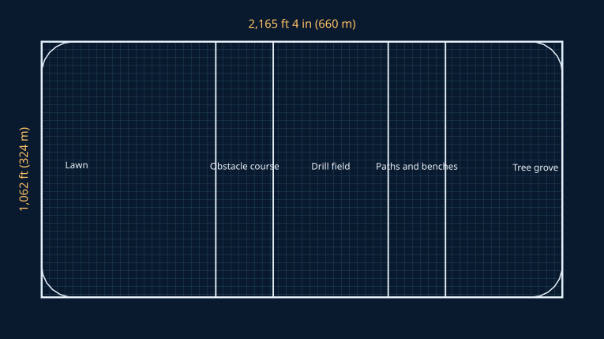

# P1-25 Training Field 4: plan

Footprint 2,165 ft 4 in (660 m) × 1,062 ft (324 m) · structural grid 32 ft 10 in (10 m)

## Levels

| Level | Floor above deck | Height | Floor area |
|---|---|---|---|
| Level 1 · Ground | 0 ft (0 mm) | 13 ft 1 in (4,000 mm) | — |

## Elements

| ID | Designation | Type | Name | Level(s) | Size / length | Area | Status |
|---|---|---|---|---|---|---|---|
| E001 | D5F6P1B1A2R1 | zone | Lawn | L1 | 724 ft 5 in (221 m) × 1,061 ft (323 m) | 760,285 sq ft (70,633 m²) | proposed |
| E002 | D5F6P1B1A2R2 | zone | Obstacle course | L1 | 238 ft 10 in (73 m) × 1,061 ft (323 m) | 253,342 sq ft (23,536 m²) | proposed |
| E003 | D5F6P1B1A2R3 | zone | Drill field | L1 | 477 ft 8 in (146 m) × 1,061 ft (323 m) | 506,684 sq ft (47,072 m²) | proposed |
| E004 | D5F6P1B1A2R4 | zone | Paths and benches | L1 | 238 ft 10 in (73 m) × 1,060 ft 8 in (323 m) | 253,342 sq ft (23,536 m²) | proposed |
| E005 | D5F6P1B1A2R5 | zone | Tree grove | L1 | 485 ft 7 in (148 m) × 1,061 ft (323 m) | 506,953 sq ft (47,097 m²) | proposed |

## Drawings

### Level 1 · Ground

