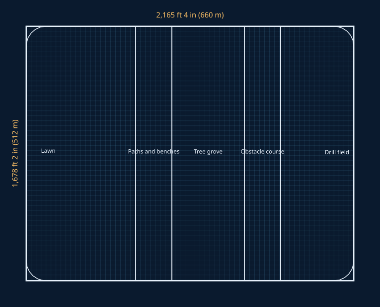

# P1-27 Training Field 5: plan

Footprint 2,165 ft 4 in (660 m) × 1,678 ft 2 in (512 m) · structural grid 32 ft 10 in (10 m)

## Levels

| Level | Floor above deck | Height | Floor area |
|---|---|---|---|
| Level 1 · Ground | 0 ft (0 mm) | 13 ft 1 in (4,000 mm) | — |

## Elements

| ID | Designation | Type | Name | Level(s) | Size / length | Area | Status |
|---|---|---|---|---|---|---|---|
| E001 | D5F6P1B5A2R1 | zone | Lawn | L1 | 723 ft 5 in (220 m) × 1,677 ft 2 in (511 m) | 1,204,585 sq ft (111,910 m²) | proposed |
| E002 | D5F6P1B5A2R2 | zone | Paths and benches | L1 | 239 ft 6 in (73 m) × 1,677 ft 2 in (511 m) | 401,605 sq ft (37,310 m²) | proposed |
| E003 | D5F6P1B5A2R3 | zone | Tree grove | L1 | 479 ft (146 m) × 1,677 ft 2 in (511 m) | 803,210 sq ft (74,621 m²) | proposed |
| E004 | D5F6P1B5A2R4 | zone | Obstacle course | L1 | 239 ft 6 in (73 m) × 1,676 ft 10 in (511 m) | 401,605 sq ft (37,310 m²) | proposed |
| E005 | D5F6P1B5A2R5 | zone | Drill field | L1 | 483 ft 11 in (148 m) × 1,677 ft 2 in (511 m) | 802,990 sq ft (74,600 m²) | proposed |

## Drawings

### Level 1 · Ground

