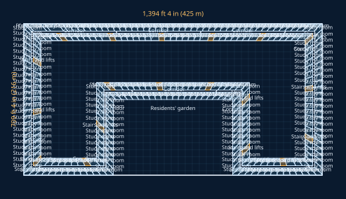
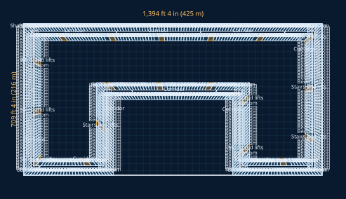

# P1-28 Cadet House 6: plan

Footprint 1,394 ft 4 in (425 m) × 709 ft 4 in (216 m) · structural grid 32 ft 10 in (10 m)

## Levels

| Level | Floor above deck | Height | Floor area |
|---|---|---|---|
| Level 1 · Ground floor | 0 ft (0 mm) | 14 ft 9 in (4,500 mm) | 299,856 sq ft (27,858 m²) |
| Level 2 · Bedroom floor 1 | 14 ft 9 in (4,500 mm) | 10 ft 6 in (3,200 mm) | 299,856 sq ft (27,858 m²) |
| Level 3 · Bedroom floor 2 | 25 ft 3 in (7,700 mm) | 10 ft 6 in (3,200 mm) | 299,856 sq ft (27,858 m²) |
| Level 4 · Bedroom floor 3 | 35 ft 9 in (11 m) | 10 ft 6 in (3,200 mm) | 299,856 sq ft (27,858 m²) |
| Level 5 · Bedroom floor 4 | 46 ft 3 in (14 m) | 10 ft 6 in (3,200 mm) | 299,856 sq ft (27,858 m²) |
| Level 6 · Bedroom floor 5 | 56 ft 9 in (17 m) | 10 ft 6 in (3,200 mm) | 299,856 sq ft (27,858 m²) |

## Elements

| ID | Designation | Type | Name | Level(s) | Size / length | Area | Status |
|---|---|---|---|---|---|---|---|
| E001 | D5F6P1B6A2L1R1 | zone | Residents' garden | L1 | 1,236 ft 11 in (377 m) × 551 ft 10 in (168 m) | 428,894 sq ft (39,846 m²) | proposed |
| E002 | D5F6P1B6A2L1R2 | zone | Corridor | L1 | 400 ft 7 in (122 m) × 9 ft 10 in (3,000 mm) | 3,875 sq ft (360 m²) | proposed |
| E003 | D5F6P1B6A2L1R3 | zone | Corridor | L1 | 396 ft 8 in (121 m) × 9 ft 10 in (3,000 mm) | 3,875 sq ft (360 m²) | proposed |
| E004 | D5F6P1B6A2L1R4 | zone | Corridor | L1 | 398 ft 7 in (122 m) × 9 ft 10 in (3,000 mm) | 3,875 sq ft (360 m²) | proposed |
| E005 | D5F6P1B6A2L1R5 | zone | Corridor | L1 | 143 ft 4 in (44 m) × 265 ft 1 in (81 m) | 3,875 sq ft (360 m²) | proposed |
| E006 | D5F6P1B6A2L1R6 | zone | Corridor | L1 | 31 ft 6 in (9,600 mm) × 377 ft 4 in (115 m) | 3,875 sq ft (360 m²) | proposed |
| E007 | D5F6P1B6A2L1R7 | zone | Corridor | L1 | 326 ft 5 in (100 m) × 86 ft 3 in (26 m) | 3,875 sq ft (360 m²) | proposed |
| E008 | D5F6P1B6A2L1R8 | zone | Corridor | L1 | 123 ft 8 in (38 m) × 288 ft 1 in (88 m) | 3,875 sq ft (360 m²) | proposed |
| E009 | D5F6P1B6A2L1R9 | zone | Corridor | L1 | 399 ft 11 in (122 m) × 9 ft 10 in (3,000 mm) | 3,875 sq ft (360 m²) | proposed |
| E010 | D5F6P1B6A2L1R10 | zone | Corridor | L1 | 135 ft 2 in (41 m) × 276 ft 3 in (84 m) | 3,875 sq ft (360 m²) | proposed |
| E011 | D5F6P1B6A2L1R11 | zone | Corridor | L1 | 314 ft 4 in (96 m) × 98 ft 1 in (30 m) | 3,875 sq ft (360 m²) | proposed |
| E012 | D5F6P1B6A2L1R12 | zone | Corridor | L1 | 43 ft (13 m) × 365 ft 2 in (111 m) | 3,875 sq ft (360 m²) | proposed |
| E013 | D5F6P1B6A2L1R13 | zone | Corridor | L1 | 9 ft 10 in (3,000 mm) × 276 ft 7 in (84 m) | 2,667 sq ft (248 m²) | proposed |
| E014 | D5F6P1B6A2L1R14, D5F6P1B6A2L2R1, D5F6P1B6A2L3R1, D5F6P1B6A2L4R1, D5F6P1B6A2L5R1, D5F6P1B6A2L6R1 | core | Stairs and lifts | L1, L2, L3, L4, L5, L6 | 54 ft 6 in (17 m) × 34 ft 5 in (10 m) | 910 sq ft (85 m²) | proposed |
| E015 | D5F6P1B6A2L1R15, D5F6P1B6A2L2R2, D5F6P1B6A2L3R2, D5F6P1B6A2L4R2, D5F6P1B6A2L5R2, D5F6P1B6A2L6R2 | core | Stairs and lifts | L1, L2, L3, L4, L5, L6 | 42 ft (13 m) × 34 ft 5 in (10 m) | 910 sq ft (85 m²) | proposed |
| E016 | D5F6P1B6A2L1R16, D5F6P1B6A2L2R3, D5F6P1B6A2L3R3, D5F6P1B6A2L4R3, D5F6P1B6A2L5R3, D5F6P1B6A2L6R3 | core | Stairs and lifts | L1, L2, L3, L4, L5, L6 | 29 ft 2 in (8,900 mm) × 34 ft 5 in (10 m) | 910 sq ft (85 m²) | proposed |
| E017 | D5F6P1B6A2L1R17, D5F6P1B6A2L2R4, D5F6P1B6A2L3R4, D5F6P1B6A2L4R4, D5F6P1B6A2L5R4, D5F6P1B6A2L6R4 | core | Stairs and lifts | L1, L2, L3, L4, L5, L6 | 36 ft 1 in (11 m) × 34 ft 5 in (10 m) | 910 sq ft (85 m²) | proposed |
| E018 | D5F6P1B6A2L1R18, D5F6P1B6A2L2R5, D5F6P1B6A2L3R5, D5F6P1B6A2L4R5, D5F6P1B6A2L5R5, D5F6P1B6A2L6R5 | core | Stairs and lifts | L1, L2, L3, L4, L5, L6 | 48 ft 7 in (15 m) × 34 ft 5 in (10 m) | 899 sq ft (83 m²) | proposed |
| E019 | D5F6P1B6A2L1R19, D5F6P1B6A2L2R6, D5F6P1B6A2L3R6, D5F6P1B6A2L4R6, D5F6P1B6A2L5R6, D5F6P1B6A2L6R6 | core | Stairs and lifts | L1, L2, L3, L4, L5, L6 | 38 ft 1 in (12 m) × 55 ft 9 in (17 m) | 904 sq ft (84 m²) | proposed |
| E020 | D5F6P1B6A2L1R20, D5F6P1B6A2L2R7, D5F6P1B6A2L3R7, D5F6P1B6A2L4R7, D5F6P1B6A2L5R7, D5F6P1B6A2L6R7 | core | Stairs and lifts | L1, L2, L3, L4, L5, L6 | 34 ft 5 in (10 m) × 32 ft 2 in (9,800 mm) | 899 sq ft (83 m²) | proposed |
| E021 | D5F6P1B6A2L1R21, D5F6P1B6A2L2R8, D5F6P1B6A2L3R8, D5F6P1B6A2L4R8, D5F6P1B6A2L5R8, D5F6P1B6A2L6R8 | core | Stairs and lifts | L1, L2, L3, L4, L5, L6 | 34 ft 5 in (10 m) × 47 ft 7 in (14 m) | 904 sq ft (84 m²) | proposed |
| E022 | D5F6P1B6A2L1R22, D5F6P1B6A2L2R9, D5F6P1B6A2L3R9, D5F6P1B6A2L4R9, D5F6P1B6A2L5R9, D5F6P1B6A2L6R9 | core | Stairs and lifts | L1, L2, L3, L4, L5, L6 | 32 ft 2 in (9,800 mm) × 34 ft 5 in (10 m) | 899 sq ft (83 m²) | proposed |
| E023 | D5F6P1B6A2L1R23, D5F6P1B6A2L2R10, D5F6P1B6A2L3R10, D5F6P1B6A2L4R10, D5F6P1B6A2L5R10, D5F6P1B6A2L6R10 | core | Stairs and lifts | L1, L2, L3, L4, L5, L6 | 34 ft 5 in (10 m) × 60 ft 8 in (18 m) | 904 sq ft (84 m²) | proposed |
| E024 | D5F6P1B6A2L1R24, D5F6P1B6A2L2R11, D5F6P1B6A2L3R11, D5F6P1B6A2L4R11, D5F6P1B6A2L5R11, D5F6P1B6A2L6R11 | core | Stairs and lifts | L1, L2, L3, L4, L5, L6 | 34 ft 5 in (10 m) × 60 ft 8 in (18 m) | 904 sq ft (84 m²) | proposed |
| E025 | D5F6P1B6A2L1R25, D5F6P1B6A2L2R12, D5F6P1B6A2L3R12, D5F6P1B6A2L4R12, D5F6P1B6A2L5R12, D5F6P1B6A2L6R12 | core | Stairs and lifts | L1, L2, L3, L4, L5, L6 | 43 ft 4 in (13 m) × 34 ft 5 in (10 m) | 904 sq ft (84 m²) | proposed |
| E026 | D5F6P1B6A2L1R26, D5F6P1B6A2L2R13, D5F6P1B6A2L3R13, D5F6P1B6A2L4R13, D5F6P1B6A2L5R13, D5F6P1B6A2L6R13 | core | Stairs and lifts | L1, L2, L3, L4, L5, L6 | 32 ft 10 in (10 m) × 34 ft 5 in (10 m) | 904 sq ft (84 m²) | proposed |
| E027 | D5F6P1B6A2L1R27, D5F6P1B6A2L2R14, D5F6P1B6A2L3R14, D5F6P1B6A2L4R14, D5F6P1B6A2L5R14, D5F6P1B6A2L6R14 | core | Stairs and lifts | L1, L2, L3, L4, L5, L6 | 56 ft 1 in (17 m) × 34 ft 5 in (10 m) | 904 sq ft (84 m²) | proposed |
| E028 | D5F6P1B6A2L1R28, D5F6P1B6A2L2R15, D5F6P1B6A2L3R15, D5F6P1B6A2L4R15, D5F6P1B6A2L5R15, D5F6P1B6A2L6R15 | core | Stairs and lifts | L1, L2, L3, L4, L5, L6 | 34 ft 5 in (10 m) × 60 ft 8 in (18 m) | 904 sq ft (84 m²) | proposed |
| E029 | D5F6P1B6A2L1R29, D5F6P1B6A2L2R16, D5F6P1B6A2L3R16, D5F6P1B6A2L4R16, D5F6P1B6A2L5R16, D5F6P1B6A2L6R16 | core | Stairs and lifts | L1, L2, L3, L4, L5, L6 | 44 ft 11 in (14 m) × 34 ft 5 in (10 m) | 899 sq ft (83 m²) | proposed |
| E030 | D5F6P1B6A2L1R30, D5F6P1B6A2L2R17, D5F6P1B6A2L3R17, D5F6P1B6A2L4R17, D5F6P1B6A2L5R17, D5F6P1B6A2L6R17 | core | Stairs and lifts | L1, L2, L3, L4, L5, L6 | 42 ft 4 in (13 m) × 50 ft 6 in (15 m) | 904 sq ft (84 m²) | proposed |
| E031 | D5F6P1B6A2L1R31, D5F6P1B6A2L2R18, D5F6P1B6A2L3R18, D5F6P1B6A2L4R18, D5F6P1B6A2L5R18, D5F6P1B6A2L6R18 | core | Stairs and lifts | L1, L2, L3, L4, L5, L6 | 34 ft 5 in (10 m) × 33 ft 2 in (10 m) | 910 sq ft (85 m²) | proposed |
| E032 | D5F6P1B6A2L1R32, D5F6P1B6A2L2R19, D5F6P1B6A2L3R19, D5F6P1B6A2L4R19, D5F6P1B6A2L5R19, D5F6P1B6A2L6R19 | core | Stairs and lifts | L1, L2, L3, L4, L5, L6 | 34 ft 5 in (10 m) × 47 ft 3 in (14 m) | 910 sq ft (85 m²) | proposed |
| E033 | D5F6P1B6A2L1R33 | room | Front desk | L1 | 46 ft 7 in (14 m) × 34 ft 5 in (10 m) | 429 sq ft (40 m²) | proposed |
| E034 | D5F6P1B6A2L1R34 | room | Common room | L1 | 94 ft 10 in (29 m) × 34 ft 5 in (10 m) | 2,153 sq ft (200 m²) | proposed |
| E035 | D5F6P1B6A2L1R35 | room | Laundry | L1 | 48 ft 11 in (15 m) × 34 ft 5 in (10 m) | 644 sq ft (60 m²) | proposed |
| E036 | D5F6P1B6A2L1R36 | room | Kitchen and dining room | L1 | 90 ft 7 in (28 m) × 34 ft 5 in (10 m) | 2,153 sq ft (200 m²) | proposed |
| E037 | D5F6P1B6A2L1R37 | room | Toilets | L1 | 44 ft 11 in (14 m) × 34 ft 5 in (10 m) | 650 sq ft (60 m²) | proposed |
| E038 | D5F6P1B6A2L1R38 | room | Housemaster's flat | L1 | 52 ft 10 in (16 m) × 34 ft 5 in (10 m) | 966 sq ft (90 m²) | proposed |
| E039 | D5F6P1B6A2L1R39 | room | Study room | L1 | 51 ft 6 in (16 m) × 34 ft 5 in (10 m) | 972 sq ft (90 m²) | proposed |
| E040 | D5F6P1B6A2L1R40 | room | Study room | L1 | 49 ft 10 in (15 m) × 34 ft 5 in (10 m) | 966 sq ft (90 m²) | proposed |
| E041 | D5F6P1B6A2L1R41 | room | Study room | L1 | 48 ft 7 in (15 m) × 34 ft 5 in (10 m) | 966 sq ft (90 m²) | proposed |
| E042 | D5F6P1B6A2L1R42 | room | Study room | L1 | 47 ft 7 in (14 m) × 34 ft 5 in (10 m) | 972 sq ft (90 m²) | proposed |
| E043 | D5F6P1B6A2L1R43 | room | Study room | L1 | 45 ft 11 in (14 m) × 34 ft 5 in (10 m) | 966 sq ft (90 m²) | proposed |
| E044 | D5F6P1B6A2L1R44 | room | Study room | L1 | 44 ft 7 in (14 m) × 34 ft 5 in (10 m) | 972 sq ft (90 m²) | proposed |
| E045 | D5F6P1B6A2L1R45 | room | Study room | L1 | 43 ft (13 m) × 34 ft 5 in (10 m) | 966 sq ft (90 m²) | proposed |
| E046 | D5F6P1B6A2L1R46 | room | Study room | L1 | 41 ft 8 in (13 m) × 34 ft 5 in (10 m) | 972 sq ft (90 m²) | proposed |
| E047 | D5F6P1B6A2L1R47 | room | Study room | L1 | 40 ft (12 m) × 34 ft 5 in (10 m) | 966 sq ft (90 m²) | proposed |
| E048 | D5F6P1B6A2L1R48 | room | Study room | L1 | 38 ft 9 in (12 m) × 34 ft 5 in (10 m) | 972 sq ft (90 m²) | proposed |
| E049 | D5F6P1B6A2L1R49 | room | Study room | L1 | 37 ft 1 in (11 m) × 34 ft 5 in (10 m) | 961 sq ft (89 m²) | proposed |
| E050 | D5F6P1B6A2L1R50 | room | Study room | L1 | 36 ft 1 in (11 m) × 34 ft 5 in (10 m) | 972 sq ft (90 m²) | proposed |
| E051 | D5F6P1B6A2L1R51 | room | Study room | L1 | 34 ft 5 in (10 m) × 34 ft 5 in (10 m) | 966 sq ft (90 m²) | proposed |
| E052 | D5F6P1B6A2L1R52 | room | Study room | L1 | 33 ft 2 in (10 m) × 34 ft 5 in (10 m) | 972 sq ft (90 m²) | proposed |
| E053 | D5F6P1B6A2L1R53 | room | Study room | L1 | 31 ft 10 in (9,700 mm) × 34 ft 5 in (10 m) | 972 sq ft (90 m²) | proposed |
| E054 | D5F6P1B6A2L1R54 | room | Study room | L1 | 30 ft 2 in (9,200 mm) × 34 ft 5 in (10 m) | 966 sq ft (90 m²) | proposed |
| E055 | D5F6P1B6A2L1R55 | room | Study room | L1 | 28 ft 10 in (8,800 mm) × 34 ft 5 in (10 m) | 972 sq ft (90 m²) | proposed |
| E056 | D5F6P1B6A2L1R56 | room | Study room | L1 | 28 ft 10 in (8,800 mm) × 34 ft 5 in (10 m) | 966 sq ft (90 m²) | proposed |
| E057 | D5F6P1B6A2L1R57 | room | Study room | L1 | 30 ft 6 in (9,300 mm) × 34 ft 5 in (10 m) | 972 sq ft (90 m²) | proposed |
| E058 | D5F6P1B6A2L1R58 | room | Study room | L1 | 31 ft 6 in (9,600 mm) × 34 ft 5 in (10 m) | 961 sq ft (89 m²) | proposed |
| E059 | D5F6P1B6A2L1R59 | room | Study room | L1 | 33 ft 2 in (10 m) × 34 ft 5 in (10 m) | 972 sq ft (90 m²) | proposed |
| E060 | D5F6P1B6A2L1R60 | room | Study room | L1 | 34 ft 5 in (10 m) × 34 ft 5 in (10 m) | 966 sq ft (90 m²) | proposed |
| E061 | D5F6P1B6A2L1R61 | room | Study room | L1 | 36 ft 1 in (11 m) × 34 ft 5 in (10 m) | 972 sq ft (90 m²) | proposed |
| E062 | D5F6P1B6A2L1R62 | room | Study room | L1 | 37 ft 5 in (11 m) × 34 ft 5 in (10 m) | 966 sq ft (90 m²) | proposed |
| E063 | D5F6P1B6A2L1R63 | room | Study room | L1 | 39 ft 1 in (12 m) × 34 ft 5 in (10 m) | 972 sq ft (90 m²) | proposed |
| E064 | D5F6P1B6A2L1R64 | room | Study room | L1 | 40 ft 4 in (12 m) × 34 ft 5 in (10 m) | 966 sq ft (90 m²) | proposed |
| E065 | D5F6P1B6A2L1R65 | room | Study room | L1 | 42 ft (13 m) × 34 ft 5 in (10 m) | 972 sq ft (90 m²) | proposed |
| E066 | D5F6P1B6A2L1R66 | room | Study room | L1 | 43 ft 4 in (13 m) × 34 ft 5 in (10 m) | 972 sq ft (90 m²) | proposed |
| E067 | D5F6P1B6A2L1R67 | room | Study room | L1 | 44 ft 3 in (14 m) × 34 ft 5 in (10 m) | 961 sq ft (89 m²) | proposed |
| E068 | D5F6P1B6A2L1R68 | room | Study room | L1 | 45 ft 11 in (14 m) × 34 ft 5 in (10 m) | 972 sq ft (90 m²) | proposed |
| E069 | D5F6P1B6A2L1R69 | room | Study room | L1 | 47 ft 3 in (14 m) × 34 ft 5 in (10 m) | 966 sq ft (90 m²) | proposed |
| E070 | D5F6P1B6A2L1R70 | room | Study room | L1 | 48 ft 11 in (15 m) × 34 ft 5 in (10 m) | 972 sq ft (90 m²) | proposed |
| E071 | D5F6P1B6A2L1R71 | room | Study room | L1 | 50 ft 2 in (15 m) × 34 ft 5 in (10 m) | 966 sq ft (90 m²) | proposed |
| E072 | D5F6P1B6A2L1R72 | room | Study room | L1 | 51 ft 10 in (16 m) × 34 ft 5 in (10 m) | 972 sq ft (90 m²) | proposed |
| E073 | D5F6P1B6A2L1R73 | room | Study room | L1 | 53 ft 2 in (16 m) × 34 ft 5 in (10 m) | 966 sq ft (90 m²) | proposed |
| E074 | D5F6P1B6A2L1R74 | room | Study room | L1 | 54 ft 9 in (17 m) × 34 ft 5 in (10 m) | 972 sq ft (90 m²) | proposed |
| E075 | D5F6P1B6A2L1R75 | room | Study room | L1 | 55 ft 9 in (17 m) × 34 ft 5 in (10 m) | 961 sq ft (89 m²) | proposed |
| E076 | D5F6P1B6A2L1R76 | room | Study room | L1 | 57 ft 5 in (18 m) × 34 ft 5 in (10 m) | 972 sq ft (90 m²) | proposed |
| E077 | D5F6P1B6A2L1R77 | room | Study room | L1 | 58 ft 9 in (18 m) × 34 ft 5 in (10 m) | 972 sq ft (90 m²) | proposed |
| E078 | D5F6P1B6A2L1R78 | room | Study room | L1 | 60 ft (18 m) × 34 ft 5 in (10 m) | 966 sq ft (90 m²) | proposed |
| E079 | D5F6P1B6A2L1R79 | room | Study room | L1 | 61 ft 8 in (19 m) × 34 ft 5 in (10 m) | 972 sq ft (90 m²) | proposed |
| E080 | D5F6P1B6A2L1R80 | room | Study room | L1 | 38 ft 1 in (12 m) × 57 ft 5 in (18 m) | 966 sq ft (90 m²) | proposed |
| E081 | D5F6P1B6A2L1R81 | room | Study room | L1 | 34 ft 5 in (10 m) × 58 ft 9 in (18 m) | 972 sq ft (90 m²) | proposed |
| E082 | D5F6P1B6A2L1R82 | room | Study room | L1 | 34 ft 5 in (10 m) × 55 ft 9 in (17 m) | 966 sq ft (90 m²) | proposed |
| E083 | D5F6P1B6A2L1R83 | room | Study room | L1 | 34 ft 5 in (10 m) × 52 ft 10 in (16 m) | 966 sq ft (90 m²) | proposed |
| E084 | D5F6P1B6A2L1R84 | room | Study room | L1 | 34 ft 5 in (10 m) × 50 ft 2 in (15 m) | 972 sq ft (90 m²) | proposed |
| E085 | D5F6P1B6A2L1R85 | room | Study room | L1 | 34 ft 5 in (10 m) × 47 ft 3 in (14 m) | 966 sq ft (90 m²) | proposed |
| E086 | D5F6P1B6A2L1R86 | room | Study room | L1 | 34 ft 5 in (10 m) × 44 ft 3 in (14 m) | 966 sq ft (90 m²) | proposed |
| E087 | D5F6P1B6A2L1R87 | room | Study room | L1 | 34 ft 5 in (10 m) × 41 ft 8 in (13 m) | 972 sq ft (90 m²) | proposed |
| E088 | D5F6P1B6A2L1R88 | room | Study room | L1 | 34 ft 5 in (10 m) × 38 ft 9 in (12 m) | 972 sq ft (90 m²) | proposed |
| E089 | D5F6P1B6A2L1R89 | room | Study room | L1 | 34 ft 5 in (10 m) × 35 ft 5 in (11 m) | 966 sq ft (90 m²) | proposed |
| E090 | D5F6P1B6A2L1R90 | room | Study room | L1 | 34 ft 5 in (10 m) × 32 ft 10 in (10 m) | 972 sq ft (90 m²) | proposed |
| E091 | D5F6P1B6A2L1R91 | room | Study room | L1 | 34 ft 5 in (10 m) × 29 ft 10 in (9,100 mm) | 966 sq ft (90 m²) | proposed |
| E092 | D5F6P1B6A2L1R92 | room | Study room | L1 | 34 ft 5 in (10 m) × 29 ft 6 in (9,000 mm) | 966 sq ft (90 m²) | proposed |
| E093 | D5F6P1B6A2L1R93 | room | Study room | L1 | 34 ft 5 in (10 m) × 32 ft 2 in (9,800 mm) | 972 sq ft (90 m²) | proposed |
| E094 | D5F6P1B6A2L1R94 | room | Study room | L1 | 34 ft 5 in (10 m) × 34 ft 9 in (11 m) | 966 sq ft (90 m²) | proposed |
| E095 | D5F6P1B6A2L1R95 | room | Study room | L1 | 34 ft 5 in (10 m) × 37 ft 9 in (12 m) | 966 sq ft (90 m²) | proposed |
| E096 | D5F6P1B6A2L1R96 | room | Study room | L1 | 34 ft 5 in (10 m) × 40 ft 8 in (12 m) | 972 sq ft (90 m²) | proposed |
| E097 | D5F6P1B6A2L1R97 | room | Study room | L1 | 34 ft 5 in (10 m) × 43 ft 4 in (13 m) | 966 sq ft (90 m²) | proposed |
| E098 | D5F6P1B6A2L1R98 | room | Study room | L1 | 34 ft 5 in (10 m) × 46 ft 3 in (14 m) | 966 sq ft (90 m²) | proposed |
| E099 | D5F6P1B6A2L1R99 | room | Study room | L1 | 34 ft 5 in (10 m) × 49 ft 6 in (15 m) | 978 sq ft (91 m²) | proposed |
| E100 | D5F6P1B6A2L1R100 | room | Study room | L1 | 34 ft 5 in (10 m) × 52 ft 2 in (16 m) | 966 sq ft (90 m²) | proposed |
| E101 | D5F6P1B6A2L1R101 | room | Study room | L1 | 34 ft 5 in (10 m) × 55 ft 1 in (17 m) | 966 sq ft (90 m²) | proposed |
| E102 | D5F6P1B6A2L1R102 | room | Study room | L1 | 34 ft 5 in (10 m) × 58 ft 1 in (18 m) | 972 sq ft (90 m²) | proposed |
| E103 | D5F6P1B6A2L1R103 | room | Study room | L1 | 34 ft 5 in (10 m) × 60 ft 8 in (18 m) | 966 sq ft (90 m²) | proposed |
| E104 | D5F6P1B6A2L1R104 | room | Study room | L1 | 56 ft 9 in (17 m) × 38 ft 1 in (12 m) | 972 sq ft (90 m²) | proposed |
| E105 | D5F6P1B6A2L1R105 | room | Study room | L1 | 55 ft 9 in (17 m) × 34 ft 5 in (10 m) | 966 sq ft (90 m²) | proposed |
| E106 | D5F6P1B6A2L1R106 | room | Study room | L1 | 50 ft 10 in (16 m) × 34 ft 5 in (10 m) | 972 sq ft (90 m²) | proposed |
| E107 | D5F6P1B6A2L1R107 | room | Study room | L1 | 45 ft 7 in (14 m) × 34 ft 5 in (10 m) | 966 sq ft (90 m²) | proposed |
| E108 | D5F6P1B6A2L1R108 | room | Study room | L1 | 40 ft 8 in (12 m) × 34 ft 5 in (10 m) | 966 sq ft (90 m²) | proposed |
| E109 | D5F6P1B6A2L1R109 | room | Study room | L1 | 35 ft 9 in (11 m) × 34 ft 5 in (10 m) | 972 sq ft (90 m²) | proposed |
| E110 | D5F6P1B6A2L1R110 | room | Study room | L1 | 30 ft 6 in (9,300 mm) × 34 ft 5 in (10 m) | 966 sq ft (90 m²) | proposed |
| E111 | D5F6P1B6A2L1R111 | room | Study room | L1 | 30 ft 10 in (9,400 mm) × 34 ft 5 in (10 m) | 972 sq ft (90 m²) | proposed |
| E112 | D5F6P1B6A2L1R112 | room | Study room | L1 | 35 ft 9 in (11 m) × 34 ft 5 in (10 m) | 966 sq ft (90 m²) | proposed |
| E113 | D5F6P1B6A2L1R113 | room | Study room | L1 | 41 ft (12 m) × 34 ft 5 in (10 m) | 972 sq ft (90 m²) | proposed |
| E114 | D5F6P1B6A2L1R114 | room | Study room | L1 | 45 ft 11 in (14 m) × 34 ft 5 in (10 m) | 966 sq ft (90 m²) | proposed |
| E115 | D5F6P1B6A2L1R115 | room | Study room | L1 | 50 ft 10 in (16 m) × 34 ft 5 in (10 m) | 966 sq ft (90 m²) | proposed |
| E116 | D5F6P1B6A2L1R116 | room | Study room | L1 | 56 ft 1 in (17 m) × 34 ft 5 in (10 m) | 972 sq ft (90 m²) | proposed |
| E117 | D5F6P1B6A2L1R117 | room | Study room | L1 | 54 ft 6 in (17 m) × 40 ft 4 in (12 m) | 961 sq ft (89 m²) | proposed |
| E118 | D5F6P1B6A2L1R118 | room | Study room | L1 | 34 ft 5 in (10 m) × 62 ft 8 in (19 m) | 972 sq ft (90 m²) | proposed |
| E119 | D5F6P1B6A2L1R119 | room | Study room | L1 | 34 ft 5 in (10 m) × 62 ft 8 in (19 m) | 972 sq ft (90 m²) | proposed |
| E120 | D5F6P1B6A2L1R120 | room | Study room | L1 | 34 ft 5 in (10 m) × 62 ft 8 in (19 m) | 972 sq ft (90 m²) | proposed |
| E121 | D5F6P1B6A2L1R121 | room | Study room | L1 | 34 ft 5 in (10 m) × 62 ft 4 in (19 m) | 961 sq ft (89 m²) | proposed |
| E122 | D5F6P1B6A2L1R122 | room | Study room | L1 | 34 ft 5 in (10 m) × 62 ft 8 in (19 m) | 972 sq ft (90 m²) | proposed |
| E123 | D5F6P1B6A2L1R123 | room | Study room | L1 | 34 ft 5 in (10 m) × 62 ft 8 in (19 m) | 972 sq ft (90 m²) | proposed |
| E124 | D5F6P1B6A2L1R124 | room | Study room | L1 | 34 ft 5 in (10 m) × 62 ft 4 in (19 m) | 961 sq ft (89 m²) | proposed |
| E125 | D5F6P1B6A2L1R125 | room | Study room | L1 | 34 ft 5 in (10 m) × 62 ft 8 in (19 m) | 972 sq ft (90 m²) | proposed |
| E126 | D5F6P1B6A2L1R126 | room | Study room | L1 | 34 ft 5 in (10 m) × 62 ft 8 in (19 m) | 972 sq ft (90 m²) | proposed |
| E127 | D5F6P1B6A2L1R127 | room | Study room | L1 | 34 ft 5 in (10 m) × 62 ft 8 in (19 m) | 972 sq ft (90 m²) | proposed |
| E128 | D5F6P1B6A2L1R128 | room | Study room | L1 | 34 ft 5 in (10 m) × 62 ft 4 in (19 m) | 961 sq ft (89 m²) | proposed |
| E129 | D5F6P1B6A2L1R129 | room | Study room | L1 | 34 ft 5 in (10 m) × 62 ft 8 in (19 m) | 972 sq ft (90 m²) | proposed |
| E130 | D5F6P1B6A2L1R130 | room | Study room | L1 | 50 ft 6 in (15 m) × 45 ft 7 in (14 m) | 972 sq ft (90 m²) | proposed |
| E131 | D5F6P1B6A2L1R131 | room | Study room | L1 | 58 ft 9 in (18 m) × 34 ft 5 in (10 m) | 961 sq ft (89 m²) | proposed |
| E132 | D5F6P1B6A2L1R132 | room | Study room | L1 | 55 ft 9 in (17 m) × 34 ft 5 in (10 m) | 972 sq ft (90 m²) | proposed |
| E133 | D5F6P1B6A2L1R133 | room | Study room | L1 | 52 ft 6 in (16 m) × 34 ft 5 in (10 m) | 972 sq ft (90 m²) | proposed |
| E134 | D5F6P1B6A2L1R134 | room | Study room | L1 | 49 ft 3 in (15 m) × 34 ft 5 in (10 m) | 972 sq ft (90 m²) | proposed |
| E135 | D5F6P1B6A2L1R135 | room | Study room | L1 | 45 ft 7 in (14 m) × 34 ft 5 in (10 m) | 961 sq ft (89 m²) | proposed |
| E136 | D5F6P1B6A2L1R136 | room | Study room | L1 | 42 ft 8 in (13 m) × 34 ft 5 in (10 m) | 972 sq ft (90 m²) | proposed |
| E137 | D5F6P1B6A2L1R137 | room | Study room | L1 | 39 ft 4 in (12 m) × 34 ft 5 in (10 m) | 972 sq ft (90 m²) | proposed |
| E138 | D5F6P1B6A2L1R138 | room | Study room | L1 | 36 ft 1 in (11 m) × 34 ft 5 in (10 m) | 966 sq ft (90 m²) | proposed |
| E139 | D5F6P1B6A2L1R139 | room | Study room | L1 | 32 ft 10 in (10 m) × 34 ft 5 in (10 m) | 966 sq ft (90 m²) | proposed |
| E140 | D5F6P1B6A2L1R140 | room | Study room | L1 | 29 ft 10 in (9,100 mm) × 34 ft 5 in (10 m) | 972 sq ft (90 m²) | proposed |
| E141 | D5F6P1B6A2L1R141 | room | Study room | L1 | 29 ft 10 in (9,100 mm) × 34 ft 5 in (10 m) | 966 sq ft (90 m²) | proposed |
| E142 | D5F6P1B6A2L1R142 | room | Study room | L1 | 33 ft 2 in (10 m) × 34 ft 5 in (10 m) | 966 sq ft (90 m²) | proposed |
| E143 | D5F6P1B6A2L1R143 | room | Study room | L1 | 36 ft 9 in (11 m) × 34 ft 5 in (10 m) | 972 sq ft (90 m²) | proposed |
| E144 | D5F6P1B6A2L1R144 | room | Study room | L1 | 40 ft (12 m) × 34 ft 5 in (10 m) | 972 sq ft (90 m²) | proposed |
| E145 | D5F6P1B6A2L1R145 | room | Study room | L1 | 43 ft (13 m) × 34 ft 5 in (10 m) | 966 sq ft (90 m²) | proposed |
| E146 | D5F6P1B6A2L1R146 | room | Study room | L1 | 46 ft 3 in (14 m) × 34 ft 5 in (10 m) | 966 sq ft (90 m²) | proposed |
| E147 | D5F6P1B6A2L1R147 | room | Study room | L1 | 49 ft 10 in (15 m) × 34 ft 5 in (10 m) | 972 sq ft (90 m²) | proposed |
| E148 | D5F6P1B6A2L1R148 | room | Study room | L1 | 52 ft 10 in (16 m) × 34 ft 5 in (10 m) | 966 sq ft (90 m²) | proposed |
| E149 | D5F6P1B6A2L1R149 | room | Study room | L1 | 56 ft 1 in (17 m) × 34 ft 5 in (10 m) | 972 sq ft (90 m²) | proposed |
| E150 | D5F6P1B6A2L1R150 | room | Study room | L1 | 59 ft 5 in (18 m) × 34 ft 5 in (10 m) | 966 sq ft (90 m²) | proposed |
| E151 | D5F6P1B6A2L1R151 | room | Study room | L1 | 46 ft 7 in (14 m) × 49 ft 10 in (15 m) | 972 sq ft (90 m²) | proposed |
| E152 | D5F6P1B6A2L1R152 | room | Study room | L1 | 34 ft 5 in (10 m) × 62 ft 4 in (19 m) | 961 sq ft (89 m²) | proposed |
| E153 | D5F6P1B6A2L1R153 | room | Study room | L1 | 34 ft 5 in (10 m) × 62 ft 8 in (19 m) | 972 sq ft (90 m²) | proposed |
| E154 | D5F6P1B6A2L1R154 | room | Study room | L1 | 34 ft 5 in (10 m) × 62 ft 8 in (19 m) | 972 sq ft (90 m²) | proposed |
| E155 | D5F6P1B6A2L1R155 | room | Study room | L1 | 34 ft 5 in (10 m) × 62 ft 8 in (19 m) | 972 sq ft (90 m²) | proposed |
| E156 | D5F6P1B6A2L1R156 | room | Study room | L1 | 34 ft 5 in (10 m) × 62 ft 4 in (19 m) | 961 sq ft (89 m²) | proposed |
| E157 | D5F6P1B6A2L1R157 | room | Study room | L1 | 34 ft 5 in (10 m) × 62 ft 8 in (19 m) | 972 sq ft (90 m²) | proposed |
| E158 | D5F6P1B6A2L1R158 | room | Study room | L1 | 34 ft 5 in (10 m) × 62 ft 8 in (19 m) | 972 sq ft (90 m²) | proposed |
| E159 | D5F6P1B6A2L1R159 | room | Study room | L1 | 34 ft 5 in (10 m) × 62 ft 4 in (19 m) | 961 sq ft (89 m²) | proposed |
| E160 | D5F6P1B6A2L1R160 | room | Study room | L1 | 34 ft 5 in (10 m) × 62 ft 8 in (19 m) | 972 sq ft (90 m²) | proposed |
| E161 | D5F6P1B6A2L1R161 | room | Study room | L1 | 34 ft 5 in (10 m) × 62 ft 8 in (19 m) | 972 sq ft (90 m²) | proposed |
| E162 | D5F6P1B6A2L1R162 | room | Study room | L1 | 34 ft 5 in (10 m) × 62 ft 8 in (19 m) | 972 sq ft (90 m²) | proposed |
| E163 | D5F6P1B6A2L1R163 | room | Study room | L1 | 34 ft 5 in (10 m) × 62 ft 4 in (19 m) | 961 sq ft (89 m²) | proposed |
| E164 | D5F6P1B6A2L1R164 | room | Study room | L1 | 58 ft 5 in (18 m) × 36 ft 5 in (11 m) | 972 sq ft (90 m²) | proposed |
| E165 | D5F6P1B6A2L1R165 | room | Study room | L1 | 55 ft 5 in (17 m) × 34 ft 5 in (10 m) | 972 sq ft (90 m²) | proposed |
| E166 | D5F6P1B6A2L1R166 | room | Study room | L1 | 50 ft 2 in (15 m) × 34 ft 5 in (10 m) | 966 sq ft (90 m²) | proposed |
| E167 | D5F6P1B6A2L1R167 | room | Study room | L1 | 45 ft 3 in (14 m) × 34 ft 5 in (10 m) | 966 sq ft (90 m²) | proposed |
| E168 | D5F6P1B6A2L1R168 | room | Study room | L1 | 40 ft 4 in (12 m) × 34 ft 5 in (10 m) | 972 sq ft (90 m²) | proposed |
| E169 | D5F6P1B6A2L1R169 | room | Study room | L1 | 35 ft 1 in (11 m) × 34 ft 5 in (10 m) | 966 sq ft (90 m²) | proposed |
| E170 | D5F6P1B6A2L1R170 | room | Study room | L1 | 30 ft 10 in (9,400 mm) × 34 ft 5 in (10 m) | 972 sq ft (90 m²) | proposed |
| E171 | D5F6P1B6A2L1R171 | room | Study room | L1 | 31 ft 2 in (9,500 mm) × 34 ft 5 in (10 m) | 966 sq ft (90 m²) | proposed |
| E172 | D5F6P1B6A2L1R172 | room | Study room | L1 | 36 ft 1 in (11 m) × 34 ft 5 in (10 m) | 966 sq ft (90 m²) | proposed |
| E173 | D5F6P1B6A2L1R173 | room | Study room | L1 | 41 ft 4 in (13 m) × 34 ft 5 in (10 m) | 972 sq ft (90 m²) | proposed |
| E174 | D5F6P1B6A2L1R174 | room | Study room | L1 | 46 ft 3 in (14 m) × 34 ft 5 in (10 m) | 966 sq ft (90 m²) | proposed |
| E175 | D5F6P1B6A2L1R175 | room | Study room | L1 | 51 ft 6 in (16 m) × 34 ft 5 in (10 m) | 972 sq ft (90 m²) | proposed |
| E176 | D5F6P1B6A2L1R176 | room | Study room | L1 | 56 ft 5 in (17 m) × 34 ft 5 in (10 m) | 966 sq ft (90 m²) | proposed |
| E177 | D5F6P1B6A2L1R177 | room | Study room | L1 | 52 ft 10 in (16 m) × 42 ft (13 m) | 972 sq ft (90 m²) | proposed |
| E178 | D5F6P1B6A2L1R178 | room | Study room | L1 | 34 ft 5 in (10 m) × 60 ft (18 m) | 966 sq ft (90 m²) | proposed |
| E179 | D5F6P1B6A2L1R179 | room | Study room | L1 | 34 ft 5 in (10 m) × 57 ft 5 in (18 m) | 972 sq ft (90 m²) | proposed |
| E180 | D5F6P1B6A2L1R180 | room | Study room | L1 | 34 ft 5 in (10 m) × 54 ft 6 in (17 m) | 966 sq ft (90 m²) | proposed |
| E181 | D5F6P1B6A2L1R181 | room | Study room | L1 | 34 ft 5 in (10 m) × 51 ft 6 in (16 m) | 966 sq ft (90 m²) | proposed |
| E182 | D5F6P1B6A2L1R182 | room | Study room | L1 | 34 ft 5 in (10 m) × 48 ft 11 in (15 m) | 972 sq ft (90 m²) | proposed |
| E183 | D5F6P1B6A2L1R183 | room | Study room | L1 | 34 ft 5 in (10 m) × 45 ft 11 in (14 m) | 966 sq ft (90 m²) | proposed |
| E184 | D5F6P1B6A2L1R184 | room | Study room | L1 | 34 ft 5 in (10 m) × 43 ft (13 m) | 966 sq ft (90 m²) | proposed |
| E185 | D5F6P1B6A2L1R185 | room | Study room | L1 | 34 ft 5 in (10 m) × 40 ft 4 in (12 m) | 972 sq ft (90 m²) | proposed |
| E186 | D5F6P1B6A2L1R186 | room | Study room | L1 | 34 ft 5 in (10 m) × 37 ft 5 in (11 m) | 966 sq ft (90 m²) | proposed |
| E187 | D5F6P1B6A2L1R187 | room | Study room | L1 | 34 ft 5 in (10 m) × 34 ft 5 in (10 m) | 966 sq ft (90 m²) | proposed |
| E188 | D5F6P1B6A2L1R188 | room | Study room | L1 | 34 ft 5 in (10 m) × 31 ft 10 in (9,700 mm) | 978 sq ft (91 m²) | proposed |
| E189 | D5F6P1B6A2L1R189 | room | Study room | L1 | 34 ft 5 in (10 m) × 29 ft 6 in (9,000 mm) | 966 sq ft (90 m²) | proposed |
| E190 | D5F6P1B6A2L1R190 | room | Study room | L1 | 34 ft 5 in (10 m) × 30 ft 6 in (9,300 mm) | 966 sq ft (90 m²) | proposed |
| E191 | D5F6P1B6A2L1R191 | room | Study room | L1 | 34 ft 5 in (10 m) × 33 ft 6 in (10 m) | 972 sq ft (90 m²) | proposed |
| E192 | D5F6P1B6A2L1R192 | room | Study room | L1 | 34 ft 5 in (10 m) × 36 ft 1 in (11 m) | 966 sq ft (90 m²) | proposed |
| E193 | D5F6P1B6A2L1R193 | room | Study room | L1 | 34 ft 5 in (10 m) × 39 ft 1 in (12 m) | 972 sq ft (90 m²) | proposed |
| E194 | D5F6P1B6A2L1R194 | room | Study room | L1 | 34 ft 5 in (10 m) × 41 ft 8 in (13 m) | 966 sq ft (90 m²) | proposed |
| E195 | D5F6P1B6A2L1R195 | room | Study room | L1 | 34 ft 5 in (10 m) × 44 ft 7 in (14 m) | 966 sq ft (90 m²) | proposed |
| E196 | D5F6P1B6A2L1R196 | room | Study room | L1 | 34 ft 5 in (10 m) × 47 ft 7 in (14 m) | 972 sq ft (90 m²) | proposed |
| E197 | D5F6P1B6A2L1R197 | room | Study room | L1 | 34 ft 5 in (10 m) × 50 ft 2 in (15 m) | 966 sq ft (90 m²) | proposed |
| E198 | D5F6P1B6A2L1R198 | room | Study room | L1 | 34 ft 5 in (10 m) × 53 ft 2 in (16 m) | 966 sq ft (90 m²) | proposed |
| E199 | D5F6P1B6A2L1R199 | room | Study room | L1 | 34 ft 5 in (10 m) × 56 ft 5 in (17 m) | 978 sq ft (91 m²) | proposed |
| E200 | D5F6P1B6A2L1R200 | room | Study room | L1 | 34 ft 5 in (10 m) × 59 ft 1 in (18 m) | 966 sq ft (90 m²) | proposed |
| E201 | D5F6P1B6A2L1R201 | room | Study room | L1 | 34 ft 5 in (10 m) × 53 ft 6 in (16 m) | 689 sq ft (64 m²) | proposed |
| E202 | D5F6P1B6A2L1R202 | room | Study room | L1 | 61 ft 8 in (19 m) × 34 ft 5 in (10 m) | 966 sq ft (90 m²) | proposed |
| E203 | D5F6P1B6A2L1R203 | room | Study room | L1 | 60 ft 4 in (18 m) × 34 ft 5 in (10 m) | 972 sq ft (90 m²) | proposed |
| E204 | D5F6P1B6A2L1R204 | room | Study room | L1 | 58 ft 9 in (18 m) × 34 ft 5 in (10 m) | 966 sq ft (90 m²) | proposed |
| E205 | D5F6P1B6A2L1R205 | room | Study room | L1 | 48 ft 3 in (15 m) × 34 ft 5 in (10 m) | 650 sq ft (60 m²) | proposed |
| E206 | D5F6P1B6A2L1R206 | room | Study room | L1 | 54 ft 9 in (17 m) × 34 ft 5 in (10 m) | 972 sq ft (90 m²) | proposed |
| E207 | D5F6P1B6A2L1R207 | room | Study room | L1 | 53 ft 2 in (16 m) × 34 ft 5 in (10 m) | 966 sq ft (90 m²) | proposed |
| E208 | D5F6P1B6A2L1R208 | room | Study room | L1 | 51 ft 6 in (16 m) × 34 ft 5 in (10 m) | 966 sq ft (90 m²) | proposed |
| E209 | D5F6P1B6A2L1R209 | room | Study room | L1 | 50 ft 2 in (15 m) × 34 ft 5 in (10 m) | 972 sq ft (90 m²) | proposed |
| E210 | D5F6P1B6A2L1R210 | room | Study room | L1 | 48 ft 7 in (15 m) × 34 ft 5 in (10 m) | 966 sq ft (90 m²) | proposed |
| E211 | D5F6P1B6A2L1R211 | room | Study room | L1 | 47 ft 3 in (14 m) × 34 ft 5 in (10 m) | 972 sq ft (90 m²) | proposed |
| E212 | D5F6P1B6A2L1R212 | room | Study room | L1 | 55 ft 1 in (17 m) × 34 ft 5 in (10 m) | 1,300 sq ft (121 m²) | proposed |
| E213 | D5F6P1B6A2L1R213 | room | Study room | L1 | 42 ft (13 m) × 34 ft 5 in (10 m) | 966 sq ft (90 m²) | proposed |
| E214 | D5F6P1B6A2L1R214 | room | Study room | L1 | 40 ft 8 in (12 m) × 34 ft 5 in (10 m) | 972 sq ft (90 m²) | proposed |
| E215 | D5F6P1B6A2L1R215 | room | Study room | L1 | 39 ft 1 in (12 m) × 34 ft 5 in (10 m) | 966 sq ft (90 m²) | proposed |
| E216 | D5F6P1B6A2L1R216 | room | Study room | L1 | 37 ft 5 in (11 m) × 34 ft 5 in (10 m) | 966 sq ft (90 m²) | proposed |
| E217 | D5F6P1B6A2L1R217 | room | Study room | L1 | 36 ft 1 in (11 m) × 34 ft 5 in (10 m) | 972 sq ft (90 m²) | proposed |
| E218 | D5F6P1B6A2L1R218 | room | Study room | L1 | 34 ft 5 in (10 m) × 34 ft 5 in (10 m) | 966 sq ft (90 m²) | proposed |
| E219 | D5F6P1B6A2L1R219 | room | Study room | L1 | 42 ft 4 in (13 m) × 34 ft 5 in (10 m) | 1,300 sq ft (121 m²) | proposed |
| E220 | D5F6P1B6A2L1R220 | room | Study room | L1 | 29 ft 6 in (9,000 mm) × 34 ft 5 in (10 m) | 972 sq ft (90 m²) | proposed |
| E221 | D5F6P1B6A2L1R221 | room | Study room | L1 | 28 ft 10 in (8,800 mm) × 34 ft 5 in (10 m) | 966 sq ft (90 m²) | proposed |
| E222 | D5F6P1B6A2L1R222 | room | Study room | L1 | 29 ft 10 in (9,100 mm) × 34 ft 5 in (10 m) | 966 sq ft (90 m²) | proposed |
| E223 | D5F6P1B6A2L1R223 | room | Study room | L1 | 31 ft 6 in (9,600 mm) × 34 ft 5 in (10 m) | 972 sq ft (90 m²) | proposed |
| E224 | D5F6P1B6A2L1R224 | room | Study room | L1 | 32 ft 10 in (10 m) × 34 ft 5 in (10 m) | 966 sq ft (90 m²) | proposed |
| E225 | D5F6P1B6A2L1R225 | room | Study room | L1 | 34 ft 5 in (10 m) × 34 ft 5 in (10 m) | 972 sq ft (90 m²) | proposed |
| E226 | D5F6P1B6A2L1R226 | room | Study room | L1 | 45 ft 7 in (14 m) × 34 ft 5 in (10 m) | 1,300 sq ft (121 m²) | proposed |
| E227 | D5F6P1B6A2L1R227 | room | Study room | L1 | 39 ft 4 in (12 m) × 34 ft 5 in (10 m) | 966 sq ft (90 m²) | proposed |
| E228 | D5F6P1B6A2L1R228 | room | Study room | L1 | 41 ft (12 m) × 34 ft 5 in (10 m) | 972 sq ft (90 m²) | proposed |
| E229 | D5F6P1B6A2L1R229 | room | Study room | L1 | 42 ft 4 in (13 m) × 34 ft 5 in (10 m) | 966 sq ft (90 m²) | proposed |
| E230 | D5F6P1B6A2L1R230 | room | Study room | L1 | 44 ft (13 m) × 34 ft 5 in (10 m) | 966 sq ft (90 m²) | proposed |
| E231 | D5F6P1B6A2L1R231 | room | Study room | L1 | 45 ft 7 in (14 m) × 34 ft 5 in (10 m) | 972 sq ft (90 m²) | proposed |
| E232 | D5F6P1B6A2L1R232 | room | Study room | L1 | 46 ft 11 in (14 m) × 34 ft 5 in (10 m) | 966 sq ft (90 m²) | proposed |
| E233 | D5F6P1B6A2L1R233 | room | Study room | L1 | 58 ft 9 in (18 m) × 34 ft 5 in (10 m) | 1,311 sq ft (122 m²) | proposed |
| E234 | D5F6P1B6A2L1R234 | room | Study room | L1 | 52 ft 2 in (16 m) × 34 ft 5 in (10 m) | 972 sq ft (90 m²) | proposed |
| E235 | D5F6P1B6A2L1R235 | room | Study room | L1 | 53 ft 6 in (16 m) × 34 ft 5 in (10 m) | 966 sq ft (90 m²) | proposed |
| E236 | D5F6P1B6A2L1R236 | room | Study room | L1 | 55 ft 1 in (17 m) × 34 ft 5 in (10 m) | 972 sq ft (90 m²) | proposed |
| E237 | D5F6P1B6A2L1R237 | room | Study room | L1 | 56 ft 5 in (17 m) × 34 ft 5 in (10 m) | 966 sq ft (90 m²) | proposed |
| E238 | D5F6P1B6A2L1R238 | room | Study room | L1 | 58 ft 1 in (18 m) × 34 ft 5 in (10 m) | 966 sq ft (90 m²) | proposed |
| E239 | D5F6P1B6A2L1R239 | room | Study room | L1 | 59 ft 9 in (18 m) × 34 ft 5 in (10 m) | 972 sq ft (90 m²) | proposed |
| E240 | D5F6P1B6A2L1R240 | room | Study room | L1 | 71 ft 2 in (22 m) × 34 ft 5 in (10 m) | 1,305 sq ft (121 m²) | proposed |
| E241 | D5F6P1B6A2L1R241 | room | Study room | L1 | 34 ft 5 in (10 m) × 58 ft 1 in (18 m) | 966 sq ft (90 m²) | proposed |
| E242 | D5F6P1B6A2L1R242 | room | Study room | L1 | 34 ft 5 in (10 m) × 54 ft 9 in (17 m) | 966 sq ft (90 m²) | proposed |
| E243 | D5F6P1B6A2L1R243 | room | Study room | L1 | 34 ft 5 in (10 m) × 51 ft 10 in (16 m) | 972 sq ft (90 m²) | proposed |
| E244 | D5F6P1B6A2L1R244 | room | Study room | L1 | 34 ft 5 in (10 m) × 48 ft 7 in (15 m) | 972 sq ft (90 m²) | proposed |
| E245 | D5F6P1B6A2L1R245 | room | Study room | L1 | 34 ft 5 in (10 m) × 44 ft 11 in (14 m) | 966 sq ft (90 m²) | proposed |
| E246 | D5F6P1B6A2L1R246 | room | Study room | L1 | 34 ft 5 in (10 m) × 41 ft 8 in (13 m) | 966 sq ft (90 m²) | proposed |
| E247 | D5F6P1B6A2L1R247 | room | Study room | L1 | 34 ft 5 in (10 m) × 47 ft 11 in (15 m) | 1,311 sq ft (122 m²) | proposed |
| E248 | D5F6P1B6A2L1R248 | room | Study room | L1 | 34 ft 5 in (10 m) × 31 ft 2 in (9,500 mm) | 972 sq ft (90 m²) | proposed |
| E249 | D5F6P1B6A2L1R249 | room | Study room | L1 | 34 ft 5 in (10 m) × 29 ft 10 in (9,100 mm) | 966 sq ft (90 m²) | proposed |
| E250 | D5F6P1B6A2L1R250 | room | Study room | L1 | 34 ft 5 in (10 m) × 32 ft 2 in (9,800 mm) | 972 sq ft (90 m²) | proposed |
| E251 | D5F6P1B6A2L1R251 | room | Study room | L1 | 34 ft 5 in (10 m) × 35 ft 1 in (11 m) | 966 sq ft (90 m²) | proposed |
| E252 | D5F6P1B6A2L1R252 | room | Study room | L1 | 34 ft 5 in (10 m) × 38 ft 5 in (12 m) | 966 sq ft (90 m²) | proposed |
| E253 | D5F6P1B6A2L1R253 | room | Study room | L1 | 34 ft 5 in (10 m) × 42 ft (13 m) | 972 sq ft (90 m²) | proposed |
| E254 | D5F6P1B6A2L1R254 | room | Study room | L1 | 34 ft 5 in (10 m) × 55 ft 5 in (17 m) | 1,305 sq ft (121 m²) | proposed |
| E255 | D5F6P1B6A2L1R255 | room | Study room | L1 | 34 ft 5 in (10 m) × 52 ft 10 in (16 m) | 972 sq ft (90 m²) | proposed |
| E256 | D5F6P1B6A2L1R256 | room | Study room | L1 | 34 ft 5 in (10 m) × 55 ft 9 in (17 m) | 961 sq ft (89 m²) | proposed |
| E257 | D5F6P1B6A2L1R257 | room | Study room | L1 | 34 ft 5 in (10 m) × 59 ft 5 in (18 m) | 972 sq ft (90 m²) | proposed |
| E258 | D5F6P1B6A2L1R258 | room | Study room | L1 | 47 ft 3 in (14 m) × 47 ft 3 in (14 m) | 966 sq ft (90 m²) | proposed |
| E259 | D5F6P1B6A2L1R259 | room | Study room | L1 | 56 ft 1 in (17 m) × 34 ft 5 in (10 m) | 972 sq ft (90 m²) | proposed |
| E260 | D5F6P1B6A2L1R260 | room | Study room | L1 | 49 ft 6 in (15 m) × 34 ft 5 in (10 m) | 972 sq ft (90 m²) | proposed |
| E261 | D5F6P1B6A2L1R261 | room | Study room | L1 | 51 ft 6 in (16 m) × 34 ft 5 in (10 m) | 1,305 sq ft (121 m²) | proposed |
| E262 | D5F6P1B6A2L1R262 | room | Study room | L1 | 31 ft 6 in (9,600 mm) × 34 ft 5 in (10 m) | 972 sq ft (90 m²) | proposed |
| E263 | D5F6P1B6A2L1R263 | room | Study room | L1 | 35 ft 1 in (11 m) × 34 ft 5 in (10 m) | 972 sq ft (90 m²) | proposed |
| E264 | D5F6P1B6A2L1R264 | room | Study room | L1 | 41 ft 4 in (13 m) × 34 ft 5 in (10 m) | 961 sq ft (89 m²) | proposed |
| E265 | D5F6P1B6A2L1R265 | room | Study room | L1 | 48 ft 3 in (15 m) × 34 ft 5 in (10 m) | 972 sq ft (90 m²) | proposed |
| E266 | D5F6P1B6A2L1R266 | room | Study room | L1 | 54 ft 9 in (17 m) × 34 ft 5 in (10 m) | 972 sq ft (90 m²) | proposed |
| E267 | D5F6P1B6A2L1R267 | room | Study room | L1 | 51 ft 10 in (16 m) × 42 ft 8 in (13 m) | 961 sq ft (89 m²) | proposed |
| E268 | D5F6P1B6A2L1R268 | room | Study room | L1 | 34 ft 5 in (10 m) × 72 ft 6 in (22 m) | 1,311 sq ft (122 m²) | proposed |
| E269 | D5F6P1B6A2L1R269 | room | Study room | L1 | 34 ft 5 in (10 m) × 62 ft 8 in (19 m) | 972 sq ft (90 m²) | proposed |
| E270 | D5F6P1B6A2L1R270 | room | Study room | L1 | 34 ft 5 in (10 m) × 62 ft 4 in (19 m) | 961 sq ft (89 m²) | proposed |
| E271 | D5F6P1B6A2L1R271 | room | Study room | L1 | 34 ft 5 in (10 m) × 62 ft 8 in (19 m) | 972 sq ft (90 m²) | proposed |
| E272 | D5F6P1B6A2L1R272 | room | Study room | L1 | 34 ft 5 in (10 m) × 62 ft 8 in (19 m) | 972 sq ft (90 m²) | proposed |
| E273 | D5F6P1B6A2L1R273 | room | Study room | L1 | 34 ft 5 in (10 m) × 62 ft 8 in (19 m) | 972 sq ft (90 m²) | proposed |
| E274 | D5F6P1B6A2L1R274 | room | Study room | L1 | 34 ft 5 in (10 m) × 62 ft 4 in (19 m) | 961 sq ft (89 m²) | proposed |
| E275 | D5F6P1B6A2L1R275 | room | Study room | L1 | 34 ft 5 in (10 m) × 72 ft 6 in (22 m) | 1,311 sq ft (122 m²) | proposed |
| E276 | D5F6P1B6A2L1R276 | room | Study room | L1 | 34 ft 5 in (10 m) × 62 ft 8 in (19 m) | 972 sq ft (90 m²) | proposed |
| E277 | D5F6P1B6A2L1R277 | room | Study room | L1 | 41 ft (12 m) × 55 ft 5 in (17 m) | 961 sq ft (89 m²) | proposed |
| E278 | D5F6P1B6A2L1R278 | room | Study room | L1 | 60 ft 8 in (18 m) × 34 ft 5 in (10 m) | 972 sq ft (90 m²) | proposed |
| E279 | D5F6P1B6A2L1R279 | room | Study room | L1 | 57 ft 9 in (18 m) × 34 ft 5 in (10 m) | 966 sq ft (90 m²) | proposed |
| E280 | D5F6P1B6A2L1R280 | room | Study room | L1 | 54 ft 9 in (17 m) × 34 ft 5 in (10 m) | 966 sq ft (90 m²) | proposed |
| E281 | D5F6P1B6A2L1R281 | room | Study room | L1 | 52 ft 2 in (16 m) × 34 ft 5 in (10 m) | 972 sq ft (90 m²) | proposed |
| E282 | D5F6P1B6A2L1R282 | room | Study room | L1 | 58 ft 5 in (18 m) × 34 ft 5 in (10 m) | 1,305 sq ft (121 m²) | proposed |
| E283 | D5F6P1B6A2L1R283 | room | Study room | L1 | 42 ft 8 in (13 m) × 34 ft 5 in (10 m) | 972 sq ft (90 m²) | proposed |
| E284 | D5F6P1B6A2L1R284 | room | Study room | L1 | 39 ft 8 in (12 m) × 34 ft 5 in (10 m) | 966 sq ft (90 m²) | proposed |
| E285 | D5F6P1B6A2L1R285 | room | Study room | L1 | 36 ft 9 in (11 m) × 34 ft 5 in (10 m) | 966 sq ft (90 m²) | proposed |
| E286 | D5F6P1B6A2L1R286 | room | Study room | L1 | 34 ft 1 in (10 m) × 34 ft 5 in (10 m) | 972 sq ft (90 m²) | proposed |
| E287 | D5F6P1B6A2L1R287 | room | Study room | L1 | 31 ft 2 in (9,500 mm) × 34 ft 5 in (10 m) | 966 sq ft (90 m²) | proposed |
| E288 | D5F6P1B6A2L1R288 | room | Study room | L1 | 29 ft 6 in (9,000 mm) × 34 ft 5 in (10 m) | 972 sq ft (90 m²) | proposed |
| E289 | D5F6P1B6A2L1R289 | room | Study room | L1 | 41 ft (12 m) × 34 ft 5 in (10 m) | 1,305 sq ft (121 m²) | proposed |
| E290 | D5F6P1B6A2L1R290 | room | Study room | L1 | 37 ft 5 in (11 m) × 34 ft 5 in (10 m) | 972 sq ft (90 m²) | proposed |
| E291 | D5F6P1B6A2L1R291 | room | Study room | L1 | 40 ft (12 m) × 34 ft 5 in (10 m) | 966 sq ft (90 m²) | proposed |
| E292 | D5F6P1B6A2L1R292 | room | Study room | L1 | 43 ft (13 m) × 34 ft 5 in (10 m) | 966 sq ft (90 m²) | proposed |
| E293 | D5F6P1B6A2L1R293 | room | Study room | L1 | 45 ft 11 in (14 m) × 34 ft 5 in (10 m) | 972 sq ft (90 m²) | proposed |
| E294 | D5F6P1B6A2L1R294 | room | Study room | L1 | 48 ft 7 in (15 m) × 34 ft 5 in (10 m) | 966 sq ft (90 m²) | proposed |
| E295 | D5F6P1B6A2L1R295 | room | Study room | L1 | 51 ft 6 in (16 m) × 34 ft 5 in (10 m) | 966 sq ft (90 m²) | proposed |
| E296 | D5F6P1B6A2L1R296 | room | Study room | L1 | 64 ft 8 in (20 m) × 34 ft 5 in (10 m) | 1,305 sq ft (121 m²) | proposed |
| E297 | D5F6P1B6A2L1R297 | room | Study room | L1 | 60 ft 8 in (18 m) × 34 ft 5 in (10 m) | 966 sq ft (90 m²) | proposed |
| E298 | D5F6P1B6A2L1R298 | room | Study room | L1 | 37 ft 9 in (12 m) × 59 ft 5 in (18 m) | 978 sq ft (91 m²) | proposed |
| E299 | D5F6P1B6A2L1R299 | room | Study room | L1 | 34 ft 5 in (10 m) × 62 ft 4 in (19 m) | 961 sq ft (89 m²) | proposed |
| E300 | D5F6P1B6A2L1R300 | room | Study room | L1 | 34 ft 5 in (10 m) × 62 ft 8 in (19 m) | 972 sq ft (90 m²) | proposed |
| E301 | D5F6P1B6A2L1R301 | room | Study room | L1 | 34 ft 5 in (10 m) × 62 ft 8 in (19 m) | 972 sq ft (90 m²) | proposed |
| E302 | D5F6P1B6A2L1R302 | room | Study room | L1 | 34 ft 5 in (10 m) × 62 ft 4 in (19 m) | 961 sq ft (89 m²) | proposed |
| E303 | D5F6P1B6A2L1R303 | room | Study room | L1 | 34 ft 5 in (10 m) × 72 ft 6 in (22 m) | 1,311 sq ft (122 m²) | proposed |
| E304 | D5F6P1B6A2L1R304 | room | Study room | L1 | 34 ft 5 in (10 m) × 62 ft 8 in (19 m) | 972 sq ft (90 m²) | proposed |
| E305 | D5F6P1B6A2L1R305 | room | Study room | L1 | 34 ft 5 in (10 m) × 62 ft 4 in (19 m) | 961 sq ft (89 m²) | proposed |
| E306 | D5F6P1B6A2L1R306 | room | Study room | L1 | 34 ft 5 in (10 m) × 62 ft 8 in (19 m) | 972 sq ft (90 m²) | proposed |
| E307 | D5F6P1B6A2L1R307 | room | Study room | L1 | 34 ft 5 in (10 m) × 62 ft 8 in (19 m) | 972 sq ft (90 m²) | proposed |
| E308 | D5F6P1B6A2L1R308 | room | Study room | L1 | 34 ft 5 in (10 m) × 62 ft 8 in (19 m) | 972 sq ft (90 m²) | proposed |
| E309 | D5F6P1B6A2L1R309 | room | Study room | L1 | 48 ft 3 in (15 m) × 46 ft 11 in (14 m) | 966 sq ft (90 m²) | proposed |
| E310 | D5F6P1B6A2L1R310 | room | Study room | L1 | 64 ft 4 in (20 m) × 34 ft 5 in (10 m) | 1,305 sq ft (121 m²) | proposed |
| E311 | D5F6P1B6A2L1R311 | room | Study room | L1 | 40 ft 8 in (12 m) × 34 ft 5 in (10 m) | 972 sq ft (90 m²) | proposed |
| E312 | D5F6P1B6A2L1R312 | room | Study room | L1 | 34 ft 1 in (10 m) × 34 ft 5 in (10 m) | 966 sq ft (90 m²) | proposed |
| E313 | D5F6P1B6A2L1R313 | room | Study room | L1 | 31 ft 6 in (9,600 mm) × 34 ft 5 in (10 m) | 972 sq ft (90 m²) | proposed |
| E314 | D5F6P1B6A2L1R314 | room | Study room | L1 | 35 ft 1 in (11 m) × 34 ft 5 in (10 m) | 966 sq ft (90 m²) | proposed |
| E315 | D5F6P1B6A2L1R315 | room | Study room | L1 | 42 ft (13 m) × 34 ft 5 in (10 m) | 972 sq ft (90 m²) | proposed |
| E316 | D5F6P1B6A2L1R316 | room | Study room | L1 | 48 ft 3 in (15 m) × 34 ft 5 in (10 m) | 966 sq ft (90 m²) | proposed |
| E317 | D5F6P1B6A2L1R317 | room | Study room | L1 | 65 ft 7 in (20 m) × 34 ft 5 in (10 m) | 1,305 sq ft (121 m²) | proposed |
| E318 | D5F6P1B6A2L1R318 | room | Study room | L1 | 34 ft 5 in (10 m) × 58 ft 9 in (18 m) | 966 sq ft (90 m²) | proposed |
| E319 | D5F6P1B6A2L1R319 | room | Study room | L1 | 34 ft 5 in (10 m) × 55 ft 9 in (17 m) | 972 sq ft (90 m²) | proposed |
| E320 | D5F6P1B6A2L1R320 | room | Study room | L1 | 34 ft 5 in (10 m) × 52 ft 2 in (16 m) | 966 sq ft (90 m²) | proposed |
| E321 | D5F6P1B6A2L1R321 | room | Study room | L1 | 34 ft 5 in (10 m) × 48 ft 11 in (15 m) | 972 sq ft (90 m²) | proposed |
| E322 | D5F6P1B6A2L1R322 | room | Study room | L1 | 34 ft 5 in (10 m) × 45 ft 7 in (14 m) | 966 sq ft (90 m²) | proposed |
| E323 | D5F6P1B6A2L1R323 | room | Study room | L1 | 34 ft 5 in (10 m) × 42 ft 8 in (13 m) | 972 sq ft (90 m²) | proposed |
| E324 | D5F6P1B6A2L1R324 | room | Study room | L1 | 34 ft 5 in (10 m) × 48 ft 3 in (15 m) | 1,300 sq ft (121 m²) | proposed |
| E325 | D5F6P1B6A2L1R325 | room | Study room | L1 | 34 ft 5 in (10 m) × 31 ft 6 in (9,600 mm) | 966 sq ft (90 m²) | proposed |
| E326 | D5F6P1B6A2L1R326 | room | Study room | L1 | 34 ft 5 in (10 m) × 29 ft 10 in (9,100 mm) | 972 sq ft (90 m²) | proposed |
| E327 | D5F6P1B6A2L1R327 | room | Study room | L1 | 34 ft 5 in (10 m) × 31 ft 2 in (9,500 mm) | 966 sq ft (90 m²) | proposed |
| E328 | D5F6P1B6A2L1R328 | room | Study room | L1 | 34 ft 5 in (10 m) × 34 ft 5 in (10 m) | 966 sq ft (90 m²) | proposed |
| E329 | D5F6P1B6A2L1R329 | room | Study room | L1 | 34 ft 5 in (10 m) × 38 ft 1 in (12 m) | 972 sq ft (90 m²) | proposed |
| E330 | D5F6P1B6A2L1R330 | room | Study room | L1 | 34 ft 5 in (10 m) × 41 ft 4 in (13 m) | 972 sq ft (90 m²) | proposed |
| E331 | D5F6P1B6A2L1R331 | room | Study room | L1 | 34 ft 5 in (10 m) × 54 ft 9 in (17 m) | 1,300 sq ft (121 m²) | proposed |
| E332 | D5F6P1B6A2L1R332 | room | Study room | L1 | 34 ft 5 in (10 m) × 51 ft 10 in (16 m) | 961 sq ft (89 m²) | proposed |
| E333 | D5F6P1B6A2L1R333 | room | Study room | L1 | 34 ft 5 in (10 m) × 55 ft 5 in (17 m) | 972 sq ft (90 m²) | proposed |
| E334 | D5F6P1B6A2L1R334 | room | Study room | L1 | 34 ft 5 in (10 m) × 58 ft 9 in (18 m) | 972 sq ft (90 m²) | proposed |
| E335 | D5F6P1B6A2L1R335 | room | Study room | L1 | 34 ft 5 in (10 m) × 52 ft 2 in (16 m) | 650 sq ft (60 m²) | proposed |
| E336 | D5F6P1B6A2L2R20, D5F6P1B6A2L3R20, D5F6P1B6A2L4R20, D5F6P1B6A2L5R20, D5F6P1B6A2L6R20 | zone | Corridor | L2, L3, L4, L5, L6 | 400 ft 7 in (122 m) × 9 ft 10 in (3,000 mm) | 3,875 sq ft (360 m²) | proposed |
| E337 | D5F6P1B6A2L2R21, D5F6P1B6A2L3R21, D5F6P1B6A2L4R21, D5F6P1B6A2L5R21, D5F6P1B6A2L6R21 | zone | Corridor | L2, L3, L4, L5, L6 | 396 ft 8 in (121 m) × 9 ft 10 in (3,000 mm) | 3,875 sq ft (360 m²) | proposed |
| E338 | D5F6P1B6A2L2R22, D5F6P1B6A2L3R22, D5F6P1B6A2L4R22, D5F6P1B6A2L5R22, D5F6P1B6A2L6R22 | zone | Corridor | L2, L3, L4, L5, L6 | 398 ft 7 in (122 m) × 9 ft 10 in (3,000 mm) | 3,875 sq ft (360 m²) | proposed |
| E339 | D5F6P1B6A2L2R23, D5F6P1B6A2L3R23, D5F6P1B6A2L4R23, D5F6P1B6A2L5R23, D5F6P1B6A2L6R23 | zone | Corridor | L2, L3, L4, L5, L6 | 143 ft 4 in (44 m) × 265 ft 1 in (81 m) | 3,875 sq ft (360 m²) | proposed |
| E340 | D5F6P1B6A2L2R24, D5F6P1B6A2L3R24, D5F6P1B6A2L4R24, D5F6P1B6A2L5R24, D5F6P1B6A2L6R24 | zone | Corridor | L2, L3, L4, L5, L6 | 31 ft 6 in (9,600 mm) × 377 ft 4 in (115 m) | 3,875 sq ft (360 m²) | proposed |
| E341 | D5F6P1B6A2L2R25, D5F6P1B6A2L3R25, D5F6P1B6A2L4R25, D5F6P1B6A2L5R25, D5F6P1B6A2L6R25 | zone | Corridor | L2, L3, L4, L5, L6 | 326 ft 5 in (100 m) × 86 ft 3 in (26 m) | 3,875 sq ft (360 m²) | proposed |
| E342 | D5F6P1B6A2L2R26, D5F6P1B6A2L3R26, D5F6P1B6A2L4R26, D5F6P1B6A2L5R26, D5F6P1B6A2L6R26 | zone | Corridor | L2, L3, L4, L5, L6 | 123 ft 8 in (38 m) × 288 ft 1 in (88 m) | 3,875 sq ft (360 m²) | proposed |
| E343 | D5F6P1B6A2L2R27, D5F6P1B6A2L3R27, D5F6P1B6A2L4R27, D5F6P1B6A2L5R27, D5F6P1B6A2L6R27 | zone | Corridor | L2, L3, L4, L5, L6 | 399 ft 11 in (122 m) × 9 ft 10 in (3,000 mm) | 3,875 sq ft (360 m²) | proposed |
| E344 | D5F6P1B6A2L2R28, D5F6P1B6A2L3R28, D5F6P1B6A2L4R28, D5F6P1B6A2L5R28, D5F6P1B6A2L6R28 | zone | Corridor | L2, L3, L4, L5, L6 | 135 ft 2 in (41 m) × 276 ft 3 in (84 m) | 3,875 sq ft (360 m²) | proposed |
| E345 | D5F6P1B6A2L2R29, D5F6P1B6A2L3R29, D5F6P1B6A2L4R29, D5F6P1B6A2L5R29, D5F6P1B6A2L6R29 | zone | Corridor | L2, L3, L4, L5, L6 | 314 ft 4 in (96 m) × 98 ft 1 in (30 m) | 3,875 sq ft (360 m²) | proposed |
| E346 | D5F6P1B6A2L2R30, D5F6P1B6A2L3R30, D5F6P1B6A2L4R30, D5F6P1B6A2L5R30, D5F6P1B6A2L6R30 | zone | Corridor | L2, L3, L4, L5, L6 | 43 ft (13 m) × 365 ft 2 in (111 m) | 3,875 sq ft (360 m²) | proposed |
| E347 | D5F6P1B6A2L2R31, D5F6P1B6A2L3R31, D5F6P1B6A2L4R31, D5F6P1B6A2L5R31, D5F6P1B6A2L6R31 | zone | Corridor | L2, L3, L4, L5, L6 | 9 ft 10 in (3,000 mm) × 276 ft 7 in (84 m) | 2,667 sq ft (248 m²) | proposed |
| E348 | D5F6P1B6A2L2R32, D5F6P1B6A2L3R32, D5F6P1B6A2L4R32, D5F6P1B6A2L5R32, D5F6P1B6A2L6R32 | room | Shared kitchen | L2, L3, L4, L5, L6 | 46 ft 3 in (14 m) × 34 ft 5 in (10 m) | 418 sq ft (39 m²) | proposed |
| E349 | D5F6P1B6A2L2R33, D5F6P1B6A2L3R33, D5F6P1B6A2L4R33, D5F6P1B6A2L5R33, D5F6P1B6A2L6R33 | room | Bathroom | L2, L3, L4, L5, L6 | 45 ft 7 in (14 m) × 34 ft 5 in (10 m) | 413 sq ft (38 m²) | proposed |
| E350 | D5F6P1B6A2L2R34, D5F6P1B6A2L3R34, D5F6P1B6A2L4R34, D5F6P1B6A2L5R34, D5F6P1B6A2L6R34 | room | Bathroom | L2, L3, L4, L5, L6 | 44 ft 11 in (14 m) × 34 ft 5 in (10 m) | 413 sq ft (38 m²) | proposed |
| E351 | D5F6P1B6A2L2R35, D5F6P1B6A2L3R35, D5F6P1B6A2L4R35, D5F6P1B6A2L5R35, D5F6P1B6A2L6R35 | room | Bedroom | L2, L3, L4, L5, L6 | 45 ft 3 in (14 m) × 34 ft 5 in (10 m) | 452 sq ft (42 m²) | proposed |
| E352 | D5F6P1B6A2L2R36, D5F6P1B6A2L3R36, D5F6P1B6A2L4R36, D5F6P1B6A2L5R36, D5F6P1B6A2L6R36 | room | Bedroom | L2, L3, L4, L5, L6 | 44 ft 7 in (14 m) × 34 ft 5 in (10 m) | 452 sq ft (42 m²) | proposed |
| E353 | D5F6P1B6A2L2R37, D5F6P1B6A2L3R37, D5F6P1B6A2L4R37, D5F6P1B6A2L5R37, D5F6P1B6A2L6R37 | room | Bedroom | L2, L3, L4, L5, L6 | 44 ft (13 m) × 34 ft 5 in (10 m) | 452 sq ft (42 m²) | proposed |
| E354 | D5F6P1B6A2L2R38, D5F6P1B6A2L3R38, D5F6P1B6A2L4R38, D5F6P1B6A2L5R38, D5F6P1B6A2L6R38 | room | Bedroom | L2, L3, L4, L5, L6 | 43 ft 4 in (13 m) × 34 ft 5 in (10 m) | 452 sq ft (42 m²) | proposed |
| E355 | D5F6P1B6A2L2R39, D5F6P1B6A2L3R39, D5F6P1B6A2L4R39, D5F6P1B6A2L5R39, D5F6P1B6A2L6R39 | room | Bedroom | L2, L3, L4, L5, L6 | 42 ft 8 in (13 m) × 34 ft 5 in (10 m) | 452 sq ft (42 m²) | proposed |
| E356 | D5F6P1B6A2L2R40, D5F6P1B6A2L3R40, D5F6P1B6A2L4R40, D5F6P1B6A2L5R40, D5F6P1B6A2L6R40 | room | Bedroom | L2, L3, L4, L5, L6 | 42 ft (13 m) × 34 ft 5 in (10 m) | 452 sq ft (42 m²) | proposed |
| E357 | D5F6P1B6A2L2R41, D5F6P1B6A2L3R41, D5F6P1B6A2L4R41, D5F6P1B6A2L5R41, D5F6P1B6A2L6R41 | room | Bedroom | L2, L3, L4, L5, L6 | 41 ft 4 in (13 m) × 34 ft 5 in (10 m) | 452 sq ft (42 m²) | proposed |
| E358 | D5F6P1B6A2L2R42, D5F6P1B6A2L3R42, D5F6P1B6A2L4R42, D5F6P1B6A2L5R42, D5F6P1B6A2L6R42 | room | Bedroom | L2, L3, L4, L5, L6 | 40 ft 8 in (12 m) × 34 ft 5 in (10 m) | 452 sq ft (42 m²) | proposed |
| E359 | D5F6P1B6A2L2R43, D5F6P1B6A2L3R43, D5F6P1B6A2L4R43, D5F6P1B6A2L5R43, D5F6P1B6A2L6R43 | room | Bedroom | L2, L3, L4, L5, L6 | 40 ft (12 m) × 34 ft 5 in (10 m) | 452 sq ft (42 m²) | proposed |
| E360 | D5F6P1B6A2L2R44, D5F6P1B6A2L3R44, D5F6P1B6A2L4R44, D5F6P1B6A2L5R44, D5F6P1B6A2L6R44 | room | Bedroom | L2, L3, L4, L5, L6 | 39 ft 4 in (12 m) × 34 ft 5 in (10 m) | 452 sq ft (42 m²) | proposed |
| E361 | D5F6P1B6A2L2R45, D5F6P1B6A2L3R45, D5F6P1B6A2L4R45, D5F6P1B6A2L5R45, D5F6P1B6A2L6R45 | room | Bedroom | L2, L3, L4, L5, L6 | 38 ft 9 in (12 m) × 34 ft 5 in (10 m) | 452 sq ft (42 m²) | proposed |
| E362 | D5F6P1B6A2L2R46, D5F6P1B6A2L3R46, D5F6P1B6A2L4R46, D5F6P1B6A2L5R46, D5F6P1B6A2L6R46 | room | Bedroom | L2, L3, L4, L5, L6 | 38 ft 1 in (12 m) × 34 ft 5 in (10 m) | 452 sq ft (42 m²) | proposed |
| E363 | D5F6P1B6A2L2R47, D5F6P1B6A2L3R47, D5F6P1B6A2L4R47, D5F6P1B6A2L5R47, D5F6P1B6A2L6R47 | room | Bedroom | L2, L3, L4, L5, L6 | 37 ft 5 in (11 m) × 34 ft 5 in (10 m) | 452 sq ft (42 m²) | proposed |
| E364 | D5F6P1B6A2L2R48, D5F6P1B6A2L3R48, D5F6P1B6A2L4R48, D5F6P1B6A2L5R48, D5F6P1B6A2L6R48 | room | Bedroom | L2, L3, L4, L5, L6 | 36 ft 9 in (11 m) × 34 ft 5 in (10 m) | 452 sq ft (42 m²) | proposed |
| E365 | D5F6P1B6A2L2R49, D5F6P1B6A2L3R49, D5F6P1B6A2L4R49, D5F6P1B6A2L5R49, D5F6P1B6A2L6R49 | room | Bedroom | L2, L3, L4, L5, L6 | 36 ft 1 in (11 m) × 34 ft 5 in (10 m) | 452 sq ft (42 m²) | proposed |
| E366 | D5F6P1B6A2L2R50, D5F6P1B6A2L3R50, D5F6P1B6A2L4R50, D5F6P1B6A2L5R50, D5F6P1B6A2L6R50 | room | Bedroom | L2, L3, L4, L5, L6 | 35 ft 5 in (11 m) × 34 ft 5 in (10 m) | 452 sq ft (42 m²) | proposed |
| E367 | D5F6P1B6A2L2R51, D5F6P1B6A2L3R51, D5F6P1B6A2L4R51, D5F6P1B6A2L5R51, D5F6P1B6A2L6R51 | room | Bedroom | L2, L3, L4, L5, L6 | 34 ft 9 in (11 m) × 34 ft 5 in (10 m) | 452 sq ft (42 m²) | proposed |
| E368 | D5F6P1B6A2L2R52, D5F6P1B6A2L3R52, D5F6P1B6A2L4R52, D5F6P1B6A2L5R52, D5F6P1B6A2L6R52 | room | Bedroom | L2, L3, L4, L5, L6 | 34 ft 1 in (10 m) × 34 ft 5 in (10 m) | 452 sq ft (42 m²) | proposed |
| E369 | D5F6P1B6A2L2R53, D5F6P1B6A2L3R53, D5F6P1B6A2L4R53, D5F6P1B6A2L5R53, D5F6P1B6A2L6R53 | room | Bedroom | L2, L3, L4, L5, L6 | 33 ft 6 in (10 m) × 34 ft 5 in (10 m) | 452 sq ft (42 m²) | proposed |
| E370 | D5F6P1B6A2L2R54, D5F6P1B6A2L3R54, D5F6P1B6A2L4R54, D5F6P1B6A2L5R54, D5F6P1B6A2L6R54 | room | Bedroom | L2, L3, L4, L5, L6 | 32 ft 10 in (10 m) × 34 ft 5 in (10 m) | 452 sq ft (42 m²) | proposed |
| E371 | D5F6P1B6A2L2R55, D5F6P1B6A2L3R55, D5F6P1B6A2L4R55, D5F6P1B6A2L5R55, D5F6P1B6A2L6R55 | room | Bedroom | L2, L3, L4, L5, L6 | 32 ft 2 in (9,800 mm) × 34 ft 5 in (10 m) | 452 sq ft (42 m²) | proposed |
| E372 | D5F6P1B6A2L2R56, D5F6P1B6A2L3R56, D5F6P1B6A2L4R56, D5F6P1B6A2L5R56, D5F6P1B6A2L6R56 | room | Bedroom | L2, L3, L4, L5, L6 | 31 ft 6 in (9,600 mm) × 34 ft 5 in (10 m) | 452 sq ft (42 m²) | proposed |
| E373 | D5F6P1B6A2L2R57, D5F6P1B6A2L3R57, D5F6P1B6A2L4R57, D5F6P1B6A2L5R57, D5F6P1B6A2L6R57 | room | Bedroom | L2, L3, L4, L5, L6 | 30 ft 10 in (9,400 mm) × 34 ft 5 in (10 m) | 452 sq ft (42 m²) | proposed |
| E374 | D5F6P1B6A2L2R58, D5F6P1B6A2L3R58, D5F6P1B6A2L4R58, D5F6P1B6A2L5R58, D5F6P1B6A2L6R58 | room | Bedroom | L2, L3, L4, L5, L6 | 30 ft 2 in (9,200 mm) × 34 ft 5 in (10 m) | 452 sq ft (42 m²) | proposed |
| E375 | D5F6P1B6A2L2R59, D5F6P1B6A2L3R59, D5F6P1B6A2L4R59, D5F6P1B6A2L5R59, D5F6P1B6A2L6R59 | room | Bedroom | L2, L3, L4, L5, L6 | 29 ft 6 in (9,000 mm) × 34 ft 5 in (10 m) | 452 sq ft (42 m²) | proposed |
| E376 | D5F6P1B6A2L2R60, D5F6P1B6A2L3R60, D5F6P1B6A2L4R60, D5F6P1B6A2L5R60, D5F6P1B6A2L6R60 | room | Bedroom | L2, L3, L4, L5, L6 | 28 ft 10 in (8,800 mm) × 34 ft 5 in (10 m) | 452 sq ft (42 m²) | proposed |
| E377 | D5F6P1B6A2L2R61, D5F6P1B6A2L3R61, D5F6P1B6A2L4R61, D5F6P1B6A2L5R61, D5F6P1B6A2L6R61 | room | Bedroom | L2, L3, L4, L5, L6 | 28 ft 3 in (8,600 mm) × 34 ft 5 in (10 m) | 452 sq ft (42 m²) | proposed |
| E378 | D5F6P1B6A2L2R62, D5F6P1B6A2L3R62, D5F6P1B6A2L4R62, D5F6P1B6A2L5R62, D5F6P1B6A2L6R62 | room | Bedroom | L2, L3, L4, L5, L6 | 27 ft 7 in (8,400 mm) × 34 ft 5 in (10 m) | 452 sq ft (42 m²) | proposed |
| E379 | D5F6P1B6A2L2R63, D5F6P1B6A2L3R63, D5F6P1B6A2L4R63, D5F6P1B6A2L5R63, D5F6P1B6A2L6R63 | room | Bedroom | L2, L3, L4, L5, L6 | 26 ft 11 in (8,200 mm) × 34 ft 5 in (10 m) | 452 sq ft (42 m²) | proposed |
| E380 | D5F6P1B6A2L2R64, D5F6P1B6A2L3R64, D5F6P1B6A2L4R64, D5F6P1B6A2L5R64, D5F6P1B6A2L6R64 | room | Bedroom | L2, L3, L4, L5, L6 | 26 ft 3 in (8,000 mm) × 34 ft 5 in (10 m) | 452 sq ft (42 m²) | proposed |
| E381 | D5F6P1B6A2L2R65, D5F6P1B6A2L3R65, D5F6P1B6A2L4R65, D5F6P1B6A2L5R65, D5F6P1B6A2L6R65 | room | Bedroom | L2, L3, L4, L5, L6 | 25 ft 7 in (7,800 mm) × 34 ft 5 in (10 m) | 452 sq ft (42 m²) | proposed |
| E382 | D5F6P1B6A2L2R66, D5F6P1B6A2L3R66, D5F6P1B6A2L4R66, D5F6P1B6A2L5R66, D5F6P1B6A2L6R66 | room | Bedroom | L2, L3, L4, L5, L6 | 24 ft 11 in (7,600 mm) × 34 ft 5 in (10 m) | 452 sq ft (42 m²) | proposed |
| E383 | D5F6P1B6A2L2R67, D5F6P1B6A2L3R67, D5F6P1B6A2L4R67, D5F6P1B6A2L5R67, D5F6P1B6A2L6R67 | room | Bedroom | L2, L3, L4, L5, L6 | 24 ft 3 in (7,400 mm) × 34 ft 5 in (10 m) | 452 sq ft (42 m²) | proposed |
| E384 | D5F6P1B6A2L2R68, D5F6P1B6A2L3R68, D5F6P1B6A2L4R68, D5F6P1B6A2L5R68, D5F6P1B6A2L6R68 | room | Bedroom | L2, L3, L4, L5, L6 | 23 ft 7 in (7,200 mm) × 34 ft 5 in (10 m) | 452 sq ft (42 m²) | proposed |
| E385 | D5F6P1B6A2L2R69, D5F6P1B6A2L3R69, D5F6P1B6A2L4R69, D5F6P1B6A2L5R69, D5F6P1B6A2L6R69 | room | Bedroom | L2, L3, L4, L5, L6 | 23 ft (7,000 mm) × 34 ft 5 in (10 m) | 458 sq ft (43 m²) | proposed |
| E386 | D5F6P1B6A2L2R70, D5F6P1B6A2L3R70, D5F6P1B6A2L4R70, D5F6P1B6A2L5R70, D5F6P1B6A2L6R70 | room | Bedroom | L2, L3, L4, L5, L6 | 22 ft (6,700 mm) × 34 ft 5 in (10 m) | 452 sq ft (42 m²) | proposed |
| E387 | D5F6P1B6A2L2R71, D5F6P1B6A2L3R71, D5F6P1B6A2L4R71, D5F6P1B6A2L5R71, D5F6P1B6A2L6R71 | room | Bedroom | L2, L3, L4, L5, L6 | 21 ft 4 in (6,500 mm) × 34 ft 5 in (10 m) | 452 sq ft (42 m²) | proposed |
| E388 | D5F6P1B6A2L2R72, D5F6P1B6A2L3R72, D5F6P1B6A2L4R72, D5F6P1B6A2L5R72, D5F6P1B6A2L6R72 | room | Bedroom | L2, L3, L4, L5, L6 | 20 ft 8 in (6,300 mm) × 34 ft 5 in (10 m) | 452 sq ft (42 m²) | proposed |
| E389 | D5F6P1B6A2L2R73, D5F6P1B6A2L3R73, D5F6P1B6A2L4R73, D5F6P1B6A2L5R73, D5F6P1B6A2L6R73 | room | Bedroom | L2, L3, L4, L5, L6 | 20 ft (6,100 mm) × 34 ft 5 in (10 m) | 452 sq ft (42 m²) | proposed |
| E390 | D5F6P1B6A2L2R74, D5F6P1B6A2L3R74, D5F6P1B6A2L4R74, D5F6P1B6A2L5R74, D5F6P1B6A2L6R74 | room | Bedroom | L2, L3, L4, L5, L6 | 19 ft 4 in (5,900 mm) × 34 ft 5 in (10 m) | 452 sq ft (42 m²) | proposed |
| E391 | D5F6P1B6A2L2R75, D5F6P1B6A2L3R75, D5F6P1B6A2L4R75, D5F6P1B6A2L5R75, D5F6P1B6A2L6R75 | room | Bedroom | L2, L3, L4, L5, L6 | 18 ft 8 in (5,700 mm) × 34 ft 5 in (10 m) | 452 sq ft (42 m²) | proposed |
| E392 | D5F6P1B6A2L2R76, D5F6P1B6A2L3R76, D5F6P1B6A2L4R76, D5F6P1B6A2L5R76, D5F6P1B6A2L6R76 | room | Bedroom | L2, L3, L4, L5, L6 | 18 ft 1 in (5,500 mm) × 34 ft 5 in (10 m) | 452 sq ft (42 m²) | proposed |
| E393 | D5F6P1B6A2L2R77, D5F6P1B6A2L3R77, D5F6P1B6A2L4R77, D5F6P1B6A2L5R77, D5F6P1B6A2L6R77 | room | Bedroom | L2, L3, L4, L5, L6 | 17 ft 5 in (5,300 mm) × 34 ft 5 in (10 m) | 452 sq ft (42 m²) | proposed |
| E394 | D5F6P1B6A2L2R78, D5F6P1B6A2L3R78, D5F6P1B6A2L4R78, D5F6P1B6A2L5R78, D5F6P1B6A2L6R78 | room | Bedroom | L2, L3, L4, L5, L6 | 16 ft 9 in (5,100 mm) × 34 ft 5 in (10 m) | 452 sq ft (42 m²) | proposed |
| E395 | D5F6P1B6A2L2R79, D5F6P1B6A2L3R79, D5F6P1B6A2L4R79, D5F6P1B6A2L5R79, D5F6P1B6A2L6R79 | room | Bedroom | L2, L3, L4, L5, L6 | 16 ft 1 in (4,900 mm) × 34 ft 5 in (10 m) | 452 sq ft (42 m²) | proposed |
| E396 | D5F6P1B6A2L2R80, D5F6P1B6A2L3R80, D5F6P1B6A2L4R80, D5F6P1B6A2L5R80, D5F6P1B6A2L6R80 | room | Bedroom | L2, L3, L4, L5, L6 | 15 ft 5 in (4,700 mm) × 34 ft 5 in (10 m) | 452 sq ft (42 m²) | proposed |
| E397 | D5F6P1B6A2L2R81, D5F6P1B6A2L3R81, D5F6P1B6A2L4R81, D5F6P1B6A2L5R81, D5F6P1B6A2L6R81 | room | Bedroom | L2, L3, L4, L5, L6 | 14 ft 9 in (4,500 mm) × 34 ft 5 in (10 m) | 452 sq ft (42 m²) | proposed |
| E398 | D5F6P1B6A2L2R82, D5F6P1B6A2L3R82, D5F6P1B6A2L4R82, D5F6P1B6A2L5R82, D5F6P1B6A2L6R82 | room | Bedroom | L2, L3, L4, L5, L6 | 14 ft 1 in (4,300 mm) × 34 ft 5 in (10 m) | 452 sq ft (42 m²) | proposed |
| E399 | D5F6P1B6A2L2R83, D5F6P1B6A2L3R83, D5F6P1B6A2L4R83, D5F6P1B6A2L5R83, D5F6P1B6A2L6R83 | room | Bedroom | L2, L3, L4, L5, L6 | 13 ft 5 in (4,100 mm) × 34 ft 5 in (10 m) | 452 sq ft (42 m²) | proposed |
| E400 | D5F6P1B6A2L2R84, D5F6P1B6A2L3R84, D5F6P1B6A2L4R84, D5F6P1B6A2L5R84, D5F6P1B6A2L6R84 | room | Bedroom | L2, L3, L4, L5, L6 | 13 ft 5 in (4,100 mm) × 34 ft 5 in (10 m) | 452 sq ft (42 m²) | proposed |
| E401 | D5F6P1B6A2L2R85, D5F6P1B6A2L3R85, D5F6P1B6A2L4R85, D5F6P1B6A2L5R85, D5F6P1B6A2L6R85 | room | Bedroom | L2, L3, L4, L5, L6 | 14 ft 1 in (4,300 mm) × 34 ft 5 in (10 m) | 452 sq ft (42 m²) | proposed |
| E402 | D5F6P1B6A2L2R86, D5F6P1B6A2L3R86, D5F6P1B6A2L4R86, D5F6P1B6A2L5R86, D5F6P1B6A2L6R86 | room | Bedroom | L2, L3, L4, L5, L6 | 14 ft 9 in (4,500 mm) × 34 ft 5 in (10 m) | 452 sq ft (42 m²) | proposed |
| E403 | D5F6P1B6A2L2R87, D5F6P1B6A2L3R87, D5F6P1B6A2L4R87, D5F6P1B6A2L5R87, D5F6P1B6A2L6R87 | room | Bedroom | L2, L3, L4, L5, L6 | 15 ft 5 in (4,700 mm) × 34 ft 5 in (10 m) | 452 sq ft (42 m²) | proposed |
| E404 | D5F6P1B6A2L2R88, D5F6P1B6A2L3R88, D5F6P1B6A2L4R88, D5F6P1B6A2L5R88, D5F6P1B6A2L6R88 | room | Bedroom | L2, L3, L4, L5, L6 | 16 ft 1 in (4,900 mm) × 34 ft 5 in (10 m) | 452 sq ft (42 m²) | proposed |
| E405 | D5F6P1B6A2L2R89, D5F6P1B6A2L3R89, D5F6P1B6A2L4R89, D5F6P1B6A2L5R89, D5F6P1B6A2L6R89 | room | Bedroom | L2, L3, L4, L5, L6 | 16 ft 9 in (5,100 mm) × 34 ft 5 in (10 m) | 452 sq ft (42 m²) | proposed |
| E406 | D5F6P1B6A2L2R90, D5F6P1B6A2L3R90, D5F6P1B6A2L4R90, D5F6P1B6A2L5R90, D5F6P1B6A2L6R90 | room | Bedroom | L2, L3, L4, L5, L6 | 17 ft 5 in (5,300 mm) × 34 ft 5 in (10 m) | 452 sq ft (42 m²) | proposed |
| E407 | D5F6P1B6A2L2R91, D5F6P1B6A2L3R91, D5F6P1B6A2L4R91, D5F6P1B6A2L5R91, D5F6P1B6A2L6R91 | room | Bedroom | L2, L3, L4, L5, L6 | 18 ft 1 in (5,500 mm) × 34 ft 5 in (10 m) | 452 sq ft (42 m²) | proposed |
| E408 | D5F6P1B6A2L2R92, D5F6P1B6A2L3R92, D5F6P1B6A2L4R92, D5F6P1B6A2L5R92, D5F6P1B6A2L6R92 | room | Bedroom | L2, L3, L4, L5, L6 | 18 ft 8 in (5,700 mm) × 34 ft 5 in (10 m) | 452 sq ft (42 m²) | proposed |
| E409 | D5F6P1B6A2L2R93, D5F6P1B6A2L3R93, D5F6P1B6A2L4R93, D5F6P1B6A2L5R93, D5F6P1B6A2L6R93 | room | Bedroom | L2, L3, L4, L5, L6 | 19 ft 4 in (5,900 mm) × 34 ft 5 in (10 m) | 452 sq ft (42 m²) | proposed |
| E410 | D5F6P1B6A2L2R94, D5F6P1B6A2L3R94, D5F6P1B6A2L4R94, D5F6P1B6A2L5R94, D5F6P1B6A2L6R94 | room | Bedroom | L2, L3, L4, L5, L6 | 20 ft (6,100 mm) × 34 ft 5 in (10 m) | 452 sq ft (42 m²) | proposed |
| E411 | D5F6P1B6A2L2R95, D5F6P1B6A2L3R95, D5F6P1B6A2L4R95, D5F6P1B6A2L5R95, D5F6P1B6A2L6R95 | room | Bedroom | L2, L3, L4, L5, L6 | 20 ft 8 in (6,300 mm) × 34 ft 5 in (10 m) | 452 sq ft (42 m²) | proposed |
| E412 | D5F6P1B6A2L2R96, D5F6P1B6A2L3R96, D5F6P1B6A2L4R96, D5F6P1B6A2L5R96, D5F6P1B6A2L6R96 | room | Bedroom | L2, L3, L4, L5, L6 | 21 ft 4 in (6,500 mm) × 34 ft 5 in (10 m) | 452 sq ft (42 m²) | proposed |
| E413 | D5F6P1B6A2L2R97, D5F6P1B6A2L3R97, D5F6P1B6A2L4R97, D5F6P1B6A2L5R97, D5F6P1B6A2L6R97 | room | Bedroom | L2, L3, L4, L5, L6 | 22 ft (6,700 mm) × 34 ft 5 in (10 m) | 452 sq ft (42 m²) | proposed |
| E414 | D5F6P1B6A2L2R98, D5F6P1B6A2L3R98, D5F6P1B6A2L4R98, D5F6P1B6A2L5R98, D5F6P1B6A2L6R98 | room | Bedroom | L2, L3, L4, L5, L6 | 22 ft 8 in (6,900 mm) × 34 ft 5 in (10 m) | 452 sq ft (42 m²) | proposed |
| E415 | D5F6P1B6A2L2R99, D5F6P1B6A2L3R99, D5F6P1B6A2L4R99, D5F6P1B6A2L5R99, D5F6P1B6A2L6R99 | room | Bedroom | L2, L3, L4, L5, L6 | 23 ft 4 in (7,100 mm) × 34 ft 5 in (10 m) | 452 sq ft (42 m²) | proposed |
| E416 | D5F6P1B6A2L2R100, D5F6P1B6A2L3R100, D5F6P1B6A2L4R100, D5F6P1B6A2L5R100, D5F6P1B6A2L6R100 | room | Bedroom | L2, L3, L4, L5, L6 | 23 ft 11 in (7,300 mm) × 34 ft 5 in (10 m) | 452 sq ft (42 m²) | proposed |
| E417 | D5F6P1B6A2L2R101, D5F6P1B6A2L3R101, D5F6P1B6A2L4R101, D5F6P1B6A2L5R101, D5F6P1B6A2L6R101 | room | Bedroom | L2, L3, L4, L5, L6 | 24 ft 7 in (7,500 mm) × 34 ft 5 in (10 m) | 452 sq ft (42 m²) | proposed |
| E418 | D5F6P1B6A2L2R102, D5F6P1B6A2L3R102, D5F6P1B6A2L4R102, D5F6P1B6A2L5R102, D5F6P1B6A2L6R102 | room | Bedroom | L2, L3, L4, L5, L6 | 25 ft 3 in (7,700 mm) × 34 ft 5 in (10 m) | 452 sq ft (42 m²) | proposed |
| E419 | D5F6P1B6A2L2R103, D5F6P1B6A2L3R103, D5F6P1B6A2L4R103, D5F6P1B6A2L5R103, D5F6P1B6A2L6R103 | room | Bedroom | L2, L3, L4, L5, L6 | 25 ft 11 in (7,900 mm) × 34 ft 5 in (10 m) | 452 sq ft (42 m²) | proposed |
| E420 | D5F6P1B6A2L2R104, D5F6P1B6A2L3R104, D5F6P1B6A2L4R104, D5F6P1B6A2L5R104, D5F6P1B6A2L6R104 | room | Bedroom | L2, L3, L4, L5, L6 | 26 ft 7 in (8,100 mm) × 34 ft 5 in (10 m) | 452 sq ft (42 m²) | proposed |
| E421 | D5F6P1B6A2L2R105, D5F6P1B6A2L3R105, D5F6P1B6A2L4R105, D5F6P1B6A2L5R105, D5F6P1B6A2L6R105 | room | Bedroom | L2, L3, L4, L5, L6 | 27 ft 3 in (8,300 mm) × 34 ft 5 in (10 m) | 452 sq ft (42 m²) | proposed |
| E422 | D5F6P1B6A2L2R106, D5F6P1B6A2L3R106, D5F6P1B6A2L4R106, D5F6P1B6A2L5R106, D5F6P1B6A2L6R106 | room | Bedroom | L2, L3, L4, L5, L6 | 27 ft 11 in (8,500 mm) × 34 ft 5 in (10 m) | 452 sq ft (42 m²) | proposed |
| E423 | D5F6P1B6A2L2R107, D5F6P1B6A2L3R107, D5F6P1B6A2L4R107, D5F6P1B6A2L5R107, D5F6P1B6A2L6R107 | room | Bedroom | L2, L3, L4, L5, L6 | 28 ft 7 in (8,700 mm) × 34 ft 5 in (10 m) | 446 sq ft (41 m²) | proposed |
| E424 | D5F6P1B6A2L2R108, D5F6P1B6A2L3R108, D5F6P1B6A2L4R108, D5F6P1B6A2L5R108, D5F6P1B6A2L6R108 | room | Bedroom | L2, L3, L4, L5, L6 | 29 ft 6 in (9,000 mm) × 34 ft 5 in (10 m) | 452 sq ft (42 m²) | proposed |
| E425 | D5F6P1B6A2L2R109, D5F6P1B6A2L3R109, D5F6P1B6A2L4R109, D5F6P1B6A2L5R109, D5F6P1B6A2L6R109 | room | Bedroom | L2, L3, L4, L5, L6 | 30 ft 2 in (9,200 mm) × 34 ft 5 in (10 m) | 452 sq ft (42 m²) | proposed |
| E426 | D5F6P1B6A2L2R110, D5F6P1B6A2L3R110, D5F6P1B6A2L4R110, D5F6P1B6A2L5R110, D5F6P1B6A2L6R110 | room | Bedroom | L2, L3, L4, L5, L6 | 30 ft 10 in (9,400 mm) × 34 ft 5 in (10 m) | 452 sq ft (42 m²) | proposed |
| E427 | D5F6P1B6A2L2R111, D5F6P1B6A2L3R111, D5F6P1B6A2L4R111, D5F6P1B6A2L5R111, D5F6P1B6A2L6R111 | room | Bedroom | L2, L3, L4, L5, L6 | 31 ft 6 in (9,600 mm) × 34 ft 5 in (10 m) | 452 sq ft (42 m²) | proposed |
| E428 | D5F6P1B6A2L2R112, D5F6P1B6A2L3R112, D5F6P1B6A2L4R112, D5F6P1B6A2L5R112, D5F6P1B6A2L6R112 | room | Bedroom | L2, L3, L4, L5, L6 | 32 ft 2 in (9,800 mm) × 34 ft 5 in (10 m) | 452 sq ft (42 m²) | proposed |
| E429 | D5F6P1B6A2L2R113, D5F6P1B6A2L3R113, D5F6P1B6A2L4R113, D5F6P1B6A2L5R113, D5F6P1B6A2L6R113 | room | Bedroom | L2, L3, L4, L5, L6 | 32 ft 10 in (10 m) × 34 ft 5 in (10 m) | 452 sq ft (42 m²) | proposed |
| E430 | D5F6P1B6A2L2R114, D5F6P1B6A2L3R114, D5F6P1B6A2L4R114, D5F6P1B6A2L5R114, D5F6P1B6A2L6R114 | room | Bedroom | L2, L3, L4, L5, L6 | 33 ft 6 in (10 m) × 34 ft 5 in (10 m) | 452 sq ft (42 m²) | proposed |
| E431 | D5F6P1B6A2L2R115, D5F6P1B6A2L3R115, D5F6P1B6A2L4R115, D5F6P1B6A2L5R115, D5F6P1B6A2L6R115 | room | Bedroom | L2, L3, L4, L5, L6 | 34 ft 1 in (10 m) × 34 ft 5 in (10 m) | 452 sq ft (42 m²) | proposed |
| E432 | D5F6P1B6A2L2R116, D5F6P1B6A2L3R116, D5F6P1B6A2L4R116, D5F6P1B6A2L5R116, D5F6P1B6A2L6R116 | room | Bedroom | L2, L3, L4, L5, L6 | 34 ft 9 in (11 m) × 34 ft 5 in (10 m) | 452 sq ft (42 m²) | proposed |
| E433 | D5F6P1B6A2L2R117, D5F6P1B6A2L3R117, D5F6P1B6A2L4R117, D5F6P1B6A2L5R117, D5F6P1B6A2L6R117 | room | Bedroom | L2, L3, L4, L5, L6 | 35 ft 5 in (11 m) × 34 ft 5 in (10 m) | 452 sq ft (42 m²) | proposed |
| E434 | D5F6P1B6A2L2R118, D5F6P1B6A2L3R118, D5F6P1B6A2L4R118, D5F6P1B6A2L5R118, D5F6P1B6A2L6R118 | room | Bedroom | L2, L3, L4, L5, L6 | 36 ft 1 in (11 m) × 34 ft 5 in (10 m) | 452 sq ft (42 m²) | proposed |
| E435 | D5F6P1B6A2L2R119, D5F6P1B6A2L3R119, D5F6P1B6A2L4R119, D5F6P1B6A2L5R119, D5F6P1B6A2L6R119 | room | Bedroom | L2, L3, L4, L5, L6 | 36 ft 9 in (11 m) × 34 ft 5 in (10 m) | 452 sq ft (42 m²) | proposed |
| E436 | D5F6P1B6A2L2R120, D5F6P1B6A2L3R120, D5F6P1B6A2L4R120, D5F6P1B6A2L5R120, D5F6P1B6A2L6R120 | room | Bedroom | L2, L3, L4, L5, L6 | 37 ft 5 in (11 m) × 34 ft 5 in (10 m) | 452 sq ft (42 m²) | proposed |
| E437 | D5F6P1B6A2L2R121, D5F6P1B6A2L3R121, D5F6P1B6A2L4R121, D5F6P1B6A2L5R121, D5F6P1B6A2L6R121 | room | Bedroom | L2, L3, L4, L5, L6 | 38 ft 1 in (12 m) × 34 ft 5 in (10 m) | 452 sq ft (42 m²) | proposed |
| E438 | D5F6P1B6A2L2R122, D5F6P1B6A2L3R122, D5F6P1B6A2L4R122, D5F6P1B6A2L5R122, D5F6P1B6A2L6R122 | room | Bedroom | L2, L3, L4, L5, L6 | 38 ft 9 in (12 m) × 34 ft 5 in (10 m) | 452 sq ft (42 m²) | proposed |
| E439 | D5F6P1B6A2L2R123, D5F6P1B6A2L3R123, D5F6P1B6A2L4R123, D5F6P1B6A2L5R123, D5F6P1B6A2L6R123 | room | Bedroom | L2, L3, L4, L5, L6 | 39 ft 4 in (12 m) × 34 ft 5 in (10 m) | 452 sq ft (42 m²) | proposed |
| E440 | D5F6P1B6A2L2R124, D5F6P1B6A2L3R124, D5F6P1B6A2L4R124, D5F6P1B6A2L5R124, D5F6P1B6A2L6R124 | room | Bedroom | L2, L3, L4, L5, L6 | 40 ft (12 m) × 34 ft 5 in (10 m) | 452 sq ft (42 m²) | proposed |
| E441 | D5F6P1B6A2L2R125, D5F6P1B6A2L3R125, D5F6P1B6A2L4R125, D5F6P1B6A2L5R125, D5F6P1B6A2L6R125 | room | Bedroom | L2, L3, L4, L5, L6 | 40 ft 8 in (12 m) × 34 ft 5 in (10 m) | 452 sq ft (42 m²) | proposed |
| E442 | D5F6P1B6A2L2R126, D5F6P1B6A2L3R126, D5F6P1B6A2L4R126, D5F6P1B6A2L5R126, D5F6P1B6A2L6R126 | room | Bedroom | L2, L3, L4, L5, L6 | 41 ft 4 in (13 m) × 34 ft 5 in (10 m) | 452 sq ft (42 m²) | proposed |
| E443 | D5F6P1B6A2L2R127, D5F6P1B6A2L3R127, D5F6P1B6A2L4R127, D5F6P1B6A2L5R127, D5F6P1B6A2L6R127 | room | Bedroom | L2, L3, L4, L5, L6 | 42 ft (13 m) × 34 ft 5 in (10 m) | 452 sq ft (42 m²) | proposed |
| E444 | D5F6P1B6A2L2R128, D5F6P1B6A2L3R128, D5F6P1B6A2L4R128, D5F6P1B6A2L5R128, D5F6P1B6A2L6R128 | room | Bedroom | L2, L3, L4, L5, L6 | 42 ft 8 in (13 m) × 34 ft 5 in (10 m) | 452 sq ft (42 m²) | proposed |
| E445 | D5F6P1B6A2L2R129, D5F6P1B6A2L3R129, D5F6P1B6A2L4R129, D5F6P1B6A2L5R129, D5F6P1B6A2L6R129 | room | Bedroom | L2, L3, L4, L5, L6 | 43 ft 4 in (13 m) × 34 ft 5 in (10 m) | 452 sq ft (42 m²) | proposed |
| E446 | D5F6P1B6A2L2R130, D5F6P1B6A2L3R130, D5F6P1B6A2L4R130, D5F6P1B6A2L5R130, D5F6P1B6A2L6R130 | room | Bedroom | L2, L3, L4, L5, L6 | 44 ft (13 m) × 34 ft 5 in (10 m) | 452 sq ft (42 m²) | proposed |
| E447 | D5F6P1B6A2L2R131, D5F6P1B6A2L3R131, D5F6P1B6A2L4R131, D5F6P1B6A2L5R131, D5F6P1B6A2L6R131 | room | Bedroom | L2, L3, L4, L5, L6 | 44 ft 7 in (14 m) × 34 ft 5 in (10 m) | 452 sq ft (42 m²) | proposed |
| E448 | D5F6P1B6A2L2R132, D5F6P1B6A2L3R132, D5F6P1B6A2L4R132, D5F6P1B6A2L5R132, D5F6P1B6A2L6R132 | room | Bedroom | L2, L3, L4, L5, L6 | 45 ft 3 in (14 m) × 34 ft 5 in (10 m) | 452 sq ft (42 m²) | proposed |
| E449 | D5F6P1B6A2L2R133, D5F6P1B6A2L3R133, D5F6P1B6A2L4R133, D5F6P1B6A2L5R133, D5F6P1B6A2L6R133 | room | Bedroom | L2, L3, L4, L5, L6 | 45 ft 11 in (14 m) × 34 ft 5 in (10 m) | 452 sq ft (42 m²) | proposed |
| E450 | D5F6P1B6A2L2R134, D5F6P1B6A2L3R134, D5F6P1B6A2L4R134, D5F6P1B6A2L5R134, D5F6P1B6A2L6R134 | room | Bedroom | L2, L3, L4, L5, L6 | 46 ft 7 in (14 m) × 34 ft 5 in (10 m) | 452 sq ft (42 m²) | proposed |
| E451 | D5F6P1B6A2L2R135, D5F6P1B6A2L3R135, D5F6P1B6A2L4R135, D5F6P1B6A2L5R135, D5F6P1B6A2L6R135 | room | Bedroom | L2, L3, L4, L5, L6 | 45 ft 7 in (14 m) × 36 ft 1 in (11 m) | 458 sq ft (43 m²) | proposed |
| E452 | D5F6P1B6A2L2R136, D5F6P1B6A2L3R136, D5F6P1B6A2L4R136, D5F6P1B6A2L5R136, D5F6P1B6A2L6R136 | room | Bedroom | L2, L3, L4, L5, L6 | 34 ft 5 in (10 m) × 46 ft 7 in (14 m) | 452 sq ft (42 m²) | proposed |
| E453 | D5F6P1B6A2L2R137, D5F6P1B6A2L3R137, D5F6P1B6A2L4R137, D5F6P1B6A2L5R137, D5F6P1B6A2L6R137 | room | Bedroom | L2, L3, L4, L5, L6 | 34 ft 5 in (10 m) × 45 ft 3 in (14 m) | 452 sq ft (42 m²) | proposed |
| E454 | D5F6P1B6A2L2R138, D5F6P1B6A2L3R138, D5F6P1B6A2L4R138, D5F6P1B6A2L5R138, D5F6P1B6A2L6R138 | room | Bedroom | L2, L3, L4, L5, L6 | 34 ft 5 in (10 m) × 44 ft (13 m) | 452 sq ft (42 m²) | proposed |
| E455 | D5F6P1B6A2L2R139, D5F6P1B6A2L3R139, D5F6P1B6A2L4R139, D5F6P1B6A2L5R139, D5F6P1B6A2L6R139 | room | Bedroom | L2, L3, L4, L5, L6 | 34 ft 5 in (10 m) × 42 ft 8 in (13 m) | 452 sq ft (42 m²) | proposed |
| E456 | D5F6P1B6A2L2R140, D5F6P1B6A2L3R140, D5F6P1B6A2L4R140, D5F6P1B6A2L5R140, D5F6P1B6A2L6R140 | room | Bedroom | L2, L3, L4, L5, L6 | 34 ft 5 in (10 m) × 41 ft 4 in (13 m) | 452 sq ft (42 m²) | proposed |
| E457 | D5F6P1B6A2L2R141, D5F6P1B6A2L3R141, D5F6P1B6A2L4R141, D5F6P1B6A2L5R141, D5F6P1B6A2L6R141 | room | Bedroom | L2, L3, L4, L5, L6 | 34 ft 5 in (10 m) × 40 ft (12 m) | 452 sq ft (42 m²) | proposed |
| E458 | D5F6P1B6A2L2R142, D5F6P1B6A2L3R142, D5F6P1B6A2L4R142, D5F6P1B6A2L5R142, D5F6P1B6A2L6R142 | room | Bedroom | L2, L3, L4, L5, L6 | 34 ft 5 in (10 m) × 38 ft 9 in (12 m) | 452 sq ft (42 m²) | proposed |
| E459 | D5F6P1B6A2L2R143, D5F6P1B6A2L3R143, D5F6P1B6A2L4R143, D5F6P1B6A2L5R143, D5F6P1B6A2L6R143 | room | Bedroom | L2, L3, L4, L5, L6 | 34 ft 5 in (10 m) × 37 ft 5 in (11 m) | 452 sq ft (42 m²) | proposed |
| E460 | D5F6P1B6A2L2R144, D5F6P1B6A2L3R144, D5F6P1B6A2L4R144, D5F6P1B6A2L5R144, D5F6P1B6A2L6R144 | room | Bedroom | L2, L3, L4, L5, L6 | 34 ft 5 in (10 m) × 36 ft 1 in (11 m) | 452 sq ft (42 m²) | proposed |
| E461 | D5F6P1B6A2L2R145, D5F6P1B6A2L3R145, D5F6P1B6A2L4R145, D5F6P1B6A2L5R145, D5F6P1B6A2L6R145 | room | Bedroom | L2, L3, L4, L5, L6 | 34 ft 5 in (10 m) × 34 ft 9 in (11 m) | 452 sq ft (42 m²) | proposed |
| E462 | D5F6P1B6A2L2R146, D5F6P1B6A2L3R146, D5F6P1B6A2L4R146, D5F6P1B6A2L5R146, D5F6P1B6A2L6R146 | room | Bedroom | L2, L3, L4, L5, L6 | 34 ft 5 in (10 m) × 33 ft 6 in (10 m) | 452 sq ft (42 m²) | proposed |
| E463 | D5F6P1B6A2L2R147, D5F6P1B6A2L3R147, D5F6P1B6A2L4R147, D5F6P1B6A2L5R147, D5F6P1B6A2L6R147 | room | Bedroom | L2, L3, L4, L5, L6 | 34 ft 5 in (10 m) × 31 ft 10 in (9,700 mm) | 446 sq ft (41 m²) | proposed |
| E464 | D5F6P1B6A2L2R148, D5F6P1B6A2L3R148, D5F6P1B6A2L4R148, D5F6P1B6A2L5R148, D5F6P1B6A2L6R148 | room | Bedroom | L2, L3, L4, L5, L6 | 34 ft 5 in (10 m) × 30 ft 6 in (9,300 mm) | 452 sq ft (42 m²) | proposed |
| E465 | D5F6P1B6A2L2R149, D5F6P1B6A2L3R149, D5F6P1B6A2L4R149, D5F6P1B6A2L5R149, D5F6P1B6A2L6R149 | room | Bedroom | L2, L3, L4, L5, L6 | 34 ft 5 in (10 m) × 29 ft 2 in (8,900 mm) | 452 sq ft (42 m²) | proposed |
| E466 | D5F6P1B6A2L2R150, D5F6P1B6A2L3R150, D5F6P1B6A2L4R150, D5F6P1B6A2L5R150, D5F6P1B6A2L6R150 | room | Bedroom | L2, L3, L4, L5, L6 | 34 ft 5 in (10 m) × 27 ft 11 in (8,500 mm) | 452 sq ft (42 m²) | proposed |
| E467 | D5F6P1B6A2L2R151, D5F6P1B6A2L3R151, D5F6P1B6A2L4R151, D5F6P1B6A2L5R151, D5F6P1B6A2L6R151 | room | Bedroom | L2, L3, L4, L5, L6 | 34 ft 5 in (10 m) × 26 ft 7 in (8,100 mm) | 452 sq ft (42 m²) | proposed |
| E468 | D5F6P1B6A2L2R152, D5F6P1B6A2L3R152, D5F6P1B6A2L4R152, D5F6P1B6A2L5R152, D5F6P1B6A2L6R152 | room | Bedroom | L2, L3, L4, L5, L6 | 34 ft 5 in (10 m) × 25 ft 3 in (7,700 mm) | 452 sq ft (42 m²) | proposed |
| E469 | D5F6P1B6A2L2R153, D5F6P1B6A2L3R153, D5F6P1B6A2L4R153, D5F6P1B6A2L5R153, D5F6P1B6A2L6R153 | room | Bedroom | L2, L3, L4, L5, L6 | 34 ft 5 in (10 m) × 23 ft 11 in (7,300 mm) | 452 sq ft (42 m²) | proposed |
| E470 | D5F6P1B6A2L2R154, D5F6P1B6A2L3R154, D5F6P1B6A2L4R154, D5F6P1B6A2L5R154, D5F6P1B6A2L6R154 | room | Bedroom | L2, L3, L4, L5, L6 | 34 ft 5 in (10 m) × 22 ft 8 in (6,900 mm) | 452 sq ft (42 m²) | proposed |
| E471 | D5F6P1B6A2L2R155, D5F6P1B6A2L3R155, D5F6P1B6A2L4R155, D5F6P1B6A2L5R155, D5F6P1B6A2L6R155 | room | Bedroom | L2, L3, L4, L5, L6 | 34 ft 5 in (10 m) × 21 ft 4 in (6,500 mm) | 452 sq ft (42 m²) | proposed |
| E472 | D5F6P1B6A2L2R156, D5F6P1B6A2L3R156, D5F6P1B6A2L4R156, D5F6P1B6A2L5R156, D5F6P1B6A2L6R156 | room | Bedroom | L2, L3, L4, L5, L6 | 34 ft 5 in (10 m) × 20 ft (6,100 mm) | 452 sq ft (42 m²) | proposed |
| E473 | D5F6P1B6A2L2R157, D5F6P1B6A2L3R157, D5F6P1B6A2L4R157, D5F6P1B6A2L5R157, D5F6P1B6A2L6R157 | room | Bedroom | L2, L3, L4, L5, L6 | 34 ft 5 in (10 m) × 18 ft 8 in (5,700 mm) | 452 sq ft (42 m²) | proposed |
| E474 | D5F6P1B6A2L2R158, D5F6P1B6A2L3R158, D5F6P1B6A2L4R158, D5F6P1B6A2L5R158, D5F6P1B6A2L6R158 | room | Bedroom | L2, L3, L4, L5, L6 | 34 ft 5 in (10 m) × 17 ft 5 in (5,300 mm) | 452 sq ft (42 m²) | proposed |
| E475 | D5F6P1B6A2L2R159, D5F6P1B6A2L3R159, D5F6P1B6A2L4R159, D5F6P1B6A2L5R159, D5F6P1B6A2L6R159 | room | Bedroom | L2, L3, L4, L5, L6 | 34 ft 5 in (10 m) × 16 ft 1 in (4,900 mm) | 458 sq ft (43 m²) | proposed |
| E476 | D5F6P1B6A2L2R160, D5F6P1B6A2L3R160, D5F6P1B6A2L4R160, D5F6P1B6A2L5R160, D5F6P1B6A2L6R160 | room | Bedroom | L2, L3, L4, L5, L6 | 34 ft 5 in (10 m) × 14 ft 5 in (4,400 mm) | 452 sq ft (42 m²) | proposed |
| E477 | D5F6P1B6A2L2R161, D5F6P1B6A2L3R161, D5F6P1B6A2L4R161, D5F6P1B6A2L5R161, D5F6P1B6A2L6R161 | room | Bedroom | L2, L3, L4, L5, L6 | 34 ft 5 in (10 m) × 13 ft 9 in (4,200 mm) | 452 sq ft (42 m²) | proposed |
| E478 | D5F6P1B6A2L2R162, D5F6P1B6A2L3R162, D5F6P1B6A2L4R162, D5F6P1B6A2L5R162, D5F6P1B6A2L6R162 | room | Bedroom | L2, L3, L4, L5, L6 | 34 ft 5 in (10 m) × 14 ft 5 in (4,400 mm) | 452 sq ft (42 m²) | proposed |
| E479 | D5F6P1B6A2L2R163, D5F6P1B6A2L3R163, D5F6P1B6A2L4R163, D5F6P1B6A2L5R163, D5F6P1B6A2L6R163 | room | Bedroom | L2, L3, L4, L5, L6 | 34 ft 5 in (10 m) × 15 ft 9 in (4,800 mm) | 452 sq ft (42 m²) | proposed |
| E480 | D5F6P1B6A2L2R164, D5F6P1B6A2L3R164, D5F6P1B6A2L4R164, D5F6P1B6A2L5R164, D5F6P1B6A2L6R164 | room | Bedroom | L2, L3, L4, L5, L6 | 34 ft 5 in (10 m) × 17 ft 1 in (5,200 mm) | 452 sq ft (42 m²) | proposed |
| E481 | D5F6P1B6A2L2R165, D5F6P1B6A2L3R165, D5F6P1B6A2L4R165, D5F6P1B6A2L5R165, D5F6P1B6A2L6R165 | room | Bedroom | L2, L3, L4, L5, L6 | 34 ft 5 in (10 m) × 18 ft 4 in (5,600 mm) | 452 sq ft (42 m²) | proposed |
| E482 | D5F6P1B6A2L2R166, D5F6P1B6A2L3R166, D5F6P1B6A2L4R166, D5F6P1B6A2L5R166, D5F6P1B6A2L6R166 | room | Bedroom | L2, L3, L4, L5, L6 | 34 ft 5 in (10 m) × 19 ft 8 in (6,000 mm) | 452 sq ft (42 m²) | proposed |
| E483 | D5F6P1B6A2L2R167, D5F6P1B6A2L3R167, D5F6P1B6A2L4R167, D5F6P1B6A2L5R167, D5F6P1B6A2L6R167 | room | Bedroom | L2, L3, L4, L5, L6 | 34 ft 5 in (10 m) × 21 ft (6,400 mm) | 452 sq ft (42 m²) | proposed |
| E484 | D5F6P1B6A2L2R168, D5F6P1B6A2L3R168, D5F6P1B6A2L4R168, D5F6P1B6A2L5R168, D5F6P1B6A2L6R168 | room | Bedroom | L2, L3, L4, L5, L6 | 34 ft 5 in (10 m) × 22 ft 4 in (6,800 mm) | 452 sq ft (42 m²) | proposed |
| E485 | D5F6P1B6A2L2R169, D5F6P1B6A2L3R169, D5F6P1B6A2L4R169, D5F6P1B6A2L5R169, D5F6P1B6A2L6R169 | room | Bedroom | L2, L3, L4, L5, L6 | 34 ft 5 in (10 m) × 23 ft 7 in (7,200 mm) | 452 sq ft (42 m²) | proposed |
| E486 | D5F6P1B6A2L2R170, D5F6P1B6A2L3R170, D5F6P1B6A2L4R170, D5F6P1B6A2L5R170, D5F6P1B6A2L6R170 | room | Bedroom | L2, L3, L4, L5, L6 | 34 ft 5 in (10 m) × 24 ft 11 in (7,600 mm) | 452 sq ft (42 m²) | proposed |
| E487 | D5F6P1B6A2L2R171, D5F6P1B6A2L3R171, D5F6P1B6A2L4R171, D5F6P1B6A2L5R171, D5F6P1B6A2L6R171 | room | Bedroom | L2, L3, L4, L5, L6 | 34 ft 5 in (10 m) × 26 ft 3 in (8,000 mm) | 446 sq ft (41 m²) | proposed |
| E488 | D5F6P1B6A2L2R172, D5F6P1B6A2L3R172, D5F6P1B6A2L4R172, D5F6P1B6A2L5R172, D5F6P1B6A2L6R172 | room | Bedroom | L2, L3, L4, L5, L6 | 34 ft 5 in (10 m) × 27 ft 11 in (8,500 mm) | 452 sq ft (42 m²) | proposed |
| E489 | D5F6P1B6A2L2R173, D5F6P1B6A2L3R173, D5F6P1B6A2L4R173, D5F6P1B6A2L5R173, D5F6P1B6A2L6R173 | room | Bedroom | L2, L3, L4, L5, L6 | 34 ft 5 in (10 m) × 29 ft 2 in (8,900 mm) | 452 sq ft (42 m²) | proposed |
| E490 | D5F6P1B6A2L2R174, D5F6P1B6A2L3R174, D5F6P1B6A2L4R174, D5F6P1B6A2L5R174, D5F6P1B6A2L6R174 | room | Bedroom | L2, L3, L4, L5, L6 | 34 ft 5 in (10 m) × 30 ft 6 in (9,300 mm) | 452 sq ft (42 m²) | proposed |
| E491 | D5F6P1B6A2L2R175, D5F6P1B6A2L3R175, D5F6P1B6A2L4R175, D5F6P1B6A2L5R175, D5F6P1B6A2L6R175 | room | Bedroom | L2, L3, L4, L5, L6 | 34 ft 5 in (10 m) × 31 ft 10 in (9,700 mm) | 452 sq ft (42 m²) | proposed |
| E492 | D5F6P1B6A2L2R176, D5F6P1B6A2L3R176, D5F6P1B6A2L4R176, D5F6P1B6A2L5R176, D5F6P1B6A2L6R176 | room | Bedroom | L2, L3, L4, L5, L6 | 34 ft 5 in (10 m) × 33 ft 2 in (10 m) | 452 sq ft (42 m²) | proposed |
| E493 | D5F6P1B6A2L2R177, D5F6P1B6A2L3R177, D5F6P1B6A2L4R177, D5F6P1B6A2L5R177, D5F6P1B6A2L6R177 | room | Bedroom | L2, L3, L4, L5, L6 | 34 ft 5 in (10 m) × 34 ft 5 in (10 m) | 452 sq ft (42 m²) | proposed |
| E494 | D5F6P1B6A2L2R178, D5F6P1B6A2L3R178, D5F6P1B6A2L4R178, D5F6P1B6A2L5R178, D5F6P1B6A2L6R178 | room | Bedroom | L2, L3, L4, L5, L6 | 34 ft 5 in (10 m) × 35 ft 9 in (11 m) | 452 sq ft (42 m²) | proposed |
| E495 | D5F6P1B6A2L2R179, D5F6P1B6A2L3R179, D5F6P1B6A2L4R179, D5F6P1B6A2L5R179, D5F6P1B6A2L6R179 | room | Bedroom | L2, L3, L4, L5, L6 | 34 ft 5 in (10 m) × 37 ft 1 in (11 m) | 452 sq ft (42 m²) | proposed |
| E496 | D5F6P1B6A2L2R180, D5F6P1B6A2L3R180, D5F6P1B6A2L4R180, D5F6P1B6A2L5R180, D5F6P1B6A2L6R180 | room | Bedroom | L2, L3, L4, L5, L6 | 34 ft 5 in (10 m) × 38 ft 5 in (12 m) | 452 sq ft (42 m²) | proposed |
| E497 | D5F6P1B6A2L2R181, D5F6P1B6A2L3R181, D5F6P1B6A2L4R181, D5F6P1B6A2L5R181, D5F6P1B6A2L6R181 | room | Bedroom | L2, L3, L4, L5, L6 | 34 ft 5 in (10 m) × 39 ft 8 in (12 m) | 452 sq ft (42 m²) | proposed |
| E498 | D5F6P1B6A2L2R182, D5F6P1B6A2L3R182, D5F6P1B6A2L4R182, D5F6P1B6A2L5R182, D5F6P1B6A2L6R182 | room | Bedroom | L2, L3, L4, L5, L6 | 34 ft 5 in (10 m) × 41 ft (12 m) | 452 sq ft (42 m²) | proposed |
| E499 | D5F6P1B6A2L2R183, D5F6P1B6A2L3R183, D5F6P1B6A2L4R183, D5F6P1B6A2L5R183, D5F6P1B6A2L6R183 | room | Bedroom | L2, L3, L4, L5, L6 | 34 ft 5 in (10 m) × 42 ft 8 in (13 m) | 458 sq ft (43 m²) | proposed |
| E500 | D5F6P1B6A2L2R184, D5F6P1B6A2L3R184, D5F6P1B6A2L4R184, D5F6P1B6A2L5R184, D5F6P1B6A2L6R184 | room | Bedroom | L2, L3, L4, L5, L6 | 34 ft 5 in (10 m) × 44 ft (13 m) | 452 sq ft (42 m²) | proposed |
| E501 | D5F6P1B6A2L2R185, D5F6P1B6A2L3R185, D5F6P1B6A2L4R185, D5F6P1B6A2L5R185, D5F6P1B6A2L6R185 | room | Bedroom | L2, L3, L4, L5, L6 | 34 ft 5 in (10 m) × 45 ft 3 in (14 m) | 452 sq ft (42 m²) | proposed |
| E502 | D5F6P1B6A2L2R186, D5F6P1B6A2L3R186, D5F6P1B6A2L4R186, D5F6P1B6A2L5R186, D5F6P1B6A2L6R186 | room | Bedroom | L2, L3, L4, L5, L6 | 34 ft 5 in (10 m) × 46 ft 7 in (14 m) | 452 sq ft (42 m²) | proposed |
| E503 | D5F6P1B6A2L2R187, D5F6P1B6A2L3R187, D5F6P1B6A2L4R187, D5F6P1B6A2L5R187, D5F6P1B6A2L6R187 | room | Bedroom | L2, L3, L4, L5, L6 | 43 ft (13 m) × 38 ft 1 in (12 m) | 452 sq ft (42 m²) | proposed |
| E504 | D5F6P1B6A2L2R188, D5F6P1B6A2L3R188, D5F6P1B6A2L4R188, D5F6P1B6A2L5R188, D5F6P1B6A2L6R188 | room | Bedroom | L2, L3, L4, L5, L6 | 44 ft 7 in (14 m) × 34 ft 5 in (10 m) | 446 sq ft (41 m²) | proposed |
| E505 | D5F6P1B6A2L2R189, D5F6P1B6A2L3R189, D5F6P1B6A2L4R189, D5F6P1B6A2L5R189, D5F6P1B6A2L6R189 | room | Bedroom | L2, L3, L4, L5, L6 | 42 ft 8 in (13 m) × 34 ft 5 in (10 m) | 458 sq ft (43 m²) | proposed |
| E506 | D5F6P1B6A2L2R190, D5F6P1B6A2L3R190, D5F6P1B6A2L4R190, D5F6P1B6A2L5R190, D5F6P1B6A2L6R190 | room | Bedroom | L2, L3, L4, L5, L6 | 40 ft (12 m) × 34 ft 5 in (10 m) | 452 sq ft (42 m²) | proposed |
| E507 | D5F6P1B6A2L2R191, D5F6P1B6A2L3R191, D5F6P1B6A2L4R191, D5F6P1B6A2L5R191, D5F6P1B6A2L6R191 | room | Bedroom | L2, L3, L4, L5, L6 | 37 ft 5 in (11 m) × 34 ft 5 in (10 m) | 446 sq ft (41 m²) | proposed |
| E508 | D5F6P1B6A2L2R192, D5F6P1B6A2L3R192, D5F6P1B6A2L4R192, D5F6P1B6A2L5R192, D5F6P1B6A2L6R192 | room | Bedroom | L2, L3, L4, L5, L6 | 35 ft 5 in (11 m) × 34 ft 5 in (10 m) | 458 sq ft (43 m²) | proposed |
| E509 | D5F6P1B6A2L2R193, D5F6P1B6A2L3R193, D5F6P1B6A2L4R193, D5F6P1B6A2L5R193, D5F6P1B6A2L6R193 | room | Bedroom | L2, L3, L4, L5, L6 | 32 ft 10 in (10 m) × 34 ft 5 in (10 m) | 446 sq ft (41 m²) | proposed |
| E510 | D5F6P1B6A2L2R194, D5F6P1B6A2L3R194, D5F6P1B6A2L4R194, D5F6P1B6A2L5R194, D5F6P1B6A2L6R194 | room | Bedroom | L2, L3, L4, L5, L6 | 30 ft 10 in (9,400 mm) × 34 ft 5 in (10 m) | 458 sq ft (43 m²) | proposed |
| E511 | D5F6P1B6A2L2R195, D5F6P1B6A2L3R195, D5F6P1B6A2L4R195, D5F6P1B6A2L5R195, D5F6P1B6A2L6R195 | room | Bedroom | L2, L3, L4, L5, L6 | 28 ft 3 in (8,600 mm) × 34 ft 5 in (10 m) | 452 sq ft (42 m²) | proposed |
| E512 | D5F6P1B6A2L2R196, D5F6P1B6A2L3R196, D5F6P1B6A2L4R196, D5F6P1B6A2L5R196, D5F6P1B6A2L6R196 | room | Bedroom | L2, L3, L4, L5, L6 | 25 ft 7 in (7,800 mm) × 34 ft 5 in (10 m) | 446 sq ft (41 m²) | proposed |
| E513 | D5F6P1B6A2L2R197, D5F6P1B6A2L3R197, D5F6P1B6A2L4R197, D5F6P1B6A2L5R197, D5F6P1B6A2L6R197 | room | Bedroom | L2, L3, L4, L5, L6 | 23 ft 7 in (7,200 mm) × 34 ft 5 in (10 m) | 458 sq ft (43 m²) | proposed |
| E514 | D5F6P1B6A2L2R198, D5F6P1B6A2L3R198, D5F6P1B6A2L4R198, D5F6P1B6A2L5R198, D5F6P1B6A2L6R198 | room | Bedroom | L2, L3, L4, L5, L6 | 21 ft (6,400 mm) × 34 ft 5 in (10 m) | 446 sq ft (41 m²) | proposed |
| E515 | D5F6P1B6A2L2R199, D5F6P1B6A2L3R199, D5F6P1B6A2L4R199, D5F6P1B6A2L5R199, D5F6P1B6A2L6R199 | room | Bedroom | L2, L3, L4, L5, L6 | 19 ft (5,800 mm) × 34 ft 5 in (10 m) | 458 sq ft (43 m²) | proposed |
| E516 | D5F6P1B6A2L2R200, D5F6P1B6A2L3R200, D5F6P1B6A2L4R200, D5F6P1B6A2L5R200, D5F6P1B6A2L6R200 | room | Bedroom | L2, L3, L4, L5, L6 | 16 ft 5 in (5,000 mm) × 34 ft 5 in (10 m) | 446 sq ft (41 m²) | proposed |
| E517 | D5F6P1B6A2L2R201, D5F6P1B6A2L3R201, D5F6P1B6A2L4R201, D5F6P1B6A2L5R201, D5F6P1B6A2L6R201 | room | Bedroom | L2, L3, L4, L5, L6 | 14 ft 5 in (4,400 mm) × 34 ft 5 in (10 m) | 452 sq ft (42 m²) | proposed |
| E518 | D5F6P1B6A2L2R202, D5F6P1B6A2L3R202, D5F6P1B6A2L4R202, D5F6P1B6A2L5R202, D5F6P1B6A2L6R202 | room | Bedroom | L2, L3, L4, L5, L6 | 14 ft 9 in (4,500 mm) × 34 ft 5 in (10 m) | 458 sq ft (43 m²) | proposed |
| E519 | D5F6P1B6A2L2R203, D5F6P1B6A2L3R203, D5F6P1B6A2L4R203, D5F6P1B6A2L5R203, D5F6P1B6A2L6R203 | room | Bedroom | L2, L3, L4, L5, L6 | 16 ft 9 in (5,100 mm) × 34 ft 5 in (10 m) | 446 sq ft (41 m²) | proposed |
| E520 | D5F6P1B6A2L2R204, D5F6P1B6A2L3R204, D5F6P1B6A2L4R204, D5F6P1B6A2L5R204, D5F6P1B6A2L6R204 | room | Bedroom | L2, L3, L4, L5, L6 | 19 ft 4 in (5,900 mm) × 34 ft 5 in (10 m) | 458 sq ft (43 m²) | proposed |
| E521 | D5F6P1B6A2L2R205, D5F6P1B6A2L3R205, D5F6P1B6A2L4R205, D5F6P1B6A2L5R205, D5F6P1B6A2L6R205 | room | Bedroom | L2, L3, L4, L5, L6 | 21 ft 4 in (6,500 mm) × 34 ft 5 in (10 m) | 446 sq ft (41 m²) | proposed |
| E522 | D5F6P1B6A2L2R206, D5F6P1B6A2L3R206, D5F6P1B6A2L4R206, D5F6P1B6A2L5R206, D5F6P1B6A2L6R206 | room | Bedroom | L2, L3, L4, L5, L6 | 23 ft 11 in (7,300 mm) × 34 ft 5 in (10 m) | 458 sq ft (43 m²) | proposed |
| E523 | D5F6P1B6A2L2R207, D5F6P1B6A2L3R207, D5F6P1B6A2L4R207, D5F6P1B6A2L5R207, D5F6P1B6A2L6R207 | room | Bedroom | L2, L3, L4, L5, L6 | 26 ft 3 in (8,000 mm) × 34 ft 5 in (10 m) | 452 sq ft (42 m²) | proposed |
| E524 | D5F6P1B6A2L2R208, D5F6P1B6A2L3R208, D5F6P1B6A2L4R208, D5F6P1B6A2L5R208, D5F6P1B6A2L6R208 | room | Bedroom | L2, L3, L4, L5, L6 | 28 ft 7 in (8,700 mm) × 34 ft 5 in (10 m) | 446 sq ft (41 m²) | proposed |
| E525 | D5F6P1B6A2L2R209, D5F6P1B6A2L3R209, D5F6P1B6A2L4R209, D5F6P1B6A2L5R209, D5F6P1B6A2L6R209 | room | Bedroom | L2, L3, L4, L5, L6 | 31 ft 2 in (9,500 mm) × 34 ft 5 in (10 m) | 458 sq ft (43 m²) | proposed |
| E526 | D5F6P1B6A2L2R210, D5F6P1B6A2L3R210, D5F6P1B6A2L4R210, D5F6P1B6A2L5R210, D5F6P1B6A2L6R210 | room | Bedroom | L2, L3, L4, L5, L6 | 33 ft 2 in (10 m) × 34 ft 5 in (10 m) | 446 sq ft (41 m²) | proposed |
| E527 | D5F6P1B6A2L2R211, D5F6P1B6A2L3R211, D5F6P1B6A2L4R211, D5F6P1B6A2L5R211, D5F6P1B6A2L6R211 | room | Bedroom | L2, L3, L4, L5, L6 | 35 ft 9 in (11 m) × 34 ft 5 in (10 m) | 458 sq ft (43 m²) | proposed |
| E528 | D5F6P1B6A2L2R212, D5F6P1B6A2L3R212, D5F6P1B6A2L4R212, D5F6P1B6A2L5R212, D5F6P1B6A2L6R212 | room | Bedroom | L2, L3, L4, L5, L6 | 38 ft 1 in (12 m) × 34 ft 5 in (10 m) | 452 sq ft (42 m²) | proposed |
| E529 | D5F6P1B6A2L2R213, D5F6P1B6A2L3R213, D5F6P1B6A2L4R213, D5F6P1B6A2L5R213, D5F6P1B6A2L6R213 | room | Bedroom | L2, L3, L4, L5, L6 | 40 ft 4 in (12 m) × 34 ft 5 in (10 m) | 446 sq ft (41 m²) | proposed |
| E530 | D5F6P1B6A2L2R214, D5F6P1B6A2L3R214, D5F6P1B6A2L4R214, D5F6P1B6A2L5R214, D5F6P1B6A2L6R214 | room | Bedroom | L2, L3, L4, L5, L6 | 43 ft (13 m) × 34 ft 5 in (10 m) | 458 sq ft (43 m²) | proposed |
| E531 | D5F6P1B6A2L2R215, D5F6P1B6A2L3R215, D5F6P1B6A2L4R215, D5F6P1B6A2L5R215, D5F6P1B6A2L6R215 | room | Bedroom | L2, L3, L4, L5, L6 | 44 ft 11 in (14 m) × 34 ft 5 in (10 m) | 446 sq ft (41 m²) | proposed |
| E532 | D5F6P1B6A2L2R216, D5F6P1B6A2L3R216, D5F6P1B6A2L4R216, D5F6P1B6A2L5R216, D5F6P1B6A2L6R216 | room | Bedroom | L2, L3, L4, L5, L6 | 41 ft (12 m) × 40 ft 4 in (12 m) | 452 sq ft (42 m²) | proposed |
| E533 | D5F6P1B6A2L2R217, D5F6P1B6A2L3R217, D5F6P1B6A2L4R217, D5F6P1B6A2L5R217, D5F6P1B6A2L6R217 | room | Bedroom | L2, L3, L4, L5, L6 | 34 ft 5 in (10 m) × 47 ft 7 in (14 m) | 452 sq ft (42 m²) | proposed |
| E534 | D5F6P1B6A2L2R218, D5F6P1B6A2L3R218, D5F6P1B6A2L4R218, D5F6P1B6A2L5R218, D5F6P1B6A2L6R218 | room | Bedroom | L2, L3, L4, L5, L6 | 34 ft 5 in (10 m) × 47 ft 7 in (14 m) | 452 sq ft (42 m²) | proposed |
| E535 | D5F6P1B6A2L2R219, D5F6P1B6A2L3R219, D5F6P1B6A2L4R219, D5F6P1B6A2L5R219, D5F6P1B6A2L6R219 | room | Bedroom | L2, L3, L4, L5, L6 | 34 ft 5 in (10 m) × 47 ft 7 in (14 m) | 452 sq ft (42 m²) | proposed |
| E536 | D5F6P1B6A2L2R220, D5F6P1B6A2L3R220, D5F6P1B6A2L4R220, D5F6P1B6A2L5R220, D5F6P1B6A2L6R220 | room | Bedroom | L2, L3, L4, L5, L6 | 34 ft 5 in (10 m) × 47 ft 7 in (14 m) | 452 sq ft (42 m²) | proposed |
| E537 | D5F6P1B6A2L2R221, D5F6P1B6A2L3R221, D5F6P1B6A2L4R221, D5F6P1B6A2L5R221, D5F6P1B6A2L6R221 | room | Bedroom | L2, L3, L4, L5, L6 | 34 ft 5 in (10 m) × 47 ft 7 in (14 m) | 452 sq ft (42 m²) | proposed |
| E538 | D5F6P1B6A2L2R222, D5F6P1B6A2L3R222, D5F6P1B6A2L4R222, D5F6P1B6A2L5R222, D5F6P1B6A2L6R222 | room | Bedroom | L2, L3, L4, L5, L6 | 34 ft 5 in (10 m) × 47 ft 7 in (14 m) | 452 sq ft (42 m²) | proposed |
| E539 | D5F6P1B6A2L2R223, D5F6P1B6A2L3R223, D5F6P1B6A2L4R223, D5F6P1B6A2L5R223, D5F6P1B6A2L6R223 | room | Bedroom | L2, L3, L4, L5, L6 | 34 ft 5 in (10 m) × 47 ft 7 in (14 m) | 452 sq ft (42 m²) | proposed |
| E540 | D5F6P1B6A2L2R224, D5F6P1B6A2L3R224, D5F6P1B6A2L4R224, D5F6P1B6A2L5R224, D5F6P1B6A2L6R224 | room | Bedroom | L2, L3, L4, L5, L6 | 34 ft 5 in (10 m) × 47 ft 7 in (14 m) | 452 sq ft (42 m²) | proposed |
| E541 | D5F6P1B6A2L2R225, D5F6P1B6A2L3R225, D5F6P1B6A2L4R225, D5F6P1B6A2L5R225, D5F6P1B6A2L6R225 | room | Bedroom | L2, L3, L4, L5, L6 | 34 ft 5 in (10 m) × 47 ft 7 in (14 m) | 452 sq ft (42 m²) | proposed |
| E542 | D5F6P1B6A2L2R226, D5F6P1B6A2L3R226, D5F6P1B6A2L4R226, D5F6P1B6A2L5R226, D5F6P1B6A2L6R226 | room | Bedroom | L2, L3, L4, L5, L6 | 34 ft 5 in (10 m) × 47 ft 7 in (14 m) | 452 sq ft (42 m²) | proposed |
| E543 | D5F6P1B6A2L2R227, D5F6P1B6A2L3R227, D5F6P1B6A2L4R227, D5F6P1B6A2L5R227, D5F6P1B6A2L6R227 | room | Bedroom | L2, L3, L4, L5, L6 | 34 ft 5 in (10 m) × 47 ft 7 in (14 m) | 452 sq ft (42 m²) | proposed |
| E544 | D5F6P1B6A2L2R228, D5F6P1B6A2L3R228, D5F6P1B6A2L4R228, D5F6P1B6A2L5R228, D5F6P1B6A2L6R228 | room | Bedroom | L2, L3, L4, L5, L6 | 34 ft 5 in (10 m) × 47 ft 7 in (14 m) | 452 sq ft (42 m²) | proposed |
| E545 | D5F6P1B6A2L2R229, D5F6P1B6A2L3R229, D5F6P1B6A2L4R229, D5F6P1B6A2L5R229, D5F6P1B6A2L6R229 | room | Bedroom | L2, L3, L4, L5, L6 | 34 ft 5 in (10 m) × 47 ft 7 in (14 m) | 452 sq ft (42 m²) | proposed |
| E546 | D5F6P1B6A2L2R230, D5F6P1B6A2L3R230, D5F6P1B6A2L4R230, D5F6P1B6A2L5R230, D5F6P1B6A2L6R230 | room | Bedroom | L2, L3, L4, L5, L6 | 34 ft 5 in (10 m) × 47 ft 7 in (14 m) | 452 sq ft (42 m²) | proposed |
| E547 | D5F6P1B6A2L2R231, D5F6P1B6A2L3R231, D5F6P1B6A2L4R231, D5F6P1B6A2L5R231, D5F6P1B6A2L6R231 | room | Bedroom | L2, L3, L4, L5, L6 | 34 ft 5 in (10 m) × 47 ft 7 in (14 m) | 452 sq ft (42 m²) | proposed |
| E548 | D5F6P1B6A2L2R232, D5F6P1B6A2L3R232, D5F6P1B6A2L4R232, D5F6P1B6A2L5R232, D5F6P1B6A2L6R232 | room | Bedroom | L2, L3, L4, L5, L6 | 34 ft 5 in (10 m) × 47 ft 7 in (14 m) | 452 sq ft (42 m²) | proposed |
| E549 | D5F6P1B6A2L2R233, D5F6P1B6A2L3R233, D5F6P1B6A2L4R233, D5F6P1B6A2L5R233, D5F6P1B6A2L6R233 | room | Bedroom | L2, L3, L4, L5, L6 | 34 ft 5 in (10 m) × 47 ft 7 in (14 m) | 452 sq ft (42 m²) | proposed |
| E550 | D5F6P1B6A2L2R234, D5F6P1B6A2L3R234, D5F6P1B6A2L4R234, D5F6P1B6A2L5R234, D5F6P1B6A2L6R234 | room | Bedroom | L2, L3, L4, L5, L6 | 34 ft 5 in (10 m) × 47 ft 7 in (14 m) | 452 sq ft (42 m²) | proposed |
| E551 | D5F6P1B6A2L2R235, D5F6P1B6A2L3R235, D5F6P1B6A2L4R235, D5F6P1B6A2L5R235, D5F6P1B6A2L6R235 | room | Bedroom | L2, L3, L4, L5, L6 | 34 ft 5 in (10 m) × 47 ft 7 in (14 m) | 452 sq ft (42 m²) | proposed |
| E552 | D5F6P1B6A2L2R236, D5F6P1B6A2L3R236, D5F6P1B6A2L4R236, D5F6P1B6A2L5R236, D5F6P1B6A2L6R236 | room | Bedroom | L2, L3, L4, L5, L6 | 34 ft 5 in (10 m) × 47 ft 7 in (14 m) | 452 sq ft (42 m²) | proposed |
| E553 | D5F6P1B6A2L2R237, D5F6P1B6A2L3R237, D5F6P1B6A2L4R237, D5F6P1B6A2L5R237, D5F6P1B6A2L6R237 | room | Bedroom | L2, L3, L4, L5, L6 | 34 ft 5 in (10 m) × 47 ft 7 in (14 m) | 452 sq ft (42 m²) | proposed |
| E554 | D5F6P1B6A2L2R238, D5F6P1B6A2L3R238, D5F6P1B6A2L4R238, D5F6P1B6A2L5R238, D5F6P1B6A2L6R238 | room | Bedroom | L2, L3, L4, L5, L6 | 34 ft 5 in (10 m) × 47 ft 7 in (14 m) | 452 sq ft (42 m²) | proposed |
| E555 | D5F6P1B6A2L2R239, D5F6P1B6A2L3R239, D5F6P1B6A2L4R239, D5F6P1B6A2L5R239, D5F6P1B6A2L6R239 | room | Bedroom | L2, L3, L4, L5, L6 | 34 ft 5 in (10 m) × 47 ft 7 in (14 m) | 452 sq ft (42 m²) | proposed |
| E556 | D5F6P1B6A2L2R240, D5F6P1B6A2L3R240, D5F6P1B6A2L4R240, D5F6P1B6A2L5R240, D5F6P1B6A2L6R240 | room | Bedroom | L2, L3, L4, L5, L6 | 34 ft 5 in (10 m) × 47 ft 7 in (14 m) | 452 sq ft (42 m²) | proposed |
| E557 | D5F6P1B6A2L2R241, D5F6P1B6A2L3R241, D5F6P1B6A2L4R241, D5F6P1B6A2L5R241, D5F6P1B6A2L6R241 | room | Bedroom | L2, L3, L4, L5, L6 | 34 ft 5 in (10 m) × 47 ft 7 in (14 m) | 452 sq ft (42 m²) | proposed |
| E558 | D5F6P1B6A2L2R242, D5F6P1B6A2L3R242, D5F6P1B6A2L4R242, D5F6P1B6A2L5R242, D5F6P1B6A2L6R242 | room | Bedroom | L2, L3, L4, L5, L6 | 34 ft 5 in (10 m) × 47 ft 7 in (14 m) | 452 sq ft (42 m²) | proposed |
| E559 | D5F6P1B6A2L2R243, D5F6P1B6A2L3R243, D5F6P1B6A2L4R243, D5F6P1B6A2L5R243, D5F6P1B6A2L6R243 | room | Bedroom | L2, L3, L4, L5, L6 | 39 ft 8 in (12 m) × 42 ft (13 m) | 452 sq ft (42 m²) | proposed |
| E560 | D5F6P1B6A2L2R244, D5F6P1B6A2L3R244, D5F6P1B6A2L4R244, D5F6P1B6A2L5R244, D5F6P1B6A2L6R244 | room | Bedroom | L2, L3, L4, L5, L6 | 46 ft 3 in (14 m) × 34 ft 5 in (10 m) | 458 sq ft (43 m²) | proposed |
| E561 | D5F6P1B6A2L2R245, D5F6P1B6A2L3R245, D5F6P1B6A2L4R245, D5F6P1B6A2L5R245, D5F6P1B6A2L6R245 | room | Bedroom | L2, L3, L4, L5, L6 | 44 ft 7 in (14 m) × 34 ft 5 in (10 m) | 452 sq ft (42 m²) | proposed |
| E562 | D5F6P1B6A2L2R246, D5F6P1B6A2L3R246, D5F6P1B6A2L4R246, D5F6P1B6A2L5R246, D5F6P1B6A2L6R246 | room | Bedroom | L2, L3, L4, L5, L6 | 43 ft (13 m) × 34 ft 5 in (10 m) | 446 sq ft (41 m²) | proposed |
| E563 | D5F6P1B6A2L2R247, D5F6P1B6A2L3R247, D5F6P1B6A2L4R247, D5F6P1B6A2L5R247, D5F6P1B6A2L6R247 | room | Bedroom | L2, L3, L4, L5, L6 | 41 ft 8 in (13 m) × 34 ft 5 in (10 m) | 458 sq ft (43 m²) | proposed |
| E564 | D5F6P1B6A2L2R248, D5F6P1B6A2L3R248, D5F6P1B6A2L4R248, D5F6P1B6A2L5R248, D5F6P1B6A2L6R248 | room | Bedroom | L2, L3, L4, L5, L6 | 40 ft (12 m) × 34 ft 5 in (10 m) | 452 sq ft (42 m²) | proposed |
| E565 | D5F6P1B6A2L2R249, D5F6P1B6A2L3R249, D5F6P1B6A2L4R249, D5F6P1B6A2L5R249, D5F6P1B6A2L6R249 | room | Bedroom | L2, L3, L4, L5, L6 | 38 ft 5 in (12 m) × 34 ft 5 in (10 m) | 446 sq ft (41 m²) | proposed |
| E566 | D5F6P1B6A2L2R250, D5F6P1B6A2L3R250, D5F6P1B6A2L4R250, D5F6P1B6A2L5R250, D5F6P1B6A2L6R250 | room | Bedroom | L2, L3, L4, L5, L6 | 37 ft 1 in (11 m) × 34 ft 5 in (10 m) | 458 sq ft (43 m²) | proposed |
| E567 | D5F6P1B6A2L2R251, D5F6P1B6A2L3R251, D5F6P1B6A2L4R251, D5F6P1B6A2L5R251, D5F6P1B6A2L6R251 | room | Bedroom | L2, L3, L4, L5, L6 | 35 ft 5 in (11 m) × 34 ft 5 in (10 m) | 452 sq ft (42 m²) | proposed |
| E568 | D5F6P1B6A2L2R252, D5F6P1B6A2L3R252, D5F6P1B6A2L4R252, D5F6P1B6A2L5R252, D5F6P1B6A2L6R252 | room | Bedroom | L2, L3, L4, L5, L6 | 33 ft 10 in (10 m) × 34 ft 5 in (10 m) | 446 sq ft (41 m²) | proposed |
| E569 | D5F6P1B6A2L2R253, D5F6P1B6A2L3R253, D5F6P1B6A2L4R253, D5F6P1B6A2L5R253, D5F6P1B6A2L6R253 | room | Bedroom | L2, L3, L4, L5, L6 | 32 ft 6 in (9,900 mm) × 34 ft 5 in (10 m) | 458 sq ft (43 m²) | proposed |
| E570 | D5F6P1B6A2L2R254, D5F6P1B6A2L3R254, D5F6P1B6A2L4R254, D5F6P1B6A2L5R254, D5F6P1B6A2L6R254 | room | Bedroom | L2, L3, L4, L5, L6 | 30 ft 10 in (9,400 mm) × 34 ft 5 in (10 m) | 452 sq ft (42 m²) | proposed |
| E571 | D5F6P1B6A2L2R255, D5F6P1B6A2L3R255, D5F6P1B6A2L4R255, D5F6P1B6A2L5R255, D5F6P1B6A2L6R255 | room | Bedroom | L2, L3, L4, L5, L6 | 29 ft 2 in (8,900 mm) × 34 ft 5 in (10 m) | 446 sq ft (41 m²) | proposed |
| E572 | D5F6P1B6A2L2R256, D5F6P1B6A2L3R256, D5F6P1B6A2L4R256, D5F6P1B6A2L5R256, D5F6P1B6A2L6R256 | room | Bedroom | L2, L3, L4, L5, L6 | 27 ft 11 in (8,500 mm) × 34 ft 5 in (10 m) | 458 sq ft (43 m²) | proposed |
| E573 | D5F6P1B6A2L2R257, D5F6P1B6A2L3R257, D5F6P1B6A2L4R257, D5F6P1B6A2L5R257, D5F6P1B6A2L6R257 | room | Bedroom | L2, L3, L4, L5, L6 | 26 ft 3 in (8,000 mm) × 34 ft 5 in (10 m) | 452 sq ft (42 m²) | proposed |
| E574 | D5F6P1B6A2L2R258, D5F6P1B6A2L3R258, D5F6P1B6A2L4R258, D5F6P1B6A2L5R258, D5F6P1B6A2L6R258 | room | Bedroom | L2, L3, L4, L5, L6 | 24 ft 7 in (7,500 mm) × 34 ft 5 in (10 m) | 446 sq ft (41 m²) | proposed |
| E575 | D5F6P1B6A2L2R259, D5F6P1B6A2L3R259, D5F6P1B6A2L4R259, D5F6P1B6A2L5R259, D5F6P1B6A2L6R259 | room | Bedroom | L2, L3, L4, L5, L6 | 23 ft 4 in (7,100 mm) × 34 ft 5 in (10 m) | 452 sq ft (42 m²) | proposed |
| E576 | D5F6P1B6A2L2R260, D5F6P1B6A2L3R260, D5F6P1B6A2L4R260, D5F6P1B6A2L5R260, D5F6P1B6A2L6R260 | room | Bedroom | L2, L3, L4, L5, L6 | 22 ft (6,700 mm) × 34 ft 5 in (10 m) | 458 sq ft (43 m²) | proposed |
| E577 | D5F6P1B6A2L2R261, D5F6P1B6A2L3R261, D5F6P1B6A2L4R261, D5F6P1B6A2L5R261, D5F6P1B6A2L6R261 | room | Bedroom | L2, L3, L4, L5, L6 | 20 ft (6,100 mm) × 34 ft 5 in (10 m) | 446 sq ft (41 m²) | proposed |
| E578 | D5F6P1B6A2L2R262, D5F6P1B6A2L3R262, D5F6P1B6A2L4R262, D5F6P1B6A2L5R262, D5F6P1B6A2L6R262 | room | Bedroom | L2, L3, L4, L5, L6 | 18 ft 8 in (5,700 mm) × 34 ft 5 in (10 m) | 452 sq ft (42 m²) | proposed |
| E579 | D5F6P1B6A2L2R263, D5F6P1B6A2L3R263, D5F6P1B6A2L4R263, D5F6P1B6A2L5R263, D5F6P1B6A2L6R263 | room | Bedroom | L2, L3, L4, L5, L6 | 17 ft 5 in (5,300 mm) × 34 ft 5 in (10 m) | 458 sq ft (43 m²) | proposed |
| E580 | D5F6P1B6A2L2R264, D5F6P1B6A2L3R264, D5F6P1B6A2L4R264, D5F6P1B6A2L5R264, D5F6P1B6A2L6R264 | room | Bedroom | L2, L3, L4, L5, L6 | 15 ft 5 in (4,700 mm) × 34 ft 5 in (10 m) | 446 sq ft (41 m²) | proposed |
| E581 | D5F6P1B6A2L2R265, D5F6P1B6A2L3R265, D5F6P1B6A2L4R265, D5F6P1B6A2L5R265, D5F6P1B6A2L6R265 | room | Bedroom | L2, L3, L4, L5, L6 | 14 ft 1 in (4,300 mm) × 34 ft 5 in (10 m) | 452 sq ft (42 m²) | proposed |
| E582 | D5F6P1B6A2L2R266, D5F6P1B6A2L3R266, D5F6P1B6A2L4R266, D5F6P1B6A2L5R266, D5F6P1B6A2L6R266 | room | Bedroom | L2, L3, L4, L5, L6 | 14 ft 1 in (4,300 mm) × 34 ft 5 in (10 m) | 458 sq ft (43 m²) | proposed |
| E583 | D5F6P1B6A2L2R267, D5F6P1B6A2L3R267, D5F6P1B6A2L4R267, D5F6P1B6A2L5R267, D5F6P1B6A2L6R267 | room | Bedroom | L2, L3, L4, L5, L6 | 15 ft 1 in (4,600 mm) × 34 ft 5 in (10 m) | 446 sq ft (41 m²) | proposed |
| E584 | D5F6P1B6A2L2R268, D5F6P1B6A2L3R268, D5F6P1B6A2L4R268, D5F6P1B6A2L5R268, D5F6P1B6A2L6R268 | room | Bedroom | L2, L3, L4, L5, L6 | 16 ft 9 in (5,100 mm) × 34 ft 5 in (10 m) | 452 sq ft (42 m²) | proposed |
| E585 | D5F6P1B6A2L2R269, D5F6P1B6A2L3R269, D5F6P1B6A2L4R269, D5F6P1B6A2L5R269, D5F6P1B6A2L6R269 | room | Bedroom | L2, L3, L4, L5, L6 | 18 ft 4 in (5,600 mm) × 34 ft 5 in (10 m) | 458 sq ft (43 m²) | proposed |
| E586 | D5F6P1B6A2L2R270, D5F6P1B6A2L3R270, D5F6P1B6A2L4R270, D5F6P1B6A2L5R270, D5F6P1B6A2L6R270 | room | Bedroom | L2, L3, L4, L5, L6 | 19 ft 8 in (6,000 mm) × 34 ft 5 in (10 m) | 446 sq ft (41 m²) | proposed |
| E587 | D5F6P1B6A2L2R271, D5F6P1B6A2L3R271, D5F6P1B6A2L4R271, D5F6P1B6A2L5R271, D5F6P1B6A2L6R271 | room | Bedroom | L2, L3, L4, L5, L6 | 21 ft 4 in (6,500 mm) × 34 ft 5 in (10 m) | 452 sq ft (42 m²) | proposed |
| E588 | D5F6P1B6A2L2R272, D5F6P1B6A2L3R272, D5F6P1B6A2L4R272, D5F6P1B6A2L5R272, D5F6P1B6A2L6R272 | room | Bedroom | L2, L3, L4, L5, L6 | 23 ft (7,000 mm) × 34 ft 5 in (10 m) | 458 sq ft (43 m²) | proposed |
| E589 | D5F6P1B6A2L2R273, D5F6P1B6A2L3R273, D5F6P1B6A2L4R273, D5F6P1B6A2L5R273, D5F6P1B6A2L6R273 | room | Bedroom | L2, L3, L4, L5, L6 | 24 ft 3 in (7,400 mm) × 34 ft 5 in (10 m) | 446 sq ft (41 m²) | proposed |
| E590 | D5F6P1B6A2L2R274, D5F6P1B6A2L3R274, D5F6P1B6A2L4R274, D5F6P1B6A2L5R274, D5F6P1B6A2L6R274 | room | Bedroom | L2, L3, L4, L5, L6 | 25 ft 11 in (7,900 mm) × 34 ft 5 in (10 m) | 452 sq ft (42 m²) | proposed |
| E591 | D5F6P1B6A2L2R275, D5F6P1B6A2L3R275, D5F6P1B6A2L4R275, D5F6P1B6A2L5R275, D5F6P1B6A2L6R275 | room | Bedroom | L2, L3, L4, L5, L6 | 27 ft 7 in (8,400 mm) × 34 ft 5 in (10 m) | 458 sq ft (43 m²) | proposed |
| E592 | D5F6P1B6A2L2R276, D5F6P1B6A2L3R276, D5F6P1B6A2L4R276, D5F6P1B6A2L5R276, D5F6P1B6A2L6R276 | room | Bedroom | L2, L3, L4, L5, L6 | 28 ft 10 in (8,800 mm) × 34 ft 5 in (10 m) | 446 sq ft (41 m²) | proposed |
| E593 | D5F6P1B6A2L2R277, D5F6P1B6A2L3R277, D5F6P1B6A2L4R277, D5F6P1B6A2L5R277, D5F6P1B6A2L6R277 | room | Bedroom | L2, L3, L4, L5, L6 | 30 ft 6 in (9,300 mm) × 34 ft 5 in (10 m) | 452 sq ft (42 m²) | proposed |
| E594 | D5F6P1B6A2L2R278, D5F6P1B6A2L3R278, D5F6P1B6A2L4R278, D5F6P1B6A2L5R278, D5F6P1B6A2L6R278 | room | Bedroom | L2, L3, L4, L5, L6 | 32 ft 2 in (9,800 mm) × 34 ft 5 in (10 m) | 458 sq ft (43 m²) | proposed |
| E595 | D5F6P1B6A2L2R279, D5F6P1B6A2L3R279, D5F6P1B6A2L4R279, D5F6P1B6A2L5R279, D5F6P1B6A2L6R279 | room | Bedroom | L2, L3, L4, L5, L6 | 33 ft 6 in (10 m) × 34 ft 5 in (10 m) | 446 sq ft (41 m²) | proposed |
| E596 | D5F6P1B6A2L2R280, D5F6P1B6A2L3R280, D5F6P1B6A2L4R280, D5F6P1B6A2L5R280, D5F6P1B6A2L6R280 | room | Bedroom | L2, L3, L4, L5, L6 | 35 ft 1 in (11 m) × 34 ft 5 in (10 m) | 452 sq ft (42 m²) | proposed |
| E597 | D5F6P1B6A2L2R281, D5F6P1B6A2L3R281, D5F6P1B6A2L4R281, D5F6P1B6A2L5R281, D5F6P1B6A2L6R281 | room | Bedroom | L2, L3, L4, L5, L6 | 36 ft 9 in (11 m) × 34 ft 5 in (10 m) | 458 sq ft (43 m²) | proposed |
| E598 | D5F6P1B6A2L2R282, D5F6P1B6A2L3R282, D5F6P1B6A2L4R282, D5F6P1B6A2L5R282, D5F6P1B6A2L6R282 | room | Bedroom | L2, L3, L4, L5, L6 | 38 ft 1 in (12 m) × 34 ft 5 in (10 m) | 446 sq ft (41 m²) | proposed |
| E599 | D5F6P1B6A2L2R283, D5F6P1B6A2L3R283, D5F6P1B6A2L4R283, D5F6P1B6A2L5R283, D5F6P1B6A2L6R283 | room | Bedroom | L2, L3, L4, L5, L6 | 39 ft 8 in (12 m) × 34 ft 5 in (10 m) | 452 sq ft (42 m²) | proposed |
| E600 | D5F6P1B6A2L2R284, D5F6P1B6A2L3R284, D5F6P1B6A2L4R284, D5F6P1B6A2L5R284, D5F6P1B6A2L6R284 | room | Bedroom | L2, L3, L4, L5, L6 | 41 ft 4 in (13 m) × 34 ft 5 in (10 m) | 458 sq ft (43 m²) | proposed |
| E601 | D5F6P1B6A2L2R285, D5F6P1B6A2L3R285, D5F6P1B6A2L4R285, D5F6P1B6A2L5R285, D5F6P1B6A2L6R285 | room | Bedroom | L2, L3, L4, L5, L6 | 42 ft 8 in (13 m) × 34 ft 5 in (10 m) | 452 sq ft (42 m²) | proposed |
| E602 | D5F6P1B6A2L2R286, D5F6P1B6A2L3R286, D5F6P1B6A2L4R286, D5F6P1B6A2L5R286, D5F6P1B6A2L6R286 | room | Bedroom | L2, L3, L4, L5, L6 | 44 ft (13 m) × 34 ft 5 in (10 m) | 446 sq ft (41 m²) | proposed |
| E603 | D5F6P1B6A2L2R287, D5F6P1B6A2L3R287, D5F6P1B6A2L4R287, D5F6P1B6A2L5R287, D5F6P1B6A2L6R287 | room | Bedroom | L2, L3, L4, L5, L6 | 45 ft 11 in (14 m) × 34 ft 5 in (10 m) | 458 sq ft (43 m²) | proposed |
| E604 | D5F6P1B6A2L2R288, D5F6P1B6A2L3R288, D5F6P1B6A2L4R288, D5F6P1B6A2L5R288, D5F6P1B6A2L6R288 | room | Bedroom | L2, L3, L4, L5, L6 | 43 ft (13 m) × 38 ft 5 in (12 m) | 446 sq ft (41 m²) | proposed |
| E605 | D5F6P1B6A2L2R289, D5F6P1B6A2L3R289, D5F6P1B6A2L4R289, D5F6P1B6A2L5R289, D5F6P1B6A2L6R289 | room | Bedroom | L2, L3, L4, L5, L6 | 34 ft 5 in (10 m) × 47 ft 7 in (14 m) | 452 sq ft (42 m²) | proposed |
| E606 | D5F6P1B6A2L2R290, D5F6P1B6A2L3R290, D5F6P1B6A2L4R290, D5F6P1B6A2L5R290, D5F6P1B6A2L6R290 | room | Bedroom | L2, L3, L4, L5, L6 | 34 ft 5 in (10 m) × 47 ft 7 in (14 m) | 452 sq ft (42 m²) | proposed |
| E607 | D5F6P1B6A2L2R291, D5F6P1B6A2L3R291, D5F6P1B6A2L4R291, D5F6P1B6A2L5R291, D5F6P1B6A2L6R291 | room | Bedroom | L2, L3, L4, L5, L6 | 34 ft 5 in (10 m) × 47 ft 7 in (14 m) | 452 sq ft (42 m²) | proposed |
| E608 | D5F6P1B6A2L2R292, D5F6P1B6A2L3R292, D5F6P1B6A2L4R292, D5F6P1B6A2L5R292, D5F6P1B6A2L6R292 | room | Bedroom | L2, L3, L4, L5, L6 | 34 ft 5 in (10 m) × 47 ft 7 in (14 m) | 452 sq ft (42 m²) | proposed |
| E609 | D5F6P1B6A2L2R293, D5F6P1B6A2L3R293, D5F6P1B6A2L4R293, D5F6P1B6A2L5R293, D5F6P1B6A2L6R293 | room | Bedroom | L2, L3, L4, L5, L6 | 34 ft 5 in (10 m) × 47 ft 7 in (15 m) | 452 sq ft (42 m²) | proposed |
| E610 | D5F6P1B6A2L2R294, D5F6P1B6A2L3R294, D5F6P1B6A2L4R294, D5F6P1B6A2L5R294, D5F6P1B6A2L6R294 | room | Bedroom | L2, L3, L4, L5, L6 | 34 ft 5 in (10 m) × 47 ft 7 in (15 m) | 452 sq ft (42 m²) | proposed |
| E611 | D5F6P1B6A2L2R295, D5F6P1B6A2L3R295, D5F6P1B6A2L4R295, D5F6P1B6A2L5R295, D5F6P1B6A2L6R295 | room | Bedroom | L2, L3, L4, L5, L6 | 34 ft 5 in (10 m) × 47 ft 7 in (15 m) | 452 sq ft (42 m²) | proposed |
| E612 | D5F6P1B6A2L2R296, D5F6P1B6A2L3R296, D5F6P1B6A2L4R296, D5F6P1B6A2L5R296, D5F6P1B6A2L6R296 | room | Bedroom | L2, L3, L4, L5, L6 | 34 ft 5 in (10 m) × 47 ft 7 in (15 m) | 452 sq ft (42 m²) | proposed |
| E613 | D5F6P1B6A2L2R297, D5F6P1B6A2L3R297, D5F6P1B6A2L4R297, D5F6P1B6A2L5R297, D5F6P1B6A2L6R297 | room | Bedroom | L2, L3, L4, L5, L6 | 34 ft 5 in (10 m) × 47 ft 7 in (14 m) | 452 sq ft (42 m²) | proposed |
| E614 | D5F6P1B6A2L2R298, D5F6P1B6A2L3R298, D5F6P1B6A2L4R298, D5F6P1B6A2L5R298, D5F6P1B6A2L6R298 | room | Bedroom | L2, L3, L4, L5, L6 | 34 ft 5 in (10 m) × 47 ft 7 in (14 m) | 452 sq ft (42 m²) | proposed |
| E615 | D5F6P1B6A2L2R299, D5F6P1B6A2L3R299, D5F6P1B6A2L4R299, D5F6P1B6A2L5R299, D5F6P1B6A2L6R299 | room | Bedroom | L2, L3, L4, L5, L6 | 34 ft 5 in (10 m) × 47 ft 7 in (14 m) | 452 sq ft (42 m²) | proposed |
| E616 | D5F6P1B6A2L2R300, D5F6P1B6A2L3R300, D5F6P1B6A2L4R300, D5F6P1B6A2L5R300, D5F6P1B6A2L6R300 | room | Bedroom | L2, L3, L4, L5, L6 | 34 ft 5 in (10 m) × 47 ft 7 in (14 m) | 452 sq ft (42 m²) | proposed |
| E617 | D5F6P1B6A2L2R301, D5F6P1B6A2L3R301, D5F6P1B6A2L4R301, D5F6P1B6A2L5R301, D5F6P1B6A2L6R301 | room | Bedroom | L2, L3, L4, L5, L6 | 34 ft 5 in (10 m) × 47 ft 7 in (14 m) | 452 sq ft (42 m²) | proposed |
| E618 | D5F6P1B6A2L2R302, D5F6P1B6A2L3R302, D5F6P1B6A2L4R302, D5F6P1B6A2L5R302, D5F6P1B6A2L6R302 | room | Bedroom | L2, L3, L4, L5, L6 | 34 ft 5 in (10 m) × 47 ft 7 in (14 m) | 452 sq ft (42 m²) | proposed |
| E619 | D5F6P1B6A2L2R303, D5F6P1B6A2L3R303, D5F6P1B6A2L4R303, D5F6P1B6A2L5R303, D5F6P1B6A2L6R303 | room | Bedroom | L2, L3, L4, L5, L6 | 34 ft 5 in (10 m) × 47 ft 7 in (14 m) | 452 sq ft (42 m²) | proposed |
| E620 | D5F6P1B6A2L2R304, D5F6P1B6A2L3R304, D5F6P1B6A2L4R304, D5F6P1B6A2L5R304, D5F6P1B6A2L6R304 | room | Bedroom | L2, L3, L4, L5, L6 | 34 ft 5 in (10 m) × 47 ft 7 in (14 m) | 452 sq ft (42 m²) | proposed |
| E621 | D5F6P1B6A2L2R305, D5F6P1B6A2L3R305, D5F6P1B6A2L4R305, D5F6P1B6A2L5R305, D5F6P1B6A2L6R305 | room | Bedroom | L2, L3, L4, L5, L6 | 34 ft 5 in (10 m) × 47 ft 7 in (14 m) | 452 sq ft (42 m²) | proposed |
| E622 | D5F6P1B6A2L2R306, D5F6P1B6A2L3R306, D5F6P1B6A2L4R306, D5F6P1B6A2L5R306, D5F6P1B6A2L6R306 | room | Bedroom | L2, L3, L4, L5, L6 | 34 ft 5 in (10 m) × 47 ft 7 in (14 m) | 452 sq ft (42 m²) | proposed |
| E623 | D5F6P1B6A2L2R307, D5F6P1B6A2L3R307, D5F6P1B6A2L4R307, D5F6P1B6A2L5R307, D5F6P1B6A2L6R307 | room | Bedroom | L2, L3, L4, L5, L6 | 34 ft 5 in (10 m) × 47 ft 7 in (14 m) | 452 sq ft (42 m²) | proposed |
| E624 | D5F6P1B6A2L2R308, D5F6P1B6A2L3R308, D5F6P1B6A2L4R308, D5F6P1B6A2L5R308, D5F6P1B6A2L6R308 | room | Bedroom | L2, L3, L4, L5, L6 | 34 ft 5 in (10 m) × 47 ft 7 in (14 m) | 452 sq ft (42 m²) | proposed |
| E625 | D5F6P1B6A2L2R309, D5F6P1B6A2L3R309, D5F6P1B6A2L4R309, D5F6P1B6A2L5R309, D5F6P1B6A2L6R309 | room | Bedroom | L2, L3, L4, L5, L6 | 34 ft 5 in (10 m) × 47 ft 7 in (14 m) | 452 sq ft (42 m²) | proposed |
| E626 | D5F6P1B6A2L2R310, D5F6P1B6A2L3R310, D5F6P1B6A2L4R310, D5F6P1B6A2L5R310, D5F6P1B6A2L6R310 | room | Bedroom | L2, L3, L4, L5, L6 | 34 ft 5 in (10 m) × 47 ft 7 in (14 m) | 452 sq ft (42 m²) | proposed |
| E627 | D5F6P1B6A2L2R311, D5F6P1B6A2L3R311, D5F6P1B6A2L4R311, D5F6P1B6A2L5R311, D5F6P1B6A2L6R311 | room | Bedroom | L2, L3, L4, L5, L6 | 34 ft 5 in (10 m) × 47 ft 7 in (14 m) | 452 sq ft (42 m²) | proposed |
| E628 | D5F6P1B6A2L2R312, D5F6P1B6A2L3R312, D5F6P1B6A2L4R312, D5F6P1B6A2L5R312, D5F6P1B6A2L6R312 | room | Bedroom | L2, L3, L4, L5, L6 | 34 ft 5 in (10 m) × 47 ft 7 in (14 m) | 452 sq ft (42 m²) | proposed |
| E629 | D5F6P1B6A2L2R313, D5F6P1B6A2L3R313, D5F6P1B6A2L4R313, D5F6P1B6A2L5R313, D5F6P1B6A2L6R313 | room | Bedroom | L2, L3, L4, L5, L6 | 34 ft 5 in (10 m) × 47 ft 7 in (14 m) | 452 sq ft (42 m²) | proposed |
| E630 | D5F6P1B6A2L2R314, D5F6P1B6A2L3R314, D5F6P1B6A2L4R314, D5F6P1B6A2L5R314, D5F6P1B6A2L6R314 | room | Bedroom | L2, L3, L4, L5, L6 | 34 ft 5 in (10 m) × 47 ft 7 in (14 m) | 452 sq ft (42 m²) | proposed |
| E631 | D5F6P1B6A2L2R315, D5F6P1B6A2L3R315, D5F6P1B6A2L4R315, D5F6P1B6A2L5R315, D5F6P1B6A2L6R315 | room | Bedroom | L2, L3, L4, L5, L6 | 37 ft 9 in (12 m) × 44 ft (13 m) | 452 sq ft (42 m²) | proposed |
| E632 | D5F6P1B6A2L2R316, D5F6P1B6A2L3R316, D5F6P1B6A2L4R316, D5F6P1B6A2L5R316, D5F6P1B6A2L6R316 | room | Bedroom | L2, L3, L4, L5, L6 | 45 ft 11 in (14 m) × 34 ft 5 in (10 m) | 458 sq ft (43 m²) | proposed |
| E633 | D5F6P1B6A2L2R317, D5F6P1B6A2L3R317, D5F6P1B6A2L4R317, D5F6P1B6A2L5R317, D5F6P1B6A2L6R317 | room | Bedroom | L2, L3, L4, L5, L6 | 43 ft 4 in (13 m) × 34 ft 5 in (10 m) | 446 sq ft (41 m²) | proposed |
| E634 | D5F6P1B6A2L2R318, D5F6P1B6A2L3R318, D5F6P1B6A2L4R318, D5F6P1B6A2L5R318, D5F6P1B6A2L6R318 | room | Bedroom | L2, L3, L4, L5, L6 | 41 ft (12 m) × 34 ft 5 in (10 m) | 452 sq ft (42 m²) | proposed |
| E635 | D5F6P1B6A2L2R319, D5F6P1B6A2L3R319, D5F6P1B6A2L4R319, D5F6P1B6A2L5R319, D5F6P1B6A2L6R319 | room | Bedroom | L2, L3, L4, L5, L6 | 38 ft 9 in (12 m) × 34 ft 5 in (10 m) | 458 sq ft (43 m²) | proposed |
| E636 | D5F6P1B6A2L2R320, D5F6P1B6A2L3R320, D5F6P1B6A2L4R320, D5F6P1B6A2L5R320, D5F6P1B6A2L6R320 | room | Bedroom | L2, L3, L4, L5, L6 | 36 ft 1 in (11 m) × 34 ft 5 in (10 m) | 446 sq ft (41 m²) | proposed |
| E637 | D5F6P1B6A2L2R321, D5F6P1B6A2L3R321, D5F6P1B6A2L4R321, D5F6P1B6A2L5R321, D5F6P1B6A2L6R321 | room | Bedroom | L2, L3, L4, L5, L6 | 34 ft 1 in (10 m) × 34 ft 5 in (10 m) | 458 sq ft (43 m²) | proposed |
| E638 | D5F6P1B6A2L2R322, D5F6P1B6A2L3R322, D5F6P1B6A2L4R322, D5F6P1B6A2L5R322, D5F6P1B6A2L6R322 | room | Bedroom | L2, L3, L4, L5, L6 | 31 ft 6 in (9,600 mm) × 34 ft 5 in (10 m) | 446 sq ft (41 m²) | proposed |
| E639 | D5F6P1B6A2L2R323, D5F6P1B6A2L3R323, D5F6P1B6A2L4R323, D5F6P1B6A2L5R323, D5F6P1B6A2L6R323 | room | Bedroom | L2, L3, L4, L5, L6 | 29 ft 6 in (9,000 mm) × 34 ft 5 in (10 m) | 458 sq ft (43 m²) | proposed |
| E640 | D5F6P1B6A2L2R324, D5F6P1B6A2L3R324, D5F6P1B6A2L4R324, D5F6P1B6A2L5R324, D5F6P1B6A2L6R324 | room | Bedroom | L2, L3, L4, L5, L6 | 26 ft 11 in (8,200 mm) × 34 ft 5 in (10 m) | 452 sq ft (42 m²) | proposed |
| E641 | D5F6P1B6A2L2R325, D5F6P1B6A2L3R325, D5F6P1B6A2L4R325, D5F6P1B6A2L5R325, D5F6P1B6A2L6R325 | room | Bedroom | L2, L3, L4, L5, L6 | 24 ft 3 in (7,400 mm) × 34 ft 5 in (10 m) | 446 sq ft (41 m²) | proposed |
| E642 | D5F6P1B6A2L2R326, D5F6P1B6A2L3R326, D5F6P1B6A2L4R326, D5F6P1B6A2L5R326, D5F6P1B6A2L6R326 | room | Bedroom | L2, L3, L4, L5, L6 | 22 ft 4 in (6,800 mm) × 34 ft 5 in (10 m) | 458 sq ft (43 m²) | proposed |
| E643 | D5F6P1B6A2L2R327, D5F6P1B6A2L3R327, D5F6P1B6A2L4R327, D5F6P1B6A2L5R327, D5F6P1B6A2L6R327 | room | Bedroom | L2, L3, L4, L5, L6 | 19 ft 8 in (6,000 mm) × 34 ft 5 in (10 m) | 446 sq ft (41 m²) | proposed |
| E644 | D5F6P1B6A2L2R328, D5F6P1B6A2L3R328, D5F6P1B6A2L4R328, D5F6P1B6A2L5R328, D5F6P1B6A2L6R328 | room | Bedroom | L2, L3, L4, L5, L6 | 17 ft 9 in (5,400 mm) × 34 ft 5 in (10 m) | 458 sq ft (43 m²) | proposed |
| E645 | D5F6P1B6A2L2R329, D5F6P1B6A2L3R329, D5F6P1B6A2L4R329, D5F6P1B6A2L5R329, D5F6P1B6A2L6R329 | room | Bedroom | L2, L3, L4, L5, L6 | 15 ft 1 in (4,600 mm) × 34 ft 5 in (10 m) | 452 sq ft (42 m²) | proposed |
| E646 | D5F6P1B6A2L2R330, D5F6P1B6A2L3R330, D5F6P1B6A2L4R330, D5F6P1B6A2L5R330, D5F6P1B6A2L6R330 | room | Bedroom | L2, L3, L4, L5, L6 | 14 ft 1 in (4,300 mm) × 34 ft 5 in (10 m) | 446 sq ft (41 m²) | proposed |
| E647 | D5F6P1B6A2L2R331, D5F6P1B6A2L3R331, D5F6P1B6A2L4R331, D5F6P1B6A2L5R331, D5F6P1B6A2L6R331 | room | Bedroom | L2, L3, L4, L5, L6 | 16 ft 1 in (4,900 mm) × 34 ft 5 in (10 m) | 458 sq ft (43 m²) | proposed |
| E648 | D5F6P1B6A2L2R332, D5F6P1B6A2L3R332, D5F6P1B6A2L4R332, D5F6P1B6A2L5R332, D5F6P1B6A2L6R332 | room | Bedroom | L2, L3, L4, L5, L6 | 18 ft 1 in (5,500 mm) × 34 ft 5 in (10 m) | 446 sq ft (41 m²) | proposed |
| E649 | D5F6P1B6A2L2R333, D5F6P1B6A2L3R333, D5F6P1B6A2L4R333, D5F6P1B6A2L5R333, D5F6P1B6A2L6R333 | room | Bedroom | L2, L3, L4, L5, L6 | 20 ft 8 in (6,300 mm) × 34 ft 5 in (10 m) | 458 sq ft (43 m²) | proposed |
| E650 | D5F6P1B6A2L2R334, D5F6P1B6A2L3R334, D5F6P1B6A2L4R334, D5F6P1B6A2L5R334, D5F6P1B6A2L6R334 | room | Bedroom | L2, L3, L4, L5, L6 | 22 ft 8 in (6,900 mm) × 34 ft 5 in (10 m) | 446 sq ft (41 m²) | proposed |
| E651 | D5F6P1B6A2L2R335, D5F6P1B6A2L3R335, D5F6P1B6A2L4R335, D5F6P1B6A2L5R335, D5F6P1B6A2L6R335 | room | Bedroom | L2, L3, L4, L5, L6 | 25 ft 3 in (7,700 mm) × 34 ft 5 in (10 m) | 452 sq ft (42 m²) | proposed |
| E652 | D5F6P1B6A2L2R336, D5F6P1B6A2L3R336, D5F6P1B6A2L4R336, D5F6P1B6A2L5R336, D5F6P1B6A2L6R336 | room | Bedroom | L2, L3, L4, L5, L6 | 27 ft 11 in (8,500 mm) × 34 ft 5 in (10 m) | 458 sq ft (43 m²) | proposed |
| E653 | D5F6P1B6A2L2R337, D5F6P1B6A2L3R337, D5F6P1B6A2L4R337, D5F6P1B6A2L5R337, D5F6P1B6A2L6R337 | room | Bedroom | L2, L3, L4, L5, L6 | 29 ft 10 in (9,100 mm) × 34 ft 5 in (10 m) | 446 sq ft (41 m²) | proposed |
| E654 | D5F6P1B6A2L2R338, D5F6P1B6A2L3R338, D5F6P1B6A2L4R338, D5F6P1B6A2L5R338, D5F6P1B6A2L6R338 | room | Bedroom | L2, L3, L4, L5, L6 | 32 ft 6 in (9,900 mm) × 34 ft 5 in (10 m) | 458 sq ft (43 m²) | proposed |
| E655 | D5F6P1B6A2L2R339, D5F6P1B6A2L3R339, D5F6P1B6A2L4R339, D5F6P1B6A2L5R339, D5F6P1B6A2L6R339 | room | Bedroom | L2, L3, L4, L5, L6 | 34 ft 5 in (11 m) × 34 ft 5 in (10 m) | 446 sq ft (41 m²) | proposed |
| E656 | D5F6P1B6A2L2R340, D5F6P1B6A2L3R340, D5F6P1B6A2L4R340, D5F6P1B6A2L5R340, D5F6P1B6A2L6R340 | room | Bedroom | L2, L3, L4, L5, L6 | 37 ft 1 in (11 m) × 34 ft 5 in (10 m) | 452 sq ft (42 m²) | proposed |
| E657 | D5F6P1B6A2L2R341, D5F6P1B6A2L3R341, D5F6P1B6A2L4R341, D5F6P1B6A2L5R341, D5F6P1B6A2L6R341 | room | Bedroom | L2, L3, L4, L5, L6 | 39 ft 8 in (12 m) × 34 ft 5 in (10 m) | 458 sq ft (43 m²) | proposed |
| E658 | D5F6P1B6A2L2R342, D5F6P1B6A2L3R342, D5F6P1B6A2L4R342, D5F6P1B6A2L5R342, D5F6P1B6A2L6R342 | room | Bedroom | L2, L3, L4, L5, L6 | 41 ft 8 in (13 m) × 34 ft 5 in (10 m) | 446 sq ft (41 m²) | proposed |
| E659 | D5F6P1B6A2L2R343, D5F6P1B6A2L3R343, D5F6P1B6A2L4R343, D5F6P1B6A2L5R343, D5F6P1B6A2L6R343 | room | Bedroom | L2, L3, L4, L5, L6 | 44 ft 3 in (14 m) × 34 ft 5 in (10 m) | 458 sq ft (43 m²) | proposed |
| E660 | D5F6P1B6A2L2R344, D5F6P1B6A2L3R344, D5F6P1B6A2L4R344, D5F6P1B6A2L5R344, D5F6P1B6A2L6R344 | room | Bedroom | L2, L3, L4, L5, L6 | 45 ft 11 in (14 m) × 34 ft 9 in (11 m) | 446 sq ft (41 m²) | proposed |
| E661 | D5F6P1B6A2L2R345, D5F6P1B6A2L3R345, D5F6P1B6A2L4R345, D5F6P1B6A2L5R345, D5F6P1B6A2L6R345 | room | Bedroom | L2, L3, L4, L5, L6 | 34 ft 5 in (10 m) × 46 ft 11 in (14 m) | 452 sq ft (42 m²) | proposed |
| E662 | D5F6P1B6A2L2R346, D5F6P1B6A2L3R346, D5F6P1B6A2L4R346, D5F6P1B6A2L5R346, D5F6P1B6A2L6R346 | room | Bedroom | L2, L3, L4, L5, L6 | 34 ft 5 in (10 m) × 45 ft 7 in (14 m) | 452 sq ft (42 m²) | proposed |
| E663 | D5F6P1B6A2L2R347, D5F6P1B6A2L3R347, D5F6P1B6A2L4R347, D5F6P1B6A2L5R347, D5F6P1B6A2L6R347 | room | Bedroom | L2, L3, L4, L5, L6 | 34 ft 5 in (10 m) × 44 ft 3 in (14 m) | 452 sq ft (42 m²) | proposed |
| E664 | D5F6P1B6A2L2R348, D5F6P1B6A2L3R348, D5F6P1B6A2L4R348, D5F6P1B6A2L5R348, D5F6P1B6A2L6R348 | room | Bedroom | L2, L3, L4, L5, L6 | 34 ft 5 in (10 m) × 43 ft (13 m) | 452 sq ft (42 m²) | proposed |
| E665 | D5F6P1B6A2L2R349, D5F6P1B6A2L3R349, D5F6P1B6A2L4R349, D5F6P1B6A2L5R349, D5F6P1B6A2L6R349 | room | Bedroom | L2, L3, L4, L5, L6 | 34 ft 5 in (10 m) × 41 ft 8 in (13 m) | 458 sq ft (43 m²) | proposed |
| E666 | D5F6P1B6A2L2R350, D5F6P1B6A2L3R350, D5F6P1B6A2L4R350, D5F6P1B6A2L5R350, D5F6P1B6A2L6R350 | room | Bedroom | L2, L3, L4, L5, L6 | 34 ft 5 in (10 m) × 40 ft (12 m) | 452 sq ft (42 m²) | proposed |
| E667 | D5F6P1B6A2L2R351, D5F6P1B6A2L3R351, D5F6P1B6A2L4R351, D5F6P1B6A2L5R351, D5F6P1B6A2L6R351 | room | Bedroom | L2, L3, L4, L5, L6 | 34 ft 5 in (10 m) × 38 ft 9 in (12 m) | 452 sq ft (42 m²) | proposed |
| E668 | D5F6P1B6A2L2R352, D5F6P1B6A2L3R352, D5F6P1B6A2L4R352, D5F6P1B6A2L5R352, D5F6P1B6A2L6R352 | room | Bedroom | L2, L3, L4, L5, L6 | 34 ft 5 in (10 m) × 37 ft 5 in (11 m) | 452 sq ft (42 m²) | proposed |
| E669 | D5F6P1B6A2L2R353, D5F6P1B6A2L3R353, D5F6P1B6A2L4R353, D5F6P1B6A2L5R353, D5F6P1B6A2L6R353 | room | Bedroom | L2, L3, L4, L5, L6 | 34 ft 5 in (10 m) × 36 ft 1 in (11 m) | 452 sq ft (42 m²) | proposed |
| E670 | D5F6P1B6A2L2R354, D5F6P1B6A2L3R354, D5F6P1B6A2L4R354, D5F6P1B6A2L5R354, D5F6P1B6A2L6R354 | room | Bedroom | L2, L3, L4, L5, L6 | 34 ft 5 in (10 m) × 34 ft 9 in (11 m) | 452 sq ft (42 m²) | proposed |
| E671 | D5F6P1B6A2L2R355, D5F6P1B6A2L3R355, D5F6P1B6A2L4R355, D5F6P1B6A2L5R355, D5F6P1B6A2L6R355 | room | Bedroom | L2, L3, L4, L5, L6 | 34 ft 5 in (10 m) × 33 ft 6 in (10 m) | 452 sq ft (42 m²) | proposed |
| E672 | D5F6P1B6A2L2R356, D5F6P1B6A2L3R356, D5F6P1B6A2L4R356, D5F6P1B6A2L5R356, D5F6P1B6A2L6R356 | room | Bedroom | L2, L3, L4, L5, L6 | 34 ft 5 in (10 m) × 32 ft 2 in (9,800 mm) | 452 sq ft (42 m²) | proposed |
| E673 | D5F6P1B6A2L2R357, D5F6P1B6A2L3R357, D5F6P1B6A2L4R357, D5F6P1B6A2L5R357, D5F6P1B6A2L6R357 | room | Bedroom | L2, L3, L4, L5, L6 | 34 ft 5 in (10 m) × 30 ft 10 in (9,400 mm) | 452 sq ft (42 m²) | proposed |
| E674 | D5F6P1B6A2L2R358, D5F6P1B6A2L3R358, D5F6P1B6A2L4R358, D5F6P1B6A2L5R358, D5F6P1B6A2L6R358 | room | Bedroom | L2, L3, L4, L5, L6 | 34 ft 5 in (10 m) × 29 ft 6 in (9,000 mm) | 452 sq ft (42 m²) | proposed |
| E675 | D5F6P1B6A2L2R359, D5F6P1B6A2L3R359, D5F6P1B6A2L4R359, D5F6P1B6A2L5R359, D5F6P1B6A2L6R359 | room | Bedroom | L2, L3, L4, L5, L6 | 34 ft 5 in (10 m) × 28 ft 3 in (8,600 mm) | 452 sq ft (42 m²) | proposed |
| E676 | D5F6P1B6A2L2R360, D5F6P1B6A2L3R360, D5F6P1B6A2L4R360, D5F6P1B6A2L5R360, D5F6P1B6A2L6R360 | room | Bedroom | L2, L3, L4, L5, L6 | 34 ft 5 in (10 m) × 26 ft 11 in (8,200 mm) | 452 sq ft (42 m²) | proposed |
| E677 | D5F6P1B6A2L2R361, D5F6P1B6A2L3R361, D5F6P1B6A2L4R361, D5F6P1B6A2L5R361, D5F6P1B6A2L6R361 | room | Bedroom | L2, L3, L4, L5, L6 | 34 ft 5 in (10 m) × 25 ft 3 in (7,700 mm) | 446 sq ft (41 m²) | proposed |
| E678 | D5F6P1B6A2L2R362, D5F6P1B6A2L3R362, D5F6P1B6A2L4R362, D5F6P1B6A2L5R362, D5F6P1B6A2L6R362 | room | Bedroom | L2, L3, L4, L5, L6 | 34 ft 5 in (10 m) × 23 ft 11 in (7,300 mm) | 452 sq ft (42 m²) | proposed |
| E679 | D5F6P1B6A2L2R363, D5F6P1B6A2L3R363, D5F6P1B6A2L4R363, D5F6P1B6A2L5R363, D5F6P1B6A2L6R363 | room | Bedroom | L2, L3, L4, L5, L6 | 34 ft 5 in (10 m) × 22 ft 8 in (6,900 mm) | 452 sq ft (42 m²) | proposed |
| E680 | D5F6P1B6A2L2R364, D5F6P1B6A2L3R364, D5F6P1B6A2L4R364, D5F6P1B6A2L5R364, D5F6P1B6A2L6R364 | room | Bedroom | L2, L3, L4, L5, L6 | 34 ft 5 in (10 m) × 21 ft 4 in (6,500 mm) | 452 sq ft (42 m²) | proposed |
| E681 | D5F6P1B6A2L2R365, D5F6P1B6A2L3R365, D5F6P1B6A2L4R365, D5F6P1B6A2L5R365, D5F6P1B6A2L6R365 | room | Bedroom | L2, L3, L4, L5, L6 | 34 ft 5 in (10 m) × 20 ft (6,100 mm) | 452 sq ft (42 m²) | proposed |
| E682 | D5F6P1B6A2L2R366, D5F6P1B6A2L3R366, D5F6P1B6A2L4R366, D5F6P1B6A2L5R366, D5F6P1B6A2L6R366 | room | Bedroom | L2, L3, L4, L5, L6 | 34 ft 5 in (10 m) × 18 ft 8 in (5,700 mm) | 452 sq ft (42 m²) | proposed |
| E683 | D5F6P1B6A2L2R367, D5F6P1B6A2L3R367, D5F6P1B6A2L4R367, D5F6P1B6A2L5R367, D5F6P1B6A2L6R367 | room | Bedroom | L2, L3, L4, L5, L6 | 34 ft 5 in (10 m) × 17 ft 5 in (5,300 mm) | 452 sq ft (42 m²) | proposed |
| E684 | D5F6P1B6A2L2R368, D5F6P1B6A2L3R368, D5F6P1B6A2L4R368, D5F6P1B6A2L5R368, D5F6P1B6A2L6R368 | room | Bedroom | L2, L3, L4, L5, L6 | 34 ft 5 in (10 m) × 16 ft 1 in (4,900 mm) | 452 sq ft (42 m²) | proposed |
| E685 | D5F6P1B6A2L2R369, D5F6P1B6A2L3R369, D5F6P1B6A2L4R369, D5F6P1B6A2L5R369, D5F6P1B6A2L6R369 | room | Bedroom | L2, L3, L4, L5, L6 | 34 ft 5 in (10 m) × 14 ft 9 in (4,500 mm) | 452 sq ft (42 m²) | proposed |
| E686 | D5F6P1B6A2L2R370, D5F6P1B6A2L3R370, D5F6P1B6A2L4R370, D5F6P1B6A2L5R370, D5F6P1B6A2L6R370 | room | Bedroom | L2, L3, L4, L5, L6 | 34 ft 5 in (10 m) × 13 ft 9 in (4,200 mm) | 452 sq ft (42 m²) | proposed |
| E687 | D5F6P1B6A2L2R371, D5F6P1B6A2L3R371, D5F6P1B6A2L4R371, D5F6P1B6A2L5R371, D5F6P1B6A2L6R371 | room | Bedroom | L2, L3, L4, L5, L6 | 34 ft 5 in (10 m) × 14 ft 1 in (4,300 mm) | 452 sq ft (42 m²) | proposed |
| E688 | D5F6P1B6A2L2R372, D5F6P1B6A2L3R372, D5F6P1B6A2L4R372, D5F6P1B6A2L5R372, D5F6P1B6A2L6R372 | room | Bedroom | L2, L3, L4, L5, L6 | 34 ft 5 in (10 m) × 15 ft 5 in (4,700 mm) | 452 sq ft (42 m²) | proposed |
| E689 | D5F6P1B6A2L2R373, D5F6P1B6A2L3R373, D5F6P1B6A2L4R373, D5F6P1B6A2L5R373, D5F6P1B6A2L6R373 | room | Bedroom | L2, L3, L4, L5, L6 | 34 ft 5 in (10 m) × 17 ft 1 in (5,200 mm) | 458 sq ft (43 m²) | proposed |
| E690 | D5F6P1B6A2L2R374, D5F6P1B6A2L3R374, D5F6P1B6A2L4R374, D5F6P1B6A2L5R374, D5F6P1B6A2L6R374 | room | Bedroom | L2, L3, L4, L5, L6 | 34 ft 5 in (10 m) × 18 ft 4 in (5,600 mm) | 452 sq ft (42 m²) | proposed |
| E691 | D5F6P1B6A2L2R375, D5F6P1B6A2L3R375, D5F6P1B6A2L4R375, D5F6P1B6A2L5R375, D5F6P1B6A2L6R375 | room | Bedroom | L2, L3, L4, L5, L6 | 34 ft 5 in (10 m) × 19 ft 8 in (6,000 mm) | 452 sq ft (42 m²) | proposed |
| E692 | D5F6P1B6A2L2R376, D5F6P1B6A2L3R376, D5F6P1B6A2L4R376, D5F6P1B6A2L5R376, D5F6P1B6A2L6R376 | room | Bedroom | L2, L3, L4, L5, L6 | 34 ft 5 in (10 m) × 21 ft (6,400 mm) | 452 sq ft (42 m²) | proposed |
| E693 | D5F6P1B6A2L2R377, D5F6P1B6A2L3R377, D5F6P1B6A2L4R377, D5F6P1B6A2L5R377, D5F6P1B6A2L6R377 | room | Bedroom | L2, L3, L4, L5, L6 | 34 ft 5 in (10 m) × 22 ft 4 in (6,800 mm) | 452 sq ft (42 m²) | proposed |
| E694 | D5F6P1B6A2L2R378, D5F6P1B6A2L3R378, D5F6P1B6A2L4R378, D5F6P1B6A2L5R378, D5F6P1B6A2L6R378 | room | Bedroom | L2, L3, L4, L5, L6 | 34 ft 5 in (10 m) × 23 ft 7 in (7,200 mm) | 452 sq ft (42 m²) | proposed |
| E695 | D5F6P1B6A2L2R379, D5F6P1B6A2L3R379, D5F6P1B6A2L4R379, D5F6P1B6A2L5R379, D5F6P1B6A2L6R379 | room | Bedroom | L2, L3, L4, L5, L6 | 34 ft 5 in (10 m) × 24 ft 11 in (7,600 mm) | 452 sq ft (42 m²) | proposed |
| E696 | D5F6P1B6A2L2R380, D5F6P1B6A2L3R380, D5F6P1B6A2L4R380, D5F6P1B6A2L5R380, D5F6P1B6A2L6R380 | room | Bedroom | L2, L3, L4, L5, L6 | 34 ft 5 in (10 m) × 26 ft 3 in (8,000 mm) | 452 sq ft (42 m²) | proposed |
| E697 | D5F6P1B6A2L2R381, D5F6P1B6A2L3R381, D5F6P1B6A2L4R381, D5F6P1B6A2L5R381, D5F6P1B6A2L6R381 | room | Bedroom | L2, L3, L4, L5, L6 | 34 ft 5 in (10 m) × 27 ft 7 in (8,400 mm) | 452 sq ft (42 m²) | proposed |
| E698 | D5F6P1B6A2L2R382, D5F6P1B6A2L3R382, D5F6P1B6A2L4R382, D5F6P1B6A2L5R382, D5F6P1B6A2L6R382 | room | Bedroom | L2, L3, L4, L5, L6 | 34 ft 5 in (10 m) × 28 ft 10 in (8,800 mm) | 452 sq ft (42 m²) | proposed |
| E699 | D5F6P1B6A2L2R383, D5F6P1B6A2L3R383, D5F6P1B6A2L4R383, D5F6P1B6A2L5R383, D5F6P1B6A2L6R383 | room | Bedroom | L2, L3, L4, L5, L6 | 34 ft 5 in (10 m) × 30 ft 2 in (9,200 mm) | 452 sq ft (42 m²) | proposed |
| E700 | D5F6P1B6A2L2R384, D5F6P1B6A2L3R384, D5F6P1B6A2L4R384, D5F6P1B6A2L5R384, D5F6P1B6A2L6R384 | room | Bedroom | L2, L3, L4, L5, L6 | 34 ft 5 in (10 m) × 31 ft 6 in (9,600 mm) | 452 sq ft (42 m²) | proposed |
| E701 | D5F6P1B6A2L2R385, D5F6P1B6A2L3R385, D5F6P1B6A2L4R385, D5F6P1B6A2L5R385, D5F6P1B6A2L6R385 | room | Bedroom | L2, L3, L4, L5, L6 | 34 ft 5 in (10 m) × 32 ft 10 in (10 m) | 446 sq ft (41 m²) | proposed |
| E702 | D5F6P1B6A2L2R386, D5F6P1B6A2L3R386, D5F6P1B6A2L4R386, D5F6P1B6A2L5R386, D5F6P1B6A2L6R386 | room | Bedroom | L2, L3, L4, L5, L6 | 34 ft 5 in (10 m) × 34 ft 5 in (10 m) | 452 sq ft (42 m²) | proposed |
| E703 | D5F6P1B6A2L2R387, D5F6P1B6A2L3R387, D5F6P1B6A2L4R387, D5F6P1B6A2L5R387, D5F6P1B6A2L6R387 | room | Bedroom | L2, L3, L4, L5, L6 | 34 ft 5 in (10 m) × 35 ft 9 in (11 m) | 452 sq ft (42 m²) | proposed |
| E704 | D5F6P1B6A2L2R388, D5F6P1B6A2L3R388, D5F6P1B6A2L4R388, D5F6P1B6A2L5R388, D5F6P1B6A2L6R388 | room | Bedroom | L2, L3, L4, L5, L6 | 34 ft 5 in (10 m) × 37 ft 1 in (11 m) | 452 sq ft (42 m²) | proposed |
| E705 | D5F6P1B6A2L2R389, D5F6P1B6A2L3R389, D5F6P1B6A2L4R389, D5F6P1B6A2L5R389, D5F6P1B6A2L6R389 | room | Bedroom | L2, L3, L4, L5, L6 | 34 ft 5 in (10 m) × 38 ft 5 in (12 m) | 452 sq ft (42 m²) | proposed |
| E706 | D5F6P1B6A2L2R390, D5F6P1B6A2L3R390, D5F6P1B6A2L4R390, D5F6P1B6A2L5R390, D5F6P1B6A2L6R390 | room | Bedroom | L2, L3, L4, L5, L6 | 34 ft 5 in (10 m) × 39 ft 8 in (12 m) | 452 sq ft (42 m²) | proposed |
| E707 | D5F6P1B6A2L2R391, D5F6P1B6A2L3R391, D5F6P1B6A2L4R391, D5F6P1B6A2L5R391, D5F6P1B6A2L6R391 | room | Bedroom | L2, L3, L4, L5, L6 | 34 ft 5 in (10 m) × 41 ft (12 m) | 452 sq ft (42 m²) | proposed |
| E708 | D5F6P1B6A2L2R392, D5F6P1B6A2L3R392, D5F6P1B6A2L4R392, D5F6P1B6A2L5R392, D5F6P1B6A2L6R392 | room | Bedroom | L2, L3, L4, L5, L6 | 34 ft 5 in (10 m) × 42 ft 4 in (13 m) | 452 sq ft (42 m²) | proposed |
| E709 | D5F6P1B6A2L2R393, D5F6P1B6A2L3R393, D5F6P1B6A2L4R393, D5F6P1B6A2L5R393, D5F6P1B6A2L6R393 | room | Bedroom | L2, L3, L4, L5, L6 | 34 ft 5 in (10 m) × 43 ft 8 in (13 m) | 452 sq ft (42 m²) | proposed |
| E710 | D5F6P1B6A2L2R394, D5F6P1B6A2L3R394, D5F6P1B6A2L4R394, D5F6P1B6A2L5R394, D5F6P1B6A2L6R394 | room | Bedroom | L2, L3, L4, L5, L6 | 34 ft 5 in (10 m) × 44 ft 11 in (14 m) | 452 sq ft (42 m²) | proposed |
| E711 | D5F6P1B6A2L2R395, D5F6P1B6A2L3R395, D5F6P1B6A2L4R395, D5F6P1B6A2L5R395, D5F6P1B6A2L6R395 | room | Bedroom | L2, L3, L4, L5, L6 | 34 ft 5 in (10 m) × 51 ft 10 in (16 m) | 633 sq ft (59 m²) | proposed |
| E712 | D5F6P1B6A2L2R396, D5F6P1B6A2L3R396, D5F6P1B6A2L4R396, D5F6P1B6A2L5R396, D5F6P1B6A2L6R396 | room | Bedroom | L2, L3, L4, L5, L6 | 47 ft 3 in (14 m) × 34 ft 5 in (10 m) | 452 sq ft (42 m²) | proposed |
| E713 | D5F6P1B6A2L2R397, D5F6P1B6A2L3R397, D5F6P1B6A2L4R397, D5F6P1B6A2L5R397, D5F6P1B6A2L6R397 | room | Bedroom | L2, L3, L4, L5, L6 | 46 ft 7 in (14 m) × 34 ft 5 in (10 m) | 452 sq ft (42 m²) | proposed |
| E714 | D5F6P1B6A2L2R398, D5F6P1B6A2L3R398, D5F6P1B6A2L4R398, D5F6P1B6A2L5R398, D5F6P1B6A2L6R398 | room | Bedroom | L2, L3, L4, L5, L6 | 45 ft 11 in (14 m) × 34 ft 5 in (10 m) | 452 sq ft (42 m²) | proposed |
| E715 | D5F6P1B6A2L2R399, D5F6P1B6A2L3R399, D5F6P1B6A2L4R399, D5F6P1B6A2L5R399, D5F6P1B6A2L6R399 | room | Bedroom | L2, L3, L4, L5, L6 | 45 ft 3 in (14 m) × 34 ft 5 in (10 m) | 452 sq ft (42 m²) | proposed |
| E716 | D5F6P1B6A2L2R400, D5F6P1B6A2L3R400, D5F6P1B6A2L4R400, D5F6P1B6A2L5R400, D5F6P1B6A2L6R400 | room | Bedroom | L2, L3, L4, L5, L6 | 44 ft 7 in (14 m) × 34 ft 5 in (10 m) | 452 sq ft (42 m²) | proposed |
| E717 | D5F6P1B6A2L2R401, D5F6P1B6A2L3R401, D5F6P1B6A2L4R401, D5F6P1B6A2L5R401, D5F6P1B6A2L6R401 | room | Bedroom | L2, L3, L4, L5, L6 | 43 ft 8 in (13 m) × 34 ft 5 in (10 m) | 452 sq ft (42 m²) | proposed |
| E718 | D5F6P1B6A2L2R402, D5F6P1B6A2L3R402, D5F6P1B6A2L4R402, D5F6P1B6A2L5R402, D5F6P1B6A2L6R402 | room | Bedroom | L2, L3, L4, L5, L6 | 42 ft 8 in (13 m) × 34 ft 5 in (10 m) | 452 sq ft (42 m²) | proposed |
| E719 | D5F6P1B6A2L2R403, D5F6P1B6A2L3R403, D5F6P1B6A2L4R403, D5F6P1B6A2L5R403, D5F6P1B6A2L6R403 | room | Bedroom | L2, L3, L4, L5, L6 | 40 ft 4 in (12 m) × 34 ft 5 in (10 m) | 390 sq ft (36 m²) | proposed |
| E720 | D5F6P1B6A2L2R404, D5F6P1B6A2L3R404, D5F6P1B6A2L4R404, D5F6P1B6A2L5R404, D5F6P1B6A2L6R404 | room | Bedroom | L2, L3, L4, L5, L6 | 40 ft (12 m) × 34 ft 5 in (10 m) | 452 sq ft (42 m²) | proposed |
| E721 | D5F6P1B6A2L2R405, D5F6P1B6A2L3R405, D5F6P1B6A2L4R405, D5F6P1B6A2L5R405, D5F6P1B6A2L6R405 | room | Bedroom | L2, L3, L4, L5, L6 | 39 ft 4 in (12 m) × 34 ft 5 in (10 m) | 452 sq ft (42 m²) | proposed |
| E722 | D5F6P1B6A2L2R406, D5F6P1B6A2L3R406, D5F6P1B6A2L4R406, D5F6P1B6A2L5R406, D5F6P1B6A2L6R406 | room | Bedroom | L2, L3, L4, L5, L6 | 38 ft 9 in (12 m) × 34 ft 5 in (10 m) | 452 sq ft (42 m²) | proposed |
| E723 | D5F6P1B6A2L2R407, D5F6P1B6A2L3R407, D5F6P1B6A2L4R407, D5F6P1B6A2L5R407, D5F6P1B6A2L6R407 | room | Bedroom | L2, L3, L4, L5, L6 | 38 ft 1 in (12 m) × 34 ft 5 in (10 m) | 452 sq ft (42 m²) | proposed |
| E724 | D5F6P1B6A2L2R408, D5F6P1B6A2L3R408, D5F6P1B6A2L4R408, D5F6P1B6A2L5R408, D5F6P1B6A2L6R408 | room | Bedroom | L2, L3, L4, L5, L6 | 37 ft 5 in (11 m) × 34 ft 5 in (10 m) | 452 sq ft (42 m²) | proposed |
| E725 | D5F6P1B6A2L2R409, D5F6P1B6A2L3R409, D5F6P1B6A2L4R409, D5F6P1B6A2L5R409, D5F6P1B6A2L6R409 | room | Bedroom | L2, L3, L4, L5, L6 | 36 ft 9 in (11 m) × 34 ft 5 in (10 m) | 452 sq ft (42 m²) | proposed |
| E726 | D5F6P1B6A2L2R410, D5F6P1B6A2L3R410, D5F6P1B6A2L4R410, D5F6P1B6A2L5R410, D5F6P1B6A2L6R410 | room | Bedroom | L2, L3, L4, L5, L6 | 36 ft 1 in (11 m) × 34 ft 5 in (10 m) | 452 sq ft (42 m²) | proposed |
| E727 | D5F6P1B6A2L2R411, D5F6P1B6A2L3R411, D5F6P1B6A2L4R411, D5F6P1B6A2L5R411, D5F6P1B6A2L6R411 | room | Bedroom | L2, L3, L4, L5, L6 | 35 ft 5 in (11 m) × 34 ft 5 in (10 m) | 452 sq ft (42 m²) | proposed |
| E728 | D5F6P1B6A2L2R412, D5F6P1B6A2L3R412, D5F6P1B6A2L4R412, D5F6P1B6A2L5R412, D5F6P1B6A2L6R412 | room | Bedroom | L2, L3, L4, L5, L6 | 34 ft 5 in (10 m) × 34 ft 5 in (10 m) | 446 sq ft (41 m²) | proposed |
| E729 | D5F6P1B6A2L2R413, D5F6P1B6A2L3R413, D5F6P1B6A2L4R413, D5F6P1B6A2L5R413, D5F6P1B6A2L6R413 | room | Bedroom | L2, L3, L4, L5, L6 | 33 ft 10 in (10 m) × 34 ft 5 in (10 m) | 452 sq ft (42 m²) | proposed |
| E730 | D5F6P1B6A2L2R414, D5F6P1B6A2L3R414, D5F6P1B6A2L4R414, D5F6P1B6A2L5R414, D5F6P1B6A2L6R414 | room | Bedroom | L2, L3, L4, L5, L6 | 33 ft 2 in (10 m) × 34 ft 5 in (10 m) | 458 sq ft (43 m²) | proposed |
| E731 | D5F6P1B6A2L2R415, D5F6P1B6A2L3R415, D5F6P1B6A2L4R415, D5F6P1B6A2L5R415, D5F6P1B6A2L6R415 | room | Bedroom | L2, L3, L4, L5, L6 | 32 ft 2 in (9,800 mm) × 34 ft 5 in (10 m) | 452 sq ft (42 m²) | proposed |
| E732 | D5F6P1B6A2L2R416, D5F6P1B6A2L3R416, D5F6P1B6A2L4R416, D5F6P1B6A2L5R416, D5F6P1B6A2L6R416 | room | Bedroom | L2, L3, L4, L5, L6 | 31 ft 6 in (9,600 mm) × 34 ft 5 in (10 m) | 452 sq ft (42 m²) | proposed |
| E733 | D5F6P1B6A2L2R417, D5F6P1B6A2L3R417, D5F6P1B6A2L4R417, D5F6P1B6A2L5R417, D5F6P1B6A2L6R417 | room | Bedroom | L2, L3, L4, L5, L6 | 30 ft 10 in (9,400 mm) × 34 ft 5 in (10 m) | 452 sq ft (42 m²) | proposed |
| E734 | D5F6P1B6A2L2R418, D5F6P1B6A2L3R418, D5F6P1B6A2L4R418, D5F6P1B6A2L5R418, D5F6P1B6A2L6R418 | room | Bedroom | L2, L3, L4, L5, L6 | 39 ft 8 in (12 m) × 34 ft 5 in (10 m) | 785 sq ft (73 m²) | proposed |
| E735 | D5F6P1B6A2L2R419, D5F6P1B6A2L3R419, D5F6P1B6A2L4R419, D5F6P1B6A2L5R419, D5F6P1B6A2L6R419 | room | Bedroom | L2, L3, L4, L5, L6 | 27 ft 7 in (8,400 mm) × 34 ft 5 in (10 m) | 452 sq ft (42 m²) | proposed |
| E736 | D5F6P1B6A2L2R420, D5F6P1B6A2L3R420, D5F6P1B6A2L4R420, D5F6P1B6A2L5R420, D5F6P1B6A2L6R420 | room | Bedroom | L2, L3, L4, L5, L6 | 26 ft 11 in (8,200 mm) × 34 ft 5 in (10 m) | 452 sq ft (42 m²) | proposed |
| E737 | D5F6P1B6A2L2R421, D5F6P1B6A2L3R421, D5F6P1B6A2L4R421, D5F6P1B6A2L5R421, D5F6P1B6A2L6R421 | room | Bedroom | L2, L3, L4, L5, L6 | 25 ft 11 in (7,900 mm) × 34 ft 5 in (10 m) | 446 sq ft (41 m²) | proposed |
| E738 | D5F6P1B6A2L2R422, D5F6P1B6A2L3R422, D5F6P1B6A2L4R422, D5F6P1B6A2L5R422, D5F6P1B6A2L6R422 | room | Bedroom | L2, L3, L4, L5, L6 | 25 ft 3 in (7,700 mm) × 34 ft 5 in (10 m) | 452 sq ft (42 m²) | proposed |
| E739 | D5F6P1B6A2L2R423, D5F6P1B6A2L3R423, D5F6P1B6A2L4R423, D5F6P1B6A2L5R423, D5F6P1B6A2L6R423 | room | Bedroom | L2, L3, L4, L5, L6 | 24 ft 7 in (7,500 mm) × 34 ft 5 in (10 m) | 452 sq ft (42 m²) | proposed |
| E740 | D5F6P1B6A2L2R424, D5F6P1B6A2L3R424, D5F6P1B6A2L4R424, D5F6P1B6A2L5R424, D5F6P1B6A2L6R424 | room | Bedroom | L2, L3, L4, L5, L6 | 23 ft 11 in (7,300 mm) × 34 ft 5 in (10 m) | 452 sq ft (42 m²) | proposed |
| E741 | D5F6P1B6A2L2R425, D5F6P1B6A2L3R425, D5F6P1B6A2L4R425, D5F6P1B6A2L5R425, D5F6P1B6A2L6R425 | room | Bedroom | L2, L3, L4, L5, L6 | 23 ft 4 in (7,100 mm) × 34 ft 5 in (10 m) | 452 sq ft (42 m²) | proposed |
| E742 | D5F6P1B6A2L2R426, D5F6P1B6A2L3R426, D5F6P1B6A2L4R426, D5F6P1B6A2L5R426, D5F6P1B6A2L6R426 | room | Bedroom | L2, L3, L4, L5, L6 | 22 ft 8 in (6,900 mm) × 34 ft 5 in (10 m) | 452 sq ft (42 m²) | proposed |
| E743 | D5F6P1B6A2L2R427, D5F6P1B6A2L3R427, D5F6P1B6A2L4R427, D5F6P1B6A2L5R427, D5F6P1B6A2L6R427 | room | Bedroom | L2, L3, L4, L5, L6 | 22 ft (6,700 mm) × 34 ft 5 in (10 m) | 452 sq ft (42 m²) | proposed |
| E744 | D5F6P1B6A2L2R428, D5F6P1B6A2L3R428, D5F6P1B6A2L4R428, D5F6P1B6A2L5R428, D5F6P1B6A2L6R428 | room | Bedroom | L2, L3, L4, L5, L6 | 21 ft 4 in (6,500 mm) × 34 ft 5 in (10 m) | 452 sq ft (42 m²) | proposed |
| E745 | D5F6P1B6A2L2R429, D5F6P1B6A2L3R429, D5F6P1B6A2L4R429, D5F6P1B6A2L5R429, D5F6P1B6A2L6R429 | room | Bedroom | L2, L3, L4, L5, L6 | 20 ft 8 in (6,300 mm) × 34 ft 5 in (10 m) | 458 sq ft (43 m²) | proposed |
| E746 | D5F6P1B6A2L2R430, D5F6P1B6A2L3R430, D5F6P1B6A2L4R430, D5F6P1B6A2L5R430, D5F6P1B6A2L6R430 | room | Bedroom | L2, L3, L4, L5, L6 | 19 ft 8 in (6,000 mm) × 34 ft 5 in (10 m) | 452 sq ft (42 m²) | proposed |
| E747 | D5F6P1B6A2L2R431, D5F6P1B6A2L3R431, D5F6P1B6A2L4R431, D5F6P1B6A2L5R431, D5F6P1B6A2L6R431 | room | Bedroom | L2, L3, L4, L5, L6 | 19 ft (5,800 mm) × 34 ft 5 in (10 m) | 452 sq ft (42 m²) | proposed |
| E748 | D5F6P1B6A2L2R432, D5F6P1B6A2L3R432, D5F6P1B6A2L4R432, D5F6P1B6A2L5R432, D5F6P1B6A2L6R432 | room | Bedroom | L2, L3, L4, L5, L6 | 18 ft 4 in (5,600 mm) × 34 ft 5 in (10 m) | 452 sq ft (42 m²) | proposed |
| E749 | D5F6P1B6A2L2R433, D5F6P1B6A2L3R433, D5F6P1B6A2L4R433, D5F6P1B6A2L5R433, D5F6P1B6A2L6R433 | room | Bedroom | L2, L3, L4, L5, L6 | 26 ft 11 in (8,200 mm) × 34 ft 5 in (10 m) | 780 sq ft (72 m²) | proposed |
| E750 | D5F6P1B6A2L2R434, D5F6P1B6A2L3R434, D5F6P1B6A2L4R434, D5F6P1B6A2L5R434, D5F6P1B6A2L6R434 | room | Bedroom | L2, L3, L4, L5, L6 | 14 ft 9 in (4,500 mm) × 34 ft 5 in (10 m) | 452 sq ft (42 m²) | proposed |
| E751 | D5F6P1B6A2L2R435, D5F6P1B6A2L3R435, D5F6P1B6A2L4R435, D5F6P1B6A2L5R435, D5F6P1B6A2L6R435 | room | Bedroom | L2, L3, L4, L5, L6 | 14 ft 1 in (4,300 mm) × 34 ft 5 in (10 m) | 452 sq ft (42 m²) | proposed |
| E752 | D5F6P1B6A2L2R436, D5F6P1B6A2L3R436, D5F6P1B6A2L4R436, D5F6P1B6A2L5R436, D5F6P1B6A2L6R436 | room | Bedroom | L2, L3, L4, L5, L6 | 13 ft 5 in (4,100 mm) × 34 ft 5 in (10 m) | 452 sq ft (42 m²) | proposed |
| E753 | D5F6P1B6A2L2R437, D5F6P1B6A2L3R437, D5F6P1B6A2L4R437, D5F6P1B6A2L5R437, D5F6P1B6A2L6R437 | room | Bedroom | L2, L3, L4, L5, L6 | 13 ft 5 in (4,100 mm) × 34 ft 5 in (10 m) | 452 sq ft (42 m²) | proposed |
| E754 | D5F6P1B6A2L2R438, D5F6P1B6A2L3R438, D5F6P1B6A2L4R438, D5F6P1B6A2L5R438, D5F6P1B6A2L6R438 | room | Bedroom | L2, L3, L4, L5, L6 | 14 ft 1 in (4,300 mm) × 34 ft 5 in (10 m) | 452 sq ft (42 m²) | proposed |
| E755 | D5F6P1B6A2L2R439, D5F6P1B6A2L3R439, D5F6P1B6A2L4R439, D5F6P1B6A2L5R439, D5F6P1B6A2L6R439 | room | Bedroom | L2, L3, L4, L5, L6 | 14 ft 9 in (4,500 mm) × 34 ft 5 in (10 m) | 452 sq ft (42 m²) | proposed |
| E756 | D5F6P1B6A2L2R440, D5F6P1B6A2L3R440, D5F6P1B6A2L4R440, D5F6P1B6A2L5R440, D5F6P1B6A2L6R440 | room | Bedroom | L2, L3, L4, L5, L6 | 15 ft 5 in (4,700 mm) × 34 ft 5 in (10 m) | 452 sq ft (42 m²) | proposed |
| E757 | D5F6P1B6A2L2R441, D5F6P1B6A2L3R441, D5F6P1B6A2L4R441, D5F6P1B6A2L5R441, D5F6P1B6A2L6R441 | room | Bedroom | L2, L3, L4, L5, L6 | 16 ft 1 in (4,900 mm) × 34 ft 5 in (10 m) | 452 sq ft (42 m²) | proposed |
| E758 | D5F6P1B6A2L2R442, D5F6P1B6A2L3R442, D5F6P1B6A2L4R442, D5F6P1B6A2L5R442, D5F6P1B6A2L6R442 | room | Bedroom | L2, L3, L4, L5, L6 | 16 ft 9 in (5,100 mm) × 34 ft 5 in (10 m) | 452 sq ft (42 m²) | proposed |
| E759 | D5F6P1B6A2L2R443, D5F6P1B6A2L3R443, D5F6P1B6A2L4R443, D5F6P1B6A2L5R443, D5F6P1B6A2L6R443 | room | Bedroom | L2, L3, L4, L5, L6 | 17 ft 5 in (5,300 mm) × 34 ft 5 in (10 m) | 446 sq ft (41 m²) | proposed |
| E760 | D5F6P1B6A2L2R444, D5F6P1B6A2L3R444, D5F6P1B6A2L4R444, D5F6P1B6A2L5R444, D5F6P1B6A2L6R444 | room | Bedroom | L2, L3, L4, L5, L6 | 18 ft 8 in (5,700 mm) × 34 ft 5 in (10 m) | 458 sq ft (43 m²) | proposed |
| E761 | D5F6P1B6A2L2R445, D5F6P1B6A2L3R445, D5F6P1B6A2L4R445, D5F6P1B6A2L5R445, D5F6P1B6A2L6R445 | room | Bedroom | L2, L3, L4, L5, L6 | 19 ft 4 in (5,900 mm) × 34 ft 5 in (10 m) | 452 sq ft (42 m²) | proposed |
| E762 | D5F6P1B6A2L2R446, D5F6P1B6A2L3R446, D5F6P1B6A2L4R446, D5F6P1B6A2L5R446, D5F6P1B6A2L6R446 | room | Bedroom | L2, L3, L4, L5, L6 | 20 ft (6,100 mm) × 34 ft 5 in (10 m) | 452 sq ft (42 m²) | proposed |
| E763 | D5F6P1B6A2L2R447, D5F6P1B6A2L3R447, D5F6P1B6A2L4R447, D5F6P1B6A2L5R447, D5F6P1B6A2L6R447 | room | Bedroom | L2, L3, L4, L5, L6 | 20 ft 8 in (6,300 mm) × 34 ft 5 in (10 m) | 452 sq ft (42 m²) | proposed |
| E764 | D5F6P1B6A2L2R448, D5F6P1B6A2L3R448, D5F6P1B6A2L4R448, D5F6P1B6A2L5R448, D5F6P1B6A2L6R448 | room | Bedroom | L2, L3, L4, L5, L6 | 31 ft 2 in (9,500 mm) × 34 ft 5 in (10 m) | 785 sq ft (73 m²) | proposed |
| E765 | D5F6P1B6A2L2R449, D5F6P1B6A2L3R449, D5F6P1B6A2L4R449, D5F6P1B6A2L5R449, D5F6P1B6A2L6R449 | room | Bedroom | L2, L3, L4, L5, L6 | 23 ft 11 in (7,300 mm) × 34 ft 5 in (10 m) | 452 sq ft (42 m²) | proposed |
| E766 | D5F6P1B6A2L2R450, D5F6P1B6A2L3R450, D5F6P1B6A2L4R450, D5F6P1B6A2L5R450, D5F6P1B6A2L6R450 | room | Bedroom | L2, L3, L4, L5, L6 | 24 ft 7 in (7,500 mm) × 34 ft 5 in (10 m) | 452 sq ft (42 m²) | proposed |
| E767 | D5F6P1B6A2L2R451, D5F6P1B6A2L3R451, D5F6P1B6A2L4R451, D5F6P1B6A2L5R451, D5F6P1B6A2L6R451 | room | Bedroom | L2, L3, L4, L5, L6 | 25 ft 3 in (7,700 mm) × 34 ft 5 in (10 m) | 452 sq ft (42 m²) | proposed |
| E768 | D5F6P1B6A2L2R452, D5F6P1B6A2L3R452, D5F6P1B6A2L4R452, D5F6P1B6A2L5R452, D5F6P1B6A2L6R452 | room | Bedroom | L2, L3, L4, L5, L6 | 25 ft 11 in (7,900 mm) × 34 ft 5 in (10 m) | 452 sq ft (42 m²) | proposed |
| E769 | D5F6P1B6A2L2R453, D5F6P1B6A2L3R453, D5F6P1B6A2L4R453, D5F6P1B6A2L5R453, D5F6P1B6A2L6R453 | room | Bedroom | L2, L3, L4, L5, L6 | 26 ft 7 in (8,100 mm) × 34 ft 5 in (10 m) | 446 sq ft (41 m²) | proposed |
| E770 | D5F6P1B6A2L2R454, D5F6P1B6A2L3R454, D5F6P1B6A2L4R454, D5F6P1B6A2L5R454, D5F6P1B6A2L6R454 | room | Bedroom | L2, L3, L4, L5, L6 | 27 ft 7 in (8,400 mm) × 34 ft 5 in (10 m) | 452 sq ft (42 m²) | proposed |
| E771 | D5F6P1B6A2L2R455, D5F6P1B6A2L3R455, D5F6P1B6A2L4R455, D5F6P1B6A2L5R455, D5F6P1B6A2L6R455 | room | Bedroom | L2, L3, L4, L5, L6 | 28 ft 3 in (8,600 mm) × 34 ft 5 in (10 m) | 452 sq ft (42 m²) | proposed |
| E772 | D5F6P1B6A2L2R456, D5F6P1B6A2L3R456, D5F6P1B6A2L4R456, D5F6P1B6A2L5R456, D5F6P1B6A2L6R456 | room | Bedroom | L2, L3, L4, L5, L6 | 28 ft 10 in (8,800 mm) × 34 ft 5 in (10 m) | 452 sq ft (42 m²) | proposed |
| E773 | D5F6P1B6A2L2R457, D5F6P1B6A2L3R457, D5F6P1B6A2L4R457, D5F6P1B6A2L5R457, D5F6P1B6A2L6R457 | room | Bedroom | L2, L3, L4, L5, L6 | 29 ft 6 in (9,000 mm) × 34 ft 5 in (10 m) | 452 sq ft (42 m²) | proposed |
| E774 | D5F6P1B6A2L2R458, D5F6P1B6A2L3R458, D5F6P1B6A2L4R458, D5F6P1B6A2L5R458, D5F6P1B6A2L6R458 | room | Bedroom | L2, L3, L4, L5, L6 | 30 ft 6 in (9,300 mm) × 34 ft 5 in (10 m) | 458 sq ft (43 m²) | proposed |
| E775 | D5F6P1B6A2L2R459, D5F6P1B6A2L3R459, D5F6P1B6A2L4R459, D5F6P1B6A2L5R459, D5F6P1B6A2L6R459 | room | Bedroom | L2, L3, L4, L5, L6 | 31 ft 2 in (9,500 mm) × 34 ft 5 in (10 m) | 452 sq ft (42 m²) | proposed |
| E776 | D5F6P1B6A2L2R460, D5F6P1B6A2L3R460, D5F6P1B6A2L4R460, D5F6P1B6A2L5R460, D5F6P1B6A2L6R460 | room | Bedroom | L2, L3, L4, L5, L6 | 31 ft 10 in (9,700 mm) × 34 ft 5 in (10 m) | 452 sq ft (42 m²) | proposed |
| E777 | D5F6P1B6A2L2R461, D5F6P1B6A2L3R461, D5F6P1B6A2L4R461, D5F6P1B6A2L5R461, D5F6P1B6A2L6R461 | room | Bedroom | L2, L3, L4, L5, L6 | 32 ft 6 in (9,900 mm) × 34 ft 5 in (10 m) | 452 sq ft (42 m²) | proposed |
| E778 | D5F6P1B6A2L2R462, D5F6P1B6A2L3R462, D5F6P1B6A2L4R462, D5F6P1B6A2L5R462, D5F6P1B6A2L6R462 | room | Bedroom | L2, L3, L4, L5, L6 | 33 ft 2 in (10 m) × 34 ft 5 in (10 m) | 452 sq ft (42 m²) | proposed |
| E779 | D5F6P1B6A2L2R463, D5F6P1B6A2L3R463, D5F6P1B6A2L4R463, D5F6P1B6A2L5R463, D5F6P1B6A2L6R463 | room | Bedroom | L2, L3, L4, L5, L6 | 44 ft (13 m) × 34 ft 5 in (10 m) | 791 sq ft (73 m²) | proposed |
| E780 | D5F6P1B6A2L2R464, D5F6P1B6A2L3R464, D5F6P1B6A2L4R464, D5F6P1B6A2L5R464, D5F6P1B6A2L6R464 | room | Bedroom | L2, L3, L4, L5, L6 | 36 ft 9 in (11 m) × 34 ft 5 in (10 m) | 452 sq ft (42 m²) | proposed |
| E781 | D5F6P1B6A2L2R465, D5F6P1B6A2L3R465, D5F6P1B6A2L4R465, D5F6P1B6A2L5R465, D5F6P1B6A2L6R465 | room | Bedroom | L2, L3, L4, L5, L6 | 37 ft 5 in (11 m) × 34 ft 5 in (10 m) | 452 sq ft (42 m²) | proposed |
| E782 | D5F6P1B6A2L2R466, D5F6P1B6A2L3R466, D5F6P1B6A2L4R466, D5F6P1B6A2L5R466, D5F6P1B6A2L6R466 | room | Bedroom | L2, L3, L4, L5, L6 | 38 ft 1 in (12 m) × 34 ft 5 in (10 m) | 452 sq ft (42 m²) | proposed |
| E783 | D5F6P1B6A2L2R467, D5F6P1B6A2L3R467, D5F6P1B6A2L4R467, D5F6P1B6A2L5R467, D5F6P1B6A2L6R467 | room | Bedroom | L2, L3, L4, L5, L6 | 38 ft 9 in (12 m) × 34 ft 5 in (10 m) | 452 sq ft (42 m²) | proposed |
| E784 | D5F6P1B6A2L2R468, D5F6P1B6A2L3R468, D5F6P1B6A2L4R468, D5F6P1B6A2L5R468, D5F6P1B6A2L6R468 | room | Bedroom | L2, L3, L4, L5, L6 | 39 ft 4 in (12 m) × 34 ft 5 in (10 m) | 452 sq ft (42 m²) | proposed |
| E785 | D5F6P1B6A2L2R469, D5F6P1B6A2L3R469, D5F6P1B6A2L4R469, D5F6P1B6A2L5R469, D5F6P1B6A2L6R469 | room | Bedroom | L2, L3, L4, L5, L6 | 40 ft (12 m) × 34 ft 5 in (10 m) | 452 sq ft (42 m²) | proposed |
| E786 | D5F6P1B6A2L2R470, D5F6P1B6A2L3R470, D5F6P1B6A2L4R470, D5F6P1B6A2L5R470, D5F6P1B6A2L6R470 | room | Bedroom | L2, L3, L4, L5, L6 | 40 ft 8 in (12 m) × 34 ft 5 in (10 m) | 452 sq ft (42 m²) | proposed |
| E787 | D5F6P1B6A2L2R471, D5F6P1B6A2L3R471, D5F6P1B6A2L4R471, D5F6P1B6A2L5R471, D5F6P1B6A2L6R471 | room | Bedroom | L2, L3, L4, L5, L6 | 41 ft 4 in (13 m) × 34 ft 5 in (10 m) | 452 sq ft (42 m²) | proposed |
| E788 | D5F6P1B6A2L2R472, D5F6P1B6A2L3R472, D5F6P1B6A2L4R472, D5F6P1B6A2L5R472, D5F6P1B6A2L6R472 | room | Bedroom | L2, L3, L4, L5, L6 | 42 ft (13 m) × 34 ft 5 in (10 m) | 452 sq ft (42 m²) | proposed |
| E789 | D5F6P1B6A2L2R473, D5F6P1B6A2L3R473, D5F6P1B6A2L4R473, D5F6P1B6A2L5R473, D5F6P1B6A2L6R473 | room | Bedroom | L2, L3, L4, L5, L6 | 43 ft (13 m) × 34 ft 5 in (10 m) | 458 sq ft (43 m²) | proposed |
| E790 | D5F6P1B6A2L2R474, D5F6P1B6A2L3R474, D5F6P1B6A2L4R474, D5F6P1B6A2L5R474, D5F6P1B6A2L6R474 | room | Bedroom | L2, L3, L4, L5, L6 | 43 ft 8 in (13 m) × 34 ft 5 in (10 m) | 446 sq ft (41 m²) | proposed |
| E791 | D5F6P1B6A2L2R475, D5F6P1B6A2L3R475, D5F6P1B6A2L4R475, D5F6P1B6A2L5R475, D5F6P1B6A2L6R475 | room | Bedroom | L2, L3, L4, L5, L6 | 44 ft 7 in (14 m) × 34 ft 5 in (10 m) | 452 sq ft (42 m²) | proposed |
| E792 | D5F6P1B6A2L2R476, D5F6P1B6A2L3R476, D5F6P1B6A2L4R476, D5F6P1B6A2L5R476, D5F6P1B6A2L6R476 | room | Bedroom | L2, L3, L4, L5, L6 | 45 ft 3 in (14 m) × 34 ft 5 in (10 m) | 452 sq ft (42 m²) | proposed |
| E793 | D5F6P1B6A2L2R477, D5F6P1B6A2L3R477, D5F6P1B6A2L4R477, D5F6P1B6A2L5R477, D5F6P1B6A2L6R477 | room | Bedroom | L2, L3, L4, L5, L6 | 45 ft 11 in (14 m) × 34 ft 5 in (10 m) | 452 sq ft (42 m²) | proposed |
| E794 | D5F6P1B6A2L2R478, D5F6P1B6A2L3R478, D5F6P1B6A2L4R478, D5F6P1B6A2L5R478, D5F6P1B6A2L6R478 | room | Bedroom | L2, L3, L4, L5, L6 | 56 ft 9 in (17 m) × 34 ft 5 in (10 m) | 791 sq ft (73 m²) | proposed |
| E795 | D5F6P1B6A2L2R479, D5F6P1B6A2L3R479, D5F6P1B6A2L4R479, D5F6P1B6A2L5R479, D5F6P1B6A2L6R479 | room | Bedroom | L2, L3, L4, L5, L6 | 34 ft 5 in (10 m) × 44 ft (13 m) | 446 sq ft (41 m²) | proposed |
| E796 | D5F6P1B6A2L2R480, D5F6P1B6A2L3R480, D5F6P1B6A2L4R480, D5F6P1B6A2L5R480, D5F6P1B6A2L6R480 | room | Bedroom | L2, L3, L4, L5, L6 | 34 ft 5 in (10 m) × 42 ft 8 in (13 m) | 458 sq ft (43 m²) | proposed |
| E797 | D5F6P1B6A2L2R481, D5F6P1B6A2L3R481, D5F6P1B6A2L4R481, D5F6P1B6A2L5R481, D5F6P1B6A2L6R481 | room | Bedroom | L2, L3, L4, L5, L6 | 34 ft 5 in (10 m) × 41 ft (12 m) | 452 sq ft (42 m²) | proposed |
| E798 | D5F6P1B6A2L2R482, D5F6P1B6A2L3R482, D5F6P1B6A2L4R482, D5F6P1B6A2L5R482, D5F6P1B6A2L6R482 | room | Bedroom | L2, L3, L4, L5, L6 | 34 ft 5 in (10 m) × 39 ft 4 in (12 m) | 446 sq ft (41 m²) | proposed |
| E799 | D5F6P1B6A2L2R483, D5F6P1B6A2L3R483, D5F6P1B6A2L4R483, D5F6P1B6A2L5R483, D5F6P1B6A2L6R483 | room | Bedroom | L2, L3, L4, L5, L6 | 34 ft 5 in (10 m) × 38 ft 1 in (12 m) | 458 sq ft (43 m²) | proposed |
| E800 | D5F6P1B6A2L2R484, D5F6P1B6A2L3R484, D5F6P1B6A2L4R484, D5F6P1B6A2L5R484, D5F6P1B6A2L6R484 | room | Bedroom | L2, L3, L4, L5, L6 | 34 ft 5 in (10 m) × 36 ft 5 in (11 m) | 452 sq ft (42 m²) | proposed |
| E801 | D5F6P1B6A2L2R485, D5F6P1B6A2L3R485, D5F6P1B6A2L4R485, D5F6P1B6A2L5R485, D5F6P1B6A2L6R485 | room | Bedroom | L2, L3, L4, L5, L6 | 34 ft 5 in (10 m) × 34 ft 9 in (11 m) | 446 sq ft (41 m²) | proposed |
| E802 | D5F6P1B6A2L2R486, D5F6P1B6A2L3R486, D5F6P1B6A2L4R486, D5F6P1B6A2L5R486, D5F6P1B6A2L6R486 | room | Bedroom | L2, L3, L4, L5, L6 | 34 ft 5 in (10 m) × 33 ft 6 in (10 m) | 458 sq ft (43 m²) | proposed |
| E803 | D5F6P1B6A2L2R487, D5F6P1B6A2L3R487, D5F6P1B6A2L4R487, D5F6P1B6A2L5R487, D5F6P1B6A2L6R487 | room | Bedroom | L2, L3, L4, L5, L6 | 34 ft 5 in (10 m) × 31 ft 10 in (9,700 mm) | 452 sq ft (42 m²) | proposed |
| E804 | D5F6P1B6A2L2R488, D5F6P1B6A2L3R488, D5F6P1B6A2L4R488, D5F6P1B6A2L5R488, D5F6P1B6A2L6R488 | room | Bedroom | L2, L3, L4, L5, L6 | 34 ft 5 in (10 m) × 30 ft 2 in (9,200 mm) | 446 sq ft (41 m²) | proposed |
| E805 | D5F6P1B6A2L2R489, D5F6P1B6A2L3R489, D5F6P1B6A2L4R489, D5F6P1B6A2L5R489, D5F6P1B6A2L6R489 | room | Bedroom | L2, L3, L4, L5, L6 | 34 ft 5 in (10 m) × 28 ft 10 in (8,800 mm) | 458 sq ft (43 m²) | proposed |
| E806 | D5F6P1B6A2L2R490, D5F6P1B6A2L3R490, D5F6P1B6A2L4R490, D5F6P1B6A2L5R490, D5F6P1B6A2L6R490 | room | Bedroom | L2, L3, L4, L5, L6 | 34 ft 5 in (10 m) × 27 ft 3 in (8,300 mm) | 452 sq ft (42 m²) | proposed |
| E807 | D5F6P1B6A2L2R491, D5F6P1B6A2L3R491, D5F6P1B6A2L4R491, D5F6P1B6A2L5R491, D5F6P1B6A2L6R491 | room | Bedroom | L2, L3, L4, L5, L6 | 34 ft 5 in (10 m) × 25 ft 7 in (7,800 mm) | 446 sq ft (41 m²) | proposed |
| E808 | D5F6P1B6A2L2R492, D5F6P1B6A2L3R492, D5F6P1B6A2L4R492, D5F6P1B6A2L5R492, D5F6P1B6A2L6R492 | room | Bedroom | L2, L3, L4, L5, L6 | 34 ft 5 in (10 m) × 24 ft 3 in (7,400 mm) | 458 sq ft (43 m²) | proposed |
| E809 | D5F6P1B6A2L2R493, D5F6P1B6A2L3R493, D5F6P1B6A2L4R493, D5F6P1B6A2L5R493, D5F6P1B6A2L6R493 | room | Bedroom | L2, L3, L4, L5, L6 | 34 ft 5 in (10 m) × 31 ft 10 in (9,700 mm) | 791 sq ft (74 m²) | proposed |
| E810 | D5F6P1B6A2L2R494, D5F6P1B6A2L3R494, D5F6P1B6A2L4R494, D5F6P1B6A2L5R494, D5F6P1B6A2L6R494 | room | Bedroom | L2, L3, L4, L5, L6 | 34 ft 5 in (10 m) × 17 ft 1 in (5,200 mm) | 458 sq ft (43 m²) | proposed |
| E811 | D5F6P1B6A2L2R495, D5F6P1B6A2L3R495, D5F6P1B6A2L4R495, D5F6P1B6A2L5R495, D5F6P1B6A2L6R495 | room | Bedroom | L2, L3, L4, L5, L6 | 34 ft 5 in (10 m) × 15 ft 1 in (4,600 mm) | 446 sq ft (41 m²) | proposed |
| E812 | D5F6P1B6A2L2R496, D5F6P1B6A2L3R496, D5F6P1B6A2L4R496, D5F6P1B6A2L5R496, D5F6P1B6A2L6R496 | room | Bedroom | L2, L3, L4, L5, L6 | 34 ft 5 in (10 m) × 13 ft 9 in (4,200 mm) | 452 sq ft (42 m²) | proposed |
| E813 | D5F6P1B6A2L2R497, D5F6P1B6A2L3R497, D5F6P1B6A2L4R497, D5F6P1B6A2L5R497, D5F6P1B6A2L6R497 | room | Bedroom | L2, L3, L4, L5, L6 | 34 ft 5 in (10 m) × 14 ft 1 in (4,300 mm) | 452 sq ft (42 m²) | proposed |
| E814 | D5F6P1B6A2L2R498, D5F6P1B6A2L3R498, D5F6P1B6A2L4R498, D5F6P1B6A2L5R498, D5F6P1B6A2L6R498 | room | Bedroom | L2, L3, L4, L5, L6 | 34 ft 5 in (10 m) × 15 ft 9 in (4,800 mm) | 452 sq ft (42 m²) | proposed |
| E815 | D5F6P1B6A2L2R499, D5F6P1B6A2L3R499, D5F6P1B6A2L4R499, D5F6P1B6A2L5R499, D5F6P1B6A2L6R499 | room | Bedroom | L2, L3, L4, L5, L6 | 34 ft 5 in (10 m) × 17 ft 1 in (5,200 mm) | 452 sq ft (42 m²) | proposed |
| E816 | D5F6P1B6A2L2R500, D5F6P1B6A2L3R500, D5F6P1B6A2L4R500, D5F6P1B6A2L5R500, D5F6P1B6A2L6R500 | room | Bedroom | L2, L3, L4, L5, L6 | 34 ft 5 in (10 m) × 18 ft 8 in (5,700 mm) | 452 sq ft (42 m²) | proposed |
| E817 | D5F6P1B6A2L2R501, D5F6P1B6A2L3R501, D5F6P1B6A2L4R501, D5F6P1B6A2L5R501, D5F6P1B6A2L6R501 | room | Bedroom | L2, L3, L4, L5, L6 | 34 ft 5 in (10 m) × 20 ft 4 in (6,200 mm) | 452 sq ft (42 m²) | proposed |
| E818 | D5F6P1B6A2L2R502, D5F6P1B6A2L3R502, D5F6P1B6A2L4R502, D5F6P1B6A2L5R502, D5F6P1B6A2L6R502 | room | Bedroom | L2, L3, L4, L5, L6 | 34 ft 5 in (10 m) × 22 ft (6,700 mm) | 458 sq ft (43 m²) | proposed |
| E819 | D5F6P1B6A2L2R503, D5F6P1B6A2L3R503, D5F6P1B6A2L4R503, D5F6P1B6A2L5R503, D5F6P1B6A2L6R503 | room | Bedroom | L2, L3, L4, L5, L6 | 34 ft 5 in (10 m) × 23 ft 4 in (7,100 mm) | 446 sq ft (41 m²) | proposed |
| E820 | D5F6P1B6A2L2R504, D5F6P1B6A2L3R504, D5F6P1B6A2L4R504, D5F6P1B6A2L5R504, D5F6P1B6A2L6R504 | room | Bedroom | L2, L3, L4, L5, L6 | 34 ft 5 in (10 m) × 24 ft 11 in (7,600 mm) | 452 sq ft (42 m²) | proposed |
| E821 | D5F6P1B6A2L2R505, D5F6P1B6A2L3R505, D5F6P1B6A2L4R505, D5F6P1B6A2L5R505, D5F6P1B6A2L6R505 | room | Bedroom | L2, L3, L4, L5, L6 | 34 ft 5 in (10 m) × 26 ft 7 in (8,100 mm) | 458 sq ft (43 m²) | proposed |
| E822 | D5F6P1B6A2L2R506, D5F6P1B6A2L3R506, D5F6P1B6A2L4R506, D5F6P1B6A2L5R506, D5F6P1B6A2L6R506 | room | Bedroom | L2, L3, L4, L5, L6 | 34 ft 5 in (10 m) × 27 ft 11 in (8,500 mm) | 446 sq ft (41 m²) | proposed |
| E823 | D5F6P1B6A2L2R507, D5F6P1B6A2L3R507, D5F6P1B6A2L4R507, D5F6P1B6A2L5R507, D5F6P1B6A2L6R507 | room | Bedroom | L2, L3, L4, L5, L6 | 34 ft 5 in (10 m) × 29 ft 6 in (9,000 mm) | 452 sq ft (42 m²) | proposed |
| E824 | D5F6P1B6A2L2R508, D5F6P1B6A2L3R508, D5F6P1B6A2L4R508, D5F6P1B6A2L5R508, D5F6P1B6A2L6R508 | room | Bedroom | L2, L3, L4, L5, L6 | 34 ft 5 in (10 m) × 41 ft 4 in (13 m) | 791 sq ft (73 m²) | proposed |
| E825 | D5F6P1B6A2L2R509, D5F6P1B6A2L3R509, D5F6P1B6A2L4R509, D5F6P1B6A2L5R509, D5F6P1B6A2L6R509 | room | Bedroom | L2, L3, L4, L5, L6 | 34 ft 5 in (10 m) × 36 ft 9 in (11 m) | 452 sq ft (42 m²) | proposed |
| E826 | D5F6P1B6A2L2R510, D5F6P1B6A2L3R510, D5F6P1B6A2L4R510, D5F6P1B6A2L5R510, D5F6P1B6A2L6R510 | room | Bedroom | L2, L3, L4, L5, L6 | 34 ft 5 in (10 m) × 38 ft 5 in (12 m) | 452 sq ft (42 m²) | proposed |
| E827 | D5F6P1B6A2L2R511, D5F6P1B6A2L3R511, D5F6P1B6A2L4R511, D5F6P1B6A2L5R511, D5F6P1B6A2L6R511 | room | Bedroom | L2, L3, L4, L5, L6 | 34 ft 5 in (10 m) × 40 ft (12 m) | 452 sq ft (42 m²) | proposed |
| E828 | D5F6P1B6A2L2R512, D5F6P1B6A2L3R512, D5F6P1B6A2L4R512, D5F6P1B6A2L5R512, D5F6P1B6A2L6R512 | room | Bedroom | L2, L3, L4, L5, L6 | 34 ft 5 in (10 m) × 41 ft 4 in (13 m) | 452 sq ft (42 m²) | proposed |
| E829 | D5F6P1B6A2L2R513, D5F6P1B6A2L3R513, D5F6P1B6A2L4R513, D5F6P1B6A2L5R513, D5F6P1B6A2L6R513 | room | Bedroom | L2, L3, L4, L5, L6 | 34 ft 5 in (10 m) × 43 ft (13 m) | 452 sq ft (42 m²) | proposed |
| E830 | D5F6P1B6A2L2R514, D5F6P1B6A2L3R514, D5F6P1B6A2L4R514, D5F6P1B6A2L5R514, D5F6P1B6A2L6R514 | room | Bedroom | L2, L3, L4, L5, L6 | 34 ft 5 in (10 m) × 44 ft 7 in (14 m) | 452 sq ft (42 m²) | proposed |
| E831 | D5F6P1B6A2L2R515, D5F6P1B6A2L3R515, D5F6P1B6A2L4R515, D5F6P1B6A2L5R515, D5F6P1B6A2L6R515 | room | Bedroom | L2, L3, L4, L5, L6 | 34 ft 5 in (10 m) × 45 ft 11 in (14 m) | 452 sq ft (42 m²) | proposed |
| E832 | D5F6P1B6A2L2R516, D5F6P1B6A2L3R516, D5F6P1B6A2L4R516, D5F6P1B6A2L5R516, D5F6P1B6A2L6R516 | room | Bedroom | L2, L3, L4, L5, L6 | 40 ft 8 in (12 m) × 40 ft (12 m) | 452 sq ft (42 m²) | proposed |
| E833 | D5F6P1B6A2L2R517, D5F6P1B6A2L3R517, D5F6P1B6A2L4R517, D5F6P1B6A2L5R517, D5F6P1B6A2L6R517 | room | Bedroom | L2, L3, L4, L5, L6 | 44 ft 3 in (14 m) × 34 ft 5 in (10 m) | 452 sq ft (42 m²) | proposed |
| E834 | D5F6P1B6A2L2R518, D5F6P1B6A2L3R518, D5F6P1B6A2L4R518, D5F6P1B6A2L5R518, D5F6P1B6A2L6R518 | room | Bedroom | L2, L3, L4, L5, L6 | 41 ft 4 in (13 m) × 34 ft 5 in (10 m) | 452 sq ft (42 m²) | proposed |
| E835 | D5F6P1B6A2L2R519, D5F6P1B6A2L3R519, D5F6P1B6A2L4R519, D5F6P1B6A2L5R519, D5F6P1B6A2L6R519 | room | Bedroom | L2, L3, L4, L5, L6 | 38 ft 5 in (12 m) × 34 ft 5 in (10 m) | 452 sq ft (42 m²) | proposed |
| E836 | D5F6P1B6A2L2R520, D5F6P1B6A2L3R520, D5F6P1B6A2L4R520, D5F6P1B6A2L5R520, D5F6P1B6A2L6R520 | room | Bedroom | L2, L3, L4, L5, L6 | 35 ft 1 in (11 m) × 34 ft 5 in (10 m) | 452 sq ft (42 m²) | proposed |
| E837 | D5F6P1B6A2L2R521, D5F6P1B6A2L3R521, D5F6P1B6A2L4R521, D5F6P1B6A2L5R521, D5F6P1B6A2L6R521 | room | Bedroom | L2, L3, L4, L5, L6 | 32 ft 2 in (9,800 mm) × 34 ft 5 in (10 m) | 452 sq ft (42 m²) | proposed |
| E838 | D5F6P1B6A2L2R522, D5F6P1B6A2L3R522, D5F6P1B6A2L4R522, D5F6P1B6A2L5R522, D5F6P1B6A2L6R522 | room | Bedroom | L2, L3, L4, L5, L6 | 29 ft 2 in (8,900 mm) × 34 ft 5 in (10 m) | 452 sq ft (42 m²) | proposed |
| E839 | D5F6P1B6A2L2R523, D5F6P1B6A2L3R523, D5F6P1B6A2L4R523, D5F6P1B6A2L5R523, D5F6P1B6A2L6R523 | room | Bedroom | L2, L3, L4, L5, L6 | 34 ft 9 in (11 m) × 34 ft 5 in (10 m) | 791 sq ft (73 m²) | proposed |
| E840 | D5F6P1B6A2L2R524, D5F6P1B6A2L3R524, D5F6P1B6A2L4R524, D5F6P1B6A2L5R524, D5F6P1B6A2L6R524 | room | Bedroom | L2, L3, L4, L5, L6 | 14 ft 9 in (4,500 mm) × 34 ft 5 in (10 m) | 458 sq ft (43 m²) | proposed |
| E841 | D5F6P1B6A2L2R525, D5F6P1B6A2L3R525, D5F6P1B6A2L4R525, D5F6P1B6A2L5R525, D5F6P1B6A2L6R525 | room | Bedroom | L2, L3, L4, L5, L6 | 14 ft 9 in (4,500 mm) × 34 ft 5 in (10 m) | 452 sq ft (42 m²) | proposed |
| E842 | D5F6P1B6A2L2R526, D5F6P1B6A2L3R526, D5F6P1B6A2L4R526, D5F6P1B6A2L5R526, D5F6P1B6A2L6R526 | room | Bedroom | L2, L3, L4, L5, L6 | 17 ft 9 in (5,400 mm) × 34 ft 5 in (10 m) | 446 sq ft (41 m²) | proposed |
| E843 | D5F6P1B6A2L2R527, D5F6P1B6A2L3R527, D5F6P1B6A2L4R527, D5F6P1B6A2L5R527, D5F6P1B6A2L6R527 | room | Bedroom | L2, L3, L4, L5, L6 | 21 ft (6,400 mm) × 34 ft 5 in (10 m) | 458 sq ft (43 m²) | proposed |
| E844 | D5F6P1B6A2L2R528, D5F6P1B6A2L3R528, D5F6P1B6A2L4R528, D5F6P1B6A2L5R528, D5F6P1B6A2L6R528 | room | Bedroom | L2, L3, L4, L5, L6 | 23 ft 11 in (7,300 mm) × 34 ft 5 in (10 m) | 452 sq ft (42 m²) | proposed |
| E845 | D5F6P1B6A2L2R529, D5F6P1B6A2L3R529, D5F6P1B6A2L4R529, D5F6P1B6A2L5R529, D5F6P1B6A2L6R529 | room | Bedroom | L2, L3, L4, L5, L6 | 26 ft 11 in (8,200 mm) × 34 ft 5 in (10 m) | 446 sq ft (41 m²) | proposed |
| E846 | D5F6P1B6A2L2R530, D5F6P1B6A2L3R530, D5F6P1B6A2L4R530, D5F6P1B6A2L5R530, D5F6P1B6A2L6R530 | room | Bedroom | L2, L3, L4, L5, L6 | 30 ft 2 in (9,200 mm) × 34 ft 5 in (10 m) | 458 sq ft (43 m²) | proposed |
| E847 | D5F6P1B6A2L2R531, D5F6P1B6A2L3R531, D5F6P1B6A2L4R531, D5F6P1B6A2L5R531, D5F6P1B6A2L6R531 | room | Bedroom | L2, L3, L4, L5, L6 | 33 ft 2 in (10 m) × 34 ft 5 in (10 m) | 452 sq ft (42 m²) | proposed |
| E848 | D5F6P1B6A2L2R532, D5F6P1B6A2L3R532, D5F6P1B6A2L4R532, D5F6P1B6A2L5R532, D5F6P1B6A2L6R532 | room | Bedroom | L2, L3, L4, L5, L6 | 36 ft 1 in (11 m) × 34 ft 5 in (10 m) | 446 sq ft (41 m²) | proposed |
| E849 | D5F6P1B6A2L2R533, D5F6P1B6A2L3R533, D5F6P1B6A2L4R533, D5F6P1B6A2L5R533, D5F6P1B6A2L6R533 | room | Bedroom | L2, L3, L4, L5, L6 | 39 ft 4 in (12 m) × 34 ft 5 in (10 m) | 458 sq ft (43 m²) | proposed |
| E850 | D5F6P1B6A2L2R534, D5F6P1B6A2L3R534, D5F6P1B6A2L4R534, D5F6P1B6A2L5R534, D5F6P1B6A2L6R534 | room | Bedroom | L2, L3, L4, L5, L6 | 42 ft 4 in (13 m) × 34 ft 5 in (10 m) | 452 sq ft (42 m²) | proposed |
| E851 | D5F6P1B6A2L2R535, D5F6P1B6A2L3R535, D5F6P1B6A2L4R535, D5F6P1B6A2L5R535, D5F6P1B6A2L6R535 | room | Bedroom | L2, L3, L4, L5, L6 | 45 ft 3 in (14 m) × 34 ft 5 in (10 m) | 446 sq ft (41 m²) | proposed |
| E852 | D5F6P1B6A2L2R536, D5F6P1B6A2L3R536, D5F6P1B6A2L4R536, D5F6P1B6A2L5R536, D5F6P1B6A2L6R536 | room | Bedroom | L2, L3, L4, L5, L6 | 37 ft 1 in (11 m) × 44 ft 7 in (14 m) | 452 sq ft (42 m²) | proposed |
| E853 | D5F6P1B6A2L2R537, D5F6P1B6A2L3R537, D5F6P1B6A2L4R537, D5F6P1B6A2L5R537, D5F6P1B6A2L6R537 | room | Bedroom | L2, L3, L4, L5, L6 | 34 ft 5 in (10 m) × 47 ft 7 in (14 m) | 452 sq ft (42 m²) | proposed |
| E854 | D5F6P1B6A2L2R538, D5F6P1B6A2L3R538, D5F6P1B6A2L4R538, D5F6P1B6A2L5R538, D5F6P1B6A2L6R538 | room | Bedroom | L2, L3, L4, L5, L6 | 34 ft 5 in (10 m) × 57 ft 5 in (18 m) | 791 sq ft (74 m²) | proposed |
| E855 | D5F6P1B6A2L2R539, D5F6P1B6A2L3R539, D5F6P1B6A2L4R539, D5F6P1B6A2L5R539, D5F6P1B6A2L6R539 | room | Bedroom | L2, L3, L4, L5, L6 | 34 ft 5 in (10 m) × 47 ft 7 in (14 m) | 452 sq ft (42 m²) | proposed |
| E856 | D5F6P1B6A2L2R540, D5F6P1B6A2L3R540, D5F6P1B6A2L4R540, D5F6P1B6A2L5R540, D5F6P1B6A2L6R540 | room | Bedroom | L2, L3, L4, L5, L6 | 34 ft 5 in (10 m) × 47 ft 7 in (14 m) | 452 sq ft (42 m²) | proposed |
| E857 | D5F6P1B6A2L2R541, D5F6P1B6A2L3R541, D5F6P1B6A2L4R541, D5F6P1B6A2L5R541, D5F6P1B6A2L6R541 | room | Bedroom | L2, L3, L4, L5, L6 | 34 ft 5 in (10 m) × 47 ft 7 in (14 m) | 452 sq ft (42 m²) | proposed |
| E858 | D5F6P1B6A2L2R542, D5F6P1B6A2L3R542, D5F6P1B6A2L4R542, D5F6P1B6A2L5R542, D5F6P1B6A2L6R542 | room | Bedroom | L2, L3, L4, L5, L6 | 34 ft 5 in (10 m) × 47 ft 7 in (14 m) | 452 sq ft (42 m²) | proposed |
| E859 | D5F6P1B6A2L2R543, D5F6P1B6A2L3R543, D5F6P1B6A2L4R543, D5F6P1B6A2L5R543, D5F6P1B6A2L6R543 | room | Bedroom | L2, L3, L4, L5, L6 | 34 ft 5 in (10 m) × 47 ft 7 in (14 m) | 452 sq ft (42 m²) | proposed |
| E860 | D5F6P1B6A2L2R544, D5F6P1B6A2L3R544, D5F6P1B6A2L4R544, D5F6P1B6A2L5R544, D5F6P1B6A2L6R544 | room | Bedroom | L2, L3, L4, L5, L6 | 34 ft 5 in (10 m) × 47 ft 7 in (14 m) | 452 sq ft (42 m²) | proposed |
| E861 | D5F6P1B6A2L2R545, D5F6P1B6A2L3R545, D5F6P1B6A2L4R545, D5F6P1B6A2L5R545, D5F6P1B6A2L6R545 | room | Bedroom | L2, L3, L4, L5, L6 | 34 ft 5 in (10 m) × 47 ft 7 in (14 m) | 452 sq ft (42 m²) | proposed |
| E862 | D5F6P1B6A2L2R546, D5F6P1B6A2L3R546, D5F6P1B6A2L4R546, D5F6P1B6A2L5R546, D5F6P1B6A2L6R546 | room | Bedroom | L2, L3, L4, L5, L6 | 34 ft 5 in (10 m) × 47 ft 7 in (14 m) | 452 sq ft (42 m²) | proposed |
| E863 | D5F6P1B6A2L2R547, D5F6P1B6A2L3R547, D5F6P1B6A2L4R547, D5F6P1B6A2L5R547, D5F6P1B6A2L6R547 | room | Bedroom | L2, L3, L4, L5, L6 | 34 ft 5 in (10 m) × 47 ft 7 in (14 m) | 452 sq ft (42 m²) | proposed |
| E864 | D5F6P1B6A2L2R548, D5F6P1B6A2L3R548, D5F6P1B6A2L4R548, D5F6P1B6A2L5R548, D5F6P1B6A2L6R548 | room | Bedroom | L2, L3, L4, L5, L6 | 34 ft 5 in (10 m) × 47 ft 7 in (14 m) | 452 sq ft (42 m²) | proposed |
| E865 | D5F6P1B6A2L2R549, D5F6P1B6A2L3R549, D5F6P1B6A2L4R549, D5F6P1B6A2L5R549, D5F6P1B6A2L6R549 | room | Bedroom | L2, L3, L4, L5, L6 | 34 ft 5 in (10 m) × 47 ft 7 in (14 m) | 452 sq ft (42 m²) | proposed |
| E866 | D5F6P1B6A2L2R550, D5F6P1B6A2L3R550, D5F6P1B6A2L4R550, D5F6P1B6A2L5R550, D5F6P1B6A2L6R550 | room | Bedroom | L2, L3, L4, L5, L6 | 34 ft 5 in (10 m) × 47 ft 7 in (14 m) | 452 sq ft (42 m²) | proposed |
| E867 | D5F6P1B6A2L2R551, D5F6P1B6A2L3R551, D5F6P1B6A2L4R551, D5F6P1B6A2L5R551, D5F6P1B6A2L6R551 | room | Bedroom | L2, L3, L4, L5, L6 | 34 ft 5 in (10 m) × 47 ft 7 in (14 m) | 452 sq ft (42 m²) | proposed |
| E868 | D5F6P1B6A2L2R552, D5F6P1B6A2L3R552, D5F6P1B6A2L4R552, D5F6P1B6A2L5R552, D5F6P1B6A2L6R552 | room | Bedroom | L2, L3, L4, L5, L6 | 34 ft 5 in (10 m) × 47 ft 7 in (14 m) | 452 sq ft (42 m²) | proposed |
| E869 | D5F6P1B6A2L2R553, D5F6P1B6A2L3R553, D5F6P1B6A2L4R553, D5F6P1B6A2L5R553, D5F6P1B6A2L6R553 | room | Bedroom | L2, L3, L4, L5, L6 | 34 ft 5 in (10 m) × 57 ft 5 in (18 m) | 791 sq ft (74 m²) | proposed |
| E870 | D5F6P1B6A2L2R554, D5F6P1B6A2L3R554, D5F6P1B6A2L4R554, D5F6P1B6A2L5R554, D5F6P1B6A2L6R554 | room | Bedroom | L2, L3, L4, L5, L6 | 34 ft 5 in (10 m) × 47 ft 7 in (14 m) | 452 sq ft (42 m²) | proposed |
| E871 | D5F6P1B6A2L2R555, D5F6P1B6A2L3R555, D5F6P1B6A2L4R555, D5F6P1B6A2L5R555, D5F6P1B6A2L6R555 | room | Bedroom | L2, L3, L4, L5, L6 | 34 ft 5 in (10 m) × 47 ft 7 in (14 m) | 452 sq ft (42 m²) | proposed |
| E872 | D5F6P1B6A2L2R556, D5F6P1B6A2L3R556, D5F6P1B6A2L4R556, D5F6P1B6A2L5R556, D5F6P1B6A2L6R556 | room | Bedroom | L2, L3, L4, L5, L6 | 34 ft 5 in (10 m) × 47 ft 7 in (14 m) | 452 sq ft (42 m²) | proposed |
| E873 | D5F6P1B6A2L2R557, D5F6P1B6A2L3R557, D5F6P1B6A2L4R557, D5F6P1B6A2L5R557, D5F6P1B6A2L6R557 | room | Bedroom | L2, L3, L4, L5, L6 | 37 ft 5 in (11 m) × 44 ft 3 in (14 m) | 446 sq ft (41 m²) | proposed |
| E874 | D5F6P1B6A2L2R558, D5F6P1B6A2L3R558, D5F6P1B6A2L4R558, D5F6P1B6A2L5R558, D5F6P1B6A2L6R558 | room | Bedroom | L2, L3, L4, L5, L6 | 46 ft 7 in (14 m) × 34 ft 5 in (10 m) | 452 sq ft (42 m²) | proposed |
| E875 | D5F6P1B6A2L2R559, D5F6P1B6A2L3R559, D5F6P1B6A2L4R559, D5F6P1B6A2L5R559, D5F6P1B6A2L6R559 | room | Bedroom | L2, L3, L4, L5, L6 | 45 ft 3 in (14 m) × 34 ft 5 in (10 m) | 452 sq ft (42 m²) | proposed |
| E876 | D5F6P1B6A2L2R560, D5F6P1B6A2L3R560, D5F6P1B6A2L4R560, D5F6P1B6A2L5R560, D5F6P1B6A2L6R560 | room | Bedroom | L2, L3, L4, L5, L6 | 44 ft (13 m) × 34 ft 5 in (10 m) | 452 sq ft (42 m²) | proposed |
| E877 | D5F6P1B6A2L2R561, D5F6P1B6A2L3R561, D5F6P1B6A2L4R561, D5F6P1B6A2L5R561, D5F6P1B6A2L6R561 | room | Bedroom | L2, L3, L4, L5, L6 | 42 ft 8 in (13 m) × 34 ft 5 in (10 m) | 452 sq ft (42 m²) | proposed |
| E878 | D5F6P1B6A2L2R562, D5F6P1B6A2L3R562, D5F6P1B6A2L4R562, D5F6P1B6A2L5R562, D5F6P1B6A2L6R562 | room | Bedroom | L2, L3, L4, L5, L6 | 41 ft 4 in (13 m) × 34 ft 5 in (10 m) | 452 sq ft (42 m²) | proposed |
| E879 | D5F6P1B6A2L2R563, D5F6P1B6A2L3R563, D5F6P1B6A2L4R563, D5F6P1B6A2L5R563, D5F6P1B6A2L6R563 | room | Bedroom | L2, L3, L4, L5, L6 | 40 ft (12 m) × 34 ft 5 in (10 m) | 452 sq ft (42 m²) | proposed |
| E880 | D5F6P1B6A2L2R564, D5F6P1B6A2L3R564, D5F6P1B6A2L4R564, D5F6P1B6A2L5R564, D5F6P1B6A2L6R564 | room | Bedroom | L2, L3, L4, L5, L6 | 38 ft 9 in (12 m) × 34 ft 5 in (10 m) | 452 sq ft (42 m²) | proposed |
| E881 | D5F6P1B6A2L2R565, D5F6P1B6A2L3R565, D5F6P1B6A2L4R565, D5F6P1B6A2L5R565, D5F6P1B6A2L6R565 | room | Bedroom | L2, L3, L4, L5, L6 | 37 ft 5 in (11 m) × 34 ft 5 in (10 m) | 452 sq ft (42 m²) | proposed |
| E882 | D5F6P1B6A2L2R566, D5F6P1B6A2L3R566, D5F6P1B6A2L4R566, D5F6P1B6A2L5R566, D5F6P1B6A2L6R566 | room | Bedroom | L2, L3, L4, L5, L6 | 36 ft 1 in (11 m) × 34 ft 5 in (10 m) | 458 sq ft (43 m²) | proposed |
| E883 | D5F6P1B6A2L2R567, D5F6P1B6A2L3R567, D5F6P1B6A2L4R567, D5F6P1B6A2L5R567, D5F6P1B6A2L6R567 | room | Bedroom | L2, L3, L4, L5, L6 | 34 ft 5 in (10 m) × 34 ft 5 in (10 m) | 452 sq ft (42 m²) | proposed |
| E884 | D5F6P1B6A2L2R568, D5F6P1B6A2L3R568, D5F6P1B6A2L4R568, D5F6P1B6A2L5R568, D5F6P1B6A2L6R568 | room | Bedroom | L2, L3, L4, L5, L6 | 42 ft 4 in (13 m) × 34 ft 5 in (10 m) | 785 sq ft (73 m²) | proposed |
| E885 | D5F6P1B6A2L2R569, D5F6P1B6A2L3R569, D5F6P1B6A2L4R569, D5F6P1B6A2L5R569, D5F6P1B6A2L6R569 | room | Bedroom | L2, L3, L4, L5, L6 | 28 ft 3 in (8,600 mm) × 34 ft 5 in (10 m) | 452 sq ft (42 m²) | proposed |
| E886 | D5F6P1B6A2L2R570, D5F6P1B6A2L3R570, D5F6P1B6A2L4R570, D5F6P1B6A2L5R570, D5F6P1B6A2L6R570 | room | Bedroom | L2, L3, L4, L5, L6 | 26 ft 11 in (8,200 mm) × 34 ft 5 in (10 m) | 452 sq ft (42 m²) | proposed |
| E887 | D5F6P1B6A2L2R571, D5F6P1B6A2L3R571, D5F6P1B6A2L4R571, D5F6P1B6A2L5R571, D5F6P1B6A2L6R571 | room | Bedroom | L2, L3, L4, L5, L6 | 25 ft 7 in (7,800 mm) × 34 ft 5 in (10 m) | 452 sq ft (42 m²) | proposed |
| E888 | D5F6P1B6A2L2R572, D5F6P1B6A2L3R572, D5F6P1B6A2L4R572, D5F6P1B6A2L5R572, D5F6P1B6A2L6R572 | room | Bedroom | L2, L3, L4, L5, L6 | 24 ft 3 in (7,400 mm) × 34 ft 5 in (10 m) | 452 sq ft (42 m²) | proposed |
| E889 | D5F6P1B6A2L2R573, D5F6P1B6A2L3R573, D5F6P1B6A2L4R573, D5F6P1B6A2L5R573, D5F6P1B6A2L6R573 | room | Bedroom | L2, L3, L4, L5, L6 | 23 ft (7,000 mm) × 34 ft 5 in (10 m) | 452 sq ft (42 m²) | proposed |
| E890 | D5F6P1B6A2L2R574, D5F6P1B6A2L3R574, D5F6P1B6A2L4R574, D5F6P1B6A2L5R574, D5F6P1B6A2L6R574 | room | Bedroom | L2, L3, L4, L5, L6 | 21 ft 8 in (6,600 mm) × 34 ft 5 in (10 m) | 452 sq ft (42 m²) | proposed |
| E891 | D5F6P1B6A2L2R575, D5F6P1B6A2L3R575, D5F6P1B6A2L4R575, D5F6P1B6A2L5R575, D5F6P1B6A2L6R575 | room | Bedroom | L2, L3, L4, L5, L6 | 20 ft 4 in (6,200 mm) × 34 ft 5 in (10 m) | 452 sq ft (42 m²) | proposed |
| E892 | D5F6P1B6A2L2R576, D5F6P1B6A2L3R576, D5F6P1B6A2L4R576, D5F6P1B6A2L5R576, D5F6P1B6A2L6R576 | room | Bedroom | L2, L3, L4, L5, L6 | 19 ft (5,800 mm) × 34 ft 5 in (10 m) | 452 sq ft (42 m²) | proposed |
| E893 | D5F6P1B6A2L2R577, D5F6P1B6A2L3R577, D5F6P1B6A2L4R577, D5F6P1B6A2L5R577, D5F6P1B6A2L6R577 | room | Bedroom | L2, L3, L4, L5, L6 | 17 ft 9 in (5,400 mm) × 34 ft 5 in (10 m) | 452 sq ft (42 m²) | proposed |
| E894 | D5F6P1B6A2L2R578, D5F6P1B6A2L3R578, D5F6P1B6A2L4R578, D5F6P1B6A2L5R578, D5F6P1B6A2L6R578 | room | Bedroom | L2, L3, L4, L5, L6 | 16 ft 5 in (5,000 mm) × 34 ft 5 in (10 m) | 452 sq ft (42 m²) | proposed |
| E895 | D5F6P1B6A2L2R579, D5F6P1B6A2L3R579, D5F6P1B6A2L4R579, D5F6P1B6A2L5R579, D5F6P1B6A2L6R579 | room | Bedroom | L2, L3, L4, L5, L6 | 15 ft 1 in (4,600 mm) × 34 ft 5 in (10 m) | 452 sq ft (42 m²) | proposed |
| E896 | D5F6P1B6A2L2R580, D5F6P1B6A2L3R580, D5F6P1B6A2L4R580, D5F6P1B6A2L5R580, D5F6P1B6A2L6R580 | room | Bedroom | L2, L3, L4, L5, L6 | 13 ft 9 in (4,200 mm) × 34 ft 5 in (10 m) | 452 sq ft (42 m²) | proposed |
| E897 | D5F6P1B6A2L2R581, D5F6P1B6A2L3R581, D5F6P1B6A2L4R581, D5F6P1B6A2L5R581, D5F6P1B6A2L6R581 | room | Bedroom | L2, L3, L4, L5, L6 | 13 ft 9 in (4,200 mm) × 34 ft 5 in (10 m) | 452 sq ft (42 m²) | proposed |
| E898 | D5F6P1B6A2L2R582, D5F6P1B6A2L3R582, D5F6P1B6A2L4R582, D5F6P1B6A2L5R582, D5F6P1B6A2L6R582 | room | Bedroom | L2, L3, L4, L5, L6 | 15 ft 1 in (4,600 mm) × 34 ft 5 in (10 m) | 452 sq ft (42 m²) | proposed |
| E899 | D5F6P1B6A2L2R583, D5F6P1B6A2L3R583, D5F6P1B6A2L4R583, D5F6P1B6A2L5R583, D5F6P1B6A2L6R583 | room | Bedroom | L2, L3, L4, L5, L6 | 26 ft 11 in (8,200 mm) × 34 ft 5 in (10 m) | 791 sq ft (74 m²) | proposed |
| E900 | D5F6P1B6A2L2R584, D5F6P1B6A2L3R584, D5F6P1B6A2L4R584, D5F6P1B6A2L5R584, D5F6P1B6A2L6R584 | room | Bedroom | L2, L3, L4, L5, L6 | 21 ft 8 in (6,600 mm) × 34 ft 5 in (10 m) | 452 sq ft (42 m²) | proposed |
| E901 | D5F6P1B6A2L2R585, D5F6P1B6A2L3R585, D5F6P1B6A2L4R585, D5F6P1B6A2L5R585, D5F6P1B6A2L6R585 | room | Bedroom | L2, L3, L4, L5, L6 | 23 ft (7,000 mm) × 34 ft 5 in (10 m) | 452 sq ft (42 m²) | proposed |
| E902 | D5F6P1B6A2L2R586, D5F6P1B6A2L3R586, D5F6P1B6A2L4R586, D5F6P1B6A2L5R586, D5F6P1B6A2L6R586 | room | Bedroom | L2, L3, L4, L5, L6 | 24 ft 3 in (7,400 mm) × 34 ft 5 in (10 m) | 452 sq ft (42 m²) | proposed |
| E903 | D5F6P1B6A2L2R587, D5F6P1B6A2L3R587, D5F6P1B6A2L4R587, D5F6P1B6A2L5R587, D5F6P1B6A2L6R587 | room | Bedroom | L2, L3, L4, L5, L6 | 25 ft 7 in (7,800 mm) × 34 ft 5 in (10 m) | 452 sq ft (42 m²) | proposed |
| E904 | D5F6P1B6A2L2R588, D5F6P1B6A2L3R588, D5F6P1B6A2L4R588, D5F6P1B6A2L5R588, D5F6P1B6A2L6R588 | room | Bedroom | L2, L3, L4, L5, L6 | 26 ft 11 in (8,200 mm) × 34 ft 5 in (10 m) | 452 sq ft (42 m²) | proposed |
| E905 | D5F6P1B6A2L2R589, D5F6P1B6A2L3R589, D5F6P1B6A2L4R589, D5F6P1B6A2L5R589, D5F6P1B6A2L6R589 | room | Bedroom | L2, L3, L4, L5, L6 | 28 ft 3 in (8,600 mm) × 34 ft 5 in (10 m) | 452 sq ft (42 m²) | proposed |
| E906 | D5F6P1B6A2L2R590, D5F6P1B6A2L3R590, D5F6P1B6A2L4R590, D5F6P1B6A2L5R590, D5F6P1B6A2L6R590 | room | Bedroom | L2, L3, L4, L5, L6 | 29 ft 6 in (9,000 mm) × 34 ft 5 in (10 m) | 452 sq ft (42 m²) | proposed |
| E907 | D5F6P1B6A2L2R591, D5F6P1B6A2L3R591, D5F6P1B6A2L4R591, D5F6P1B6A2L5R591, D5F6P1B6A2L6R591 | room | Bedroom | L2, L3, L4, L5, L6 | 30 ft 10 in (9,400 mm) × 34 ft 5 in (10 m) | 452 sq ft (42 m²) | proposed |
| E908 | D5F6P1B6A2L2R592, D5F6P1B6A2L3R592, D5F6P1B6A2L4R592, D5F6P1B6A2L5R592, D5F6P1B6A2L6R592 | room | Bedroom | L2, L3, L4, L5, L6 | 32 ft 2 in (9,800 mm) × 34 ft 5 in (10 m) | 452 sq ft (42 m²) | proposed |
| E909 | D5F6P1B6A2L2R593, D5F6P1B6A2L3R593, D5F6P1B6A2L4R593, D5F6P1B6A2L5R593, D5F6P1B6A2L6R593 | room | Bedroom | L2, L3, L4, L5, L6 | 33 ft 6 in (10 m) × 34 ft 5 in (10 m) | 452 sq ft (42 m²) | proposed |
| E910 | D5F6P1B6A2L2R594, D5F6P1B6A2L3R594, D5F6P1B6A2L4R594, D5F6P1B6A2L5R594, D5F6P1B6A2L6R594 | room | Bedroom | L2, L3, L4, L5, L6 | 34 ft 9 in (11 m) × 34 ft 5 in (10 m) | 452 sq ft (42 m²) | proposed |
| E911 | D5F6P1B6A2L2R595, D5F6P1B6A2L3R595, D5F6P1B6A2L4R595, D5F6P1B6A2L5R595, D5F6P1B6A2L6R595 | room | Bedroom | L2, L3, L4, L5, L6 | 36 ft 1 in (11 m) × 34 ft 5 in (10 m) | 452 sq ft (42 m²) | proposed |
| E912 | D5F6P1B6A2L2R596, D5F6P1B6A2L3R596, D5F6P1B6A2L4R596, D5F6P1B6A2L5R596, D5F6P1B6A2L6R596 | room | Bedroom | L2, L3, L4, L5, L6 | 37 ft 5 in (11 m) × 34 ft 5 in (10 m) | 452 sq ft (42 m²) | proposed |
| E913 | D5F6P1B6A2L2R597, D5F6P1B6A2L3R597, D5F6P1B6A2L4R597, D5F6P1B6A2L5R597, D5F6P1B6A2L6R597 | room | Bedroom | L2, L3, L4, L5, L6 | 38 ft 9 in (12 m) × 34 ft 5 in (10 m) | 452 sq ft (42 m²) | proposed |
| E914 | D5F6P1B6A2L2R598, D5F6P1B6A2L3R598, D5F6P1B6A2L4R598, D5F6P1B6A2L5R598, D5F6P1B6A2L6R598 | room | Bedroom | L2, L3, L4, L5, L6 | 50 ft 2 in (15 m) × 34 ft 5 in (10 m) | 785 sq ft (73 m²) | proposed |
| E915 | D5F6P1B6A2L2R599, D5F6P1B6A2L3R599, D5F6P1B6A2L4R599, D5F6P1B6A2L5R599, D5F6P1B6A2L6R599 | room | Bedroom | L2, L3, L4, L5, L6 | 44 ft 11 in (14 m) × 34 ft 5 in (10 m) | 452 sq ft (42 m²) | proposed |
| E916 | D5F6P1B6A2L2R600, D5F6P1B6A2L3R600, D5F6P1B6A2L4R600, D5F6P1B6A2L5R600, D5F6P1B6A2L6R600 | room | Bedroom | L2, L3, L4, L5, L6 | 46 ft 3 in (14 m) × 34 ft 5 in (10 m) | 452 sq ft (42 m²) | proposed |
| E917 | D5F6P1B6A2L2R601, D5F6P1B6A2L3R601, D5F6P1B6A2L4R601, D5F6P1B6A2L5R601, D5F6P1B6A2L6R601 | room | Bedroom | L2, L3, L4, L5, L6 | 39 ft 4 in (12 m) × 42 ft 4 in (13 m) | 452 sq ft (42 m²) | proposed |
| E918 | D5F6P1B6A2L2R602, D5F6P1B6A2L3R602, D5F6P1B6A2L4R602, D5F6P1B6A2L5R602, D5F6P1B6A2L6R602 | room | Bedroom | L2, L3, L4, L5, L6 | 34 ft 5 in (10 m) × 47 ft 7 in (14 m) | 452 sq ft (42 m²) | proposed |
| E919 | D5F6P1B6A2L2R603, D5F6P1B6A2L3R603, D5F6P1B6A2L4R603, D5F6P1B6A2L5R603, D5F6P1B6A2L6R603 | room | Bedroom | L2, L3, L4, L5, L6 | 34 ft 5 in (10 m) × 47 ft 7 in (14 m) | 452 sq ft (42 m²) | proposed |
| E920 | D5F6P1B6A2L2R604, D5F6P1B6A2L3R604, D5F6P1B6A2L4R604, D5F6P1B6A2L5R604, D5F6P1B6A2L6R604 | room | Bedroom | L2, L3, L4, L5, L6 | 34 ft 5 in (10 m) × 47 ft 7 in (14 m) | 452 sq ft (42 m²) | proposed |
| E921 | D5F6P1B6A2L2R605, D5F6P1B6A2L3R605, D5F6P1B6A2L4R605, D5F6P1B6A2L5R605, D5F6P1B6A2L6R605 | room | Bedroom | L2, L3, L4, L5, L6 | 34 ft 5 in (10 m) × 47 ft 7 in (14 m) | 452 sq ft (42 m²) | proposed |
| E922 | D5F6P1B6A2L2R606, D5F6P1B6A2L3R606, D5F6P1B6A2L4R606, D5F6P1B6A2L5R606, D5F6P1B6A2L6R606 | room | Bedroom | L2, L3, L4, L5, L6 | 34 ft 5 in (10 m) × 47 ft 7 in (14 m) | 452 sq ft (42 m²) | proposed |
| E923 | D5F6P1B6A2L2R607, D5F6P1B6A2L3R607, D5F6P1B6A2L4R607, D5F6P1B6A2L5R607, D5F6P1B6A2L6R607 | room | Bedroom | L2, L3, L4, L5, L6 | 34 ft 5 in (10 m) × 47 ft 7 in (14 m) | 452 sq ft (42 m²) | proposed |
| E924 | D5F6P1B6A2L2R608, D5F6P1B6A2L3R608, D5F6P1B6A2L4R608, D5F6P1B6A2L5R608, D5F6P1B6A2L6R608 | room | Bedroom | L2, L3, L4, L5, L6 | 34 ft 5 in (10 m) × 47 ft 7 in (14 m) | 452 sq ft (42 m²) | proposed |
| E925 | D5F6P1B6A2L2R609, D5F6P1B6A2L3R609, D5F6P1B6A2L4R609, D5F6P1B6A2L5R609, D5F6P1B6A2L6R609 | room | Bedroom | L2, L3, L4, L5, L6 | 34 ft 5 in (10 m) × 47 ft 7 in (14 m) | 452 sq ft (42 m²) | proposed |
| E926 | D5F6P1B6A2L2R610, D5F6P1B6A2L3R610, D5F6P1B6A2L4R610, D5F6P1B6A2L5R610, D5F6P1B6A2L6R610 | room | Bedroom | L2, L3, L4, L5, L6 | 34 ft 5 in (10 m) × 47 ft 7 in (14 m) | 452 sq ft (42 m²) | proposed |
| E927 | D5F6P1B6A2L2R611, D5F6P1B6A2L3R611, D5F6P1B6A2L4R611, D5F6P1B6A2L5R611, D5F6P1B6A2L6R611 | room | Bedroom | L2, L3, L4, L5, L6 | 34 ft 5 in (10 m) × 47 ft 7 in (14 m) | 452 sq ft (42 m²) | proposed |
| E928 | D5F6P1B6A2L2R612, D5F6P1B6A2L3R612, D5F6P1B6A2L4R612, D5F6P1B6A2L5R612, D5F6P1B6A2L6R612 | room | Bedroom | L2, L3, L4, L5, L6 | 34 ft 5 in (10 m) × 47 ft 7 in (14 m) | 452 sq ft (42 m²) | proposed |
| E929 | D5F6P1B6A2L2R613, D5F6P1B6A2L3R613, D5F6P1B6A2L4R613, D5F6P1B6A2L5R613, D5F6P1B6A2L6R613 | room | Bedroom | L2, L3, L4, L5, L6 | 34 ft 5 in (10 m) × 57 ft 5 in (18 m) | 791 sq ft (74 m²) | proposed |
| E930 | D5F6P1B6A2L2R614, D5F6P1B6A2L3R614, D5F6P1B6A2L4R614, D5F6P1B6A2L5R614, D5F6P1B6A2L6R614 | room | Bedroom | L2, L3, L4, L5, L6 | 34 ft 5 in (10 m) × 47 ft 7 in (14 m) | 452 sq ft (42 m²) | proposed |
| E931 | D5F6P1B6A2L2R615, D5F6P1B6A2L3R615, D5F6P1B6A2L4R615, D5F6P1B6A2L5R615, D5F6P1B6A2L6R615 | room | Bedroom | L2, L3, L4, L5, L6 | 34 ft 5 in (10 m) × 47 ft 7 in (14 m) | 452 sq ft (42 m²) | proposed |
| E932 | D5F6P1B6A2L2R616, D5F6P1B6A2L3R616, D5F6P1B6A2L4R616, D5F6P1B6A2L5R616, D5F6P1B6A2L6R616 | room | Bedroom | L2, L3, L4, L5, L6 | 34 ft 5 in (10 m) × 47 ft 7 in (14 m) | 452 sq ft (42 m²) | proposed |
| E933 | D5F6P1B6A2L2R617, D5F6P1B6A2L3R617, D5F6P1B6A2L4R617, D5F6P1B6A2L5R617, D5F6P1B6A2L6R617 | room | Bedroom | L2, L3, L4, L5, L6 | 34 ft 5 in (10 m) × 47 ft 7 in (14 m) | 452 sq ft (42 m²) | proposed |
| E934 | D5F6P1B6A2L2R618, D5F6P1B6A2L3R618, D5F6P1B6A2L4R618, D5F6P1B6A2L5R618, D5F6P1B6A2L6R618 | room | Bedroom | L2, L3, L4, L5, L6 | 34 ft 5 in (10 m) × 47 ft 7 in (14 m) | 452 sq ft (42 m²) | proposed |
| E935 | D5F6P1B6A2L2R619, D5F6P1B6A2L3R619, D5F6P1B6A2L4R619, D5F6P1B6A2L5R619, D5F6P1B6A2L6R619 | room | Bedroom | L2, L3, L4, L5, L6 | 34 ft 5 in (10 m) × 47 ft 7 in (14 m) | 452 sq ft (42 m²) | proposed |
| E936 | D5F6P1B6A2L2R620, D5F6P1B6A2L3R620, D5F6P1B6A2L4R620, D5F6P1B6A2L5R620, D5F6P1B6A2L6R620 | room | Bedroom | L2, L3, L4, L5, L6 | 34 ft 5 in (10 m) × 47 ft 7 in (14 m) | 452 sq ft (42 m²) | proposed |
| E937 | D5F6P1B6A2L2R621, D5F6P1B6A2L3R621, D5F6P1B6A2L4R621, D5F6P1B6A2L5R621, D5F6P1B6A2L6R621 | room | Bedroom | L2, L3, L4, L5, L6 | 34 ft 5 in (10 m) × 47 ft 7 in (14 m) | 452 sq ft (42 m²) | proposed |
| E938 | D5F6P1B6A2L2R622, D5F6P1B6A2L3R622, D5F6P1B6A2L4R622, D5F6P1B6A2L5R622, D5F6P1B6A2L6R622 | room | Bedroom | L2, L3, L4, L5, L6 | 34 ft 5 in (10 m) × 47 ft 7 in (14 m) | 452 sq ft (42 m²) | proposed |
| E939 | D5F6P1B6A2L2R623, D5F6P1B6A2L3R623, D5F6P1B6A2L4R623, D5F6P1B6A2L5R623, D5F6P1B6A2L6R623 | room | Bedroom | L2, L3, L4, L5, L6 | 34 ft 5 in (10 m) × 47 ft 7 in (14 m) | 452 sq ft (42 m²) | proposed |
| E940 | D5F6P1B6A2L2R624, D5F6P1B6A2L3R624, D5F6P1B6A2L4R624, D5F6P1B6A2L5R624, D5F6P1B6A2L6R624 | room | Bedroom | L2, L3, L4, L5, L6 | 34 ft 5 in (10 m) × 47 ft 7 in (14 m) | 452 sq ft (42 m²) | proposed |
| E941 | D5F6P1B6A2L2R625, D5F6P1B6A2L3R625, D5F6P1B6A2L4R625, D5F6P1B6A2L5R625, D5F6P1B6A2L6R625 | room | Bedroom | L2, L3, L4, L5, L6 | 38 ft 1 in (12 m) × 43 ft 4 in (13 m) | 446 sq ft (41 m²) | proposed |
| E942 | D5F6P1B6A2L2R626, D5F6P1B6A2L3R626, D5F6P1B6A2L4R626, D5F6P1B6A2L5R626, D5F6P1B6A2L6R626 | room | Bedroom | L2, L3, L4, L5, L6 | 45 ft 3 in (14 m) × 34 ft 5 in (10 m) | 458 sq ft (43 m²) | proposed |
| E943 | D5F6P1B6A2L2R627, D5F6P1B6A2L3R627, D5F6P1B6A2L4R627, D5F6P1B6A2L5R627, D5F6P1B6A2L6R627 | room | Bedroom | L2, L3, L4, L5, L6 | 42 ft (13 m) × 34 ft 5 in (10 m) | 452 sq ft (42 m²) | proposed |
| E944 | D5F6P1B6A2L2R628, D5F6P1B6A2L3R628, D5F6P1B6A2L4R628, D5F6P1B6A2L5R628, D5F6P1B6A2L6R628 | room | Bedroom | L2, L3, L4, L5, L6 | 47 ft 7 in (14 m) × 34 ft 5 in (10 m) | 791 sq ft (73 m²) | proposed |
| E945 | D5F6P1B6A2L2R629, D5F6P1B6A2L3R629, D5F6P1B6A2L4R629, D5F6P1B6A2L5R629, D5F6P1B6A2L6R629 | room | Bedroom | L2, L3, L4, L5, L6 | 27 ft 7 in (8,400 mm) × 34 ft 5 in (10 m) | 458 sq ft (43 m²) | proposed |
| E946 | D5F6P1B6A2L2R630, D5F6P1B6A2L3R630, D5F6P1B6A2L4R630, D5F6P1B6A2L5R630, D5F6P1B6A2L6R630 | room | Bedroom | L2, L3, L4, L5, L6 | 24 ft 3 in (7,400 mm) × 34 ft 5 in (10 m) | 446 sq ft (41 m²) | proposed |
| E947 | D5F6P1B6A2L2R631, D5F6P1B6A2L3R631, D5F6P1B6A2L4R631, D5F6P1B6A2L5R631, D5F6P1B6A2L6R631 | room | Bedroom | L2, L3, L4, L5, L6 | 21 ft 4 in (6,500 mm) × 34 ft 5 in (10 m) | 452 sq ft (42 m²) | proposed |
| E948 | D5F6P1B6A2L2R632, D5F6P1B6A2L3R632, D5F6P1B6A2L4R632, D5F6P1B6A2L5R632, D5F6P1B6A2L6R632 | room | Bedroom | L2, L3, L4, L5, L6 | 18 ft 4 in (5,600 mm) × 34 ft 5 in (10 m) | 458 sq ft (43 m²) | proposed |
| E949 | D5F6P1B6A2L2R633, D5F6P1B6A2L3R633, D5F6P1B6A2L4R633, D5F6P1B6A2L5R633, D5F6P1B6A2L6R633 | room | Bedroom | L2, L3, L4, L5, L6 | 15 ft 1 in (4,600 mm) × 34 ft 5 in (10 m) | 446 sq ft (41 m²) | proposed |
| E950 | D5F6P1B6A2L2R634, D5F6P1B6A2L3R634, D5F6P1B6A2L4R634, D5F6P1B6A2L5R634, D5F6P1B6A2L6R634 | room | Bedroom | L2, L3, L4, L5, L6 | 14 ft 9 in (4,500 mm) × 34 ft 5 in (10 m) | 452 sq ft (42 m²) | proposed |
| E951 | D5F6P1B6A2L2R635, D5F6P1B6A2L3R635, D5F6P1B6A2L4R635, D5F6P1B6A2L5R635, D5F6P1B6A2L6R635 | room | Bedroom | L2, L3, L4, L5, L6 | 17 ft 5 in (5,300 mm) × 34 ft 5 in (10 m) | 458 sq ft (43 m²) | proposed |
| E952 | D5F6P1B6A2L2R636, D5F6P1B6A2L3R636, D5F6P1B6A2L4R636, D5F6P1B6A2L5R636, D5F6P1B6A2L6R636 | room | Bedroom | L2, L3, L4, L5, L6 | 20 ft (6,100 mm) × 34 ft 5 in (10 m) | 446 sq ft (41 m²) | proposed |
| E953 | D5F6P1B6A2L2R637, D5F6P1B6A2L3R637, D5F6P1B6A2L4R637, D5F6P1B6A2L5R637, D5F6P1B6A2L6R637 | room | Bedroom | L2, L3, L4, L5, L6 | 23 ft 4 in (7,100 mm) × 34 ft 5 in (10 m) | 452 sq ft (42 m²) | proposed |
| E954 | D5F6P1B6A2L2R638, D5F6P1B6A2L3R638, D5F6P1B6A2L4R638, D5F6P1B6A2L5R638, D5F6P1B6A2L6R638 | room | Bedroom | L2, L3, L4, L5, L6 | 26 ft 7 in (8,100 mm) × 34 ft 5 in (10 m) | 458 sq ft (43 m²) | proposed |
| E955 | D5F6P1B6A2L2R639, D5F6P1B6A2L3R639, D5F6P1B6A2L4R639, D5F6P1B6A2L5R639, D5F6P1B6A2L6R639 | room | Bedroom | L2, L3, L4, L5, L6 | 29 ft 2 in (8,900 mm) × 34 ft 5 in (10 m) | 446 sq ft (41 m²) | proposed |
| E956 | D5F6P1B6A2L2R640, D5F6P1B6A2L3R640, D5F6P1B6A2L4R640, D5F6P1B6A2L5R640, D5F6P1B6A2L6R640 | room | Bedroom | L2, L3, L4, L5, L6 | 32 ft 6 in (9,900 mm) × 34 ft 5 in (10 m) | 452 sq ft (42 m²) | proposed |
| E957 | D5F6P1B6A2L2R641, D5F6P1B6A2L3R641, D5F6P1B6A2L4R641, D5F6P1B6A2L5R641, D5F6P1B6A2L6R641 | room | Bedroom | L2, L3, L4, L5, L6 | 35 ft 9 in (11 m) × 34 ft 5 in (10 m) | 458 sq ft (43 m²) | proposed |
| E958 | D5F6P1B6A2L2R642, D5F6P1B6A2L3R642, D5F6P1B6A2L4R642, D5F6P1B6A2L5R642, D5F6P1B6A2L6R642 | room | Bedroom | L2, L3, L4, L5, L6 | 38 ft 5 in (12 m) × 34 ft 5 in (10 m) | 446 sq ft (41 m²) | proposed |
| E959 | D5F6P1B6A2L2R643, D5F6P1B6A2L3R643, D5F6P1B6A2L4R643, D5F6P1B6A2L5R643, D5F6P1B6A2L6R643 | room | Bedroom | L2, L3, L4, L5, L6 | 52 ft 6 in (16 m) × 34 ft 5 in (10 m) | 791 sq ft (73 m²) | proposed |
| E960 | D5F6P1B6A2L2R644, D5F6P1B6A2L3R644, D5F6P1B6A2L4R644, D5F6P1B6A2L5R644, D5F6P1B6A2L6R644 | room | Bedroom | L2, L3, L4, L5, L6 | 34 ft 5 in (10 m) × 44 ft 7 in (14 m) | 452 sq ft (42 m²) | proposed |
| E961 | D5F6P1B6A2L2R645, D5F6P1B6A2L3R645, D5F6P1B6A2L4R645, D5F6P1B6A2L5R645, D5F6P1B6A2L6R645 | room | Bedroom | L2, L3, L4, L5, L6 | 34 ft 5 in (10 m) × 43 ft 4 in (13 m) | 452 sq ft (42 m²) | proposed |
| E962 | D5F6P1B6A2L2R646, D5F6P1B6A2L3R646, D5F6P1B6A2L4R646, D5F6P1B6A2L5R646, D5F6P1B6A2L6R646 | room | Bedroom | L2, L3, L4, L5, L6 | 34 ft 5 in (10 m) × 41 ft 8 in (13 m) | 452 sq ft (42 m²) | proposed |
| E963 | D5F6P1B6A2L2R647, D5F6P1B6A2L3R647, D5F6P1B6A2L4R647, D5F6P1B6A2L5R647, D5F6P1B6A2L6R647 | room | Bedroom | L2, L3, L4, L5, L6 | 34 ft 5 in (10 m) × 40 ft (12 m) | 452 sq ft (42 m²) | proposed |
| E964 | D5F6P1B6A2L2R648, D5F6P1B6A2L3R648, D5F6P1B6A2L4R648, D5F6P1B6A2L5R648, D5F6P1B6A2L6R648 | room | Bedroom | L2, L3, L4, L5, L6 | 34 ft 5 in (10 m) × 38 ft 9 in (12 m) | 452 sq ft (42 m²) | proposed |
| E965 | D5F6P1B6A2L2R649, D5F6P1B6A2L3R649, D5F6P1B6A2L4R649, D5F6P1B6A2L5R649, D5F6P1B6A2L6R649 | room | Bedroom | L2, L3, L4, L5, L6 | 34 ft 5 in (10 m) × 37 ft 1 in (11 m) | 452 sq ft (42 m²) | proposed |
| E966 | D5F6P1B6A2L2R650, D5F6P1B6A2L3R650, D5F6P1B6A2L4R650, D5F6P1B6A2L5R650, D5F6P1B6A2L6R650 | room | Bedroom | L2, L3, L4, L5, L6 | 34 ft 5 in (10 m) × 35 ft 5 in (11 m) | 452 sq ft (42 m²) | proposed |
| E967 | D5F6P1B6A2L2R651, D5F6P1B6A2L3R651, D5F6P1B6A2L4R651, D5F6P1B6A2L5R651, D5F6P1B6A2L6R651 | room | Bedroom | L2, L3, L4, L5, L6 | 34 ft 5 in (10 m) × 34 ft 1 in (10 m) | 452 sq ft (42 m²) | proposed |
| E968 | D5F6P1B6A2L2R652, D5F6P1B6A2L3R652, D5F6P1B6A2L4R652, D5F6P1B6A2L5R652, D5F6P1B6A2L6R652 | room | Bedroom | L2, L3, L4, L5, L6 | 34 ft 5 in (10 m) × 32 ft 6 in (9,900 mm) | 452 sq ft (42 m²) | proposed |
| E969 | D5F6P1B6A2L2R653, D5F6P1B6A2L3R653, D5F6P1B6A2L4R653, D5F6P1B6A2L5R653, D5F6P1B6A2L6R653 | room | Bedroom | L2, L3, L4, L5, L6 | 34 ft 5 in (10 m) × 30 ft 10 in (9,400 mm) | 452 sq ft (42 m²) | proposed |
| E970 | D5F6P1B6A2L2R654, D5F6P1B6A2L3R654, D5F6P1B6A2L4R654, D5F6P1B6A2L5R654, D5F6P1B6A2L6R654 | room | Bedroom | L2, L3, L4, L5, L6 | 34 ft 5 in (10 m) × 29 ft 6 in (9,000 mm) | 452 sq ft (42 m²) | proposed |
| E971 | D5F6P1B6A2L2R655, D5F6P1B6A2L3R655, D5F6P1B6A2L4R655, D5F6P1B6A2L5R655, D5F6P1B6A2L6R655 | room | Bedroom | L2, L3, L4, L5, L6 | 34 ft 5 in (10 m) × 27 ft 11 in (8,500 mm) | 452 sq ft (42 m²) | proposed |
| E972 | D5F6P1B6A2L2R656, D5F6P1B6A2L3R656, D5F6P1B6A2L4R656, D5F6P1B6A2L5R656, D5F6P1B6A2L6R656 | room | Bedroom | L2, L3, L4, L5, L6 | 34 ft 5 in (10 m) × 26 ft 3 in (8,000 mm) | 452 sq ft (42 m²) | proposed |
| E973 | D5F6P1B6A2L2R657, D5F6P1B6A2L3R657, D5F6P1B6A2L4R657, D5F6P1B6A2L5R657, D5F6P1B6A2L6R657 | room | Bedroom | L2, L3, L4, L5, L6 | 34 ft 5 in (10 m) × 24 ft 11 in (7,600 mm) | 458 sq ft (43 m²) | proposed |
| E974 | D5F6P1B6A2L2R658, D5F6P1B6A2L3R658, D5F6P1B6A2L4R658, D5F6P1B6A2L5R658, D5F6P1B6A2L6R658 | room | Bedroom | L2, L3, L4, L5, L6 | 34 ft 5 in (10 m) × 32 ft 2 in (9,800 mm) | 780 sq ft (72 m²) | proposed |
| E975 | D5F6P1B6A2L2R659, D5F6P1B6A2L3R659, D5F6P1B6A2L4R659, D5F6P1B6A2L5R659, D5F6P1B6A2L6R659 | room | Bedroom | L2, L3, L4, L5, L6 | 34 ft 5 in (10 m) × 17 ft 5 in (5,300 mm) | 446 sq ft (41 m²) | proposed |
| E976 | D5F6P1B6A2L2R660, D5F6P1B6A2L3R660, D5F6P1B6A2L4R660, D5F6P1B6A2L5R660, D5F6P1B6A2L6R660 | room | Bedroom | L2, L3, L4, L5, L6 | 34 ft 5 in (10 m) × 16 ft 1 in (4,900 mm) | 458 sq ft (43 m²) | proposed |
| E977 | D5F6P1B6A2L2R661, D5F6P1B6A2L3R661, D5F6P1B6A2L4R661, D5F6P1B6A2L5R661, D5F6P1B6A2L6R661 | room | Bedroom | L2, L3, L4, L5, L6 | 34 ft 5 in (10 m) × 14 ft 1 in (4,300 mm) | 446 sq ft (41 m²) | proposed |
| E978 | D5F6P1B6A2L2R662, D5F6P1B6A2L3R662, D5F6P1B6A2L4R662, D5F6P1B6A2L5R662, D5F6P1B6A2L6R662 | room | Bedroom | L2, L3, L4, L5, L6 | 34 ft 5 in (10 m) × 14 ft 1 in (4,300 mm) | 458 sq ft (43 m²) | proposed |
| E979 | D5F6P1B6A2L2R663, D5F6P1B6A2L3R663, D5F6P1B6A2L4R663, D5F6P1B6A2L5R663, D5F6P1B6A2L6R663 | room | Bedroom | L2, L3, L4, L5, L6 | 34 ft 5 in (10 m) × 15 ft 1 in (4,600 mm) | 452 sq ft (42 m²) | proposed |
| E980 | D5F6P1B6A2L2R664, D5F6P1B6A2L3R664, D5F6P1B6A2L4R664, D5F6P1B6A2L5R664, D5F6P1B6A2L6R664 | room | Bedroom | L2, L3, L4, L5, L6 | 34 ft 5 in (10 m) × 16 ft 5 in (5,000 mm) | 446 sq ft (41 m²) | proposed |
| E981 | D5F6P1B6A2L2R665, D5F6P1B6A2L3R665, D5F6P1B6A2L4R665, D5F6P1B6A2L5R665, D5F6P1B6A2L6R665 | room | Bedroom | L2, L3, L4, L5, L6 | 34 ft 5 in (10 m) × 18 ft 4 in (5,600 mm) | 458 sq ft (43 m²) | proposed |
| E982 | D5F6P1B6A2L2R666, D5F6P1B6A2L3R666, D5F6P1B6A2L4R666, D5F6P1B6A2L5R666, D5F6P1B6A2L6R666 | room | Bedroom | L2, L3, L4, L5, L6 | 34 ft 5 in (10 m) × 19 ft 8 in (6,000 mm) | 452 sq ft (42 m²) | proposed |
| E983 | D5F6P1B6A2L2R667, D5F6P1B6A2L3R667, D5F6P1B6A2L4R667, D5F6P1B6A2L5R667, D5F6P1B6A2L6R667 | room | Bedroom | L2, L3, L4, L5, L6 | 34 ft 5 in (10 m) × 21 ft (6,400 mm) | 446 sq ft (41 m²) | proposed |
| E984 | D5F6P1B6A2L2R668, D5F6P1B6A2L3R668, D5F6P1B6A2L4R668, D5F6P1B6A2L5R668, D5F6P1B6A2L6R668 | room | Bedroom | L2, L3, L4, L5, L6 | 34 ft 5 in (10 m) × 23 ft (7,000 mm) | 458 sq ft (43 m²) | proposed |
| E985 | D5F6P1B6A2L2R669, D5F6P1B6A2L3R669, D5F6P1B6A2L4R669, D5F6P1B6A2L5R669, D5F6P1B6A2L6R669 | room | Bedroom | L2, L3, L4, L5, L6 | 34 ft 5 in (10 m) × 24 ft 3 in (7,400 mm) | 452 sq ft (42 m²) | proposed |
| E986 | D5F6P1B6A2L2R670, D5F6P1B6A2L3R670, D5F6P1B6A2L4R670, D5F6P1B6A2L5R670, D5F6P1B6A2L6R670 | room | Bedroom | L2, L3, L4, L5, L6 | 34 ft 5 in (10 m) × 25 ft 7 in (7,800 mm) | 446 sq ft (41 m²) | proposed |
| E987 | D5F6P1B6A2L2R671, D5F6P1B6A2L3R671, D5F6P1B6A2L4R671, D5F6P1B6A2L5R671, D5F6P1B6A2L6R671 | room | Bedroom | L2, L3, L4, L5, L6 | 34 ft 5 in (10 m) × 27 ft 7 in (8,400 mm) | 458 sq ft (43 m²) | proposed |
| E988 | D5F6P1B6A2L2R672, D5F6P1B6A2L3R672, D5F6P1B6A2L4R672, D5F6P1B6A2L5R672, D5F6P1B6A2L6R672 | room | Bedroom | L2, L3, L4, L5, L6 | 34 ft 5 in (10 m) × 28 ft 10 in (8,800 mm) | 452 sq ft (42 m²) | proposed |
| E989 | D5F6P1B6A2L2R673, D5F6P1B6A2L3R673, D5F6P1B6A2L4R673, D5F6P1B6A2L5R673, D5F6P1B6A2L6R673 | room | Bedroom | L2, L3, L4, L5, L6 | 34 ft 5 in (10 m) × 40 ft 8 in (12 m) | 785 sq ft (73 m²) | proposed |
| E990 | D5F6P1B6A2L2R674, D5F6P1B6A2L3R674, D5F6P1B6A2L4R674, D5F6P1B6A2L5R674, D5F6P1B6A2L6R674 | room | Bedroom | L2, L3, L4, L5, L6 | 34 ft 5 in (10 m) × 36 ft 1 in (11 m) | 446 sq ft (41 m²) | proposed |
| E991 | D5F6P1B6A2L2R675, D5F6P1B6A2L3R675, D5F6P1B6A2L4R675, D5F6P1B6A2L5R675, D5F6P1B6A2L6R675 | room | Bedroom | L2, L3, L4, L5, L6 | 34 ft 5 in (10 m) × 37 ft 9 in (12 m) | 452 sq ft (42 m²) | proposed |
| E992 | D5F6P1B6A2L2R676, D5F6P1B6A2L3R676, D5F6P1B6A2L4R676, D5F6P1B6A2L5R676, D5F6P1B6A2L6R676 | room | Bedroom | L2, L3, L4, L5, L6 | 34 ft 5 in (10 m) × 39 ft 4 in (12 m) | 458 sq ft (43 m²) | proposed |
| E993 | D5F6P1B6A2L2R677, D5F6P1B6A2L3R677, D5F6P1B6A2L4R677, D5F6P1B6A2L5R677, D5F6P1B6A2L6R677 | room | Bedroom | L2, L3, L4, L5, L6 | 34 ft 5 in (10 m) × 40 ft 8 in (12 m) | 446 sq ft (41 m²) | proposed |
| E994 | D5F6P1B6A2L2R678, D5F6P1B6A2L3R678, D5F6P1B6A2L4R678, D5F6P1B6A2L5R678, D5F6P1B6A2L6R678 | room | Bedroom | L2, L3, L4, L5, L6 | 34 ft 5 in (10 m) × 42 ft 4 in (13 m) | 452 sq ft (42 m²) | proposed |
| E995 | D5F6P1B6A2L2R679, D5F6P1B6A2L3R679, D5F6P1B6A2L4R679, D5F6P1B6A2L5R679, D5F6P1B6A2L6R679 | room | Bedroom | L2, L3, L4, L5, L6 | 34 ft 5 in (10 m) × 44 ft (13 m) | 458 sq ft (43 m²) | proposed |
| E996 | D5F6P1B6A2L2R680, D5F6P1B6A2L3R680, D5F6P1B6A2L4R680, D5F6P1B6A2L5R680, D5F6P1B6A2L6R680 | room | Bedroom | L2, L3, L4, L5, L6 | 34 ft 5 in (10 m) × 45 ft 3 in (14 m) | 446 sq ft (41 m²) | proposed |
| E997 | D5F6P1B6A2L2R681, D5F6P1B6A2L3R681, D5F6P1B6A2L4R681, D5F6P1B6A2L5R681, D5F6P1B6A2L6R681 | room | Bedroom | L2, L3, L4, L5, L6 | 34 ft 5 in (10 m) × 45 ft 3 in (14 m) | 396 sq ft (37 m²) | proposed |

## Drawings

### Level 1 · Ground floor

### Level 2 · Bedroom floor 1

### Level 3 · Bedroom floor 2

### Level 4 · Bedroom floor 3

### Level 5 · Bedroom floor 4

### Level 6 · Bedroom floor 5

