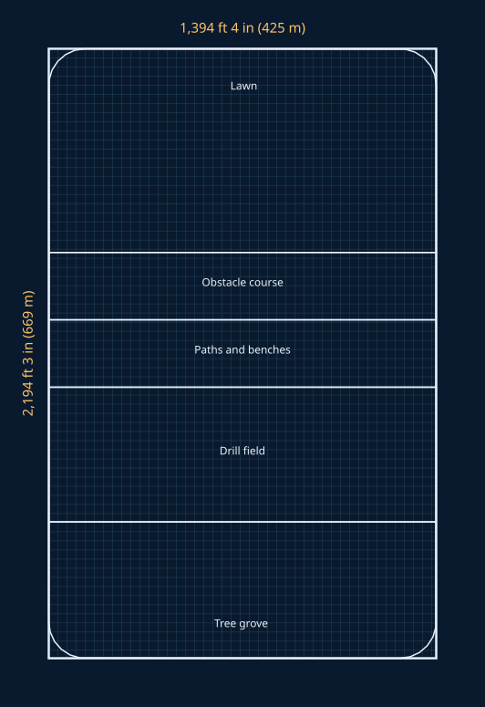

# P1-29 Training Field 6: plan

Footprint 1,394 ft 4 in (425 m) × 2,194 ft 3 in (669 m) · structural grid 32 ft 10 in (10 m)

## Levels

| Level | Floor above deck | Height | Floor area |
|---|---|---|---|
| Level 1 · Ground | 0 ft (0 mm) | 13 ft 1 in (4,000 mm) | — |

## Elements

| ID | Designation | Type | Name | Level(s) | Size / length | Area | Status |
|---|---|---|---|---|---|---|---|
| E001 | D5F6P1B9A2R1 | zone | Lawn | L1 | 1,393 ft 4 in (425 m) × 733 ft 3 in (224 m) | 1,013,164 sq ft (94,126 m²) | proposed |
| E002 | D5F6P1B9A2R2 | zone | Obstacle course | L1 | 1,393 ft 4 in (425 m) × 242 ft 5 in (74 m) | 337,749 sq ft (31,378 m²) | proposed |
| E003 | D5F6P1B9A2R3 | zone | Paths and benches | L1 | 1,393 ft 1 in (425 m) × 242 ft 9 in (74 m) | 338,206 sq ft (31,420 m²) | proposed |
| E004 | D5F6P1B9A2R4 | zone | Drill field | L1 | 1,393 ft 4 in (425 m) × 484 ft 11 in (148 m) | 675,499 sq ft (62,756 m²) | proposed |
| E005 | D5F6P1B9A2R5 | zone | Tree grove | L1 | 1,393 ft 4 in (425 m) × 490 ft 10 in (150 m) | 675,425 sq ft (62,749 m²) | proposed |

## Drawings

### Level 1 · Ground

