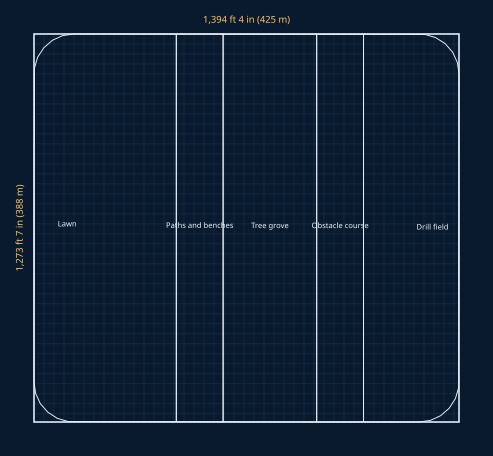

# P1-31 Training Field 7: plan

Footprint 1,394 ft 4 in (425 m) × 1,273 ft 7 in (388 m) · structural grid 32 ft 10 in (10 m)

## Levels

| Level | Floor above deck | Height | Floor area |
|---|---|---|---|
| Level 1 · Ground | 0 ft (0 mm) | 13 ft 1 in (4,000 mm) | — |

## Elements

| ID | Designation | Type | Name | Level(s) | Size / length | Area | Status |
|---|---|---|---|---|---|---|---|
| E001 | D5F6P1B11A2R1 | zone | Lawn | L1 | 466 ft 10 in (142 m) × 1,272 ft 8 in (388 m) | 585,779 sq ft (54,421 m²) | proposed |
| E002 | D5F6P1B11A2R2 | zone | Paths and benches | L1 | 153 ft 7 in (47 m) × 1,272 ft 8 in (388 m) | 195,355 sq ft (18,149 m²) | proposed |
| E003 | D5F6P1B11A2R3 | zone | Tree grove | L1 | 307 ft 1 in (94 m) × 1,272 ft 8 in (388 m) | 390,709 sq ft (36,298 m²) | proposed |
| E004 | D5F6P1B11A2R4 | zone | Obstacle course | L1 | 153 ft 7 in (47 m) × 1,272 ft 4 in (388 m) | 195,355 sq ft (18,149 m²) | proposed |
| E005 | D5F6P1B11A2R5 | zone | Drill field | L1 | 313 ft 4 in (96 m) × 1,272 ft 8 in (388 m) | 390,435 sq ft (36,273 m²) | proposed |

## Drawings

### Level 1 · Ground

