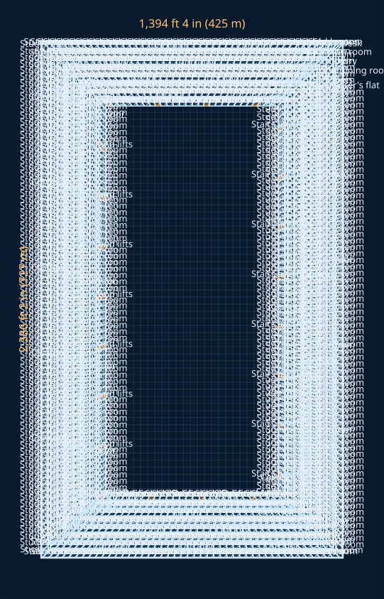
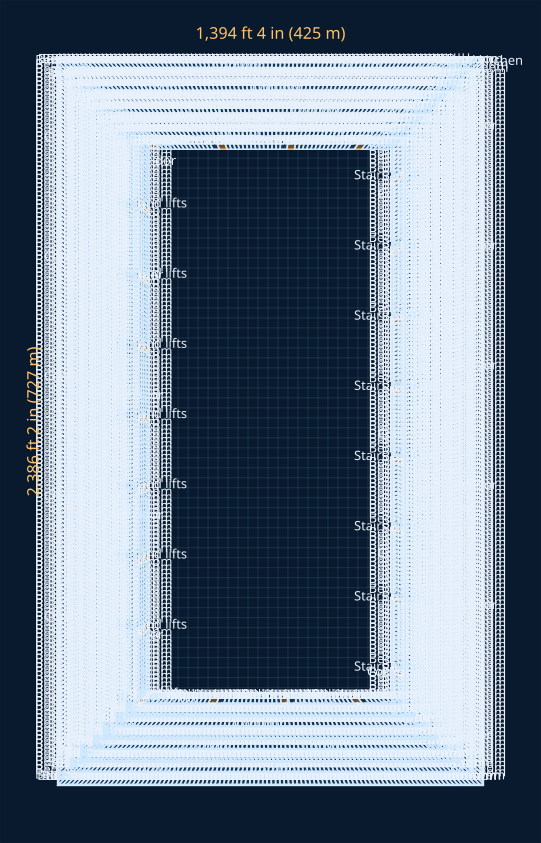

# P1-32 Cadet House 8: plan

Footprint 1,394 ft 4 in (425 m) × 2,386 ft 2 in (727 m) · structural grid 32 ft 10 in (10 m)

## Levels

| Level | Floor above deck | Height | Floor area |
|---|---|---|---|
| Level 1 · Ground floor | 0 ft (0 mm) | 14 ft 9 in (4,500 mm) | 1,632,286 sq ft (151,644 m²) |
| Level 2 · Bedroom floor 1 | 14 ft 9 in (4,500 mm) | 10 ft 6 in (3,200 mm) | 1,632,249 sq ft (151,641 m²) |
| Level 3 · Bedroom floor 2 | 25 ft 3 in (7,700 mm) | 10 ft 6 in (3,200 mm) | 1,632,249 sq ft (151,641 m²) |
| Level 4 · Bedroom floor 3 | 35 ft 9 in (11 m) | 10 ft 6 in (3,200 mm) | 1,632,249 sq ft (151,641 m²) |

## Elements

| ID | Designation | Type | Name | Level(s) | Size / length | Area | Status |
|---|---|---|---|---|---|---|---|
| E001 | D5F6P1B12A2L1R1 | zone | Corridor | L1 | 9 ft 10 in (3,000 mm) × 401 ft 11 in (122 m) | 3,875 sq ft (360 m²) | proposed |
| E002 | D5F6P1B12A2L1R2 | zone | Corridor | L1 | 9 ft 10 in (3,000 mm) × 398 ft 7 in (122 m) | 3,875 sq ft (360 m²) | proposed |
| E003 | D5F6P1B12A2L1R3 | zone | Corridor | L1 | 9 ft 10 in (3,000 mm) × 395 ft 4 in (120 m) | 3,873 sq ft (360 m²) | proposed |
| E004 | D5F6P1B12A2L1R4 | zone | Corridor | L1 | 9 ft 10 in (3,000 mm) × 395 ft 8 in (121 m) | 3,875 sq ft (360 m²) | proposed |
| E005 | D5F6P1B12A2L1R5 | zone | Corridor | L1 | 9 ft 10 in (3,000 mm) × 398 ft 11 in (122 m) | 3,875 sq ft (360 m²) | proposed |
| E006 | D5F6P1B12A2L1R6 | zone | Corridor | L1 | 60 ft (18 m) × 351 ft 5 in (107 m) | 3,875 sq ft (360 m²) | proposed |
| E007 | D5F6P1B12A2L1R7 | zone | Corridor | L1 | 399 ft 7 in (122 m) × 9 ft 10 in (3,000 mm) | 3,875 sq ft (360 m²) | proposed |
| E008 | D5F6P1B12A2L1R8 | zone | Corridor | L1 | 396 ft 8 in (121 m) × 9 ft 10 in (3,000 mm) | 3,875 sq ft (360 m²) | proposed |
| E009 | D5F6P1B12A2L1R9 | zone | Corridor | L1 | 399 ft 3 in (122 m) × 9 ft 10 in (3,000 mm) | 3,873 sq ft (360 m²) | proposed |
| E010 | D5F6P1B12A2L1R10 | zone | Corridor | L1 | 97 ft 1 in (30 m) × 314 ft 4 in (96 m) | 3,875 sq ft (360 m²) | proposed |
| E011 | D5F6P1B12A2L1R11 | zone | Corridor | L1 | 9 ft 10 in (3,000 mm) × 399 ft 3 in (122 m) | 3,875 sq ft (360 m²) | proposed |
| E012 | D5F6P1B12A2L1R12 | zone | Corridor | L1 | 9 ft 10 in (3,000 mm) × 396 ft (121 m) | 3,875 sq ft (360 m²) | proposed |
| E013 | D5F6P1B12A2L1R13 | zone | Corridor | L1 | 9 ft 10 in (3,000 mm) × 395 ft 4 in (120 m) | 3,875 sq ft (360 m²) | proposed |
| E014 | D5F6P1B12A2L1R14 | zone | Corridor | L1 | 9 ft 10 in (3,000 mm) × 398 ft (121 m) | 3,875 sq ft (360 m²) | proposed |
| E015 | D5F6P1B12A2L1R15 | zone | Corridor | L1 | 9 ft 10 in (3,000 mm) × 401 ft 7 in (122 m) | 3,877 sq ft (360 m²) | proposed |
| E016 | D5F6P1B12A2L1R16 | zone | Corridor | L1 | 363 ft 10 in (111 m) × 46 ft 7 in (14 m) | 3,873 sq ft (360 m²) | proposed |
| E017 | D5F6P1B12A2L1R17 | zone | Corridor | L1 | 396 ft 8 in (121 m) × 9 ft 10 in (3,000 mm) | 3,875 sq ft (360 m²) | proposed |
| E018 | D5F6P1B12A2L1R18 | zone | Corridor | L1 | 398 ft (121 m) × 9 ft 10 in (3,000 mm) | 3,875 sq ft (360 m²) | proposed |
| E019 | D5F6P1B12A2L1R19 | zone | Corridor | L1 | 184 ft 1 in (56 m) × 9 ft 10 in (3,000 mm) | 1,728 sq ft (160 m²) | proposed |
| E020 | D5F6P1B12A2L1R20 | zone | Corridor | L1 | 9 ft 10 in (3,000 mm) × 401 ft 11 in (122 m) | 3,877 sq ft (360 m²) | proposed |
| E021 | D5F6P1B12A2L1R21 | zone | Corridor | L1 | 9 ft 10 in (3,000 mm) × 398 ft 4 in (121 m) | 3,875 sq ft (360 m²) | proposed |
| E022 | D5F6P1B12A2L1R22 | zone | Corridor | L1 | 9 ft 10 in (3,000 mm) × 395 ft 8 in (121 m) | 3,875 sq ft (360 m²) | proposed |
| E023 | D5F6P1B12A2L1R23 | zone | Corridor | L1 | 9 ft 10 in (3,000 mm) × 396 ft 4 in (121 m) | 3,875 sq ft (360 m²) | proposed |
| E024 | D5F6P1B12A2L1R24 | zone | Corridor | L1 | 9 ft 10 in (3,000 mm) × 399 ft 11 in (122 m) | 3,875 sq ft (360 m²) | proposed |
| E025 | D5F6P1B12A2L1R25 | zone | Corridor | L1 | 208 ft 4 in (64 m) × 202 ft 9 in (62 m) | 3,877 sq ft (360 m²) | proposed |
| E026 | D5F6P1B12A2L1R26 | zone | Corridor | L1 | 397 ft 4 in (121 m) × 9 ft 10 in (3,000 mm) | 3,877 sq ft (360 m²) | proposed |
| E027 | D5F6P1B12A2L1R27 | zone | Corridor | L1 | 397 ft 4 in (121 m) × 9 ft 10 in (3,000 mm) | 3,875 sq ft (360 m²) | proposed |
| E028 | D5F6P1B12A2L1R28 | zone | Corridor | L1 | 191 ft 3 in (58 m) × 219 ft 10 in (67 m) | 3,877 sq ft (360 m²) | proposed |
| E029 | D5F6P1B12A2L1R29 | zone | Corridor | L1 | 9 ft 10 in (3,000 mm) × 399 ft 11 in (122 m) | 3,877 sq ft (360 m²) | proposed |
| E030 | D5F6P1B12A2L1R30 | zone | Corridor | L1 | 9 ft 10 in (3,000 mm) × 396 ft (121 m) | 3,873 sq ft (360 m²) | proposed |
| E031 | D5F6P1B12A2L1R31 | zone | Corridor | L1 | 9 ft 10 in (3,000 mm) × 395 ft 8 in (121 m) | 3,877 sq ft (360 m²) | proposed |
| E032 | D5F6P1B12A2L1R32 | zone | Corridor | L1 | 9 ft 10 in (3,000 mm) × 398 ft 4 in (121 m) | 3,873 sq ft (360 m²) | proposed |
| E033 | D5F6P1B12A2L1R33 | zone | Corridor | L1 | 27 ft 3 in (8,300 mm) × 384 ft 10 in (117 m) | 3,880 sq ft (360 m²) | proposed |
| E034 | D5F6P1B12A2L1R34 | zone | Corridor | L1 | 399 ft 11 in (122 m) × 9 ft 10 in (3,000 mm) | 3,875 sq ft (360 m²) | proposed |
| E035 | D5F6P1B12A2L1R35 | zone | Corridor | L1 | 397 ft (121 m) × 9 ft 10 in (3,000 mm) | 3,875 sq ft (360 m²) | proposed |
| E036 | D5F6P1B12A2L1R36 | zone | Corridor | L1 | 372 ft 5 in (114 m) × 9 ft 10 in (3,000 mm) | 3,599 sq ft (334 m²) | proposed |
| E037 | D5F6P1B12A2L1R37 | zone | Corridor | L1 | 9 ft 10 in (3,000 mm) × 401 ft 7 in (122 m) | 3,875 sq ft (360 m²) | proposed |
| E038 | D5F6P1B12A2L1R38 | zone | Corridor | L1 | 9 ft 10 in (3,000 mm) × 397 ft 8 in (121 m) | 3,875 sq ft (360 m²) | proposed |
| E039 | D5F6P1B12A2L1R39 | zone | Corridor | L1 | 9 ft 10 in (3,000 mm) × 395 ft 8 in (121 m) | 3,875 sq ft (360 m²) | proposed |
| E040 | D5F6P1B12A2L1R40 | zone | Corridor | L1 | 9 ft 10 in (3,000 mm) × 397 ft 8 in (121 m) | 3,877 sq ft (360 m²) | proposed |
| E041 | D5F6P1B12A2L1R41 | zone | Corridor | L1 | 9 ft 10 in (3,000 mm) × 400 ft 11 in (122 m) | 3,873 sq ft (360 m²) | proposed |
| E042 | D5F6P1B12A2L1R42 | zone | Corridor | L1 | 356 ft (108 m) × 53 ft 10 in (16 m) | 3,877 sq ft (360 m²) | proposed |
| E043 | D5F6P1B12A2L1R43 | zone | Corridor | L1 | 397 ft 4 in (121 m) × 9 ft 10 in (3,000 mm) | 3,873 sq ft (360 m²) | proposed |
| E044 | D5F6P1B12A2L1R44 | zone | Corridor | L1 | 285 ft 1 in (87 m) × 125 ft 4 in (38 m) | 3,877 sq ft (360 m²) | proposed |
| E045 | D5F6P1B12A2L1R45 | zone | Corridor | L1 | 9 ft 10 in (3,000 mm) × 400 ft 7 in (122 m) | 3,875 sq ft (360 m²) | proposed |
| E046 | D5F6P1B12A2L1R46 | zone | Corridor | L1 | 9 ft 10 in (3,000 mm) × 396 ft 8 in (121 m) | 3,875 sq ft (360 m²) | proposed |
| E047 | D5F6P1B12A2L1R47 | zone | Corridor | L1 | 9 ft 10 in (3,000 mm) × 395 ft 8 in (121 m) | 3,875 sq ft (360 m²) | proposed |
| E048 | D5F6P1B12A2L1R48 | zone | Corridor | L1 | 9 ft 10 in (3,000 mm) × 398 ft 7 in (122 m) | 3,875 sq ft (360 m²) | proposed |
| E049 | D5F6P1B12A2L1R49 | zone | Corridor | L1 | 81 ft (25 m) × 330 ft 5 in (101 m) | 3,877 sq ft (360 m²) | proposed |
| E050 | D5F6P1B12A2L1R50 | zone | Corridor | L1 | 398 ft 4 in (121 m) × 9 ft 10 in (3,000 mm) | 3,873 sq ft (360 m²) | proposed |
| E051 | D5F6P1B12A2L1R51 | zone | Corridor | L1 | 397 ft 8 in (121 m) × 9 ft 10 in (3,000 mm) | 3,875 sq ft (360 m²) | proposed |
| E052 | D5F6P1B12A2L1R52 | zone | Corridor | L1 | 170 ft 3 in (52 m) × 9 ft 10 in (3,000 mm) | 1,594 sq ft (148 m²) | proposed |
| E053 | D5F6P1B12A2L1R53 | zone | Corridor | L1 | 9 ft 10 in (3,000 mm) × 401 ft 3 in (122 m) | 3,873 sq ft (360 m²) | proposed |
| E054 | D5F6P1B12A2L1R54 | zone | Corridor | L1 | 9 ft 10 in (3,000 mm) × 397 ft 4 in (121 m) | 3,875 sq ft (360 m²) | proposed |
| E055 | D5F6P1B12A2L1R55 | zone | Corridor | L1 | 9 ft 10 in (3,000 mm) × 396 ft (121 m) | 3,877 sq ft (360 m²) | proposed |
| E056 | D5F6P1B12A2L1R56 | zone | Corridor | L1 | 9 ft 10 in (3,000 mm) × 398 ft 4 in (121 m) | 3,873 sq ft (360 m²) | proposed |
| E057 | D5F6P1B12A2L1R57 | zone | Corridor | L1 | 113 ft 10 in (35 m) × 296 ft 11 in (90 m) | 3,875 sq ft (360 m²) | proposed |
| E058 | D5F6P1B12A2L1R58 | zone | Corridor | L1 | 398 ft (121 m) × 9 ft 10 in (3,000 mm) | 3,873 sq ft (360 m²) | proposed |
| E059 | D5F6P1B12A2L1R59 | zone | Corridor | L1 | 378 ft 3 in (115 m) × 30 ft 6 in (9,300 mm) | 3,873 sq ft (360 m²) | proposed |
| E060 | D5F6P1B12A2L1R60 | zone | Corridor | L1 | 9 ft 10 in (3,000 mm) × 401 ft 3 in (122 m) | 3,875 sq ft (360 m²) | proposed |
| E061 | D5F6P1B12A2L1R61 | zone | Corridor | L1 | 9 ft 10 in (3,000 mm) × 397 ft 4 in (121 m) | 3,877 sq ft (360 m²) | proposed |
| E062 | D5F6P1B12A2L1R62 | zone | Corridor | L1 | 9 ft 10 in (3,000 mm) × 395 ft 8 in (121 m) | 3,873 sq ft (360 m²) | proposed |
| E063 | D5F6P1B12A2L1R63 | zone | Corridor | L1 | 9 ft 10 in (3,000 mm) × 398 ft 7 in (122 m) | 3,875 sq ft (360 m²) | proposed |
| E064 | D5F6P1B12A2L1R64 | zone | Corridor | L1 | 134 ft 6 in (41 m) × 275 ft 11 in (84 m) | 3,873 sq ft (360 m²) | proposed |
| E065 | D5F6P1B12A2L1R65 | zone | Corridor | L1 | 398 ft 4 in (121 m) × 9 ft 10 in (3,000 mm) | 3,875 sq ft (360 m²) | proposed |
| E066 | D5F6P1B12A2L1R66 | zone | Corridor | L1 | 357 ft 7 in (109 m) × 9 ft 10 in (3,000 mm) | 3,462 sq ft (322 m²) | proposed |
| E067 | D5F6P1B12A2L1R67, D5F6P1B12A2L2R1, D5F6P1B12A2L3R1, D5F6P1B12A2L4R1 | core | Stairs and lifts | L1, L2, L3, L4 | 32 ft 6 in (9,900 mm) × 54 ft 6 in (17 m) | 853 sq ft (79 m²) | proposed |
| E068 | D5F6P1B12A2L1R68, D5F6P1B12A2L2R2, D5F6P1B12A2L3R2, D5F6P1B12A2L4R2 | core | Stairs and lifts | L1, L2, L3, L4 | 32 ft 6 in (9,900 mm) × 46 ft 7 in (14 m) | 858 sq ft (80 m²) | proposed |
| E069 | D5F6P1B12A2L1R69, D5F6P1B12A2L2R3, D5F6P1B12A2L3R3, D5F6P1B12A2L4R3 | core | Stairs and lifts | L1, L2, L3, L4 | 32 ft 6 in (9,900 mm) × 38 ft 5 in (12 m) | 858 sq ft (80 m²) | proposed |
| E070 | D5F6P1B12A2L1R70, D5F6P1B12A2L2R4, D5F6P1B12A2L3R4, D5F6P1B12A2L4R4 | core | Stairs and lifts | L1, L2, L3, L4 | 32 ft 6 in (9,900 mm) × 30 ft 2 in (9,200 mm) | 858 sq ft (80 m²) | proposed |
| E071 | D5F6P1B12A2L1R71, D5F6P1B12A2L2R5, D5F6P1B12A2L3R5, D5F6P1B12A2L4R5 | core | Stairs and lifts | L1, L2, L3, L4 | 32 ft 6 in (9,900 mm) × 30 ft 10 in (9,400 mm) | 858 sq ft (80 m²) | proposed |
| E072 | D5F6P1B12A2L1R72, D5F6P1B12A2L2R6, D5F6P1B12A2L3R6, D5F6P1B12A2L4R6 | core | Stairs and lifts | L1, L2, L3, L4 | 32 ft 6 in (9,900 mm) × 39 ft 1 in (12 m) | 858 sq ft (80 m²) | proposed |
| E073 | D5F6P1B12A2L1R73, D5F6P1B12A2L2R7, D5F6P1B12A2L3R7, D5F6P1B12A2L4R7 | core | Stairs and lifts | L1, L2, L3, L4 | 32 ft 6 in (9,900 mm) × 47 ft 3 in (14 m) | 858 sq ft (80 m²) | proposed |
| E074 | D5F6P1B12A2L1R74, D5F6P1B12A2L2R8, D5F6P1B12A2L3R8, D5F6P1B12A2L4R8 | core | Stairs and lifts | L1, L2, L3, L4 | 32 ft 6 in (9,900 mm) × 55 ft 5 in (17 m) | 858 sq ft (80 m²) | proposed |
| E075 | D5F6P1B12A2L1R75, D5F6P1B12A2L2R9, D5F6P1B12A2L3R9, D5F6P1B12A2L4R9 | core | Stairs and lifts | L1, L2, L3, L4 | 47 ft 11 in (15 m) × 32 ft 6 in (9,900 mm) | 853 sq ft (79 m²) | proposed |
| E076 | D5F6P1B12A2L1R76, D5F6P1B12A2L2R10, D5F6P1B12A2L3R10, D5F6P1B12A2L4R10 | core | Stairs and lifts | L1, L2, L3, L4 | 29 ft 10 in (9,100 mm) × 32 ft 6 in (9,900 mm) | 853 sq ft (79 m²) | proposed |
| E077 | D5F6P1B12A2L1R77, D5F6P1B12A2L2R11, D5F6P1B12A2L3R11, D5F6P1B12A2L4R11 | core | Stairs and lifts | L1, L2, L3, L4 | 40 ft 8 in (12 m) × 32 ft 6 in (9,900 mm) | 853 sq ft (79 m²) | proposed |
| E078 | D5F6P1B12A2L1R78, D5F6P1B12A2L2R12, D5F6P1B12A2L3R12, D5F6P1B12A2L4R12 | core | Stairs and lifts | L1, L2, L3, L4 | 44 ft 11 in (14 m) × 45 ft 3 in (14 m) | 842 sq ft (78 m²) | proposed |
| E079 | D5F6P1B12A2L1R79, D5F6P1B12A2L2R13, D5F6P1B12A2L3R13, D5F6P1B12A2L4R13 | core | Stairs and lifts | L1, L2, L3, L4 | 32 ft 6 in (9,900 mm) × 50 ft 6 in (15 m) | 853 sq ft (79 m²) | proposed |
| E080 | D5F6P1B12A2L1R80, D5F6P1B12A2L2R14, D5F6P1B12A2L3R14, D5F6P1B12A2L4R14 | core | Stairs and lifts | L1, L2, L3, L4 | 32 ft 6 in (9,900 mm) × 42 ft 4 in (13 m) | 853 sq ft (79 m²) | proposed |
| E081 | D5F6P1B12A2L1R81, D5F6P1B12A2L2R15, D5F6P1B12A2L3R15, D5F6P1B12A2L4R15 | core | Stairs and lifts | L1, L2, L3, L4 | 32 ft 6 in (9,900 mm) × 34 ft 1 in (10 m) | 853 sq ft (79 m²) | proposed |
| E082 | D5F6P1B12A2L1R82, D5F6P1B12A2L2R16, D5F6P1B12A2L3R16, D5F6P1B12A2L4R16 | core | Stairs and lifts | L1, L2, L3, L4 | 32 ft 6 in (9,900 mm) × 26 ft 7 in (8,100 mm) | 853 sq ft (79 m²) | proposed |
| E083 | D5F6P1B12A2L1R83, D5F6P1B12A2L2R17, D5F6P1B12A2L3R17, D5F6P1B12A2L4R17 | core | Stairs and lifts | L1, L2, L3, L4 | 32 ft 6 in (9,900 mm) × 34 ft 9 in (11 m) | 853 sq ft (79 m²) | proposed |
| E084 | D5F6P1B12A2L1R84, D5F6P1B12A2L2R18, D5F6P1B12A2L3R18, D5F6P1B12A2L4R18 | core | Stairs and lifts | L1, L2, L3, L4 | 32 ft 6 in (9,900 mm) × 43 ft (13 m) | 853 sq ft (79 m²) | proposed |
| E085 | D5F6P1B12A2L1R85, D5F6P1B12A2L2R19, D5F6P1B12A2L3R19, D5F6P1B12A2L4R19 | core | Stairs and lifts | L1, L2, L3, L4 | 32 ft 6 in (9,900 mm) × 51 ft 2 in (16 m) | 853 sq ft (79 m²) | proposed |
| E086 | D5F6P1B12A2L1R86, D5F6P1B12A2L2R20, D5F6P1B12A2L3R20, D5F6P1B12A2L4R20 | core | Stairs and lifts | L1, L2, L3, L4 | 56 ft 9 in (17 m) × 32 ft 6 in (9,900 mm) | 853 sq ft (79 m²) | proposed |
| E087 | D5F6P1B12A2L1R87, D5F6P1B12A2L2R21, D5F6P1B12A2L3R21, D5F6P1B12A2L4R21 | core | Stairs and lifts | L1, L2, L3, L4 | 38 ft 9 in (12 m) × 32 ft 6 in (9,900 mm) | 853 sq ft (79 m²) | proposed |
| E088 | D5F6P1B12A2L1R88, D5F6P1B12A2L2R22, D5F6P1B12A2L3R22, D5F6P1B12A2L4R22 | core | Stairs and lifts | L1, L2, L3, L4 | 31 ft 6 in (9,600 mm) × 32 ft 6 in (9,900 mm) | 847 sq ft (79 m²) | proposed |
| E089 | D5F6P1B12A2L1R89, D5F6P1B12A2L2R23, D5F6P1B12A2L3R23, D5F6P1B12A2L4R23 | core | Stairs and lifts | L1, L2, L3, L4 | 49 ft 6 in (15 m) × 32 ft 6 in (9,900 mm) | 847 sq ft (79 m²) | proposed |
| E090 | D5F6P1B12A2L1R90 | room | Front desk | L1 | 32 ft 6 in (9,900 mm) × 45 ft 7 in (14 m) | 432 sq ft (40 m²) | proposed |
| E091 | D5F6P1B12A2L1R91 | room | Common room | L1 | 32 ft 6 in (9,900 mm) × 97 ft 5 in (30 m) | 2,153 sq ft (200 m²) | proposed |
| E092 | D5F6P1B12A2L1R92 | room | Laundry | L1 | 32 ft 6 in (9,900 mm) × 49 ft 10 in (15 m) | 650 sq ft (60 m²) | proposed |
| E093 | D5F6P1B12A2L1R93 | room | Kitchen and dining room | L1 | 32 ft 6 in (9,900 mm) × 95 ft 2 in (29 m) | 2,158 sq ft (200 m²) | proposed |
| E094 | D5F6P1B12A2L1R94 | room | Toilets | L1 | 32 ft 6 in (9,900 mm) × 47 ft 7 in (14 m) | 650 sq ft (60 m²) | proposed |
| E095 | D5F6P1B12A2L1R95 | room | Housemaster's flat | L1 | 32 ft 6 in (9,900 mm) × 56 ft 9 in (17 m) | 970 sq ft (90 m²) | proposed |
| E096 | D5F6P1B12A2L1R96 | room | Study room | L1 | 32 ft 6 in (9,900 mm) × 55 ft 9 in (17 m) | 964 sq ft (90 m²) | proposed |
| E097 | D5F6P1B12A2L1R97 | room | Study room | L1 | 32 ft 6 in (9,900 mm) × 55 ft 1 in (17 m) | 970 sq ft (90 m²) | proposed |
| E098 | D5F6P1B12A2L1R98 | room | Study room | L1 | 32 ft 6 in (9,900 mm) × 54 ft 6 in (17 m) | 975 sq ft (91 m²) | proposed |
| E099 | D5F6P1B12A2L1R99 | room | Study room | L1 | 32 ft 6 in (9,900 mm) × 53 ft 6 in (16 m) | 970 sq ft (90 m²) | proposed |
| E100 | D5F6P1B12A2L1R100 | room | Study room | L1 | 32 ft 6 in (9,900 mm) × 52 ft 10 in (16 m) | 970 sq ft (90 m²) | proposed |
| E101 | D5F6P1B12A2L1R101 | room | Study room | L1 | 32 ft 6 in (9,900 mm) × 51 ft 10 in (16 m) | 970 sq ft (90 m²) | proposed |
| E102 | D5F6P1B12A2L1R102 | room | Study room | L1 | 32 ft 6 in (9,900 mm) × 50 ft 10 in (16 m) | 970 sq ft (90 m²) | proposed |
| E103 | D5F6P1B12A2L1R103 | room | Study room | L1 | 32 ft 6 in (9,900 mm) × 50 ft 2 in (15 m) | 970 sq ft (90 m²) | proposed |
| E104 | D5F6P1B12A2L1R104 | room | Study room | L1 | 32 ft 6 in (9,900 mm) × 49 ft 6 in (15 m) | 975 sq ft (91 m²) | proposed |
| E105 | D5F6P1B12A2L1R105 | room | Study room | L1 | 32 ft 6 in (9,900 mm) × 48 ft 7 in (15 m) | 970 sq ft (90 m²) | proposed |
| E106 | D5F6P1B12A2L1R106 | room | Study room | L1 | 32 ft 6 in (9,900 mm) × 47 ft 11 in (15 m) | 970 sq ft (90 m²) | proposed |
| E107 | D5F6P1B12A2L1R107 | room | Study room | L1 | 32 ft 6 in (9,900 mm) × 46 ft 11 in (14 m) | 970 sq ft (90 m²) | proposed |
| E108 | D5F6P1B12A2L1R108 | room | Study room | L1 | 32 ft 6 in (9,900 mm) × 45 ft 11 in (14 m) | 970 sq ft (90 m²) | proposed |
| E109 | D5F6P1B12A2L1R109 | room | Study room | L1 | 32 ft 6 in (9,900 mm) × 45 ft 3 in (14 m) | 970 sq ft (90 m²) | proposed |
| E110 | D5F6P1B12A2L1R110 | room | Study room | L1 | 32 ft 6 in (9,900 mm) × 44 ft 7 in (14 m) | 975 sq ft (91 m²) | proposed |
| E111 | D5F6P1B12A2L1R111 | room | Study room | L1 | 32 ft 6 in (9,900 mm) × 43 ft 8 in (13 m) | 970 sq ft (90 m²) | proposed |
| E112 | D5F6P1B12A2L1R112 | room | Study room | L1 | 32 ft 6 in (9,900 mm) × 43 ft (13 m) | 970 sq ft (90 m²) | proposed |
| E113 | D5F6P1B12A2L1R113 | room | Study room | L1 | 32 ft 6 in (9,900 mm) × 42 ft (13 m) | 970 sq ft (90 m²) | proposed |
| E114 | D5F6P1B12A2L1R114 | room | Study room | L1 | 32 ft 6 in (9,900 mm) × 41 ft (12 m) | 970 sq ft (90 m²) | proposed |
| E115 | D5F6P1B12A2L1R115 | room | Study room | L1 | 32 ft 6 in (9,900 mm) × 40 ft 4 in (12 m) | 970 sq ft (90 m²) | proposed |
| E116 | D5F6P1B12A2L1R116 | room | Study room | L1 | 32 ft 6 in (9,900 mm) × 39 ft 8 in (12 m) | 975 sq ft (91 m²) | proposed |
| E117 | D5F6P1B12A2L1R117 | room | Study room | L1 | 32 ft 6 in (9,900 mm) × 38 ft 9 in (12 m) | 970 sq ft (90 m²) | proposed |
| E118 | D5F6P1B12A2L1R118 | room | Study room | L1 | 32 ft 6 in (9,900 mm) × 37 ft 9 in (12 m) | 964 sq ft (90 m²) | proposed |
| E119 | D5F6P1B12A2L1R119 | room | Study room | L1 | 32 ft 6 in (9,900 mm) × 37 ft 1 in (11 m) | 975 sq ft (91 m²) | proposed |
| E120 | D5F6P1B12A2L1R120 | room | Study room | L1 | 32 ft 6 in (9,900 mm) × 36 ft 1 in (11 m) | 970 sq ft (90 m²) | proposed |
| E121 | D5F6P1B12A2L1R121 | room | Study room | L1 | 32 ft 6 in (9,900 mm) × 35 ft 5 in (11 m) | 970 sq ft (90 m²) | proposed |
| E122 | D5F6P1B12A2L1R122 | room | Study room | L1 | 32 ft 6 in (9,900 mm) × 34 ft 9 in (11 m) | 975 sq ft (91 m²) | proposed |
| E123 | D5F6P1B12A2L1R123 | room | Study room | L1 | 32 ft 6 in (9,900 mm) × 33 ft 10 in (10 m) | 970 sq ft (90 m²) | proposed |
| E124 | D5F6P1B12A2L1R124 | room | Study room | L1 | 32 ft 6 in (9,900 mm) × 32 ft 10 in (10 m) | 964 sq ft (90 m²) | proposed |
| E125 | D5F6P1B12A2L1R125 | room | Study room | L1 | 32 ft 6 in (9,900 mm) × 32 ft 2 in (9,800 mm) | 975 sq ft (91 m²) | proposed |
| E126 | D5F6P1B12A2L1R126 | room | Study room | L1 | 32 ft 6 in (9,900 mm) × 31 ft 2 in (9,500 mm) | 970 sq ft (90 m²) | proposed |
| E127 | D5F6P1B12A2L1R127 | room | Study room | L1 | 32 ft 6 in (9,900 mm) × 30 ft 6 in (9,300 mm) | 970 sq ft (90 m²) | proposed |
| E128 | D5F6P1B12A2L1R128 | room | Study room | L1 | 32 ft 6 in (9,900 mm) × 30 ft 6 in (9,300 mm) | 975 sq ft (91 m²) | proposed |
| E129 | D5F6P1B12A2L1R129 | room | Study room | L1 | 32 ft 6 in (9,900 mm) × 30 ft 10 in (9,400 mm) | 964 sq ft (90 m²) | proposed |
| E130 | D5F6P1B12A2L1R130 | room | Study room | L1 | 32 ft 6 in (9,900 mm) × 31 ft 10 in (9,700 mm) | 970 sq ft (90 m²) | proposed |
| E131 | D5F6P1B12A2L1R131 | room | Study room | L1 | 32 ft 6 in (9,900 mm) × 32 ft 10 in (10 m) | 975 sq ft (91 m²) | proposed |
| E132 | D5F6P1B12A2L1R132 | room | Study room | L1 | 32 ft 6 in (9,900 mm) × 33 ft 6 in (10 m) | 970 sq ft (90 m²) | proposed |
| E133 | D5F6P1B12A2L1R133 | room | Study room | L1 | 32 ft 6 in (9,900 mm) × 34 ft 1 in (10 m) | 970 sq ft (90 m²) | proposed |
| E134 | D5F6P1B12A2L1R134 | room | Study room | L1 | 32 ft 6 in (9,900 mm) × 35 ft 1 in (11 m) | 975 sq ft (91 m²) | proposed |
| E135 | D5F6P1B12A2L1R135 | room | Study room | L1 | 32 ft 6 in (9,900 mm) × 35 ft 9 in (11 m) | 964 sq ft (90 m²) | proposed |
| E136 | D5F6P1B12A2L1R136 | room | Study room | L1 | 32 ft 6 in (9,900 mm) × 36 ft 9 in (11 m) | 970 sq ft (90 m²) | proposed |
| E137 | D5F6P1B12A2L1R137 | room | Study room | L1 | 32 ft 6 in (9,900 mm) × 37 ft 9 in (12 m) | 975 sq ft (91 m²) | proposed |
| E138 | D5F6P1B12A2L1R138 | room | Study room | L1 | 32 ft 6 in (9,900 mm) × 38 ft 5 in (12 m) | 970 sq ft (90 m²) | proposed |
| E139 | D5F6P1B12A2L1R139 | room | Study room | L1 | 32 ft 6 in (9,900 mm) × 39 ft 1 in (12 m) | 970 sq ft (90 m²) | proposed |
| E140 | D5F6P1B12A2L1R140 | room | Study room | L1 | 32 ft 6 in (9,900 mm) × 40 ft (12 m) | 975 sq ft (91 m²) | proposed |
| E141 | D5F6P1B12A2L1R141 | room | Study room | L1 | 32 ft 6 in (9,900 mm) × 40 ft 8 in (12 m) | 964 sq ft (90 m²) | proposed |
| E142 | D5F6P1B12A2L1R142 | room | Study room | L1 | 32 ft 6 in (9,900 mm) × 41 ft 8 in (13 m) | 970 sq ft (90 m²) | proposed |
| E143 | D5F6P1B12A2L1R143 | room | Study room | L1 | 32 ft 6 in (9,900 mm) × 42 ft 8 in (13 m) | 975 sq ft (91 m²) | proposed |
| E144 | D5F6P1B12A2L1R144 | room | Study room | L1 | 32 ft 6 in (9,900 mm) × 43 ft 4 in (13 m) | 970 sq ft (90 m²) | proposed |
| E145 | D5F6P1B12A2L1R145 | room | Study room | L1 | 32 ft 6 in (9,900 mm) × 44 ft (13 m) | 970 sq ft (90 m²) | proposed |
| E146 | D5F6P1B12A2L1R146 | room | Study room | L1 | 32 ft 6 in (9,900 mm) × 44 ft 11 in (14 m) | 970 sq ft (90 m²) | proposed |
| E147 | D5F6P1B12A2L1R147 | room | Study room | L1 | 32 ft 6 in (9,900 mm) × 45 ft 11 in (14 m) | 970 sq ft (90 m²) | proposed |
| E148 | D5F6P1B12A2L1R148 | room | Study room | L1 | 32 ft 6 in (9,900 mm) × 46 ft 7 in (14 m) | 970 sq ft (90 m²) | proposed |
| E149 | D5F6P1B12A2L1R149 | room | Study room | L1 | 32 ft 6 in (9,900 mm) × 47 ft 7 in (14 m) | 975 sq ft (91 m²) | proposed |
| E150 | D5F6P1B12A2L1R150 | room | Study room | L1 | 32 ft 6 in (9,900 mm) × 48 ft 3 in (15 m) | 970 sq ft (90 m²) | proposed |
| E151 | D5F6P1B12A2L1R151 | room | Study room | L1 | 32 ft 6 in (9,900 mm) × 48 ft 11 in (15 m) | 970 sq ft (90 m²) | proposed |
| E152 | D5F6P1B12A2L1R152 | room | Study room | L1 | 32 ft 6 in (9,900 mm) × 49 ft 10 in (15 m) | 970 sq ft (90 m²) | proposed |
| E153 | D5F6P1B12A2L1R153 | room | Study room | L1 | 32 ft 6 in (9,900 mm) × 50 ft 10 in (16 m) | 970 sq ft (90 m²) | proposed |
| E154 | D5F6P1B12A2L1R154 | room | Study room | L1 | 32 ft 6 in (9,900 mm) × 51 ft 6 in (16 m) | 970 sq ft (90 m²) | proposed |
| E155 | D5F6P1B12A2L1R155 | room | Study room | L1 | 32 ft 6 in (9,900 mm) × 52 ft 6 in (16 m) | 975 sq ft (91 m²) | proposed |
| E156 | D5F6P1B12A2L1R156 | room | Study room | L1 | 32 ft 6 in (9,900 mm) × 53 ft 2 in (16 m) | 970 sq ft (90 m²) | proposed |
| E157 | D5F6P1B12A2L1R157 | room | Study room | L1 | 32 ft 6 in (9,900 mm) × 53 ft 10 in (16 m) | 970 sq ft (90 m²) | proposed |
| E158 | D5F6P1B12A2L1R158 | room | Study room | L1 | 32 ft 6 in (9,900 mm) × 54 ft 9 in (17 m) | 970 sq ft (90 m²) | proposed |
| E159 | D5F6P1B12A2L1R159 | room | Study room | L1 | 32 ft 6 in (9,900 mm) × 55 ft 9 in (17 m) | 970 sq ft (90 m²) | proposed |
| E160 | D5F6P1B12A2L1R160 | room | Study room | L1 | 32 ft 6 in (9,900 mm) × 56 ft 5 in (17 m) | 970 sq ft (90 m²) | proposed |
| E161 | D5F6P1B12A2L1R161 | room | Study room | L1 | 32 ft 6 in (9,900 mm) × 57 ft 5 in (18 m) | 975 sq ft (91 m²) | proposed |
| E162 | D5F6P1B12A2L1R162 | room | Study room | L1 | 32 ft 6 in (9,900 mm) × 58 ft 1 in (18 m) | 970 sq ft (90 m²) | proposed |
| E163 | D5F6P1B12A2L1R163 | room | Study room | L1 | 32 ft 6 in (9,900 mm) × 58 ft 9 in (18 m) | 964 sq ft (90 m²) | proposed |
| E164 | D5F6P1B12A2L1R164 | room | Study room | L1 | 32 ft 6 in (9,900 mm) × 60 ft (18 m) | 975 sq ft (91 m²) | proposed |
| E165 | D5F6P1B12A2L1R165 | room | Study room | L1 | 32 ft 6 in (9,900 mm) × 60 ft 8 in (18 m) | 970 sq ft (90 m²) | proposed |
| E166 | D5F6P1B12A2L1R166 | room | Study room | L1 | 32 ft 6 in (9,900 mm) × 61 ft 4 in (19 m) | 970 sq ft (90 m²) | proposed |
| E167 | D5F6P1B12A2L1R167 | room | Study room | L1 | 45 ft 7 in (14 m) × 48 ft 7 in (15 m) | 970 sq ft (90 m²) | proposed |
| E168 | D5F6P1B12A2L1R168 | room | Study room | L1 | 61 ft (19 m) × 32 ft 6 in (9,900 mm) | 970 sq ft (90 m²) | proposed |
| E169 | D5F6P1B12A2L1R169 | room | Study room | L1 | 59 ft 9 in (18 m) × 32 ft 6 in (9,900 mm) | 975 sq ft (91 m²) | proposed |
| E170 | D5F6P1B12A2L1R170 | room | Study room | L1 | 58 ft 1 in (18 m) × 32 ft 6 in (9,900 mm) | 970 sq ft (90 m²) | proposed |
| E171 | D5F6P1B12A2L1R171 | room | Study room | L1 | 56 ft 9 in (17 m) × 32 ft 6 in (9,900 mm) | 970 sq ft (90 m²) | proposed |
| E172 | D5F6P1B12A2L1R172 | room | Study room | L1 | 55 ft 1 in (17 m) × 32 ft 6 in (9,900 mm) | 964 sq ft (90 m²) | proposed |
| E173 | D5F6P1B12A2L1R173 | room | Study room | L1 | 53 ft 10 in (16 m) × 32 ft 6 in (9,900 mm) | 975 sq ft (91 m²) | proposed |
| E174 | D5F6P1B12A2L1R174 | room | Study room | L1 | 52 ft 2 in (16 m) × 32 ft 6 in (9,900 mm) | 970 sq ft (90 m²) | proposed |
| E175 | D5F6P1B12A2L1R175 | room | Study room | L1 | 50 ft 10 in (16 m) × 32 ft 6 in (9,900 mm) | 970 sq ft (90 m²) | proposed |
| E176 | D5F6P1B12A2L1R176 | room | Study room | L1 | 49 ft 6 in (15 m) × 32 ft 6 in (9,900 mm) | 970 sq ft (90 m²) | proposed |
| E177 | D5F6P1B12A2L1R177 | room | Study room | L1 | 48 ft 3 in (15 m) × 32 ft 6 in (9,900 mm) | 975 sq ft (91 m²) | proposed |
| E178 | D5F6P1B12A2L1R178 | room | Study room | L1 | 46 ft 7 in (14 m) × 32 ft 6 in (9,900 mm) | 970 sq ft (90 m²) | proposed |
| E179 | D5F6P1B12A2L1R179 | room | Study room | L1 | 45 ft 3 in (14 m) × 32 ft 6 in (9,900 mm) | 970 sq ft (90 m²) | proposed |
| E180 | D5F6P1B12A2L1R180 | room | Study room | L1 | 44 ft (13 m) × 32 ft 6 in (9,900 mm) | 970 sq ft (90 m²) | proposed |
| E181 | D5F6P1B12A2L1R181 | room | Study room | L1 | 42 ft 8 in (13 m) × 32 ft 6 in (9,900 mm) | 975 sq ft (91 m²) | proposed |
| E182 | D5F6P1B12A2L1R182 | room | Study room | L1 | 41 ft (12 m) × 32 ft 6 in (9,900 mm) | 970 sq ft (90 m²) | proposed |
| E183 | D5F6P1B12A2L1R183 | room | Study room | L1 | 39 ft 4 in (12 m) × 32 ft 6 in (9,900 mm) | 964 sq ft (90 m²) | proposed |
| E184 | D5F6P1B12A2L1R184 | room | Study room | L1 | 38 ft 1 in (12 m) × 32 ft 6 in (9,900 mm) | 970 sq ft (90 m²) | proposed |
| E185 | D5F6P1B12A2L1R185 | room | Study room | L1 | 36 ft 9 in (11 m) × 32 ft 6 in (9,900 mm) | 970 sq ft (90 m²) | proposed |
| E186 | D5F6P1B12A2L1R186 | room | Study room | L1 | 35 ft 5 in (11 m) × 32 ft 6 in (9,900 mm) | 975 sq ft (91 m²) | proposed |
| E187 | D5F6P1B12A2L1R187 | room | Study room | L1 | 33 ft 10 in (10 m) × 32 ft 6 in (9,900 mm) | 970 sq ft (90 m²) | proposed |
| E188 | D5F6P1B12A2L1R188 | room | Study room | L1 | 32 ft 6 in (9,900 mm) × 32 ft 6 in (9,900 mm) | 970 sq ft (90 m²) | proposed |
| E189 | D5F6P1B12A2L1R189 | room | Study room | L1 | 31 ft 2 in (9,500 mm) × 32 ft 6 in (9,900 mm) | 970 sq ft (90 m²) | proposed |
| E190 | D5F6P1B12A2L1R190 | room | Study room | L1 | 30 ft 10 in (9,400 mm) × 32 ft 6 in (9,900 mm) | 975 sq ft (91 m²) | proposed |
| E191 | D5F6P1B12A2L1R191 | room | Study room | L1 | 31 ft 6 in (9,600 mm) × 32 ft 6 in (9,900 mm) | 970 sq ft (90 m²) | proposed |
| E192 | D5F6P1B12A2L1R192 | room | Study room | L1 | 32 ft 10 in (10 m) × 32 ft 6 in (9,900 mm) | 970 sq ft (90 m²) | proposed |
| E193 | D5F6P1B12A2L1R193 | room | Study room | L1 | 34 ft 1 in (10 m) × 32 ft 6 in (9,900 mm) | 970 sq ft (90 m²) | proposed |
| E194 | D5F6P1B12A2L1R194 | room | Study room | L1 | 35 ft 9 in (11 m) × 32 ft 6 in (9,900 mm) | 970 sq ft (90 m²) | proposed |
| E195 | D5F6P1B12A2L1R195 | room | Study room | L1 | 37 ft 5 in (11 m) × 32 ft 6 in (9,900 mm) | 970 sq ft (90 m²) | proposed |
| E196 | D5F6P1B12A2L1R196 | room | Study room | L1 | 38 ft 9 in (12 m) × 32 ft 6 in (9,900 mm) | 970 sq ft (90 m²) | proposed |
| E197 | D5F6P1B12A2L1R197 | room | Study room | L1 | 40 ft (12 m) × 32 ft 6 in (9,900 mm) | 970 sq ft (90 m²) | proposed |
| E198 | D5F6P1B12A2L1R198 | room | Study room | L1 | 41 ft 8 in (13 m) × 32 ft 6 in (9,900 mm) | 975 sq ft (91 m²) | proposed |
| E199 | D5F6P1B12A2L1R199 | room | Study room | L1 | 43 ft (13 m) × 32 ft 6 in (9,900 mm) | 970 sq ft (90 m²) | proposed |
| E200 | D5F6P1B12A2L1R200 | room | Study room | L1 | 44 ft 3 in (14 m) × 32 ft 6 in (9,900 mm) | 970 sq ft (90 m²) | proposed |
| E201 | D5F6P1B12A2L1R201 | room | Study room | L1 | 45 ft 7 in (14 m) × 32 ft 6 in (9,900 mm) | 970 sq ft (90 m²) | proposed |
| E202 | D5F6P1B12A2L1R202 | room | Study room | L1 | 47 ft 3 in (14 m) × 32 ft 6 in (9,900 mm) | 975 sq ft (91 m²) | proposed |
| E203 | D5F6P1B12A2L1R203 | room | Study room | L1 | 48 ft 7 in (15 m) × 32 ft 6 in (9,900 mm) | 970 sq ft (90 m²) | proposed |
| E204 | D5F6P1B12A2L1R204 | room | Study room | L1 | 49 ft 10 in (15 m) × 32 ft 6 in (9,900 mm) | 970 sq ft (90 m²) | proposed |
| E205 | D5F6P1B12A2L1R205 | room | Study room | L1 | 51 ft 2 in (16 m) × 32 ft 6 in (9,900 mm) | 964 sq ft (90 m²) | proposed |
| E206 | D5F6P1B12A2L1R206 | room | Study room | L1 | 53 ft 2 in (16 m) × 32 ft 6 in (9,900 mm) | 975 sq ft (91 m²) | proposed |
| E207 | D5F6P1B12A2L1R207 | room | Study room | L1 | 54 ft 6 in (17 m) × 32 ft 6 in (9,900 mm) | 970 sq ft (90 m²) | proposed |
| E208 | D5F6P1B12A2L1R208 | room | Study room | L1 | 55 ft 9 in (17 m) × 32 ft 6 in (9,900 mm) | 970 sq ft (90 m²) | proposed |
| E209 | D5F6P1B12A2L1R209 | room | Study room | L1 | 57 ft 1 in (17 m) × 32 ft 6 in (9,900 mm) | 970 sq ft (90 m²) | proposed |
| E210 | D5F6P1B12A2L1R210 | room | Study room | L1 | 58 ft 9 in (18 m) × 32 ft 6 in (9,900 mm) | 975 sq ft (91 m²) | proposed |
| E211 | D5F6P1B12A2L1R211 | room | Study room | L1 | 60 ft (18 m) × 32 ft 6 in (9,900 mm) | 970 sq ft (90 m²) | proposed |
| E212 | D5F6P1B12A2L1R212 | room | Study room | L1 | 61 ft 4 in (19 m) × 32 ft 6 in (9,900 mm) | 970 sq ft (90 m²) | proposed |
| E213 | D5F6P1B12A2L1R213 | room | Study room | L1 | 36 ft 1 in (11 m) × 58 ft 1 in (18 m) | 970 sq ft (90 m²) | proposed |
| E214 | D5F6P1B12A2L1R214 | room | Study room | L1 | 32 ft 6 in (9,900 mm) × 61 ft (19 m) | 970 sq ft (90 m²) | proposed |
| E215 | D5F6P1B12A2L1R215 | room | Study room | L1 | 32 ft 6 in (9,900 mm) × 60 ft 4 in (18 m) | 970 sq ft (90 m²) | proposed |
| E216 | D5F6P1B12A2L1R216 | room | Study room | L1 | 32 ft 6 in (9,900 mm) × 59 ft 9 in (18 m) | 975 sq ft (91 m²) | proposed |
| E217 | D5F6P1B12A2L1R217 | room | Study room | L1 | 32 ft 6 in (9,900 mm) × 58 ft 5 in (18 m) | 964 sq ft (90 m²) | proposed |
| E218 | D5F6P1B12A2L1R218 | room | Study room | L1 | 32 ft 6 in (9,900 mm) × 57 ft 9 in (18 m) | 970 sq ft (90 m²) | proposed |
| E219 | D5F6P1B12A2L1R219 | room | Study room | L1 | 32 ft 6 in (9,900 mm) × 57 ft 1 in (17 m) | 975 sq ft (91 m²) | proposed |
| E220 | D5F6P1B12A2L1R220 | room | Study room | L1 | 32 ft 6 in (9,900 mm) × 56 ft 1 in (17 m) | 970 sq ft (90 m²) | proposed |
| E221 | D5F6P1B12A2L1R221 | room | Study room | L1 | 32 ft 6 in (9,900 mm) × 55 ft 5 in (17 m) | 970 sq ft (90 m²) | proposed |
| E222 | D5F6P1B12A2L1R222 | room | Study room | L1 | 32 ft 6 in (9,900 mm) × 54 ft 9 in (17 m) | 975 sq ft (91 m²) | proposed |
| E223 | D5F6P1B12A2L1R223 | room | Study room | L1 | 32 ft 6 in (9,900 mm) × 53 ft 6 in (16 m) | 964 sq ft (90 m²) | proposed |
| E224 | D5F6P1B12A2L1R224 | room | Study room | L1 | 32 ft 6 in (9,900 mm) × 52 ft 10 in (16 m) | 970 sq ft (90 m²) | proposed |
| E225 | D5F6P1B12A2L1R225 | room | Study room | L1 | 32 ft 6 in (9,900 mm) × 52 ft 2 in (16 m) | 975 sq ft (91 m²) | proposed |
| E226 | D5F6P1B12A2L1R226 | room | Study room | L1 | 32 ft 6 in (9,900 mm) × 51 ft 2 in (16 m) | 970 sq ft (90 m²) | proposed |
| E227 | D5F6P1B12A2L1R227 | room | Study room | L1 | 32 ft 6 in (9,900 mm) × 50 ft 6 in (15 m) | 970 sq ft (90 m²) | proposed |
| E228 | D5F6P1B12A2L1R228 | room | Study room | L1 | 32 ft 6 in (9,900 mm) × 49 ft 10 in (15 m) | 975 sq ft (91 m²) | proposed |
| E229 | D5F6P1B12A2L1R229 | room | Study room | L1 | 32 ft 6 in (9,900 mm) × 48 ft 7 in (15 m) | 964 sq ft (90 m²) | proposed |
| E230 | D5F6P1B12A2L1R230 | room | Study room | L1 | 32 ft 6 in (9,900 mm) × 47 ft 11 in (15 m) | 970 sq ft (90 m²) | proposed |
| E231 | D5F6P1B12A2L1R231 | room | Study room | L1 | 32 ft 6 in (9,900 mm) × 47 ft 3 in (14 m) | 975 sq ft (91 m²) | proposed |
| E232 | D5F6P1B12A2L1R232 | room | Study room | L1 | 32 ft 6 in (9,900 mm) × 46 ft 3 in (14 m) | 970 sq ft (90 m²) | proposed |
| E233 | D5F6P1B12A2L1R233 | room | Study room | L1 | 32 ft 6 in (9,900 mm) × 45 ft 7 in (14 m) | 970 sq ft (90 m²) | proposed |
| E234 | D5F6P1B12A2L1R234 | room | Study room | L1 | 32 ft 6 in (9,900 mm) × 44 ft 7 in (14 m) | 964 sq ft (90 m²) | proposed |
| E235 | D5F6P1B12A2L1R235 | room | Study room | L1 | 32 ft 6 in (9,900 mm) × 44 ft (13 m) | 975 sq ft (91 m²) | proposed |
| E236 | D5F6P1B12A2L1R236 | room | Study room | L1 | 32 ft 6 in (9,900 mm) × 43 ft (13 m) | 970 sq ft (90 m²) | proposed |
| E237 | D5F6P1B12A2L1R237 | room | Study room | L1 | 32 ft 6 in (9,900 mm) × 42 ft 4 in (13 m) | 970 sq ft (90 m²) | proposed |
| E238 | D5F6P1B12A2L1R238 | room | Study room | L1 | 32 ft 6 in (9,900 mm) × 41 ft 8 in (13 m) | 975 sq ft (91 m²) | proposed |
| E239 | D5F6P1B12A2L1R239 | room | Study room | L1 | 32 ft 6 in (9,900 mm) × 40 ft 8 in (12 m) | 970 sq ft (90 m²) | proposed |
| E240 | D5F6P1B12A2L1R240 | room | Study room | L1 | 32 ft 6 in (9,900 mm) × 39 ft 8 in (12 m) | 964 sq ft (90 m²) | proposed |
| E241 | D5F6P1B12A2L1R241 | room | Study room | L1 | 32 ft 6 in (9,900 mm) × 39 ft 1 in (12 m) | 975 sq ft (91 m²) | proposed |
| E242 | D5F6P1B12A2L1R242 | room | Study room | L1 | 32 ft 6 in (9,900 mm) × 38 ft 1 in (12 m) | 970 sq ft (90 m²) | proposed |
| E243 | D5F6P1B12A2L1R243 | room | Study room | L1 | 32 ft 6 in (9,900 mm) × 37 ft 5 in (11 m) | 970 sq ft (90 m²) | proposed |
| E244 | D5F6P1B12A2L1R244 | room | Study room | L1 | 32 ft 6 in (9,900 mm) × 36 ft 9 in (11 m) | 975 sq ft (91 m²) | proposed |
| E245 | D5F6P1B12A2L1R245 | room | Study room | L1 | 32 ft 6 in (9,900 mm) × 35 ft 5 in (11 m) | 964 sq ft (90 m²) | proposed |
| E246 | D5F6P1B12A2L1R246 | room | Study room | L1 | 32 ft 6 in (9,900 mm) × 34 ft 9 in (11 m) | 970 sq ft (90 m²) | proposed |
| E247 | D5F6P1B12A2L1R247 | room | Study room | L1 | 32 ft 6 in (9,900 mm) × 34 ft 1 in (10 m) | 975 sq ft (91 m²) | proposed |
| E248 | D5F6P1B12A2L1R248 | room | Study room | L1 | 32 ft 6 in (9,900 mm) × 33 ft 2 in (10 m) | 970 sq ft (90 m²) | proposed |
| E249 | D5F6P1B12A2L1R249 | room | Study room | L1 | 32 ft 6 in (9,900 mm) × 32 ft 6 in (9,900 mm) | 970 sq ft (90 m²) | proposed |
| E250 | D5F6P1B12A2L1R250 | room | Study room | L1 | 32 ft 6 in (9,900 mm) × 31 ft 10 in (9,700 mm) | 975 sq ft (91 m²) | proposed |
| E251 | D5F6P1B12A2L1R251 | room | Study room | L1 | 32 ft 6 in (9,900 mm) × 30 ft 6 in (9,300 mm) | 964 sq ft (90 m²) | proposed |
| E252 | D5F6P1B12A2L1R252 | room | Study room | L1 | 32 ft 6 in (9,900 mm) × 30 ft 2 in (9,200 mm) | 970 sq ft (90 m²) | proposed |
| E253 | D5F6P1B12A2L1R253 | room | Study room | L1 | 32 ft 6 in (9,900 mm) × 30 ft 10 in (9,400 mm) | 975 sq ft (91 m²) | proposed |
| E254 | D5F6P1B12A2L1R254 | room | Study room | L1 | 32 ft 6 in (9,900 mm) × 31 ft 6 in (9,600 mm) | 970 sq ft (90 m²) | proposed |
| E255 | D5F6P1B12A2L1R255 | room | Study room | L1 | 32 ft 6 in (9,900 mm) × 32 ft 2 in (9,800 mm) | 970 sq ft (90 m²) | proposed |
| E256 | D5F6P1B12A2L1R256 | room | Study room | L1 | 32 ft 6 in (9,900 mm) × 33 ft 2 in (10 m) | 975 sq ft (91 m²) | proposed |
| E257 | D5F6P1B12A2L1R257 | room | Study room | L1 | 32 ft 6 in (9,900 mm) × 33 ft 10 in (10 m) | 964 sq ft (90 m²) | proposed |
| E258 | D5F6P1B12A2L1R258 | room | Study room | L1 | 32 ft 6 in (9,900 mm) × 34 ft 9 in (11 m) | 970 sq ft (90 m²) | proposed |
| E259 | D5F6P1B12A2L1R259 | room | Study room | L1 | 32 ft 6 in (9,900 mm) × 35 ft 9 in (11 m) | 975 sq ft (91 m²) | proposed |
| E260 | D5F6P1B12A2L1R260 | room | Study room | L1 | 32 ft 6 in (9,900 mm) × 36 ft 5 in (11 m) | 970 sq ft (90 m²) | proposed |
| E261 | D5F6P1B12A2L1R261 | room | Study room | L1 | 32 ft 6 in (9,900 mm) × 37 ft 1 in (11 m) | 970 sq ft (90 m²) | proposed |
| E262 | D5F6P1B12A2L1R262 | room | Study room | L1 | 32 ft 6 in (9,900 mm) × 38 ft 1 in (12 m) | 970 sq ft (90 m²) | proposed |
| E263 | D5F6P1B12A2L1R263 | room | Study room | L1 | 32 ft 6 in (9,900 mm) × 39 ft 1 in (12 m) | 970 sq ft (90 m²) | proposed |
| E264 | D5F6P1B12A2L1R264 | room | Study room | L1 | 32 ft 6 in (9,900 mm) × 39 ft 8 in (12 m) | 970 sq ft (90 m²) | proposed |
| E265 | D5F6P1B12A2L1R265 | room | Study room | L1 | 32 ft 6 in (9,900 mm) × 40 ft 8 in (12 m) | 975 sq ft (91 m²) | proposed |
| E266 | D5F6P1B12A2L1R266 | room | Study room | L1 | 32 ft 6 in (9,900 mm) × 41 ft 4 in (13 m) | 970 sq ft (90 m²) | proposed |
| E267 | D5F6P1B12A2L1R267 | room | Study room | L1 | 32 ft 6 in (9,900 mm) × 42 ft (13 m) | 970 sq ft (90 m²) | proposed |
| E268 | D5F6P1B12A2L1R268 | room | Study room | L1 | 32 ft 6 in (9,900 mm) × 43 ft (13 m) | 970 sq ft (90 m²) | proposed |
| E269 | D5F6P1B12A2L1R269 | room | Study room | L1 | 32 ft 6 in (9,900 mm) × 44 ft (13 m) | 970 sq ft (90 m²) | proposed |
| E270 | D5F6P1B12A2L1R270 | room | Study room | L1 | 32 ft 6 in (9,900 mm) × 44 ft 7 in (14 m) | 970 sq ft (90 m²) | proposed |
| E271 | D5F6P1B12A2L1R271 | room | Study room | L1 | 32 ft 6 in (9,900 mm) × 45 ft 7 in (14 m) | 975 sq ft (91 m²) | proposed |
| E272 | D5F6P1B12A2L1R272 | room | Study room | L1 | 32 ft 6 in (9,900 mm) × 46 ft 3 in (14 m) | 970 sq ft (90 m²) | proposed |
| E273 | D5F6P1B12A2L1R273 | room | Study room | L1 | 32 ft 6 in (9,900 mm) × 46 ft 11 in (14 m) | 964 sq ft (90 m²) | proposed |
| E274 | D5F6P1B12A2L1R274 | room | Study room | L1 | 32 ft 6 in (9,900 mm) × 48 ft 3 in (15 m) | 975 sq ft (91 m²) | proposed |
| E275 | D5F6P1B12A2L1R275 | room | Study room | L1 | 32 ft 6 in (9,900 mm) × 48 ft 11 in (15 m) | 970 sq ft (90 m²) | proposed |
| E276 | D5F6P1B12A2L1R276 | room | Study room | L1 | 32 ft 6 in (9,900 mm) × 49 ft 6 in (15 m) | 970 sq ft (90 m²) | proposed |
| E277 | D5F6P1B12A2L1R277 | room | Study room | L1 | 32 ft 6 in (9,900 mm) × 50 ft 6 in (15 m) | 975 sq ft (91 m²) | proposed |
| E278 | D5F6P1B12A2L1R278 | room | Study room | L1 | 32 ft 6 in (9,900 mm) × 51 ft 2 in (16 m) | 970 sq ft (90 m²) | proposed |
| E279 | D5F6P1B12A2L1R279 | room | Study room | L1 | 32 ft 6 in (9,900 mm) × 51 ft 10 in (16 m) | 964 sq ft (90 m²) | proposed |
| E280 | D5F6P1B12A2L1R280 | room | Study room | L1 | 32 ft 6 in (9,900 mm) × 53 ft 2 in (16 m) | 975 sq ft (91 m²) | proposed |
| E281 | D5F6P1B12A2L1R281 | room | Study room | L1 | 32 ft 6 in (9,900 mm) × 53 ft 10 in (16 m) | 970 sq ft (90 m²) | proposed |
| E282 | D5F6P1B12A2L1R282 | room | Study room | L1 | 32 ft 6 in (9,900 mm) × 54 ft 6 in (17 m) | 970 sq ft (90 m²) | proposed |
| E283 | D5F6P1B12A2L1R283 | room | Study room | L1 | 32 ft 6 in (9,900 mm) × 55 ft 5 in (17 m) | 975 sq ft (91 m²) | proposed |
| E284 | D5F6P1B12A2L1R284 | room | Study room | L1 | 32 ft 6 in (9,900 mm) × 56 ft 1 in (17 m) | 970 sq ft (90 m²) | proposed |
| E285 | D5F6P1B12A2L1R285 | room | Study room | L1 | 32 ft 6 in (9,900 mm) × 56 ft 9 in (17 m) | 964 sq ft (90 m²) | proposed |
| E286 | D5F6P1B12A2L1R286 | room | Study room | L1 | 32 ft 6 in (9,900 mm) × 58 ft 1 in (18 m) | 975 sq ft (91 m²) | proposed |
| E287 | D5F6P1B12A2L1R287 | room | Study room | L1 | 32 ft 6 in (9,900 mm) × 58 ft 9 in (18 m) | 970 sq ft (90 m²) | proposed |
| E288 | D5F6P1B12A2L1R288 | room | Study room | L1 | 32 ft 6 in (9,900 mm) × 59 ft 5 in (18 m) | 970 sq ft (90 m²) | proposed |
| E289 | D5F6P1B12A2L1R289 | room | Study room | L1 | 32 ft 6 in (9,900 mm) × 60 ft 4 in (18 m) | 975 sq ft (91 m²) | proposed |
| E290 | D5F6P1B12A2L1R290 | room | Study room | L1 | 32 ft 6 in (9,900 mm) × 61 ft (19 m) | 964 sq ft (90 m²) | proposed |
| E291 | D5F6P1B12A2L1R291 | room | Study room | L1 | 35 ft 5 in (11 m) × 59 ft 1 in (18 m) | 970 sq ft (90 m²) | proposed |
| E292 | D5F6P1B12A2L1R292 | room | Study room | L1 | 61 ft 8 in (19 m) × 32 ft 6 in (9,900 mm) | 975 sq ft (91 m²) | proposed |
| E293 | D5F6P1B12A2L1R293 | room | Study room | L1 | 60 ft (18 m) × 32 ft 6 in (9,900 mm) | 970 sq ft (90 m²) | proposed |
| E294 | D5F6P1B12A2L1R294 | room | Study room | L1 | 58 ft 9 in (18 m) × 32 ft 6 in (9,900 mm) | 970 sq ft (90 m²) | proposed |
| E295 | D5F6P1B12A2L1R295 | room | Study room | L1 | 57 ft 1 in (17 m) × 32 ft 6 in (9,900 mm) | 964 sq ft (90 m²) | proposed |
| E296 | D5F6P1B12A2L1R296 | room | Study room | L1 | 55 ft 9 in (17 m) × 32 ft 6 in (9,900 mm) | 975 sq ft (91 m²) | proposed |
| E297 | D5F6P1B12A2L1R297 | room | Study room | L1 | 54 ft 2 in (16 m) × 32 ft 6 in (9,900 mm) | 970 sq ft (90 m²) | proposed |
| E298 | D5F6P1B12A2L1R298 | room | Study room | L1 | 52 ft 10 in (16 m) × 32 ft 6 in (9,900 mm) | 970 sq ft (90 m²) | proposed |
| E299 | D5F6P1B12A2L1R299 | room | Study room | L1 | 51 ft 6 in (16 m) × 32 ft 6 in (9,900 mm) | 970 sq ft (90 m²) | proposed |
| E300 | D5F6P1B12A2L1R300 | room | Study room | L1 | 50 ft 2 in (15 m) × 32 ft 6 in (9,900 mm) | 975 sq ft (91 m²) | proposed |
| E301 | D5F6P1B12A2L1R301 | room | Study room | L1 | 48 ft 7 in (15 m) × 32 ft 6 in (9,900 mm) | 970 sq ft (90 m²) | proposed |
| E302 | D5F6P1B12A2L1R302 | room | Study room | L1 | 47 ft 3 in (14 m) × 32 ft 6 in (9,900 mm) | 970 sq ft (90 m²) | proposed |
| E303 | D5F6P1B12A2L1R303 | room | Study room | L1 | 45 ft 11 in (14 m) × 32 ft 6 in (9,900 mm) | 970 sq ft (90 m²) | proposed |
| E304 | D5F6P1B12A2L1R304 | room | Study room | L1 | 44 ft 7 in (14 m) × 32 ft 6 in (9,900 mm) | 975 sq ft (91 m²) | proposed |
| E305 | D5F6P1B12A2L1R305 | room | Study room | L1 | 43 ft (13 m) × 32 ft 6 in (9,900 mm) | 970 sq ft (90 m²) | proposed |
| E306 | D5F6P1B12A2L1R306 | room | Study room | L1 | 41 ft 4 in (13 m) × 32 ft 6 in (9,900 mm) | 964 sq ft (90 m²) | proposed |
| E307 | D5F6P1B12A2L1R307 | room | Study room | L1 | 40 ft (12 m) × 32 ft 6 in (9,900 mm) | 970 sq ft (90 m²) | proposed |
| E308 | D5F6P1B12A2L1R308 | room | Study room | L1 | 38 ft 9 in (12 m) × 32 ft 6 in (9,900 mm) | 975 sq ft (91 m²) | proposed |
| E309 | D5F6P1B12A2L1R309 | room | Study room | L1 | 37 ft 1 in (11 m) × 32 ft 6 in (9,900 mm) | 970 sq ft (90 m²) | proposed |
| E310 | D5F6P1B12A2L1R310 | room | Study room | L1 | 35 ft 9 in (11 m) × 32 ft 6 in (9,900 mm) | 970 sq ft (90 m²) | proposed |
| E311 | D5F6P1B12A2L1R311 | room | Study room | L1 | 34 ft 5 in (10 m) × 32 ft 6 in (9,900 mm) | 970 sq ft (90 m²) | proposed |
| E312 | D5F6P1B12A2L1R312 | room | Study room | L1 | 33 ft 2 in (10 m) × 32 ft 6 in (9,900 mm) | 975 sq ft (91 m²) | proposed |
| E313 | D5F6P1B12A2L1R313 | room | Study room | L1 | 31 ft 6 in (9,600 mm) × 32 ft 6 in (9,900 mm) | 970 sq ft (90 m²) | proposed |
| E314 | D5F6P1B12A2L1R314 | room | Study room | L1 | 30 ft 6 in (9,300 mm) × 32 ft 6 in (9,900 mm) | 970 sq ft (90 m²) | proposed |
| E315 | D5F6P1B12A2L1R315 | room | Study room | L1 | 30 ft 10 in (9,400 mm) × 32 ft 6 in (9,900 mm) | 970 sq ft (90 m²) | proposed |
| E316 | D5F6P1B12A2L1R316 | room | Study room | L1 | 32 ft 6 in (9,900 mm) × 32 ft 6 in (9,900 mm) | 975 sq ft (91 m²) | proposed |
| E317 | D5F6P1B12A2L1R317 | room | Study room | L1 | 33 ft 10 in (10 m) × 32 ft 6 in (9,900 mm) | 964 sq ft (90 m²) | proposed |
| E318 | D5F6P1B12A2L1R318 | room | Study room | L1 | 35 ft 5 in (11 m) × 32 ft 6 in (9,900 mm) | 970 sq ft (90 m²) | proposed |
| E319 | D5F6P1B12A2L1R319 | room | Study room | L1 | 36 ft 9 in (11 m) × 32 ft 6 in (9,900 mm) | 970 sq ft (90 m²) | proposed |
| E320 | D5F6P1B12A2L1R320 | room | Study room | L1 | 38 ft 5 in (12 m) × 32 ft 6 in (9,900 mm) | 975 sq ft (91 m²) | proposed |
| E321 | D5F6P1B12A2L1R321 | room | Study room | L1 | 39 ft 8 in (12 m) × 32 ft 6 in (9,900 mm) | 970 sq ft (90 m²) | proposed |
| E322 | D5F6P1B12A2L1R322 | room | Study room | L1 | 41 ft (12 m) × 32 ft 6 in (9,900 mm) | 970 sq ft (90 m²) | proposed |
| E323 | D5F6P1B12A2L1R323 | room | Study room | L1 | 42 ft 4 in (13 m) × 32 ft 6 in (9,900 mm) | 970 sq ft (90 m²) | proposed |
| E324 | D5F6P1B12A2L1R324 | room | Study room | L1 | 44 ft (13 m) × 32 ft 6 in (9,900 mm) | 975 sq ft (91 m²) | proposed |
| E325 | D5F6P1B12A2L1R325 | room | Study room | L1 | 45 ft 3 in (14 m) × 32 ft 6 in (9,900 mm) | 970 sq ft (90 m²) | proposed |
| E326 | D5F6P1B12A2L1R326 | room | Study room | L1 | 46 ft 7 in (14 m) × 32 ft 6 in (9,900 mm) | 970 sq ft (90 m²) | proposed |
| E327 | D5F6P1B12A2L1R327 | room | Study room | L1 | 47 ft 11 in (15 m) × 32 ft 6 in (9,900 mm) | 970 sq ft (90 m²) | proposed |
| E328 | D5F6P1B12A2L1R328 | room | Study room | L1 | 49 ft 6 in (15 m) × 32 ft 6 in (9,900 mm) | 970 sq ft (90 m²) | proposed |
| E329 | D5F6P1B12A2L1R329 | room | Study room | L1 | 51 ft 2 in (16 m) × 32 ft 6 in (9,900 mm) | 970 sq ft (90 m²) | proposed |
| E330 | D5F6P1B12A2L1R330 | room | Study room | L1 | 52 ft 6 in (16 m) × 32 ft 6 in (9,900 mm) | 970 sq ft (90 m²) | proposed |
| E331 | D5F6P1B12A2L1R331 | room | Study room | L1 | 53 ft 10 in (16 m) × 32 ft 6 in (9,900 mm) | 970 sq ft (90 m²) | proposed |
| E332 | D5F6P1B12A2L1R332 | room | Study room | L1 | 55 ft 1 in (17 m) × 32 ft 6 in (9,900 mm) | 970 sq ft (90 m²) | proposed |
| E333 | D5F6P1B12A2L1R333 | room | Study room | L1 | 56 ft 9 in (17 m) × 32 ft 6 in (9,900 mm) | 975 sq ft (91 m²) | proposed |
| E334 | D5F6P1B12A2L1R334 | room | Study room | L1 | 58 ft 1 in (18 m) × 32 ft 6 in (9,900 mm) | 970 sq ft (90 m²) | proposed |
| E335 | D5F6P1B12A2L1R335 | room | Study room | L1 | 59 ft 5 in (18 m) × 32 ft 6 in (9,900 mm) | 970 sq ft (90 m²) | proposed |
| E336 | D5F6P1B12A2L1R336 | room | Study room | L1 | 60 ft 8 in (18 m) × 32 ft 6 in (9,900 mm) | 970 sq ft (90 m²) | proposed |
| E337 | D5F6P1B12A2L1R337 | room | Study room | L1 | 46 ft 3 in (14 m) × 32 ft 6 in (9,900 mm) | 464 sq ft (43 m²) | proposed |
| E338 | D5F6P1B12A2L1R338 | room | Study room | L1 | 32 ft 6 in (9,900 mm) × 61 ft 8 in (19 m) | 964 sq ft (90 m²) | proposed |
| E339 | D5F6P1B12A2L1R339 | room | Study room | L1 | 32 ft 6 in (9,900 mm) × 61 ft (19 m) | 975 sq ft (91 m²) | proposed |
| E340 | D5F6P1B12A2L1R340 | room | Study room | L1 | 32 ft 6 in (9,900 mm) × 60 ft (18 m) | 970 sq ft (90 m²) | proposed |
| E341 | D5F6P1B12A2L1R341 | room | Study room | L1 | 32 ft 6 in (9,900 mm) × 59 ft 5 in (18 m) | 970 sq ft (90 m²) | proposed |
| E342 | D5F6P1B12A2L1R342 | room | Study room | L1 | 32 ft 6 in (9,900 mm) × 58 ft 9 in (18 m) | 975 sq ft (91 m²) | proposed |
| E343 | D5F6P1B12A2L1R343 | room | Study room | L1 | 32 ft 6 in (9,900 mm) × 57 ft 5 in (17 m) | 964 sq ft (90 m²) | proposed |
| E344 | D5F6P1B12A2L1R344 | room | Study room | L1 | 32 ft 6 in (9,900 mm) × 56 ft 9 in (17 m) | 970 sq ft (90 m²) | proposed |
| E345 | D5F6P1B12A2L1R345 | room | Study room | L1 | 32 ft 6 in (9,900 mm) × 56 ft 1 in (17 m) | 975 sq ft (91 m²) | proposed |
| E346 | D5F6P1B12A2L1R346 | room | Study room | L1 | 32 ft 6 in (9,900 mm) × 55 ft 1 in (17 m) | 970 sq ft (90 m²) | proposed |
| E347 | D5F6P1B12A2L1R347 | room | Study room | L1 | 32 ft 6 in (9,900 mm) × 54 ft 2 in (16 m) | 970 sq ft (90 m²) | proposed |
| E348 | D5F6P1B12A2L1R348 | room | Study room | L1 | 32 ft 6 in (9,900 mm) × 53 ft 2 in (16 m) | 970 sq ft (90 m²) | proposed |
| E349 | D5F6P1B12A2L1R349 | room | Study room | L1 | 32 ft 6 in (9,900 mm) × 52 ft 6 in (16 m) | 970 sq ft (90 m²) | proposed |
| E350 | D5F6P1B12A2L1R350 | room | Study room | L1 | 32 ft 6 in (9,900 mm) × 51 ft 10 in (16 m) | 975 sq ft (91 m²) | proposed |
| E351 | D5F6P1B12A2L1R351 | room | Study room | L1 | 32 ft 6 in (9,900 mm) × 50 ft 6 in (15 m) | 964 sq ft (90 m²) | proposed |
| E352 | D5F6P1B12A2L1R352 | room | Study room | L1 | 32 ft 6 in (9,900 mm) × 49 ft 10 in (15 m) | 970 sq ft (90 m²) | proposed |
| E353 | D5F6P1B12A2L1R353 | room | Study room | L1 | 32 ft 6 in (9,900 mm) × 49 ft 3 in (15 m) | 975 sq ft (91 m²) | proposed |
| E354 | D5F6P1B12A2L1R354 | room | Study room | L1 | 32 ft 6 in (9,900 mm) × 48 ft 3 in (15 m) | 970 sq ft (90 m²) | proposed |
| E355 | D5F6P1B12A2L1R355 | room | Study room | L1 | 32 ft 6 in (9,900 mm) × 47 ft 7 in (14 m) | 975 sq ft (91 m²) | proposed |
| E356 | D5F6P1B12A2L1R356 | room | Study room | L1 | 32 ft 6 in (9,900 mm) × 46 ft 3 in (14 m) | 964 sq ft (90 m²) | proposed |
| E357 | D5F6P1B12A2L1R357 | room | Study room | L1 | 32 ft 6 in (9,900 mm) × 45 ft 7 in (14 m) | 970 sq ft (90 m²) | proposed |
| E358 | D5F6P1B12A2L1R358 | room | Study room | L1 | 32 ft 6 in (9,900 mm) × 44 ft 11 in (14 m) | 975 sq ft (91 m²) | proposed |
| E359 | D5F6P1B12A2L1R359 | room | Study room | L1 | 32 ft 6 in (9,900 mm) × 44 ft (13 m) | 970 sq ft (90 m²) | proposed |
| E360 | D5F6P1B12A2L1R360 | room | Study room | L1 | 32 ft 6 in (9,900 mm) × 43 ft (13 m) | 970 sq ft (90 m²) | proposed |
| E361 | D5F6P1B12A2L1R361 | room | Study room | L1 | 32 ft 6 in (9,900 mm) × 42 ft (13 m) | 970 sq ft (90 m²) | proposed |
| E362 | D5F6P1B12A2L1R362 | room | Study room | L1 | 32 ft 6 in (9,900 mm) × 41 ft 4 in (13 m) | 970 sq ft (90 m²) | proposed |
| E363 | D5F6P1B12A2L1R363 | room | Study room | L1 | 32 ft 6 in (9,900 mm) × 40 ft 8 in (12 m) | 975 sq ft (91 m²) | proposed |
| E364 | D5F6P1B12A2L1R364 | room | Study room | L1 | 32 ft 6 in (9,900 mm) × 39 ft 8 in (12 m) | 970 sq ft (90 m²) | proposed |
| E365 | D5F6P1B12A2L1R365 | room | Study room | L1 | 32 ft 6 in (9,900 mm) × 38 ft 9 in (12 m) | 964 sq ft (90 m²) | proposed |
| E366 | D5F6P1B12A2L1R366 | room | Study room | L1 | 32 ft 6 in (9,900 mm) × 38 ft 1 in (12 m) | 975 sq ft (91 m²) | proposed |
| E367 | D5F6P1B12A2L1R367 | room | Study room | L1 | 32 ft 6 in (9,900 mm) × 37 ft 1 in (11 m) | 970 sq ft (90 m²) | proposed |
| E368 | D5F6P1B12A2L1R368 | room | Study room | L1 | 32 ft 6 in (9,900 mm) × 36 ft 5 in (11 m) | 975 sq ft (91 m²) | proposed |
| E369 | D5F6P1B12A2L1R369 | room | Study room | L1 | 32 ft 6 in (9,900 mm) × 35 ft 1 in (11 m) | 964 sq ft (90 m²) | proposed |
| E370 | D5F6P1B12A2L1R370 | room | Study room | L1 | 32 ft 6 in (9,900 mm) × 34 ft 5 in (10 m) | 970 sq ft (90 m²) | proposed |
| E371 | D5F6P1B12A2L1R371 | room | Study room | L1 | 32 ft 6 in (9,900 mm) × 33 ft 10 in (10 m) | 975 sq ft (91 m²) | proposed |
| E372 | D5F6P1B12A2L1R372 | room | Study room | L1 | 32 ft 6 in (9,900 mm) × 32 ft 10 in (10 m) | 970 sq ft (90 m²) | proposed |
| E373 | D5F6P1B12A2L1R373 | room | Study room | L1 | 32 ft 6 in (9,900 mm) × 32 ft 2 in (9,800 mm) | 970 sq ft (90 m²) | proposed |
| E374 | D5F6P1B12A2L1R374 | room | Study room | L1 | 32 ft 6 in (9,900 mm) × 31 ft 2 in (9,500 mm) | 970 sq ft (90 m²) | proposed |
| E375 | D5F6P1B12A2L1R375 | room | Study room | L1 | 32 ft 6 in (9,900 mm) × 30 ft 2 in (9,200 mm) | 970 sq ft (90 m²) | proposed |
| E376 | D5F6P1B12A2L1R376 | room | Study room | L1 | 32 ft 6 in (9,900 mm) × 30 ft 6 in (9,300 mm) | 975 sq ft (91 m²) | proposed |
| E377 | D5F6P1B12A2L1R377 | room | Study room | L1 | 32 ft 6 in (9,900 mm) × 31 ft 2 in (9,500 mm) | 970 sq ft (90 m²) | proposed |
| E378 | D5F6P1B12A2L1R378 | room | Study room | L1 | 32 ft 6 in (9,900 mm) × 31 ft 10 in (9,700 mm) | 964 sq ft (90 m²) | proposed |
| E379 | D5F6P1B12A2L1R379 | room | Study room | L1 | 32 ft 6 in (9,900 mm) × 33 ft 2 in (10 m) | 975 sq ft (91 m²) | proposed |
| E380 | D5F6P1B12A2L1R380 | room | Study room | L1 | 32 ft 6 in (9,900 mm) × 33 ft 10 in (10 m) | 970 sq ft (90 m²) | proposed |
| E381 | D5F6P1B12A2L1R381 | room | Study room | L1 | 32 ft 6 in (9,900 mm) × 34 ft 5 in (10 m) | 970 sq ft (90 m²) | proposed |
| E382 | D5F6P1B12A2L1R382 | room | Study room | L1 | 32 ft 6 in (9,900 mm) × 35 ft 5 in (11 m) | 975 sq ft (91 m²) | proposed |
| E383 | D5F6P1B12A2L1R383 | room | Study room | L1 | 32 ft 6 in (9,900 mm) × 36 ft 1 in (11 m) | 964 sq ft (90 m²) | proposed |
| E384 | D5F6P1B12A2L1R384 | room | Study room | L1 | 32 ft 6 in (9,900 mm) × 37 ft 5 in (11 m) | 975 sq ft (91 m²) | proposed |
| E385 | D5F6P1B12A2L1R385 | room | Study room | L1 | 32 ft 6 in (9,900 mm) × 38 ft 1 in (12 m) | 970 sq ft (90 m²) | proposed |
| E386 | D5F6P1B12A2L1R386 | room | Study room | L1 | 32 ft 6 in (9,900 mm) × 38 ft 9 in (12 m) | 970 sq ft (90 m²) | proposed |
| E387 | D5F6P1B12A2L1R387 | room | Study room | L1 | 32 ft 6 in (9,900 mm) × 39 ft 8 in (12 m) | 970 sq ft (90 m²) | proposed |
| E388 | D5F6P1B12A2L1R388 | room | Study room | L1 | 32 ft 6 in (9,900 mm) × 40 ft 8 in (12 m) | 970 sq ft (90 m²) | proposed |
| E389 | D5F6P1B12A2L1R389 | room | Study room | L1 | 32 ft 6 in (9,900 mm) × 41 ft 4 in (13 m) | 970 sq ft (90 m²) | proposed |
| E390 | D5F6P1B12A2L1R390 | room | Study room | L1 | 32 ft 6 in (9,900 mm) × 42 ft 4 in (13 m) | 975 sq ft (91 m²) | proposed |
| E391 | D5F6P1B12A2L1R391 | room | Study room | L1 | 32 ft 6 in (9,900 mm) × 43 ft (13 m) | 970 sq ft (90 m²) | proposed |
| E392 | D5F6P1B12A2L1R392 | room | Study room | L1 | 32 ft 6 in (9,900 mm) × 44 ft (13 m) | 970 sq ft (90 m²) | proposed |
| E393 | D5F6P1B12A2L1R393 | room | Study room | L1 | 32 ft 6 in (9,900 mm) × 44 ft 11 in (14 m) | 970 sq ft (90 m²) | proposed |
| E394 | D5F6P1B12A2L1R394 | room | Study room | L1 | 32 ft 6 in (9,900 mm) × 45 ft 7 in (14 m) | 970 sq ft (90 m²) | proposed |
| E395 | D5F6P1B12A2L1R395 | room | Study room | L1 | 32 ft 6 in (9,900 mm) × 46 ft 7 in (14 m) | 975 sq ft (91 m²) | proposed |
| E396 | D5F6P1B12A2L1R396 | room | Study room | L1 | 32 ft 6 in (9,900 mm) × 47 ft 3 in (14 m) | 964 sq ft (90 m²) | proposed |
| E397 | D5F6P1B12A2L1R397 | room | Study room | L1 | 32 ft 6 in (9,900 mm) × 48 ft 3 in (15 m) | 970 sq ft (90 m²) | proposed |
| E398 | D5F6P1B12A2L1R398 | room | Study room | L1 | 32 ft 6 in (9,900 mm) × 49 ft 3 in (15 m) | 975 sq ft (91 m²) | proposed |
| E399 | D5F6P1B12A2L1R399 | room | Study room | L1 | 32 ft 6 in (9,900 mm) × 49 ft 10 in (15 m) | 970 sq ft (90 m²) | proposed |
| E400 | D5F6P1B12A2L1R400 | room | Study room | L1 | 32 ft 6 in (9,900 mm) × 50 ft 10 in (16 m) | 970 sq ft (90 m²) | proposed |
| E401 | D5F6P1B12A2L1R401 | room | Study room | L1 | 32 ft 6 in (9,900 mm) × 51 ft 10 in (16 m) | 970 sq ft (90 m²) | proposed |
| E402 | D5F6P1B12A2L1R402 | room | Study room | L1 | 32 ft 6 in (9,900 mm) × 52 ft 6 in (16 m) | 970 sq ft (90 m²) | proposed |
| E403 | D5F6P1B12A2L1R403 | room | Study room | L1 | 32 ft 6 in (9,900 mm) × 53 ft 6 in (16 m) | 975 sq ft (91 m²) | proposed |
| E404 | D5F6P1B12A2L1R404 | room | Study room | L1 | 32 ft 6 in (9,900 mm) × 54 ft 2 in (16 m) | 970 sq ft (90 m²) | proposed |
| E405 | D5F6P1B12A2L1R405 | room | Study room | L1 | 32 ft 6 in (9,900 mm) × 55 ft 1 in (17 m) | 970 sq ft (90 m²) | proposed |
| E406 | D5F6P1B12A2L1R406 | room | Study room | L1 | 32 ft 6 in (9,900 mm) × 56 ft 1 in (17 m) | 970 sq ft (90 m²) | proposed |
| E407 | D5F6P1B12A2L1R407 | room | Study room | L1 | 32 ft 6 in (9,900 mm) × 56 ft 9 in (17 m) | 970 sq ft (90 m²) | proposed |
| E408 | D5F6P1B12A2L1R408 | room | Study room | L1 | 32 ft 6 in (9,900 mm) × 57 ft 9 in (18 m) | 975 sq ft (91 m²) | proposed |
| E409 | D5F6P1B12A2L1R409 | room | Study room | L1 | 32 ft 6 in (9,900 mm) × 58 ft 5 in (18 m) | 964 sq ft (90 m²) | proposed |
| E410 | D5F6P1B12A2L1R410 | room | Study room | L1 | 32 ft 6 in (9,900 mm) × 59 ft 5 in (18 m) | 970 sq ft (90 m²) | proposed |
| E411 | D5F6P1B12A2L1R411 | room | Study room | L1 | 32 ft 6 in (9,900 mm) × 60 ft 4 in (18 m) | 975 sq ft (91 m²) | proposed |
| E412 | D5F6P1B12A2L1R412 | room | Study room | L1 | 32 ft 6 in (9,900 mm) × 61 ft (19 m) | 970 sq ft (90 m²) | proposed |
| E413 | D5F6P1B12A2L1R413 | room | Study room | L1 | 34 ft 1 in (10 m) × 60 ft (18 m) | 964 sq ft (90 m²) | proposed |
| E414 | D5F6P1B12A2L1R414 | room | Study room | L1 | 61 ft 8 in (19 m) × 32 ft 6 in (9,900 mm) | 975 sq ft (91 m²) | proposed |
| E415 | D5F6P1B12A2L1R415 | room | Study room | L1 | 59 ft 9 in (18 m) × 32 ft 6 in (9,900 mm) | 964 sq ft (90 m²) | proposed |
| E416 | D5F6P1B12A2L1R416 | room | Study room | L1 | 58 ft 5 in (18 m) × 32 ft 6 in (9,900 mm) | 970 sq ft (90 m²) | proposed |
| E417 | D5F6P1B12A2L1R417 | room | Study room | L1 | 57 ft 1 in (17 m) × 32 ft 6 in (9,900 mm) | 975 sq ft (91 m²) | proposed |
| E418 | D5F6P1B12A2L1R418 | room | Study room | L1 | 55 ft 5 in (17 m) × 32 ft 6 in (9,900 mm) | 970 sq ft (90 m²) | proposed |
| E419 | D5F6P1B12A2L1R419 | room | Study room | L1 | 53 ft 10 in (16 m) × 32 ft 6 in (9,900 mm) | 970 sq ft (90 m²) | proposed |
| E420 | D5F6P1B12A2L1R420 | room | Study room | L1 | 52 ft 2 in (16 m) × 32 ft 6 in (9,900 mm) | 970 sq ft (90 m²) | proposed |
| E421 | D5F6P1B12A2L1R421 | room | Study room | L1 | 50 ft 10 in (16 m) × 32 ft 6 in (9,900 mm) | 970 sq ft (90 m²) | proposed |
| E422 | D5F6P1B12A2L1R422 | room | Study room | L1 | 49 ft 6 in (15 m) × 32 ft 6 in (9,900 mm) | 975 sq ft (91 m²) | proposed |
| E423 | D5F6P1B12A2L1R423 | room | Study room | L1 | 47 ft 7 in (14 m) × 32 ft 6 in (9,900 mm) | 964 sq ft (90 m²) | proposed |
| E424 | D5F6P1B12A2L1R424 | room | Study room | L1 | 46 ft 3 in (14 m) × 32 ft 6 in (9,900 mm) | 970 sq ft (90 m²) | proposed |
| E425 | D5F6P1B12A2L1R425 | room | Study room | L1 | 44 ft 11 in (14 m) × 32 ft 6 in (9,900 mm) | 975 sq ft (91 m²) | proposed |
| E426 | D5F6P1B12A2L1R426 | room | Study room | L1 | 43 ft 4 in (13 m) × 32 ft 6 in (9,900 mm) | 970 sq ft (90 m²) | proposed |
| E427 | D5F6P1B12A2L1R427 | room | Study room | L1 | 41 ft 8 in (13 m) × 32 ft 6 in (9,900 mm) | 970 sq ft (90 m²) | proposed |
| E428 | D5F6P1B12A2L1R428 | room | Study room | L1 | 40 ft (12 m) × 32 ft 6 in (9,900 mm) | 970 sq ft (90 m²) | proposed |
| E429 | D5F6P1B12A2L1R429 | room | Study room | L1 | 38 ft 9 in (12 m) × 32 ft 6 in (9,900 mm) | 970 sq ft (90 m²) | proposed |
| E430 | D5F6P1B12A2L1R430 | room | Study room | L1 | 37 ft 5 in (11 m) × 32 ft 6 in (9,900 mm) | 975 sq ft (91 m²) | proposed |
| E431 | D5F6P1B12A2L1R431 | room | Study room | L1 | 35 ft 9 in (11 m) × 32 ft 6 in (9,900 mm) | 970 sq ft (90 m²) | proposed |
| E432 | D5F6P1B12A2L1R432 | room | Study room | L1 | 34 ft 1 in (10 m) × 32 ft 6 in (9,900 mm) | 970 sq ft (90 m²) | proposed |
| E433 | D5F6P1B12A2L1R433 | room | Study room | L1 | 32 ft 6 in (9,900 mm) × 32 ft 6 in (9,900 mm) | 970 sq ft (90 m²) | proposed |
| E434 | D5F6P1B12A2L1R434 | room | Study room | L1 | 31 ft 2 in (9,500 mm) × 32 ft 6 in (9,900 mm) | 970 sq ft (90 m²) | proposed |
| E435 | D5F6P1B12A2L1R435 | room | Study room | L1 | 30 ft 10 in (9,400 mm) × 32 ft 6 in (9,900 mm) | 975 sq ft (91 m²) | proposed |
| E436 | D5F6P1B12A2L1R436 | room | Study room | L1 | 31 ft 6 in (9,600 mm) × 32 ft 6 in (9,900 mm) | 964 sq ft (90 m²) | proposed |
| E437 | D5F6P1B12A2L1R437 | room | Study room | L1 | 33 ft 6 in (10 m) × 32 ft 6 in (9,900 mm) | 975 sq ft (91 m²) | proposed |
| E438 | D5F6P1B12A2L1R438 | room | Study room | L1 | 34 ft 9 in (11 m) × 32 ft 6 in (9,900 mm) | 970 sq ft (90 m²) | proposed |
| E439 | D5F6P1B12A2L1R439 | room | Study room | L1 | 36 ft 1 in (11 m) × 32 ft 6 in (9,900 mm) | 970 sq ft (90 m²) | proposed |
| E440 | D5F6P1B12A2L1R440 | room | Study room | L1 | 37 ft 9 in (12 m) × 32 ft 6 in (9,900 mm) | 970 sq ft (90 m²) | proposed |
| E441 | D5F6P1B12A2L1R441 | room | Study room | L1 | 39 ft 4 in (12 m) × 32 ft 6 in (9,900 mm) | 970 sq ft (90 m²) | proposed |
| E442 | D5F6P1B12A2L1R442 | room | Study room | L1 | 40 ft 8 in (12 m) × 32 ft 6 in (9,900 mm) | 970 sq ft (90 m²) | proposed |
| E443 | D5F6P1B12A2L1R443 | room | Study room | L1 | 42 ft 4 in (13 m) × 32 ft 6 in (9,900 mm) | 975 sq ft (91 m²) | proposed |
| E444 | D5F6P1B12A2L1R444 | room | Study room | L1 | 43 ft 8 in (13 m) × 32 ft 6 in (9,900 mm) | 964 sq ft (90 m²) | proposed |
| E445 | D5F6P1B12A2L1R445 | room | Study room | L1 | 45 ft 7 in (14 m) × 32 ft 6 in (9,900 mm) | 975 sq ft (91 m²) | proposed |
| E446 | D5F6P1B12A2L1R446 | room | Study room | L1 | 46 ft 11 in (14 m) × 32 ft 6 in (9,900 mm) | 970 sq ft (90 m²) | proposed |
| E447 | D5F6P1B12A2L1R447 | room | Study room | L1 | 48 ft 3 in (15 m) × 32 ft 6 in (9,900 mm) | 970 sq ft (90 m²) | proposed |
| E448 | D5F6P1B12A2L1R448 | room | Study room | L1 | 49 ft 10 in (15 m) × 32 ft 6 in (9,900 mm) | 975 sq ft (91 m²) | proposed |
| E449 | D5F6P1B12A2L1R449 | room | Study room | L1 | 51 ft 2 in (16 m) × 32 ft 6 in (9,900 mm) | 964 sq ft (90 m²) | proposed |
| E450 | D5F6P1B12A2L1R450 | room | Study room | L1 | 53 ft 2 in (16 m) × 32 ft 6 in (9,900 mm) | 975 sq ft (91 m²) | proposed |
| E451 | D5F6P1B12A2L1R451 | room | Study room | L1 | 54 ft 6 in (17 m) × 32 ft 6 in (9,900 mm) | 970 sq ft (90 m²) | proposed |
| E452 | D5F6P1B12A2L1R452 | room | Study room | L1 | 55 ft 9 in (17 m) × 32 ft 6 in (9,900 mm) | 970 sq ft (90 m²) | proposed |
| E453 | D5F6P1B12A2L1R453 | room | Study room | L1 | 57 ft 5 in (18 m) × 32 ft 6 in (9,900 mm) | 970 sq ft (90 m²) | proposed |
| E454 | D5F6P1B12A2L1R454 | room | Study room | L1 | 59 ft 1 in (18 m) × 32 ft 6 in (9,900 mm) | 970 sq ft (90 m²) | proposed |
| E455 | D5F6P1B12A2L1R455 | room | Study room | L1 | 60 ft 8 in (18 m) × 32 ft 6 in (9,900 mm) | 975 sq ft (91 m²) | proposed |
| E456 | D5F6P1B12A2L1R456 | room | Study room | L1 | 52 ft 6 in (16 m) × 41 ft 4 in (13 m) | 959 sq ft (89 m²) | proposed |
| E457 | D5F6P1B12A2L1R457 | room | Study room | L1 | 32 ft 6 in (9,900 mm) × 61 ft 8 in (19 m) | 975 sq ft (91 m²) | proposed |
| E458 | D5F6P1B12A2L1R458 | room | Study room | L1 | 32 ft 6 in (9,900 mm) × 60 ft 8 in (18 m) | 970 sq ft (90 m²) | proposed |
| E459 | D5F6P1B12A2L1R459 | room | Study room | L1 | 32 ft 6 in (9,900 mm) × 60 ft (18 m) | 970 sq ft (90 m²) | proposed |
| E460 | D5F6P1B12A2L1R460 | room | Study room | L1 | 32 ft 6 in (9,900 mm) × 59 ft 1 in (18 m) | 970 sq ft (90 m²) | proposed |
| E461 | D5F6P1B12A2L1R461 | room | Study room | L1 | 32 ft 6 in (9,900 mm) × 58 ft 1 in (18 m) | 970 sq ft (90 m²) | proposed |
| E462 | D5F6P1B12A2L1R462 | room | Study room | L1 | 32 ft 6 in (9,900 mm) × 57 ft 5 in (18 m) | 975 sq ft (91 m²) | proposed |
| E463 | D5F6P1B12A2L1R463 | room | Study room | L1 | 32 ft 6 in (9,900 mm) × 56 ft 5 in (17 m) | 970 sq ft (90 m²) | proposed |
| E464 | D5F6P1B12A2L1R464 | room | Study room | L1 | 32 ft 6 in (9,900 mm) × 55 ft 5 in (17 m) | 964 sq ft (90 m²) | proposed |
| E465 | D5F6P1B12A2L1R465 | room | Study room | L1 | 32 ft 6 in (9,900 mm) × 54 ft 9 in (17 m) | 975 sq ft (91 m²) | proposed |
| E466 | D5F6P1B12A2L1R466 | room | Study room | L1 | 32 ft 6 in (9,900 mm) × 53 ft 10 in (16 m) | 970 sq ft (90 m²) | proposed |
| E467 | D5F6P1B12A2L1R467 | room | Study room | L1 | 32 ft 6 in (9,900 mm) × 53 ft 2 in (16 m) | 970 sq ft (90 m²) | proposed |
| E468 | D5F6P1B12A2L1R468 | room | Study room | L1 | 32 ft 6 in (9,900 mm) × 52 ft 6 in (16 m) | 975 sq ft (91 m²) | proposed |
| E469 | D5F6P1B12A2L1R469 | room | Study room | L1 | 32 ft 6 in (9,900 mm) × 51 ft 2 in (16 m) | 964 sq ft (90 m²) | proposed |
| E470 | D5F6P1B12A2L1R470 | room | Study room | L1 | 32 ft 6 in (9,900 mm) × 50 ft 6 in (15 m) | 975 sq ft (91 m²) | proposed |
| E471 | D5F6P1B12A2L1R471 | room | Study room | L1 | 32 ft 6 in (9,900 mm) × 49 ft 6 in (15 m) | 970 sq ft (90 m²) | proposed |
| E472 | D5F6P1B12A2L1R472 | room | Study room | L1 | 32 ft 6 in (9,900 mm) × 48 ft 11 in (15 m) | 970 sq ft (90 m²) | proposed |
| E473 | D5F6P1B12A2L1R473 | room | Study room | L1 | 32 ft 6 in (9,900 mm) × 47 ft 11 in (15 m) | 970 sq ft (90 m²) | proposed |
| E474 | D5F6P1B12A2L1R474 | room | Study room | L1 | 32 ft 6 in (9,900 mm) × 46 ft 11 in (14 m) | 970 sq ft (90 m²) | proposed |
| E475 | D5F6P1B12A2L1R475 | room | Study room | L1 | 32 ft 6 in (9,900 mm) × 46 ft 3 in (14 m) | 970 sq ft (90 m²) | proposed |
| E476 | D5F6P1B12A2L1R476 | room | Study room | L1 | 32 ft 6 in (9,900 mm) × 45 ft 7 in (14 m) | 975 sq ft (91 m²) | proposed |
| E477 | D5F6P1B12A2L1R477 | room | Study room | L1 | 32 ft 6 in (9,900 mm) × 44 ft 7 in (14 m) | 970 sq ft (90 m²) | proposed |
| E478 | D5F6P1B12A2L1R478 | room | Study room | L1 | 32 ft 6 in (9,900 mm) × 43 ft 8 in (13 m) | 970 sq ft (90 m²) | proposed |
| E479 | D5F6P1B12A2L1R479 | room | Study room | L1 | 32 ft 6 in (9,900 mm) × 42 ft 8 in (13 m) | 970 sq ft (90 m²) | proposed |
| E480 | D5F6P1B12A2L1R480 | room | Study room | L1 | 32 ft 6 in (9,900 mm) × 42 ft (13 m) | 970 sq ft (90 m²) | proposed |
| E481 | D5F6P1B12A2L1R481 | room | Study room | L1 | 32 ft 6 in (9,900 mm) × 41 ft 4 in (13 m) | 975 sq ft (91 m²) | proposed |
| E482 | D5F6P1B12A2L1R482 | room | Study room | L1 | 32 ft 6 in (9,900 mm) × 40 ft (12 m) | 964 sq ft (90 m²) | proposed |
| E483 | D5F6P1B12A2L1R483 | room | Study room | L1 | 32 ft 6 in (9,900 mm) × 39 ft 4 in (12 m) | 970 sq ft (90 m²) | proposed |
| E484 | D5F6P1B12A2L1R484 | room | Study room | L1 | 32 ft 6 in (9,900 mm) × 38 ft 9 in (12 m) | 975 sq ft (91 m²) | proposed |
| E485 | D5F6P1B12A2L1R485 | room | Study room | L1 | 32 ft 6 in (9,900 mm) × 37 ft 9 in (12 m) | 970 sq ft (90 m²) | proposed |
| E486 | D5F6P1B12A2L1R486 | room | Study room | L1 | 32 ft 6 in (9,900 mm) × 37 ft 1 in (11 m) | 975 sq ft (91 m²) | proposed |
| E487 | D5F6P1B12A2L1R487 | room | Study room | L1 | 32 ft 6 in (9,900 mm) × 35 ft 9 in (11 m) | 964 sq ft (90 m²) | proposed |
| E488 | D5F6P1B12A2L1R488 | room | Study room | L1 | 32 ft 6 in (9,900 mm) × 35 ft 1 in (11 m) | 970 sq ft (90 m²) | proposed |
| E489 | D5F6P1B12A2L1R489 | room | Study room | L1 | 32 ft 6 in (9,900 mm) × 34 ft 5 in (10 m) | 975 sq ft (91 m²) | proposed |
| E490 | D5F6P1B12A2L1R490 | room | Study room | L1 | 32 ft 6 in (9,900 mm) × 33 ft 6 in (10 m) | 970 sq ft (90 m²) | proposed |
| E491 | D5F6P1B12A2L1R491 | room | Study room | L1 | 32 ft 6 in (9,900 mm) × 32 ft 6 in (9,900 mm) | 964 sq ft (90 m²) | proposed |
| E492 | D5F6P1B12A2L1R492 | room | Study room | L1 | 32 ft 6 in (9,900 mm) × 31 ft 10 in (9,700 mm) | 975 sq ft (91 m²) | proposed |
| E493 | D5F6P1B12A2L1R493 | room | Study room | L1 | 32 ft 6 in (9,900 mm) × 30 ft 10 in (9,400 mm) | 970 sq ft (90 m²) | proposed |
| E494 | D5F6P1B12A2L1R494 | room | Study room | L1 | 32 ft 6 in (9,900 mm) × 30 ft 6 in (9,300 mm) | 975 sq ft (91 m²) | proposed |
| E495 | D5F6P1B12A2L1R495 | room | Study room | L1 | 32 ft 6 in (9,900 mm) × 30 ft 6 in (9,300 mm) | 964 sq ft (90 m²) | proposed |
| E496 | D5F6P1B12A2L1R496 | room | Study room | L1 | 32 ft 6 in (9,900 mm) × 31 ft 6 in (9,600 mm) | 970 sq ft (90 m²) | proposed |
| E497 | D5F6P1B12A2L1R497 | room | Study room | L1 | 32 ft 6 in (9,900 mm) × 32 ft 6 in (9,900 mm) | 975 sq ft (91 m²) | proposed |
| E498 | D5F6P1B12A2L1R498 | room | Study room | L1 | 32 ft 6 in (9,900 mm) × 33 ft 2 in (10 m) | 970 sq ft (90 m²) | proposed |
| E499 | D5F6P1B12A2L1R499 | room | Study room | L1 | 32 ft 6 in (9,900 mm) × 33 ft 10 in (10 m) | 970 sq ft (90 m²) | proposed |
| E500 | D5F6P1B12A2L1R500 | room | Study room | L1 | 32 ft 6 in (9,900 mm) × 34 ft 9 in (11 m) | 970 sq ft (90 m²) | proposed |
| E501 | D5F6P1B12A2L1R501 | room | Study room | L1 | 32 ft 6 in (9,900 mm) × 35 ft 9 in (11 m) | 970 sq ft (90 m²) | proposed |
| E502 | D5F6P1B12A2L1R502 | room | Study room | L1 | 32 ft 6 in (9,900 mm) × 36 ft 9 in (11 m) | 975 sq ft (91 m²) | proposed |
| E503 | D5F6P1B12A2L1R503 | room | Study room | L1 | 32 ft 6 in (9,900 mm) × 37 ft 5 in (11 m) | 970 sq ft (90 m²) | proposed |
| E504 | D5F6P1B12A2L1R504 | room | Study room | L1 | 32 ft 6 in (9,900 mm) × 38 ft 1 in (12 m) | 964 sq ft (90 m²) | proposed |
| E505 | D5F6P1B12A2L1R505 | room | Study room | L1 | 32 ft 6 in (9,900 mm) × 39 ft 4 in (12 m) | 975 sq ft (91 m²) | proposed |
| E506 | D5F6P1B12A2L1R506 | room | Study room | L1 | 32 ft 6 in (9,900 mm) × 40 ft (12 m) | 970 sq ft (90 m²) | proposed |
| E507 | D5F6P1B12A2L1R507 | room | Study room | L1 | 32 ft 6 in (9,900 mm) × 41 ft (12 m) | 975 sq ft (91 m²) | proposed |
| E508 | D5F6P1B12A2L1R508 | room | Study room | L1 | 32 ft 6 in (9,900 mm) × 41 ft 8 in (13 m) | 970 sq ft (90 m²) | proposed |
| E509 | D5F6P1B12A2L1R509 | room | Study room | L1 | 32 ft 6 in (9,900 mm) × 42 ft 4 in (13 m) | 964 sq ft (90 m²) | proposed |
| E510 | D5F6P1B12A2L1R510 | room | Study room | L1 | 32 ft 6 in (9,900 mm) × 43 ft 8 in (13 m) | 975 sq ft (91 m²) | proposed |
| E511 | D5F6P1B12A2L1R511 | room | Study room | L1 | 32 ft 6 in (9,900 mm) × 44 ft 3 in (14 m) | 970 sq ft (90 m²) | proposed |
| E512 | D5F6P1B12A2L1R512 | room | Study room | L1 | 32 ft 6 in (9,900 mm) × 44 ft 11 in (14 m) | 970 sq ft (90 m²) | proposed |
| E513 | D5F6P1B12A2L1R513 | room | Study room | L1 | 32 ft 6 in (9,900 mm) × 45 ft 11 in (14 m) | 970 sq ft (90 m²) | proposed |
| E514 | D5F6P1B12A2L1R514 | room | Study room | L1 | 32 ft 6 in (9,900 mm) × 46 ft 11 in (14 m) | 970 sq ft (90 m²) | proposed |
| E515 | D5F6P1B12A2L1R515 | room | Study room | L1 | 32 ft 6 in (9,900 mm) × 47 ft 11 in (15 m) | 975 sq ft (91 m²) | proposed |
| E516 | D5F6P1B12A2L1R516 | room | Study room | L1 | 32 ft 6 in (9,900 mm) × 48 ft 7 in (15 m) | 970 sq ft (90 m²) | proposed |
| E517 | D5F6P1B12A2L1R517 | room | Study room | L1 | 32 ft 6 in (9,900 mm) × 49 ft 3 in (15 m) | 970 sq ft (90 m²) | proposed |
| E518 | D5F6P1B12A2L1R518 | room | Study room | L1 | 32 ft 6 in (9,900 mm) × 50 ft 2 in (15 m) | 970 sq ft (90 m²) | proposed |
| E519 | D5F6P1B12A2L1R519 | room | Study room | L1 | 32 ft 6 in (9,900 mm) × 51 ft 2 in (16 m) | 970 sq ft (90 m²) | proposed |
| E520 | D5F6P1B12A2L1R520 | room | Study room | L1 | 32 ft 6 in (9,900 mm) × 51 ft 10 in (16 m) | 970 sq ft (90 m²) | proposed |
| E521 | D5F6P1B12A2L1R521 | room | Study room | L1 | 32 ft 6 in (9,900 mm) × 52 ft 10 in (16 m) | 975 sq ft (91 m²) | proposed |
| E522 | D5F6P1B12A2L1R522 | room | Study room | L1 | 32 ft 6 in (9,900 mm) × 53 ft 6 in (16 m) | 964 sq ft (90 m²) | proposed |
| E523 | D5F6P1B12A2L1R523 | room | Study room | L1 | 32 ft 6 in (9,900 mm) × 54 ft 9 in (17 m) | 975 sq ft (91 m²) | proposed |
| E524 | D5F6P1B12A2L1R524 | room | Study room | L1 | 32 ft 6 in (9,900 mm) × 55 ft 5 in (17 m) | 970 sq ft (90 m²) | proposed |
| E525 | D5F6P1B12A2L1R525 | room | Study room | L1 | 32 ft 6 in (9,900 mm) × 56 ft 1 in (17 m) | 970 sq ft (90 m²) | proposed |
| E526 | D5F6P1B12A2L1R526 | room | Study room | L1 | 32 ft 6 in (9,900 mm) × 57 ft 1 in (17 m) | 975 sq ft (91 m²) | proposed |
| E527 | D5F6P1B12A2L1R527 | room | Study room | L1 | 32 ft 6 in (9,900 mm) × 57 ft 9 in (18 m) | 964 sq ft (90 m²) | proposed |
| E528 | D5F6P1B12A2L1R528 | room | Study room | L1 | 32 ft 6 in (9,900 mm) × 58 ft 9 in (18 m) | 970 sq ft (90 m²) | proposed |
| E529 | D5F6P1B12A2L1R529 | room | Study room | L1 | 32 ft 6 in (9,900 mm) × 59 ft 9 in (18 m) | 975 sq ft (91 m²) | proposed |
| E530 | D5F6P1B12A2L1R530 | room | Study room | L1 | 32 ft 6 in (9,900 mm) × 60 ft 4 in (18 m) | 970 sq ft (90 m²) | proposed |
| E531 | D5F6P1B12A2L1R531 | room | Study room | L1 | 32 ft 6 in (9,900 mm) × 61 ft 4 in (19 m) | 970 sq ft (90 m²) | proposed |
| E532 | D5F6P1B12A2L1R532 | room | Study room | L1 | 43 ft (13 m) × 51 ft 2 in (16 m) | 964 sq ft (90 m²) | proposed |
| E533 | D5F6P1B12A2L1R533 | room | Study room | L1 | 61 ft (19 m) × 32 ft 6 in (9,900 mm) | 970 sq ft (90 m²) | proposed |
| E534 | D5F6P1B12A2L1R534 | room | Study room | L1 | 59 ft 9 in (18 m) × 32 ft 6 in (9,900 mm) | 975 sq ft (91 m²) | proposed |
| E535 | D5F6P1B12A2L1R535 | room | Study room | L1 | 57 ft 9 in (18 m) × 32 ft 6 in (9,900 mm) | 964 sq ft (90 m²) | proposed |
| E536 | D5F6P1B12A2L1R536 | room | Study room | L1 | 56 ft 5 in (17 m) × 32 ft 6 in (9,900 mm) | 975 sq ft (91 m²) | proposed |
| E537 | D5F6P1B12A2L1R537 | room | Study room | L1 | 54 ft 9 in (17 m) × 32 ft 6 in (9,900 mm) | 970 sq ft (90 m²) | proposed |
| E538 | D5F6P1B12A2L1R538 | room | Study room | L1 | 53 ft 6 in (16 m) × 32 ft 6 in (9,900 mm) | 970 sq ft (90 m²) | proposed |
| E539 | D5F6P1B12A2L1R539 | room | Study room | L1 | 51 ft 10 in (16 m) × 32 ft 6 in (9,900 mm) | 970 sq ft (90 m²) | proposed |
| E540 | D5F6P1B12A2L1R540 | room | Study room | L1 | 50 ft 2 in (15 m) × 32 ft 6 in (9,900 mm) | 970 sq ft (90 m²) | proposed |
| E541 | D5F6P1B12A2L1R541 | room | Study room | L1 | 48 ft 11 in (15 m) × 32 ft 6 in (9,900 mm) | 970 sq ft (90 m²) | proposed |
| E542 | D5F6P1B12A2L1R542 | room | Study room | L1 | 47 ft 7 in (14 m) × 32 ft 6 in (9,900 mm) | 975 sq ft (91 m²) | proposed |
| E543 | D5F6P1B12A2L1R543 | room | Study room | L1 | 45 ft 7 in (14 m) × 32 ft 6 in (9,900 mm) | 964 sq ft (90 m²) | proposed |
| E544 | D5F6P1B12A2L1R544 | room | Study room | L1 | 44 ft 3 in (14 m) × 32 ft 6 in (9,900 mm) | 975 sq ft (91 m²) | proposed |
| E545 | D5F6P1B12A2L1R545 | room | Study room | L1 | 42 ft 8 in (13 m) × 32 ft 6 in (9,900 mm) | 970 sq ft (90 m²) | proposed |
| E546 | D5F6P1B12A2L1R546 | room | Study room | L1 | 41 ft 4 in (13 m) × 32 ft 6 in (9,900 mm) | 970 sq ft (90 m²) | proposed |
| E547 | D5F6P1B12A2L1R547 | room | Study room | L1 | 40 ft (12 m) × 32 ft 6 in (9,900 mm) | 975 sq ft (91 m²) | proposed |
| E548 | D5F6P1B12A2L1R548 | room | Study room | L1 | 38 ft 1 in (12 m) × 32 ft 6 in (9,900 mm) | 964 sq ft (90 m²) | proposed |
| E549 | D5F6P1B12A2L1R549 | room | Study room | L1 | 36 ft 9 in (11 m) × 32 ft 6 in (9,900 mm) | 975 sq ft (91 m²) | proposed |
| E550 | D5F6P1B12A2L1R550 | room | Study room | L1 | 35 ft 1 in (11 m) × 32 ft 6 in (9,900 mm) | 970 sq ft (90 m²) | proposed |
| E551 | D5F6P1B12A2L1R551 | room | Study room | L1 | 33 ft 10 in (10 m) × 32 ft 6 in (9,900 mm) | 970 sq ft (90 m²) | proposed |
| E552 | D5F6P1B12A2L1R552 | room | Study room | L1 | 32 ft 2 in (9,800 mm) × 32 ft 6 in (9,900 mm) | 970 sq ft (90 m²) | proposed |
| E553 | D5F6P1B12A2L1R553 | room | Study room | L1 | 30 ft 6 in (9,300 mm) × 32 ft 6 in (9,900 mm) | 970 sq ft (90 m²) | proposed |
| E554 | D5F6P1B12A2L1R554 | room | Study room | L1 | 30 ft 6 in (9,300 mm) × 32 ft 6 in (9,900 mm) | 970 sq ft (90 m²) | proposed |
| E555 | D5F6P1B12A2L1R555 | room | Study room | L1 | 32 ft 2 in (9,800 mm) × 32 ft 6 in (9,900 mm) | 975 sq ft (91 m²) | proposed |
| E556 | D5F6P1B12A2L1R556 | room | Study room | L1 | 33 ft 6 in (10 m) × 32 ft 6 in (9,900 mm) | 964 sq ft (90 m²) | proposed |
| E557 | D5F6P1B12A2L1R557 | room | Study room | L1 | 35 ft 5 in (11 m) × 32 ft 6 in (9,900 mm) | 975 sq ft (91 m²) | proposed |
| E558 | D5F6P1B12A2L1R558 | room | Study room | L1 | 36 ft 9 in (11 m) × 32 ft 6 in (9,900 mm) | 970 sq ft (90 m²) | proposed |
| E559 | D5F6P1B12A2L1R559 | room | Study room | L1 | 38 ft 1 in (12 m) × 32 ft 6 in (9,900 mm) | 970 sq ft (90 m²) | proposed |
| E560 | D5F6P1B12A2L1R560 | room | Study room | L1 | 39 ft 8 in (12 m) × 32 ft 6 in (9,900 mm) | 975 sq ft (91 m²) | proposed |
| E561 | D5F6P1B12A2L1R561 | room | Study room | L1 | 41 ft (12 m) × 32 ft 6 in (9,900 mm) | 964 sq ft (90 m²) | proposed |
| E562 | D5F6P1B12A2L1R562 | room | Study room | L1 | 43 ft (13 m) × 32 ft 6 in (9,900 mm) | 975 sq ft (91 m²) | proposed |
| E563 | D5F6P1B12A2L1R563 | room | Study room | L1 | 44 ft 3 in (14 m) × 32 ft 6 in (9,900 mm) | 970 sq ft (90 m²) | proposed |
| E564 | D5F6P1B12A2L1R564 | room | Study room | L1 | 45 ft 7 in (14 m) × 32 ft 6 in (9,900 mm) | 970 sq ft (90 m²) | proposed |
| E565 | D5F6P1B12A2L1R565 | room | Study room | L1 | 47 ft 3 in (14 m) × 32 ft 6 in (9,900 mm) | 970 sq ft (90 m²) | proposed |
| E566 | D5F6P1B12A2L1R566 | room | Study room | L1 | 48 ft 11 in (15 m) × 32 ft 6 in (9,900 mm) | 970 sq ft (90 m²) | proposed |
| E567 | D5F6P1B12A2L1R567 | room | Study room | L1 | 50 ft 6 in (15 m) × 32 ft 6 in (9,900 mm) | 975 sq ft (91 m²) | proposed |
| E568 | D5F6P1B12A2L1R568 | room | Study room | L1 | 51 ft 10 in (16 m) × 32 ft 6 in (9,900 mm) | 970 sq ft (90 m²) | proposed |
| E569 | D5F6P1B12A2L1R569 | room | Study room | L1 | 53 ft 2 in (16 m) × 32 ft 6 in (9,900 mm) | 964 sq ft (90 m²) | proposed |
| E570 | D5F6P1B12A2L1R570 | room | Study room | L1 | 55 ft 1 in (17 m) × 32 ft 6 in (9,900 mm) | 975 sq ft (91 m²) | proposed |
| E571 | D5F6P1B12A2L1R571 | room | Study room | L1 | 56 ft 5 in (17 m) × 32 ft 6 in (9,900 mm) | 970 sq ft (90 m²) | proposed |
| E572 | D5F6P1B12A2L1R572 | room | Study room | L1 | 57 ft 9 in (18 m) × 32 ft 6 in (9,900 mm) | 970 sq ft (90 m²) | proposed |
| E573 | D5F6P1B12A2L1R573 | room | Study room | L1 | 59 ft 5 in (18 m) × 32 ft 6 in (9,900 mm) | 970 sq ft (90 m²) | proposed |
| E574 | D5F6P1B12A2L1R574 | room | Study room | L1 | 72 ft 10 in (22 m) × 32 ft 6 in (9,900 mm) | 1,343 sq ft (125 m²) | proposed |
| E575 | D5F6P1B12A2L1R575 | room | Study room | L1 | 32 ft 2 in (9,800 mm) × 61 ft 8 in (19 m) | 960 sq ft (89 m²) | proposed |
| E576 | D5F6P1B12A2L1R576 | room | Study room | L1 | 32 ft 2 in (9,800 mm) × 61 ft (19 m) | 960 sq ft (89 m²) | proposed |
| E577 | D5F6P1B12A2L1R577 | room | Study room | L1 | 32 ft 2 in (9,800 mm) × 60 ft 4 in (18 m) | 965 sq ft (90 m²) | proposed |
| E578 | D5F6P1B12A2L1R578 | room | Study room | L1 | 32 ft 2 in (9,800 mm) × 59 ft 1 in (18 m) | 955 sq ft (89 m²) | proposed |
| E579 | D5F6P1B12A2L1R579 | room | Study room | L1 | 32 ft 2 in (9,800 mm) × 58 ft 5 in (18 m) | 965 sq ft (90 m²) | proposed |
| E580 | D5F6P1B12A2L1R580 | room | Study room | L1 | 32 ft 2 in (9,800 mm) × 57 ft 5 in (18 m) | 960 sq ft (89 m²) | proposed |
| E581 | D5F6P1B12A2L1R581 | room | Study room | L1 | 32 ft 2 in (9,800 mm) × 56 ft 9 in (17 m) | 965 sq ft (90 m²) | proposed |
| E582 | D5F6P1B12A2L1R582 | room | Study room | L1 | 32 ft 2 in (9,800 mm) × 55 ft 5 in (17 m) | 955 sq ft (89 m²) | proposed |
| E583 | D5F6P1B12A2L1R583 | room | Study room | L1 | 32 ft 2 in (9,800 mm) × 54 ft 9 in (17 m) | 960 sq ft (89 m²) | proposed |
| E584 | D5F6P1B12A2L1R584 | room | Study room | L1 | 32 ft 2 in (9,800 mm) × 54 ft 2 in (16 m) | 965 sq ft (90 m²) | proposed |
| E585 | D5F6P1B12A2L1R585 | room | Study room | L1 | 32 ft 2 in (9,800 mm) × 53 ft 2 in (16 m) | 960 sq ft (89 m²) | proposed |
| E586 | D5F6P1B12A2L1R586 | room | Study room | L1 | 32 ft 2 in (9,800 mm) × 52 ft 2 in (16 m) | 960 sq ft (89 m²) | proposed |
| E587 | D5F6P1B12A2L1R587 | room | Study room | L1 | 32 ft 2 in (9,800 mm) × 51 ft 2 in (16 m) | 960 sq ft (89 m²) | proposed |
| E588 | D5F6P1B12A2L1R588 | room | Study room | L1 | 32 ft 2 in (9,800 mm) × 50 ft 6 in (15 m) | 960 sq ft (89 m²) | proposed |
| E589 | D5F6P1B12A2L1R589 | room | Study room | L1 | 32 ft 2 in (9,800 mm) × 49 ft 10 in (15 m) | 965 sq ft (90 m²) | proposed |
| E590 | D5F6P1B12A2L1R590 | room | Study room | L1 | 32 ft 2 in (9,800 mm) × 48 ft 7 in (15 m) | 955 sq ft (89 m²) | proposed |
| E591 | D5F6P1B12A2L1R591 | room | Study room | L1 | 32 ft 2 in (9,800 mm) × 47 ft 11 in (15 m) | 965 sq ft (90 m²) | proposed |
| E592 | D5F6P1B12A2L1R592 | room | Study room | L1 | 32 ft 2 in (9,800 mm) × 46 ft 11 in (14 m) | 960 sq ft (89 m²) | proposed |
| E593 | D5F6P1B12A2L1R593 | room | Study room | L1 | 32 ft 2 in (9,800 mm) × 45 ft 11 in (14 m) | 960 sq ft (89 m²) | proposed |
| E594 | D5F6P1B12A2L1R594 | room | Study room | L1 | 32 ft 2 in (9,800 mm) × 44 ft 11 in (14 m) | 960 sq ft (89 m²) | proposed |
| E595 | D5F6P1B12A2L1R595 | room | Study room | L1 | 32 ft 2 in (9,800 mm) × 44 ft 3 in (14 m) | 960 sq ft (89 m²) | proposed |
| E596 | D5F6P1B12A2L1R596 | room | Study room | L1 | 32 ft 2 in (9,800 mm) × 43 ft 8 in (13 m) | 965 sq ft (90 m²) | proposed |
| E597 | D5F6P1B12A2L1R597 | room | Study room | L1 | 32 ft 2 in (9,800 mm) × 42 ft 4 in (13 m) | 955 sq ft (89 m²) | proposed |
| E598 | D5F6P1B12A2L1R598 | room | Study room | L1 | 32 ft 2 in (9,800 mm) × 41 ft 8 in (13 m) | 965 sq ft (90 m²) | proposed |
| E599 | D5F6P1B12A2L1R599 | room | Study room | L1 | 32 ft 2 in (9,800 mm) × 40 ft 8 in (12 m) | 960 sq ft (89 m²) | proposed |
| E600 | D5F6P1B12A2L1R600 | room | Study room | L1 | 32 ft 2 in (9,800 mm) × 40 ft (12 m) | 960 sq ft (89 m²) | proposed |
| E601 | D5F6P1B12A2L1R601 | room | Study room | L1 | 32 ft 2 in (9,800 mm) × 39 ft 1 in (12 m) | 960 sq ft (89 m²) | proposed |
| E602 | D5F6P1B12A2L1R602 | room | Study room | L1 | 32 ft 2 in (9,800 mm) × 38 ft 1 in (12 m) | 960 sq ft (89 m²) | proposed |
| E603 | D5F6P1B12A2L1R603 | room | Study room | L1 | 32 ft 2 in (9,800 mm) × 37 ft 5 in (11 m) | 965 sq ft (90 m²) | proposed |
| E604 | D5F6P1B12A2L1R604 | room | Study room | L1 | 32 ft 2 in (9,800 mm) × 36 ft 5 in (11 m) | 960 sq ft (89 m²) | proposed |
| E605 | D5F6P1B12A2L1R605 | room | Study room | L1 | 32 ft 2 in (9,800 mm) × 35 ft 5 in (11 m) | 960 sq ft (89 m²) | proposed |
| E606 | D5F6P1B12A2L1R606 | room | Study room | L1 | 32 ft 2 in (9,800 mm) × 34 ft 5 in (10 m) | 960 sq ft (89 m²) | proposed |
| E607 | D5F6P1B12A2L1R607 | room | Study room | L1 | 32 ft 2 in (9,800 mm) × 33 ft 10 in (10 m) | 960 sq ft (89 m²) | proposed |
| E608 | D5F6P1B12A2L1R608 | room | Study room | L1 | 32 ft 2 in (9,800 mm) × 33 ft 2 in (10 m) | 965 sq ft (90 m²) | proposed |
| E609 | D5F6P1B12A2L1R609 | room | Study room | L1 | 32 ft 2 in (9,800 mm) × 31 ft 10 in (9,700 mm) | 955 sq ft (89 m²) | proposed |
| E610 | D5F6P1B12A2L1R610 | room | Study room | L1 | 32 ft 2 in (9,800 mm) × 31 ft 2 in (9,500 mm) | 965 sq ft (90 m²) | proposed |
| E611 | D5F6P1B12A2L1R611 | room | Study room | L1 | 32 ft 2 in (9,800 mm) × 30 ft 2 in (9,200 mm) | 960 sq ft (89 m²) | proposed |
| E612 | D5F6P1B12A2L1R612 | room | Study room | L1 | 32 ft 2 in (9,800 mm) × 30 ft 2 in (9,200 mm) | 955 sq ft (89 m²) | proposed |
| E613 | D5F6P1B12A2L1R613 | room | Study room | L1 | 32 ft 2 in (9,800 mm) × 31 ft 6 in (9,600 mm) | 965 sq ft (90 m²) | proposed |
| E614 | D5F6P1B12A2L1R614 | room | Study room | L1 | 32 ft 2 in (9,800 mm) × 32 ft 2 in (9,800 mm) | 960 sq ft (89 m²) | proposed |
| E615 | D5F6P1B12A2L1R615 | room | Study room | L1 | 32 ft 2 in (9,800 mm) × 33 ft 2 in (10 m) | 965 sq ft (90 m²) | proposed |
| E616 | D5F6P1B12A2L1R616 | room | Study room | L1 | 32 ft 2 in (9,800 mm) × 33 ft 10 in (10 m) | 955 sq ft (89 m²) | proposed |
| E617 | D5F6P1B12A2L1R617 | room | Study room | L1 | 32 ft 2 in (9,800 mm) × 35 ft 1 in (11 m) | 965 sq ft (90 m²) | proposed |
| E618 | D5F6P1B12A2L1R618 | room | Study room | L1 | 32 ft 2 in (9,800 mm) × 35 ft 9 in (11 m) | 960 sq ft (89 m²) | proposed |
| E619 | D5F6P1B12A2L1R619 | room | Study room | L1 | 32 ft 2 in (9,800 mm) × 36 ft 5 in (11 m) | 960 sq ft (89 m²) | proposed |
| E620 | D5F6P1B12A2L1R620 | room | Study room | L1 | 32 ft 2 in (9,800 mm) × 37 ft 5 in (11 m) | 960 sq ft (89 m²) | proposed |
| E621 | D5F6P1B12A2L1R621 | room | Study room | L1 | 32 ft 2 in (9,800 mm) × 38 ft 5 in (12 m) | 960 sq ft (89 m²) | proposed |
| E622 | D5F6P1B12A2L1R622 | room | Study room | L1 | 32 ft 2 in (9,800 mm) × 39 ft 4 in (12 m) | 965 sq ft (90 m²) | proposed |
| E623 | D5F6P1B12A2L1R623 | room | Study room | L1 | 32 ft 2 in (9,800 mm) × 40 ft (12 m) | 960 sq ft (89 m²) | proposed |
| E624 | D5F6P1B12A2L1R624 | room | Study room | L1 | 32 ft 2 in (9,800 mm) × 40 ft 8 in (12 m) | 955 sq ft (89 m²) | proposed |
| E625 | D5F6P1B12A2L1R625 | room | Study room | L1 | 32 ft 2 in (9,800 mm) × 42 ft (13 m) | 965 sq ft (90 m²) | proposed |
| E626 | D5F6P1B12A2L1R626 | room | Study room | L1 | 32 ft 2 in (9,800 mm) × 42 ft 8 in (13 m) | 960 sq ft (89 m²) | proposed |
| E627 | D5F6P1B12A2L1R627 | room | Study room | L1 | 32 ft 2 in (9,800 mm) × 43 ft 8 in (13 m) | 965 sq ft (90 m²) | proposed |
| E628 | D5F6P1B12A2L1R628 | room | Study room | L1 | 32 ft 2 in (9,800 mm) × 44 ft 3 in (13 m) | 955 sq ft (89 m²) | proposed |
| E629 | D5F6P1B12A2L1R629 | room | Study room | L1 | 32 ft 2 in (9,800 mm) × 45 ft 7 in (14 m) | 965 sq ft (90 m²) | proposed |
| E630 | D5F6P1B12A2L1R630 | room | Study room | L1 | 32 ft 2 in (9,800 mm) × 46 ft 3 in (14 m) | 960 sq ft (89 m²) | proposed |
| E631 | D5F6P1B12A2L1R631 | room | Study room | L1 | 32 ft 2 in (9,800 mm) × 46 ft 11 in (14 m) | 955 sq ft (89 m²) | proposed |
| E632 | D5F6P1B12A2L1R632 | room | Study room | L1 | 32 ft 2 in (9,800 mm) × 48 ft 3 in (15 m) | 965 sq ft (90 m²) | proposed |
| E633 | D5F6P1B12A2L1R633 | room | Study room | L1 | 32 ft 2 in (9,800 mm) × 48 ft 11 in (15 m) | 960 sq ft (89 m²) | proposed |
| E634 | D5F6P1B12A2L1R634 | room | Study room | L1 | 32 ft 2 in (9,800 mm) × 49 ft 10 in (15 m) | 965 sq ft (90 m²) | proposed |
| E635 | D5F6P1B12A2L1R635 | room | Study room | L1 | 32 ft 2 in (9,800 mm) × 50 ft 6 in (15 m) | 955 sq ft (89 m²) | proposed |
| E636 | D5F6P1B12A2L1R636 | room | Study room | L1 | 32 ft 2 in (9,800 mm) × 51 ft 6 in (16 m) | 960 sq ft (89 m²) | proposed |
| E637 | D5F6P1B12A2L1R637 | room | Study room | L1 | 32 ft 2 in (9,800 mm) × 52 ft 6 in (16 m) | 965 sq ft (90 m²) | proposed |
| E638 | D5F6P1B12A2L1R638 | room | Study room | L1 | 32 ft 2 in (9,800 mm) × 53 ft 2 in (16 m) | 960 sq ft (89 m²) | proposed |
| E639 | D5F6P1B12A2L1R639 | room | Study room | L1 | 32 ft 2 in (9,800 mm) × 54 ft 2 in (16 m) | 960 sq ft (89 m²) | proposed |
| E640 | D5F6P1B12A2L1R640 | room | Study room | L1 | 32 ft 2 in (9,800 mm) × 55 ft 1 in (17 m) | 960 sq ft (89 m²) | proposed |
| E641 | D5F6P1B12A2L1R641 | room | Study room | L1 | 32 ft 2 in (9,800 mm) × 56 ft 1 in (17 m) | 965 sq ft (90 m²) | proposed |
| E642 | D5F6P1B12A2L1R642 | room | Study room | L1 | 32 ft 2 in (9,800 mm) × 56 ft 9 in (17 m) | 960 sq ft (89 m²) | proposed |
| E643 | D5F6P1B12A2L1R643 | room | Study room | L1 | 32 ft 2 in (9,800 mm) × 57 ft 5 in (18 m) | 955 sq ft (89 m²) | proposed |
| E644 | D5F6P1B12A2L1R644 | room | Study room | L1 | 32 ft 2 in (9,800 mm) × 58 ft 9 in (18 m) | 965 sq ft (90 m²) | proposed |
| E645 | D5F6P1B12A2L1R645 | room | Study room | L1 | 32 ft 2 in (9,800 mm) × 59 ft 5 in (18 m) | 960 sq ft (89 m²) | proposed |
| E646 | D5F6P1B12A2L1R646 | room | Study room | L1 | 32 ft 2 in (9,800 mm) × 60 ft 4 in (18 m) | 965 sq ft (90 m²) | proposed |
| E647 | D5F6P1B12A2L1R647 | room | Study room | L1 | 32 ft 2 in (9,800 mm) × 61 ft (19 m) | 955 sq ft (89 m²) | proposed |
| E648 | D5F6P1B12A2L1R648 | room | Study room | L1 | 39 ft 1 in (12 m) × 55 ft 1 in (17 m) | 965 sq ft (90 m²) | proposed |
| E649 | D5F6P1B12A2L1R649 | room | Study room | L1 | 61 ft (19 m) × 32 ft 2 in (9,800 mm) | 955 sq ft (89 m²) | proposed |
| E650 | D5F6P1B12A2L1R650 | room | Study room | L1 | 59 ft 9 in (18 m) × 32 ft 2 in (9,800 mm) | 965 sq ft (90 m²) | proposed |
| E651 | D5F6P1B12A2L1R651 | room | Study room | L1 | 58 ft 1 in (18 m) × 32 ft 2 in (9,800 mm) | 960 sq ft (89 m²) | proposed |
| E652 | D5F6P1B12A2L1R652 | room | Study room | L1 | 56 ft 5 in (17 m) × 32 ft 2 in (9,800 mm) | 960 sq ft (89 m²) | proposed |
| E653 | D5F6P1B12A2L1R653 | room | Study room | L1 | 54 ft 9 in (17 m) × 32 ft 2 in (9,800 mm) | 965 sq ft (90 m²) | proposed |
| E654 | D5F6P1B12A2L1R654 | room | Study room | L1 | 53 ft 2 in (16 m) × 32 ft 2 in (9,800 mm) | 960 sq ft (89 m²) | proposed |
| E655 | D5F6P1B12A2L1R655 | room | Study room | L1 | 51 ft 6 in (16 m) × 32 ft 2 in (9,800 mm) | 960 sq ft (89 m²) | proposed |
| E656 | D5F6P1B12A2L1R656 | room | Study room | L1 | 49 ft 10 in (15 m) × 32 ft 2 in (9,800 mm) | 960 sq ft (89 m²) | proposed |
| E657 | D5F6P1B12A2L1R657 | room | Study room | L1 | 48 ft 3 in (15 m) × 32 ft 2 in (9,800 mm) | 960 sq ft (89 m²) | proposed |
| E658 | D5F6P1B12A2L1R658 | room | Study room | L1 | 46 ft 7 in (14 m) × 32 ft 2 in (9,800 mm) | 960 sq ft (89 m²) | proposed |
| E659 | D5F6P1B12A2L1R659 | room | Study room | L1 | 45 ft 3 in (14 m) × 32 ft 2 in (9,800 mm) | 965 sq ft (90 m²) | proposed |
| E660 | D5F6P1B12A2L1R660 | room | Study room | L1 | 43 ft 4 in (13 m) × 32 ft 2 in (9,800 mm) | 955 sq ft (89 m²) | proposed |
| E661 | D5F6P1B12A2L1R661 | room | Study room | L1 | 42 ft (13 m) × 32 ft 2 in (9,800 mm) | 965 sq ft (90 m²) | proposed |
| E662 | D5F6P1B12A2L1R662 | room | Study room | L1 | 40 ft 4 in (12 m) × 32 ft 2 in (9,800 mm) | 960 sq ft (89 m²) | proposed |
| E663 | D5F6P1B12A2L1R663 | room | Study room | L1 | 38 ft 9 in (12 m) × 32 ft 2 in (9,800 mm) | 960 sq ft (89 m²) | proposed |
| E664 | D5F6P1B12A2L1R664 | room | Study room | L1 | 37 ft 1 in (11 m) × 32 ft 2 in (9,800 mm) | 960 sq ft (89 m²) | proposed |
| E665 | D5F6P1B12A2L1R665 | room | Study room | L1 | 35 ft 9 in (11 m) × 32 ft 2 in (9,800 mm) | 965 sq ft (90 m²) | proposed |
| E666 | D5F6P1B12A2L1R666 | room | Study room | L1 | 33 ft 10 in (10 m) × 32 ft 2 in (9,800 mm) | 955 sq ft (89 m²) | proposed |
| E667 | D5F6P1B12A2L1R667 | room | Study room | L1 | 32 ft 6 in (9,900 mm) × 32 ft 2 in (9,800 mm) | 965 sq ft (90 m²) | proposed |
| E668 | D5F6P1B12A2L1R668 | room | Study room | L1 | 30 ft 6 in (9,300 mm) × 32 ft 2 in (9,800 mm) | 955 sq ft (89 m²) | proposed |
| E669 | D5F6P1B12A2L1R669 | room | Study room | L1 | 30 ft 10 in (9,400 mm) × 32 ft 2 in (9,800 mm) | 965 sq ft (90 m²) | proposed |
| E670 | D5F6P1B12A2L1R670 | room | Study room | L1 | 32 ft 2 in (9,800 mm) × 32 ft 2 in (9,800 mm) | 960 sq ft (89 m²) | proposed |
| E671 | D5F6P1B12A2L1R671 | room | Study room | L1 | 33 ft 10 in (10 m) × 32 ft 2 in (9,800 mm) | 960 sq ft (89 m²) | proposed |
| E672 | D5F6P1B12A2L1R672 | room | Study room | L1 | 35 ft 5 in (11 m) × 32 ft 2 in (9,800 mm) | 960 sq ft (89 m²) | proposed |
| E673 | D5F6P1B12A2L1R673 | room | Study room | L1 | 37 ft 1 in (11 m) × 32 ft 2 in (9,800 mm) | 965 sq ft (90 m²) | proposed |
| E674 | D5F6P1B12A2L1R674 | room | Study room | L1 | 38 ft 5 in (12 m) × 32 ft 2 in (9,800 mm) | 955 sq ft (89 m²) | proposed |
| E675 | D5F6P1B12A2L1R675 | room | Study room | L1 | 40 ft 4 in (12 m) × 32 ft 2 in (9,800 mm) | 965 sq ft (90 m²) | proposed |
| E676 | D5F6P1B12A2L1R676 | room | Study room | L1 | 41 ft 8 in (13 m) × 32 ft 2 in (9,800 mm) | 960 sq ft (89 m²) | proposed |
| E677 | D5F6P1B12A2L1R677 | room | Study room | L1 | 43 ft 4 in (13 m) × 32 ft 2 in (9,800 mm) | 960 sq ft (89 m²) | proposed |
| E678 | D5F6P1B12A2L1R678 | room | Study room | L1 | 44 ft 11 in (14 m) × 32 ft 2 in (9,800 mm) | 960 sq ft (89 m²) | proposed |
| E679 | D5F6P1B12A2L1R679 | room | Study room | L1 | 46 ft 7 in (14 m) × 32 ft 2 in (9,800 mm) | 965 sq ft (90 m²) | proposed |
| E680 | D5F6P1B12A2L1R680 | room | Study room | L1 | 47 ft 11 in (15 m) × 32 ft 2 in (9,800 mm) | 955 sq ft (89 m²) | proposed |
| E681 | D5F6P1B12A2L1R681 | room | Study room | L1 | 49 ft 10 in (15 m) × 32 ft 2 in (9,800 mm) | 965 sq ft (90 m²) | proposed |
| E682 | D5F6P1B12A2L1R682 | room | Study room | L1 | 51 ft 2 in (16 m) × 32 ft 2 in (9,800 mm) | 955 sq ft (89 m²) | proposed |
| E683 | D5F6P1B12A2L1R683 | room | Study room | L1 | 53 ft 2 in (16 m) × 32 ft 2 in (9,800 mm) | 965 sq ft (90 m²) | proposed |
| E684 | D5F6P1B12A2L1R684 | room | Study room | L1 | 54 ft 6 in (17 m) × 32 ft 2 in (9,800 mm) | 960 sq ft (89 m²) | proposed |
| E685 | D5F6P1B12A2L1R685 | room | Study room | L1 | 56 ft 1 in (17 m) × 32 ft 2 in (9,800 mm) | 960 sq ft (89 m²) | proposed |
| E686 | D5F6P1B12A2L1R686 | room | Study room | L1 | 57 ft 9 in (18 m) × 32 ft 2 in (9,800 mm) | 960 sq ft (89 m²) | proposed |
| E687 | D5F6P1B12A2L1R687 | room | Study room | L1 | 59 ft 5 in (18 m) × 32 ft 2 in (9,800 mm) | 965 sq ft (90 m²) | proposed |
| E688 | D5F6P1B12A2L1R688 | room | Study room | L1 | 60 ft 8 in (18 m) × 32 ft 2 in (9,800 mm) | 955 sq ft (89 m²) | proposed |
| E689 | D5F6P1B12A2L1R689 | room | Study room | L1 | 42 ft 8 in (13 m) × 51 ft 6 in (16 m) | 965 sq ft (90 m²) | proposed |
| E690 | D5F6P1B12A2L1R690 | room | Study room | L1 | 32 ft 2 in (9,800 mm) × 61 ft 4 in (19 m) | 960 sq ft (89 m²) | proposed |
| E691 | D5F6P1B12A2L1R691 | room | Study room | L1 | 32 ft 2 in (9,800 mm) × 60 ft 4 in (18 m) | 960 sq ft (89 m²) | proposed |
| E692 | D5F6P1B12A2L1R692 | room | Study room | L1 | 32 ft 2 in (9,800 mm) × 59 ft 9 in (18 m) | 965 sq ft (90 m²) | proposed |
| E693 | D5F6P1B12A2L1R693 | room | Study room | L1 | 32 ft 2 in (9,800 mm) × 58 ft 9 in (18 m) | 960 sq ft (89 m²) | proposed |
| E694 | D5F6P1B12A2L1R694 | room | Study room | L1 | 32 ft 2 in (9,800 mm) × 57 ft 9 in (18 m) | 960 sq ft (89 m²) | proposed |
| E695 | D5F6P1B12A2L1R695 | room | Study room | L1 | 32 ft 2 in (9,800 mm) × 56 ft 9 in (17 m) | 960 sq ft (89 m²) | proposed |
| E696 | D5F6P1B12A2L1R696 | room | Study room | L1 | 32 ft 2 in (9,800 mm) × 56 ft 1 in (17 m) | 960 sq ft (89 m²) | proposed |
| E697 | D5F6P1B12A2L1R697 | room | Study room | L1 | 32 ft 2 in (9,800 mm) × 55 ft 1 in (17 m) | 960 sq ft (89 m²) | proposed |
| E698 | D5F6P1B12A2L1R698 | room | Study room | L1 | 32 ft 2 in (9,800 mm) × 54 ft 2 in (16 m) | 960 sq ft (89 m²) | proposed |
| E699 | D5F6P1B12A2L1R699 | room | Study room | L1 | 32 ft 2 in (9,800 mm) × 53 ft 6 in (16 m) | 965 sq ft (90 m²) | proposed |
| E700 | D5F6P1B12A2L1R700 | room | Study room | L1 | 32 ft 2 in (9,800 mm) × 52 ft 6 in (16 m) | 960 sq ft (89 m²) | proposed |
| E701 | D5F6P1B12A2L1R701 | room | Study room | L1 | 32 ft 2 in (9,800 mm) × 51 ft 6 in (16 m) | 955 sq ft (89 m²) | proposed |
| E702 | D5F6P1B12A2L1R702 | room | Study room | L1 | 32 ft 2 in (9,800 mm) × 50 ft 10 in (16 m) | 965 sq ft (90 m²) | proposed |
| E703 | D5F6P1B12A2L1R703 | room | Study room | L1 | 32 ft 2 in (9,800 mm) × 49 ft 10 in (15 m) | 960 sq ft (89 m²) | proposed |
| E704 | D5F6P1B12A2L1R704 | room | Study room | L1 | 32 ft 2 in (9,800 mm) × 49 ft 3 in (15 m) | 965 sq ft (90 m²) | proposed |
| E705 | D5F6P1B12A2L1R705 | room | Study room | L1 | 32 ft 2 in (9,800 mm) × 47 ft 11 in (15 m) | 955 sq ft (89 m²) | proposed |
| E706 | D5F6P1B12A2L1R706 | room | Study room | L1 | 32 ft 2 in (9,800 mm) × 47 ft 3 in (14 m) | 965 sq ft (90 m²) | proposed |
| E707 | D5F6P1B12A2L1R707 | room | Study room | L1 | 32 ft 2 in (9,800 mm) × 46 ft 3 in (14 m) | 960 sq ft (89 m²) | proposed |
| E708 | D5F6P1B12A2L1R708 | room | Study room | L1 | 32 ft 2 in (9,800 mm) × 45 ft 7 in (14 m) | 960 sq ft (89 m²) | proposed |
| E709 | D5F6P1B12A2L1R709 | room | Study room | L1 | 32 ft 2 in (9,800 mm) × 44 ft 7 in (14 m) | 960 sq ft (89 m²) | proposed |
| E710 | D5F6P1B12A2L1R710 | room | Study room | L1 | 32 ft 2 in (9,800 mm) × 43 ft 8 in (13 m) | 960 sq ft (89 m²) | proposed |
| E711 | D5F6P1B12A2L1R711 | room | Study room | L1 | 32 ft 2 in (9,800 mm) × 43 ft (13 m) | 965 sq ft (90 m²) | proposed |
| E712 | D5F6P1B12A2L1R712 | room | Study room | L1 | 32 ft 2 in (9,800 mm) × 42 ft (13 m) | 960 sq ft (89 m²) | proposed |
| E713 | D5F6P1B12A2L1R713 | room | Study room | L1 | 32 ft 2 in (9,800 mm) × 41 ft (12 m) | 955 sq ft (89 m²) | proposed |
| E714 | D5F6P1B12A2L1R714 | room | Study room | L1 | 32 ft 2 in (9,800 mm) × 40 ft 4 in (12 m) | 965 sq ft (90 m²) | proposed |
| E715 | D5F6P1B12A2L1R715 | room | Study room | L1 | 32 ft 2 in (9,800 mm) × 39 ft 4 in (12 m) | 960 sq ft (89 m²) | proposed |
| E716 | D5F6P1B12A2L1R716 | room | Study room | L1 | 32 ft 2 in (9,800 mm) × 38 ft 5 in (12 m) | 960 sq ft (89 m²) | proposed |
| E717 | D5F6P1B12A2L1R717 | room | Study room | L1 | 32 ft 2 in (9,800 mm) × 37 ft 5 in (11 m) | 960 sq ft (89 m²) | proposed |
| E718 | D5F6P1B12A2L1R718 | room | Study room | L1 | 32 ft 2 in (9,800 mm) × 36 ft 9 in (11 m) | 965 sq ft (90 m²) | proposed |
| E719 | D5F6P1B12A2L1R719 | room | Study room | L1 | 32 ft 2 in (9,800 mm) × 35 ft 9 in (11 m) | 960 sq ft (89 m²) | proposed |
| E720 | D5F6P1B12A2L1R720 | room | Study room | L1 | 32 ft 2 in (9,800 mm) × 34 ft 9 in (11 m) | 955 sq ft (89 m²) | proposed |
| E721 | D5F6P1B12A2L1R721 | room | Study room | L1 | 32 ft 2 in (9,800 mm) × 34 ft 1 in (10 m) | 965 sq ft (90 m²) | proposed |
| E722 | D5F6P1B12A2L1R722 | room | Study room | L1 | 32 ft 2 in (9,800 mm) × 33 ft 2 in (10 m) | 960 sq ft (89 m²) | proposed |
| E723 | D5F6P1B12A2L1R723 | room | Study room | L1 | 32 ft 2 in (9,800 mm) × 32 ft 6 in (9,900 mm) | 965 sq ft (90 m²) | proposed |
| E724 | D5F6P1B12A2L1R724 | room | Study room | L1 | 32 ft 2 in (9,800 mm) × 31 ft 2 in (9,500 mm) | 955 sq ft (89 m²) | proposed |
| E725 | D5F6P1B12A2L1R725 | room | Study room | L1 | 32 ft 2 in (9,800 mm) × 30 ft 6 in (9,300 mm) | 960 sq ft (89 m²) | proposed |
| E726 | D5F6P1B12A2L1R726 | room | Study room | L1 | 32 ft 2 in (9,800 mm) × 30 ft 6 in (9,300 mm) | 965 sq ft (90 m²) | proposed |
| E727 | D5F6P1B12A2L1R727 | room | Study room | L1 | 32 ft 2 in (9,800 mm) × 30 ft 10 in (9,400 mm) | 960 sq ft (89 m²) | proposed |
| E728 | D5F6P1B12A2L1R728 | room | Study room | L1 | 32 ft 2 in (9,800 mm) × 31 ft 10 in (9,700 mm) | 960 sq ft (89 m²) | proposed |
| E729 | D5F6P1B12A2L1R729 | room | Study room | L1 | 32 ft 2 in (9,800 mm) × 32 ft 10 in (10 m) | 960 sq ft (89 m²) | proposed |
| E730 | D5F6P1B12A2L1R730 | room | Study room | L1 | 32 ft 2 in (9,800 mm) × 33 ft 10 in (10 m) | 965 sq ft (90 m²) | proposed |
| E731 | D5F6P1B12A2L1R731 | room | Study room | L1 | 32 ft 2 in (9,800 mm) × 34 ft 5 in (10 m) | 960 sq ft (89 m²) | proposed |
| E732 | D5F6P1B12A2L1R732 | room | Study room | L1 | 32 ft 2 in (9,800 mm) × 35 ft 1 in (11 m) | 955 sq ft (89 m²) | proposed |
| E733 | D5F6P1B12A2L1R733 | room | Study room | L1 | 32 ft 2 in (9,800 mm) × 36 ft 5 in (11 m) | 965 sq ft (90 m²) | proposed |
| E734 | D5F6P1B12A2L1R734 | room | Study room | L1 | 32 ft 2 in (9,800 mm) × 37 ft 1 in (11 m) | 960 sq ft (89 m²) | proposed |
| E735 | D5F6P1B12A2L1R735 | room | Study room | L1 | 32 ft 2 in (9,800 mm) × 38 ft 1 in (12 m) | 960 sq ft (89 m²) | proposed |
| E736 | D5F6P1B12A2L1R736 | room | Study room | L1 | 32 ft 2 in (9,800 mm) × 39 ft 1 in (12 m) | 960 sq ft (89 m²) | proposed |
| E737 | D5F6P1B12A2L1R737 | room | Study room | L1 | 32 ft 2 in (9,800 mm) × 39 ft 8 in (12 m) | 960 sq ft (89 m²) | proposed |
| E738 | D5F6P1B12A2L1R738 | room | Study room | L1 | 32 ft 2 in (9,800 mm) × 40 ft 8 in (12 m) | 965 sq ft (90 m²) | proposed |
| E739 | D5F6P1B12A2L1R739 | room | Study room | L1 | 32 ft 2 in (9,800 mm) × 41 ft 4 in (13 m) | 955 sq ft (89 m²) | proposed |
| E740 | D5F6P1B12A2L1R740 | room | Study room | L1 | 32 ft 2 in (9,800 mm) × 42 ft 8 in (13 m) | 965 sq ft (90 m²) | proposed |
| E741 | D5F6P1B12A2L1R741 | room | Study room | L1 | 32 ft 2 in (9,800 mm) × 43 ft 4 in (13 m) | 960 sq ft (89 m²) | proposed |
| E742 | D5F6P1B12A2L1R742 | room | Study room | L1 | 32 ft 2 in (9,800 mm) × 44 ft 3 in (14 m) | 965 sq ft (90 m²) | proposed |
| E743 | D5F6P1B12A2L1R743 | room | Study room | L1 | 32 ft 2 in (9,800 mm) × 44 ft 11 in (14 m) | 955 sq ft (89 m²) | proposed |
| E744 | D5F6P1B12A2L1R744 | room | Study room | L1 | 32 ft 2 in (9,800 mm) × 45 ft 11 in (14 m) | 960 sq ft (89 m²) | proposed |
| E745 | D5F6P1B12A2L1R745 | room | Study room | L1 | 32 ft 2 in (9,800 mm) × 46 ft 11 in (14 m) | 965 sq ft (90 m²) | proposed |
| E746 | D5F6P1B12A2L1R746 | room | Study room | L1 | 32 ft 2 in (9,800 mm) × 47 ft 7 in (14 m) | 960 sq ft (89 m²) | proposed |
| E747 | D5F6P1B12A2L1R747 | room | Study room | L1 | 32 ft 2 in (9,800 mm) × 48 ft 7 in (15 m) | 960 sq ft (89 m²) | proposed |
| E748 | D5F6P1B12A2L1R748 | room | Study room | L1 | 32 ft 2 in (9,800 mm) × 49 ft 6 in (15 m) | 960 sq ft (89 m²) | proposed |
| E749 | D5F6P1B12A2L1R749 | room | Study room | L1 | 32 ft 2 in (9,800 mm) × 50 ft 2 in (15 m) | 960 sq ft (89 m²) | proposed |
| E750 | D5F6P1B12A2L1R750 | room | Study room | L1 | 32 ft 2 in (9,800 mm) × 51 ft 2 in (16 m) | 965 sq ft (90 m²) | proposed |
| E751 | D5F6P1B12A2L1R751 | room | Study room | L1 | 32 ft 2 in (9,800 mm) × 51 ft 10 in (16 m) | 955 sq ft (89 m²) | proposed |
| E752 | D5F6P1B12A2L1R752 | room | Study room | L1 | 32 ft 2 in (9,800 mm) × 53 ft 2 in (16 m) | 965 sq ft (90 m²) | proposed |
| E753 | D5F6P1B12A2L1R753 | room | Study room | L1 | 32 ft 2 in (9,800 mm) × 53 ft 10 in (16 m) | 960 sq ft (89 m²) | proposed |
| E754 | D5F6P1B12A2L1R754 | room | Study room | L1 | 32 ft 2 in (9,800 mm) × 54 ft 9 in (17 m) | 960 sq ft (89 m²) | proposed |
| E755 | D5F6P1B12A2L1R755 | room | Study room | L1 | 32 ft 2 in (9,800 mm) × 55 ft 9 in (17 m) | 960 sq ft (89 m²) | proposed |
| E756 | D5F6P1B12A2L1R756 | room | Study room | L1 | 32 ft 2 in (9,800 mm) × 56 ft 5 in (17 m) | 960 sq ft (89 m²) | proposed |
| E757 | D5F6P1B12A2L1R757 | room | Study room | L1 | 32 ft 2 in (9,800 mm) × 57 ft 5 in (18 m) | 965 sq ft (90 m²) | proposed |
| E758 | D5F6P1B12A2L1R758 | room | Study room | L1 | 32 ft 2 in (9,800 mm) × 58 ft 1 in (18 m) | 955 sq ft (89 m²) | proposed |
| E759 | D5F6P1B12A2L1R759 | room | Study room | L1 | 32 ft 2 in (9,800 mm) × 59 ft 5 in (18 m) | 965 sq ft (90 m²) | proposed |
| E760 | D5F6P1B12A2L1R760 | room | Study room | L1 | 32 ft 2 in (9,800 mm) × 60 ft (18 m) | 960 sq ft (89 m²) | proposed |
| E761 | D5F6P1B12A2L1R761 | room | Study room | L1 | 32 ft 2 in (9,800 mm) × 60 ft 8 in (18 m) | 960 sq ft (89 m²) | proposed |
| E762 | D5F6P1B12A2L1R762 | room | Study room | L1 | 32 ft 2 in (9,800 mm) × 61 ft 8 in (19 m) | 960 sq ft (89 m²) | proposed |
| E763 | D5F6P1B12A2L1R763 | room | Study room | L1 | 57 ft 9 in (18 m) × 36 ft 1 in (11 m) | 965 sq ft (90 m²) | proposed |
| E764 | D5F6P1B12A2L1R764 | room | Study room | L1 | 60 ft (18 m) × 32 ft 2 in (9,800 mm) | 960 sq ft (89 m²) | proposed |
| E765 | D5F6P1B12A2L1R765 | room | Study room | L1 | 58 ft 5 in (18 m) × 32 ft 2 in (9,800 mm) | 960 sq ft (89 m²) | proposed |
| E766 | D5F6P1B12A2L1R766 | room | Study room | L1 | 56 ft 9 in (17 m) × 32 ft 2 in (9,800 mm) | 960 sq ft (89 m²) | proposed |
| E767 | D5F6P1B12A2L1R767 | room | Study room | L1 | 55 ft 5 in (17 m) × 32 ft 2 in (9,800 mm) | 965 sq ft (90 m²) | proposed |
| E768 | D5F6P1B12A2L1R768 | room | Study room | L1 | 53 ft 6 in (16 m) × 32 ft 2 in (9,800 mm) | 955 sq ft (89 m²) | proposed |
| E769 | D5F6P1B12A2L1R769 | room | Study room | L1 | 52 ft 2 in (16 m) × 32 ft 2 in (9,800 mm) | 965 sq ft (90 m²) | proposed |
| E770 | D5F6P1B12A2L1R770 | room | Study room | L1 | 50 ft 6 in (15 m) × 32 ft 2 in (9,800 mm) | 960 sq ft (89 m²) | proposed |
| E771 | D5F6P1B12A2L1R771 | room | Study room | L1 | 48 ft 11 in (15 m) × 32 ft 2 in (9,800 mm) | 960 sq ft (89 m²) | proposed |
| E772 | D5F6P1B12A2L1R772 | room | Study room | L1 | 47 ft 3 in (14 m) × 32 ft 2 in (9,800 mm) | 960 sq ft (89 m²) | proposed |
| E773 | D5F6P1B12A2L1R773 | room | Study room | L1 | 45 ft 7 in (14 m) × 32 ft 2 in (9,800 mm) | 960 sq ft (89 m²) | proposed |
| E774 | D5F6P1B12A2L1R774 | room | Study room | L1 | 44 ft (13 m) × 32 ft 2 in (9,800 mm) | 960 sq ft (89 m²) | proposed |
| E775 | D5F6P1B12A2L1R775 | room | Study room | L1 | 42 ft 8 in (13 m) × 32 ft 2 in (9,800 mm) | 965 sq ft (90 m²) | proposed |
| E776 | D5F6P1B12A2L1R776 | room | Study room | L1 | 40 ft 8 in (12 m) × 32 ft 2 in (9,800 mm) | 955 sq ft (89 m²) | proposed |
| E777 | D5F6P1B12A2L1R777 | room | Study room | L1 | 39 ft 4 in (12 m) × 32 ft 2 in (9,800 mm) | 965 sq ft (90 m²) | proposed |
| E778 | D5F6P1B12A2L1R778 | room | Study room | L1 | 37 ft 9 in (12 m) × 32 ft 2 in (9,800 mm) | 960 sq ft (89 m²) | proposed |
| E779 | D5F6P1B12A2L1R779 | room | Study room | L1 | 36 ft 1 in (11 m) × 32 ft 2 in (9,800 mm) | 960 sq ft (89 m²) | proposed |
| E780 | D5F6P1B12A2L1R780 | room | Study room | L1 | 34 ft 5 in (10 m) × 32 ft 2 in (9,800 mm) | 960 sq ft (89 m²) | proposed |
| E781 | D5F6P1B12A2L1R781 | room | Study room | L1 | 33 ft 2 in (10 m) × 32 ft 2 in (9,800 mm) | 965 sq ft (90 m²) | proposed |
| E782 | D5F6P1B12A2L1R782 | room | Study room | L1 | 31 ft 2 in (9,500 mm) × 32 ft 2 in (9,800 mm) | 955 sq ft (89 m²) | proposed |
| E783 | D5F6P1B12A2L1R783 | room | Study room | L1 | 30 ft 10 in (9,400 mm) × 32 ft 2 in (9,800 mm) | 965 sq ft (90 m²) | proposed |
| E784 | D5F6P1B12A2L1R784 | room | Study room | L1 | 31 ft 6 in (9,600 mm) × 32 ft 2 in (9,800 mm) | 960 sq ft (89 m²) | proposed |
| E785 | D5F6P1B12A2L1R785 | room | Study room | L1 | 33 ft 2 in (10 m) × 32 ft 2 in (9,800 mm) | 960 sq ft (89 m²) | proposed |
| E786 | D5F6P1B12A2L1R786 | room | Study room | L1 | 34 ft 9 in (11 m) × 32 ft 2 in (9,800 mm) | 960 sq ft (89 m²) | proposed |
| E787 | D5F6P1B12A2L1R787 | room | Study room | L1 | 36 ft 5 in (11 m) × 32 ft 2 in (9,800 mm) | 960 sq ft (89 m²) | proposed |
| E788 | D5F6P1B12A2L1R788 | room | Study room | L1 | 38 ft 1 in (12 m) × 32 ft 2 in (9,800 mm) | 960 sq ft (89 m²) | proposed |
| E789 | D5F6P1B12A2L1R789 | room | Study room | L1 | 39 ft 8 in (12 m) × 32 ft 2 in (9,800 mm) | 965 sq ft (90 m²) | proposed |
| E790 | D5F6P1B12A2L1R790 | room | Study room | L1 | 41 ft (12 m) × 32 ft 2 in (9,800 mm) | 955 sq ft (89 m²) | proposed |
| E791 | D5F6P1B12A2L1R791 | room | Study room | L1 | 43 ft (13 m) × 32 ft 2 in (9,800 mm) | 965 sq ft (90 m²) | proposed |
| E792 | D5F6P1B12A2L1R792 | room | Study room | L1 | 44 ft 3 in (14 m) × 32 ft 2 in (9,800 mm) | 960 sq ft (89 m²) | proposed |
| E793 | D5F6P1B12A2L1R793 | room | Study room | L1 | 45 ft 11 in (14 m) × 32 ft 2 in (9,800 mm) | 960 sq ft (89 m²) | proposed |
| E794 | D5F6P1B12A2L1R794 | room | Study room | L1 | 47 ft 7 in (14 m) × 32 ft 2 in (9,800 mm) | 960 sq ft (89 m²) | proposed |
| E795 | D5F6P1B12A2L1R795 | room | Study room | L1 | 49 ft 3 in (15 m) × 32 ft 2 in (9,800 mm) | 965 sq ft (90 m²) | proposed |
| E796 | D5F6P1B12A2L1R796 | room | Study room | L1 | 50 ft 6 in (15 m) × 32 ft 2 in (9,800 mm) | 955 sq ft (89 m²) | proposed |
| E797 | D5F6P1B12A2L1R797 | room | Study room | L1 | 52 ft 6 in (16 m) × 32 ft 2 in (9,800 mm) | 965 sq ft (90 m²) | proposed |
| E798 | D5F6P1B12A2L1R798 | room | Study room | L1 | 53 ft 10 in (16 m) × 32 ft 2 in (9,800 mm) | 960 sq ft (89 m²) | proposed |
| E799 | D5F6P1B12A2L1R799 | room | Study room | L1 | 55 ft 5 in (17 m) × 32 ft 2 in (9,800 mm) | 960 sq ft (89 m²) | proposed |
| E800 | D5F6P1B12A2L1R800 | room | Study room | L1 | 57 ft 1 in (17 m) × 32 ft 2 in (9,800 mm) | 960 sq ft (89 m²) | proposed |
| E801 | D5F6P1B12A2L1R801 | room | Study room | L1 | 58 ft 9 in (18 m) × 32 ft 2 in (9,800 mm) | 960 sq ft (89 m²) | proposed |
| E802 | D5F6P1B12A2L1R802 | room | Study room | L1 | 60 ft 4 in (18 m) × 32 ft 2 in (9,800 mm) | 960 sq ft (89 m²) | proposed |
| E803 | D5F6P1B12A2L1R803 | room | Study room | L1 | 52 ft 10 in (16 m) × 32 ft 2 in (9,800 mm) | 680 sq ft (63 m²) | proposed |
| E804 | D5F6P1B12A2L1R804 | room | Study room | L1 | 32 ft 6 in (9,900 mm) × 62 ft (19 m) | 975 sq ft (91 m²) | proposed |
| E805 | D5F6P1B12A2L1R805 | room | Study room | L1 | 32 ft 6 in (9,900 mm) × 61 ft (19 m) | 970 sq ft (90 m²) | proposed |
| E806 | D5F6P1B12A2L1R806 | room | Study room | L1 | 32 ft 6 in (9,900 mm) × 60 ft (18 m) | 970 sq ft (90 m²) | proposed |
| E807 | D5F6P1B12A2L1R807 | room | Study room | L1 | 32 ft 6 in (9,900 mm) × 59 ft 1 in (18 m) | 970 sq ft (90 m²) | proposed |
| E808 | D5F6P1B12A2L1R808 | room | Study room | L1 | 32 ft 6 in (9,900 mm) × 58 ft 5 in (18 m) | 975 sq ft (91 m²) | proposed |
| E809 | D5F6P1B12A2L1R809 | room | Study room | L1 | 32 ft 6 in (9,900 mm) × 57 ft 1 in (17 m) | 964 sq ft (90 m²) | proposed |
| E810 | D5F6P1B12A2L1R810 | room | Study room | L1 | 32 ft 6 in (9,900 mm) × 56 ft 5 in (17 m) | 975 sq ft (91 m²) | proposed |
| E811 | D5F6P1B12A2L1R811 | room | Study room | L1 | 32 ft 6 in (9,900 mm) × 55 ft 5 in (17 m) | 970 sq ft (90 m²) | proposed |
| E812 | D5F6P1B12A2L1R812 | room | Study room | L1 | 32 ft 6 in (9,900 mm) × 54 ft 6 in (17 m) | 970 sq ft (90 m²) | proposed |
| E813 | D5F6P1B12A2L1R813 | room | Study room | L1 | 32 ft 6 in (9,900 mm) × 53 ft 6 in (16 m) | 970 sq ft (90 m²) | proposed |
| E814 | D5F6P1B12A2L1R814 | room | Study room | L1 | 32 ft 6 in (9,900 mm) × 52 ft 10 in (16 m) | 975 sq ft (91 m²) | proposed |
| E815 | D5F6P1B12A2L1R815 | room | Study room | L1 | 32 ft 6 in (9,900 mm) × 51 ft 6 in (16 m) | 964 sq ft (90 m²) | proposed |
| E816 | D5F6P1B12A2L1R816 | room | Study room | L1 | 32 ft 6 in (9,900 mm) × 50 ft 10 in (16 m) | 975 sq ft (91 m²) | proposed |
| E817 | D5F6P1B12A2L1R817 | room | Study room | L1 | 32 ft 6 in (9,900 mm) × 49 ft 10 in (15 m) | 970 sq ft (90 m²) | proposed |
| E818 | D5F6P1B12A2L1R818 | room | Study room | L1 | 32 ft 6 in (9,900 mm) × 49 ft 3 in (15 m) | 970 sq ft (90 m²) | proposed |
| E819 | D5F6P1B12A2L1R819 | room | Study room | L1 | 32 ft 6 in (9,900 mm) × 48 ft 3 in (15 m) | 970 sq ft (90 m²) | proposed |
| E820 | D5F6P1B12A2L1R820 | room | Study room | L1 | 32 ft 6 in (9,900 mm) × 47 ft 3 in (14 m) | 970 sq ft (90 m²) | proposed |
| E821 | D5F6P1B12A2L1R821 | room | Study room | L1 | 32 ft 6 in (9,900 mm) × 46 ft 7 in (14 m) | 975 sq ft (91 m²) | proposed |
| E822 | D5F6P1B12A2L1R822 | room | Study room | L1 | 32 ft 6 in (9,900 mm) × 45 ft 3 in (14 m) | 964 sq ft (90 m²) | proposed |
| E823 | D5F6P1B12A2L1R823 | room | Study room | L1 | 32 ft 6 in (9,900 mm) × 44 ft 7 in (14 m) | 975 sq ft (91 m²) | proposed |
| E824 | D5F6P1B12A2L1R824 | room | Study room | L1 | 32 ft 6 in (9,900 mm) × 43 ft 8 in (13 m) | 970 sq ft (90 m²) | proposed |
| E825 | D5F6P1B12A2L1R825 | room | Study room | L1 | 32 ft 6 in (9,900 mm) × 42 ft 8 in (13 m) | 970 sq ft (90 m²) | proposed |
| E826 | D5F6P1B12A2L1R826 | room | Study room | L1 | 32 ft 6 in (9,900 mm) × 41 ft 8 in (13 m) | 970 sq ft (90 m²) | proposed |
| E827 | D5F6P1B12A2L1R827 | room | Study room | L1 | 32 ft 6 in (9,900 mm) × 41 ft (12 m) | 975 sq ft (91 m²) | proposed |
| E828 | D5F6P1B12A2L1R828 | room | Study room | L1 | 32 ft 6 in (9,900 mm) × 39 ft 8 in (12 m) | 964 sq ft (90 m²) | proposed |
| E829 | D5F6P1B12A2L1R829 | room | Study room | L1 | 32 ft 6 in (9,900 mm) × 39 ft 1 in (12 m) | 975 sq ft (91 m²) | proposed |
| E830 | D5F6P1B12A2L1R830 | room | Study room | L1 | 32 ft 6 in (9,900 mm) × 38 ft 1 in (12 m) | 970 sq ft (90 m²) | proposed |
| E831 | D5F6P1B12A2L1R831 | room | Study room | L1 | 32 ft 6 in (9,900 mm) × 37 ft 1 in (11 m) | 970 sq ft (90 m²) | proposed |
| E832 | D5F6P1B12A2L1R832 | room | Study room | L1 | 32 ft 6 in (9,900 mm) × 36 ft 1 in (11 m) | 970 sq ft (90 m²) | proposed |
| E833 | D5F6P1B12A2L1R833 | room | Study room | L1 | 32 ft 6 in (9,900 mm) × 35 ft 5 in (11 m) | 975 sq ft (91 m²) | proposed |
| E834 | D5F6P1B12A2L1R834 | room | Study room | L1 | 32 ft 6 in (9,900 mm) × 34 ft 1 in (10 m) | 964 sq ft (90 m²) | proposed |
| E835 | D5F6P1B12A2L1R835 | room | Study room | L1 | 32 ft 6 in (9,900 mm) × 33 ft 6 in (10 m) | 970 sq ft (90 m²) | proposed |
| E836 | D5F6P1B12A2L1R836 | room | Study room | L1 | 32 ft 6 in (9,900 mm) × 32 ft 10 in (10 m) | 975 sq ft (91 m²) | proposed |
| E837 | D5F6P1B12A2L1R837 | room | Study room | L1 | 32 ft 6 in (9,900 mm) × 31 ft 10 in (9,700 mm) | 970 sq ft (90 m²) | proposed |
| E838 | D5F6P1B12A2L1R838 | room | Study room | L1 | 32 ft 6 in (9,900 mm) × 30 ft 10 in (9,400 mm) | 970 sq ft (90 m²) | proposed |
| E839 | D5F6P1B12A2L1R839 | room | Study room | L1 | 32 ft 6 in (9,900 mm) × 30 ft 2 in (9,200 mm) | 970 sq ft (90 m²) | proposed |
| E840 | D5F6P1B12A2L1R840 | room | Study room | L1 | 32 ft 6 in (9,900 mm) × 30 ft 10 in (9,400 mm) | 975 sq ft (91 m²) | proposed |
| E841 | D5F6P1B12A2L1R841 | room | Study room | L1 | 32 ft 6 in (9,900 mm) × 31 ft 6 in (9,600 mm) | 964 sq ft (90 m²) | proposed |
| E842 | D5F6P1B12A2L1R842 | room | Study room | L1 | 32 ft 6 in (9,900 mm) × 32 ft 10 in (10 m) | 975 sq ft (91 m²) | proposed |
| E843 | D5F6P1B12A2L1R843 | room | Study room | L1 | 32 ft 6 in (9,900 mm) × 33 ft 6 in (10 m) | 970 sq ft (90 m²) | proposed |
| E844 | D5F6P1B12A2L1R844 | room | Study room | L1 | 32 ft 6 in (9,900 mm) × 34 ft 5 in (10 m) | 970 sq ft (90 m²) | proposed |
| E845 | D5F6P1B12A2L1R845 | room | Study room | L1 | 32 ft 6 in (9,900 mm) × 35 ft 5 in (11 m) | 970 sq ft (90 m²) | proposed |
| E846 | D5F6P1B12A2L1R846 | room | Study room | L1 | 32 ft 6 in (9,900 mm) × 36 ft 5 in (11 m) | 975 sq ft (91 m²) | proposed |
| E847 | D5F6P1B12A2L1R847 | room | Study room | L1 | 32 ft 6 in (9,900 mm) × 37 ft 1 in (11 m) | 964 sq ft (90 m²) | proposed |
| E848 | D5F6P1B12A2L1R848 | room | Study room | L1 | 32 ft 6 in (9,900 mm) × 38 ft 5 in (12 m) | 975 sq ft (91 m²) | proposed |
| E849 | D5F6P1B12A2L1R849 | room | Study room | L1 | 32 ft 6 in (9,900 mm) × 39 ft 1 in (12 m) | 970 sq ft (90 m²) | proposed |
| E850 | D5F6P1B12A2L1R850 | room | Study room | L1 | 32 ft 6 in (9,900 mm) × 40 ft (12 m) | 970 sq ft (90 m²) | proposed |
| E851 | D5F6P1B12A2L1R851 | room | Study room | L1 | 32 ft 6 in (9,900 mm) × 41 ft (12 m) | 970 sq ft (90 m²) | proposed |
| E852 | D5F6P1B12A2L1R852 | room | Study room | L1 | 32 ft 6 in (9,900 mm) × 41 ft 8 in (13 m) | 970 sq ft (90 m²) | proposed |
| E853 | D5F6P1B12A2L1R853 | room | Study room | L1 | 32 ft 6 in (9,900 mm) × 42 ft 8 in (13 m) | 970 sq ft (90 m²) | proposed |
| E854 | D5F6P1B12A2L1R854 | room | Study room | L1 | 32 ft 6 in (9,900 mm) × 43 ft 8 in (13 m) | 970 sq ft (90 m²) | proposed |
| E855 | D5F6P1B12A2L1R855 | room | Study room | L1 | 32 ft 6 in (9,900 mm) × 44 ft 7 in (14 m) | 975 sq ft (91 m²) | proposed |
| E856 | D5F6P1B12A2L1R856 | room | Study room | L1 | 32 ft 6 in (9,900 mm) × 45 ft 3 in (14 m) | 970 sq ft (90 m²) | proposed |
| E857 | D5F6P1B12A2L1R857 | room | Study room | L1 | 32 ft 6 in (9,900 mm) × 46 ft 3 in (14 m) | 970 sq ft (90 m²) | proposed |
| E858 | D5F6P1B12A2L1R858 | room | Study room | L1 | 32 ft 6 in (9,900 mm) × 47 ft 3 in (14 m) | 970 sq ft (90 m²) | proposed |
| E859 | D5F6P1B12A2L1R859 | room | Study room | L1 | 32 ft 6 in (9,900 mm) × 48 ft 3 in (15 m) | 975 sq ft (91 m²) | proposed |
| E860 | D5F6P1B12A2L1R860 | room | Study room | L1 | 32 ft 6 in (9,900 mm) × 48 ft 11 in (15 m) | 964 sq ft (90 m²) | proposed |
| E861 | D5F6P1B12A2L1R861 | room | Study room | L1 | 32 ft 6 in (9,900 mm) × 50 ft 2 in (15 m) | 975 sq ft (91 m²) | proposed |
| E862 | D5F6P1B12A2L1R862 | room | Study room | L1 | 32 ft 6 in (9,900 mm) × 50 ft 10 in (16 m) | 970 sq ft (90 m²) | proposed |
| E863 | D5F6P1B12A2L1R863 | room | Study room | L1 | 32 ft 6 in (9,900 mm) × 51 ft 10 in (16 m) | 970 sq ft (90 m²) | proposed |
| E864 | D5F6P1B12A2L1R864 | room | Study room | L1 | 32 ft 6 in (9,900 mm) × 52 ft 10 in (16 m) | 970 sq ft (90 m²) | proposed |
| E865 | D5F6P1B12A2L1R865 | room | Study room | L1 | 32 ft 6 in (9,900 mm) × 53 ft 10 in (16 m) | 975 sq ft (91 m²) | proposed |
| E866 | D5F6P1B12A2L1R866 | room | Study room | L1 | 32 ft 6 in (9,900 mm) × 54 ft 6 in (17 m) | 964 sq ft (90 m²) | proposed |
| E867 | D5F6P1B12A2L1R867 | room | Study room | L1 | 32 ft 6 in (9,900 mm) × 55 ft 9 in (17 m) | 975 sq ft (91 m²) | proposed |
| E868 | D5F6P1B12A2L1R868 | room | Study room | L1 | 32 ft 6 in (9,900 mm) × 56 ft 5 in (17 m) | 970 sq ft (90 m²) | proposed |
| E869 | D5F6P1B12A2L1R869 | room | Study room | L1 | 32 ft 6 in (9,900 mm) × 57 ft 1 in (17 m) | 964 sq ft (90 m²) | proposed |
| E870 | D5F6P1B12A2L1R870 | room | Study room | L1 | 32 ft 6 in (9,900 mm) × 58 ft 5 in (18 m) | 975 sq ft (91 m²) | proposed |
| E871 | D5F6P1B12A2L1R871 | room | Study room | L1 | 32 ft 6 in (9,900 mm) × 59 ft 1 in (18 m) | 970 sq ft (90 m²) | proposed |
| E872 | D5F6P1B12A2L1R872 | room | Study room | L1 | 32 ft 6 in (9,900 mm) × 60 ft (18 m) | 970 sq ft (90 m²) | proposed |
| E873 | D5F6P1B12A2L1R873 | room | Study room | L1 | 32 ft 6 in (9,900 mm) × 61 ft (19 m) | 970 sq ft (90 m²) | proposed |
| E874 | D5F6P1B12A2L1R874 | room | Study room | L1 | 34 ft 1 in (10 m) × 60 ft 4 in (18 m) | 980 sq ft (91 m²) | proposed |
| E875 | D5F6P1B12A2L1R875 | room | Study room | L1 | 61 ft 4 in (19 m) × 32 ft 6 in (9,900 mm) | 970 sq ft (90 m²) | proposed |
| E876 | D5F6P1B12A2L1R876 | room | Study room | L1 | 59 ft 9 in (18 m) × 32 ft 6 in (9,900 mm) | 970 sq ft (90 m²) | proposed |
| E877 | D5F6P1B12A2L1R877 | room | Study room | L1 | 58 ft 1 in (18 m) × 32 ft 6 in (9,900 mm) | 975 sq ft (91 m²) | proposed |
| E878 | D5F6P1B12A2L1R878 | room | Study room | L1 | 56 ft 1 in (17 m) × 32 ft 6 in (9,900 mm) | 970 sq ft (90 m²) | proposed |
| E879 | D5F6P1B12A2L1R879 | room | Study room | L1 | 54 ft 6 in (17 m) × 32 ft 6 in (9,900 mm) | 970 sq ft (90 m²) | proposed |
| E880 | D5F6P1B12A2L1R880 | room | Study room | L1 | 52 ft 10 in (16 m) × 32 ft 6 in (9,900 mm) | 970 sq ft (90 m²) | proposed |
| E881 | D5F6P1B12A2L1R881 | room | Study room | L1 | 50 ft 10 in (16 m) × 32 ft 6 in (9,900 mm) | 970 sq ft (90 m²) | proposed |
| E882 | D5F6P1B12A2L1R882 | room | Study room | L1 | 49 ft 3 in (15 m) × 32 ft 6 in (9,900 mm) | 970 sq ft (90 m²) | proposed |
| E883 | D5F6P1B12A2L1R883 | room | Study room | L1 | 47 ft 7 in (14 m) × 32 ft 6 in (9,900 mm) | 970 sq ft (90 m²) | proposed |
| E884 | D5F6P1B12A2L1R884 | room | Study room | L1 | 45 ft 11 in (14 m) × 32 ft 6 in (9,900 mm) | 975 sq ft (91 m²) | proposed |
| E885 | D5F6P1B12A2L1R885 | room | Study room | L1 | 44 ft (13 m) × 32 ft 6 in (9,900 mm) | 964 sq ft (90 m²) | proposed |
| E886 | D5F6P1B12A2L1R886 | room | Study room | L1 | 42 ft 8 in (13 m) × 32 ft 6 in (9,900 mm) | 975 sq ft (91 m²) | proposed |
| E887 | D5F6P1B12A2L1R887 | room | Study room | L1 | 40 ft 8 in (12 m) × 32 ft 6 in (9,900 mm) | 970 sq ft (90 m²) | proposed |
| E888 | D5F6P1B12A2L1R888 | room | Study room | L1 | 39 ft 1 in (12 m) × 32 ft 6 in (9,900 mm) | 970 sq ft (90 m²) | proposed |
| E889 | D5F6P1B12A2L1R889 | room | Study room | L1 | 37 ft 5 in (11 m) × 32 ft 6 in (9,900 mm) | 970 sq ft (90 m²) | proposed |
| E890 | D5F6P1B12A2L1R890 | room | Study room | L1 | 35 ft 9 in (11 m) × 32 ft 6 in (9,900 mm) | 975 sq ft (91 m²) | proposed |
| E891 | D5F6P1B12A2L1R891 | room | Study room | L1 | 33 ft 10 in (10 m) × 32 ft 6 in (9,900 mm) | 970 sq ft (90 m²) | proposed |
| E892 | D5F6P1B12A2L1R892 | room | Study room | L1 | 32 ft 2 in (9,800 mm) × 32 ft 6 in (9,900 mm) | 970 sq ft (90 m²) | proposed |
| E893 | D5F6P1B12A2L1R893 | room | Study room | L1 | 30 ft 10 in (9,400 mm) × 32 ft 6 in (9,900 mm) | 970 sq ft (90 m²) | proposed |
| E894 | D5F6P1B12A2L1R894 | room | Study room | L1 | 31 ft 2 in (9,500 mm) × 32 ft 6 in (9,900 mm) | 970 sq ft (90 m²) | proposed |
| E895 | D5F6P1B12A2L1R895 | room | Study room | L1 | 32 ft 10 in (10 m) × 32 ft 6 in (9,900 mm) | 970 sq ft (90 m²) | proposed |
| E896 | D5F6P1B12A2L1R896 | room | Study room | L1 | 34 ft 5 in (10 m) × 32 ft 6 in (9,900 mm) | 970 sq ft (90 m²) | proposed |
| E897 | D5F6P1B12A2L1R897 | room | Study room | L1 | 36 ft 5 in (11 m) × 32 ft 6 in (9,900 mm) | 975 sq ft (91 m²) | proposed |
| E898 | D5F6P1B12A2L1R898 | room | Study room | L1 | 37 ft 9 in (12 m) × 32 ft 6 in (9,900 mm) | 964 sq ft (90 m²) | proposed |
| E899 | D5F6P1B12A2L1R899 | room | Study room | L1 | 39 ft 8 in (12 m) × 32 ft 6 in (9,900 mm) | 975 sq ft (91 m²) | proposed |
| E900 | D5F6P1B12A2L1R900 | room | Study room | L1 | 41 ft 4 in (13 m) × 32 ft 6 in (9,900 mm) | 970 sq ft (90 m²) | proposed |
| E901 | D5F6P1B12A2L1R901 | room | Study room | L1 | 43 ft 4 in (13 m) × 32 ft 6 in (9,900 mm) | 975 sq ft (91 m²) | proposed |
| E902 | D5F6P1B12A2L1R902 | room | Study room | L1 | 44 ft 7 in (14 m) × 32 ft 6 in (9,900 mm) | 964 sq ft (90 m²) | proposed |
| E903 | D5F6P1B12A2L1R903 | room | Study room | L1 | 46 ft 7 in (14 m) × 32 ft 6 in (9,900 mm) | 975 sq ft (91 m²) | proposed |
| E904 | D5F6P1B12A2L1R904 | room | Study room | L1 | 48 ft 3 in (15 m) × 32 ft 6 in (9,900 mm) | 970 sq ft (90 m²) | proposed |
| E905 | D5F6P1B12A2L1R905 | room | Study room | L1 | 49 ft 10 in (15 m) × 32 ft 6 in (9,900 mm) | 970 sq ft (90 m²) | proposed |
| E906 | D5F6P1B12A2L1R906 | room | Study room | L1 | 51 ft 6 in (16 m) × 32 ft 6 in (9,900 mm) | 970 sq ft (90 m²) | proposed |
| E907 | D5F6P1B12A2L1R907 | room | Study room | L1 | 53 ft 6 in (16 m) × 32 ft 6 in (9,900 mm) | 970 sq ft (90 m²) | proposed |
| E908 | D5F6P1B12A2L1R908 | room | Study room | L1 | 55 ft 1 in (17 m) × 32 ft 6 in (9,900 mm) | 970 sq ft (90 m²) | proposed |
| E909 | D5F6P1B12A2L1R909 | room | Study room | L1 | 56 ft 9 in (17 m) × 32 ft 6 in (9,900 mm) | 970 sq ft (90 m²) | proposed |
| E910 | D5F6P1B12A2L1R910 | room | Study room | L1 | 58 ft 9 in (18 m) × 32 ft 6 in (9,900 mm) | 975 sq ft (91 m²) | proposed |
| E911 | D5F6P1B12A2L1R911 | room | Study room | L1 | 60 ft (18 m) × 32 ft 6 in (9,900 mm) | 964 sq ft (90 m²) | proposed |
| E912 | D5F6P1B12A2L1R912 | room | Study room | L1 | 52 ft 10 in (16 m) × 41 ft 8 in (13 m) | 986 sq ft (92 m²) | proposed |
| E913 | D5F6P1B12A2L1R913 | room | Study room | L1 | 32 ft 6 in (9,900 mm) × 61 ft 4 in (19 m) | 964 sq ft (90 m²) | proposed |
| E914 | D5F6P1B12A2L1R914 | room | Study room | L1 | 32 ft 6 in (9,900 mm) × 60 ft 8 in (18 m) | 975 sq ft (91 m²) | proposed |
| E915 | D5F6P1B12A2L1R915 | room | Study room | L1 | 32 ft 6 in (9,900 mm) × 59 ft 9 in (18 m) | 970 sq ft (90 m²) | proposed |
| E916 | D5F6P1B12A2L1R916 | room | Study room | L1 | 32 ft 6 in (9,900 mm) × 58 ft 9 in (18 m) | 970 sq ft (90 m²) | proposed |
| E917 | D5F6P1B12A2L1R917 | room | Study room | L1 | 32 ft 6 in (9,900 mm) × 57 ft 9 in (18 m) | 970 sq ft (90 m²) | proposed |
| E918 | D5F6P1B12A2L1R918 | room | Study room | L1 | 32 ft 6 in (9,900 mm) × 57 ft 1 in (17 m) | 970 sq ft (90 m²) | proposed |
| E919 | D5F6P1B12A2L1R919 | room | Study room | L1 | 32 ft 6 in (9,900 mm) × 56 ft 1 in (17 m) | 970 sq ft (90 m²) | proposed |
| E920 | D5F6P1B12A2L1R920 | room | Study room | L1 | 32 ft 6 in (9,900 mm) × 55 ft 1 in (17 m) | 970 sq ft (90 m²) | proposed |
| E921 | D5F6P1B12A2L1R921 | room | Study room | L1 | 32 ft 6 in (9,900 mm) × 54 ft 6 in (17 m) | 975 sq ft (91 m²) | proposed |
| E922 | D5F6P1B12A2L1R922 | room | Study room | L1 | 32 ft 6 in (9,900 mm) × 53 ft 2 in (16 m) | 964 sq ft (90 m²) | proposed |
| E923 | D5F6P1B12A2L1R923 | room | Study room | L1 | 32 ft 6 in (9,900 mm) × 52 ft 6 in (16 m) | 975 sq ft (91 m²) | proposed |
| E924 | D5F6P1B12A2L1R924 | room | Study room | L1 | 32 ft 6 in (9,900 mm) × 51 ft 6 in (16 m) | 970 sq ft (90 m²) | proposed |
| E925 | D5F6P1B12A2L1R925 | room | Study room | L1 | 32 ft 6 in (9,900 mm) × 50 ft 10 in (16 m) | 975 sq ft (91 m²) | proposed |
| E926 | D5F6P1B12A2L1R926 | room | Study room | L1 | 32 ft 6 in (9,900 mm) × 49 ft 6 in (15 m) | 964 sq ft (90 m²) | proposed |
| E927 | D5F6P1B12A2L1R927 | room | Study room | L1 | 32 ft 6 in (9,900 mm) × 48 ft 11 in (15 m) | 975 sq ft (91 m²) | proposed |
| E928 | D5F6P1B12A2L1R928 | room | Study room | L1 | 32 ft 6 in (9,900 mm) × 47 ft 11 in (15 m) | 970 sq ft (90 m²) | proposed |
| E929 | D5F6P1B12A2L1R929 | room | Study room | L1 | 32 ft 6 in (9,900 mm) × 46 ft 11 in (14 m) | 970 sq ft (90 m²) | proposed |
| E930 | D5F6P1B12A2L1R930 | room | Study room | L1 | 32 ft 6 in (9,900 mm) × 45 ft 11 in (14 m) | 970 sq ft (90 m²) | proposed |
| E931 | D5F6P1B12A2L1R931 | room | Study room | L1 | 32 ft 6 in (9,900 mm) × 45 ft 3 in (14 m) | 975 sq ft (91 m²) | proposed |
| E932 | D5F6P1B12A2L1R932 | room | Study room | L1 | 32 ft 6 in (9,900 mm) × 44 ft (13 m) | 964 sq ft (90 m²) | proposed |
| E933 | D5F6P1B12A2L1R933 | room | Study room | L1 | 32 ft 6 in (9,900 mm) × 43 ft 4 in (13 m) | 975 sq ft (91 m²) | proposed |
| E934 | D5F6P1B12A2L1R934 | room | Study room | L1 | 32 ft 6 in (9,900 mm) × 42 ft 4 in (13 m) | 970 sq ft (90 m²) | proposed |
| E935 | D5F6P1B12A2L1R935 | room | Study room | L1 | 32 ft 6 in (9,900 mm) × 41 ft 4 in (13 m) | 964 sq ft (90 m²) | proposed |
| E936 | D5F6P1B12A2L1R936 | room | Study room | L1 | 32 ft 6 in (9,900 mm) × 40 ft 8 in (12 m) | 975 sq ft (91 m²) | proposed |
| E937 | D5F6P1B12A2L1R937 | room | Study room | L1 | 32 ft 6 in (9,900 mm) × 39 ft 8 in (12 m) | 970 sq ft (90 m²) | proposed |
| E938 | D5F6P1B12A2L1R938 | room | Study room | L1 | 32 ft 6 in (9,900 mm) × 38 ft 9 in (12 m) | 970 sq ft (90 m²) | proposed |
| E939 | D5F6P1B12A2L1R939 | room | Study room | L1 | 32 ft 6 in (9,900 mm) × 37 ft 9 in (12 m) | 970 sq ft (90 m²) | proposed |
| E940 | D5F6P1B12A2L1R940 | room | Study room | L1 | 32 ft 6 in (9,900 mm) × 37 ft 1 in (11 m) | 975 sq ft (91 m²) | proposed |
| E941 | D5F6P1B12A2L1R941 | room | Study room | L1 | 32 ft 6 in (9,900 mm) × 35 ft 9 in (11 m) | 964 sq ft (90 m²) | proposed |
| E942 | D5F6P1B12A2L1R942 | room | Study room | L1 | 32 ft 6 in (9,900 mm) × 35 ft 1 in (11 m) | 975 sq ft (91 m²) | proposed |
| E943 | D5F6P1B12A2L1R943 | room | Study room | L1 | 32 ft 6 in (9,900 mm) × 34 ft 1 in (10 m) | 970 sq ft (90 m²) | proposed |
| E944 | D5F6P1B12A2L1R944 | room | Study room | L1 | 32 ft 6 in (9,900 mm) × 33 ft 6 in (10 m) | 975 sq ft (91 m²) | proposed |
| E945 | D5F6P1B12A2L1R945 | room | Study room | L1 | 32 ft 6 in (9,900 mm) × 32 ft 2 in (9,800 mm) | 964 sq ft (90 m²) | proposed |
| E946 | D5F6P1B12A2L1R946 | room | Study room | L1 | 32 ft 6 in (9,900 mm) × 31 ft 6 in (9,600 mm) | 975 sq ft (91 m²) | proposed |
| E947 | D5F6P1B12A2L1R947 | room | Study room | L1 | 32 ft 6 in (9,900 mm) × 30 ft 6 in (9,300 mm) | 970 sq ft (90 m²) | proposed |
| E948 | D5F6P1B12A2L1R948 | room | Study room | L1 | 32 ft 6 in (9,900 mm) × 30 ft 6 in (9,300 mm) | 970 sq ft (90 m²) | proposed |
| E949 | D5F6P1B12A2L1R949 | room | Study room | L1 | 32 ft 6 in (9,900 mm) × 31 ft 2 in (9,500 mm) | 970 sq ft (90 m²) | proposed |
| E950 | D5F6P1B12A2L1R950 | room | Study room | L1 | 32 ft 6 in (9,900 mm) × 32 ft 2 in (9,800 mm) | 975 sq ft (91 m²) | proposed |
| E951 | D5F6P1B12A2L1R951 | room | Study room | L1 | 32 ft 6 in (9,900 mm) × 32 ft 10 in (10 m) | 964 sq ft (90 m²) | proposed |
| E952 | D5F6P1B12A2L1R952 | room | Study room | L1 | 32 ft 6 in (9,900 mm) × 33 ft 10 in (10 m) | 970 sq ft (90 m²) | proposed |
| E953 | D5F6P1B12A2L1R953 | room | Study room | L1 | 32 ft 6 in (9,900 mm) × 34 ft 9 in (11 m) | 975 sq ft (91 m²) | proposed |
| E954 | D5F6P1B12A2L1R954 | room | Study room | L1 | 32 ft 6 in (9,900 mm) × 35 ft 5 in (11 m) | 964 sq ft (90 m²) | proposed |
| E955 | D5F6P1B12A2L1R955 | room | Study room | L1 | 32 ft 6 in (9,900 mm) × 36 ft 9 in (11 m) | 975 sq ft (91 m²) | proposed |
| E956 | D5F6P1B12A2L1R956 | room | Study room | L1 | 32 ft 6 in (9,900 mm) × 37 ft 5 in (11 m) | 970 sq ft (90 m²) | proposed |
| E957 | D5F6P1B12A2L1R957 | room | Study room | L1 | 32 ft 6 in (9,900 mm) × 38 ft 5 in (12 m) | 970 sq ft (90 m²) | proposed |
| E958 | D5F6P1B12A2L1R958 | room | Study room | L1 | 32 ft 6 in (9,900 mm) × 39 ft 4 in (12 m) | 970 sq ft (90 m²) | proposed |
| E959 | D5F6P1B12A2L1R959 | room | Study room | L1 | 32 ft 6 in (9,900 mm) × 40 ft 4 in (12 m) | 975 sq ft (91 m²) | proposed |
| E960 | D5F6P1B12A2L1R960 | room | Study room | L1 | 32 ft 6 in (9,900 mm) × 41 ft (12 m) | 964 sq ft (90 m²) | proposed |
| E961 | D5F6P1B12A2L1R961 | room | Study room | L1 | 32 ft 6 in (9,900 mm) × 42 ft 4 in (13 m) | 975 sq ft (91 m²) | proposed |
| E962 | D5F6P1B12A2L1R962 | room | Study room | L1 | 32 ft 6 in (9,900 mm) × 43 ft (13 m) | 970 sq ft (90 m²) | proposed |
| E963 | D5F6P1B12A2L1R963 | room | Study room | L1 | 32 ft 6 in (9,900 mm) × 44 ft (13 m) | 975 sq ft (91 m²) | proposed |
| E964 | D5F6P1B12A2L1R964 | room | Study room | L1 | 32 ft 6 in (9,900 mm) × 44 ft 7 in (14 m) | 964 sq ft (90 m²) | proposed |
| E965 | D5F6P1B12A2L1R965 | room | Study room | L1 | 32 ft 6 in (9,900 mm) × 45 ft 11 in (14 m) | 975 sq ft (91 m²) | proposed |
| E966 | D5F6P1B12A2L1R966 | room | Study room | L1 | 32 ft 6 in (9,900 mm) × 46 ft 7 in (14 m) | 970 sq ft (90 m²) | proposed |
| E967 | D5F6P1B12A2L1R967 | room | Study room | L1 | 32 ft 6 in (9,900 mm) × 47 ft 3 in (14 m) | 964 sq ft (90 m²) | proposed |
| E968 | D5F6P1B12A2L1R968 | room | Study room | L1 | 32 ft 6 in (9,900 mm) × 48 ft 7 in (15 m) | 975 sq ft (91 m²) | proposed |
| E969 | D5F6P1B12A2L1R969 | room | Study room | L1 | 32 ft 6 in (9,900 mm) × 49 ft 3 in (15 m) | 970 sq ft (90 m²) | proposed |
| E970 | D5F6P1B12A2L1R970 | room | Study room | L1 | 32 ft 6 in (9,900 mm) × 50 ft 2 in (15 m) | 970 sq ft (90 m²) | proposed |
| E971 | D5F6P1B12A2L1R971 | room | Study room | L1 | 32 ft 6 in (9,900 mm) × 51 ft 2 in (16 m) | 970 sq ft (90 m²) | proposed |
| E972 | D5F6P1B12A2L1R972 | room | Study room | L1 | 32 ft 6 in (9,900 mm) × 52 ft 2 in (16 m) | 975 sq ft (91 m²) | proposed |
| E973 | D5F6P1B12A2L1R973 | room | Study room | L1 | 32 ft 6 in (9,900 mm) × 52 ft 10 in (16 m) | 964 sq ft (90 m²) | proposed |
| E974 | D5F6P1B12A2L1R974 | room | Study room | L1 | 32 ft 6 in (9,900 mm) × 54 ft 2 in (16 m) | 975 sq ft (91 m²) | proposed |
| E975 | D5F6P1B12A2L1R975 | room | Study room | L1 | 32 ft 6 in (9,900 mm) × 54 ft 9 in (17 m) | 970 sq ft (90 m²) | proposed |
| E976 | D5F6P1B12A2L1R976 | room | Study room | L1 | 32 ft 6 in (9,900 mm) × 55 ft 9 in (17 m) | 970 sq ft (90 m²) | proposed |
| E977 | D5F6P1B12A2L1R977 | room | Study room | L1 | 32 ft 6 in (9,900 mm) × 56 ft 9 in (17 m) | 970 sq ft (90 m²) | proposed |
| E978 | D5F6P1B12A2L1R978 | room | Study room | L1 | 32 ft 6 in (9,900 mm) × 57 ft 9 in (18 m) | 975 sq ft (91 m²) | proposed |
| E979 | D5F6P1B12A2L1R979 | room | Study room | L1 | 32 ft 6 in (9,900 mm) × 58 ft 5 in (18 m) | 964 sq ft (90 m²) | proposed |
| E980 | D5F6P1B12A2L1R980 | room | Study room | L1 | 32 ft 6 in (9,900 mm) × 59 ft 9 in (18 m) | 975 sq ft (91 m²) | proposed |
| E981 | D5F6P1B12A2L1R981 | room | Study room | L1 | 32 ft 6 in (9,900 mm) × 60 ft 4 in (18 m) | 970 sq ft (90 m²) | proposed |
| E982 | D5F6P1B12A2L1R982 | room | Study room | L1 | 32 ft 6 in (9,900 mm) × 61 ft 4 in (19 m) | 975 sq ft (91 m²) | proposed |
| E983 | D5F6P1B12A2L1R983 | room | Study room | L1 | 43 ft (13 m) × 51 ft 2 in (16 m) | 970 sq ft (90 m²) | proposed |
| E984 | D5F6P1B12A2L1R984 | room | Study room | L1 | 61 ft (19 m) × 32 ft 6 in (9,900 mm) | 975 sq ft (91 m²) | proposed |
| E985 | D5F6P1B12A2L1R985 | room | Study room | L1 | 59 ft 1 in (18 m) × 32 ft 6 in (9,900 mm) | 970 sq ft (90 m²) | proposed |
| E986 | D5F6P1B12A2L1R986 | room | Study room | L1 | 57 ft 5 in (18 m) × 32 ft 6 in (9,900 mm) | 970 sq ft (90 m²) | proposed |
| E987 | D5F6P1B12A2L1R987 | room | Study room | L1 | 55 ft 9 in (17 m) × 32 ft 6 in (9,900 mm) | 970 sq ft (90 m²) | proposed |
| E988 | D5F6P1B12A2L1R988 | room | Study room | L1 | 54 ft 2 in (16 m) × 32 ft 6 in (9,900 mm) | 975 sq ft (91 m²) | proposed |
| E989 | D5F6P1B12A2L1R989 | room | Study room | L1 | 52 ft 2 in (16 m) × 32 ft 6 in (9,900 mm) | 970 sq ft (90 m²) | proposed |
| E990 | D5F6P1B12A2L1R990 | room | Study room | L1 | 50 ft 2 in (15 m) × 32 ft 6 in (9,900 mm) | 964 sq ft (90 m²) | proposed |
| E991 | D5F6P1B12A2L1R991 | room | Study room | L1 | 48 ft 11 in (15 m) × 32 ft 6 in (9,900 mm) | 975 sq ft (91 m²) | proposed |
| E992 | D5F6P1B12A2L1R992 | room | Study room | L1 | 46 ft 11 in (14 m) × 32 ft 6 in (9,900 mm) | 970 sq ft (90 m²) | proposed |
| E993 | D5F6P1B12A2L1R993 | room | Study room | L1 | 45 ft 3 in (14 m) × 32 ft 6 in (9,900 mm) | 970 sq ft (90 m²) | proposed |
| E994 | D5F6P1B12A2L1R994 | room | Study room | L1 | 43 ft 8 in (13 m) × 32 ft 6 in (9,900 mm) | 970 sq ft (90 m²) | proposed |
| E995 | D5F6P1B12A2L1R995 | room | Study room | L1 | 42 ft (13 m) × 32 ft 6 in (9,900 mm) | 975 sq ft (91 m²) | proposed |
| E996 | D5F6P1B12A2L1R996 | room | Study room | L1 | 40 ft (12 m) × 32 ft 6 in (9,900 mm) | 964 sq ft (90 m²) | proposed |
| E997 | D5F6P1B12A2L1R997 | room | Study room | L1 | 38 ft 9 in (12 m) × 32 ft 6 in (9,900 mm) | 975 sq ft (91 m²) | proposed |
| E998 | D5F6P1B12A2L1R998 | room | Study room | L1 | 36 ft 9 in (11 m) × 32 ft 6 in (9,900 mm) | 970 sq ft (90 m²) | proposed |
| E999 | D5F6P1B12A2L1R999 | room | Study room | L1 | 35 ft 1 in (11 m) × 32 ft 6 in (9,900 mm) | 970 sq ft (90 m²) | proposed |
| E1000 | D5F6P1B12A2L1R1000 | room | Study room | L1 | 33 ft 6 in (10 m) × 32 ft 6 in (9,900 mm) | 970 sq ft (90 m²) | proposed |
| E1001 | D5F6P1B12A2L1R1001 | room | Study room | L1 | 31 ft 10 in (9,700 mm) × 32 ft 6 in (9,900 mm) | 975 sq ft (91 m²) | proposed |
| E1002 | D5F6P1B12A2L1R1002 | room | Study room | L1 | 30 ft 10 in (9,400 mm) × 32 ft 6 in (9,900 mm) | 970 sq ft (90 m²) | proposed |
| E1003 | D5F6P1B12A2L1R1003 | room | Study room | L1 | 31 ft 6 in (9,600 mm) × 32 ft 6 in (9,900 mm) | 964 sq ft (90 m²) | proposed |
| E1004 | D5F6P1B12A2L1R1004 | room | Study room | L1 | 33 ft 6 in (10 m) × 32 ft 6 in (9,900 mm) | 975 sq ft (91 m²) | proposed |
| E1005 | D5F6P1B12A2L1R1005 | room | Study room | L1 | 35 ft 1 in (11 m) × 32 ft 6 in (9,900 mm) | 970 sq ft (90 m²) | proposed |
| E1006 | D5F6P1B12A2L1R1006 | room | Study room | L1 | 36 ft 9 in (11 m) × 32 ft 6 in (9,900 mm) | 970 sq ft (90 m²) | proposed |
| E1007 | D5F6P1B12A2L1R1007 | room | Study room | L1 | 38 ft 5 in (12 m) × 32 ft 6 in (9,900 mm) | 970 sq ft (90 m²) | proposed |
| E1008 | D5F6P1B12A2L1R1008 | room | Study room | L1 | 40 ft 4 in (12 m) × 32 ft 6 in (9,900 mm) | 975 sq ft (91 m²) | proposed |
| E1009 | D5F6P1B12A2L1R1009 | room | Study room | L1 | 41 ft 8 in (13 m) × 32 ft 6 in (9,900 mm) | 964 sq ft (90 m²) | proposed |
| E1010 | D5F6P1B12A2L1R1010 | room | Study room | L1 | 43 ft 8 in (13 m) × 32 ft 6 in (9,900 mm) | 975 sq ft (91 m²) | proposed |
| E1011 | D5F6P1B12A2L1R1011 | room | Study room | L1 | 45 ft 3 in (14 m) × 32 ft 6 in (9,900 mm) | 970 sq ft (90 m²) | proposed |
| E1012 | D5F6P1B12A2L1R1012 | room | Study room | L1 | 46 ft 11 in (14 m) × 32 ft 6 in (9,900 mm) | 970 sq ft (90 m²) | proposed |
| E1013 | D5F6P1B12A2L1R1013 | room | Study room | L1 | 48 ft 7 in (15 m) × 32 ft 6 in (9,900 mm) | 970 sq ft (90 m²) | proposed |
| E1014 | D5F6P1B12A2L1R1014 | room | Study room | L1 | 50 ft 6 in (15 m) × 32 ft 6 in (9,900 mm) | 975 sq ft (91 m²) | proposed |
| E1015 | D5F6P1B12A2L1R1015 | room | Study room | L1 | 52 ft 2 in (16 m) × 32 ft 6 in (9,900 mm) | 970 sq ft (90 m²) | proposed |
| E1016 | D5F6P1B12A2L1R1016 | room | Study room | L1 | 53 ft 10 in (16 m) × 32 ft 6 in (9,900 mm) | 964 sq ft (90 m²) | proposed |
| E1017 | D5F6P1B12A2L1R1017 | room | Study room | L1 | 55 ft 9 in (17 m) × 32 ft 6 in (9,900 mm) | 975 sq ft (91 m²) | proposed |
| E1018 | D5F6P1B12A2L1R1018 | room | Study room | L1 | 57 ft 5 in (18 m) × 32 ft 6 in (9,900 mm) | 970 sq ft (90 m²) | proposed |
| E1019 | D5F6P1B12A2L1R1019 | room | Study room | L1 | 59 ft 1 in (18 m) × 32 ft 6 in (9,900 mm) | 970 sq ft (90 m²) | proposed |
| E1020 | D5F6P1B12A2L1R1020 | room | Study room | L1 | 72 ft 10 in (22 m) × 32 ft 6 in (9,900 mm) | 1,353 sq ft (126 m²) | proposed |
| E1021 | D5F6P1B12A2L1R1021 | room | Study room | L1 | 32 ft 6 in (9,900 mm) × 62 ft (19 m) | 975 sq ft (91 m²) | proposed |
| E1022 | D5F6P1B12A2L1R1022 | room | Study room | L1 | 32 ft 6 in (9,900 mm) × 60 ft 8 in (18 m) | 964 sq ft (90 m²) | proposed |
| E1023 | D5F6P1B12A2L1R1023 | room | Study room | L1 | 32 ft 6 in (9,900 mm) × 60 ft (18 m) | 975 sq ft (91 m²) | proposed |
| E1024 | D5F6P1B12A2L1R1024 | room | Study room | L1 | 32 ft 6 in (9,900 mm) × 59 ft 1 in (18 m) | 970 sq ft (90 m²) | proposed |
| E1025 | D5F6P1B12A2L1R1025 | room | Study room | L1 | 32 ft 6 in (9,900 mm) × 58 ft 1 in (18 m) | 970 sq ft (90 m²) | proposed |
| E1026 | D5F6P1B12A2L1R1026 | room | Study room | L1 | 32 ft 6 in (9,900 mm) × 57 ft 1 in (17 m) | 970 sq ft (90 m²) | proposed |
| E1027 | D5F6P1B12A2L1R1027 | room | Study room | L1 | 32 ft 6 in (9,900 mm) × 56 ft 5 in (17 m) | 975 sq ft (91 m²) | proposed |
| E1028 | D5F6P1B12A2L1R1028 | room | Study room | L1 | 32 ft 6 in (9,900 mm) × 55 ft 1 in (17 m) | 964 sq ft (90 m²) | proposed |
| E1029 | D5F6P1B12A2L1R1029 | room | Study room | L1 | 32 ft 6 in (9,900 mm) × 54 ft 6 in (17 m) | 975 sq ft (91 m²) | proposed |
| E1030 | D5F6P1B12A2L1R1030 | room | Study room | L1 | 32 ft 6 in (9,900 mm) × 53 ft 2 in (16 m) | 964 sq ft (90 m²) | proposed |
| E1031 | D5F6P1B12A2L1R1031 | room | Study room | L1 | 32 ft 6 in (9,900 mm) × 52 ft 6 in (16 m) | 975 sq ft (91 m²) | proposed |
| E1032 | D5F6P1B12A2L1R1032 | room | Study room | L1 | 32 ft 6 in (9,900 mm) × 51 ft 6 in (16 m) | 970 sq ft (90 m²) | proposed |
| E1033 | D5F6P1B12A2L1R1033 | room | Study room | L1 | 32 ft 6 in (9,900 mm) × 50 ft 6 in (15 m) | 970 sq ft (90 m²) | proposed |
| E1034 | D5F6P1B12A2L1R1034 | room | Study room | L1 | 32 ft 6 in (9,900 mm) × 49 ft 6 in (15 m) | 970 sq ft (90 m²) | proposed |
| E1035 | D5F6P1B12A2L1R1035 | room | Study room | L1 | 32 ft 6 in (9,900 mm) × 48 ft 11 in (15 m) | 975 sq ft (91 m²) | proposed |
| E1036 | D5F6P1B12A2L1R1036 | room | Study room | L1 | 32 ft 6 in (9,900 mm) × 47 ft 7 in (14 m) | 964 sq ft (90 m²) | proposed |
| E1037 | D5F6P1B12A2L1R1037 | room | Study room | L1 | 32 ft 6 in (9,900 mm) × 46 ft 11 in (14 m) | 975 sq ft (91 m²) | proposed |
| E1038 | D5F6P1B12A2L1R1038 | room | Study room | L1 | 32 ft 6 in (9,900 mm) × 45 ft 11 in (14 m) | 975 sq ft (91 m²) | proposed |
| E1039 | D5F6P1B12A2L1R1039 | room | Study room | L1 | 32 ft 6 in (9,900 mm) × 44 ft 7 in (14 m) | 964 sq ft (90 m²) | proposed |
| E1040 | D5F6P1B12A2L1R1040 | room | Study room | L1 | 32 ft 6 in (9,900 mm) × 44 ft (13 m) | 975 sq ft (91 m²) | proposed |
| E1041 | D5F6P1B12A2L1R1041 | room | Study room | L1 | 32 ft 6 in (9,900 mm) × 43 ft (13 m) | 970 sq ft (90 m²) | proposed |
| E1042 | D5F6P1B12A2L1R1042 | room | Study room | L1 | 32 ft 6 in (9,900 mm) × 42 ft (13 m) | 970 sq ft (90 m²) | proposed |
| E1043 | D5F6P1B12A2L1R1043 | room | Study room | L1 | 32 ft 6 in (9,900 mm) × 41 ft (13 m) | 970 sq ft (90 m²) | proposed |
| E1044 | D5F6P1B12A2L1R1044 | room | Study room | L1 | 32 ft 6 in (9,900 mm) × 40 ft (12 m) | 970 sq ft (90 m²) | proposed |
| E1045 | D5F6P1B12A2L1R1045 | room | Study room | L1 | 32 ft 6 in (9,900 mm) × 39 ft 1 in (12 m) | 970 sq ft (90 m²) | proposed |
| E1046 | D5F6P1B12A2L1R1046 | room | Study room | L1 | 32 ft 6 in (9,900 mm) × 38 ft 5 in (12 m) | 975 sq ft (91 m²) | proposed |
| E1047 | D5F6P1B12A2L1R1047 | room | Study room | L1 | 32 ft 6 in (9,900 mm) × 37 ft 1 in (11 m) | 964 sq ft (90 m²) | proposed |
| E1048 | D5F6P1B12A2L1R1048 | room | Study room | L1 | 32 ft 6 in (9,900 mm) × 36 ft 5 in (11 m) | 975 sq ft (91 m²) | proposed |
| E1049 | D5F6P1B12A2L1R1049 | room | Study room | L1 | 32 ft 6 in (9,900 mm) × 35 ft 5 in (11 m) | 970 sq ft (90 m²) | proposed |
| E1050 | D5F6P1B12A2L1R1050 | room | Study room | L1 | 32 ft 6 in (9,900 mm) × 34 ft 5 in (10 m) | 970 sq ft (90 m²) | proposed |
| E1051 | D5F6P1B12A2L1R1051 | room | Study room | L1 | 32 ft 6 in (9,900 mm) × 33 ft 6 in (10 m) | 970 sq ft (90 m²) | proposed |
| E1052 | D5F6P1B12A2L1R1052 | room | Study room | L1 | 32 ft 6 in (9,900 mm) × 32 ft 10 in (10 m) | 975 sq ft (91 m²) | proposed |
| E1053 | D5F6P1B12A2L1R1053 | room | Study room | L1 | 32 ft 6 in (9,900 mm) × 31 ft 6 in (9,600 mm) | 964 sq ft (90 m²) | proposed |
| E1054 | D5F6P1B12A2L1R1054 | room | Study room | L1 | 32 ft 6 in (9,900 mm) × 30 ft 10 in (9,400 mm) | 975 sq ft (91 m²) | proposed |
| E1055 | D5F6P1B12A2L1R1055 | room | Study room | L1 | 32 ft 6 in (9,900 mm) × 30 ft 2 in (9,200 mm) | 964 sq ft (90 m²) | proposed |
| E1056 | D5F6P1B12A2L1R1056 | room | Study room | L1 | 32 ft 6 in (9,900 mm) × 31 ft 2 in (9,500 mm) | 975 sq ft (91 m²) | proposed |
| E1057 | D5F6P1B12A2L1R1057 | room | Study room | L1 | 32 ft 6 in (9,900 mm) × 31 ft 10 in (9,700 mm) | 970 sq ft (90 m²) | proposed |
| E1058 | D5F6P1B12A2L1R1058 | room | Study room | L1 | 32 ft 6 in (9,900 mm) × 32 ft 10 in (10 m) | 970 sq ft (90 m²) | proposed |
| E1059 | D5F6P1B12A2L1R1059 | room | Study room | L1 | 32 ft 6 in (9,900 mm) × 33 ft 10 in (10 m) | 970 sq ft (90 m²) | proposed |
| E1060 | D5F6P1B12A2L1R1060 | room | Study room | L1 | 32 ft 6 in (9,900 mm) × 34 ft 9 in (11 m) | 975 sq ft (91 m²) | proposed |
| E1061 | D5F6P1B12A2L1R1061 | room | Study room | L1 | 32 ft 6 in (9,900 mm) × 35 ft 5 in (11 m) | 964 sq ft (90 m²) | proposed |
| E1062 | D5F6P1B12A2L1R1062 | room | Study room | L1 | 32 ft 6 in (9,900 mm) × 36 ft 9 in (11 m) | 975 sq ft (91 m²) | proposed |
| E1063 | D5F6P1B12A2L1R1063 | room | Study room | L1 | 32 ft 6 in (9,900 mm) × 37 ft 5 in (11 m) | 970 sq ft (90 m²) | proposed |
| E1064 | D5F6P1B12A2L1R1064 | room | Study room | L1 | 32 ft 6 in (9,900 mm) × 38 ft 5 in (12 m) | 970 sq ft (90 m²) | proposed |
| E1065 | D5F6P1B12A2L1R1065 | room | Study room | L1 | 32 ft 6 in (9,900 mm) × 39 ft 4 in (12 m) | 970 sq ft (90 m²) | proposed |
| E1066 | D5F6P1B12A2L1R1066 | room | Study room | L1 | 32 ft 6 in (9,900 mm) × 40 ft 4 in (12 m) | 975 sq ft (91 m²) | proposed |
| E1067 | D5F6P1B12A2L1R1067 | room | Study room | L1 | 32 ft 6 in (9,900 mm) × 41 ft (12 m) | 964 sq ft (90 m²) | proposed |
| E1068 | D5F6P1B12A2L1R1068 | room | Study room | L1 | 32 ft 6 in (9,900 mm) × 42 ft 4 in (13 m) | 975 sq ft (91 m²) | proposed |
| E1069 | D5F6P1B12A2L1R1069 | room | Study room | L1 | 32 ft 6 in (9,900 mm) × 43 ft (13 m) | 964 sq ft (90 m²) | proposed |
| E1070 | D5F6P1B12A2L1R1070 | room | Study room | L1 | 32 ft 6 in (9,900 mm) × 44 ft 3 in (14 m) | 975 sq ft (91 m²) | proposed |
| E1071 | D5F6P1B12A2L1R1071 | room | Study room | L1 | 32 ft 6 in (9,900 mm) × 44 ft 11 in (14 m) | 970 sq ft (90 m²) | proposed |
| E1072 | D5F6P1B12A2L1R1072 | room | Study room | L1 | 32 ft 6 in (9,900 mm) × 45 ft 11 in (14 m) | 970 sq ft (90 m²) | proposed |
| E1073 | D5F6P1B12A2L1R1073 | room | Study room | L1 | 32 ft 6 in (9,900 mm) × 46 ft 11 in (14 m) | 970 sq ft (90 m²) | proposed |
| E1074 | D5F6P1B12A2L1R1074 | room | Study room | L1 | 32 ft 6 in (9,900 mm) × 47 ft 11 in (15 m) | 975 sq ft (91 m²) | proposed |
| E1075 | D5F6P1B12A2L1R1075 | room | Study room | L1 | 32 ft 6 in (9,900 mm) × 48 ft 11 in (15 m) | 970 sq ft (90 m²) | proposed |
| E1076 | D5F6P1B12A2L1R1076 | room | Study room | L1 | 32 ft 6 in (9,900 mm) × 49 ft 10 in (15 m) | 970 sq ft (90 m²) | proposed |
| E1077 | D5F6P1B12A2L1R1077 | room | Study room | L1 | 32 ft 6 in (9,900 mm) × 50 ft 10 in (16 m) | 975 sq ft (91 m²) | proposed |
| E1078 | D5F6P1B12A2L1R1078 | room | Study room | L1 | 32 ft 6 in (9,900 mm) × 51 ft 6 in (16 m) | 964 sq ft (90 m²) | proposed |
| E1079 | D5F6P1B12A2L1R1079 | room | Study room | L1 | 32 ft 6 in (9,900 mm) × 52 ft 10 in (16 m) | 975 sq ft (91 m²) | proposed |
| E1080 | D5F6P1B12A2L1R1080 | room | Study room | L1 | 32 ft 6 in (9,900 mm) × 53 ft 6 in (16 m) | 964 sq ft (90 m²) | proposed |
| E1081 | D5F6P1B12A2L1R1081 | room | Study room | L1 | 32 ft 6 in (9,900 mm) × 54 ft 9 in (17 m) | 975 sq ft (91 m²) | proposed |
| E1082 | D5F6P1B12A2L1R1082 | room | Study room | L1 | 32 ft 6 in (9,900 mm) × 55 ft 5 in (17 m) | 970 sq ft (90 m²) | proposed |
| E1083 | D5F6P1B12A2L1R1083 | room | Study room | L1 | 32 ft 6 in (9,900 mm) × 56 ft 5 in (17 m) | 970 sq ft (90 m²) | proposed |
| E1084 | D5F6P1B12A2L1R1084 | room | Study room | L1 | 32 ft 6 in (9,900 mm) × 57 ft 5 in (18 m) | 970 sq ft (90 m²) | proposed |
| E1085 | D5F6P1B12A2L1R1085 | room | Study room | L1 | 32 ft 6 in (9,900 mm) × 58 ft 5 in (18 m) | 975 sq ft (91 m²) | proposed |
| E1086 | D5F6P1B12A2L1R1086 | room | Study room | L1 | 32 ft 6 in (9,900 mm) × 59 ft 1 in (18 m) | 964 sq ft (90 m²) | proposed |
| E1087 | D5F6P1B12A2L1R1087 | room | Study room | L1 | 32 ft 6 in (9,900 mm) × 60 ft 4 in (18 m) | 975 sq ft (91 m²) | proposed |
| E1088 | D5F6P1B12A2L1R1088 | room | Study room | L1 | 32 ft 6 in (9,900 mm) × 61 ft (19 m) | 970 sq ft (90 m²) | proposed |
| E1089 | D5F6P1B12A2L1R1089 | room | Study room | L1 | 39 ft 1 in (12 m) × 55 ft 1 in (17 m) | 975 sq ft (91 m²) | proposed |
| E1090 | D5F6P1B12A2L1R1090 | room | Study room | L1 | 60 ft 8 in (18 m) × 32 ft 6 in (9,900 mm) | 964 sq ft (90 m²) | proposed |
| E1091 | D5F6P1B12A2L1R1091 | room | Study room | L1 | 59 ft 5 in (18 m) × 32 ft 6 in (9,900 mm) | 975 sq ft (91 m²) | proposed |
| E1092 | D5F6P1B12A2L1R1092 | room | Study room | L1 | 57 ft 5 in (18 m) × 32 ft 6 in (9,900 mm) | 970 sq ft (90 m²) | proposed |
| E1093 | D5F6P1B12A2L1R1093 | room | Study room | L1 | 55 ft 5 in (17 m) × 32 ft 6 in (9,900 mm) | 970 sq ft (90 m²) | proposed |
| E1094 | D5F6P1B12A2L1R1094 | room | Study room | L1 | 53 ft 10 in (16 m) × 32 ft 6 in (9,900 mm) | 975 sq ft (91 m²) | proposed |
| E1095 | D5F6P1B12A2L1R1095 | room | Study room | L1 | 51 ft 10 in (16 m) × 32 ft 6 in (9,900 mm) | 970 sq ft (90 m²) | proposed |
| E1096 | D5F6P1B12A2L1R1096 | room | Study room | L1 | 49 ft 10 in (15 m) × 32 ft 6 in (9,900 mm) | 970 sq ft (90 m²) | proposed |
| E1097 | D5F6P1B12A2L1R1097 | room | Study room | L1 | 47 ft 11 in (15 m) × 32 ft 6 in (9,900 mm) | 964 sq ft (90 m²) | proposed |
| E1098 | D5F6P1B12A2L1R1098 | room | Study room | L1 | 46 ft 7 in (14 m) × 32 ft 6 in (9,900 mm) | 975 sq ft (91 m²) | proposed |
| E1099 | D5F6P1B12A2L1R1099 | room | Study room | L1 | 44 ft 7 in (14 m) × 32 ft 6 in (9,900 mm) | 970 sq ft (90 m²) | proposed |
| E1100 | D5F6P1B12A2L1R1100 | room | Study room | L1 | 42 ft 8 in (13 m) × 32 ft 6 in (9,900 mm) | 970 sq ft (90 m²) | proposed |
| E1101 | D5F6P1B12A2L1R1101 | room | Study room | L1 | 41 ft (12 m) × 32 ft 6 in (9,900 mm) | 975 sq ft (91 m²) | proposed |
| E1102 | D5F6P1B12A2L1R1102 | room | Study room | L1 | 39 ft 1 in (12 m) × 32 ft 6 in (9,900 mm) | 970 sq ft (90 m²) | proposed |
| E1103 | D5F6P1B12A2L1R1103 | room | Study room | L1 | 37 ft 1 in (11 m) × 32 ft 6 in (9,900 mm) | 964 sq ft (90 m²) | proposed |
| E1104 | D5F6P1B12A2L1R1104 | room | Study room | L1 | 35 ft 9 in (11 m) × 32 ft 6 in (9,900 mm) | 975 sq ft (91 m²) | proposed |
| E1105 | D5F6P1B12A2L1R1105 | room | Study room | L1 | 33 ft 10 in (10 m) × 32 ft 6 in (9,900 mm) | 970 sq ft (90 m²) | proposed |
| E1106 | D5F6P1B12A2L1R1106 | room | Study room | L1 | 31 ft 10 in (9,700 mm) × 32 ft 6 in (9,900 mm) | 970 sq ft (90 m²) | proposed |
| E1107 | D5F6P1B12A2L1R1107 | room | Study room | L1 | 30 ft 10 in (9,400 mm) × 32 ft 6 in (9,900 mm) | 970 sq ft (90 m²) | proposed |
| E1108 | D5F6P1B12A2L1R1108 | room | Study room | L1 | 31 ft 10 in (9,700 mm) × 32 ft 6 in (9,900 mm) | 975 sq ft (91 m²) | proposed |
| E1109 | D5F6P1B12A2L1R1109 | room | Study room | L1 | 33 ft 6 in (10 m) × 32 ft 6 in (9,900 mm) | 970 sq ft (90 m²) | proposed |
| E1110 | D5F6P1B12A2L1R1110 | room | Study room | L1 | 35 ft 1 in (11 m) × 32 ft 6 in (9,900 mm) | 964 sq ft (90 m²) | proposed |
| E1111 | D5F6P1B12A2L1R1111 | room | Study room | L1 | 37 ft 1 in (11 m) × 32 ft 6 in (9,900 mm) | 975 sq ft (91 m²) | proposed |
| E1112 | D5F6P1B12A2L1R1112 | room | Study room | L1 | 38 ft 9 in (12 m) × 32 ft 6 in (9,900 mm) | 970 sq ft (90 m²) | proposed |
| E1113 | D5F6P1B12A2L1R1113 | room | Study room | L1 | 40 ft 8 in (12 m) × 32 ft 6 in (9,900 mm) | 970 sq ft (90 m²) | proposed |
| E1114 | D5F6P1B12A2L1R1114 | room | Study room | L1 | 42 ft 8 in (13 m) × 32 ft 6 in (9,900 mm) | 975 sq ft (91 m²) | proposed |
| E1115 | D5F6P1B12A2L1R1115 | room | Study room | L1 | 44 ft 3 in (14 m) × 32 ft 6 in (9,900 mm) | 970 sq ft (90 m²) | proposed |
| E1116 | D5F6P1B12A2L1R1116 | room | Study room | L1 | 46 ft 3 in (14 m) × 32 ft 6 in (9,900 mm) | 970 sq ft (90 m²) | proposed |
| E1117 | D5F6P1B12A2L1R1117 | room | Study room | L1 | 47 ft 11 in (15 m) × 32 ft 6 in (9,900 mm) | 964 sq ft (90 m²) | proposed |
| E1118 | D5F6P1B12A2L1R1118 | room | Study room | L1 | 49 ft 10 in (15 m) × 32 ft 6 in (9,900 mm) | 975 sq ft (91 m²) | proposed |
| E1119 | D5F6P1B12A2L1R1119 | room | Study room | L1 | 51 ft 6 in (16 m) × 32 ft 6 in (9,900 mm) | 970 sq ft (90 m²) | proposed |
| E1120 | D5F6P1B12A2L1R1120 | room | Study room | L1 | 53 ft 6 in (16 m) × 32 ft 6 in (9,900 mm) | 970 sq ft (90 m²) | proposed |
| E1121 | D5F6P1B12A2L1R1121 | room | Study room | L1 | 55 ft 5 in (17 m) × 32 ft 6 in (9,900 mm) | 975 sq ft (91 m²) | proposed |
| E1122 | D5F6P1B12A2L1R1122 | room | Study room | L1 | 57 ft 1 in (17 m) × 32 ft 6 in (9,900 mm) | 970 sq ft (90 m²) | proposed |
| E1123 | D5F6P1B12A2L1R1123 | room | Study room | L1 | 59 ft 1 in (18 m) × 32 ft 6 in (9,900 mm) | 970 sq ft (90 m²) | proposed |
| E1124 | D5F6P1B12A2L1R1124 | room | Study room | L1 | 60 ft 8 in (19 m) × 32 ft 6 in (9,900 mm) | 970 sq ft (90 m²) | proposed |
| E1125 | D5F6P1B12A2L1R1125 | room | Study room | L1 | 42 ft 8 in (13 m) × 51 ft 6 in (16 m) | 975 sq ft (91 m²) | proposed |
| E1126 | D5F6P1B12A2L1R1126 | room | Study room | L1 | 32 ft 6 in (9,900 mm) × 61 ft 4 in (19 m) | 970 sq ft (90 m²) | proposed |
| E1127 | D5F6P1B12A2L1R1127 | room | Study room | L1 | 32 ft 6 in (9,900 mm) × 60 ft 4 in (18 m) | 970 sq ft (90 m²) | proposed |
| E1128 | D5F6P1B12A2L1R1128 | room | Study room | L1 | 32 ft 6 in (9,900 mm) × 59 ft 5 in (18 m) | 975 sq ft (91 m²) | proposed |
| E1129 | D5F6P1B12A2L1R1129 | room | Study room | L1 | 32 ft 6 in (9,900 mm) × 58 ft 1 in (18 m) | 964 sq ft (90 m²) | proposed |
| E1130 | D5F6P1B12A2L1R1130 | room | Study room | L1 | 32 ft 6 in (9,900 mm) × 57 ft 5 in (18 m) | 975 sq ft (91 m²) | proposed |
| E1131 | D5F6P1B12A2L1R1131 | room | Study room | L1 | 32 ft 6 in (9,900 mm) × 56 ft 5 in (17 m) | 970 sq ft (90 m²) | proposed |
| E1132 | D5F6P1B12A2L1R1132 | room | Study room | L1 | 32 ft 6 in (9,900 mm) × 55 ft 5 in (17 m) | 970 sq ft (90 m²) | proposed |
| E1133 | D5F6P1B12A2L1R1133 | room | Study room | L1 | 32 ft 6 in (9,900 mm) × 54 ft 6 in (17 m) | 970 sq ft (90 m²) | proposed |
| E1134 | D5F6P1B12A2L1R1134 | room | Study room | L1 | 32 ft 6 in (9,900 mm) × 53 ft 10 in (16 m) | 975 sq ft (91 m²) | proposed |
| E1135 | D5F6P1B12A2L1R1135 | room | Study room | L1 | 32 ft 6 in (9,900 mm) × 52 ft 6 in (16 m) | 964 sq ft (90 m²) | proposed |
| E1136 | D5F6P1B12A2L1R1136 | room | Study room | L1 | 32 ft 6 in (9,900 mm) × 51 ft 10 in (16 m) | 975 sq ft (91 m²) | proposed |
| E1137 | D5F6P1B12A2L1R1137 | room | Study room | L1 | 32 ft 6 in (9,900 mm) × 50 ft 10 in (16 m) | 970 sq ft (90 m²) | proposed |
| E1138 | D5F6P1B12A2L1R1138 | room | Study room | L1 | 32 ft 6 in (9,900 mm) × 49 ft 10 in (15 m) | 970 sq ft (90 m²) | proposed |
| E1139 | D5F6P1B12A2L1R1139 | room | Study room | L1 | 32 ft 6 in (9,900 mm) × 48 ft 11 in (15 m) | 970 sq ft (90 m²) | proposed |
| E1140 | D5F6P1B12A2L1R1140 | room | Study room | L1 | 32 ft 6 in (9,900 mm) × 48 ft 3 in (15 m) | 975 sq ft (91 m²) | proposed |
| E1141 | D5F6P1B12A2L1R1141 | room | Study room | L1 | 32 ft 6 in (9,900 mm) × 46 ft 11 in (14 m) | 964 sq ft (90 m²) | proposed |
| E1142 | D5F6P1B12A2L1R1142 | room | Study room | L1 | 32 ft 6 in (9,900 mm) × 46 ft 3 in (14 m) | 975 sq ft (91 m²) | proposed |
| E1143 | D5F6P1B12A2L1R1143 | room | Study room | L1 | 32 ft 6 in (9,900 mm) × 44 ft 11 in (14 m) | 964 sq ft (90 m²) | proposed |
| E1144 | D5F6P1B12A2L1R1144 | room | Study room | L1 | 32 ft 6 in (9,900 mm) × 44 ft 3 in (14 m) | 975 sq ft (91 m²) | proposed |
| E1145 | D5F6P1B12A2L1R1145 | room | Study room | L1 | 32 ft 6 in (9,900 mm) × 43 ft 4 in (13 m) | 970 sq ft (90 m²) | proposed |
| E1146 | D5F6P1B12A2L1R1146 | room | Study room | L1 | 32 ft 6 in (9,900 mm) × 42 ft 4 in (13 m) | 970 sq ft (90 m²) | proposed |
| E1147 | D5F6P1B12A2L1R1147 | room | Study room | L1 | 32 ft 6 in (9,900 mm) × 41 ft 4 in (13 m) | 970 sq ft (90 m²) | proposed |
| E1148 | D5F6P1B12A2L1R1148 | room | Study room | L1 | 32 ft 6 in (9,900 mm) × 40 ft 8 in (12 m) | 975 sq ft (91 m²) | proposed |
| E1149 | D5F6P1B12A2L1R1149 | room | Study room | L1 | 32 ft 6 in (9,900 mm) × 39 ft 4 in (12 m) | 964 sq ft (90 m²) | proposed |
| E1150 | D5F6P1B12A2L1R1150 | room | Study room | L1 | 32 ft 6 in (9,900 mm) × 38 ft 9 in (12 m) | 975 sq ft (91 m²) | proposed |
| E1151 | D5F6P1B12A2L1R1151 | room | Study room | L1 | 32 ft 6 in (9,900 mm) × 37 ft 9 in (12 m) | 970 sq ft (90 m²) | proposed |
| E1152 | D5F6P1B12A2L1R1152 | room | Study room | L1 | 32 ft 6 in (9,900 mm) × 36 ft 9 in (11 m) | 970 sq ft (90 m²) | proposed |
| E1153 | D5F6P1B12A2L1R1153 | room | Study room | L1 | 32 ft 6 in (9,900 mm) × 35 ft 9 in (11 m) | 970 sq ft (90 m²) | proposed |
| E1154 | D5F6P1B12A2L1R1154 | room | Study room | L1 | 32 ft 6 in (9,900 mm) × 34 ft 9 in (11 m) | 970 sq ft (90 m²) | proposed |
| E1155 | D5F6P1B12A2L1R1155 | room | Study room | L1 | 32 ft 6 in (9,900 mm) × 33 ft 10 in (10 m) | 970 sq ft (90 m²) | proposed |
| E1156 | D5F6P1B12A2L1R1156 | room | Study room | L1 | 32 ft 6 in (9,900 mm) × 33 ft 2 in (10 m) | 975 sq ft (91 m²) | proposed |
| E1157 | D5F6P1B12A2L1R1157 | room | Study room | L1 | 32 ft 6 in (9,900 mm) × 31 ft 10 in (9,700 mm) | 964 sq ft (90 m²) | proposed |
| E1158 | D5F6P1B12A2L1R1158 | room | Study room | L1 | 32 ft 6 in (9,900 mm) × 31 ft 2 in (9,500 mm) | 975 sq ft (91 m²) | proposed |
| E1159 | D5F6P1B12A2L1R1159 | room | Study room | L1 | 32 ft 6 in (9,900 mm) × 30 ft 2 in (9,200 mm) | 970 sq ft (90 m²) | proposed |
| E1160 | D5F6P1B12A2L1R1160 | room | Study room | L1 | 32 ft 6 in (9,900 mm) × 30 ft 6 in (9,300 mm) | 970 sq ft (90 m²) | proposed |
| E1161 | D5F6P1B12A2L1R1161 | room | Study room | L1 | 32 ft 6 in (9,900 mm) × 31 ft 6 in (9,600 mm) | 970 sq ft (90 m²) | proposed |
| E1162 | D5F6P1B12A2L1R1162 | room | Study room | L1 | 32 ft 6 in (9,900 mm) × 32 ft 6 in (9,900 mm) | 975 sq ft (91 m²) | proposed |
| E1163 | D5F6P1B12A2L1R1163 | room | Study room | L1 | 32 ft 6 in (9,900 mm) × 33 ft 2 in (10 m) | 964 sq ft (90 m²) | proposed |
| E1164 | D5F6P1B12A2L1R1164 | room | Study room | L1 | 32 ft 6 in (9,900 mm) × 34 ft 5 in (10 m) | 975 sq ft (91 m²) | proposed |
| E1165 | D5F6P1B12A2L1R1165 | room | Study room | L1 | 32 ft 6 in (9,900 mm) × 35 ft 1 in (11 m) | 970 sq ft (90 m²) | proposed |
| E1166 | D5F6P1B12A2L1R1166 | room | Study room | L1 | 32 ft 6 in (9,900 mm) × 36 ft 1 in (11 m) | 970 sq ft (90 m²) | proposed |
| E1167 | D5F6P1B12A2L1R1167 | room | Study room | L1 | 32 ft 6 in (9,900 mm) × 37 ft 5 in (11 m) | 975 sq ft (91 m²) | proposed |
| E1168 | D5F6P1B12A2L1R1168 | room | Study room | L1 | 32 ft 6 in (9,900 mm) × 38 ft 1 in (12 m) | 964 sq ft (90 m²) | proposed |
| E1169 | D5F6P1B12A2L1R1169 | room | Study room | L1 | 32 ft 6 in (9,900 mm) × 39 ft 4 in (12 m) | 975 sq ft (91 m²) | proposed |
| E1170 | D5F6P1B12A2L1R1170 | room | Study room | L1 | 32 ft 6 in (9,900 mm) × 40 ft (12 m) | 970 sq ft (90 m²) | proposed |
| E1171 | D5F6P1B12A2L1R1171 | room | Study room | L1 | 32 ft 6 in (9,900 mm) × 41 ft (12 m) | 970 sq ft (90 m²) | proposed |
| E1172 | D5F6P1B12A2L1R1172 | room | Study room | L1 | 32 ft 6 in (9,900 mm) × 42 ft (13 m) | 970 sq ft (90 m²) | proposed |
| E1173 | D5F6P1B12A2L1R1173 | room | Study room | L1 | 32 ft 6 in (9,900 mm) × 43 ft (13 m) | 975 sq ft (91 m²) | proposed |
| E1174 | D5F6P1B12A2L1R1174 | room | Study room | L1 | 32 ft 6 in (9,900 mm) × 43 ft 8 in (13 m) | 964 sq ft (90 m²) | proposed |
| E1175 | D5F6P1B12A2L1R1175 | room | Study room | L1 | 32 ft 6 in (9,900 mm) × 44 ft 11 in (14 m) | 975 sq ft (91 m²) | proposed |
| E1176 | D5F6P1B12A2L1R1176 | room | Study room | L1 | 32 ft 6 in (9,900 mm) × 45 ft 7 in (14 m) | 970 sq ft (90 m²) | proposed |
| E1177 | D5F6P1B12A2L1R1177 | room | Study room | L1 | 32 ft 6 in (9,900 mm) × 46 ft 7 in (14 m) | 970 sq ft (90 m²) | proposed |
| E1178 | D5F6P1B12A2L1R1178 | room | Study room | L1 | 32 ft 6 in (9,900 mm) × 47 ft 7 in (14 m) | 970 sq ft (90 m²) | proposed |
| E1179 | D5F6P1B12A2L1R1179 | room | Study room | L1 | 32 ft 6 in (9,900 mm) × 48 ft 7 in (15 m) | 970 sq ft (90 m²) | proposed |
| E1180 | D5F6P1B12A2L1R1180 | room | Study room | L1 | 32 ft 6 in (9,900 mm) × 49 ft 6 in (15 m) | 970 sq ft (90 m²) | proposed |
| E1181 | D5F6P1B12A2L1R1181 | room | Study room | L1 | 32 ft 6 in (9,900 mm) × 50 ft 6 in (15 m) | 975 sq ft (91 m²) | proposed |
| E1182 | D5F6P1B12A2L1R1182 | room | Study room | L1 | 32 ft 6 in (9,900 mm) × 51 ft 2 in (16 m) | 964 sq ft (90 m²) | proposed |
| E1183 | D5F6P1B12A2L1R1183 | room | Study room | L1 | 32 ft 6 in (9,900 mm) × 52 ft 6 in (16 m) | 975 sq ft (91 m²) | proposed |
| E1184 | D5F6P1B12A2L1R1184 | room | Study room | L1 | 32 ft 6 in (9,900 mm) × 53 ft 2 in (16 m) | 970 sq ft (90 m²) | proposed |
| E1185 | D5F6P1B12A2L1R1185 | room | Study room | L1 | 32 ft 6 in (9,900 mm) × 54 ft 2 in (16 m) | 970 sq ft (90 m²) | proposed |
| E1186 | D5F6P1B12A2L1R1186 | room | Study room | L1 | 32 ft 6 in (9,900 mm) × 55 ft 1 in (17 m) | 970 sq ft (90 m²) | proposed |
| E1187 | D5F6P1B12A2L1R1187 | room | Study room | L1 | 32 ft 6 in (9,900 mm) × 56 ft 1 in (17 m) | 975 sq ft (91 m²) | proposed |
| E1188 | D5F6P1B12A2L1R1188 | room | Study room | L1 | 32 ft 6 in (9,900 mm) × 56 ft 9 in (17 m) | 964 sq ft (90 m²) | proposed |
| E1189 | D5F6P1B12A2L1R1189 | room | Study room | L1 | 32 ft 6 in (9,900 mm) × 58 ft 1 in (18 m) | 975 sq ft (91 m²) | proposed |
| E1190 | D5F6P1B12A2L1R1190 | room | Study room | L1 | 32 ft 6 in (9,900 mm) × 58 ft 9 in (18 m) | 970 sq ft (90 m²) | proposed |
| E1191 | D5F6P1B12A2L1R1191 | room | Study room | L1 | 32 ft 6 in (9,900 mm) × 59 ft 9 in (18 m) | 970 sq ft (90 m²) | proposed |
| E1192 | D5F6P1B12A2L1R1192 | room | Study room | L1 | 32 ft 6 in (9,900 mm) × 60 ft 8 in (18 m) | 970 sq ft (90 m²) | proposed |
| E1193 | D5F6P1B12A2L1R1193 | room | Study room | L1 | 32 ft 6 in (9,900 mm) × 61 ft 8 in (19 m) | 970 sq ft (90 m²) | proposed |
| E1194 | D5F6P1B12A2L1R1194 | room | Study room | L1 | 57 ft 9 in (18 m) × 36 ft 5 in (11 m) | 975 sq ft (91 m²) | proposed |
| E1195 | D5F6P1B12A2L1R1195 | room | Study room | L1 | 59 ft 9 in (18 m) × 32 ft 6 in (9,900 mm) | 970 sq ft (90 m²) | proposed |
| E1196 | D5F6P1B12A2L1R1196 | room | Study room | L1 | 58 ft 1 in (18 m) × 32 ft 6 in (9,900 mm) | 975 sq ft (91 m²) | proposed |
| E1197 | D5F6P1B12A2L1R1197 | room | Study room | L1 | 56 ft 1 in (17 m) × 32 ft 6 in (9,900 mm) | 970 sq ft (90 m²) | proposed |
| E1198 | D5F6P1B12A2L1R1198 | room | Study room | L1 | 54 ft 2 in (16 m) × 32 ft 6 in (9,900 mm) | 970 sq ft (90 m²) | proposed |
| E1199 | D5F6P1B12A2L1R1199 | room | Study room | L1 | 52 ft 6 in (16 m) × 32 ft 6 in (9,900 mm) | 970 sq ft (90 m²) | proposed |
| E1200 | D5F6P1B12A2L1R1200 | room | Study room | L1 | 50 ft 10 in (16 m) × 32 ft 6 in (9,900 mm) | 970 sq ft (90 m²) | proposed |
| E1201 | D5F6P1B12A2L1R1201 | room | Study room | L1 | 48 ft 11 in (15 m) × 32 ft 6 in (9,900 mm) | 970 sq ft (90 m²) | proposed |
| E1202 | D5F6P1B12A2L1R1202 | room | Study room | L1 | 46 ft 11 in (14 m) × 32 ft 6 in (9,900 mm) | 970 sq ft (90 m²) | proposed |
| E1203 | D5F6P1B12A2L1R1203 | room | Study room | L1 | 45 ft 3 in (14 m) × 32 ft 6 in (9,900 mm) | 975 sq ft (91 m²) | proposed |
| E1204 | D5F6P1B12A2L1R1204 | room | Study room | L1 | 43 ft 4 in (13 m) × 32 ft 6 in (9,900 mm) | 970 sq ft (90 m²) | proposed |
| E1205 | D5F6P1B12A2L1R1205 | room | Study room | L1 | 41 ft 4 in (13 m) × 32 ft 6 in (9,900 mm) | 964 sq ft (90 m²) | proposed |
| E1206 | D5F6P1B12A2L1R1206 | room | Study room | L1 | 40 ft (12 m) × 32 ft 6 in (9,900 mm) | 975 sq ft (91 m²) | proposed |
| E1207 | D5F6P1B12A2L1R1207 | room | Study room | L1 | 38 ft 1 in (12 m) × 32 ft 6 in (9,900 mm) | 970 sq ft (90 m²) | proposed |
| E1208 | D5F6P1B12A2L1R1208 | room | Study room | L1 | 36 ft 1 in (11 m) × 32 ft 6 in (9,900 mm) | 970 sq ft (90 m²) | proposed |
| E1209 | D5F6P1B12A2L1R1209 | room | Study room | L1 | 34 ft 5 in (10 m) × 32 ft 6 in (9,900 mm) | 975 sq ft (91 m²) | proposed |
| E1210 | D5F6P1B12A2L1R1210 | room | Study room | L1 | 32 ft 6 in (9,900 mm) × 32 ft 6 in (9,900 mm) | 970 sq ft (90 m²) | proposed |
| E1211 | D5F6P1B12A2L1R1211 | room | Study room | L1 | 30 ft 10 in (9,400 mm) × 32 ft 6 in (9,900 mm) | 970 sq ft (90 m²) | proposed |
| E1212 | D5F6P1B12A2L1R1212 | room | Study room | L1 | 30 ft 10 in (9,400 mm) × 32 ft 6 in (9,900 mm) | 964 sq ft (90 m²) | proposed |
| E1213 | D5F6P1B12A2L1R1213 | room | Study room | L1 | 32 ft 10 in (10 m) × 32 ft 6 in (9,900 mm) | 975 sq ft (91 m²) | proposed |
| E1214 | D5F6P1B12A2L1R1214 | room | Study room | L1 | 34 ft 5 in (10 m) × 32 ft 6 in (9,900 mm) | 970 sq ft (90 m²) | proposed |
| E1215 | D5F6P1B12A2L1R1215 | room | Study room | L1 | 36 ft 5 in (11 m) × 32 ft 6 in (9,900 mm) | 970 sq ft (90 m²) | proposed |
| E1216 | D5F6P1B12A2L1R1216 | room | Study room | L1 | 38 ft 5 in (12 m) × 32 ft 6 in (9,900 mm) | 975 sq ft (91 m²) | proposed |
| E1217 | D5F6P1B12A2L1R1217 | room | Study room | L1 | 40 ft (12 m) × 32 ft 6 in (9,900 mm) | 970 sq ft (90 m²) | proposed |
| E1218 | D5F6P1B12A2L1R1218 | room | Study room | L1 | 42 ft (13 m) × 32 ft 6 in (9,900 mm) | 970 sq ft (90 m²) | proposed |
| E1219 | D5F6P1B12A2L1R1219 | room | Study room | L1 | 43 ft 8 in (13 m) × 32 ft 6 in (9,900 mm) | 970 sq ft (90 m²) | proposed |
| E1220 | D5F6P1B12A2L1R1220 | room | Study room | L1 | 45 ft 3 in (14 m) × 32 ft 6 in (9,900 mm) | 970 sq ft (90 m²) | proposed |
| E1221 | D5F6P1B12A2L1R1221 | room | Study room | L1 | 47 ft 3 in (14 m) × 32 ft 6 in (9,900 mm) | 970 sq ft (90 m²) | proposed |
| E1222 | D5F6P1B12A2L1R1222 | room | Study room | L1 | 49 ft 3 in (15 m) × 32 ft 6 in (9,900 mm) | 970 sq ft (90 m²) | proposed |
| E1223 | D5F6P1B12A2L1R1223 | room | Study room | L1 | 51 ft 2 in (16 m) × 32 ft 6 in (9,900 mm) | 975 sq ft (91 m²) | proposed |
| E1224 | D5F6P1B12A2L1R1224 | room | Study room | L1 | 52 ft 10 in (16 m) × 32 ft 6 in (9,900 mm) | 970 sq ft (90 m²) | proposed |
| E1225 | D5F6P1B12A2L1R1225 | room | Study room | L1 | 54 ft 9 in (17 m) × 32 ft 6 in (9,900 mm) | 970 sq ft (90 m²) | proposed |
| E1226 | D5F6P1B12A2L1R1226 | room | Study room | L1 | 56 ft 5 in (17 m) × 32 ft 6 in (9,900 mm) | 970 sq ft (90 m²) | proposed |
| E1227 | D5F6P1B12A2L1R1227 | room | Study room | L1 | 58 ft 1 in (18 m) × 32 ft 6 in (9,900 mm) | 970 sq ft (90 m²) | proposed |
| E1228 | D5F6P1B12A2L1R1228 | room | Study room | L1 | 60 ft (18 m) × 32 ft 6 in (9,900 mm) | 970 sq ft (90 m²) | proposed |
| E1229 | D5F6P1B12A2L1R1229 | room | Study room | L1 | 53 ft 2 in (16 m) × 32 ft 6 in (9,900 mm) | 693 sq ft (64 m²) | proposed |
| E1230 | D5F6P1B12A2L1R1230 | room | Study room | L1 | 32 ft 6 in (9,900 mm) × 61 ft 8 in (19 m) | 970 sq ft (90 m²) | proposed |
| E1231 | D5F6P1B12A2L1R1231 | room | Study room | L1 | 32 ft 6 in (9,900 mm) × 60 ft 8 in (18 m) | 970 sq ft (90 m²) | proposed |
| E1232 | D5F6P1B12A2L1R1232 | room | Study room | L1 | 32 ft 6 in (9,900 mm) × 60 ft (18 m) | 975 sq ft (91 m²) | proposed |
| E1233 | D5F6P1B12A2L1R1233 | room | Study room | L1 | 32 ft 6 in (9,900 mm) × 58 ft 9 in (18 m) | 964 sq ft (90 m²) | proposed |
| E1234 | D5F6P1B12A2L1R1234 | room | Study room | L1 | 32 ft 6 in (9,900 mm) × 58 ft 1 in (18 m) | 975 sq ft (91 m²) | proposed |
| E1235 | D5F6P1B12A2L1R1235 | room | Study room | L1 | 32 ft 6 in (9,900 mm) × 56 ft 9 in (17 m) | 970 sq ft (90 m²) | proposed |
| E1236 | D5F6P1B12A2L1R1236 | room | Study room | L1 | 32 ft 6 in (9,900 mm) × 55 ft 9 in (17 m) | 970 sq ft (90 m²) | proposed |
| E1237 | D5F6P1B12A2L1R1237 | room | Study room | L1 | 32 ft 6 in (9,900 mm) × 55 ft 1 in (17 m) | 975 sq ft (91 m²) | proposed |
| E1238 | D5F6P1B12A2L1R1238 | room | Study room | L1 | 32 ft 6 in (9,900 mm) × 53 ft 10 in (16 m) | 964 sq ft (90 m²) | proposed |
| E1239 | D5F6P1B12A2L1R1239 | room | Study room | L1 | 32 ft 6 in (9,900 mm) × 53 ft 2 in (16 m) | 975 sq ft (91 m²) | proposed |
| E1240 | D5F6P1B12A2L1R1240 | room | Study room | L1 | 32 ft 6 in (9,900 mm) × 51 ft 10 in (16 m) | 964 sq ft (90 m²) | proposed |
| E1241 | D5F6P1B12A2L1R1241 | room | Study room | L1 | 32 ft 6 in (9,900 mm) × 51 ft 2 in (16 m) | 975 sq ft (91 m²) | proposed |
| E1242 | D5F6P1B12A2L1R1242 | room | Study room | L1 | 32 ft 6 in (9,900 mm) × 49 ft 10 in (15 m) | 970 sq ft (90 m²) | proposed |
| E1243 | D5F6P1B12A2L1R1243 | room | Study room | L1 | 32 ft 6 in (9,900 mm) × 48 ft 11 in (15 m) | 970 sq ft (90 m²) | proposed |
| E1244 | D5F6P1B12A2L1R1244 | room | Study room | L1 | 32 ft 6 in (9,900 mm) × 48 ft 3 in (15 m) | 975 sq ft (91 m²) | proposed |
| E1245 | D5F6P1B12A2L1R1245 | room | Study room | L1 | 32 ft 6 in (9,900 mm) × 46 ft 11 in (14 m) | 964 sq ft (90 m²) | proposed |
| E1246 | D5F6P1B12A2L1R1246 | room | Study room | L1 | 32 ft 6 in (9,900 mm) × 46 ft 3 in (14 m) | 975 sq ft (91 m²) | proposed |
| E1247 | D5F6P1B12A2L1R1247 | room | Study room | L1 | 32 ft 6 in (9,900 mm) × 44 ft 11 in (14 m) | 964 sq ft (90 m²) | proposed |
| E1248 | D5F6P1B12A2L1R1248 | room | Study room | L1 | 32 ft 6 in (9,900 mm) × 44 ft 3 in (14 m) | 975 sq ft (91 m²) | proposed |
| E1249 | D5F6P1B12A2L1R1249 | room | Study room | L1 | 32 ft 6 in (9,900 mm) × 43 ft (13 m) | 970 sq ft (90 m²) | proposed |
| E1250 | D5F6P1B12A2L1R1250 | room | Study room | L1 | 32 ft 6 in (9,900 mm) × 42 ft (13 m) | 970 sq ft (90 m²) | proposed |
| E1251 | D5F6P1B12A2L1R1251 | room | Study room | L1 | 32 ft 6 in (9,900 mm) × 41 ft 4 in (13 m) | 975 sq ft (91 m²) | proposed |
| E1252 | D5F6P1B12A2L1R1252 | room | Study room | L1 | 32 ft 6 in (9,900 mm) × 40 ft (12 m) | 964 sq ft (90 m²) | proposed |
| E1253 | D5F6P1B12A2L1R1253 | room | Study room | L1 | 32 ft 6 in (9,900 mm) × 39 ft 4 in (12 m) | 975 sq ft (91 m²) | proposed |
| E1254 | D5F6P1B12A2L1R1254 | room | Study room | L1 | 32 ft 6 in (9,900 mm) × 38 ft 1 in (12 m) | 964 sq ft (90 m²) | proposed |
| E1255 | D5F6P1B12A2L1R1255 | room | Study room | L1 | 32 ft 6 in (9,900 mm) × 37 ft 5 in (11 m) | 975 sq ft (91 m²) | proposed |
| E1256 | D5F6P1B12A2L1R1256 | room | Study room | L1 | 32 ft 6 in (9,900 mm) × 36 ft 5 in (11 m) | 975 sq ft (91 m²) | proposed |
| E1257 | D5F6P1B12A2L1R1257 | room | Study room | L1 | 32 ft 6 in (9,900 mm) × 35 ft 1 in (11 m) | 964 sq ft (90 m²) | proposed |
| E1258 | D5F6P1B12A2L1R1258 | room | Study room | L1 | 32 ft 6 in (9,900 mm) × 34 ft 5 in (10 m) | 975 sq ft (91 m²) | proposed |
| E1259 | D5F6P1B12A2L1R1259 | room | Study room | L1 | 32 ft 6 in (9,900 mm) × 33 ft 2 in (10 m) | 964 sq ft (90 m²) | proposed |
| E1260 | D5F6P1B12A2L1R1260 | room | Study room | L1 | 32 ft 6 in (9,900 mm) × 32 ft 6 in (9,900 mm) | 975 sq ft (91 m²) | proposed |
| E1261 | D5F6P1B12A2L1R1261 | room | Study room | L1 | 32 ft 6 in (9,900 mm) × 31 ft 2 in (9,500 mm) | 964 sq ft (90 m²) | proposed |
| E1262 | D5F6P1B12A2L1R1262 | room | Study room | L1 | 32 ft 6 in (9,900 mm) × 30 ft 6 in (9,300 mm) | 975 sq ft (91 m²) | proposed |
| E1263 | D5F6P1B12A2L1R1263 | room | Study room | L1 | 32 ft 6 in (9,900 mm) × 30 ft 6 in (9,300 mm) | 975 sq ft (91 m²) | proposed |
| E1264 | D5F6P1B12A2L1R1264 | room | Study room | L1 | 32 ft 6 in (9,900 mm) × 31 ft 2 in (9,500 mm) | 964 sq ft (90 m²) | proposed |
| E1265 | D5F6P1B12A2L1R1265 | room | Study room | L1 | 32 ft 6 in (9,900 mm) × 32 ft 6 in (9,900 mm) | 975 sq ft (91 m²) | proposed |
| E1266 | D5F6P1B12A2L1R1266 | room | Study room | L1 | 32 ft 6 in (9,900 mm) × 33 ft 2 in (10 m) | 964 sq ft (90 m²) | proposed |
| E1267 | D5F6P1B12A2L1R1267 | room | Study room | L1 | 32 ft 6 in (9,900 mm) × 34 ft 5 in (10 m) | 975 sq ft (91 m²) | proposed |
| E1268 | D5F6P1B12A2L1R1268 | room | Study room | L1 | 32 ft 6 in (9,900 mm) × 35 ft 5 in (11 m) | 970 sq ft (90 m²) | proposed |
| E1269 | D5F6P1B12A2L1R1269 | room | Study room | L1 | 32 ft 6 in (9,900 mm) × 36 ft 5 in (11 m) | 970 sq ft (90 m²) | proposed |
| E1270 | D5F6P1B12A2L1R1270 | room | Study room | L1 | 32 ft 6 in (9,900 mm) × 37 ft 5 in (11 m) | 975 sq ft (91 m²) | proposed |
| E1271 | D5F6P1B12A2L1R1271 | room | Study room | L1 | 32 ft 6 in (9,900 mm) × 38 ft 1 in (12 m) | 964 sq ft (90 m²) | proposed |
| E1272 | D5F6P1B12A2L1R1272 | room | Study room | L1 | 32 ft 6 in (9,900 mm) × 39 ft 4 in (12 m) | 975 sq ft (91 m²) | proposed |
| E1273 | D5F6P1B12A2L1R1273 | room | Study room | L1 | 32 ft 6 in (9,900 mm) × 40 ft (12 m) | 964 sq ft (90 m²) | proposed |
| E1274 | D5F6P1B12A2L1R1274 | room | Study room | L1 | 32 ft 6 in (9,900 mm) × 41 ft 4 in (13 m) | 975 sq ft (91 m²) | proposed |
| E1275 | D5F6P1B12A2L1R1275 | room | Study room | L1 | 32 ft 6 in (9,900 mm) × 42 ft 4 in (13 m) | 970 sq ft (90 m²) | proposed |
| E1276 | D5F6P1B12A2L1R1276 | room | Study room | L1 | 32 ft 6 in (9,900 mm) × 43 ft 4 in (13 m) | 970 sq ft (90 m²) | proposed |
| E1277 | D5F6P1B12A2L1R1277 | room | Study room | L1 | 32 ft 6 in (9,900 mm) × 44 ft 3 in (14 m) | 975 sq ft (91 m²) | proposed |
| E1278 | D5F6P1B12A2L1R1278 | room | Study room | L1 | 32 ft 6 in (9,900 mm) × 44 ft 11 in (14 m) | 964 sq ft (90 m²) | proposed |
| E1279 | D5F6P1B12A2L1R1279 | room | Study room | L1 | 32 ft 6 in (9,900 mm) × 46 ft 3 in (14 m) | 975 sq ft (91 m²) | proposed |
| E1280 | D5F6P1B12A2L1R1280 | room | Study room | L1 | 32 ft 6 in (9,900 mm) × 46 ft 11 in (14 m) | 964 sq ft (90 m²) | proposed |
| E1281 | D5F6P1B12A2L1R1281 | room | Study room | L1 | 32 ft 6 in (9,900 mm) × 48 ft 3 in (15 m) | 975 sq ft (91 m²) | proposed |
| E1282 | D5F6P1B12A2L1R1282 | room | Study room | L1 | 32 ft 6 in (9,900 mm) × 49 ft 3 in (15 m) | 975 sq ft (91 m²) | proposed |
| E1283 | D5F6P1B12A2L1R1283 | room | Study room | L1 | 32 ft 6 in (9,900 mm) × 49 ft 10 in (15 m) | 964 sq ft (90 m²) | proposed |
| E1284 | D5F6P1B12A2L1R1284 | room | Study room | L1 | 32 ft 6 in (9,900 mm) × 51 ft 2 in (16 m) | 975 sq ft (91 m²) | proposed |
| E1285 | D5F6P1B12A2L1R1285 | room | Study room | L1 | 32 ft 6 in (9,900 mm) × 51 ft 10 in (16 m) | 964 sq ft (90 m²) | proposed |
| E1286 | D5F6P1B12A2L1R1286 | room | Study room | L1 | 32 ft 6 in (9,900 mm) × 53 ft 2 in (16 m) | 975 sq ft (91 m²) | proposed |
| E1287 | D5F6P1B12A2L1R1287 | room | Study room | L1 | 32 ft 6 in (9,900 mm) × 53 ft 10 in (16 m) | 964 sq ft (90 m²) | proposed |
| E1288 | D5F6P1B12A2L1R1288 | room | Study room | L1 | 32 ft 6 in (9,900 mm) × 55 ft 1 in (17 m) | 975 sq ft (91 m²) | proposed |
| E1289 | D5F6P1B12A2L1R1289 | room | Study room | L1 | 32 ft 6 in (9,900 mm) × 56 ft 1 in (17 m) | 975 sq ft (91 m²) | proposed |
| E1290 | D5F6P1B12A2L1R1290 | room | Study room | L1 | 32 ft 6 in (9,900 mm) × 56 ft 9 in (17 m) | 964 sq ft (90 m²) | proposed |
| E1291 | D5F6P1B12A2L1R1291 | room | Study room | L1 | 32 ft 6 in (9,900 mm) × 58 ft 1 in (18 m) | 975 sq ft (91 m²) | proposed |
| E1292 | D5F6P1B12A2L1R1292 | room | Study room | L1 | 32 ft 6 in (9,900 mm) × 58 ft 9 in (18 m) | 964 sq ft (90 m²) | proposed |
| E1293 | D5F6P1B12A2L1R1293 | room | Study room | L1 | 32 ft 6 in (9,900 mm) × 60 ft (18 m) | 975 sq ft (91 m²) | proposed |
| E1294 | D5F6P1B12A2L1R1294 | room | Study room | L1 | 32 ft 6 in (9,900 mm) × 60 ft 8 in (18 m) | 964 sq ft (90 m²) | proposed |
| E1295 | D5F6P1B12A2L1R1295 | room | Study room | L1 | 34 ft 1 in (10 m) × 60 ft 4 in (18 m) | 975 sq ft (91 m²) | proposed |
| E1296 | D5F6P1B12A2L1R1296 | room | Study room | L1 | 61 ft 4 in (19 m) × 32 ft 6 in (9,900 mm) | 970 sq ft (90 m²) | proposed |
| E1297 | D5F6P1B12A2L1R1297 | room | Study room | L1 | 59 ft 5 in (18 m) × 32 ft 6 in (9,900 mm) | 970 sq ft (90 m²) | proposed |
| E1298 | D5F6P1B12A2L1R1298 | room | Study room | L1 | 57 ft 5 in (18 m) × 32 ft 6 in (9,900 mm) | 975 sq ft (91 m²) | proposed |
| E1299 | D5F6P1B12A2L1R1299 | room | Study room | L1 | 55 ft 1 in (17 m) × 32 ft 6 in (9,900 mm) | 970 sq ft (90 m²) | proposed |
| E1300 | D5F6P1B12A2L1R1300 | room | Study room | L1 | 53 ft 2 in (16 m) × 32 ft 6 in (9,900 mm) | 970 sq ft (90 m²) | proposed |
| E1301 | D5F6P1B12A2L1R1301 | room | Study room | L1 | 51 ft 2 in (16 m) × 32 ft 6 in (9,900 mm) | 970 sq ft (90 m²) | proposed |
| E1302 | D5F6P1B12A2L1R1302 | room | Study room | L1 | 49 ft 3 in (15 m) × 32 ft 6 in (9,900 mm) | 970 sq ft (90 m²) | proposed |
| E1303 | D5F6P1B12A2L1R1303 | room | Study room | L1 | 47 ft 3 in (14 m) × 32 ft 6 in (9,900 mm) | 970 sq ft (90 m²) | proposed |
| E1304 | D5F6P1B12A2L1R1304 | room | Study room | L1 | 45 ft 3 in (14 m) × 32 ft 6 in (9,900 mm) | 970 sq ft (90 m²) | proposed |
| E1305 | D5F6P1B12A2L1R1305 | room | Study room | L1 | 43 ft 4 in (13 m) × 32 ft 6 in (9,900 mm) | 970 sq ft (90 m²) | proposed |
| E1306 | D5F6P1B12A2L1R1306 | room | Study room | L1 | 41 ft 4 in (13 m) × 32 ft 6 in (9,900 mm) | 970 sq ft (90 m²) | proposed |
| E1307 | D5F6P1B12A2L1R1307 | room | Study room | L1 | 39 ft 8 in (12 m) × 32 ft 6 in (9,900 mm) | 975 sq ft (91 m²) | proposed |
| E1308 | D5F6P1B12A2L1R1308 | room | Study room | L1 | 37 ft 9 in (12 m) × 32 ft 6 in (9,900 mm) | 975 sq ft (91 m²) | proposed |
| E1309 | D5F6P1B12A2L1R1309 | room | Study room | L1 | 35 ft 5 in (11 m) × 32 ft 6 in (9,900 mm) | 970 sq ft (90 m²) | proposed |
| E1310 | D5F6P1B12A2L1R1310 | room | Study room | L1 | 33 ft 6 in (10 m) × 32 ft 6 in (9,900 mm) | 970 sq ft (90 m²) | proposed |
| E1311 | D5F6P1B12A2L1R1311 | room | Study room | L1 | 31 ft 6 in (9,600 mm) × 32 ft 6 in (9,900 mm) | 970 sq ft (90 m²) | proposed |
| E1312 | D5F6P1B12A2L1R1312 | room | Study room | L1 | 30 ft 10 in (9,400 mm) × 32 ft 6 in (9,900 mm) | 970 sq ft (90 m²) | proposed |
| E1313 | D5F6P1B12A2L1R1313 | room | Study room | L1 | 32 ft 2 in (9,800 mm) × 32 ft 6 in (9,900 mm) | 970 sq ft (90 m²) | proposed |
| E1314 | D5F6P1B12A2L1R1314 | room | Study room | L1 | 34 ft 1 in (10 m) × 32 ft 6 in (9,900 mm) | 970 sq ft (90 m²) | proposed |
| E1315 | D5F6P1B12A2L1R1315 | room | Study room | L1 | 36 ft 1 in (11 m) × 32 ft 6 in (9,900 mm) | 970 sq ft (90 m²) | proposed |
| E1316 | D5F6P1B12A2L1R1316 | room | Study room | L1 | 38 ft 1 in (12 m) × 32 ft 6 in (9,900 mm) | 970 sq ft (90 m²) | proposed |
| E1317 | D5F6P1B12A2L1R1317 | room | Study room | L1 | 40 ft (12 m) × 32 ft 6 in (9,900 mm) | 970 sq ft (90 m²) | proposed |
| E1318 | D5F6P1B12A2L1R1318 | room | Study room | L1 | 42 ft (13 m) × 32 ft 6 in (9,900 mm) | 970 sq ft (90 m²) | proposed |
| E1319 | D5F6P1B12A2L1R1319 | room | Study room | L1 | 44 ft 3 in (14 m) × 32 ft 6 in (9,900 mm) | 975 sq ft (91 m²) | proposed |
| E1320 | D5F6P1B12A2L1R1320 | room | Study room | L1 | 46 ft 3 in (14 m) × 32 ft 6 in (9,900 mm) | 970 sq ft (90 m²) | proposed |
| E1321 | D5F6P1B12A2L1R1321 | room | Study room | L1 | 48 ft 3 in (15 m) × 32 ft 6 in (9,900 mm) | 970 sq ft (90 m²) | proposed |
| E1322 | D5F6P1B12A2L1R1322 | room | Study room | L1 | 50 ft 2 in (15 m) × 32 ft 6 in (9,900 mm) | 970 sq ft (90 m²) | proposed |
| E1323 | D5F6P1B12A2L1R1323 | room | Study room | L1 | 52 ft 2 in (16 m) × 32 ft 6 in (9,900 mm) | 970 sq ft (90 m²) | proposed |
| E1324 | D5F6P1B12A2L1R1324 | room | Study room | L1 | 54 ft 2 in (16 m) × 32 ft 6 in (9,900 mm) | 975 sq ft (91 m²) | proposed |
| E1325 | D5F6P1B12A2L1R1325 | room | Study room | L1 | 55 ft 9 in (17 m) × 32 ft 6 in (9,900 mm) | 970 sq ft (90 m²) | proposed |
| E1326 | D5F6P1B12A2L1R1326 | room | Study room | L1 | 57 ft 9 in (18 m) × 32 ft 6 in (9,900 mm) | 970 sq ft (90 m²) | proposed |
| E1327 | D5F6P1B12A2L1R1327 | room | Study room | L1 | 59 ft 9 in (18 m) × 32 ft 6 in (9,900 mm) | 970 sq ft (90 m²) | proposed |
| E1328 | D5F6P1B12A2L1R1328 | room | Study room | L1 | 52 ft 6 in (16 m) × 41 ft 4 in (13 m) | 970 sq ft (90 m²) | proposed |
| E1329 | D5F6P1B12A2L1R1329 | room | Study room | L1 | 32 ft 6 in (9,900 mm) × 61 ft 8 in (19 m) | 975 sq ft (91 m²) | proposed |
| E1330 | D5F6P1B12A2L1R1330 | room | Study room | L1 | 32 ft 6 in (9,900 mm) × 60 ft 4 in (18 m) | 964 sq ft (90 m²) | proposed |
| E1331 | D5F6P1B12A2L1R1331 | room | Study room | L1 | 32 ft 6 in (9,900 mm) × 59 ft 9 in (18 m) | 975 sq ft (91 m²) | proposed |
| E1332 | D5F6P1B12A2L1R1332 | room | Study room | L1 | 32 ft 6 in (9,900 mm) × 58 ft 5 in (18 m) | 964 sq ft (90 m²) | proposed |
| E1333 | D5F6P1B12A2L1R1333 | room | Study room | L1 | 32 ft 6 in (9,900 mm) × 57 ft 9 in (18 m) | 975 sq ft (91 m²) | proposed |
| E1334 | D5F6P1B12A2L1R1334 | room | Study room | L1 | 32 ft 6 in (9,900 mm) × 56 ft 5 in (17 m) | 970 sq ft (90 m²) | proposed |
| E1335 | D5F6P1B12A2L1R1335 | room | Study room | L1 | 32 ft 6 in (9,900 mm) × 55 ft 5 in (17 m) | 970 sq ft (90 m²) | proposed |
| E1336 | D5F6P1B12A2L1R1336 | room | Study room | L1 | 32 ft 6 in (9,900 mm) × 54 ft 9 in (17 m) | 975 sq ft (91 m²) | proposed |
| E1337 | D5F6P1B12A2L1R1337 | room | Study room | L1 | 32 ft 6 in (9,900 mm) × 53 ft 6 in (16 m) | 964 sq ft (90 m²) | proposed |
| E1338 | D5F6P1B12A2L1R1338 | room | Study room | L1 | 32 ft 6 in (9,900 mm) × 52 ft 10 in (16 m) | 975 sq ft (91 m²) | proposed |
| E1339 | D5F6P1B12A2L1R1339 | room | Study room | L1 | 32 ft 6 in (9,900 mm) × 51 ft 6 in (16 m) | 964 sq ft (90 m²) | proposed |
| E1340 | D5F6P1B12A2L1R1340 | room | Study room | L1 | 32 ft 6 in (9,900 mm) × 50 ft 10 in (16 m) | 975 sq ft (91 m²) | proposed |
| E1341 | D5F6P1B12A2L1R1341 | room | Study room | L1 | 32 ft 6 in (9,900 mm) × 49 ft 10 in (15 m) | 975 sq ft (91 m²) | proposed |
| E1342 | D5F6P1B12A2L1R1342 | room | Study room | L1 | 32 ft 6 in (9,900 mm) × 48 ft 7 in (15 m) | 964 sq ft (90 m²) | proposed |
| E1343 | D5F6P1B12A2L1R1343 | room | Study room | L1 | 32 ft 6 in (9,900 mm) × 47 ft 11 in (15 m) | 975 sq ft (91 m²) | proposed |
| E1344 | D5F6P1B12A2L1R1344 | room | Study room | L1 | 32 ft 6 in (9,900 mm) × 46 ft 7 in (14 m) | 964 sq ft (90 m²) | proposed |
| E1345 | D5F6P1B12A2L1R1345 | room | Study room | L1 | 32 ft 6 in (9,900 mm) × 45 ft 11 in (14 m) | 975 sq ft (91 m²) | proposed |
| E1346 | D5F6P1B12A2L1R1346 | room | Study room | L1 | 32 ft 6 in (9,900 mm) × 44 ft 7 in (14 m) | 964 sq ft (90 m²) | proposed |
| E1347 | D5F6P1B12A2L1R1347 | room | Study room | L1 | 32 ft 6 in (9,900 mm) × 44 ft (13 m) | 975 sq ft (91 m²) | proposed |
| E1348 | D5F6P1B12A2L1R1348 | room | Study room | L1 | 32 ft 6 in (9,900 mm) × 43 ft (13 m) | 975 sq ft (91 m²) | proposed |
| E1349 | D5F6P1B12A2L1R1349 | room | Study room | L1 | 32 ft 6 in (9,900 mm) × 41 ft 8 in (13 m) | 964 sq ft (90 m²) | proposed |
| E1350 | D5F6P1B12A2L1R1350 | room | Study room | L1 | 32 ft 6 in (9,900 mm) × 41 ft (12 m) | 975 sq ft (91 m²) | proposed |
| E1351 | D5F6P1B12A2L1R1351 | room | Study room | L1 | 32 ft 6 in (9,900 mm) × 39 ft 8 in (12 m) | 964 sq ft (90 m²) | proposed |
| E1352 | D5F6P1B12A2L1R1352 | room | Study room | L1 | 32 ft 6 in (9,900 mm) × 39 ft 1 in (12 m) | 975 sq ft (91 m²) | proposed |
| E1353 | D5F6P1B12A2L1R1353 | room | Study room | L1 | 32 ft 6 in (9,900 mm) × 37 ft 9 in (12 m) | 964 sq ft (90 m²) | proposed |
| E1354 | D5F6P1B12A2L1R1354 | room | Study room | L1 | 32 ft 6 in (9,900 mm) × 37 ft 1 in (11 m) | 975 sq ft (91 m²) | proposed |
| E1355 | D5F6P1B12A2L1R1355 | room | Study room | L1 | 32 ft 6 in (9,900 mm) × 36 ft 1 in (11 m) | 975 sq ft (91 m²) | proposed |
| E1356 | D5F6P1B12A2L1R1356 | room | Study room | L1 | 32 ft 6 in (9,900 mm) × 34 ft 9 in (11 m) | 964 sq ft (90 m²) | proposed |
| E1357 | D5F6P1B12A2L1R1357 | room | Study room | L1 | 32 ft 6 in (9,900 mm) × 34 ft 1 in (10 m) | 975 sq ft (91 m²) | proposed |
| E1358 | D5F6P1B12A2L1R1358 | room | Study room | L1 | 32 ft 6 in (9,900 mm) × 32 ft 10 in (10 m) | 964 sq ft (90 m²) | proposed |
| E1359 | D5F6P1B12A2L1R1359 | room | Study room | L1 | 32 ft 6 in (9,900 mm) × 32 ft 2 in (9,800 mm) | 975 sq ft (91 m²) | proposed |
| E1360 | D5F6P1B12A2L1R1360 | room | Study room | L1 | 32 ft 6 in (9,900 mm) × 31 ft 2 in (9,500 mm) | 975 sq ft (91 m²) | proposed |
| E1361 | D5F6P1B12A2L1R1361 | room | Study room | L1 | 32 ft 6 in (9,900 mm) × 30 ft 2 in (9,200 mm) | 964 sq ft (90 m²) | proposed |
| E1362 | D5F6P1B12A2L1R1362 | room | Study room | L1 | 32 ft 6 in (9,900 mm) × 30 ft 10 in (9,400 mm) | 975 sq ft (91 m²) | proposed |
| E1363 | D5F6P1B12A2L1R1363 | room | Study room | L1 | 32 ft 6 in (9,900 mm) × 31 ft 6 in (9,600 mm) | 964 sq ft (90 m²) | proposed |
| E1364 | D5F6P1B12A2L1R1364 | room | Study room | L1 | 32 ft 6 in (9,900 mm) × 32 ft 10 in (10 m) | 975 sq ft (91 m²) | proposed |
| E1365 | D5F6P1B12A2L1R1365 | room | Study room | L1 | 32 ft 6 in (9,900 mm) × 33 ft 6 in (10 m) | 964 sq ft (90 m²) | proposed |
| E1366 | D5F6P1B12A2L1R1366 | room | Study room | L1 | 32 ft 6 in (9,900 mm) × 34 ft 9 in (11 m) | 975 sq ft (91 m²) | proposed |
| E1367 | D5F6P1B12A2L1R1367 | room | Study room | L1 | 32 ft 6 in (9,900 mm) × 35 ft 9 in (11 m) | 975 sq ft (91 m²) | proposed |
| E1368 | D5F6P1B12A2L1R1368 | room | Study room | L1 | 32 ft 6 in (9,900 mm) × 36 ft 5 in (11 m) | 964 sq ft (90 m²) | proposed |
| E1369 | D5F6P1B12A2L1R1369 | room | Study room | L1 | 32 ft 6 in (9,900 mm) × 37 ft 9 in (12 m) | 975 sq ft (91 m²) | proposed |
| E1370 | D5F6P1B12A2L1R1370 | room | Study room | L1 | 32 ft 6 in (9,900 mm) × 38 ft 5 in (12 m) | 964 sq ft (90 m²) | proposed |
| E1371 | D5F6P1B12A2L1R1371 | room | Study room | L1 | 32 ft 6 in (9,900 mm) × 39 ft 8 in (12 m) | 975 sq ft (91 m²) | proposed |
| E1372 | D5F6P1B12A2L1R1372 | room | Study room | L1 | 32 ft 6 in (9,900 mm) × 40 ft 4 in (12 m) | 964 sq ft (90 m²) | proposed |
| E1373 | D5F6P1B12A2L1R1373 | room | Study room | L1 | 32 ft 6 in (9,900 mm) × 41 ft 8 in (13 m) | 975 sq ft (91 m²) | proposed |
| E1374 | D5F6P1B12A2L1R1374 | room | Study room | L1 | 32 ft 6 in (9,900 mm) × 42 ft 8 in (13 m) | 975 sq ft (91 m²) | proposed |
| E1375 | D5F6P1B12A2L1R1375 | room | Study room | L1 | 32 ft 6 in (9,900 mm) × 43 ft 4 in (13 m) | 964 sq ft (90 m²) | proposed |
| E1376 | D5F6P1B12A2L1R1376 | room | Study room | L1 | 32 ft 6 in (9,900 mm) × 44 ft 7 in (14 m) | 975 sq ft (91 m²) | proposed |
| E1377 | D5F6P1B12A2L1R1377 | room | Study room | L1 | 32 ft 6 in (9,900 mm) × 45 ft 3 in (14 m) | 964 sq ft (90 m²) | proposed |
| E1378 | D5F6P1B12A2L1R1378 | room | Study room | L1 | 32 ft 6 in (9,900 mm) × 46 ft 7 in (14 m) | 975 sq ft (91 m²) | proposed |
| E1379 | D5F6P1B12A2L1R1379 | room | Study room | L1 | 32 ft 6 in (9,900 mm) × 47 ft 3 in (14 m) | 970 sq ft (90 m²) | proposed |
| E1380 | D5F6P1B12A2L1R1380 | room | Study room | L1 | 32 ft 6 in (9,900 mm) × 48 ft 3 in (15 m) | 970 sq ft (90 m²) | proposed |
| E1381 | D5F6P1B12A2L1R1381 | room | Study room | L1 | 32 ft 6 in (9,900 mm) × 49 ft 6 in (15 m) | 975 sq ft (91 m²) | proposed |
| E1382 | D5F6P1B12A2L1R1382 | room | Study room | L1 | 32 ft 6 in (9,900 mm) × 50 ft 2 in (15 m) | 964 sq ft (90 m²) | proposed |
| E1383 | D5F6P1B12A2L1R1383 | room | Study room | L1 | 32 ft 6 in (9,900 mm) × 51 ft 6 in (16 m) | 975 sq ft (91 m²) | proposed |
| E1384 | D5F6P1B12A2L1R1384 | room | Study room | L1 | 32 ft 6 in (9,900 mm) × 52 ft 2 in (16 m) | 964 sq ft (90 m²) | proposed |
| E1385 | D5F6P1B12A2L1R1385 | room | Study room | L1 | 32 ft 6 in (9,900 mm) × 53 ft 6 in (16 m) | 975 sq ft (91 m²) | proposed |
| E1386 | D5F6P1B12A2L1R1386 | room | Study room | L1 | 32 ft 6 in (9,900 mm) × 54 ft 2 in (16 m) | 970 sq ft (90 m²) | proposed |
| E1387 | D5F6P1B12A2L1R1387 | room | Study room | L1 | 32 ft 6 in (9,900 mm) × 55 ft 1 in (17 m) | 970 sq ft (90 m²) | proposed |
| E1388 | D5F6P1B12A2L1R1388 | room | Study room | L1 | 32 ft 6 in (9,900 mm) × 56 ft 5 in (17 m) | 975 sq ft (91 m²) | proposed |
| E1389 | D5F6P1B12A2L1R1389 | room | Study room | L1 | 32 ft 6 in (9,900 mm) × 57 ft 1 in (17 m) | 964 sq ft (90 m²) | proposed |
| E1390 | D5F6P1B12A2L1R1390 | room | Study room | L1 | 32 ft 6 in (9,900 mm) × 58 ft 5 in (18 m) | 975 sq ft (91 m²) | proposed |
| E1391 | D5F6P1B12A2L1R1391 | room | Study room | L1 | 32 ft 6 in (9,900 mm) × 59 ft 1 in (18 m) | 964 sq ft (90 m²) | proposed |
| E1392 | D5F6P1B12A2L1R1392 | room | Study room | L1 | 32 ft 6 in (9,900 mm) × 60 ft 4 in (18 m) | 975 sq ft (91 m²) | proposed |
| E1393 | D5F6P1B12A2L1R1393 | room | Study room | L1 | 32 ft 6 in (9,900 mm) × 61 ft (19 m) | 970 sq ft (90 m²) | proposed |
| E1394 | D5F6P1B12A2L1R1394 | room | Study room | L1 | 42 ft 8 in (13 m) × 51 ft 2 in (16 m) | 970 sq ft (90 m²) | proposed |
| E1395 | D5F6P1B12A2L1R1395 | room | Study room | L1 | 60 ft 8 in (18 m) × 32 ft 6 in (9,900 mm) | 975 sq ft (91 m²) | proposed |
| E1396 | D5F6P1B12A2L1R1396 | room | Study room | L1 | 58 ft 9 in (18 m) × 32 ft 6 in (9,900 mm) | 970 sq ft (90 m²) | proposed |
| E1397 | D5F6P1B12A2L1R1397 | room | Study room | L1 | 56 ft 9 in (17 m) × 32 ft 6 in (9,900 mm) | 970 sq ft (90 m²) | proposed |
| E1398 | D5F6P1B12A2L1R1398 | room | Study room | L1 | 54 ft 9 in (17 m) × 32 ft 6 in (9,900 mm) | 970 sq ft (90 m²) | proposed |
| E1399 | D5F6P1B12A2L1R1399 | room | Study room | L1 | 52 ft 10 in (16 m) × 32 ft 6 in (9,900 mm) | 970 sq ft (90 m²) | proposed |
| E1400 | D5F6P1B12A2L1R1400 | room | Study room | L1 | 50 ft 10 in (16 m) × 32 ft 6 in (9,900 mm) | 970 sq ft (90 m²) | proposed |
| E1401 | D5F6P1B12A2L1R1401 | room | Study room | L1 | 48 ft 11 in (15 m) × 32 ft 6 in (9,900 mm) | 970 sq ft (90 m²) | proposed |
| E1402 | D5F6P1B12A2L1R1402 | room | Study room | L1 | 46 ft 11 in (14 m) × 32 ft 6 in (9,900 mm) | 975 sq ft (91 m²) | proposed |
| E1403 | D5F6P1B12A2L1R1403 | room | Study room | L1 | 44 ft 7 in (14 m) × 32 ft 6 in (9,900 mm) | 970 sq ft (90 m²) | proposed |
| E1404 | D5F6P1B12A2L1R1404 | room | Study room | L1 | 42 ft 8 in (13 m) × 32 ft 6 in (9,900 mm) | 970 sq ft (90 m²) | proposed |
| E1405 | D5F6P1B12A2L1R1405 | room | Study room | L1 | 40 ft 8 in (12 m) × 32 ft 6 in (9,900 mm) | 970 sq ft (90 m²) | proposed |
| E1406 | D5F6P1B12A2L1R1406 | room | Study room | L1 | 38 ft 9 in (12 m) × 32 ft 6 in (9,900 mm) | 970 sq ft (90 m²) | proposed |
| E1407 | D5F6P1B12A2L1R1407 | room | Study room | L1 | 36 ft 9 in (11 m) × 32 ft 6 in (9,900 mm) | 970 sq ft (90 m²) | proposed |
| E1408 | D5F6P1B12A2L1R1408 | room | Study room | L1 | 34 ft 9 in (11 m) × 32 ft 6 in (9,900 mm) | 970 sq ft (90 m²) | proposed |
| E1409 | D5F6P1B12A2L1R1409 | room | Study room | L1 | 32 ft 10 in (10 m) × 32 ft 6 in (9,900 mm) | 970 sq ft (90 m²) | proposed |
| E1410 | D5F6P1B12A2L1R1410 | room | Study room | L1 | 30 ft 10 in (9,400 mm) × 32 ft 6 in (9,900 mm) | 970 sq ft (90 m²) | proposed |
| E1411 | D5F6P1B12A2L1R1411 | room | Study room | L1 | 30 ft 10 in (9,400 mm) × 32 ft 6 in (9,900 mm) | 970 sq ft (90 m²) | proposed |
| E1412 | D5F6P1B12A2L1R1412 | room | Study room | L1 | 32 ft 10 in (10 m) × 32 ft 6 in (9,900 mm) | 975 sq ft (91 m²) | proposed |
| E1413 | D5F6P1B12A2L1R1413 | room | Study room | L1 | 34 ft 9 in (11 m) × 32 ft 6 in (9,900 mm) | 975 sq ft (91 m²) | proposed |
| E1414 | D5F6P1B12A2L1R1414 | room | Study room | L1 | 36 ft 9 in (11 m) × 32 ft 6 in (9,900 mm) | 970 sq ft (90 m²) | proposed |
| E1415 | D5F6P1B12A2L1R1415 | room | Study room | L1 | 38 ft 9 in (12 m) × 32 ft 6 in (9,900 mm) | 970 sq ft (90 m²) | proposed |
| E1416 | D5F6P1B12A2L1R1416 | room | Study room | L1 | 40 ft 8 in (12 m) × 32 ft 6 in (9,900 mm) | 970 sq ft (90 m²) | proposed |
| E1417 | D5F6P1B12A2L1R1417 | room | Study room | L1 | 42 ft 8 in (13 m) × 32 ft 6 in (9,900 mm) | 970 sq ft (90 m²) | proposed |
| E1418 | D5F6P1B12A2L1R1418 | room | Study room | L1 | 44 ft 7 in (14 m) × 32 ft 6 in (9,900 mm) | 970 sq ft (90 m²) | proposed |
| E1419 | D5F6P1B12A2L1R1419 | room | Study room | L1 | 46 ft 7 in (14 m) × 32 ft 6 in (9,900 mm) | 970 sq ft (90 m²) | proposed |
| E1420 | D5F6P1B12A2L1R1420 | room | Study room | L1 | 48 ft 7 in (15 m) × 32 ft 6 in (9,900 mm) | 970 sq ft (90 m²) | proposed |
| E1421 | D5F6P1B12A2L1R1421 | room | Study room | L1 | 50 ft 6 in (15 m) × 32 ft 6 in (9,900 mm) | 970 sq ft (90 m²) | proposed |
| E1422 | D5F6P1B12A2L1R1422 | room | Study room | L1 | 52 ft 6 in (16 m) × 32 ft 6 in (9,900 mm) | 970 sq ft (90 m²) | proposed |
| E1423 | D5F6P1B12A2L1R1423 | room | Study room | L1 | 54 ft 9 in (17 m) × 32 ft 6 in (9,900 mm) | 975 sq ft (91 m²) | proposed |
| E1424 | D5F6P1B12A2L1R1424 | room | Study room | L1 | 56 ft 9 in (17 m) × 32 ft 6 in (9,900 mm) | 970 sq ft (90 m²) | proposed |
| E1425 | D5F6P1B12A2L1R1425 | room | Study room | L1 | 58 ft 9 in (18 m) × 32 ft 6 in (9,900 mm) | 970 sq ft (90 m²) | proposed |
| E1426 | D5F6P1B12A2L1R1426 | room | Study room | L1 | 72 ft 10 in (22 m) × 32 ft 6 in (9,900 mm) | 1,353 sq ft (126 m²) | proposed |
| E1427 | D5F6P1B12A2L1R1427 | room | Study room | L1 | 32 ft 6 in (9,900 mm) × 61 ft 8 in (19 m) | 970 sq ft (90 m²) | proposed |
| E1428 | D5F6P1B12A2L1R1428 | room | Study room | L1 | 32 ft 6 in (9,900 mm) × 60 ft 8 in (18 m) | 970 sq ft (90 m²) | proposed |
| E1429 | D5F6P1B12A2L1R1429 | room | Study room | L1 | 32 ft 6 in (9,900 mm) × 59 ft 9 in (18 m) | 970 sq ft (90 m²) | proposed |
| E1430 | D5F6P1B12A2L1R1430 | room | Study room | L1 | 32 ft 6 in (9,900 mm) × 58 ft 9 in (18 m) | 970 sq ft (90 m²) | proposed |
| E1431 | D5F6P1B12A2L1R1431 | room | Study room | L1 | 32 ft 6 in (9,900 mm) × 57 ft 9 in (18 m) | 970 sq ft (90 m²) | proposed |
| E1432 | D5F6P1B12A2L1R1432 | room | Study room | L1 | 32 ft 6 in (9,900 mm) × 56 ft 9 in (17 m) | 975 sq ft (91 m²) | proposed |
| E1433 | D5F6P1B12A2L1R1433 | room | Study room | L1 | 32 ft 6 in (9,900 mm) × 55 ft 5 in (17 m) | 964 sq ft (90 m²) | proposed |
| E1434 | D5F6P1B12A2L1R1434 | room | Study room | L1 | 32 ft 6 in (9,900 mm) × 54 ft 9 in (17 m) | 975 sq ft (91 m²) | proposed |
| E1435 | D5F6P1B12A2L1R1435 | room | Study room | L1 | 32 ft 6 in (9,900 mm) × 53 ft 6 in (16 m) | 970 sq ft (90 m²) | proposed |
| E1436 | D5F6P1B12A2L1R1436 | room | Study room | L1 | 32 ft 6 in (9,900 mm) × 52 ft 6 in (16 m) | 970 sq ft (90 m²) | proposed |
| E1437 | D5F6P1B12A2L1R1437 | room | Study room | L1 | 32 ft 6 in (9,900 mm) × 51 ft 10 in (16 m) | 975 sq ft (91 m²) | proposed |
| E1438 | D5F6P1B12A2L1R1438 | room | Study room | L1 | 32 ft 6 in (9,900 mm) × 50 ft 6 in (15 m) | 964 sq ft (90 m²) | proposed |
| E1439 | D5F6P1B12A2L1R1439 | room | Study room | L1 | 32 ft 6 in (9,900 mm) × 49 ft 10 in (15 m) | 975 sq ft (91 m²) | proposed |
| E1440 | D5F6P1B12A2L1R1440 | room | Study room | L1 | 32 ft 6 in (9,900 mm) × 48 ft 7 in (15 m) | 970 sq ft (90 m²) | proposed |
| E1441 | D5F6P1B12A2L1R1441 | room | Study room | L1 | 32 ft 6 in (9,900 mm) × 47 ft 7 in (14 m) | 970 sq ft (90 m²) | proposed |
| E1442 | D5F6P1B12A2L1R1442 | room | Study room | L1 | 32 ft 6 in (9,900 mm) × 46 ft 7 in (14 m) | 970 sq ft (90 m²) | proposed |
| E1443 | D5F6P1B12A2L1R1443 | room | Study room | L1 | 32 ft 6 in (9,900 mm) × 45 ft 7 in (14 m) | 975 sq ft (91 m²) | proposed |
| E1444 | D5F6P1B12A2L1R1444 | room | Study room | L1 | 32 ft 6 in (9,900 mm) × 44 ft 3 in (14 m) | 964 sq ft (90 m²) | proposed |
| E1445 | D5F6P1B12A2L1R1445 | room | Study room | L1 | 32 ft 6 in (9,900 mm) × 43 ft 8 in (13 m) | 975 sq ft (91 m²) | proposed |
| E1446 | D5F6P1B12A2L1R1446 | room | Study room | L1 | 32 ft 6 in (9,900 mm) × 42 ft 4 in (13 m) | 964 sq ft (90 m²) | proposed |
| E1447 | D5F6P1B12A2L1R1447 | room | Study room | L1 | 32 ft 6 in (9,900 mm) × 41 ft 8 in (13 m) | 975 sq ft (91 m²) | proposed |
| E1448 | D5F6P1B12A2L1R1448 | room | Study room | L1 | 32 ft 6 in (9,900 mm) × 40 ft 4 in (12 m) | 970 sq ft (90 m²) | proposed |
| E1449 | D5F6P1B12A2L1R1449 | room | Study room | L1 | 32 ft 6 in (9,900 mm) × 39 ft 4 in (12 m) | 970 sq ft (90 m²) | proposed |
| E1450 | D5F6P1B12A2L1R1450 | room | Study room | L1 | 32 ft 6 in (9,900 mm) × 38 ft 5 in (12 m) | 970 sq ft (90 m²) | proposed |
| E1451 | D5F6P1B12A2L1R1451 | room | Study room | L1 | 32 ft 6 in (9,900 mm) × 37 ft 5 in (11 m) | 975 sq ft (91 m²) | proposed |
| E1452 | D5F6P1B12A2L1R1452 | room | Study room | L1 | 32 ft 6 in (9,900 mm) × 36 ft 1 in (11 m) | 964 sq ft (90 m²) | proposed |
| E1453 | D5F6P1B12A2L1R1453 | room | Study room | L1 | 32 ft 6 in (9,900 mm) × 35 ft 5 in (11 m) | 975 sq ft (91 m²) | proposed |
| E1454 | D5F6P1B12A2L1R1454 | room | Study room | L1 | 32 ft 6 in (9,900 mm) × 34 ft 1 in (10 m) | 964 sq ft (90 m²) | proposed |
| E1455 | D5F6P1B12A2L1R1455 | room | Study room | L1 | 32 ft 6 in (9,900 mm) × 33 ft 6 in (10 m) | 975 sq ft (91 m²) | proposed |
| E1456 | D5F6P1B12A2L1R1456 | room | Study room | L1 | 32 ft 6 in (9,900 mm) × 32 ft 6 in (9,900 mm) | 975 sq ft (91 m²) | proposed |
| E1457 | D5F6P1B12A2L1R1457 | room | Study room | L1 | 32 ft 6 in (9,900 mm) × 31 ft 2 in (9,500 mm) | 964 sq ft (90 m²) | proposed |
| E1458 | D5F6P1B12A2L1R1458 | room | Study room | L1 | 32 ft 6 in (9,900 mm) × 30 ft 6 in (9,300 mm) | 975 sq ft (91 m²) | proposed |
| E1459 | D5F6P1B12A2L1R1459 | room | Study room | L1 | 32 ft 6 in (9,900 mm) × 30 ft 6 in (9,300 mm) | 970 sq ft (90 m²) | proposed |
| E1460 | D5F6P1B12A2L1R1460 | room | Study room | L1 | 32 ft 6 in (9,900 mm) × 31 ft 6 in (9,600 mm) | 970 sq ft (90 m²) | proposed |
| E1461 | D5F6P1B12A2L1R1461 | room | Study room | L1 | 32 ft 6 in (9,900 mm) × 32 ft 6 in (9,900 mm) | 970 sq ft (90 m²) | proposed |
| E1462 | D5F6P1B12A2L1R1462 | room | Study room | L1 | 32 ft 6 in (9,900 mm) × 33 ft 6 in (10 m) | 970 sq ft (90 m²) | proposed |
| E1463 | D5F6P1B12A2L1R1463 | room | Study room | L1 | 32 ft 6 in (9,900 mm) × 34 ft 5 in (10 m) | 970 sq ft (90 m²) | proposed |
| E1464 | D5F6P1B12A2L1R1464 | room | Study room | L1 | 32 ft 6 in (9,900 mm) × 35 ft 9 in (11 m) | 975 sq ft (91 m²) | proposed |
| E1465 | D5F6P1B12A2L1R1465 | room | Study room | L1 | 32 ft 6 in (9,900 mm) × 36 ft 5 in (11 m) | 964 sq ft (90 m²) | proposed |
| E1466 | D5F6P1B12A2L1R1466 | room | Study room | L1 | 32 ft 6 in (9,900 mm) × 37 ft 9 in (12 m) | 975 sq ft (91 m²) | proposed |
| E1467 | D5F6P1B12A2L1R1467 | room | Study room | L1 | 32 ft 6 in (9,900 mm) × 38 ft 9 in (12 m) | 970 sq ft (90 m²) | proposed |
| E1468 | D5F6P1B12A2L1R1468 | room | Study room | L1 | 32 ft 6 in (9,900 mm) × 39 ft 8 in (12 m) | 970 sq ft (90 m²) | proposed |
| E1469 | D5F6P1B12A2L1R1469 | room | Study room | L1 | 32 ft 6 in (9,900 mm) × 40 ft 8 in (12 m) | 970 sq ft (90 m²) | proposed |
| E1470 | D5F6P1B12A2L1R1470 | room | Study room | L1 | 32 ft 6 in (9,900 mm) × 41 ft 8 in (13 m) | 970 sq ft (90 m²) | proposed |
| E1471 | D5F6P1B12A2L1R1471 | room | Study room | L1 | 32 ft 6 in (9,900 mm) × 42 ft 8 in (13 m) | 970 sq ft (90 m²) | proposed |
| E1472 | D5F6P1B12A2L1R1472 | room | Study room | L1 | 32 ft 6 in (9,900 mm) × 44 ft (13 m) | 975 sq ft (91 m²) | proposed |
| E1473 | D5F6P1B12A2L1R1473 | room | Study room | L1 | 32 ft 6 in (9,900 mm) × 44 ft 7 in (14 m) | 964 sq ft (90 m²) | proposed |
| E1474 | D5F6P1B12A2L1R1474 | room | Study room | L1 | 32 ft 6 in (9,900 mm) × 45 ft 11 in (14 m) | 975 sq ft (91 m²) | proposed |
| E1475 | D5F6P1B12A2L1R1475 | room | Study room | L1 | 32 ft 6 in (9,900 mm) × 46 ft 11 in (14 m) | 975 sq ft (91 m²) | proposed |
| E1476 | D5F6P1B12A2L1R1476 | room | Study room | L1 | 32 ft 6 in (9,900 mm) × 47 ft 7 in (14 m) | 964 sq ft (90 m²) | proposed |
| E1477 | D5F6P1B12A2L1R1477 | room | Study room | L1 | 32 ft 6 in (9,900 mm) × 48 ft 11 in (15 m) | 975 sq ft (91 m²) | proposed |
| E1478 | D5F6P1B12A2L1R1478 | room | Study room | L1 | 32 ft 6 in (9,900 mm) × 49 ft 6 in (15 m) | 964 sq ft (90 m²) | proposed |
| E1479 | D5F6P1B12A2L1R1479 | room | Study room | L1 | 32 ft 6 in (9,900 mm) × 50 ft 10 in (16 m) | 975 sq ft (91 m²) | proposed |
| E1480 | D5F6P1B12A2L1R1480 | room | Study room | L1 | 32 ft 6 in (9,900 mm) × 51 ft 10 in (16 m) | 970 sq ft (90 m²) | proposed |
| E1481 | D5F6P1B12A2L1R1481 | room | Study room | L1 | 32 ft 6 in (9,900 mm) × 52 ft 10 in (16 m) | 970 sq ft (90 m²) | proposed |
| E1482 | D5F6P1B12A2L1R1482 | room | Study room | L1 | 32 ft 6 in (9,900 mm) × 53 ft 10 in (16 m) | 970 sq ft (90 m²) | proposed |
| E1483 | D5F6P1B12A2L1R1483 | room | Study room | L1 | 32 ft 6 in (9,900 mm) × 55 ft 1 in (17 m) | 975 sq ft (91 m²) | proposed |
| E1484 | D5F6P1B12A2L1R1484 | room | Study room | L1 | 32 ft 6 in (9,900 mm) × 55 ft 9 in (17 m) | 964 sq ft (90 m²) | proposed |
| E1485 | D5F6P1B12A2L1R1485 | room | Study room | L1 | 32 ft 6 in (9,900 mm) × 57 ft 1 in (17 m) | 975 sq ft (91 m²) | proposed |
| E1486 | D5F6P1B12A2L1R1486 | room | Study room | L1 | 32 ft 6 in (9,900 mm) × 57 ft 9 in (18 m) | 964 sq ft (90 m²) | proposed |
| E1487 | D5F6P1B12A2L1R1487 | room | Study room | L1 | 32 ft 6 in (9,900 mm) × 59 ft 1 in (18 m) | 975 sq ft (91 m²) | proposed |
| E1488 | D5F6P1B12A2L1R1488 | room | Study room | L1 | 32 ft 6 in (9,900 mm) × 60 ft (18 m) | 970 sq ft (90 m²) | proposed |
| E1489 | D5F6P1B12A2L1R1489 | room | Study room | L1 | 32 ft 6 in (9,900 mm) × 61 ft (19 m) | 970 sq ft (90 m²) | proposed |
| E1490 | D5F6P1B12A2L1R1490 | room | Study room | L1 | 39 ft 1 in (12 m) × 55 ft 1 in (17 m) | 970 sq ft (90 m²) | proposed |
| E1491 | D5F6P1B12A2L1R1491 | room | Study room | L1 | 60 ft 8 in (18 m) × 32 ft 6 in (9,900 mm) | 964 sq ft (90 m²) | proposed |
| E1492 | D5F6P1B12A2L1R1492 | room | Study room | L1 | 58 ft 9 in (18 m) × 32 ft 6 in (9,900 mm) | 975 sq ft (91 m²) | proposed |
| E1493 | D5F6P1B12A2L1R1493 | room | Study room | L1 | 56 ft 5 in (17 m) × 32 ft 6 in (9,900 mm) | 970 sq ft (90 m²) | proposed |
| E1494 | D5F6P1B12A2L1R1494 | room | Study room | L1 | 54 ft 6 in (17 m) × 32 ft 6 in (9,900 mm) | 970 sq ft (90 m²) | proposed |
| E1495 | D5F6P1B12A2L1R1495 | room | Study room | L1 | 52 ft 6 in (16 m) × 32 ft 6 in (9,900 mm) | 975 sq ft (91 m²) | proposed |
| E1496 | D5F6P1B12A2L1R1496 | room | Study room | L1 | 50 ft 2 in (15 m) × 32 ft 6 in (9,900 mm) | 970 sq ft (90 m²) | proposed |
| E1497 | D5F6P1B12A2L1R1497 | room | Study room | L1 | 47 ft 11 in (15 m) × 32 ft 6 in (9,900 mm) | 964 sq ft (90 m²) | proposed |
| E1498 | D5F6P1B12A2L1R1498 | room | Study room | L1 | 45 ft 11 in (14 m) × 32 ft 6 in (9,900 mm) | 975 sq ft (91 m²) | proposed |
| E1499 | D5F6P1B12A2L1R1499 | room | Study room | L1 | 43 ft 8 in (13 m) × 32 ft 6 in (9,900 mm) | 970 sq ft (90 m²) | proposed |
| E1500 | D5F6P1B12A2L1R1500 | room | Study room | L1 | 41 ft 8 in (13 m) × 32 ft 6 in (9,900 mm) | 970 sq ft (90 m²) | proposed |
| E1501 | D5F6P1B12A2L1R1501 | room | Study room | L1 | 39 ft 8 in (12 m) × 32 ft 6 in (9,900 mm) | 975 sq ft (91 m²) | proposed |
| E1502 | D5F6P1B12A2L1R1502 | room | Study room | L1 | 37 ft 5 in (11 m) × 32 ft 6 in (9,900 mm) | 970 sq ft (90 m²) | proposed |
| E1503 | D5F6P1B12A2L1R1503 | room | Study room | L1 | 35 ft 5 in (11 m) × 32 ft 6 in (9,900 mm) | 970 sq ft (90 m²) | proposed |
| E1504 | D5F6P1B12A2L1R1504 | room | Study room | L1 | 33 ft 2 in (10 m) × 32 ft 6 in (9,900 mm) | 964 sq ft (90 m²) | proposed |
| E1505 | D5F6P1B12A2L1R1505 | room | Study room | L1 | 31 ft 2 in (9,500 mm) × 32 ft 6 in (9,900 mm) | 975 sq ft (91 m²) | proposed |
| E1506 | D5F6P1B12A2L1R1506 | room | Study room | L1 | 30 ft 10 in (9,400 mm) × 32 ft 6 in (9,900 mm) | 970 sq ft (90 m²) | proposed |
| E1507 | D5F6P1B12A2L1R1507 | room | Study room | L1 | 32 ft 10 in (10 m) × 32 ft 6 in (9,900 mm) | 970 sq ft (90 m²) | proposed |
| E1508 | D5F6P1B12A2L1R1508 | room | Study room | L1 | 35 ft 1 in (11 m) × 32 ft 6 in (9,900 mm) | 975 sq ft (91 m²) | proposed |
| E1509 | D5F6P1B12A2L1R1509 | room | Study room | L1 | 37 ft 1 in (11 m) × 32 ft 6 in (9,900 mm) | 970 sq ft (90 m²) | proposed |
| E1510 | D5F6P1B12A2L1R1510 | room | Study room | L1 | 39 ft 1 in (12 m) × 32 ft 6 in (9,900 mm) | 964 sq ft (90 m²) | proposed |
| E1511 | D5F6P1B12A2L1R1511 | room | Study room | L1 | 41 ft 8 in (13 m) × 32 ft 6 in (9,900 mm) | 975 sq ft (91 m²) | proposed |
| E1512 | D5F6P1B12A2L1R1512 | room | Study room | L1 | 43 ft 8 in (13 m) × 32 ft 6 in (9,900 mm) | 970 sq ft (90 m²) | proposed |
| E1513 | D5F6P1B12A2L1R1513 | room | Study room | L1 | 45 ft 7 in (14 m) × 32 ft 6 in (9,900 mm) | 970 sq ft (90 m²) | proposed |
| E1514 | D5F6P1B12A2L1R1514 | room | Study room | L1 | 47 ft 11 in (15 m) × 32 ft 6 in (9,900 mm) | 975 sq ft (91 m²) | proposed |
| E1515 | D5F6P1B12A2L1R1515 | room | Study room | L1 | 49 ft 10 in (15 m) × 32 ft 6 in (9,900 mm) | 970 sq ft (90 m²) | proposed |
| E1516 | D5F6P1B12A2L1R1516 | room | Study room | L1 | 51 ft 10 in (16 m) × 32 ft 6 in (9,900 mm) | 970 sq ft (90 m²) | proposed |
| E1517 | D5F6P1B12A2L1R1517 | room | Study room | L1 | 53 ft 10 in (16 m) × 32 ft 6 in (9,900 mm) | 964 sq ft (90 m²) | proposed |
| E1518 | D5F6P1B12A2L1R1518 | room | Study room | L1 | 56 ft 5 in (17 m) × 32 ft 6 in (9,900 mm) | 975 sq ft (91 m²) | proposed |
| E1519 | D5F6P1B12A2L1R1519 | room | Study room | L1 | 58 ft 5 in (18 m) × 32 ft 6 in (9,900 mm) | 970 sq ft (90 m²) | proposed |
| E1520 | D5F6P1B12A2L1R1520 | room | Study room | L1 | 60 ft 4 in (18 m) × 32 ft 6 in (9,900 mm) | 970 sq ft (90 m²) | proposed |
| E1521 | D5F6P1B12A2L1R1521 | room | Study room | L1 | 42 ft 8 in (13 m) × 51 ft 2 in (16 m) | 964 sq ft (90 m²) | proposed |
| E1522 | D5F6P1B12A2L1R1522 | room | Study room | L1 | 32 ft 6 in (9,900 mm) × 61 ft 4 in (19 m) | 975 sq ft (91 m²) | proposed |
| E1523 | D5F6P1B12A2L1R1523 | room | Study room | L1 | 32 ft 6 in (9,900 mm) × 60 ft (18 m) | 970 sq ft (90 m²) | proposed |
| E1524 | D5F6P1B12A2L1R1524 | room | Study room | L1 | 32 ft 6 in (9,900 mm) × 59 ft 1 in (18 m) | 970 sq ft (90 m²) | proposed |
| E1525 | D5F6P1B12A2L1R1525 | room | Study room | L1 | 32 ft 6 in (9,900 mm) × 58 ft 1 in (18 m) | 970 sq ft (90 m²) | proposed |
| E1526 | D5F6P1B12A2L1R1526 | room | Study room | L1 | 32 ft 6 in (9,900 mm) × 57 ft 1 in (17 m) | 975 sq ft (91 m²) | proposed |
| E1527 | D5F6P1B12A2L1R1527 | room | Study room | L1 | 32 ft 6 in (9,900 mm) × 55 ft 9 in (17 m) | 964 sq ft (90 m²) | proposed |
| E1528 | D5F6P1B12A2L1R1528 | room | Study room | L1 | 32 ft 6 in (9,900 mm) × 55 ft 1 in (17 m) | 975 sq ft (91 m²) | proposed |
| E1529 | D5F6P1B12A2L1R1529 | room | Study room | L1 | 32 ft 6 in (9,900 mm) × 53 ft 10 in (16 m) | 964 sq ft (90 m²) | proposed |
| E1530 | D5F6P1B12A2L1R1530 | room | Study room | L1 | 32 ft 6 in (9,900 mm) × 53 ft 2 in (16 m) | 975 sq ft (91 m²) | proposed |
| E1531 | D5F6P1B12A2L1R1531 | room | Study room | L1 | 32 ft 6 in (9,900 mm) × 52 ft 2 in (16 m) | 975 sq ft (91 m²) | proposed |
| E1532 | D5F6P1B12A2L1R1532 | room | Study room | L1 | 32 ft 6 in (9,900 mm) × 50 ft 10 in (16 m) | 964 sq ft (90 m²) | proposed |
| E1533 | D5F6P1B12A2L1R1533 | room | Study room | L1 | 32 ft 6 in (9,900 mm) × 50 ft 2 in (15 m) | 975 sq ft (91 m²) | proposed |
| E1534 | D5F6P1B12A2L1R1534 | room | Study room | L1 | 32 ft 6 in (9,900 mm) × 48 ft 11 in (15 m) | 970 sq ft (90 m²) | proposed |
| E1535 | D5F6P1B12A2L1R1535 | room | Study room | L1 | 32 ft 6 in (9,900 mm) × 47 ft 11 in (15 m) | 970 sq ft (90 m²) | proposed |
| E1536 | D5F6P1B12A2L1R1536 | room | Study room | L1 | 32 ft 6 in (9,900 mm) × 46 ft 11 in (14 m) | 970 sq ft (90 m²) | proposed |
| E1537 | D5F6P1B12A2L1R1537 | room | Study room | L1 | 32 ft 6 in (9,900 mm) × 45 ft 11 in (14 m) | 970 sq ft (90 m²) | proposed |
| E1538 | D5F6P1B12A2L1R1538 | room | Study room | L1 | 32 ft 6 in (9,900 mm) × 44 ft 11 in (14 m) | 970 sq ft (90 m²) | proposed |
| E1539 | D5F6P1B12A2L1R1539 | room | Study room | L1 | 32 ft 6 in (9,900 mm) × 44 ft (13 m) | 975 sq ft (91 m²) | proposed |
| E1540 | D5F6P1B12A2L1R1540 | room | Study room | L1 | 32 ft 6 in (9,900 mm) × 42 ft 8 in (13 m) | 964 sq ft (90 m²) | proposed |
| E1541 | D5F6P1B12A2L1R1541 | room | Study room | L1 | 32 ft 6 in (9,900 mm) × 42 ft (13 m) | 975 sq ft (91 m²) | proposed |
| E1542 | D5F6P1B12A2L1R1542 | room | Study room | L1 | 32 ft 6 in (9,900 mm) × 40 ft 8 in (12 m) | 970 sq ft (90 m²) | proposed |
| E1543 | D5F6P1B12A2L1R1543 | room | Study room | L1 | 32 ft 6 in (9,900 mm) × 39 ft 8 in (12 m) | 970 sq ft (90 m²) | proposed |
| E1544 | D5F6P1B12A2L1R1544 | room | Study room | L1 | 32 ft 6 in (9,900 mm) × 38 ft 9 in (12 m) | 970 sq ft (90 m²) | proposed |
| E1545 | D5F6P1B12A2L1R1545 | room | Study room | L1 | 32 ft 6 in (9,900 mm) × 37 ft 9 in (12 m) | 970 sq ft (90 m²) | proposed |
| E1546 | D5F6P1B12A2L1R1546 | room | Study room | L1 | 32 ft 6 in (9,900 mm) × 36 ft 9 in (11 m) | 970 sq ft (90 m²) | proposed |
| E1547 | D5F6P1B12A2L1R1547 | room | Study room | L1 | 32 ft 6 in (9,900 mm) × 35 ft 9 in (11 m) | 975 sq ft (91 m²) | proposed |
| E1548 | D5F6P1B12A2L1R1548 | room | Study room | L1 | 32 ft 6 in (9,900 mm) × 34 ft 9 in (11 m) | 970 sq ft (90 m²) | proposed |
| E1549 | D5F6P1B12A2L1R1549 | room | Study room | L1 | 32 ft 6 in (9,900 mm) × 33 ft 10 in (10 m) | 970 sq ft (90 m²) | proposed |
| E1550 | D5F6P1B12A2L1R1550 | room | Study room | L1 | 32 ft 6 in (9,900 mm) × 32 ft 10 in (10 m) | 975 sq ft (91 m²) | proposed |
| E1551 | D5F6P1B12A2L1R1551 | room | Study room | L1 | 32 ft 6 in (9,900 mm) × 31 ft 6 in (9,600 mm) | 964 sq ft (90 m²) | proposed |
| E1552 | D5F6P1B12A2L1R1552 | room | Study room | L1 | 32 ft 6 in (9,900 mm) × 30 ft 10 in (9,400 mm) | 975 sq ft (91 m²) | proposed |
| E1553 | D5F6P1B12A2L1R1553 | room | Study room | L1 | 32 ft 6 in (9,900 mm) × 30 ft 2 in (9,200 mm) | 964 sq ft (90 m²) | proposed |
| E1554 | D5F6P1B12A2L1R1554 | room | Study room | L1 | 32 ft 6 in (9,900 mm) × 31 ft 2 in (9,500 mm) | 975 sq ft (91 m²) | proposed |
| E1555 | D5F6P1B12A2L1R1555 | room | Study room | L1 | 32 ft 6 in (9,900 mm) × 32 ft 2 in (9,800 mm) | 970 sq ft (90 m²) | proposed |
| E1556 | D5F6P1B12A2L1R1556 | room | Study room | L1 | 32 ft 6 in (9,900 mm) × 33 ft 2 in (10 m) | 970 sq ft (90 m²) | proposed |
| E1557 | D5F6P1B12A2L1R1557 | room | Study room | L1 | 32 ft 6 in (9,900 mm) × 34 ft 1 in (10 m) | 970 sq ft (90 m²) | proposed |
| E1558 | D5F6P1B12A2L1R1558 | room | Study room | L1 | 32 ft 6 in (9,900 mm) × 35 ft 5 in (11 m) | 975 sq ft (91 m²) | proposed |
| E1559 | D5F6P1B12A2L1R1559 | room | Study room | L1 | 32 ft 6 in (9,900 mm) × 36 ft 1 in (11 m) | 964 sq ft (90 m²) | proposed |
| E1560 | D5F6P1B12A2L1R1560 | room | Study room | L1 | 32 ft 6 in (9,900 mm) × 37 ft 5 in (11 m) | 975 sq ft (91 m²) | proposed |
| E1561 | D5F6P1B12A2L1R1561 | room | Study room | L1 | 32 ft 6 in (9,900 mm) × 38 ft 1 in (12 m) | 964 sq ft (90 m²) | proposed |
| E1562 | D5F6P1B12A2L1R1562 | room | Study room | L1 | 32 ft 6 in (9,900 mm) × 39 ft 4 in (12 m) | 975 sq ft (91 m²) | proposed |
| E1563 | D5F6P1B12A2L1R1563 | room | Study room | L1 | 32 ft 6 in (9,900 mm) × 40 ft 4 in (12 m) | 970 sq ft (90 m²) | proposed |
| E1564 | D5F6P1B12A2L1R1564 | room | Study room | L1 | 32 ft 6 in (9,900 mm) × 41 ft 4 in (13 m) | 970 sq ft (90 m²) | proposed |
| E1565 | D5F6P1B12A2L1R1565 | room | Study room | L1 | 32 ft 6 in (9,900 mm) × 42 ft 4 in (13 m) | 970 sq ft (90 m²) | proposed |
| E1566 | D5F6P1B12A2L1R1566 | room | Study room | L1 | 32 ft 6 in (9,900 mm) × 43 ft 8 in (13 m) | 975 sq ft (91 m²) | proposed |
| E1567 | D5F6P1B12A2L1R1567 | room | Study room | L1 | 32 ft 6 in (9,900 mm) × 44 ft 3 in (14 m) | 970 sq ft (90 m²) | proposed |
| E1568 | D5F6P1B12A2L1R1568 | room | Study room | L1 | 32 ft 6 in (9,900 mm) × 45 ft 3 in (14 m) | 970 sq ft (90 m²) | proposed |
| E1569 | D5F6P1B12A2L1R1569 | room | Study room | L1 | 32 ft 6 in (9,900 mm) × 46 ft 3 in (14 m) | 970 sq ft (90 m²) | proposed |
| E1570 | D5F6P1B12A2L1R1570 | room | Study room | L1 | 32 ft 6 in (9,900 mm) × 47 ft 3 in (14 m) | 970 sq ft (90 m²) | proposed |
| E1571 | D5F6P1B12A2L1R1571 | room | Study room | L1 | 32 ft 6 in (9,900 mm) × 48 ft 7 in (15 m) | 975 sq ft (91 m²) | proposed |
| E1572 | D5F6P1B12A2L1R1572 | room | Study room | L1 | 32 ft 6 in (9,900 mm) × 49 ft 3 in (15 m) | 964 sq ft (90 m²) | proposed |
| E1573 | D5F6P1B12A2L1R1573 | room | Study room | L1 | 32 ft 6 in (9,900 mm) × 50 ft 6 in (15 m) | 975 sq ft (91 m²) | proposed |
| E1574 | D5F6P1B12A2L1R1574 | room | Study room | L1 | 32 ft 6 in (9,900 mm) × 51 ft 6 in (16 m) | 970 sq ft (90 m²) | proposed |
| E1575 | D5F6P1B12A2L1R1575 | room | Study room | L1 | 32 ft 6 in (9,900 mm) × 52 ft 6 in (16 m) | 970 sq ft (90 m²) | proposed |
| E1576 | D5F6P1B12A2L1R1576 | room | Study room | L1 | 32 ft 6 in (9,900 mm) × 53 ft 6 in (16 m) | 970 sq ft (90 m²) | proposed |
| E1577 | D5F6P1B12A2L1R1577 | room | Study room | L1 | 32 ft 6 in (9,900 mm) × 54 ft 9 in (17 m) | 975 sq ft (91 m²) | proposed |
| E1578 | D5F6P1B12A2L1R1578 | room | Study room | L1 | 32 ft 6 in (9,900 mm) × 55 ft 5 in (17 m) | 964 sq ft (90 m²) | proposed |
| E1579 | D5F6P1B12A2L1R1579 | room | Study room | L1 | 32 ft 6 in (9,900 mm) × 56 ft 9 in (17 m) | 975 sq ft (91 m²) | proposed |
| E1580 | D5F6P1B12A2L1R1580 | room | Study room | L1 | 32 ft 6 in (9,900 mm) × 57 ft 5 in (18 m) | 964 sq ft (90 m²) | proposed |
| E1581 | D5F6P1B12A2L1R1581 | room | Study room | L1 | 32 ft 6 in (9,900 mm) × 58 ft 9 in (18 m) | 975 sq ft (91 m²) | proposed |
| E1582 | D5F6P1B12A2L1R1582 | room | Study room | L1 | 32 ft 6 in (9,900 mm) × 59 ft 9 in (18 m) | 970 sq ft (90 m²) | proposed |
| E1583 | D5F6P1B12A2L1R1583 | room | Study room | L1 | 32 ft 6 in (9,900 mm) × 60 ft 8 in (18 m) | 970 sq ft (90 m²) | proposed |
| E1584 | D5F6P1B12A2L1R1584 | room | Study room | L1 | 32 ft 6 in (9,900 mm) × 61 ft 8 in (19 m) | 970 sq ft (90 m²) | proposed |
| E1585 | D5F6P1B12A2L1R1585 | room | Study room | L1 | 57 ft 5 in (18 m) × 36 ft 5 in (11 m) | 970 sq ft (90 m²) | proposed |
| E1586 | D5F6P1B12A2L1R1586 | room | Study room | L1 | 59 ft 5 in (18 m) × 32 ft 6 in (9,900 mm) | 970 sq ft (90 m²) | proposed |
| E1587 | D5F6P1B12A2L1R1587 | room | Study room | L1 | 57 ft 5 in (18 m) × 32 ft 6 in (9,900 mm) | 970 sq ft (90 m²) | proposed |
| E1588 | D5F6P1B12A2L1R1588 | room | Study room | L1 | 55 ft 5 in (17 m) × 32 ft 6 in (9,900 mm) | 975 sq ft (91 m²) | proposed |
| E1589 | D5F6P1B12A2L1R1589 | room | Study room | L1 | 52 ft 10 in (16 m) × 32 ft 6 in (9,900 mm) | 964 sq ft (90 m²) | proposed |
| E1590 | D5F6P1B12A2L1R1590 | room | Study room | L1 | 50 ft 10 in (15 m) × 32 ft 6 in (9,900 mm) | 970 sq ft (90 m²) | proposed |
| E1591 | D5F6P1B12A2L1R1591 | room | Study room | L1 | 48 ft 11 in (15 m) × 32 ft 6 in (9,900 mm) | 975 sq ft (91 m²) | proposed |
| E1592 | D5F6P1B12A2L1R1592 | room | Study room | L1 | 46 ft 7 in (14 m) × 32 ft 6 in (9,900 mm) | 970 sq ft (90 m²) | proposed |
| E1593 | D5F6P1B12A2L1R1593 | room | Study room | L1 | 44 ft 7 in (14 m) × 32 ft 6 in (9,900 mm) | 970 sq ft (90 m²) | proposed |
| E1594 | D5F6P1B12A2L1R1594 | room | Study room | L1 | 42 ft 8 in (13 m) × 32 ft 6 in (9,900 mm) | 975 sq ft (91 m²) | proposed |
| E1595 | D5F6P1B12A2L1R1595 | room | Study room | L1 | 40 ft (12 m) × 32 ft 6 in (9,900 mm) | 964 sq ft (90 m²) | proposed |
| E1596 | D5F6P1B12A2L1R1596 | room | Study room | L1 | 38 ft 1 in (12 m) × 32 ft 6 in (9,900 mm) | 970 sq ft (90 m²) | proposed |
| E1597 | D5F6P1B12A2L1R1597 | room | Study room | L1 | 36 ft 1 in (11 m) × 32 ft 6 in (9,900 mm) | 970 sq ft (90 m²) | proposed |
| E1598 | D5F6P1B12A2L1R1598 | room | Study room | L1 | 34 ft 1 in (10 m) × 32 ft 6 in (9,900 mm) | 975 sq ft (91 m²) | proposed |
| E1599 | D5F6P1B12A2L1R1599 | room | Study room | L1 | 31 ft 10 in (9,700 mm) × 32 ft 6 in (9,900 mm) | 970 sq ft (90 m²) | proposed |
| E1600 | D5F6P1B12A2L1R1600 | room | Study room | L1 | 30 ft 10 in (9,400 mm) × 32 ft 6 in (9,900 mm) | 970 sq ft (90 m²) | proposed |
| E1601 | D5F6P1B12A2L1R1601 | room | Study room | L1 | 32 ft 2 in (9,800 mm) × 32 ft 6 in (9,900 mm) | 975 sq ft (91 m²) | proposed |
| E1602 | D5F6P1B12A2L1R1602 | room | Study room | L1 | 34 ft 1 in (10 m) × 32 ft 6 in (9,900 mm) | 964 sq ft (90 m²) | proposed |
| E1603 | D5F6P1B12A2L1R1603 | room | Study room | L1 | 36 ft 5 in (11 m) × 32 ft 6 in (9,900 mm) | 970 sq ft (90 m²) | proposed |
| E1604 | D5F6P1B12A2L1R1604 | room | Study room | L1 | 38 ft 9 in (12 m) × 32 ft 6 in (9,900 mm) | 975 sq ft (91 m²) | proposed |
| E1605 | D5F6P1B12A2L1R1605 | room | Study room | L1 | 40 ft 8 in (12 m) × 32 ft 6 in (9,900 mm) | 970 sq ft (90 m²) | proposed |
| E1606 | D5F6P1B12A2L1R1606 | room | Study room | L1 | 42 ft 8 in (13 m) × 32 ft 6 in (9,900 mm) | 970 sq ft (90 m²) | proposed |
| E1607 | D5F6P1B12A2L1R1607 | room | Study room | L1 | 44 ft 11 in (14 m) × 32 ft 6 in (9,900 mm) | 975 sq ft (91 m²) | proposed |
| E1608 | D5F6P1B12A2L1R1608 | room | Study room | L1 | 46 ft 11 in (14 m) × 32 ft 6 in (9,900 mm) | 964 sq ft (90 m²) | proposed |
| E1609 | D5F6P1B12A2L1R1609 | room | Study room | L1 | 49 ft 3 in (15 m) × 32 ft 6 in (9,900 mm) | 970 sq ft (90 m²) | proposed |
| E1610 | D5F6P1B12A2L1R1610 | room | Study room | L1 | 51 ft 2 in (16 m) × 32 ft 6 in (9,900 mm) | 970 sq ft (90 m²) | proposed |
| E1611 | D5F6P1B12A2L1R1611 | room | Study room | L1 | 53 ft 6 in (16 m) × 32 ft 6 in (9,900 mm) | 975 sq ft (91 m²) | proposed |
| E1612 | D5F6P1B12A2L1R1612 | room | Study room | L1 | 55 ft 5 in (17 m) × 32 ft 6 in (9,900 mm) | 970 sq ft (90 m²) | proposed |
| E1613 | D5F6P1B12A2L1R1613 | room | Study room | L1 | 57 ft 5 in (18 m) × 32 ft 6 in (9,900 mm) | 970 sq ft (90 m²) | proposed |
| E1614 | D5F6P1B12A2L1R1614 | room | Study room | L1 | 59 ft 9 in (18 m) × 32 ft 6 in (9,900 mm) | 975 sq ft (91 m²) | proposed |
| E1615 | D5F6P1B12A2L1R1615 | room | Study room | L1 | 52 ft 10 in (16 m) × 32 ft 6 in (9,900 mm) | 687 sq ft (64 m²) | proposed |
| E1616 | D5F6P1B12A2L1R1616 | room | Study room | L1 | 32 ft 6 in (9,900 mm) × 61 ft 8 in (19 m) | 964 sq ft (90 m²) | proposed |
| E1617 | D5F6P1B12A2L1R1617 | room | Study room | L1 | 32 ft 6 in (9,900 mm) × 60 ft 8 in (18 m) | 970 sq ft (90 m²) | proposed |
| E1618 | D5F6P1B12A2L1R1618 | room | Study room | L1 | 32 ft 6 in (9,900 mm) × 71 ft 10 in (22 m) | 1,380 sq ft (128 m²) | proposed |
| E1619 | D5F6P1B12A2L1R1619 | room | Study room | L1 | 32 ft 6 in (9,900 mm) × 57 ft 1 in (17 m) | 970 sq ft (90 m²) | proposed |
| E1620 | D5F6P1B12A2L1R1620 | room | Study room | L1 | 32 ft 6 in (9,900 mm) × 56 ft 1 in (17 m) | 970 sq ft (90 m²) | proposed |
| E1621 | D5F6P1B12A2L1R1621 | room | Study room | L1 | 32 ft 6 in (9,900 mm) × 55 ft 1 in (17 m) | 970 sq ft (90 m²) | proposed |
| E1622 | D5F6P1B12A2L1R1622 | room | Study room | L1 | 32 ft 6 in (9,900 mm) × 54 ft 2 in (16 m) | 975 sq ft (91 m²) | proposed |
| E1623 | D5F6P1B12A2L1R1623 | room | Study room | L1 | 32 ft 6 in (9,900 mm) × 52 ft 10 in (16 m) | 964 sq ft (90 m²) | proposed |
| E1624 | D5F6P1B12A2L1R1624 | room | Study room | L1 | 32 ft 6 in (9,900 mm) × 52 ft 2 in (16 m) | 975 sq ft (91 m²) | proposed |
| E1625 | D5F6P1B12A2L1R1625 | room | Study room | L1 | 32 ft 6 in (9,900 mm) × 45 ft 11 in (14 m) | 805 sq ft (75 m²) | proposed |
| E1626 | D5F6P1B12A2L1R1626 | room | Study room | L1 | 32 ft 6 in (9,900 mm) × 48 ft 11 in (15 m) | 970 sq ft (90 m²) | proposed |
| E1627 | D5F6P1B12A2L1R1627 | room | Study room | L1 | 32 ft 6 in (9,900 mm) × 47 ft 11 in (15 m) | 970 sq ft (90 m²) | proposed |
| E1628 | D5F6P1B12A2L1R1628 | room | Study room | L1 | 32 ft 6 in (9,900 mm) × 46 ft 11 in (14 m) | 970 sq ft (90 m²) | proposed |
| E1629 | D5F6P1B12A2L1R1629 | room | Study room | L1 | 32 ft 6 in (9,900 mm) × 45 ft 11 in (14 m) | 975 sq ft (91 m²) | proposed |
| E1630 | D5F6P1B12A2L1R1630 | room | Study room | L1 | 32 ft 6 in (9,900 mm) × 44 ft 7 in (14 m) | 964 sq ft (90 m²) | proposed |
| E1631 | D5F6P1B12A2L1R1631 | room | Study room | L1 | 32 ft 6 in (9,900 mm) × 44 ft (13 m) | 975 sq ft (91 m²) | proposed |
| E1632 | D5F6P1B12A2L1R1632 | room | Study room | L1 | 32 ft 6 in (9,900 mm) × 37 ft 9 in (12 m) | 805 sq ft (75 m²) | proposed |
| E1633 | D5F6P1B12A2L1R1633 | room | Study room | L1 | 32 ft 6 in (9,900 mm) × 40 ft 8 in (12 m) | 970 sq ft (90 m²) | proposed |
| E1634 | D5F6P1B12A2L1R1634 | room | Study room | L1 | 32 ft 6 in (9,900 mm) × 39 ft 8 in (12 m) | 970 sq ft (90 m²) | proposed |
| E1635 | D5F6P1B12A2L1R1635 | room | Study room | L1 | 32 ft 6 in (9,900 mm) × 38 ft 9 in (12 m) | 970 sq ft (90 m²) | proposed |
| E1636 | D5F6P1B12A2L1R1636 | room | Study room | L1 | 32 ft 6 in (9,900 mm) × 37 ft 9 in (12 m) | 975 sq ft (91 m²) | proposed |
| E1637 | D5F6P1B12A2L1R1637 | room | Study room | L1 | 32 ft 6 in (9,900 mm) × 36 ft 5 in (11 m) | 964 sq ft (90 m²) | proposed |
| E1638 | D5F6P1B12A2L1R1638 | room | Study room | L1 | 32 ft 6 in (9,900 mm) × 35 ft 5 in (11 m) | 970 sq ft (90 m²) | proposed |
| E1639 | D5F6P1B12A2L1R1639 | room | Study room | L1 | 32 ft 6 in (9,900 mm) × 29 ft 6 in (9,000 mm) | 810 sq ft (75 m²) | proposed |
| E1640 | D5F6P1B12A2L1R1640 | room | Study room | L1 | 32 ft 6 in (9,900 mm) × 32 ft 6 in (9,900 mm) | 970 sq ft (90 m²) | proposed |
| E1641 | D5F6P1B12A2L1R1641 | room | Study room | L1 | 32 ft 6 in (9,900 mm) × 31 ft 6 in (9,600 mm) | 970 sq ft (90 m²) | proposed |
| E1642 | D5F6P1B12A2L1R1642 | room | Study room | L1 | 32 ft 6 in (9,900 mm) × 30 ft 6 in (9,300 mm) | 970 sq ft (90 m²) | proposed |
| E1643 | D5F6P1B12A2L1R1643 | room | Study room | L1 | 32 ft 6 in (9,900 mm) × 30 ft 6 in (9,300 mm) | 975 sq ft (91 m²) | proposed |
| E1644 | D5F6P1B12A2L1R1644 | room | Study room | L1 | 32 ft 6 in (9,900 mm) × 31 ft 2 in (9,500 mm) | 964 sq ft (90 m²) | proposed |
| E1645 | D5F6P1B12A2L1R1645 | room | Study room | L1 | 32 ft 6 in (9,900 mm) × 32 ft 6 in (9,900 mm) | 970 sq ft (90 m²) | proposed |
| E1646 | D5F6P1B12A2L1R1646 | room | Study room | L1 | 32 ft 6 in (9,900 mm) × 28 ft 7 in (8,700 mm) | 810 sq ft (75 m²) | proposed |
| E1647 | D5F6P1B12A2L1R1647 | room | Study room | L1 | 32 ft 6 in (9,900 mm) × 35 ft 5 in (11 m) | 970 sq ft (90 m²) | proposed |
| E1648 | D5F6P1B12A2L1R1648 | room | Study room | L1 | 32 ft 6 in (9,900 mm) × 36 ft 5 in (11 m) | 970 sq ft (90 m²) | proposed |
| E1649 | D5F6P1B12A2L1R1649 | room | Study room | L1 | 32 ft 6 in (9,900 mm) × 37 ft 5 in (11 m) | 970 sq ft (90 m²) | proposed |
| E1650 | D5F6P1B12A2L1R1650 | room | Study room | L1 | 32 ft 6 in (9,900 mm) × 38 ft 9 in (12 m) | 975 sq ft (91 m²) | proposed |
| E1651 | D5F6P1B12A2L1R1651 | room | Study room | L1 | 32 ft 6 in (9,900 mm) × 39 ft 4 in (12 m) | 964 sq ft (90 m²) | proposed |
| E1652 | D5F6P1B12A2L1R1652 | room | Study room | L1 | 32 ft 6 in (9,900 mm) × 40 ft 8 in (12 m) | 970 sq ft (90 m²) | proposed |
| E1653 | D5F6P1B12A2L1R1653 | room | Study room | L1 | 32 ft 6 in (9,900 mm) × 36 ft 9 in (11 m) | 810 sq ft (75 m²) | proposed |
| E1654 | D5F6P1B12A2L1R1654 | room | Study room | L1 | 32 ft 6 in (9,900 mm) × 43 ft 8 in (13 m) | 970 sq ft (90 m²) | proposed |
| E1655 | D5F6P1B12A2L1R1655 | room | Study room | L1 | 32 ft 6 in (9,900 mm) × 44 ft 7 in (14 m) | 970 sq ft (90 m²) | proposed |
| E1656 | D5F6P1B12A2L1R1656 | room | Study room | L1 | 32 ft 6 in (9,900 mm) × 45 ft 7 in (14 m) | 970 sq ft (90 m²) | proposed |
| E1657 | D5F6P1B12A2L1R1657 | room | Study room | L1 | 32 ft 6 in (9,900 mm) × 46 ft 11 in (14 m) | 970 sq ft (90 m²) | proposed |
| E1658 | D5F6P1B12A2L1R1658 | room | Study room | L1 | 32 ft 6 in (9,900 mm) × 47 ft 11 in (15 m) | 970 sq ft (90 m²) | proposed |
| E1659 | D5F6P1B12A2L1R1659 | room | Study room | L1 | 32 ft 6 in (9,900 mm) × 48 ft 11 in (15 m) | 970 sq ft (90 m²) | proposed |
| E1660 | D5F6P1B12A2L1R1660 | room | Study room | L1 | 32 ft 6 in (9,900 mm) × 44 ft 11 in (14 m) | 810 sq ft (75 m²) | proposed |
| E1661 | D5F6P1B12A2L1R1661 | room | Study room | L1 | 32 ft 6 in (9,900 mm) × 51 ft 10 in (16 m) | 970 sq ft (90 m²) | proposed |
| E1662 | D5F6P1B12A2L1R1662 | room | Study room | L1 | 32 ft 6 in (9,900 mm) × 52 ft 10 in (16 m) | 970 sq ft (90 m²) | proposed |
| E1663 | D5F6P1B12A2L1R1663 | room | Study room | L1 | 32 ft 6 in (9,900 mm) × 53 ft 10 in (16 m) | 970 sq ft (90 m²) | proposed |
| E1664 | D5F6P1B12A2L1R1664 | room | Study room | L1 | 32 ft 6 in (9,900 mm) × 55 ft 1 in (17 m) | 970 sq ft (90 m²) | proposed |
| E1665 | D5F6P1B12A2L1R1665 | room | Study room | L1 | 32 ft 6 in (9,900 mm) × 56 ft 1 in (17 m) | 970 sq ft (90 m²) | proposed |
| E1666 | D5F6P1B12A2L1R1666 | room | Study room | L1 | 32 ft 6 in (9,900 mm) × 57 ft 1 in (17 m) | 970 sq ft (90 m²) | proposed |
| E1667 | D5F6P1B12A2L1R1667 | room | Study room | L1 | 32 ft 6 in (9,900 mm) × 53 ft 2 in (16 m) | 810 sq ft (75 m²) | proposed |
| E1668 | D5F6P1B12A2L1R1668 | room | Study room | L1 | 32 ft 6 in (9,900 mm) × 59 ft 9 in (18 m) | 964 sq ft (90 m²) | proposed |
| E1669 | D5F6P1B12A2L1R1669 | room | Study room | L1 | 32 ft 6 in (9,900 mm) × 61 ft (19 m) | 975 sq ft (91 m²) | proposed |
| E1670 | D5F6P1B12A2L1R1670 | room | Study room | L1 | 42 ft (13 m) × 51 ft 6 in (16 m) | 959 sq ft (89 m²) | proposed |
| E1671 | D5F6P1B12A2L1R1671 | room | Study room | L1 | 60 ft 4 in (18 m) × 32 ft 6 in (9,900 mm) | 975 sq ft (91 m²) | proposed |
| E1672 | D5F6P1B12A2L1R1672 | room | Study room | L1 | 57 ft 9 in (18 m) × 32 ft 6 in (9,900 mm) | 964 sq ft (90 m²) | proposed |
| E1673 | D5F6P1B12A2L1R1673 | room | Study room | L1 | 55 ft 9 in (17 m) × 32 ft 6 in (9,900 mm) | 975 sq ft (91 m²) | proposed |
| E1674 | D5F6P1B12A2L1R1674 | room | Study room | L1 | 48 ft 7 in (15 m) × 32 ft 6 in (9,900 mm) | 810 sq ft (75 m²) | proposed |
| E1675 | D5F6P1B12A2L1R1675 | room | Study room | L1 | 49 ft 3 in (15 m) × 32 ft 6 in (9,900 mm) | 970 sq ft (90 m²) | proposed |
| E1676 | D5F6P1B12A2L1R1676 | room | Study room | L1 | 46 ft 11 in (14 m) × 32 ft 6 in (9,900 mm) | 970 sq ft (90 m²) | proposed |
| E1677 | D5F6P1B12A2L1R1677 | room | Study room | L1 | 44 ft 7 in (14 m) × 32 ft 6 in (9,900 mm) | 970 sq ft (90 m²) | proposed |
| E1678 | D5F6P1B12A2L1R1678 | room | Study room | L1 | 42 ft 4 in (13 m) × 32 ft 6 in (9,900 mm) | 975 sq ft (91 m²) | proposed |
| E1679 | D5F6P1B12A2L1R1679 | room | Study room | L1 | 39 ft 8 in (12 m) × 32 ft 6 in (9,900 mm) | 964 sq ft (90 m²) | proposed |
| E1680 | D5F6P1B12A2L1R1680 | room | Study room | L1 | 37 ft 9 in (12 m) × 32 ft 6 in (9,900 mm) | 975 sq ft (91 m²) | proposed |
| E1681 | D5F6P1B12A2L1R1681 | room | Study room | L1 | 30 ft 6 in (9,300 mm) × 32 ft 6 in (9,900 mm) | 810 sq ft (75 m²) | proposed |
| E1682 | D5F6P1B12A2L1R1682 | room | Study room | L1 | 31 ft 2 in (9,500 mm) × 32 ft 6 in (9,900 mm) | 970 sq ft (90 m²) | proposed |
| E1683 | D5F6P1B12A2L1R1683 | room | Study room | L1 | 30 ft 10 in (9,400 mm) × 32 ft 6 in (9,900 mm) | 970 sq ft (90 m²) | proposed |
| E1684 | D5F6P1B12A2L1R1684 | room | Study room | L1 | 33 ft 2 in (10 m) × 32 ft 6 in (9,900 mm) | 970 sq ft (90 m²) | proposed |
| E1685 | D5F6P1B12A2L1R1685 | room | Study room | L1 | 35 ft 9 in (11 m) × 32 ft 6 in (9,900 mm) | 975 sq ft (91 m²) | proposed |
| E1686 | D5F6P1B12A2L1R1686 | room | Study room | L1 | 37 ft 9 in (12 m) × 32 ft 6 in (9,900 mm) | 964 sq ft (90 m²) | proposed |
| E1687 | D5F6P1B12A2L1R1687 | room | Study room | L1 | 40 ft 4 in (12 m) × 32 ft 6 in (9,900 mm) | 975 sq ft (91 m²) | proposed |
| E1688 | D5F6P1B12A2L1R1688 | room | Study room | L1 | 37 ft 5 in (11 m) × 32 ft 6 in (9,900 mm) | 810 sq ft (75 m²) | proposed |
| E1689 | D5F6P1B12A2L1R1689 | room | Study room | L1 | 46 ft 7 in (14 m) × 32 ft 6 in (9,900 mm) | 970 sq ft (90 m²) | proposed |
| E1690 | D5F6P1B12A2L1R1690 | room | Study room | L1 | 48 ft 11 in (15 m) × 32 ft 6 in (9,900 mm) | 970 sq ft (90 m²) | proposed |
| E1691 | D5F6P1B12A2L1R1691 | room | Study room | L1 | 51 ft 2 in (16 m) × 32 ft 6 in (9,900 mm) | 970 sq ft (90 m²) | proposed |
| E1692 | D5F6P1B12A2L1R1692 | room | Study room | L1 | 53 ft 6 in (16 m) × 32 ft 6 in (9,900 mm) | 970 sq ft (90 m²) | proposed |
| E1693 | D5F6P1B12A2L1R1693 | room | Study room | L1 | 55 ft 9 in (17 m) × 32 ft 6 in (9,900 mm) | 970 sq ft (90 m²) | proposed |
| E1694 | D5F6P1B12A2L1R1694 | room | Study room | L1 | 58 ft 5 in (18 m) × 32 ft 6 in (9,900 mm) | 975 sq ft (91 m²) | proposed |
| E1695 | D5F6P1B12A2L1R1695 | room | Study room | L1 | 55 ft 5 in (17 m) × 32 ft 6 in (9,900 mm) | 810 sq ft (75 m²) | proposed |
| E1696 | D5F6P1B12A2L1R1696 | room | Study room | L1 | 32 ft 6 in (9,900 mm) × 61 ft 4 in (19 m) | 970 sq ft (90 m²) | proposed |
| E1697 | D5F6P1B12A2L1R1697 | room | Study room | L1 | 32 ft 6 in (9,900 mm) × 60 ft 4 in (18 m) | 975 sq ft (91 m²) | proposed |
| E1698 | D5F6P1B12A2L1R1698 | room | Study room | L1 | 32 ft 6 in (9,900 mm) × 59 ft 1 in (18 m) | 970 sq ft (90 m²) | proposed |
| E1699 | D5F6P1B12A2L1R1699 | room | Study room | L1 | 32 ft 6 in (9,900 mm) × 58 ft 1 in (18 m) | 970 sq ft (90 m²) | proposed |
| E1700 | D5F6P1B12A2L1R1700 | room | Study room | L1 | 32 ft 6 in (9,900 mm) × 57 ft 1 in (17 m) | 970 sq ft (90 m²) | proposed |
| E1701 | D5F6P1B12A2L1R1701 | room | Study room | L1 | 32 ft 6 in (9,900 mm) × 56 ft 1 in (17 m) | 975 sq ft (91 m²) | proposed |
| E1702 | D5F6P1B12A2L1R1702 | room | Study room | L1 | 32 ft 6 in (9,900 mm) × 49 ft 10 in (15 m) | 805 sq ft (75 m²) | proposed |
| E1703 | D5F6P1B12A2L1R1703 | room | Study room | L1 | 32 ft 6 in (9,900 mm) × 53 ft 2 in (16 m) | 970 sq ft (90 m²) | proposed |
| E1704 | D5F6P1B12A2L1R1704 | room | Study room | L1 | 32 ft 6 in (9,900 mm) × 52 ft 2 in (16 m) | 975 sq ft (91 m²) | proposed |
| E1705 | D5F6P1B12A2L1R1705 | room | Study room | L1 | 32 ft 6 in (9,900 mm) × 50 ft 10 in (16 m) | 970 sq ft (90 m²) | proposed |
| E1706 | D5F6P1B12A2L1R1706 | room | Study room | L1 | 32 ft 6 in (9,900 mm) × 49 ft 10 in (15 m) | 970 sq ft (90 m²) | proposed |
| E1707 | D5F6P1B12A2L1R1707 | room | Study room | L1 | 32 ft 6 in (9,900 mm) × 48 ft 11 in (15 m) | 970 sq ft (90 m²) | proposed |
| E1708 | D5F6P1B12A2L1R1708 | room | Study room | L1 | 32 ft 6 in (9,900 mm) × 47 ft 11 in (15 m) | 975 sq ft (91 m²) | proposed |
| E1709 | D5F6P1B12A2L1R1709 | room | Study room | L1 | 32 ft 6 in (9,900 mm) × 41 ft 8 in (13 m) | 805 sq ft (75 m²) | proposed |
| E1710 | D5F6P1B12A2L1R1710 | room | Study room | L1 | 32 ft 6 in (9,900 mm) × 44 ft 11 in (14 m) | 970 sq ft (90 m²) | proposed |
| E1711 | D5F6P1B12A2L1R1711 | room | Study room | L1 | 32 ft 6 in (9,900 mm) × 44 ft (13 m) | 975 sq ft (91 m²) | proposed |
| E1712 | D5F6P1B12A2L1R1712 | room | Study room | L1 | 32 ft 6 in (9,900 mm) × 42 ft 8 in (13 m) | 964 sq ft (90 m²) | proposed |
| E1713 | D5F6P1B12A2L1R1713 | room | Study room | L1 | 32 ft 6 in (9,900 mm) × 42 ft (13 m) | 975 sq ft (91 m²) | proposed |
| E1714 | D5F6P1B12A2L1R1714 | room | Study room | L1 | 32 ft 6 in (9,900 mm) × 40 ft 8 in (12 m) | 970 sq ft (90 m²) | proposed |
| E1715 | D5F6P1B12A2L1R1715 | room | Study room | L1 | 32 ft 6 in (9,900 mm) × 39 ft 8 in (12 m) | 975 sq ft (91 m²) | proposed |
| E1716 | D5F6P1B12A2L1R1716 | room | Study room | L1 | 32 ft 6 in (9,900 mm) × 33 ft 6 in (10 m) | 805 sq ft (75 m²) | proposed |
| E1717 | D5F6P1B12A2L1R1717 | room | Study room | L1 | 32 ft 6 in (9,900 mm) × 36 ft 9 in (11 m) | 970 sq ft (90 m²) | proposed |
| E1718 | D5F6P1B12A2L1R1718 | room | Study room | L1 | 32 ft 6 in (9,900 mm) × 35 ft 9 in (11 m) | 975 sq ft (91 m²) | proposed |
| E1719 | D5F6P1B12A2L1R1719 | room | Study room | L1 | 32 ft 6 in (9,900 mm) × 34 ft 5 in (10 m) | 964 sq ft (90 m²) | proposed |
| E1720 | D5F6P1B12A2L1R1720 | room | Study room | L1 | 32 ft 6 in (9,900 mm) × 33 ft 10 in (10 m) | 975 sq ft (91 m²) | proposed |
| E1721 | D5F6P1B12A2L1R1721 | room | Study room | L1 | 32 ft 6 in (9,900 mm) × 32 ft 6 in (9,900 mm) | 970 sq ft (90 m²) | proposed |
| E1722 | D5F6P1B12A2L1R1722 | room | Study room | L1 | 32 ft 6 in (9,900 mm) × 31 ft 2 in (9,500 mm) | 970 sq ft (90 m²) | proposed |
| E1723 | D5F6P1B12A2L1R1723 | room | Study room | L1 | 32 ft 6 in (9,900 mm) × 25 ft 3 in (7,700 mm) | 810 sq ft (75 m²) | proposed |
| E1724 | D5F6P1B12A2L1R1724 | room | Study room | L1 | 32 ft 6 in (9,900 mm) × 31 ft 2 in (9,500 mm) | 970 sq ft (90 m²) | proposed |
| E1725 | D5F6P1B12A2L1R1725 | room | Study room | L1 | 32 ft 6 in (9,900 mm) × 32 ft 6 in (9,900 mm) | 975 sq ft (91 m²) | proposed |
| E1726 | D5F6P1B12A2L1R1726 | room | Study room | L1 | 32 ft 6 in (9,900 mm) × 33 ft 2 in (10 m) | 964 sq ft (90 m²) | proposed |
| E1727 | D5F6P1B12A2L1R1727 | room | Study room | L1 | 32 ft 6 in (9,900 mm) × 34 ft 5 in (10 m) | 975 sq ft (91 m²) | proposed |
| E1728 | D5F6P1B12A2L1R1728 | room | Study room | L1 | 32 ft 6 in (9,900 mm) × 35 ft 5 in (11 m) | 970 sq ft (90 m²) | proposed |
| E1729 | D5F6P1B12A2L1R1729 | room | Study room | L1 | 32 ft 6 in (9,900 mm) × 36 ft 9 in (11 m) | 970 sq ft (90 m²) | proposed |
| E1730 | D5F6P1B12A2L1R1730 | room | Study room | L1 | 32 ft 6 in (9,900 mm) × 32 ft 10 in (10 m) | 810 sq ft (75 m²) | proposed |
| E1731 | D5F6P1B12A2L1R1731 | room | Study room | L1 | 32 ft 6 in (9,900 mm) × 39 ft 4 in (12 m) | 970 sq ft (90 m²) | proposed |
| E1732 | D5F6P1B12A2L1R1732 | room | Study room | L1 | 32 ft 6 in (9,900 mm) × 40 ft 8 in (12 m) | 975 sq ft (91 m²) | proposed |
| E1733 | D5F6P1B12A2L1R1733 | room | Study room | L1 | 32 ft 6 in (9,900 mm) × 41 ft 4 in (13 m) | 964 sq ft (90 m²) | proposed |
| E1734 | D5F6P1B12A2L1R1734 | room | Study room | L1 | 32 ft 6 in (9,900 mm) × 42 ft 8 in (13 m) | 970 sq ft (90 m²) | proposed |
| E1735 | D5F6P1B12A2L1R1735 | room | Study room | L1 | 32 ft 6 in (9,900 mm) × 44 ft (13 m) | 975 sq ft (91 m²) | proposed |
| E1736 | D5F6P1B12A2L1R1736 | room | Study room | L1 | 32 ft 6 in (9,900 mm) × 44 ft 11 in (14 m) | 970 sq ft (90 m²) | proposed |
| E1737 | D5F6P1B12A2L1R1737 | room | Study room | L1 | 32 ft 6 in (9,900 mm) × 41 ft (12 m) | 810 sq ft (75 m²) | proposed |
| E1738 | D5F6P1B12A2L1R1738 | room | Study room | L1 | 32 ft 6 in (9,900 mm) × 47 ft 7 in (14 m) | 970 sq ft (90 m²) | proposed |
| E1739 | D5F6P1B12A2L1R1739 | room | Study room | L1 | 32 ft 6 in (9,900 mm) × 48 ft 11 in (15 m) | 975 sq ft (91 m²) | proposed |
| E1740 | D5F6P1B12A2L1R1740 | room | Study room | L1 | 32 ft 6 in (9,900 mm) × 49 ft 6 in (15 m) | 964 sq ft (90 m²) | proposed |
| E1741 | D5F6P1B12A2L1R1741 | room | Study room | L1 | 32 ft 6 in (9,900 mm) × 50 ft 10 in (16 m) | 970 sq ft (90 m²) | proposed |
| E1742 | D5F6P1B12A2L1R1742 | room | Study room | L1 | 32 ft 6 in (9,900 mm) × 52 ft 2 in (16 m) | 975 sq ft (91 m²) | proposed |
| E1743 | D5F6P1B12A2L1R1743 | room | Study room | L1 | 32 ft 6 in (9,900 mm) × 53 ft 2 in (16 m) | 970 sq ft (90 m²) | proposed |
| E1744 | D5F6P1B12A2L1R1744 | room | Study room | L1 | 32 ft 6 in (9,900 mm) × 49 ft 3 in (15 m) | 810 sq ft (75 m²) | proposed |
| E1745 | D5F6P1B12A2L1R1745 | room | Study room | L1 | 32 ft 6 in (9,900 mm) × 55 ft 9 in (17 m) | 970 sq ft (90 m²) | proposed |
| E1746 | D5F6P1B12A2L1R1746 | room | Study room | L1 | 32 ft 6 in (9,900 mm) × 57 ft 1 in (17 m) | 975 sq ft (91 m²) | proposed |
| E1747 | D5F6P1B12A2L1R1747 | room | Study room | L1 | 32 ft 6 in (9,900 mm) × 57 ft 9 in (18 m) | 964 sq ft (90 m²) | proposed |
| E1748 | D5F6P1B12A2L1R1748 | room | Study room | L1 | 32 ft 6 in (9,900 mm) × 59 ft 1 in (18 m) | 970 sq ft (90 m²) | proposed |
| E1749 | D5F6P1B12A2L1R1749 | room | Study room | L1 | 32 ft 6 in (9,900 mm) × 60 ft 4 in (18 m) | 975 sq ft (91 m²) | proposed |
| E1750 | D5F6P1B12A2L1R1750 | room | Study room | L1 | 32 ft 6 in (9,900 mm) × 61 ft (19 m) | 964 sq ft (90 m²) | proposed |
| E1751 | D5F6P1B12A2L1R1751 | room | Study room | L1 | 41 ft 4 in (13 m) × 47 ft 7 in (14 m) | 805 sq ft (75 m²) | proposed |
| E1752 | D5F6P1B12A2L1R1752 | room | Study room | L1 | 58 ft 5 in (18 m) × 32 ft 6 in (9,900 mm) | 975 sq ft (91 m²) | proposed |
| E1753 | D5F6P1B12A2L1R1753 | room | Study room | L1 | 55 ft 9 in (17 m) × 32 ft 6 in (9,900 mm) | 964 sq ft (90 m²) | proposed |
| E1754 | D5F6P1B12A2L1R1754 | room | Study room | L1 | 53 ft 10 in (16 m) × 32 ft 6 in (9,900 mm) | 975 sq ft (91 m²) | proposed |
| E1755 | D5F6P1B12A2L1R1755 | room | Study room | L1 | 51 ft 2 in (16 m) × 32 ft 6 in (9,900 mm) | 970 sq ft (90 m²) | proposed |
| E1756 | D5F6P1B12A2L1R1756 | room | Study room | L1 | 48 ft 11 in (15 m) × 32 ft 6 in (9,900 mm) | 970 sq ft (90 m²) | proposed |
| E1757 | D5F6P1B12A2L1R1757 | room | Study room | L1 | 46 ft 7 in (14 m) × 32 ft 6 in (9,900 mm) | 970 sq ft (90 m²) | proposed |
| E1758 | D5F6P1B12A2L1R1758 | room | Study room | L1 | 39 ft 4 in (12 m) × 32 ft 6 in (9,900 mm) | 810 sq ft (75 m²) | proposed |
| E1759 | D5F6P1B12A2L1R1759 | room | Study room | L1 | 40 ft 4 in (12 m) × 32 ft 6 in (9,900 mm) | 975 sq ft (91 m²) | proposed |
| E1760 | D5F6P1B12A2L1R1760 | room | Study room | L1 | 37 ft 9 in (12 m) × 32 ft 6 in (9,900 mm) | 964 sq ft (90 m²) | proposed |
| E1761 | D5F6P1B12A2L1R1761 | room | Study room | L1 | 35 ft 9 in (11 m) × 32 ft 6 in (9,900 mm) | 975 sq ft (91 m²) | proposed |
| E1762 | D5F6P1B12A2L1R1762 | room | Study room | L1 | 33 ft 2 in (10 m) × 32 ft 6 in (9,900 mm) | 970 sq ft (90 m²) | proposed |
| E1763 | D5F6P1B12A2L1R1763 | room | Study room | L1 | 30 ft 10 in (9,400 mm) × 32 ft 6 in (9,900 mm) | 970 sq ft (90 m²) | proposed |
| E1764 | D5F6P1B12A2L1R1764 | room | Study room | L1 | 31 ft 2 in (9,500 mm) × 32 ft 6 in (9,900 mm) | 970 sq ft (90 m²) | proposed |
| E1765 | D5F6P1B12A2L1R1765 | room | Study room | L1 | 28 ft 7 in (8,700 mm) × 32 ft 6 in (9,900 mm) | 815 sq ft (76 m²) | proposed |
| E1766 | D5F6P1B12A2L1R1766 | room | Study room | L1 | 37 ft 9 in (12 m) × 32 ft 6 in (9,900 mm) | 975 sq ft (91 m²) | proposed |
| E1767 | D5F6P1B12A2L1R1767 | room | Study room | L1 | 39 ft 8 in (12 m) × 32 ft 6 in (9,900 mm) | 964 sq ft (90 m²) | proposed |
| E1768 | D5F6P1B12A2L1R1768 | room | Study room | L1 | 42 ft 4 in (13 m) × 32 ft 6 in (9,900 mm) | 975 sq ft (91 m²) | proposed |
| E1769 | D5F6P1B12A2L1R1769 | room | Study room | L1 | 44 ft 3 in (14 m) × 32 ft 6 in (9,900 mm) | 964 sq ft (90 m²) | proposed |
| E1770 | D5F6P1B12A2L1R1770 | room | Study room | L1 | 46 ft 11 in (14 m) × 32 ft 6 in (9,900 mm) | 975 sq ft (91 m²) | proposed |
| E1771 | D5F6P1B12A2L1R1771 | room | Study room | L1 | 49 ft 3 in (15 m) × 32 ft 6 in (9,900 mm) | 970 sq ft (90 m²) | proposed |
| E1772 | D5F6P1B12A2L1R1772 | room | Study room | L1 | 46 ft 7 in (14 m) × 32 ft 6 in (9,900 mm) | 815 sq ft (76 m²) | proposed |
| E1773 | D5F6P1B12A2L1R1773 | room | Study room | L1 | 55 ft 9 in (17 m) × 32 ft 6 in (9,900 mm) | 975 sq ft (91 m²) | proposed |
| E1774 | D5F6P1B12A2L1R1774 | room | Study room | L1 | 57 ft 9 in (18 m) × 32 ft 6 in (9,900 mm) | 964 sq ft (90 m²) | proposed |
| E1775 | D5F6P1B12A2L1R1775 | room | Study room | L1 | 73 ft 2 in (22 m) × 32 ft 6 in (9,900 mm) | 1,375 sq ft (128 m²) | proposed |
| E1776 | D5F6P1B12A2L2R24, D5F6P1B12A2L3R24, D5F6P1B12A2L4R24 | zone | Corridor | L2, L3, L4 | 9 ft 10 in (3,000 mm) × 401 ft 11 in (122 m) | 3,875 sq ft (360 m²) | proposed |
| E1777 | D5F6P1B12A2L2R25, D5F6P1B12A2L3R25, D5F6P1B12A2L4R25 | zone | Corridor | L2, L3, L4 | 9 ft 10 in (3,000 mm) × 398 ft 7 in (122 m) | 3,875 sq ft (360 m²) | proposed |
| E1778 | D5F6P1B12A2L2R26, D5F6P1B12A2L3R26, D5F6P1B12A2L4R26 | zone | Corridor | L2, L3, L4 | 9 ft 10 in (3,000 mm) × 395 ft 4 in (120 m) | 3,873 sq ft (360 m²) | proposed |
| E1779 | D5F6P1B12A2L2R27, D5F6P1B12A2L3R27, D5F6P1B12A2L4R27 | zone | Corridor | L2, L3, L4 | 9 ft 10 in (3,000 mm) × 395 ft 8 in (121 m) | 3,875 sq ft (360 m²) | proposed |
| E1780 | D5F6P1B12A2L2R28, D5F6P1B12A2L3R28, D5F6P1B12A2L4R28 | zone | Corridor | L2, L3, L4 | 9 ft 10 in (3,000 mm) × 398 ft 11 in (122 m) | 3,875 sq ft (360 m²) | proposed |
| E1781 | D5F6P1B12A2L2R29, D5F6P1B12A2L3R29, D5F6P1B12A2L4R29 | zone | Corridor | L2, L3, L4 | 60 ft (18 m) × 351 ft 5 in (107 m) | 3,875 sq ft (360 m²) | proposed |
| E1782 | D5F6P1B12A2L2R30, D5F6P1B12A2L3R30, D5F6P1B12A2L4R30 | zone | Corridor | L2, L3, L4 | 399 ft 7 in (122 m) × 9 ft 10 in (3,000 mm) | 3,875 sq ft (360 m²) | proposed |
| E1783 | D5F6P1B12A2L2R31, D5F6P1B12A2L3R31, D5F6P1B12A2L4R31 | zone | Corridor | L2, L3, L4 | 396 ft 8 in (121 m) × 9 ft 10 in (3,000 mm) | 3,875 sq ft (360 m²) | proposed |
| E1784 | D5F6P1B12A2L2R32, D5F6P1B12A2L3R32, D5F6P1B12A2L4R32 | zone | Corridor | L2, L3, L4 | 399 ft 3 in (122 m) × 9 ft 10 in (3,000 mm) | 3,873 sq ft (360 m²) | proposed |
| E1785 | D5F6P1B12A2L2R33, D5F6P1B12A2L3R33, D5F6P1B12A2L4R33 | zone | Corridor | L2, L3, L4 | 97 ft 1 in (30 m) × 314 ft 4 in (96 m) | 3,875 sq ft (360 m²) | proposed |
| E1786 | D5F6P1B12A2L2R34, D5F6P1B12A2L3R34, D5F6P1B12A2L4R34 | zone | Corridor | L2, L3, L4 | 9 ft 10 in (3,000 mm) × 399 ft 3 in (122 m) | 3,875 sq ft (360 m²) | proposed |
| E1787 | D5F6P1B12A2L2R35, D5F6P1B12A2L3R35, D5F6P1B12A2L4R35 | zone | Corridor | L2, L3, L4 | 9 ft 10 in (3,000 mm) × 396 ft (121 m) | 3,875 sq ft (360 m²) | proposed |
| E1788 | D5F6P1B12A2L2R36, D5F6P1B12A2L3R36, D5F6P1B12A2L4R36 | zone | Corridor | L2, L3, L4 | 9 ft 10 in (3,000 mm) × 395 ft 4 in (120 m) | 3,875 sq ft (360 m²) | proposed |
| E1789 | D5F6P1B12A2L2R37, D5F6P1B12A2L3R37, D5F6P1B12A2L4R37 | zone | Corridor | L2, L3, L4 | 9 ft 10 in (3,000 mm) × 398 ft (121 m) | 3,875 sq ft (360 m²) | proposed |
| E1790 | D5F6P1B12A2L2R38, D5F6P1B12A2L3R38, D5F6P1B12A2L4R38 | zone | Corridor | L2, L3, L4 | 9 ft 10 in (3,000 mm) × 401 ft 7 in (122 m) | 3,877 sq ft (360 m²) | proposed |
| E1791 | D5F6P1B12A2L2R39, D5F6P1B12A2L3R39, D5F6P1B12A2L4R39 | zone | Corridor | L2, L3, L4 | 363 ft 10 in (111 m) × 46 ft 7 in (14 m) | 3,873 sq ft (360 m²) | proposed |
| E1792 | D5F6P1B12A2L2R40, D5F6P1B12A2L3R40, D5F6P1B12A2L4R40 | zone | Corridor | L2, L3, L4 | 396 ft 8 in (121 m) × 9 ft 10 in (3,000 mm) | 3,875 sq ft (360 m²) | proposed |
| E1793 | D5F6P1B12A2L2R41, D5F6P1B12A2L3R41, D5F6P1B12A2L4R41 | zone | Corridor | L2, L3, L4 | 398 ft (121 m) × 9 ft 10 in (3,000 mm) | 3,875 sq ft (360 m²) | proposed |
| E1794 | D5F6P1B12A2L2R42, D5F6P1B12A2L3R42, D5F6P1B12A2L4R42 | zone | Corridor | L2, L3, L4 | 184 ft 1 in (56 m) × 9 ft 10 in (3,000 mm) | 1,728 sq ft (160 m²) | proposed |
| E1795 | D5F6P1B12A2L2R43, D5F6P1B12A2L3R43, D5F6P1B12A2L4R43 | zone | Corridor | L2, L3, L4 | 9 ft 10 in (3,000 mm) × 401 ft 11 in (122 m) | 3,877 sq ft (360 m²) | proposed |
| E1796 | D5F6P1B12A2L2R44, D5F6P1B12A2L3R44, D5F6P1B12A2L4R44 | zone | Corridor | L2, L3, L4 | 9 ft 10 in (3,000 mm) × 398 ft 4 in (121 m) | 3,875 sq ft (360 m²) | proposed |
| E1797 | D5F6P1B12A2L2R45, D5F6P1B12A2L3R45, D5F6P1B12A2L4R45 | zone | Corridor | L2, L3, L4 | 9 ft 10 in (3,000 mm) × 395 ft 8 in (121 m) | 3,875 sq ft (360 m²) | proposed |
| E1798 | D5F6P1B12A2L2R46, D5F6P1B12A2L3R46, D5F6P1B12A2L4R46 | zone | Corridor | L2, L3, L4 | 9 ft 10 in (3,000 mm) × 396 ft 4 in (121 m) | 3,875 sq ft (360 m²) | proposed |
| E1799 | D5F6P1B12A2L2R47, D5F6P1B12A2L3R47, D5F6P1B12A2L4R47 | zone | Corridor | L2, L3, L4 | 9 ft 10 in (3,000 mm) × 399 ft 11 in (122 m) | 3,875 sq ft (360 m²) | proposed |
| E1800 | D5F6P1B12A2L2R48, D5F6P1B12A2L3R48, D5F6P1B12A2L4R48 | zone | Corridor | L2, L3, L4 | 208 ft 4 in (64 m) × 202 ft 9 in (62 m) | 3,877 sq ft (360 m²) | proposed |
| E1801 | D5F6P1B12A2L2R49, D5F6P1B12A2L3R49, D5F6P1B12A2L4R49 | zone | Corridor | L2, L3, L4 | 397 ft 4 in (121 m) × 9 ft 10 in (3,000 mm) | 3,877 sq ft (360 m²) | proposed |
| E1802 | D5F6P1B12A2L2R50, D5F6P1B12A2L3R50, D5F6P1B12A2L4R50 | zone | Corridor | L2, L3, L4 | 397 ft 4 in (121 m) × 9 ft 10 in (3,000 mm) | 3,875 sq ft (360 m²) | proposed |
| E1803 | D5F6P1B12A2L2R51, D5F6P1B12A2L3R51, D5F6P1B12A2L4R51 | zone | Corridor | L2, L3, L4 | 191 ft 3 in (58 m) × 219 ft 10 in (67 m) | 3,877 sq ft (360 m²) | proposed |
| E1804 | D5F6P1B12A2L2R52, D5F6P1B12A2L3R52, D5F6P1B12A2L4R52 | zone | Corridor | L2, L3, L4 | 9 ft 10 in (3,000 mm) × 399 ft 11 in (122 m) | 3,877 sq ft (360 m²) | proposed |
| E1805 | D5F6P1B12A2L2R53, D5F6P1B12A2L3R53, D5F6P1B12A2L4R53 | zone | Corridor | L2, L3, L4 | 9 ft 10 in (3,000 mm) × 396 ft (121 m) | 3,873 sq ft (360 m²) | proposed |
| E1806 | D5F6P1B12A2L2R54, D5F6P1B12A2L3R54, D5F6P1B12A2L4R54 | zone | Corridor | L2, L3, L4 | 9 ft 10 in (3,000 mm) × 395 ft 8 in (121 m) | 3,877 sq ft (360 m²) | proposed |
| E1807 | D5F6P1B12A2L2R55, D5F6P1B12A2L3R55, D5F6P1B12A2L4R55 | zone | Corridor | L2, L3, L4 | 9 ft 10 in (3,000 mm) × 398 ft 4 in (121 m) | 3,873 sq ft (360 m²) | proposed |
| E1808 | D5F6P1B12A2L2R56, D5F6P1B12A2L3R56, D5F6P1B12A2L4R56 | zone | Corridor | L2, L3, L4 | 27 ft 3 in (8,300 mm) × 384 ft 10 in (117 m) | 3,880 sq ft (360 m²) | proposed |
| E1809 | D5F6P1B12A2L2R57, D5F6P1B12A2L3R57, D5F6P1B12A2L4R57 | zone | Corridor | L2, L3, L4 | 399 ft 11 in (122 m) × 9 ft 10 in (3,000 mm) | 3,875 sq ft (360 m²) | proposed |
| E1810 | D5F6P1B12A2L2R58, D5F6P1B12A2L3R58, D5F6P1B12A2L4R58 | zone | Corridor | L2, L3, L4 | 397 ft (121 m) × 9 ft 10 in (3,000 mm) | 3,875 sq ft (360 m²) | proposed |
| E1811 | D5F6P1B12A2L2R59, D5F6P1B12A2L3R59, D5F6P1B12A2L4R59 | zone | Corridor | L2, L3, L4 | 372 ft 5 in (114 m) × 9 ft 10 in (3,000 mm) | 3,599 sq ft (334 m²) | proposed |
| E1812 | D5F6P1B12A2L2R60, D5F6P1B12A2L3R60, D5F6P1B12A2L4R60 | zone | Corridor | L2, L3, L4 | 9 ft 10 in (3,000 mm) × 401 ft 7 in (122 m) | 3,875 sq ft (360 m²) | proposed |
| E1813 | D5F6P1B12A2L2R61, D5F6P1B12A2L3R61, D5F6P1B12A2L4R61 | zone | Corridor | L2, L3, L4 | 9 ft 10 in (3,000 mm) × 397 ft 8 in (121 m) | 3,875 sq ft (360 m²) | proposed |
| E1814 | D5F6P1B12A2L2R62, D5F6P1B12A2L3R62, D5F6P1B12A2L4R62 | zone | Corridor | L2, L3, L4 | 9 ft 10 in (3,000 mm) × 395 ft 8 in (121 m) | 3,875 sq ft (360 m²) | proposed |
| E1815 | D5F6P1B12A2L2R63, D5F6P1B12A2L3R63, D5F6P1B12A2L4R63 | zone | Corridor | L2, L3, L4 | 9 ft 10 in (3,000 mm) × 397 ft 8 in (121 m) | 3,877 sq ft (360 m²) | proposed |
| E1816 | D5F6P1B12A2L2R64, D5F6P1B12A2L3R64, D5F6P1B12A2L4R64 | zone | Corridor | L2, L3, L4 | 9 ft 10 in (3,000 mm) × 400 ft 11 in (122 m) | 3,873 sq ft (360 m²) | proposed |
| E1817 | D5F6P1B12A2L2R65, D5F6P1B12A2L3R65, D5F6P1B12A2L4R65 | zone | Corridor | L2, L3, L4 | 356 ft (108 m) × 53 ft 10 in (16 m) | 3,877 sq ft (360 m²) | proposed |
| E1818 | D5F6P1B12A2L2R66, D5F6P1B12A2L3R66, D5F6P1B12A2L4R66 | zone | Corridor | L2, L3, L4 | 397 ft 4 in (121 m) × 9 ft 10 in (3,000 mm) | 3,873 sq ft (360 m²) | proposed |
| E1819 | D5F6P1B12A2L2R67, D5F6P1B12A2L3R67, D5F6P1B12A2L4R67 | zone | Corridor | L2, L3, L4 | 285 ft 1 in (87 m) × 125 ft 4 in (38 m) | 3,877 sq ft (360 m²) | proposed |
| E1820 | D5F6P1B12A2L2R68, D5F6P1B12A2L3R68, D5F6P1B12A2L4R68 | zone | Corridor | L2, L3, L4 | 9 ft 10 in (3,000 mm) × 400 ft 7 in (122 m) | 3,875 sq ft (360 m²) | proposed |
| E1821 | D5F6P1B12A2L2R69, D5F6P1B12A2L3R69, D5F6P1B12A2L4R69 | zone | Corridor | L2, L3, L4 | 9 ft 10 in (3,000 mm) × 396 ft 8 in (121 m) | 3,875 sq ft (360 m²) | proposed |
| E1822 | D5F6P1B12A2L2R70, D5F6P1B12A2L3R70, D5F6P1B12A2L4R70 | zone | Corridor | L2, L3, L4 | 9 ft 10 in (3,000 mm) × 395 ft 8 in (121 m) | 3,875 sq ft (360 m²) | proposed |
| E1823 | D5F6P1B12A2L2R71, D5F6P1B12A2L3R71, D5F6P1B12A2L4R71 | zone | Corridor | L2, L3, L4 | 9 ft 10 in (3,000 mm) × 398 ft 7 in (122 m) | 3,875 sq ft (360 m²) | proposed |
| E1824 | D5F6P1B12A2L2R72, D5F6P1B12A2L3R72, D5F6P1B12A2L4R72 | zone | Corridor | L2, L3, L4 | 81 ft (25 m) × 330 ft 5 in (101 m) | 3,877 sq ft (360 m²) | proposed |
| E1825 | D5F6P1B12A2L2R73, D5F6P1B12A2L3R73, D5F6P1B12A2L4R73 | zone | Corridor | L2, L3, L4 | 398 ft 4 in (121 m) × 9 ft 10 in (3,000 mm) | 3,873 sq ft (360 m²) | proposed |
| E1826 | D5F6P1B12A2L2R74, D5F6P1B12A2L3R74, D5F6P1B12A2L4R74 | zone | Corridor | L2, L3, L4 | 397 ft 8 in (121 m) × 9 ft 10 in (3,000 mm) | 3,875 sq ft (360 m²) | proposed |
| E1827 | D5F6P1B12A2L2R75, D5F6P1B12A2L3R75, D5F6P1B12A2L4R75 | zone | Corridor | L2, L3, L4 | 170 ft 3 in (52 m) × 9 ft 10 in (3,000 mm) | 1,594 sq ft (148 m²) | proposed |
| E1828 | D5F6P1B12A2L2R76, D5F6P1B12A2L3R76, D5F6P1B12A2L4R76 | zone | Corridor | L2, L3, L4 | 9 ft 10 in (3,000 mm) × 401 ft 3 in (122 m) | 3,873 sq ft (360 m²) | proposed |
| E1829 | D5F6P1B12A2L2R77, D5F6P1B12A2L3R77, D5F6P1B12A2L4R77 | zone | Corridor | L2, L3, L4 | 9 ft 10 in (3,000 mm) × 397 ft 4 in (121 m) | 3,875 sq ft (360 m²) | proposed |
| E1830 | D5F6P1B12A2L2R78, D5F6P1B12A2L3R78, D5F6P1B12A2L4R78 | zone | Corridor | L2, L3, L4 | 9 ft 10 in (3,000 mm) × 396 ft (121 m) | 3,877 sq ft (360 m²) | proposed |
| E1831 | D5F6P1B12A2L2R79, D5F6P1B12A2L3R79, D5F6P1B12A2L4R79 | zone | Corridor | L2, L3, L4 | 9 ft 10 in (3,000 mm) × 398 ft 4 in (121 m) | 3,873 sq ft (360 m²) | proposed |
| E1832 | D5F6P1B12A2L2R80, D5F6P1B12A2L3R80, D5F6P1B12A2L4R80 | zone | Corridor | L2, L3, L4 | 113 ft 10 in (35 m) × 296 ft 11 in (90 m) | 3,875 sq ft (360 m²) | proposed |
| E1833 | D5F6P1B12A2L2R81, D5F6P1B12A2L3R81, D5F6P1B12A2L4R81 | zone | Corridor | L2, L3, L4 | 398 ft (121 m) × 9 ft 10 in (3,000 mm) | 3,873 sq ft (360 m²) | proposed |
| E1834 | D5F6P1B12A2L2R82, D5F6P1B12A2L3R82, D5F6P1B12A2L4R82 | zone | Corridor | L2, L3, L4 | 378 ft 3 in (115 m) × 30 ft 6 in (9,300 mm) | 3,873 sq ft (360 m²) | proposed |
| E1835 | D5F6P1B12A2L2R83, D5F6P1B12A2L3R83, D5F6P1B12A2L4R83 | zone | Corridor | L2, L3, L4 | 9 ft 10 in (3,000 mm) × 401 ft 3 in (122 m) | 3,875 sq ft (360 m²) | proposed |
| E1836 | D5F6P1B12A2L2R84, D5F6P1B12A2L3R84, D5F6P1B12A2L4R84 | zone | Corridor | L2, L3, L4 | 9 ft 10 in (3,000 mm) × 397 ft 4 in (121 m) | 3,877 sq ft (360 m²) | proposed |
| E1837 | D5F6P1B12A2L2R85, D5F6P1B12A2L3R85, D5F6P1B12A2L4R85 | zone | Corridor | L2, L3, L4 | 9 ft 10 in (3,000 mm) × 395 ft 8 in (121 m) | 3,873 sq ft (360 m²) | proposed |
| E1838 | D5F6P1B12A2L2R86, D5F6P1B12A2L3R86, D5F6P1B12A2L4R86 | zone | Corridor | L2, L3, L4 | 9 ft 10 in (3,000 mm) × 398 ft 7 in (122 m) | 3,875 sq ft (360 m²) | proposed |
| E1839 | D5F6P1B12A2L2R87, D5F6P1B12A2L3R87, D5F6P1B12A2L4R87 | zone | Corridor | L2, L3, L4 | 134 ft 6 in (41 m) × 275 ft 11 in (84 m) | 3,873 sq ft (360 m²) | proposed |
| E1840 | D5F6P1B12A2L2R88, D5F6P1B12A2L3R88, D5F6P1B12A2L4R88 | zone | Corridor | L2, L3, L4 | 398 ft 4 in (121 m) × 9 ft 10 in (3,000 mm) | 3,875 sq ft (360 m²) | proposed |
| E1841 | D5F6P1B12A2L2R89, D5F6P1B12A2L3R89, D5F6P1B12A2L4R89 | zone | Corridor | L2, L3, L4 | 357 ft 7 in (109 m) × 9 ft 10 in (3,000 mm) | 3,462 sq ft (322 m²) | proposed |
| E1842 | D5F6P1B12A2L2R90, D5F6P1B12A2L3R90, D5F6P1B12A2L4R90 | room | Shared kitchen | L2, L3, L4 | 32 ft 6 in (9,900 mm) × 43 ft 8 in (13 m) | 368 sq ft (34 m²) | proposed |
| E1843 | D5F6P1B12A2L2R91, D5F6P1B12A2L3R91, D5F6P1B12A2L4R91 | room | Bathroom | L2, L3, L4 | 32 ft 6 in (9,900 mm) × 43 ft 4 in (13 m) | 368 sq ft (34 m²) | proposed |
| E1844 | D5F6P1B12A2L2R92, D5F6P1B12A2L3R92, D5F6P1B12A2L4R92 | room | Bathroom | L2, L3, L4 | 32 ft 6 in (9,900 mm) × 43 ft (13 m) | 368 sq ft (34 m²) | proposed |
| E1845 | D5F6P1B12A2L2R93, D5F6P1B12A2L3R93, D5F6P1B12A2L4R93 | room | Bedroom | L2, L3, L4 | 32 ft 6 in (9,900 mm) × 45 ft 3 in (14 m) | 453 sq ft (42 m²) | proposed |
| E1846 | D5F6P1B12A2L2R94, D5F6P1B12A2L3R94, D5F6P1B12A2L4R94 | room | Bedroom | L2, L3, L4 | 32 ft 6 in (9,900 mm) × 44 ft 11 in (14 m) | 453 sq ft (42 m²) | proposed |
| E1847 | D5F6P1B12A2L2R95, D5F6P1B12A2L3R95, D5F6P1B12A2L4R95 | room | Bedroom | L2, L3, L4 | 32 ft 6 in (9,900 mm) × 44 ft 7 in (14 m) | 453 sq ft (42 m²) | proposed |
| E1848 | D5F6P1B12A2L2R96, D5F6P1B12A2L3R96, D5F6P1B12A2L4R96 | room | Bedroom | L2, L3, L4 | 32 ft 6 in (9,900 mm) × 44 ft 3 in (14 m) | 458 sq ft (43 m²) | proposed |
| E1849 | D5F6P1B12A2L2R97, D5F6P1B12A2L3R97, D5F6P1B12A2L4R97 | room | Bedroom | L2, L3, L4 | 32 ft 6 in (9,900 mm) × 43 ft 8 in (13 m) | 453 sq ft (42 m²) | proposed |
| E1850 | D5F6P1B12A2L2R98, D5F6P1B12A2L3R98, D5F6P1B12A2L4R98 | room | Bedroom | L2, L3, L4 | 32 ft 6 in (9,900 mm) × 43 ft 4 in (13 m) | 453 sq ft (42 m²) | proposed |
| E1851 | D5F6P1B12A2L2R99, D5F6P1B12A2L3R99, D5F6P1B12A2L4R99 | room | Bedroom | L2, L3, L4 | 32 ft 6 in (9,900 mm) × 43 ft (13 m) | 453 sq ft (42 m²) | proposed |
| E1852 | D5F6P1B12A2L2R100, D5F6P1B12A2L3R100, D5F6P1B12A2L4R100 | room | Bedroom | L2, L3, L4 | 32 ft 6 in (9,900 mm) × 42 ft 4 in (13 m) | 448 sq ft (42 m²) | proposed |
| E1853 | D5F6P1B12A2L2R101, D5F6P1B12A2L3R101, D5F6P1B12A2L4R101 | room | Bedroom | L2, L3, L4 | 32 ft 6 in (9,900 mm) × 42 ft (13 m) | 453 sq ft (42 m²) | proposed |
| E1854 | D5F6P1B12A2L2R102, D5F6P1B12A2L3R102, D5F6P1B12A2L4R102 | room | Bedroom | L2, L3, L4 | 32 ft 6 in (9,900 mm) × 41 ft 8 in (13 m) | 453 sq ft (42 m²) | proposed |
| E1855 | D5F6P1B12A2L2R103, D5F6P1B12A2L3R103, D5F6P1B12A2L4R103 | room | Bedroom | L2, L3, L4 | 32 ft 6 in (9,900 mm) × 41 ft 4 in (13 m) | 453 sq ft (42 m²) | proposed |
| E1856 | D5F6P1B12A2L2R104, D5F6P1B12A2L3R104, D5F6P1B12A2L4R104 | room | Bedroom | L2, L3, L4 | 32 ft 6 in (9,900 mm) × 41 ft (13 m) | 453 sq ft (42 m²) | proposed |
| E1857 | D5F6P1B12A2L2R105, D5F6P1B12A2L3R105, D5F6P1B12A2L4R105 | room | Bedroom | L2, L3, L4 | 32 ft 6 in (9,900 mm) × 40 ft 8 in (12 m) | 453 sq ft (42 m²) | proposed |
| E1858 | D5F6P1B12A2L2R106, D5F6P1B12A2L3R106, D5F6P1B12A2L4R106 | room | Bedroom | L2, L3, L4 | 32 ft 6 in (9,900 mm) × 40 ft 4 in (12 m) | 453 sq ft (42 m²) | proposed |
| E1859 | D5F6P1B12A2L2R107, D5F6P1B12A2L3R107, D5F6P1B12A2L4R107 | room | Bedroom | L2, L3, L4 | 32 ft 6 in (9,900 mm) × 40 ft (12 m) | 458 sq ft (43 m²) | proposed |
| E1860 | D5F6P1B12A2L2R108, D5F6P1B12A2L3R108, D5F6P1B12A2L4R108 | room | Bedroom | L2, L3, L4 | 32 ft 6 in (9,900 mm) × 39 ft 4 in (12 m) | 453 sq ft (42 m²) | proposed |
| E1861 | D5F6P1B12A2L2R109, D5F6P1B12A2L3R109, D5F6P1B12A2L4R109 | room | Bedroom | L2, L3, L4 | 32 ft 6 in (9,900 mm) × 39 ft 1 in (12 m) | 453 sq ft (42 m²) | proposed |
| E1862 | D5F6P1B12A2L2R110, D5F6P1B12A2L3R110, D5F6P1B12A2L4R110 | room | Bedroom | L2, L3, L4 | 32 ft 6 in (9,900 mm) × 38 ft 9 in (12 m) | 453 sq ft (42 m²) | proposed |
| E1863 | D5F6P1B12A2L2R111, D5F6P1B12A2L3R111, D5F6P1B12A2L4R111 | room | Bedroom | L2, L3, L4 | 32 ft 6 in (9,900 mm) × 38 ft 5 in (12 m) | 453 sq ft (42 m²) | proposed |
| E1864 | D5F6P1B12A2L2R112, D5F6P1B12A2L3R112, D5F6P1B12A2L4R112 | room | Bedroom | L2, L3, L4 | 32 ft 6 in (9,900 mm) × 37 ft 9 in (12 m) | 448 sq ft (42 m²) | proposed |
| E1865 | D5F6P1B12A2L2R113, D5F6P1B12A2L3R113, D5F6P1B12A2L4R113 | room | Bedroom | L2, L3, L4 | 32 ft 6 in (9,900 mm) × 37 ft 5 in (11 m) | 453 sq ft (42 m²) | proposed |
| E1866 | D5F6P1B12A2L2R114, D5F6P1B12A2L3R114, D5F6P1B12A2L4R114 | room | Bedroom | L2, L3, L4 | 32 ft 6 in (9,900 mm) × 37 ft 1 in (11 m) | 453 sq ft (42 m²) | proposed |
| E1867 | D5F6P1B12A2L2R115, D5F6P1B12A2L3R115, D5F6P1B12A2L4R115 | room | Bedroom | L2, L3, L4 | 32 ft 6 in (9,900 mm) × 36 ft 9 in (11 m) | 453 sq ft (42 m²) | proposed |
| E1868 | D5F6P1B12A2L2R116, D5F6P1B12A2L3R116, D5F6P1B12A2L4R116 | room | Bedroom | L2, L3, L4 | 32 ft 6 in (9,900 mm) × 36 ft 5 in (11 m) | 453 sq ft (42 m²) | proposed |
| E1869 | D5F6P1B12A2L2R117, D5F6P1B12A2L3R117, D5F6P1B12A2L4R117 | room | Bedroom | L2, L3, L4 | 32 ft 6 in (9,900 mm) × 36 ft 1 in (11 m) | 453 sq ft (42 m²) | proposed |
| E1870 | D5F6P1B12A2L2R118, D5F6P1B12A2L3R118, D5F6P1B12A2L4R118 | room | Bedroom | L2, L3, L4 | 32 ft 6 in (9,900 mm) × 35 ft 9 in (11 m) | 453 sq ft (42 m²) | proposed |
| E1871 | D5F6P1B12A2L2R119, D5F6P1B12A2L3R119, D5F6P1B12A2L4R119 | room | Bedroom | L2, L3, L4 | 32 ft 6 in (9,900 mm) × 35 ft 5 in (11 m) | 458 sq ft (43 m²) | proposed |
| E1872 | D5F6P1B12A2L2R120, D5F6P1B12A2L3R120, D5F6P1B12A2L4R120 | room | Bedroom | L2, L3, L4 | 32 ft 6 in (9,900 mm) × 34 ft 9 in (11 m) | 453 sq ft (42 m²) | proposed |
| E1873 | D5F6P1B12A2L2R121, D5F6P1B12A2L3R121, D5F6P1B12A2L4R121 | room | Bedroom | L2, L3, L4 | 32 ft 6 in (9,900 mm) × 34 ft 5 in (10 m) | 453 sq ft (42 m²) | proposed |
| E1874 | D5F6P1B12A2L2R122, D5F6P1B12A2L3R122, D5F6P1B12A2L4R122 | room | Bedroom | L2, L3, L4 | 32 ft 6 in (9,900 mm) × 34 ft 1 in (10 m) | 453 sq ft (42 m²) | proposed |
| E1875 | D5F6P1B12A2L2R123, D5F6P1B12A2L3R123, D5F6P1B12A2L4R123 | room | Bedroom | L2, L3, L4 | 32 ft 6 in (9,900 mm) × 33 ft 10 in (10 m) | 453 sq ft (42 m²) | proposed |
| E1876 | D5F6P1B12A2L2R124, D5F6P1B12A2L3R124, D5F6P1B12A2L4R124 | room | Bedroom | L2, L3, L4 | 32 ft 6 in (9,900 mm) × 33 ft 2 in (10 m) | 448 sq ft (42 m²) | proposed |
| E1877 | D5F6P1B12A2L2R125, D5F6P1B12A2L3R125, D5F6P1B12A2L4R125 | room | Bedroom | L2, L3, L4 | 32 ft 6 in (9,900 mm) × 32 ft 10 in (10 m) | 453 sq ft (42 m²) | proposed |
| E1878 | D5F6P1B12A2L2R126, D5F6P1B12A2L3R126, D5F6P1B12A2L4R126 | room | Bedroom | L2, L3, L4 | 32 ft 6 in (9,900 mm) × 32 ft 6 in (9,900 mm) | 453 sq ft (42 m²) | proposed |
| E1879 | D5F6P1B12A2L2R127, D5F6P1B12A2L3R127, D5F6P1B12A2L4R127 | room | Bedroom | L2, L3, L4 | 32 ft 6 in (9,900 mm) × 32 ft 2 in (9,800 mm) | 453 sq ft (42 m²) | proposed |
| E1880 | D5F6P1B12A2L2R128, D5F6P1B12A2L3R128, D5F6P1B12A2L4R128 | room | Bedroom | L2, L3, L4 | 32 ft 6 in (9,900 mm) × 31 ft 10 in (9,700 mm) | 453 sq ft (42 m²) | proposed |
| E1881 | D5F6P1B12A2L2R129, D5F6P1B12A2L3R129, D5F6P1B12A2L4R129 | room | Bedroom | L2, L3, L4 | 32 ft 6 in (9,900 mm) × 31 ft 6 in (9,600 mm) | 453 sq ft (42 m²) | proposed |
| E1882 | D5F6P1B12A2L2R130, D5F6P1B12A2L3R130, D5F6P1B12A2L4R130 | room | Bedroom | L2, L3, L4 | 32 ft 6 in (9,900 mm) × 31 ft 2 in (9,500 mm) | 458 sq ft (43 m²) | proposed |
| E1883 | D5F6P1B12A2L2R131, D5F6P1B12A2L3R131, D5F6P1B12A2L4R131 | room | Bedroom | L2, L3, L4 | 32 ft 6 in (9,900 mm) × 30 ft 6 in (9,300 mm) | 453 sq ft (42 m²) | proposed |
| E1884 | D5F6P1B12A2L2R132, D5F6P1B12A2L3R132, D5F6P1B12A2L4R132 | room | Bedroom | L2, L3, L4 | 32 ft 6 in (9,900 mm) × 30 ft 2 in (9,200 mm) | 453 sq ft (42 m²) | proposed |
| E1885 | D5F6P1B12A2L2R133, D5F6P1B12A2L3R133, D5F6P1B12A2L4R133 | room | Bedroom | L2, L3, L4 | 32 ft 6 in (9,900 mm) × 29 ft 10 in (9,100 mm) | 453 sq ft (42 m²) | proposed |
| E1886 | D5F6P1B12A2L2R134, D5F6P1B12A2L3R134, D5F6P1B12A2L4R134 | room | Bedroom | L2, L3, L4 | 32 ft 6 in (9,900 mm) × 29 ft 6 in (9,000 mm) | 453 sq ft (42 m²) | proposed |
| E1887 | D5F6P1B12A2L2R135, D5F6P1B12A2L3R135, D5F6P1B12A2L4R135 | room | Bedroom | L2, L3, L4 | 32 ft 6 in (9,900 mm) × 29 ft 2 in (8,900 mm) | 453 sq ft (42 m²) | proposed |
| E1888 | D5F6P1B12A2L2R136, D5F6P1B12A2L3R136, D5F6P1B12A2L4R136 | room | Bedroom | L2, L3, L4 | 32 ft 6 in (9,900 mm) × 28 ft 7 in (8,700 mm) | 448 sq ft (42 m²) | proposed |
| E1889 | D5F6P1B12A2L2R137, D5F6P1B12A2L3R137, D5F6P1B12A2L4R137 | room | Bedroom | L2, L3, L4 | 32 ft 6 in (9,900 mm) × 28 ft 3 in (8,600 mm) | 453 sq ft (42 m²) | proposed |
| E1890 | D5F6P1B12A2L2R138, D5F6P1B12A2L3R138, D5F6P1B12A2L4R138 | room | Bedroom | L2, L3, L4 | 32 ft 6 in (9,900 mm) × 27 ft 11 in (8,500 mm) | 453 sq ft (42 m²) | proposed |
| E1891 | D5F6P1B12A2L2R139, D5F6P1B12A2L3R139, D5F6P1B12A2L4R139 | room | Bedroom | L2, L3, L4 | 32 ft 6 in (9,900 mm) × 27 ft 7 in (8,400 mm) | 453 sq ft (42 m²) | proposed |
| E1892 | D5F6P1B12A2L2R140, D5F6P1B12A2L3R140, D5F6P1B12A2L4R140 | room | Bedroom | L2, L3, L4 | 32 ft 6 in (9,900 mm) × 27 ft 3 in (8,300 mm) | 453 sq ft (42 m²) | proposed |
| E1893 | D5F6P1B12A2L2R141, D5F6P1B12A2L3R141, D5F6P1B12A2L4R141 | room | Bedroom | L2, L3, L4 | 32 ft 6 in (9,900 mm) × 26 ft 11 in (8,200 mm) | 453 sq ft (42 m²) | proposed |
| E1894 | D5F6P1B12A2L2R142, D5F6P1B12A2L3R142, D5F6P1B12A2L4R142 | room | Bedroom | L2, L3, L4 | 32 ft 6 in (9,900 mm) × 26 ft 7 in (8,100 mm) | 458 sq ft (43 m²) | proposed |
| E1895 | D5F6P1B12A2L2R143, D5F6P1B12A2L3R143, D5F6P1B12A2L4R143 | room | Bedroom | L2, L3, L4 | 32 ft 6 in (9,900 mm) × 25 ft 11 in (7,900 mm) | 453 sq ft (42 m²) | proposed |
| E1896 | D5F6P1B12A2L2R144, D5F6P1B12A2L3R144, D5F6P1B12A2L4R144 | room | Bedroom | L2, L3, L4 | 32 ft 6 in (9,900 mm) × 25 ft 7 in (7,800 mm) | 453 sq ft (42 m²) | proposed |
| E1897 | D5F6P1B12A2L2R145, D5F6P1B12A2L3R145, D5F6P1B12A2L4R145 | room | Bedroom | L2, L3, L4 | 32 ft 6 in (9,900 mm) × 25 ft 3 in (7,700 mm) | 453 sq ft (42 m²) | proposed |
| E1898 | D5F6P1B12A2L2R146, D5F6P1B12A2L3R146, D5F6P1B12A2L4R146 | room | Bedroom | L2, L3, L4 | 32 ft 6 in (9,900 mm) × 24 ft 11 in (7,600 mm) | 453 sq ft (42 m²) | proposed |
| E1899 | D5F6P1B12A2L2R147, D5F6P1B12A2L3R147, D5F6P1B12A2L4R147 | room | Bedroom | L2, L3, L4 | 32 ft 6 in (9,900 mm) × 24 ft 7 in (7,500 mm) | 453 sq ft (42 m²) | proposed |
| E1900 | D5F6P1B12A2L2R148, D5F6P1B12A2L3R148, D5F6P1B12A2L4R148 | room | Bedroom | L2, L3, L4 | 32 ft 6 in (9,900 mm) × 23 ft 11 in (7,300 mm) | 448 sq ft (42 m²) | proposed |
| E1901 | D5F6P1B12A2L2R149, D5F6P1B12A2L3R149, D5F6P1B12A2L4R149 | room | Bedroom | L2, L3, L4 | 32 ft 6 in (9,900 mm) × 23 ft 7 in (7,200 mm) | 453 sq ft (42 m²) | proposed |
| E1902 | D5F6P1B12A2L2R150, D5F6P1B12A2L3R150, D5F6P1B12A2L4R150 | room | Bedroom | L2, L3, L4 | 32 ft 6 in (9,900 mm) × 23 ft 4 in (7,100 mm) | 453 sq ft (42 m²) | proposed |
| E1903 | D5F6P1B12A2L2R151, D5F6P1B12A2L3R151, D5F6P1B12A2L4R151 | room | Bedroom | L2, L3, L4 | 32 ft 6 in (9,900 mm) × 23 ft (7,000 mm) | 453 sq ft (42 m²) | proposed |
| E1904 | D5F6P1B12A2L2R152, D5F6P1B12A2L3R152, D5F6P1B12A2L4R152 | room | Bedroom | L2, L3, L4 | 32 ft 6 in (9,900 mm) × 22 ft 8 in (6,900 mm) | 453 sq ft (42 m²) | proposed |
| E1905 | D5F6P1B12A2L2R153, D5F6P1B12A2L3R153, D5F6P1B12A2L4R153 | room | Bedroom | L2, L3, L4 | 32 ft 6 in (9,900 mm) × 22 ft 4 in (6,800 mm) | 458 sq ft (43 m²) | proposed |
| E1906 | D5F6P1B12A2L2R154, D5F6P1B12A2L3R154, D5F6P1B12A2L4R154 | room | Bedroom | L2, L3, L4 | 32 ft 6 in (9,900 mm) × 21 ft 8 in (6,600 mm) | 453 sq ft (42 m²) | proposed |
| E1907 | D5F6P1B12A2L2R155, D5F6P1B12A2L3R155, D5F6P1B12A2L4R155 | room | Bedroom | L2, L3, L4 | 32 ft 6 in (9,900 mm) × 21 ft 4 in (6,500 mm) | 453 sq ft (42 m²) | proposed |
| E1908 | D5F6P1B12A2L2R156, D5F6P1B12A2L3R156, D5F6P1B12A2L4R156 | room | Bedroom | L2, L3, L4 | 32 ft 6 in (9,900 mm) × 21 ft (6,400 mm) | 453 sq ft (42 m²) | proposed |
| E1909 | D5F6P1B12A2L2R157, D5F6P1B12A2L3R157, D5F6P1B12A2L4R157 | room | Bedroom | L2, L3, L4 | 32 ft 6 in (9,900 mm) × 20 ft 8 in (6,300 mm) | 453 sq ft (42 m²) | proposed |
| E1910 | D5F6P1B12A2L2R158, D5F6P1B12A2L3R158, D5F6P1B12A2L4R158 | room | Bedroom | L2, L3, L4 | 32 ft 6 in (9,900 mm) × 20 ft 4 in (6,200 mm) | 453 sq ft (42 m²) | proposed |
| E1911 | D5F6P1B12A2L2R159, D5F6P1B12A2L3R159, D5F6P1B12A2L4R159 | room | Bedroom | L2, L3, L4 | 32 ft 6 in (9,900 mm) × 20 ft (6,100 mm) | 453 sq ft (42 m²) | proposed |
| E1912 | D5F6P1B12A2L2R160, D5F6P1B12A2L3R160, D5F6P1B12A2L4R160 | room | Bedroom | L2, L3, L4 | 32 ft 6 in (9,900 mm) × 19 ft 8 in (6,000 mm) | 453 sq ft (42 m²) | proposed |
| E1913 | D5F6P1B12A2L2R161, D5F6P1B12A2L3R161, D5F6P1B12A2L4R161 | room | Bedroom | L2, L3, L4 | 32 ft 6 in (9,900 mm) × 19 ft (5,800 mm) | 448 sq ft (42 m²) | proposed |
| E1914 | D5F6P1B12A2L2R162, D5F6P1B12A2L3R162, D5F6P1B12A2L4R162 | room | Bedroom | L2, L3, L4 | 32 ft 6 in (9,900 mm) × 18 ft 8 in (5,700 mm) | 453 sq ft (42 m²) | proposed |
| E1915 | D5F6P1B12A2L2R163, D5F6P1B12A2L3R163, D5F6P1B12A2L4R163 | room | Bedroom | L2, L3, L4 | 32 ft 6 in (9,900 mm) × 18 ft 4 in (5,600 mm) | 453 sq ft (42 m²) | proposed |
| E1916 | D5F6P1B12A2L2R164, D5F6P1B12A2L3R164, D5F6P1B12A2L4R164 | room | Bedroom | L2, L3, L4 | 32 ft 6 in (9,900 mm) × 18 ft 1 in (5,500 mm) | 458 sq ft (43 m²) | proposed |
| E1917 | D5F6P1B12A2L2R165, D5F6P1B12A2L3R165, D5F6P1B12A2L4R165 | room | Bedroom | L2, L3, L4 | 32 ft 6 in (9,900 mm) × 17 ft 5 in (5,300 mm) | 453 sq ft (42 m²) | proposed |
| E1918 | D5F6P1B12A2L2R166, D5F6P1B12A2L3R166, D5F6P1B12A2L4R166 | room | Bedroom | L2, L3, L4 | 32 ft 6 in (9,900 mm) × 17 ft 1 in (5,200 mm) | 453 sq ft (42 m²) | proposed |
| E1919 | D5F6P1B12A2L2R167, D5F6P1B12A2L3R167, D5F6P1B12A2L4R167 | room | Bedroom | L2, L3, L4 | 32 ft 6 in (9,900 mm) × 16 ft 9 in (5,100 mm) | 453 sq ft (42 m²) | proposed |
| E1920 | D5F6P1B12A2L2R168, D5F6P1B12A2L3R168, D5F6P1B12A2L4R168 | room | Bedroom | L2, L3, L4 | 32 ft 6 in (9,900 mm) × 16 ft 5 in (5,000 mm) | 453 sq ft (42 m²) | proposed |
| E1921 | D5F6P1B12A2L2R169, D5F6P1B12A2L3R169, D5F6P1B12A2L4R169 | room | Bedroom | L2, L3, L4 | 32 ft 6 in (9,900 mm) × 16 ft 1 in (4,900 mm) | 453 sq ft (42 m²) | proposed |
| E1922 | D5F6P1B12A2L2R170, D5F6P1B12A2L3R170, D5F6P1B12A2L4R170 | room | Bedroom | L2, L3, L4 | 32 ft 6 in (9,900 mm) × 15 ft 9 in (4,800 mm) | 453 sq ft (42 m²) | proposed |
| E1923 | D5F6P1B12A2L2R171, D5F6P1B12A2L3R171, D5F6P1B12A2L4R171 | room | Bedroom | L2, L3, L4 | 32 ft 6 in (9,900 mm) × 15 ft 5 in (4,700 mm) | 453 sq ft (42 m²) | proposed |
| E1924 | D5F6P1B12A2L2R172, D5F6P1B12A2L3R172, D5F6P1B12A2L4R172 | room | Bedroom | L2, L3, L4 | 32 ft 6 in (9,900 mm) × 15 ft 1 in (4,600 mm) | 453 sq ft (42 m²) | proposed |
| E1925 | D5F6P1B12A2L2R173, D5F6P1B12A2L3R173, D5F6P1B12A2L4R173 | room | Bedroom | L2, L3, L4 | 32 ft 6 in (9,900 mm) × 14 ft 5 in (4,400 mm) | 448 sq ft (42 m²) | proposed |
| E1926 | D5F6P1B12A2L2R174, D5F6P1B12A2L3R174, D5F6P1B12A2L4R174 | room | Bedroom | L2, L3, L4 | 32 ft 6 in (9,900 mm) × 14 ft 1 in (4,300 mm) | 453 sq ft (42 m²) | proposed |
| E1927 | D5F6P1B12A2L2R175, D5F6P1B12A2L3R175, D5F6P1B12A2L4R175 | room | Bedroom | L2, L3, L4 | 32 ft 6 in (9,900 mm) × 14 ft 1 in (4,300 mm) | 453 sq ft (42 m²) | proposed |
| E1928 | D5F6P1B12A2L2R176, D5F6P1B12A2L3R176, D5F6P1B12A2L4R176 | room | Bedroom | L2, L3, L4 | 32 ft 6 in (9,900 mm) × 14 ft 9 in (4,500 mm) | 458 sq ft (43 m²) | proposed |
| E1929 | D5F6P1B12A2L2R177, D5F6P1B12A2L3R177, D5F6P1B12A2L4R177 | room | Bedroom | L2, L3, L4 | 32 ft 6 in (9,900 mm) × 15 ft 1 in (4,600 mm) | 453 sq ft (42 m²) | proposed |
| E1930 | D5F6P1B12A2L2R178, D5F6P1B12A2L3R178, D5F6P1B12A2L4R178 | room | Bedroom | L2, L3, L4 | 32 ft 6 in (9,900 mm) × 15 ft 5 in (4,700 mm) | 453 sq ft (42 m²) | proposed |
| E1931 | D5F6P1B12A2L2R179, D5F6P1B12A2L3R179, D5F6P1B12A2L4R179 | room | Bedroom | L2, L3, L4 | 32 ft 6 in (9,900 mm) × 15 ft 9 in (4,800 mm) | 453 sq ft (42 m²) | proposed |
| E1932 | D5F6P1B12A2L2R180, D5F6P1B12A2L3R180, D5F6P1B12A2L4R180 | room | Bedroom | L2, L3, L4 | 32 ft 6 in (9,900 mm) × 16 ft 1 in (4,900 mm) | 453 sq ft (42 m²) | proposed |
| E1933 | D5F6P1B12A2L2R181, D5F6P1B12A2L3R181, D5F6P1B12A2L4R181 | room | Bedroom | L2, L3, L4 | 32 ft 6 in (9,900 mm) × 16 ft 5 in (5,000 mm) | 453 sq ft (42 m²) | proposed |
| E1934 | D5F6P1B12A2L2R182, D5F6P1B12A2L3R182, D5F6P1B12A2L4R182 | room | Bedroom | L2, L3, L4 | 32 ft 6 in (9,900 mm) × 16 ft 9 in (5,100 mm) | 453 sq ft (42 m²) | proposed |
| E1935 | D5F6P1B12A2L2R183, D5F6P1B12A2L3R183, D5F6P1B12A2L4R183 | room | Bedroom | L2, L3, L4 | 32 ft 6 in (9,900 mm) × 17 ft 1 in (5,200 mm) | 453 sq ft (42 m²) | proposed |
| E1936 | D5F6P1B12A2L2R184, D5F6P1B12A2L3R184, D5F6P1B12A2L4R184 | room | Bedroom | L2, L3, L4 | 32 ft 6 in (9,900 mm) × 17 ft 5 in (5,300 mm) | 453 sq ft (42 m²) | proposed |
| E1937 | D5F6P1B12A2L2R185, D5F6P1B12A2L3R185, D5F6P1B12A2L4R185 | room | Bedroom | L2, L3, L4 | 32 ft 6 in (9,900 mm) × 17 ft 9 in (5,400 mm) | 448 sq ft (42 m²) | proposed |
| E1938 | D5F6P1B12A2L2R186, D5F6P1B12A2L3R186, D5F6P1B12A2L4R186 | room | Bedroom | L2, L3, L4 | 32 ft 6 in (9,900 mm) × 18 ft 4 in (5,600 mm) | 453 sq ft (42 m²) | proposed |
| E1939 | D5F6P1B12A2L2R187, D5F6P1B12A2L3R187, D5F6P1B12A2L4R187 | room | Bedroom | L2, L3, L4 | 32 ft 6 in (9,900 mm) × 19 ft (5,800 mm) | 458 sq ft (43 m²) | proposed |
| E1940 | D5F6P1B12A2L2R188, D5F6P1B12A2L3R188, D5F6P1B12A2L4R188 | room | Bedroom | L2, L3, L4 | 32 ft 6 in (9,900 mm) × 19 ft 4 in (5,900 mm) | 453 sq ft (42 m²) | proposed |
| E1941 | D5F6P1B12A2L2R189, D5F6P1B12A2L3R189, D5F6P1B12A2L4R189 | room | Bedroom | L2, L3, L4 | 32 ft 6 in (9,900 mm) × 19 ft 8 in (6,000 mm) | 453 sq ft (42 m²) | proposed |
| E1942 | D5F6P1B12A2L2R190, D5F6P1B12A2L3R190, D5F6P1B12A2L4R190 | room | Bedroom | L2, L3, L4 | 32 ft 6 in (9,900 mm) × 20 ft (6,100 mm) | 453 sq ft (42 m²) | proposed |
| E1943 | D5F6P1B12A2L2R191, D5F6P1B12A2L3R191, D5F6P1B12A2L4R191 | room | Bedroom | L2, L3, L4 | 32 ft 6 in (9,900 mm) × 20 ft 4 in (6,200 mm) | 453 sq ft (42 m²) | proposed |
| E1944 | D5F6P1B12A2L2R192, D5F6P1B12A2L3R192, D5F6P1B12A2L4R192 | room | Bedroom | L2, L3, L4 | 32 ft 6 in (9,900 mm) × 20 ft 8 in (6,300 mm) | 453 sq ft (42 m²) | proposed |
| E1945 | D5F6P1B12A2L2R193, D5F6P1B12A2L3R193, D5F6P1B12A2L4R193 | room | Bedroom | L2, L3, L4 | 32 ft 6 in (9,900 mm) × 21 ft (6,400 mm) | 453 sq ft (42 m²) | proposed |
| E1946 | D5F6P1B12A2L2R194, D5F6P1B12A2L3R194, D5F6P1B12A2L4R194 | room | Bedroom | L2, L3, L4 | 32 ft 6 in (9,900 mm) × 21 ft 4 in (6,500 mm) | 453 sq ft (42 m²) | proposed |
| E1947 | D5F6P1B12A2L2R195, D5F6P1B12A2L3R195, D5F6P1B12A2L4R195 | room | Bedroom | L2, L3, L4 | 32 ft 6 in (9,900 mm) × 21 ft 8 in (6,600 mm) | 453 sq ft (42 m²) | proposed |
| E1948 | D5F6P1B12A2L2R196, D5F6P1B12A2L3R196, D5F6P1B12A2L4R196 | room | Bedroom | L2, L3, L4 | 32 ft 6 in (9,900 mm) × 22 ft (6,700 mm) | 453 sq ft (42 m²) | proposed |
| E1949 | D5F6P1B12A2L2R197, D5F6P1B12A2L3R197, D5F6P1B12A2L4R197 | room | Bedroom | L2, L3, L4 | 32 ft 6 in (9,900 mm) × 22 ft 4 in (6,800 mm) | 448 sq ft (42 m²) | proposed |
| E1950 | D5F6P1B12A2L2R198, D5F6P1B12A2L3R198, D5F6P1B12A2L4R198 | room | Bedroom | L2, L3, L4 | 32 ft 6 in (9,900 mm) × 23 ft (7,000 mm) | 453 sq ft (42 m²) | proposed |
| E1951 | D5F6P1B12A2L2R199, D5F6P1B12A2L3R199, D5F6P1B12A2L4R199 | room | Bedroom | L2, L3, L4 | 32 ft 6 in (9,900 mm) × 23 ft 7 in (7,200 mm) | 458 sq ft (43 m²) | proposed |
| E1952 | D5F6P1B12A2L2R200, D5F6P1B12A2L3R200, D5F6P1B12A2L4R200 | room | Bedroom | L2, L3, L4 | 32 ft 6 in (9,900 mm) × 23 ft 11 in (7,300 mm) | 453 sq ft (42 m²) | proposed |
| E1953 | D5F6P1B12A2L2R201, D5F6P1B12A2L3R201, D5F6P1B12A2L4R201 | room | Bedroom | L2, L3, L4 | 32 ft 6 in (9,900 mm) × 24 ft 3 in (7,400 mm) | 453 sq ft (42 m²) | proposed |
| E1954 | D5F6P1B12A2L2R202, D5F6P1B12A2L3R202, D5F6P1B12A2L4R202 | room | Bedroom | L2, L3, L4 | 32 ft 6 in (9,900 mm) × 24 ft 7 in (7,500 mm) | 453 sq ft (42 m²) | proposed |
| E1955 | D5F6P1B12A2L2R203, D5F6P1B12A2L3R203, D5F6P1B12A2L4R203 | room | Bedroom | L2, L3, L4 | 32 ft 6 in (9,900 mm) × 24 ft 11 in (7,600 mm) | 453 sq ft (42 m²) | proposed |
| E1956 | D5F6P1B12A2L2R204, D5F6P1B12A2L3R204, D5F6P1B12A2L4R204 | room | Bedroom | L2, L3, L4 | 32 ft 6 in (9,900 mm) × 25 ft 3 in (7,700 mm) | 453 sq ft (42 m²) | proposed |
| E1957 | D5F6P1B12A2L2R205, D5F6P1B12A2L3R205, D5F6P1B12A2L4R205 | room | Bedroom | L2, L3, L4 | 32 ft 6 in (9,900 mm) × 25 ft 7 in (7,800 mm) | 453 sq ft (42 m²) | proposed |
| E1958 | D5F6P1B12A2L2R206, D5F6P1B12A2L3R206, D5F6P1B12A2L4R206 | room | Bedroom | L2, L3, L4 | 32 ft 6 in (9,900 mm) × 25 ft 11 in (7,900 mm) | 453 sq ft (42 m²) | proposed |
| E1959 | D5F6P1B12A2L2R207, D5F6P1B12A2L3R207, D5F6P1B12A2L4R207 | room | Bedroom | L2, L3, L4 | 32 ft 6 in (9,900 mm) × 26 ft 3 in (8,000 mm) | 453 sq ft (42 m²) | proposed |
| E1960 | D5F6P1B12A2L2R208, D5F6P1B12A2L3R208, D5F6P1B12A2L4R208 | room | Bedroom | L2, L3, L4 | 32 ft 6 in (9,900 mm) × 26 ft 7 in (8,100 mm) | 453 sq ft (42 m²) | proposed |
| E1961 | D5F6P1B12A2L2R209, D5F6P1B12A2L3R209, D5F6P1B12A2L4R209 | room | Bedroom | L2, L3, L4 | 32 ft 6 in (9,900 mm) × 26 ft 11 in (8,200 mm) | 448 sq ft (42 m²) | proposed |
| E1962 | D5F6P1B12A2L2R210, D5F6P1B12A2L3R210, D5F6P1B12A2L4R210 | room | Bedroom | L2, L3, L4 | 32 ft 6 in (9,900 mm) × 27 ft 11 in (8,500 mm) | 458 sq ft (43 m²) | proposed |
| E1963 | D5F6P1B12A2L2R211, D5F6P1B12A2L3R211, D5F6P1B12A2L4R211 | room | Bedroom | L2, L3, L4 | 32 ft 6 in (9,900 mm) × 28 ft 3 in (8,600 mm) | 453 sq ft (42 m²) | proposed |
| E1964 | D5F6P1B12A2L2R212, D5F6P1B12A2L3R212, D5F6P1B12A2L4R212 | room | Bedroom | L2, L3, L4 | 32 ft 6 in (9,900 mm) × 28 ft 7 in (8,700 mm) | 453 sq ft (42 m²) | proposed |
| E1965 | D5F6P1B12A2L2R213, D5F6P1B12A2L3R213, D5F6P1B12A2L4R213 | room | Bedroom | L2, L3, L4 | 32 ft 6 in (9,900 mm) × 28 ft 10 in (8,800 mm) | 453 sq ft (42 m²) | proposed |
| E1966 | D5F6P1B12A2L2R214, D5F6P1B12A2L3R214, D5F6P1B12A2L4R214 | room | Bedroom | L2, L3, L4 | 32 ft 6 in (9,900 mm) × 29 ft 2 in (8,900 mm) | 453 sq ft (42 m²) | proposed |
| E1967 | D5F6P1B12A2L2R215, D5F6P1B12A2L3R215, D5F6P1B12A2L4R215 | room | Bedroom | L2, L3, L4 | 32 ft 6 in (9,900 mm) × 29 ft 6 in (9,000 mm) | 453 sq ft (42 m²) | proposed |
| E1968 | D5F6P1B12A2L2R216, D5F6P1B12A2L3R216, D5F6P1B12A2L4R216 | room | Bedroom | L2, L3, L4 | 32 ft 6 in (9,900 mm) × 29 ft 10 in (9,100 mm) | 453 sq ft (42 m²) | proposed |
| E1969 | D5F6P1B12A2L2R217, D5F6P1B12A2L3R217, D5F6P1B12A2L4R217 | room | Bedroom | L2, L3, L4 | 32 ft 6 in (9,900 mm) × 30 ft 2 in (9,200 mm) | 453 sq ft (42 m²) | proposed |
| E1970 | D5F6P1B12A2L2R218, D5F6P1B12A2L3R218, D5F6P1B12A2L4R218 | room | Bedroom | L2, L3, L4 | 32 ft 6 in (9,900 mm) × 30 ft 6 in (9,300 mm) | 453 sq ft (42 m²) | proposed |
| E1971 | D5F6P1B12A2L2R219, D5F6P1B12A2L3R219, D5F6P1B12A2L4R219 | room | Bedroom | L2, L3, L4 | 32 ft 6 in (9,900 mm) × 30 ft 10 in (9,400 mm) | 453 sq ft (42 m²) | proposed |
| E1972 | D5F6P1B12A2L2R220, D5F6P1B12A2L3R220, D5F6P1B12A2L4R220 | room | Bedroom | L2, L3, L4 | 32 ft 6 in (9,900 mm) × 31 ft 2 in (9,500 mm) | 453 sq ft (42 m²) | proposed |
| E1973 | D5F6P1B12A2L2R221, D5F6P1B12A2L3R221, D5F6P1B12A2L4R221 | room | Bedroom | L2, L3, L4 | 32 ft 6 in (9,900 mm) × 31 ft 10 in (9,700 mm) | 453 sq ft (42 m²) | proposed |
| E1974 | D5F6P1B12A2L2R222, D5F6P1B12A2L3R222, D5F6P1B12A2L4R222 | room | Bedroom | L2, L3, L4 | 32 ft 6 in (9,900 mm) × 32 ft 6 in (9,900 mm) | 453 sq ft (42 m²) | proposed |
| E1975 | D5F6P1B12A2L2R223, D5F6P1B12A2L3R223, D5F6P1B12A2L4R223 | room | Bedroom | L2, L3, L4 | 32 ft 6 in (9,900 mm) × 32 ft 10 in (10 m) | 453 sq ft (42 m²) | proposed |
| E1976 | D5F6P1B12A2L2R224, D5F6P1B12A2L3R224, D5F6P1B12A2L4R224 | room | Bedroom | L2, L3, L4 | 32 ft 6 in (9,900 mm) × 33 ft 2 in (10 m) | 453 sq ft (42 m²) | proposed |
| E1977 | D5F6P1B12A2L2R225, D5F6P1B12A2L3R225, D5F6P1B12A2L4R225 | room | Bedroom | L2, L3, L4 | 32 ft 6 in (9,900 mm) × 33 ft 6 in (10 m) | 453 sq ft (42 m²) | proposed |
| E1978 | D5F6P1B12A2L2R226, D5F6P1B12A2L3R226, D5F6P1B12A2L4R226 | room | Bedroom | L2, L3, L4 | 32 ft 6 in (9,900 mm) × 33 ft 10 in (10 m) | 453 sq ft (42 m²) | proposed |
| E1979 | D5F6P1B12A2L2R227, D5F6P1B12A2L3R227, D5F6P1B12A2L4R227 | room | Bedroom | L2, L3, L4 | 32 ft 6 in (9,900 mm) × 34 ft 1 in (10 m) | 453 sq ft (42 m²) | proposed |
| E1980 | D5F6P1B12A2L2R228, D5F6P1B12A2L3R228, D5F6P1B12A2L4R228 | room | Bedroom | L2, L3, L4 | 32 ft 6 in (9,900 mm) × 34 ft 5 in (10 m) | 453 sq ft (42 m²) | proposed |
| E1981 | D5F6P1B12A2L2R229, D5F6P1B12A2L3R229, D5F6P1B12A2L4R229 | room | Bedroom | L2, L3, L4 | 32 ft 6 in (9,900 mm) × 34 ft 9 in (11 m) | 453 sq ft (42 m²) | proposed |
| E1982 | D5F6P1B12A2L2R230, D5F6P1B12A2L3R230, D5F6P1B12A2L4R230 | room | Bedroom | L2, L3, L4 | 32 ft 6 in (9,900 mm) × 35 ft 1 in (11 m) | 453 sq ft (42 m²) | proposed |
| E1983 | D5F6P1B12A2L2R231, D5F6P1B12A2L3R231, D5F6P1B12A2L4R231 | room | Bedroom | L2, L3, L4 | 32 ft 6 in (9,900 mm) × 35 ft 5 in (11 m) | 453 sq ft (42 m²) | proposed |
| E1984 | D5F6P1B12A2L2R232, D5F6P1B12A2L3R232, D5F6P1B12A2L4R232 | room | Bedroom | L2, L3, L4 | 32 ft 6 in (9,900 mm) × 35 ft 9 in (11 m) | 453 sq ft (42 m²) | proposed |
| E1985 | D5F6P1B12A2L2R233, D5F6P1B12A2L3R233, D5F6P1B12A2L4R233 | room | Bedroom | L2, L3, L4 | 32 ft 6 in (9,900 mm) × 36 ft 5 in (11 m) | 453 sq ft (42 m²) | proposed |
| E1986 | D5F6P1B12A2L2R234, D5F6P1B12A2L3R234, D5F6P1B12A2L4R234 | room | Bedroom | L2, L3, L4 | 32 ft 6 in (9,900 mm) × 37 ft 1 in (11 m) | 453 sq ft (42 m²) | proposed |
| E1987 | D5F6P1B12A2L2R235, D5F6P1B12A2L3R235, D5F6P1B12A2L4R235 | room | Bedroom | L2, L3, L4 | 32 ft 6 in (9,900 mm) × 37 ft 5 in (11 m) | 453 sq ft (42 m²) | proposed |
| E1988 | D5F6P1B12A2L2R236, D5F6P1B12A2L3R236, D5F6P1B12A2L4R236 | room | Bedroom | L2, L3, L4 | 32 ft 6 in (9,900 mm) × 37 ft 9 in (12 m) | 453 sq ft (42 m²) | proposed |
| E1989 | D5F6P1B12A2L2R237, D5F6P1B12A2L3R237, D5F6P1B12A2L4R237 | room | Bedroom | L2, L3, L4 | 32 ft 6 in (9,900 mm) × 38 ft 1 in (12 m) | 453 sq ft (42 m²) | proposed |
| E1990 | D5F6P1B12A2L2R238, D5F6P1B12A2L3R238, D5F6P1B12A2L4R238 | room | Bedroom | L2, L3, L4 | 32 ft 6 in (9,900 mm) × 38 ft 5 in (12 m) | 453 sq ft (42 m²) | proposed |
| E1991 | D5F6P1B12A2L2R239, D5F6P1B12A2L3R239, D5F6P1B12A2L4R239 | room | Bedroom | L2, L3, L4 | 32 ft 6 in (9,900 mm) × 38 ft 9 in (12 m) | 453 sq ft (42 m²) | proposed |
| E1992 | D5F6P1B12A2L2R240, D5F6P1B12A2L3R240, D5F6P1B12A2L4R240 | room | Bedroom | L2, L3, L4 | 32 ft 6 in (9,900 mm) × 39 ft 1 in (12 m) | 453 sq ft (42 m²) | proposed |
| E1993 | D5F6P1B12A2L2R241, D5F6P1B12A2L3R241, D5F6P1B12A2L4R241 | room | Bedroom | L2, L3, L4 | 32 ft 6 in (9,900 mm) × 39 ft 4 in (12 m) | 453 sq ft (42 m²) | proposed |
| E1994 | D5F6P1B12A2L2R242, D5F6P1B12A2L3R242, D5F6P1B12A2L4R242 | room | Bedroom | L2, L3, L4 | 32 ft 6 in (9,900 mm) × 39 ft 8 in (12 m) | 453 sq ft (42 m²) | proposed |
| E1995 | D5F6P1B12A2L2R243, D5F6P1B12A2L3R243, D5F6P1B12A2L4R243 | room | Bedroom | L2, L3, L4 | 32 ft 6 in (9,900 mm) × 40 ft (12 m) | 453 sq ft (42 m²) | proposed |
| E1996 | D5F6P1B12A2L2R244, D5F6P1B12A2L3R244, D5F6P1B12A2L4R244 | room | Bedroom | L2, L3, L4 | 32 ft 6 in (9,900 mm) × 40 ft 8 in (12 m) | 458 sq ft (43 m²) | proposed |
| E1997 | D5F6P1B12A2L2R245, D5F6P1B12A2L3R245, D5F6P1B12A2L4R245 | room | Bedroom | L2, L3, L4 | 32 ft 6 in (9,900 mm) × 41 ft (12 m) | 448 sq ft (42 m²) | proposed |
| E1998 | D5F6P1B12A2L2R246, D5F6P1B12A2L3R246, D5F6P1B12A2L4R246 | room | Bedroom | L2, L3, L4 | 32 ft 6 in (9,900 mm) × 41 ft 8 in (13 m) | 453 sq ft (42 m²) | proposed |
| E1999 | D5F6P1B12A2L2R247, D5F6P1B12A2L3R247, D5F6P1B12A2L4R247 | room | Bedroom | L2, L3, L4 | 32 ft 6 in (9,900 mm) × 42 ft (13 m) | 453 sq ft (42 m²) | proposed |
| E2000 | D5F6P1B12A2L2R248, D5F6P1B12A2L3R248, D5F6P1B12A2L4R248 | room | Bedroom | L2, L3, L4 | 32 ft 6 in (9,900 mm) × 42 ft 4 in (13 m) | 453 sq ft (42 m²) | proposed |
| E2001 | D5F6P1B12A2L2R249, D5F6P1B12A2L3R249, D5F6P1B12A2L4R249 | room | Bedroom | L2, L3, L4 | 32 ft 6 in (9,900 mm) × 42 ft 8 in (13 m) | 453 sq ft (42 m²) | proposed |
| E2002 | D5F6P1B12A2L2R250, D5F6P1B12A2L3R250, D5F6P1B12A2L4R250 | room | Bedroom | L2, L3, L4 | 32 ft 6 in (9,900 mm) × 43 ft (13 m) | 453 sq ft (42 m²) | proposed |
| E2003 | D5F6P1B12A2L2R251, D5F6P1B12A2L3R251, D5F6P1B12A2L4R251 | room | Bedroom | L2, L3, L4 | 32 ft 6 in (9,900 mm) × 43 ft 4 in (13 m) | 453 sq ft (42 m²) | proposed |
| E2004 | D5F6P1B12A2L2R252, D5F6P1B12A2L3R252, D5F6P1B12A2L4R252 | room | Bedroom | L2, L3, L4 | 32 ft 6 in (9,900 mm) × 43 ft 8 in (13 m) | 453 sq ft (42 m²) | proposed |
| E2005 | D5F6P1B12A2L2R253, D5F6P1B12A2L3R253, D5F6P1B12A2L4R253 | room | Bedroom | L2, L3, L4 | 32 ft 6 in (9,900 mm) × 44 ft (13 m) | 453 sq ft (42 m²) | proposed |
| E2006 | D5F6P1B12A2L2R254, D5F6P1B12A2L3R254, D5F6P1B12A2L4R254 | room | Bedroom | L2, L3, L4 | 32 ft 6 in (9,900 mm) × 44 ft 3 in (14 m) | 453 sq ft (42 m²) | proposed |
| E2007 | D5F6P1B12A2L2R255, D5F6P1B12A2L3R255, D5F6P1B12A2L4R255 | room | Bedroom | L2, L3, L4 | 32 ft 6 in (9,900 mm) × 44 ft 11 in (14 m) | 458 sq ft (43 m²) | proposed |
| E2008 | D5F6P1B12A2L2R256, D5F6P1B12A2L3R256, D5F6P1B12A2L4R256 | room | Bedroom | L2, L3, L4 | 32 ft 6 in (9,900 mm) × 45 ft 3 in (14 m) | 453 sq ft (42 m²) | proposed |
| E2009 | D5F6P1B12A2L2R257, D5F6P1B12A2L3R257, D5F6P1B12A2L4R257 | room | Bedroom | L2, L3, L4 | 32 ft 6 in (9,900 mm) × 45 ft 7 in (14 m) | 448 sq ft (42 m²) | proposed |
| E2010 | D5F6P1B12A2L2R258, D5F6P1B12A2L3R258, D5F6P1B12A2L4R258 | room | Bedroom | L2, L3, L4 | 32 ft 6 in (9,900 mm) × 46 ft 3 in (14 m) | 453 sq ft (42 m²) | proposed |
| E2011 | D5F6P1B12A2L2R259, D5F6P1B12A2L3R259, D5F6P1B12A2L4R259 | room | Bedroom | L2, L3, L4 | 41 ft 4 in (13 m) × 37 ft 5 in (11 m) | 453 sq ft (42 m²) | proposed |
| E2012 | D5F6P1B12A2L2R260, D5F6P1B12A2L3R260, D5F6P1B12A2L4R260 | room | Bedroom | L2, L3, L4 | 45 ft 7 in (14 m) × 32 ft 6 in (9,900 mm) | 453 sq ft (42 m²) | proposed |
| E2013 | D5F6P1B12A2L2R261, D5F6P1B12A2L3R261, D5F6P1B12A2L4R261 | room | Bedroom | L2, L3, L4 | 44 ft 11 in (14 m) × 32 ft 6 in (9,900 mm) | 453 sq ft (42 m²) | proposed |
| E2014 | D5F6P1B12A2L2R262, D5F6P1B12A2L3R262, D5F6P1B12A2L4R262 | room | Bedroom | L2, L3, L4 | 44 ft 3 in (14 m) × 32 ft 6 in (9,900 mm) | 453 sq ft (42 m²) | proposed |
| E2015 | D5F6P1B12A2L2R263, D5F6P1B12A2L3R263, D5F6P1B12A2L4R263 | room | Bedroom | L2, L3, L4 | 43 ft 8 in (13 m) × 32 ft 6 in (9,900 mm) | 453 sq ft (42 m²) | proposed |
| E2016 | D5F6P1B12A2L2R264, D5F6P1B12A2L3R264, D5F6P1B12A2L4R264 | room | Bedroom | L2, L3, L4 | 43 ft (13 m) × 32 ft 6 in (9,900 mm) | 453 sq ft (42 m²) | proposed |
| E2017 | D5F6P1B12A2L2R265, D5F6P1B12A2L3R265, D5F6P1B12A2L4R265 | room | Bedroom | L2, L3, L4 | 42 ft 4 in (13 m) × 32 ft 6 in (9,900 mm) | 453 sq ft (42 m²) | proposed |
| E2018 | D5F6P1B12A2L2R266, D5F6P1B12A2L3R266, D5F6P1B12A2L4R266 | room | Bedroom | L2, L3, L4 | 41 ft 8 in (13 m) × 32 ft 6 in (9,900 mm) | 453 sq ft (42 m²) | proposed |
| E2019 | D5F6P1B12A2L2R267, D5F6P1B12A2L3R267, D5F6P1B12A2L4R267 | room | Bedroom | L2, L3, L4 | 41 ft (12 m) × 32 ft 6 in (9,900 mm) | 453 sq ft (42 m²) | proposed |
| E2020 | D5F6P1B12A2L2R268, D5F6P1B12A2L3R268, D5F6P1B12A2L4R268 | room | Bedroom | L2, L3, L4 | 40 ft 4 in (12 m) × 32 ft 6 in (9,900 mm) | 453 sq ft (42 m²) | proposed |
| E2021 | D5F6P1B12A2L2R269, D5F6P1B12A2L3R269, D5F6P1B12A2L4R269 | room | Bedroom | L2, L3, L4 | 39 ft 8 in (12 m) × 32 ft 6 in (9,900 mm) | 453 sq ft (42 m²) | proposed |
| E2022 | D5F6P1B12A2L2R270, D5F6P1B12A2L3R270, D5F6P1B12A2L4R270 | room | Bedroom | L2, L3, L4 | 39 ft 1 in (12 m) × 32 ft 6 in (9,900 mm) | 453 sq ft (42 m²) | proposed |
| E2023 | D5F6P1B12A2L2R271, D5F6P1B12A2L3R271, D5F6P1B12A2L4R271 | room | Bedroom | L2, L3, L4 | 38 ft 5 in (12 m) × 32 ft 6 in (9,900 mm) | 453 sq ft (42 m²) | proposed |
| E2024 | D5F6P1B12A2L2R272, D5F6P1B12A2L3R272, D5F6P1B12A2L4R272 | room | Bedroom | L2, L3, L4 | 37 ft 9 in (12 m) × 32 ft 6 in (9,900 mm) | 453 sq ft (42 m²) | proposed |
| E2025 | D5F6P1B12A2L2R273, D5F6P1B12A2L3R273, D5F6P1B12A2L4R273 | room | Bedroom | L2, L3, L4 | 37 ft 1 in (11 m) × 32 ft 6 in (9,900 mm) | 453 sq ft (42 m²) | proposed |
| E2026 | D5F6P1B12A2L2R274, D5F6P1B12A2L3R274, D5F6P1B12A2L4R274 | room | Bedroom | L2, L3, L4 | 36 ft 5 in (11 m) × 32 ft 6 in (9,900 mm) | 453 sq ft (42 m²) | proposed |
| E2027 | D5F6P1B12A2L2R275, D5F6P1B12A2L3R275, D5F6P1B12A2L4R275 | room | Bedroom | L2, L3, L4 | 35 ft 5 in (11 m) × 32 ft 6 in (9,900 mm) | 448 sq ft (42 m²) | proposed |
| E2028 | D5F6P1B12A2L2R276, D5F6P1B12A2L3R276, D5F6P1B12A2L4R276 | room | Bedroom | L2, L3, L4 | 35 ft 1 in (11 m) × 32 ft 6 in (9,900 mm) | 458 sq ft (43 m²) | proposed |
| E2029 | D5F6P1B12A2L2R277, D5F6P1B12A2L3R277, D5F6P1B12A2L4R277 | room | Bedroom | L2, L3, L4 | 34 ft 1 in (10 m) × 32 ft 6 in (9,900 mm) | 448 sq ft (42 m²) | proposed |
| E2030 | D5F6P1B12A2L2R278, D5F6P1B12A2L3R278, D5F6P1B12A2L4R278 | room | Bedroom | L2, L3, L4 | 33 ft 10 in (10 m) × 32 ft 6 in (9,900 mm) | 458 sq ft (43 m²) | proposed |
| E2031 | D5F6P1B12A2L2R279, D5F6P1B12A2L3R279, D5F6P1B12A2L4R279 | room | Bedroom | L2, L3, L4 | 32 ft 10 in (10 m) × 32 ft 6 in (9,900 mm) | 448 sq ft (42 m²) | proposed |
| E2032 | D5F6P1B12A2L2R280, D5F6P1B12A2L3R280, D5F6P1B12A2L4R280 | room | Bedroom | L2, L3, L4 | 32 ft 6 in (9,900 mm) × 32 ft 6 in (9,900 mm) | 458 sq ft (43 m²) | proposed |
| E2033 | D5F6P1B12A2L2R281, D5F6P1B12A2L3R281, D5F6P1B12A2L4R281 | room | Bedroom | L2, L3, L4 | 31 ft 6 in (9,600 mm) × 32 ft 6 in (9,900 mm) | 448 sq ft (42 m²) | proposed |
| E2034 | D5F6P1B12A2L2R282, D5F6P1B12A2L3R282, D5F6P1B12A2L4R282 | room | Bedroom | L2, L3, L4 | 31 ft 2 in (9,500 mm) × 32 ft 6 in (9,900 mm) | 458 sq ft (43 m²) | proposed |
| E2035 | D5F6P1B12A2L2R283, D5F6P1B12A2L3R283, D5F6P1B12A2L4R283 | room | Bedroom | L2, L3, L4 | 30 ft 2 in (9,200 mm) × 32 ft 6 in (9,900 mm) | 448 sq ft (42 m²) | proposed |
| E2036 | D5F6P1B12A2L2R284, D5F6P1B12A2L3R284, D5F6P1B12A2L4R284 | room | Bedroom | L2, L3, L4 | 29 ft 10 in (9,100 mm) × 32 ft 6 in (9,900 mm) | 458 sq ft (43 m²) | proposed |
| E2037 | D5F6P1B12A2L2R285, D5F6P1B12A2L3R285, D5F6P1B12A2L4R285 | room | Bedroom | L2, L3, L4 | 28 ft 10 in (8,800 mm) × 32 ft 6 in (9,900 mm) | 448 sq ft (42 m²) | proposed |
| E2038 | D5F6P1B12A2L2R286, D5F6P1B12A2L3R286, D5F6P1B12A2L4R286 | room | Bedroom | L2, L3, L4 | 28 ft 7 in (8,700 mm) × 32 ft 6 in (9,900 mm) | 458 sq ft (43 m²) | proposed |
| E2039 | D5F6P1B12A2L2R287, D5F6P1B12A2L3R287, D5F6P1B12A2L4R287 | room | Bedroom | L2, L3, L4 | 27 ft 7 in (8,400 mm) × 32 ft 6 in (9,900 mm) | 453 sq ft (42 m²) | proposed |
| E2040 | D5F6P1B12A2L2R288, D5F6P1B12A2L3R288, D5F6P1B12A2L4R288 | room | Bedroom | L2, L3, L4 | 26 ft 11 in (8,200 mm) × 32 ft 6 in (9,900 mm) | 453 sq ft (42 m²) | proposed |
| E2041 | D5F6P1B12A2L2R289, D5F6P1B12A2L3R289, D5F6P1B12A2L4R289 | room | Bedroom | L2, L3, L4 | 26 ft 3 in (8,000 mm) × 32 ft 6 in (9,900 mm) | 453 sq ft (42 m²) | proposed |
| E2042 | D5F6P1B12A2L2R290, D5F6P1B12A2L3R290, D5F6P1B12A2L4R290 | room | Bedroom | L2, L3, L4 | 25 ft 7 in (7,800 mm) × 32 ft 6 in (9,900 mm) | 453 sq ft (42 m²) | proposed |
| E2043 | D5F6P1B12A2L2R291, D5F6P1B12A2L3R291, D5F6P1B12A2L4R291 | room | Bedroom | L2, L3, L4 | 24 ft 11 in (7,600 mm) × 32 ft 6 in (9,900 mm) | 453 sq ft (42 m²) | proposed |
| E2044 | D5F6P1B12A2L2R292, D5F6P1B12A2L3R292, D5F6P1B12A2L4R292 | room | Bedroom | L2, L3, L4 | 24 ft 3 in (7,400 mm) × 32 ft 6 in (9,900 mm) | 453 sq ft (42 m²) | proposed |
| E2045 | D5F6P1B12A2L2R293, D5F6P1B12A2L3R293, D5F6P1B12A2L4R293 | room | Bedroom | L2, L3, L4 | 23 ft 7 in (7,200 mm) × 32 ft 6 in (9,900 mm) | 453 sq ft (42 m²) | proposed |
| E2046 | D5F6P1B12A2L2R294, D5F6P1B12A2L3R294, D5F6P1B12A2L4R294 | room | Bedroom | L2, L3, L4 | 23 ft (7,000 mm) × 32 ft 6 in (9,900 mm) | 453 sq ft (42 m²) | proposed |
| E2047 | D5F6P1B12A2L2R295, D5F6P1B12A2L3R295, D5F6P1B12A2L4R295 | room | Bedroom | L2, L3, L4 | 22 ft 4 in (6,800 mm) × 32 ft 6 in (9,900 mm) | 453 sq ft (42 m²) | proposed |
| E2048 | D5F6P1B12A2L2R296, D5F6P1B12A2L3R296, D5F6P1B12A2L4R296 | room | Bedroom | L2, L3, L4 | 21 ft 8 in (6,600 mm) × 32 ft 6 in (9,900 mm) | 453 sq ft (42 m²) | proposed |
| E2049 | D5F6P1B12A2L2R297, D5F6P1B12A2L3R297, D5F6P1B12A2L4R297 | room | Bedroom | L2, L3, L4 | 21 ft (6,400 mm) × 32 ft 6 in (9,900 mm) | 453 sq ft (42 m²) | proposed |
| E2050 | D5F6P1B12A2L2R298, D5F6P1B12A2L3R298, D5F6P1B12A2L4R298 | room | Bedroom | L2, L3, L4 | 20 ft 4 in (6,200 mm) × 32 ft 6 in (9,900 mm) | 453 sq ft (42 m²) | proposed |
| E2051 | D5F6P1B12A2L2R299, D5F6P1B12A2L3R299, D5F6P1B12A2L4R299 | room | Bedroom | L2, L3, L4 | 19 ft 8 in (6,000 mm) × 32 ft 6 in (9,900 mm) | 453 sq ft (42 m²) | proposed |
| E2052 | D5F6P1B12A2L2R300, D5F6P1B12A2L3R300, D5F6P1B12A2L4R300 | room | Bedroom | L2, L3, L4 | 19 ft (5,800 mm) × 32 ft 6 in (9,900 mm) | 453 sq ft (42 m²) | proposed |
| E2053 | D5F6P1B12A2L2R301, D5F6P1B12A2L3R301, D5F6P1B12A2L4R301 | room | Bedroom | L2, L3, L4 | 18 ft 4 in (5,600 mm) × 32 ft 6 in (9,900 mm) | 453 sq ft (42 m²) | proposed |
| E2054 | D5F6P1B12A2L2R302, D5F6P1B12A2L3R302, D5F6P1B12A2L4R302 | room | Bedroom | L2, L3, L4 | 17 ft 9 in (5,400 mm) × 32 ft 6 in (9,900 mm) | 453 sq ft (42 m²) | proposed |
| E2055 | D5F6P1B12A2L2R303, D5F6P1B12A2L3R303, D5F6P1B12A2L4R303 | room | Bedroom | L2, L3, L4 | 17 ft 1 in (5,200 mm) × 32 ft 6 in (9,900 mm) | 453 sq ft (42 m²) | proposed |
| E2056 | D5F6P1B12A2L2R304, D5F6P1B12A2L3R304, D5F6P1B12A2L4R304 | room | Bedroom | L2, L3, L4 | 16 ft 5 in (5,000 mm) × 32 ft 6 in (9,900 mm) | 453 sq ft (42 m²) | proposed |
| E2057 | D5F6P1B12A2L2R305, D5F6P1B12A2L3R305, D5F6P1B12A2L4R305 | room | Bedroom | L2, L3, L4 | 15 ft 9 in (4,800 mm) × 32 ft 6 in (9,900 mm) | 453 sq ft (42 m²) | proposed |
| E2058 | D5F6P1B12A2L2R306, D5F6P1B12A2L3R306, D5F6P1B12A2L4R306 | room | Bedroom | L2, L3, L4 | 15 ft 1 in (4,600 mm) × 32 ft 6 in (9,900 mm) | 453 sq ft (42 m²) | proposed |
| E2059 | D5F6P1B12A2L2R307, D5F6P1B12A2L3R307, D5F6P1B12A2L4R307 | room | Bedroom | L2, L3, L4 | 14 ft 5 in (4,400 mm) × 32 ft 6 in (9,900 mm) | 453 sq ft (42 m²) | proposed |
| E2060 | D5F6P1B12A2L2R308, D5F6P1B12A2L3R308, D5F6P1B12A2L4R308 | room | Bedroom | L2, L3, L4 | 14 ft 1 in (4,300 mm) × 32 ft 6 in (9,900 mm) | 453 sq ft (42 m²) | proposed |
| E2061 | D5F6P1B12A2L2R309, D5F6P1B12A2L3R309, D5F6P1B12A2L4R309 | room | Bedroom | L2, L3, L4 | 14 ft 9 in (4,500 mm) × 32 ft 6 in (9,900 mm) | 453 sq ft (42 m²) | proposed |
| E2062 | D5F6P1B12A2L2R310, D5F6P1B12A2L3R310, D5F6P1B12A2L4R310 | room | Bedroom | L2, L3, L4 | 15 ft 5 in (4,700 mm) × 32 ft 6 in (9,900 mm) | 453 sq ft (42 m²) | proposed |
| E2063 | D5F6P1B12A2L2R311, D5F6P1B12A2L3R311, D5F6P1B12A2L4R311 | room | Bedroom | L2, L3, L4 | 16 ft 1 in (4,900 mm) × 32 ft 6 in (9,900 mm) | 453 sq ft (42 m²) | proposed |
| E2064 | D5F6P1B12A2L2R312, D5F6P1B12A2L3R312, D5F6P1B12A2L4R312 | room | Bedroom | L2, L3, L4 | 16 ft 9 in (5,100 mm) × 32 ft 6 in (9,900 mm) | 453 sq ft (42 m²) | proposed |
| E2065 | D5F6P1B12A2L2R313, D5F6P1B12A2L3R313, D5F6P1B12A2L4R313 | room | Bedroom | L2, L3, L4 | 17 ft 5 in (5,300 mm) × 32 ft 6 in (9,900 mm) | 453 sq ft (42 m²) | proposed |
| E2066 | D5F6P1B12A2L2R314, D5F6P1B12A2L3R314, D5F6P1B12A2L4R314 | room | Bedroom | L2, L3, L4 | 18 ft 1 in (5,500 mm) × 32 ft 6 in (9,900 mm) | 453 sq ft (42 m²) | proposed |
| E2067 | D5F6P1B12A2L2R315, D5F6P1B12A2L3R315, D5F6P1B12A2L4R315 | room | Bedroom | L2, L3, L4 | 18 ft 8 in (5,700 mm) × 32 ft 6 in (9,900 mm) | 453 sq ft (42 m²) | proposed |
| E2068 | D5F6P1B12A2L2R316, D5F6P1B12A2L3R316, D5F6P1B12A2L4R316 | room | Bedroom | L2, L3, L4 | 19 ft 4 in (5,900 mm) × 32 ft 6 in (9,900 mm) | 453 sq ft (42 m²) | proposed |
| E2069 | D5F6P1B12A2L2R317, D5F6P1B12A2L3R317, D5F6P1B12A2L4R317 | room | Bedroom | L2, L3, L4 | 20 ft (6,100 mm) × 32 ft 6 in (9,900 mm) | 453 sq ft (42 m²) | proposed |
| E2070 | D5F6P1B12A2L2R318, D5F6P1B12A2L3R318, D5F6P1B12A2L4R318 | room | Bedroom | L2, L3, L4 | 20 ft 8 in (6,300 mm) × 32 ft 6 in (9,900 mm) | 453 sq ft (42 m²) | proposed |
| E2071 | D5F6P1B12A2L2R319, D5F6P1B12A2L3R319, D5F6P1B12A2L4R319 | room | Bedroom | L2, L3, L4 | 21 ft 4 in (6,500 mm) × 32 ft 6 in (9,900 mm) | 453 sq ft (42 m²) | proposed |
| E2072 | D5F6P1B12A2L2R320, D5F6P1B12A2L3R320, D5F6P1B12A2L4R320 | room | Bedroom | L2, L3, L4 | 22 ft (6,700 mm) × 32 ft 6 in (9,900 mm) | 453 sq ft (42 m²) | proposed |
| E2073 | D5F6P1B12A2L2R321, D5F6P1B12A2L3R321, D5F6P1B12A2L4R321 | room | Bedroom | L2, L3, L4 | 22 ft 8 in (6,900 mm) × 32 ft 6 in (9,900 mm) | 453 sq ft (42 m²) | proposed |
| E2074 | D5F6P1B12A2L2R322, D5F6P1B12A2L3R322, D5F6P1B12A2L4R322 | room | Bedroom | L2, L3, L4 | 23 ft 7 in (7,200 mm) × 32 ft 6 in (9,900 mm) | 458 sq ft (43 m²) | proposed |
| E2075 | D5F6P1B12A2L2R323, D5F6P1B12A2L3R323, D5F6P1B12A2L4R323 | room | Bedroom | L2, L3, L4 | 23 ft 11 in (7,300 mm) × 32 ft 6 in (9,900 mm) | 448 sq ft (42 m²) | proposed |
| E2076 | D5F6P1B12A2L2R324, D5F6P1B12A2L3R324, D5F6P1B12A2L4R324 | room | Bedroom | L2, L3, L4 | 24 ft 11 in (7,600 mm) × 32 ft 6 in (9,900 mm) | 458 sq ft (43 m²) | proposed |
| E2077 | D5F6P1B12A2L2R325, D5F6P1B12A2L3R325, D5F6P1B12A2L4R325 | room | Bedroom | L2, L3, L4 | 25 ft 3 in (7,700 mm) × 32 ft 6 in (9,900 mm) | 448 sq ft (42 m²) | proposed |
| E2078 | D5F6P1B12A2L2R326, D5F6P1B12A2L3R326, D5F6P1B12A2L4R326 | room | Bedroom | L2, L3, L4 | 26 ft 3 in (8,000 mm) × 32 ft 6 in (9,900 mm) | 458 sq ft (43 m²) | proposed |
| E2079 | D5F6P1B12A2L2R327, D5F6P1B12A2L3R327, D5F6P1B12A2L4R327 | room | Bedroom | L2, L3, L4 | 26 ft 7 in (8,100 mm) × 32 ft 6 in (9,900 mm) | 448 sq ft (42 m²) | proposed |
| E2080 | D5F6P1B12A2L2R328, D5F6P1B12A2L3R328, D5F6P1B12A2L4R328 | room | Bedroom | L2, L3, L4 | 27 ft 7 in (8,400 mm) × 32 ft 6 in (9,900 mm) | 453 sq ft (42 m²) | proposed |
| E2081 | D5F6P1B12A2L2R329, D5F6P1B12A2L3R329, D5F6P1B12A2L4R329 | room | Bedroom | L2, L3, L4 | 28 ft 3 in (8,600 mm) × 32 ft 6 in (9,900 mm) | 453 sq ft (42 m²) | proposed |
| E2082 | D5F6P1B12A2L2R330, D5F6P1B12A2L3R330, D5F6P1B12A2L4R330 | room | Bedroom | L2, L3, L4 | 28 ft 10 in (8,800 mm) × 32 ft 6 in (9,900 mm) | 453 sq ft (42 m²) | proposed |
| E2083 | D5F6P1B12A2L2R331, D5F6P1B12A2L3R331, D5F6P1B12A2L4R331 | room | Bedroom | L2, L3, L4 | 29 ft 6 in (9,000 mm) × 32 ft 6 in (9,900 mm) | 453 sq ft (42 m²) | proposed |
| E2084 | D5F6P1B12A2L2R332, D5F6P1B12A2L3R332, D5F6P1B12A2L4R332 | room | Bedroom | L2, L3, L4 | 30 ft 2 in (9,200 mm) × 32 ft 6 in (9,900 mm) | 453 sq ft (42 m²) | proposed |
| E2085 | D5F6P1B12A2L2R333, D5F6P1B12A2L3R333, D5F6P1B12A2L4R333 | room | Bedroom | L2, L3, L4 | 30 ft 10 in (9,400 mm) × 32 ft 6 in (9,900 mm) | 453 sq ft (42 m²) | proposed |
| E2086 | D5F6P1B12A2L2R334, D5F6P1B12A2L3R334, D5F6P1B12A2L4R334 | room | Bedroom | L2, L3, L4 | 31 ft 6 in (9,600 mm) × 32 ft 6 in (9,900 mm) | 453 sq ft (42 m²) | proposed |
| E2087 | D5F6P1B12A2L2R335, D5F6P1B12A2L3R335, D5F6P1B12A2L4R335 | room | Bedroom | L2, L3, L4 | 32 ft 2 in (9,800 mm) × 32 ft 6 in (9,900 mm) | 453 sq ft (42 m²) | proposed |
| E2088 | D5F6P1B12A2L2R336, D5F6P1B12A2L3R336, D5F6P1B12A2L4R336 | room | Bedroom | L2, L3, L4 | 32 ft 10 in (10 m) × 32 ft 6 in (9,900 mm) | 453 sq ft (42 m²) | proposed |
| E2089 | D5F6P1B12A2L2R337, D5F6P1B12A2L3R337, D5F6P1B12A2L4R337 | room | Bedroom | L2, L3, L4 | 33 ft 6 in (10 m) × 32 ft 6 in (9,900 mm) | 453 sq ft (42 m²) | proposed |
| E2090 | D5F6P1B12A2L2R338, D5F6P1B12A2L3R338, D5F6P1B12A2L4R338 | room | Bedroom | L2, L3, L4 | 34 ft 1 in (10 m) × 32 ft 6 in (9,900 mm) | 453 sq ft (42 m²) | proposed |
| E2091 | D5F6P1B12A2L2R339, D5F6P1B12A2L3R339, D5F6P1B12A2L4R339 | room | Bedroom | L2, L3, L4 | 34 ft 9 in (11 m) × 32 ft 6 in (9,900 mm) | 453 sq ft (42 m²) | proposed |
| E2092 | D5F6P1B12A2L2R340, D5F6P1B12A2L3R340, D5F6P1B12A2L4R340 | room | Bedroom | L2, L3, L4 | 35 ft 5 in (11 m) × 32 ft 6 in (9,900 mm) | 453 sq ft (42 m²) | proposed |
| E2093 | D5F6P1B12A2L2R341, D5F6P1B12A2L3R341, D5F6P1B12A2L4R341 | room | Bedroom | L2, L3, L4 | 36 ft 1 in (11 m) × 32 ft 6 in (9,900 mm) | 453 sq ft (42 m²) | proposed |
| E2094 | D5F6P1B12A2L2R342, D5F6P1B12A2L3R342, D5F6P1B12A2L4R342 | room | Bedroom | L2, L3, L4 | 36 ft 9 in (11 m) × 32 ft 6 in (9,900 mm) | 453 sq ft (42 m²) | proposed |
| E2095 | D5F6P1B12A2L2R343, D5F6P1B12A2L3R343, D5F6P1B12A2L4R343 | room | Bedroom | L2, L3, L4 | 37 ft 5 in (11 m) × 32 ft 6 in (9,900 mm) | 453 sq ft (42 m²) | proposed |
| E2096 | D5F6P1B12A2L2R344, D5F6P1B12A2L3R344, D5F6P1B12A2L4R344 | room | Bedroom | L2, L3, L4 | 38 ft 1 in (12 m) × 32 ft 6 in (9,900 mm) | 453 sq ft (42 m²) | proposed |
| E2097 | D5F6P1B12A2L2R345, D5F6P1B12A2L3R345, D5F6P1B12A2L4R345 | room | Bedroom | L2, L3, L4 | 38 ft 9 in (12 m) × 32 ft 6 in (9,900 mm) | 453 sq ft (42 m²) | proposed |
| E2098 | D5F6P1B12A2L2R346, D5F6P1B12A2L3R346, D5F6P1B12A2L4R346 | room | Bedroom | L2, L3, L4 | 39 ft 4 in (12 m) × 32 ft 6 in (9,900 mm) | 453 sq ft (42 m²) | proposed |
| E2099 | D5F6P1B12A2L2R347, D5F6P1B12A2L3R347, D5F6P1B12A2L4R347 | room | Bedroom | L2, L3, L4 | 40 ft (12 m) × 32 ft 6 in (9,900 mm) | 453 sq ft (42 m²) | proposed |
| E2100 | D5F6P1B12A2L2R348, D5F6P1B12A2L3R348, D5F6P1B12A2L4R348 | room | Bedroom | L2, L3, L4 | 40 ft 8 in (12 m) × 32 ft 6 in (9,900 mm) | 453 sq ft (42 m²) | proposed |
| E2101 | D5F6P1B12A2L2R349, D5F6P1B12A2L3R349, D5F6P1B12A2L4R349 | room | Bedroom | L2, L3, L4 | 41 ft 4 in (13 m) × 32 ft 6 in (9,900 mm) | 453 sq ft (42 m²) | proposed |
| E2102 | D5F6P1B12A2L2R350, D5F6P1B12A2L3R350, D5F6P1B12A2L4R350 | room | Bedroom | L2, L3, L4 | 42 ft (13 m) × 32 ft 6 in (9,900 mm) | 453 sq ft (42 m²) | proposed |
| E2103 | D5F6P1B12A2L2R351, D5F6P1B12A2L3R351, D5F6P1B12A2L4R351 | room | Bedroom | L2, L3, L4 | 42 ft 8 in (13 m) × 32 ft 6 in (9,900 mm) | 453 sq ft (42 m²) | proposed |
| E2104 | D5F6P1B12A2L2R352, D5F6P1B12A2L3R352, D5F6P1B12A2L4R352 | room | Bedroom | L2, L3, L4 | 43 ft 4 in (13 m) × 32 ft 6 in (9,900 mm) | 453 sq ft (42 m²) | proposed |
| E2105 | D5F6P1B12A2L2R353, D5F6P1B12A2L3R353, D5F6P1B12A2L4R353 | room | Bedroom | L2, L3, L4 | 44 ft (13 m) × 32 ft 6 in (9,900 mm) | 453 sq ft (42 m²) | proposed |
| E2106 | D5F6P1B12A2L2R354, D5F6P1B12A2L3R354, D5F6P1B12A2L4R354 | room | Bedroom | L2, L3, L4 | 44 ft 7 in (14 m) × 32 ft 6 in (9,900 mm) | 453 sq ft (42 m²) | proposed |
| E2107 | D5F6P1B12A2L2R355, D5F6P1B12A2L3R355, D5F6P1B12A2L4R355 | room | Bedroom | L2, L3, L4 | 45 ft 3 in (14 m) × 32 ft 6 in (9,900 mm) | 453 sq ft (42 m²) | proposed |
| E2108 | D5F6P1B12A2L2R356, D5F6P1B12A2L3R356, D5F6P1B12A2L4R356 | room | Bedroom | L2, L3, L4 | 45 ft 11 in (14 m) × 32 ft 6 in (9,900 mm) | 453 sq ft (42 m²) | proposed |
| E2109 | D5F6P1B12A2L2R357, D5F6P1B12A2L3R357, D5F6P1B12A2L4R357 | room | Bedroom | L2, L3, L4 | 32 ft 10 in (10 m) × 45 ft 11 in (14 m) | 453 sq ft (42 m²) | proposed |
| E2110 | D5F6P1B12A2L2R358, D5F6P1B12A2L3R358, D5F6P1B12A2L4R358 | room | Bedroom | L2, L3, L4 | 32 ft 6 in (9,900 mm) × 45 ft 11 in (14 m) | 453 sq ft (42 m²) | proposed |
| E2111 | D5F6P1B12A2L2R359, D5F6P1B12A2L3R359, D5F6P1B12A2L4R359 | room | Bedroom | L2, L3, L4 | 32 ft 6 in (9,900 mm) × 45 ft 7 in (14 m) | 453 sq ft (42 m²) | proposed |
| E2112 | D5F6P1B12A2L2R360, D5F6P1B12A2L3R360, D5F6P1B12A2L4R360 | room | Bedroom | L2, L3, L4 | 32 ft 6 in (9,900 mm) × 45 ft 3 in (14 m) | 453 sq ft (42 m²) | proposed |
| E2113 | D5F6P1B12A2L2R361, D5F6P1B12A2L3R361, D5F6P1B12A2L4R361 | room | Bedroom | L2, L3, L4 | 32 ft 6 in (9,900 mm) × 44 ft 7 in (14 m) | 448 sq ft (42 m²) | proposed |
| E2114 | D5F6P1B12A2L2R362, D5F6P1B12A2L3R362, D5F6P1B12A2L4R362 | room | Bedroom | L2, L3, L4 | 32 ft 6 in (9,900 mm) × 44 ft 3 in (14 m) | 458 sq ft (43 m²) | proposed |
| E2115 | D5F6P1B12A2L2R363, D5F6P1B12A2L3R363, D5F6P1B12A2L4R363 | room | Bedroom | L2, L3, L4 | 32 ft 6 in (9,900 mm) × 43 ft 8 in (13 m) | 453 sq ft (42 m²) | proposed |
| E2116 | D5F6P1B12A2L2R364, D5F6P1B12A2L3R364, D5F6P1B12A2L4R364 | room | Bedroom | L2, L3, L4 | 32 ft 6 in (9,900 mm) × 43 ft 4 in (13 m) | 453 sq ft (42 m²) | proposed |
| E2117 | D5F6P1B12A2L2R365, D5F6P1B12A2L3R365, D5F6P1B12A2L4R365 | room | Bedroom | L2, L3, L4 | 32 ft 6 in (9,900 mm) × 43 ft (13 m) | 453 sq ft (42 m²) | proposed |
| E2118 | D5F6P1B12A2L2R366, D5F6P1B12A2L3R366, D5F6P1B12A2L4R366 | room | Bedroom | L2, L3, L4 | 32 ft 6 in (9,900 mm) × 42 ft 8 in (13 m) | 453 sq ft (42 m²) | proposed |
| E2119 | D5F6P1B12A2L2R367, D5F6P1B12A2L3R367, D5F6P1B12A2L4R367 | room | Bedroom | L2, L3, L4 | 32 ft 6 in (9,900 mm) × 42 ft 4 in (13 m) | 453 sq ft (42 m²) | proposed |
| E2120 | D5F6P1B12A2L2R368, D5F6P1B12A2L3R368, D5F6P1B12A2L4R368 | room | Bedroom | L2, L3, L4 | 32 ft 6 in (9,900 mm) × 42 ft (13 m) | 453 sq ft (42 m²) | proposed |
| E2121 | D5F6P1B12A2L2R369, D5F6P1B12A2L3R369, D5F6P1B12A2L4R369 | room | Bedroom | L2, L3, L4 | 32 ft 6 in (9,900 mm) × 41 ft 8 in (13 m) | 453 sq ft (42 m²) | proposed |
| E2122 | D5F6P1B12A2L2R370, D5F6P1B12A2L3R370, D5F6P1B12A2L4R370 | room | Bedroom | L2, L3, L4 | 32 ft 6 in (9,900 mm) × 41 ft 4 in (13 m) | 453 sq ft (42 m²) | proposed |
| E2123 | D5F6P1B12A2L2R371, D5F6P1B12A2L3R371, D5F6P1B12A2L4R371 | room | Bedroom | L2, L3, L4 | 32 ft 6 in (9,900 mm) × 41 ft (12 m) | 453 sq ft (42 m²) | proposed |
| E2124 | D5F6P1B12A2L2R372, D5F6P1B12A2L3R372, D5F6P1B12A2L4R372 | room | Bedroom | L2, L3, L4 | 32 ft 6 in (9,900 mm) × 40 ft 8 in (12 m) | 453 sq ft (42 m²) | proposed |
| E2125 | D5F6P1B12A2L2R373, D5F6P1B12A2L3R373, D5F6P1B12A2L4R373 | room | Bedroom | L2, L3, L4 | 32 ft 6 in (9,900 mm) × 40 ft (12 m) | 453 sq ft (42 m²) | proposed |
| E2126 | D5F6P1B12A2L2R374, D5F6P1B12A2L3R374, D5F6P1B12A2L4R374 | room | Bedroom | L2, L3, L4 | 32 ft 6 in (9,900 mm) × 39 ft 4 in (12 m) | 453 sq ft (42 m²) | proposed |
| E2127 | D5F6P1B12A2L2R375, D5F6P1B12A2L3R375, D5F6P1B12A2L4R375 | room | Bedroom | L2, L3, L4 | 32 ft 6 in (9,900 mm) × 39 ft 1 in (12 m) | 453 sq ft (42 m²) | proposed |
| E2128 | D5F6P1B12A2L2R376, D5F6P1B12A2L3R376, D5F6P1B12A2L4R376 | room | Bedroom | L2, L3, L4 | 32 ft 6 in (9,900 mm) × 38 ft 9 in (12 m) | 453 sq ft (42 m²) | proposed |
| E2129 | D5F6P1B12A2L2R377, D5F6P1B12A2L3R377, D5F6P1B12A2L4R377 | room | Bedroom | L2, L3, L4 | 32 ft 6 in (9,900 mm) × 38 ft 5 in (12 m) | 453 sq ft (42 m²) | proposed |
| E2130 | D5F6P1B12A2L2R378, D5F6P1B12A2L3R378, D5F6P1B12A2L4R378 | room | Bedroom | L2, L3, L4 | 32 ft 6 in (9,900 mm) × 38 ft 1 in (12 m) | 453 sq ft (42 m²) | proposed |
| E2131 | D5F6P1B12A2L2R379, D5F6P1B12A2L3R379, D5F6P1B12A2L4R379 | room | Bedroom | L2, L3, L4 | 32 ft 6 in (9,900 mm) × 37 ft 9 in (12 m) | 453 sq ft (42 m²) | proposed |
| E2132 | D5F6P1B12A2L2R380, D5F6P1B12A2L3R380, D5F6P1B12A2L4R380 | room | Bedroom | L2, L3, L4 | 32 ft 6 in (9,900 mm) × 37 ft 5 in (11 m) | 453 sq ft (42 m²) | proposed |
| E2133 | D5F6P1B12A2L2R381, D5F6P1B12A2L3R381, D5F6P1B12A2L4R381 | room | Bedroom | L2, L3, L4 | 32 ft 6 in (9,900 mm) × 37 ft 1 in (11 m) | 453 sq ft (42 m²) | proposed |
| E2134 | D5F6P1B12A2L2R382, D5F6P1B12A2L3R382, D5F6P1B12A2L4R382 | room | Bedroom | L2, L3, L4 | 32 ft 6 in (9,900 mm) × 36 ft 9 in (11 m) | 453 sq ft (42 m²) | proposed |
| E2135 | D5F6P1B12A2L2R383, D5F6P1B12A2L3R383, D5F6P1B12A2L4R383 | room | Bedroom | L2, L3, L4 | 32 ft 6 in (9,900 mm) × 36 ft 5 in (11 m) | 453 sq ft (42 m²) | proposed |
| E2136 | D5F6P1B12A2L2R384, D5F6P1B12A2L3R384, D5F6P1B12A2L4R384 | room | Bedroom | L2, L3, L4 | 32 ft 6 in (9,900 mm) × 36 ft 1 in (11 m) | 453 sq ft (42 m²) | proposed |
| E2137 | D5F6P1B12A2L2R385, D5F6P1B12A2L3R385, D5F6P1B12A2L4R385 | room | Bedroom | L2, L3, L4 | 32 ft 6 in (9,900 mm) × 35 ft 5 in (11 m) | 453 sq ft (42 m²) | proposed |
| E2138 | D5F6P1B12A2L2R386, D5F6P1B12A2L3R386, D5F6P1B12A2L4R386 | room | Bedroom | L2, L3, L4 | 32 ft 6 in (9,900 mm) × 34 ft 9 in (11 m) | 453 sq ft (42 m²) | proposed |
| E2139 | D5F6P1B12A2L2R387, D5F6P1B12A2L3R387, D5F6P1B12A2L4R387 | room | Bedroom | L2, L3, L4 | 32 ft 6 in (9,900 mm) × 34 ft 5 in (10 m) | 453 sq ft (42 m²) | proposed |
| E2140 | D5F6P1B12A2L2R388, D5F6P1B12A2L3R388, D5F6P1B12A2L4R388 | room | Bedroom | L2, L3, L4 | 32 ft 6 in (9,900 mm) × 34 ft 1 in (10 m) | 453 sq ft (42 m²) | proposed |
| E2141 | D5F6P1B12A2L2R389, D5F6P1B12A2L3R389, D5F6P1B12A2L4R389 | room | Bedroom | L2, L3, L4 | 32 ft 6 in (9,900 mm) × 33 ft 10 in (10 m) | 453 sq ft (42 m²) | proposed |
| E2142 | D5F6P1B12A2L2R390, D5F6P1B12A2L3R390, D5F6P1B12A2L4R390 | room | Bedroom | L2, L3, L4 | 32 ft 6 in (9,900 mm) × 33 ft 6 in (10 m) | 453 sq ft (42 m²) | proposed |
| E2143 | D5F6P1B12A2L2R391, D5F6P1B12A2L3R391, D5F6P1B12A2L4R391 | room | Bedroom | L2, L3, L4 | 32 ft 6 in (9,900 mm) × 33 ft 2 in (10 m) | 453 sq ft (42 m²) | proposed |
| E2144 | D5F6P1B12A2L2R392, D5F6P1B12A2L3R392, D5F6P1B12A2L4R392 | room | Bedroom | L2, L3, L4 | 32 ft 6 in (9,900 mm) × 32 ft 10 in (10 m) | 453 sq ft (42 m²) | proposed |
| E2145 | D5F6P1B12A2L2R393, D5F6P1B12A2L3R393, D5F6P1B12A2L4R393 | room | Bedroom | L2, L3, L4 | 32 ft 6 in (9,900 mm) × 32 ft 6 in (9,900 mm) | 453 sq ft (42 m²) | proposed |
| E2146 | D5F6P1B12A2L2R394, D5F6P1B12A2L3R394, D5F6P1B12A2L4R394 | room | Bedroom | L2, L3, L4 | 32 ft 6 in (9,900 mm) × 32 ft 2 in (9,800 mm) | 453 sq ft (42 m²) | proposed |
| E2147 | D5F6P1B12A2L2R395, D5F6P1B12A2L3R395, D5F6P1B12A2L4R395 | room | Bedroom | L2, L3, L4 | 32 ft 6 in (9,900 mm) × 31 ft 10 in (9,700 mm) | 453 sq ft (42 m²) | proposed |
| E2148 | D5F6P1B12A2L2R396, D5F6P1B12A2L3R396, D5F6P1B12A2L4R396 | room | Bedroom | L2, L3, L4 | 32 ft 6 in (9,900 mm) × 31 ft 6 in (9,600 mm) | 458 sq ft (43 m²) | proposed |
| E2149 | D5F6P1B12A2L2R397, D5F6P1B12A2L3R397, D5F6P1B12A2L4R397 | room | Bedroom | L2, L3, L4 | 32 ft 6 in (9,900 mm) × 30 ft 6 in (9,300 mm) | 448 sq ft (42 m²) | proposed |
| E2150 | D5F6P1B12A2L2R398, D5F6P1B12A2L3R398, D5F6P1B12A2L4R398 | room | Bedroom | L2, L3, L4 | 32 ft 6 in (9,900 mm) × 30 ft 2 in (9,200 mm) | 453 sq ft (42 m²) | proposed |
| E2151 | D5F6P1B12A2L2R399, D5F6P1B12A2L3R399, D5F6P1B12A2L4R399 | room | Bedroom | L2, L3, L4 | 32 ft 6 in (9,900 mm) × 29 ft 10 in (9,100 mm) | 453 sq ft (42 m²) | proposed |
| E2152 | D5F6P1B12A2L2R400, D5F6P1B12A2L3R400, D5F6P1B12A2L4R400 | room | Bedroom | L2, L3, L4 | 32 ft 6 in (9,900 mm) × 29 ft 6 in (9,000 mm) | 453 sq ft (42 m²) | proposed |
| E2153 | D5F6P1B12A2L2R401, D5F6P1B12A2L3R401, D5F6P1B12A2L4R401 | room | Bedroom | L2, L3, L4 | 32 ft 6 in (9,900 mm) × 29 ft 2 in (8,900 mm) | 453 sq ft (42 m²) | proposed |
| E2154 | D5F6P1B12A2L2R402, D5F6P1B12A2L3R402, D5F6P1B12A2L4R402 | room | Bedroom | L2, L3, L4 | 32 ft 6 in (9,900 mm) × 28 ft 10 in (8,800 mm) | 453 sq ft (42 m²) | proposed |
| E2155 | D5F6P1B12A2L2R403, D5F6P1B12A2L3R403, D5F6P1B12A2L4R403 | room | Bedroom | L2, L3, L4 | 32 ft 6 in (9,900 mm) × 28 ft 7 in (8,700 mm) | 453 sq ft (42 m²) | proposed |
| E2156 | D5F6P1B12A2L2R404, D5F6P1B12A2L3R404, D5F6P1B12A2L4R404 | room | Bedroom | L2, L3, L4 | 32 ft 6 in (9,900 mm) × 28 ft 3 in (8,600 mm) | 453 sq ft (42 m²) | proposed |
| E2157 | D5F6P1B12A2L2R405, D5F6P1B12A2L3R405, D5F6P1B12A2L4R405 | room | Bedroom | L2, L3, L4 | 32 ft 6 in (9,900 mm) × 27 ft 11 in (8,500 mm) | 453 sq ft (42 m²) | proposed |
| E2158 | D5F6P1B12A2L2R406, D5F6P1B12A2L3R406, D5F6P1B12A2L4R406 | room | Bedroom | L2, L3, L4 | 32 ft 6 in (9,900 mm) × 27 ft 7 in (8,400 mm) | 453 sq ft (42 m²) | proposed |
| E2159 | D5F6P1B12A2L2R407, D5F6P1B12A2L3R407, D5F6P1B12A2L4R407 | room | Bedroom | L2, L3, L4 | 32 ft 6 in (9,900 mm) × 27 ft 3 in (8,300 mm) | 453 sq ft (42 m²) | proposed |
| E2160 | D5F6P1B12A2L2R408, D5F6P1B12A2L3R408, D5F6P1B12A2L4R408 | room | Bedroom | L2, L3, L4 | 32 ft 6 in (9,900 mm) × 26 ft 11 in (8,200 mm) | 458 sq ft (43 m²) | proposed |
| E2161 | D5F6P1B12A2L2R409, D5F6P1B12A2L3R409, D5F6P1B12A2L4R409 | room | Bedroom | L2, L3, L4 | 32 ft 6 in (9,900 mm) × 25 ft 11 in (7,900 mm) | 448 sq ft (42 m²) | proposed |
| E2162 | D5F6P1B12A2L2R410, D5F6P1B12A2L3R410, D5F6P1B12A2L4R410 | room | Bedroom | L2, L3, L4 | 32 ft 6 in (9,900 mm) × 25 ft 7 in (7,800 mm) | 453 sq ft (42 m²) | proposed |
| E2163 | D5F6P1B12A2L2R411, D5F6P1B12A2L3R411, D5F6P1B12A2L4R411 | room | Bedroom | L2, L3, L4 | 32 ft 6 in (9,900 mm) × 25 ft 3 in (7,700 mm) | 453 sq ft (42 m²) | proposed |
| E2164 | D5F6P1B12A2L2R412, D5F6P1B12A2L3R412, D5F6P1B12A2L4R412 | room | Bedroom | L2, L3, L4 | 32 ft 6 in (9,900 mm) × 24 ft 11 in (7,600 mm) | 453 sq ft (42 m²) | proposed |
| E2165 | D5F6P1B12A2L2R413, D5F6P1B12A2L3R413, D5F6P1B12A2L4R413 | room | Bedroom | L2, L3, L4 | 32 ft 6 in (9,900 mm) × 24 ft 7 in (7,500 mm) | 453 sq ft (42 m²) | proposed |
| E2166 | D5F6P1B12A2L2R414, D5F6P1B12A2L3R414, D5F6P1B12A2L4R414 | room | Bedroom | L2, L3, L4 | 32 ft 6 in (9,900 mm) × 24 ft 3 in (7,400 mm) | 453 sq ft (42 m²) | proposed |
| E2167 | D5F6P1B12A2L2R415, D5F6P1B12A2L3R415, D5F6P1B12A2L4R415 | room | Bedroom | L2, L3, L4 | 32 ft 6 in (9,900 mm) × 23 ft 11 in (7,300 mm) | 453 sq ft (42 m²) | proposed |
| E2168 | D5F6P1B12A2L2R416, D5F6P1B12A2L3R416, D5F6P1B12A2L4R416 | room | Bedroom | L2, L3, L4 | 32 ft 6 in (9,900 mm) × 23 ft 7 in (7,200 mm) | 453 sq ft (42 m²) | proposed |
| E2169 | D5F6P1B12A2L2R417, D5F6P1B12A2L3R417, D5F6P1B12A2L4R417 | room | Bedroom | L2, L3, L4 | 32 ft 6 in (9,900 mm) × 23 ft 4 in (7,100 mm) | 453 sq ft (42 m²) | proposed |
| E2170 | D5F6P1B12A2L2R418, D5F6P1B12A2L3R418, D5F6P1B12A2L4R418 | room | Bedroom | L2, L3, L4 | 32 ft 6 in (9,900 mm) × 23 ft (7,000 mm) | 453 sq ft (42 m²) | proposed |
| E2171 | D5F6P1B12A2L2R419, D5F6P1B12A2L3R419, D5F6P1B12A2L4R419 | room | Bedroom | L2, L3, L4 | 32 ft 6 in (9,900 mm) × 22 ft 8 in (6,900 mm) | 458 sq ft (43 m²) | proposed |
| E2172 | D5F6P1B12A2L2R420, D5F6P1B12A2L3R420, D5F6P1B12A2L4R420 | room | Bedroom | L2, L3, L4 | 32 ft 6 in (9,900 mm) × 22 ft (6,700 mm) | 453 sq ft (42 m²) | proposed |
| E2173 | D5F6P1B12A2L2R421, D5F6P1B12A2L3R421, D5F6P1B12A2L4R421 | room | Bedroom | L2, L3, L4 | 32 ft 6 in (9,900 mm) × 21 ft 4 in (6,500 mm) | 448 sq ft (42 m²) | proposed |
| E2174 | D5F6P1B12A2L2R422, D5F6P1B12A2L3R422, D5F6P1B12A2L4R422 | room | Bedroom | L2, L3, L4 | 32 ft 6 in (9,900 mm) × 21 ft (6,400 mm) | 453 sq ft (42 m²) | proposed |
| E2175 | D5F6P1B12A2L2R423, D5F6P1B12A2L3R423, D5F6P1B12A2L4R423 | room | Bedroom | L2, L3, L4 | 32 ft 6 in (9,900 mm) × 20 ft 8 in (6,300 mm) | 453 sq ft (42 m²) | proposed |
| E2176 | D5F6P1B12A2L2R424, D5F6P1B12A2L3R424, D5F6P1B12A2L4R424 | room | Bedroom | L2, L3, L4 | 32 ft 6 in (9,900 mm) × 20 ft 4 in (6,200 mm) | 453 sq ft (42 m²) | proposed |
| E2177 | D5F6P1B12A2L2R425, D5F6P1B12A2L3R425, D5F6P1B12A2L4R425 | room | Bedroom | L2, L3, L4 | 32 ft 6 in (9,900 mm) × 20 ft (6,100 mm) | 453 sq ft (42 m²) | proposed |
| E2178 | D5F6P1B12A2L2R426, D5F6P1B12A2L3R426, D5F6P1B12A2L4R426 | room | Bedroom | L2, L3, L4 | 32 ft 6 in (9,900 mm) × 19 ft 8 in (6,000 mm) | 453 sq ft (42 m²) | proposed |
| E2179 | D5F6P1B12A2L2R427, D5F6P1B12A2L3R427, D5F6P1B12A2L4R427 | room | Bedroom | L2, L3, L4 | 32 ft 6 in (9,900 mm) × 19 ft 4 in (5,900 mm) | 453 sq ft (42 m²) | proposed |
| E2180 | D5F6P1B12A2L2R428, D5F6P1B12A2L3R428, D5F6P1B12A2L4R428 | room | Bedroom | L2, L3, L4 | 32 ft 6 in (9,900 mm) × 19 ft (5,800 mm) | 453 sq ft (42 m²) | proposed |
| E2181 | D5F6P1B12A2L2R429, D5F6P1B12A2L3R429, D5F6P1B12A2L4R429 | room | Bedroom | L2, L3, L4 | 32 ft 6 in (9,900 mm) × 18 ft 8 in (5,700 mm) | 453 sq ft (42 m²) | proposed |
| E2182 | D5F6P1B12A2L2R430, D5F6P1B12A2L3R430, D5F6P1B12A2L4R430 | room | Bedroom | L2, L3, L4 | 32 ft 6 in (9,900 mm) × 18 ft 4 in (5,600 mm) | 458 sq ft (43 m²) | proposed |
| E2183 | D5F6P1B12A2L2R431, D5F6P1B12A2L3R431, D5F6P1B12A2L4R431 | room | Bedroom | L2, L3, L4 | 32 ft 6 in (9,900 mm) × 17 ft 9 in (5,400 mm) | 453 sq ft (42 m²) | proposed |
| E2184 | D5F6P1B12A2L2R432, D5F6P1B12A2L3R432, D5F6P1B12A2L4R432 | room | Bedroom | L2, L3, L4 | 32 ft 6 in (9,900 mm) × 17 ft 5 in (5,300 mm) | 453 sq ft (42 m²) | proposed |
| E2185 | D5F6P1B12A2L2R433, D5F6P1B12A2L3R433, D5F6P1B12A2L4R433 | room | Bedroom | L2, L3, L4 | 32 ft 6 in (9,900 mm) × 16 ft 9 in (5,100 mm) | 448 sq ft (42 m²) | proposed |
| E2186 | D5F6P1B12A2L2R434, D5F6P1B12A2L3R434, D5F6P1B12A2L4R434 | room | Bedroom | L2, L3, L4 | 32 ft 6 in (9,900 mm) × 16 ft 5 in (5,000 mm) | 453 sq ft (42 m²) | proposed |
| E2187 | D5F6P1B12A2L2R435, D5F6P1B12A2L3R435, D5F6P1B12A2L4R435 | room | Bedroom | L2, L3, L4 | 32 ft 6 in (9,900 mm) × 16 ft 1 in (4,900 mm) | 453 sq ft (42 m²) | proposed |
| E2188 | D5F6P1B12A2L2R436, D5F6P1B12A2L3R436, D5F6P1B12A2L4R436 | room | Bedroom | L2, L3, L4 | 32 ft 6 in (9,900 mm) × 15 ft 9 in (4,800 mm) | 453 sq ft (42 m²) | proposed |
| E2189 | D5F6P1B12A2L2R437, D5F6P1B12A2L3R437, D5F6P1B12A2L4R437 | room | Bedroom | L2, L3, L4 | 32 ft 6 in (9,900 mm) × 15 ft 5 in (4,700 mm) | 453 sq ft (42 m²) | proposed |
| E2190 | D5F6P1B12A2L2R438, D5F6P1B12A2L3R438, D5F6P1B12A2L4R438 | room | Bedroom | L2, L3, L4 | 32 ft 6 in (9,900 mm) × 15 ft 1 in (4,600 mm) | 453 sq ft (42 m²) | proposed |
| E2191 | D5F6P1B12A2L2R439, D5F6P1B12A2L3R439, D5F6P1B12A2L4R439 | room | Bedroom | L2, L3, L4 | 32 ft 6 in (9,900 mm) × 14 ft 9 in (4,500 mm) | 453 sq ft (42 m²) | proposed |
| E2192 | D5F6P1B12A2L2R440, D5F6P1B12A2L3R440, D5F6P1B12A2L4R440 | room | Bedroom | L2, L3, L4 | 32 ft 6 in (9,900 mm) × 14 ft 5 in (4,400 mm) | 453 sq ft (42 m²) | proposed |
| E2193 | D5F6P1B12A2L2R441, D5F6P1B12A2L3R441, D5F6P1B12A2L4R441 | room | Bedroom | L2, L3, L4 | 32 ft 6 in (9,900 mm) × 14 ft 1 in (4,300 mm) | 453 sq ft (42 m²) | proposed |
| E2194 | D5F6P1B12A2L2R442, D5F6P1B12A2L3R442, D5F6P1B12A2L4R442 | room | Bedroom | L2, L3, L4 | 32 ft 6 in (9,900 mm) × 14 ft 5 in (4,400 mm) | 458 sq ft (43 m²) | proposed |
| E2195 | D5F6P1B12A2L2R443, D5F6P1B12A2L3R443, D5F6P1B12A2L4R443 | room | Bedroom | L2, L3, L4 | 32 ft 6 in (9,900 mm) × 14 ft 9 in (4,500 mm) | 453 sq ft (42 m²) | proposed |
| E2196 | D5F6P1B12A2L2R444, D5F6P1B12A2L3R444, D5F6P1B12A2L4R444 | room | Bedroom | L2, L3, L4 | 32 ft 6 in (9,900 mm) × 15 ft 1 in (4,600 mm) | 453 sq ft (42 m²) | proposed |
| E2197 | D5F6P1B12A2L2R445, D5F6P1B12A2L3R445, D5F6P1B12A2L4R445 | room | Bedroom | L2, L3, L4 | 32 ft 6 in (9,900 mm) × 15 ft 5 in (4,700 mm) | 448 sq ft (42 m²) | proposed |
| E2198 | D5F6P1B12A2L2R446, D5F6P1B12A2L3R446, D5F6P1B12A2L4R446 | room | Bedroom | L2, L3, L4 | 32 ft 6 in (9,900 mm) × 16 ft 1 in (4,900 mm) | 453 sq ft (42 m²) | proposed |
| E2199 | D5F6P1B12A2L2R447, D5F6P1B12A2L3R447, D5F6P1B12A2L4R447 | room | Bedroom | L2, L3, L4 | 32 ft 6 in (9,900 mm) × 16 ft 5 in (5,000 mm) | 453 sq ft (42 m²) | proposed |
| E2200 | D5F6P1B12A2L2R448, D5F6P1B12A2L3R448, D5F6P1B12A2L4R448 | room | Bedroom | L2, L3, L4 | 32 ft 6 in (9,900 mm) × 16 ft 9 in (5,100 mm) | 453 sq ft (42 m²) | proposed |
| E2201 | D5F6P1B12A2L2R449, D5F6P1B12A2L3R449, D5F6P1B12A2L4R449 | room | Bedroom | L2, L3, L4 | 32 ft 6 in (9,900 mm) × 17 ft 1 in (5,200 mm) | 453 sq ft (42 m²) | proposed |
| E2202 | D5F6P1B12A2L2R450, D5F6P1B12A2L3R450, D5F6P1B12A2L4R450 | room | Bedroom | L2, L3, L4 | 32 ft 6 in (9,900 mm) × 17 ft 5 in (5,300 mm) | 453 sq ft (42 m²) | proposed |
| E2203 | D5F6P1B12A2L2R451, D5F6P1B12A2L3R451, D5F6P1B12A2L4R451 | room | Bedroom | L2, L3, L4 | 32 ft 6 in (9,900 mm) × 17 ft 9 in (5,400 mm) | 453 sq ft (42 m²) | proposed |
| E2204 | D5F6P1B12A2L2R452, D5F6P1B12A2L3R452, D5F6P1B12A2L4R452 | room | Bedroom | L2, L3, L4 | 32 ft 6 in (9,900 mm) × 18 ft 1 in (5,500 mm) | 453 sq ft (42 m²) | proposed |
| E2205 | D5F6P1B12A2L2R453, D5F6P1B12A2L3R453, D5F6P1B12A2L4R453 | room | Bedroom | L2, L3, L4 | 32 ft 6 in (9,900 mm) × 18 ft 8 in (5,700 mm) | 458 sq ft (43 m²) | proposed |
| E2206 | D5F6P1B12A2L2R454, D5F6P1B12A2L3R454, D5F6P1B12A2L4R454 | room | Bedroom | L2, L3, L4 | 32 ft 6 in (9,900 mm) × 19 ft (5,800 mm) | 453 sq ft (42 m²) | proposed |
| E2207 | D5F6P1B12A2L2R455, D5F6P1B12A2L3R455, D5F6P1B12A2L4R455 | room | Bedroom | L2, L3, L4 | 32 ft 6 in (9,900 mm) × 19 ft 4 in (5,900 mm) | 453 sq ft (42 m²) | proposed |
| E2208 | D5F6P1B12A2L2R456, D5F6P1B12A2L3R456, D5F6P1B12A2L4R456 | room | Bedroom | L2, L3, L4 | 32 ft 6 in (9,900 mm) × 19 ft 8 in (6,000 mm) | 453 sq ft (42 m²) | proposed |
| E2209 | D5F6P1B12A2L2R457, D5F6P1B12A2L3R457, D5F6P1B12A2L4R457 | room | Bedroom | L2, L3, L4 | 32 ft 6 in (9,900 mm) × 20 ft (6,100 mm) | 448 sq ft (42 m²) | proposed |
| E2210 | D5F6P1B12A2L2R458, D5F6P1B12A2L3R458, D5F6P1B12A2L4R458 | room | Bedroom | L2, L3, L4 | 32 ft 6 in (9,900 mm) × 20 ft 8 in (6,300 mm) | 453 sq ft (42 m²) | proposed |
| E2211 | D5F6P1B12A2L2R459, D5F6P1B12A2L3R459, D5F6P1B12A2L4R459 | room | Bedroom | L2, L3, L4 | 32 ft 6 in (9,900 mm) × 21 ft (6,400 mm) | 453 sq ft (42 m²) | proposed |
| E2212 | D5F6P1B12A2L2R460, D5F6P1B12A2L3R460, D5F6P1B12A2L4R460 | room | Bedroom | L2, L3, L4 | 32 ft 6 in (9,900 mm) × 21 ft 4 in (6,500 mm) | 453 sq ft (42 m²) | proposed |
| E2213 | D5F6P1B12A2L2R461, D5F6P1B12A2L3R461, D5F6P1B12A2L4R461 | room | Bedroom | L2, L3, L4 | 32 ft 6 in (9,900 mm) × 21 ft 8 in (6,600 mm) | 453 sq ft (42 m²) | proposed |
| E2214 | D5F6P1B12A2L2R462, D5F6P1B12A2L3R462, D5F6P1B12A2L4R462 | room | Bedroom | L2, L3, L4 | 32 ft 6 in (9,900 mm) × 22 ft (6,700 mm) | 453 sq ft (42 m²) | proposed |
| E2215 | D5F6P1B12A2L2R463, D5F6P1B12A2L3R463, D5F6P1B12A2L4R463 | room | Bedroom | L2, L3, L4 | 32 ft 6 in (9,900 mm) × 22 ft 4 in (6,800 mm) | 453 sq ft (42 m²) | proposed |
| E2216 | D5F6P1B12A2L2R464, D5F6P1B12A2L3R464, D5F6P1B12A2L4R464 | room | Bedroom | L2, L3, L4 | 32 ft 6 in (9,900 mm) × 23 ft (7,000 mm) | 458 sq ft (43 m²) | proposed |
| E2217 | D5F6P1B12A2L2R465, D5F6P1B12A2L3R465, D5F6P1B12A2L4R465 | room | Bedroom | L2, L3, L4 | 32 ft 6 in (9,900 mm) × 23 ft 4 in (7,100 mm) | 453 sq ft (42 m²) | proposed |
| E2218 | D5F6P1B12A2L2R466, D5F6P1B12A2L3R466, D5F6P1B12A2L4R466 | room | Bedroom | L2, L3, L4 | 32 ft 6 in (9,900 mm) × 23 ft 7 in (7,200 mm) | 453 sq ft (42 m²) | proposed |
| E2219 | D5F6P1B12A2L2R467, D5F6P1B12A2L3R467, D5F6P1B12A2L4R467 | room | Bedroom | L2, L3, L4 | 32 ft 6 in (9,900 mm) × 23 ft 11 in (7,300 mm) | 453 sq ft (42 m²) | proposed |
| E2220 | D5F6P1B12A2L2R468, D5F6P1B12A2L3R468, D5F6P1B12A2L4R468 | room | Bedroom | L2, L3, L4 | 32 ft 6 in (9,900 mm) × 24 ft 3 in (7,400 mm) | 453 sq ft (42 m²) | proposed |
| E2221 | D5F6P1B12A2L2R469, D5F6P1B12A2L3R469, D5F6P1B12A2L4R469 | room | Bedroom | L2, L3, L4 | 32 ft 6 in (9,900 mm) × 24 ft 7 in (7,500 mm) | 448 sq ft (42 m²) | proposed |
| E2222 | D5F6P1B12A2L2R470, D5F6P1B12A2L3R470, D5F6P1B12A2L4R470 | room | Bedroom | L2, L3, L4 | 32 ft 6 in (9,900 mm) × 25 ft 3 in (7,700 mm) | 453 sq ft (42 m²) | proposed |
| E2223 | D5F6P1B12A2L2R471, D5F6P1B12A2L3R471, D5F6P1B12A2L4R471 | room | Bedroom | L2, L3, L4 | 32 ft 6 in (9,900 mm) × 25 ft 7 in (7,800 mm) | 453 sq ft (42 m²) | proposed |
| E2224 | D5F6P1B12A2L2R472, D5F6P1B12A2L3R472, D5F6P1B12A2L4R472 | room | Bedroom | L2, L3, L4 | 32 ft 6 in (9,900 mm) × 25 ft 11 in (7,900 mm) | 453 sq ft (42 m²) | proposed |
| E2225 | D5F6P1B12A2L2R473, D5F6P1B12A2L3R473, D5F6P1B12A2L4R473 | room | Bedroom | L2, L3, L4 | 32 ft 6 in (9,900 mm) × 26 ft 3 in (8,000 mm) | 453 sq ft (42 m²) | proposed |
| E2226 | D5F6P1B12A2L2R474, D5F6P1B12A2L3R474, D5F6P1B12A2L4R474 | room | Bedroom | L2, L3, L4 | 32 ft 6 in (9,900 mm) × 26 ft 7 in (8,100 mm) | 453 sq ft (42 m²) | proposed |
| E2227 | D5F6P1B12A2L2R475, D5F6P1B12A2L3R475, D5F6P1B12A2L4R475 | room | Bedroom | L2, L3, L4 | 32 ft 6 in (9,900 mm) × 26 ft 11 in (8,200 mm) | 453 sq ft (42 m²) | proposed |
| E2228 | D5F6P1B12A2L2R476, D5F6P1B12A2L3R476, D5F6P1B12A2L4R476 | room | Bedroom | L2, L3, L4 | 32 ft 6 in (9,900 mm) × 27 ft 7 in (8,400 mm) | 458 sq ft (43 m²) | proposed |
| E2229 | D5F6P1B12A2L2R477, D5F6P1B12A2L3R477, D5F6P1B12A2L4R477 | room | Bedroom | L2, L3, L4 | 32 ft 6 in (9,900 mm) × 27 ft 11 in (8,500 mm) | 453 sq ft (42 m²) | proposed |
| E2230 | D5F6P1B12A2L2R478, D5F6P1B12A2L3R478, D5F6P1B12A2L4R478 | room | Bedroom | L2, L3, L4 | 32 ft 6 in (9,900 mm) × 28 ft 3 in (8,600 mm) | 453 sq ft (42 m²) | proposed |
| E2231 | D5F6P1B12A2L2R479, D5F6P1B12A2L3R479, D5F6P1B12A2L4R479 | room | Bedroom | L2, L3, L4 | 32 ft 6 in (9,900 mm) × 28 ft 7 in (8,700 mm) | 453 sq ft (42 m²) | proposed |
| E2232 | D5F6P1B12A2L2R480, D5F6P1B12A2L3R480, D5F6P1B12A2L4R480 | room | Bedroom | L2, L3, L4 | 32 ft 6 in (9,900 mm) × 28 ft 10 in (8,800 mm) | 453 sq ft (42 m²) | proposed |
| E2233 | D5F6P1B12A2L2R481, D5F6P1B12A2L3R481, D5F6P1B12A2L4R481 | room | Bedroom | L2, L3, L4 | 32 ft 6 in (9,900 mm) × 29 ft 2 in (8,900 mm) | 448 sq ft (42 m²) | proposed |
| E2234 | D5F6P1B12A2L2R482, D5F6P1B12A2L3R482, D5F6P1B12A2L4R482 | room | Bedroom | L2, L3, L4 | 32 ft 6 in (9,900 mm) × 29 ft 10 in (9,100 mm) | 453 sq ft (42 m²) | proposed |
| E2235 | D5F6P1B12A2L2R483, D5F6P1B12A2L3R483, D5F6P1B12A2L4R483 | room | Bedroom | L2, L3, L4 | 32 ft 6 in (9,900 mm) × 30 ft 2 in (9,200 mm) | 453 sq ft (42 m²) | proposed |
| E2236 | D5F6P1B12A2L2R484, D5F6P1B12A2L3R484, D5F6P1B12A2L4R484 | room | Bedroom | L2, L3, L4 | 32 ft 6 in (9,900 mm) × 30 ft 6 in (9,300 mm) | 453 sq ft (42 m²) | proposed |
| E2237 | D5F6P1B12A2L2R485, D5F6P1B12A2L3R485, D5F6P1B12A2L4R485 | room | Bedroom | L2, L3, L4 | 32 ft 6 in (9,900 mm) × 30 ft 10 in (9,400 mm) | 453 sq ft (42 m²) | proposed |
| E2238 | D5F6P1B12A2L2R486, D5F6P1B12A2L3R486, D5F6P1B12A2L4R486 | room | Bedroom | L2, L3, L4 | 32 ft 6 in (9,900 mm) × 31 ft 2 in (9,500 mm) | 453 sq ft (42 m²) | proposed |
| E2239 | D5F6P1B12A2L2R487, D5F6P1B12A2L3R487, D5F6P1B12A2L4R487 | room | Bedroom | L2, L3, L4 | 32 ft 6 in (9,900 mm) × 31 ft 10 in (9,700 mm) | 458 sq ft (43 m²) | proposed |
| E2240 | D5F6P1B12A2L2R488, D5F6P1B12A2L3R488, D5F6P1B12A2L4R488 | room | Bedroom | L2, L3, L4 | 32 ft 6 in (9,900 mm) × 32 ft 2 in (9,800 mm) | 453 sq ft (42 m²) | proposed |
| E2241 | D5F6P1B12A2L2R489, D5F6P1B12A2L3R489, D5F6P1B12A2L4R489 | room | Bedroom | L2, L3, L4 | 32 ft 6 in (9,900 mm) × 32 ft 6 in (9,900 mm) | 453 sq ft (42 m²) | proposed |
| E2242 | D5F6P1B12A2L2R490, D5F6P1B12A2L3R490, D5F6P1B12A2L4R490 | room | Bedroom | L2, L3, L4 | 32 ft 6 in (9,900 mm) × 32 ft 10 in (10 m) | 453 sq ft (42 m²) | proposed |
| E2243 | D5F6P1B12A2L2R491, D5F6P1B12A2L3R491, D5F6P1B12A2L4R491 | room | Bedroom | L2, L3, L4 | 32 ft 6 in (9,900 mm) × 33 ft 2 in (10 m) | 453 sq ft (42 m²) | proposed |
| E2244 | D5F6P1B12A2L2R492, D5F6P1B12A2L3R492, D5F6P1B12A2L4R492 | room | Bedroom | L2, L3, L4 | 32 ft 6 in (9,900 mm) × 33 ft 6 in (10 m) | 453 sq ft (42 m²) | proposed |
| E2245 | D5F6P1B12A2L2R493, D5F6P1B12A2L3R493, D5F6P1B12A2L4R493 | room | Bedroom | L2, L3, L4 | 32 ft 6 in (9,900 mm) × 33 ft 10 in (10 m) | 448 sq ft (42 m²) | proposed |
| E2246 | D5F6P1B12A2L2R494, D5F6P1B12A2L3R494, D5F6P1B12A2L4R494 | room | Bedroom | L2, L3, L4 | 32 ft 6 in (9,900 mm) × 34 ft 5 in (10 m) | 453 sq ft (42 m²) | proposed |
| E2247 | D5F6P1B12A2L2R495, D5F6P1B12A2L3R495, D5F6P1B12A2L4R495 | room | Bedroom | L2, L3, L4 | 32 ft 6 in (9,900 mm) × 34 ft 9 in (11 m) | 453 sq ft (42 m²) | proposed |
| E2248 | D5F6P1B12A2L2R496, D5F6P1B12A2L3R496, D5F6P1B12A2L4R496 | room | Bedroom | L2, L3, L4 | 32 ft 6 in (9,900 mm) × 35 ft 1 in (11 m) | 453 sq ft (42 m²) | proposed |
| E2249 | D5F6P1B12A2L2R497, D5F6P1B12A2L3R497, D5F6P1B12A2L4R497 | room | Bedroom | L2, L3, L4 | 32 ft 6 in (9,900 mm) × 35 ft 5 in (11 m) | 453 sq ft (42 m²) | proposed |
| E2250 | D5F6P1B12A2L2R498, D5F6P1B12A2L3R498, D5F6P1B12A2L4R498 | room | Bedroom | L2, L3, L4 | 32 ft 6 in (9,900 mm) × 35 ft 9 in (11 m) | 453 sq ft (42 m²) | proposed |
| E2251 | D5F6P1B12A2L2R499, D5F6P1B12A2L3R499, D5F6P1B12A2L4R499 | room | Bedroom | L2, L3, L4 | 32 ft 6 in (9,900 mm) × 36 ft 5 in (11 m) | 458 sq ft (43 m²) | proposed |
| E2252 | D5F6P1B12A2L2R500, D5F6P1B12A2L3R500, D5F6P1B12A2L4R500 | room | Bedroom | L2, L3, L4 | 32 ft 6 in (9,900 mm) × 36 ft 9 in (11 m) | 453 sq ft (42 m²) | proposed |
| E2253 | D5F6P1B12A2L2R501, D5F6P1B12A2L3R501, D5F6P1B12A2L4R501 | room | Bedroom | L2, L3, L4 | 32 ft 6 in (9,900 mm) × 37 ft 1 in (11 m) | 453 sq ft (42 m²) | proposed |
| E2254 | D5F6P1B12A2L2R502, D5F6P1B12A2L3R502, D5F6P1B12A2L4R502 | room | Bedroom | L2, L3, L4 | 32 ft 6 in (9,900 mm) × 37 ft 5 in (11 m) | 453 sq ft (42 m²) | proposed |
| E2255 | D5F6P1B12A2L2R503, D5F6P1B12A2L3R503, D5F6P1B12A2L4R503 | room | Bedroom | L2, L3, L4 | 32 ft 6 in (9,900 mm) × 37 ft 9 in (12 m) | 453 sq ft (42 m²) | proposed |
| E2256 | D5F6P1B12A2L2R504, D5F6P1B12A2L3R504, D5F6P1B12A2L4R504 | room | Bedroom | L2, L3, L4 | 32 ft 6 in (9,900 mm) × 38 ft 1 in (12 m) | 453 sq ft (42 m²) | proposed |
| E2257 | D5F6P1B12A2L2R505, D5F6P1B12A2L3R505, D5F6P1B12A2L4R505 | room | Bedroom | L2, L3, L4 | 32 ft 6 in (9,900 mm) × 38 ft 5 in (12 m) | 448 sq ft (42 m²) | proposed |
| E2258 | D5F6P1B12A2L2R506, D5F6P1B12A2L3R506, D5F6P1B12A2L4R506 | room | Bedroom | L2, L3, L4 | 32 ft 6 in (9,900 mm) × 39 ft 1 in (12 m) | 453 sq ft (42 m²) | proposed |
| E2259 | D5F6P1B12A2L2R507, D5F6P1B12A2L3R507, D5F6P1B12A2L4R507 | room | Bedroom | L2, L3, L4 | 32 ft 6 in (9,900 mm) × 39 ft 4 in (12 m) | 453 sq ft (42 m²) | proposed |
| E2260 | D5F6P1B12A2L2R508, D5F6P1B12A2L3R508, D5F6P1B12A2L4R508 | room | Bedroom | L2, L3, L4 | 32 ft 6 in (9,900 mm) × 39 ft 8 in (12 m) | 453 sq ft (42 m²) | proposed |
| E2261 | D5F6P1B12A2L2R509, D5F6P1B12A2L3R509, D5F6P1B12A2L4R509 | room | Bedroom | L2, L3, L4 | 32 ft 6 in (9,900 mm) × 40 ft (12 m) | 453 sq ft (42 m²) | proposed |
| E2262 | D5F6P1B12A2L2R510, D5F6P1B12A2L3R510, D5F6P1B12A2L4R510 | room | Bedroom | L2, L3, L4 | 32 ft 6 in (9,900 mm) × 40 ft 8 in (12 m) | 458 sq ft (43 m²) | proposed |
| E2263 | D5F6P1B12A2L2R511, D5F6P1B12A2L3R511, D5F6P1B12A2L4R511 | room | Bedroom | L2, L3, L4 | 32 ft 6 in (9,900 mm) × 41 ft (12 m) | 453 sq ft (42 m²) | proposed |
| E2264 | D5F6P1B12A2L2R512, D5F6P1B12A2L3R512, D5F6P1B12A2L4R512 | room | Bedroom | L2, L3, L4 | 32 ft 6 in (9,900 mm) × 41 ft 4 in (13 m) | 453 sq ft (42 m²) | proposed |
| E2265 | D5F6P1B12A2L2R513, D5F6P1B12A2L3R513, D5F6P1B12A2L4R513 | room | Bedroom | L2, L3, L4 | 32 ft 6 in (9,900 mm) × 41 ft 8 in (13 m) | 453 sq ft (42 m²) | proposed |
| E2266 | D5F6P1B12A2L2R514, D5F6P1B12A2L3R514, D5F6P1B12A2L4R514 | room | Bedroom | L2, L3, L4 | 32 ft 6 in (9,900 mm) × 42 ft (13 m) | 453 sq ft (42 m²) | proposed |
| E2267 | D5F6P1B12A2L2R515, D5F6P1B12A2L3R515, D5F6P1B12A2L4R515 | room | Bedroom | L2, L3, L4 | 32 ft 6 in (9,900 mm) × 42 ft 4 in (13 m) | 453 sq ft (42 m²) | proposed |
| E2268 | D5F6P1B12A2L2R516, D5F6P1B12A2L3R516, D5F6P1B12A2L4R516 | room | Bedroom | L2, L3, L4 | 32 ft 6 in (9,900 mm) × 42 ft 8 in (13 m) | 453 sq ft (42 m²) | proposed |
| E2269 | D5F6P1B12A2L2R517, D5F6P1B12A2L3R517, D5F6P1B12A2L4R517 | room | Bedroom | L2, L3, L4 | 32 ft 6 in (9,900 mm) × 43 ft (13 m) | 448 sq ft (42 m²) | proposed |
| E2270 | D5F6P1B12A2L2R518, D5F6P1B12A2L3R518, D5F6P1B12A2L4R518 | room | Bedroom | L2, L3, L4 | 32 ft 6 in (9,900 mm) × 43 ft 8 in (13 m) | 453 sq ft (42 m²) | proposed |
| E2271 | D5F6P1B12A2L2R519, D5F6P1B12A2L3R519, D5F6P1B12A2L4R519 | room | Bedroom | L2, L3, L4 | 32 ft 6 in (9,900 mm) × 44 ft (13 m) | 453 sq ft (42 m²) | proposed |
| E2272 | D5F6P1B12A2L2R520, D5F6P1B12A2L3R520, D5F6P1B12A2L4R520 | room | Bedroom | L2, L3, L4 | 32 ft 6 in (9,900 mm) × 44 ft 3 in (13 m) | 453 sq ft (42 m²) | proposed |
| E2273 | D5F6P1B12A2L2R521, D5F6P1B12A2L3R521, D5F6P1B12A2L4R521 | room | Bedroom | L2, L3, L4 | 32 ft 6 in (9,900 mm) × 44 ft 11 in (14 m) | 458 sq ft (43 m²) | proposed |
| E2274 | D5F6P1B12A2L2R522, D5F6P1B12A2L3R522, D5F6P1B12A2L4R522 | room | Bedroom | L2, L3, L4 | 32 ft 6 in (9,900 mm) × 45 ft 3 in (14 m) | 453 sq ft (42 m²) | proposed |
| E2275 | D5F6P1B12A2L2R523, D5F6P1B12A2L3R523, D5F6P1B12A2L4R523 | room | Bedroom | L2, L3, L4 | 32 ft 6 in (9,900 mm) × 45 ft 7 in (14 m) | 453 sq ft (42 m²) | proposed |
| E2276 | D5F6P1B12A2L2R524, D5F6P1B12A2L3R524, D5F6P1B12A2L4R524 | room | Bedroom | L2, L3, L4 | 32 ft 6 in (9,900 mm) × 45 ft 11 in (14 m) | 453 sq ft (42 m²) | proposed |
| E2277 | D5F6P1B12A2L2R525, D5F6P1B12A2L3R525, D5F6P1B12A2L4R525 | room | Bedroom | L2, L3, L4 | 34 ft 9 in (11 m) × 43 ft 8 in (13 m) | 448 sq ft (42 m²) | proposed |
| E2278 | D5F6P1B12A2L2R526, D5F6P1B12A2L3R526, D5F6P1B12A2L4R526 | room | Bedroom | L2, L3, L4 | 45 ft 11 in (14 m) × 32 ft 6 in (9,900 mm) | 453 sq ft (42 m²) | proposed |
| E2279 | D5F6P1B12A2L2R527, D5F6P1B12A2L3R527, D5F6P1B12A2L4R527 | room | Bedroom | L2, L3, L4 | 45 ft 3 in (14 m) × 32 ft 6 in (9,900 mm) | 453 sq ft (42 m²) | proposed |
| E2280 | D5F6P1B12A2L2R528, D5F6P1B12A2L3R528, D5F6P1B12A2L4R528 | room | Bedroom | L2, L3, L4 | 44 ft 7 in (14 m) × 32 ft 6 in (9,900 mm) | 453 sq ft (42 m²) | proposed |
| E2281 | D5F6P1B12A2L2R529, D5F6P1B12A2L3R529, D5F6P1B12A2L4R529 | room | Bedroom | L2, L3, L4 | 44 ft (13 m) × 32 ft 6 in (9,900 mm) | 453 sq ft (42 m²) | proposed |
| E2282 | D5F6P1B12A2L2R530, D5F6P1B12A2L3R530, D5F6P1B12A2L4R530 | room | Bedroom | L2, L3, L4 | 43 ft 4 in (13 m) × 32 ft 6 in (9,900 mm) | 458 sq ft (43 m²) | proposed |
| E2283 | D5F6P1B12A2L2R531, D5F6P1B12A2L3R531, D5F6P1B12A2L4R531 | room | Bedroom | L2, L3, L4 | 42 ft 4 in (13 m) × 32 ft 6 in (9,900 mm) | 448 sq ft (42 m²) | proposed |
| E2284 | D5F6P1B12A2L2R532, D5F6P1B12A2L3R532, D5F6P1B12A2L4R532 | room | Bedroom | L2, L3, L4 | 42 ft (13 m) × 32 ft 6 in (9,900 mm) | 458 sq ft (43 m²) | proposed |
| E2285 | D5F6P1B12A2L2R533, D5F6P1B12A2L3R533, D5F6P1B12A2L4R533 | room | Bedroom | L2, L3, L4 | 41 ft (12 m) × 32 ft 6 in (9,900 mm) | 448 sq ft (42 m²) | proposed |
| E2286 | D5F6P1B12A2L2R534, D5F6P1B12A2L3R534, D5F6P1B12A2L4R534 | room | Bedroom | L2, L3, L4 | 40 ft 8 in (12 m) × 32 ft 6 in (9,900 mm) | 458 sq ft (43 m²) | proposed |
| E2287 | D5F6P1B12A2L2R535, D5F6P1B12A2L3R535, D5F6P1B12A2L4R535 | room | Bedroom | L2, L3, L4 | 39 ft 8 in (12 m) × 32 ft 6 in (9,900 mm) | 448 sq ft (42 m²) | proposed |
| E2288 | D5F6P1B12A2L2R536, D5F6P1B12A2L3R536, D5F6P1B12A2L4R536 | room | Bedroom | L2, L3, L4 | 39 ft 4 in (12 m) × 32 ft 6 in (9,900 mm) | 458 sq ft (43 m²) | proposed |
| E2289 | D5F6P1B12A2L2R537, D5F6P1B12A2L3R537, D5F6P1B12A2L4R537 | room | Bedroom | L2, L3, L4 | 38 ft 5 in (12 m) × 32 ft 6 in (9,900 mm) | 448 sq ft (42 m²) | proposed |
| E2290 | D5F6P1B12A2L2R538, D5F6P1B12A2L3R538, D5F6P1B12A2L4R538 | room | Bedroom | L2, L3, L4 | 38 ft 1 in (12 m) × 32 ft 6 in (9,900 mm) | 458 sq ft (43 m²) | proposed |
| E2291 | D5F6P1B12A2L2R539, D5F6P1B12A2L3R539, D5F6P1B12A2L4R539 | room | Bedroom | L2, L3, L4 | 37 ft 1 in (11 m) × 32 ft 6 in (9,900 mm) | 448 sq ft (42 m²) | proposed |
| E2292 | D5F6P1B12A2L2R540, D5F6P1B12A2L3R540, D5F6P1B12A2L4R540 | room | Bedroom | L2, L3, L4 | 36 ft 9 in (11 m) × 32 ft 6 in (9,900 mm) | 458 sq ft (43 m²) | proposed |
| E2293 | D5F6P1B12A2L2R541, D5F6P1B12A2L3R541, D5F6P1B12A2L4R541 | room | Bedroom | L2, L3, L4 | 35 ft 9 in (11 m) × 32 ft 6 in (9,900 mm) | 448 sq ft (42 m²) | proposed |
| E2294 | D5F6P1B12A2L2R542, D5F6P1B12A2L3R542, D5F6P1B12A2L4R542 | room | Bedroom | L2, L3, L4 | 35 ft 5 in (11 m) × 32 ft 6 in (9,900 mm) | 458 sq ft (43 m²) | proposed |
| E2295 | D5F6P1B12A2L2R543, D5F6P1B12A2L3R543, D5F6P1B12A2L4R543 | room | Bedroom | L2, L3, L4 | 34 ft 5 in (10 m) × 32 ft 6 in (9,900 mm) | 448 sq ft (42 m²) | proposed |
| E2296 | D5F6P1B12A2L2R544, D5F6P1B12A2L3R544, D5F6P1B12A2L4R544 | room | Bedroom | L2, L3, L4 | 34 ft 1 in (10 m) × 32 ft 6 in (9,900 mm) | 458 sq ft (43 m²) | proposed |
| E2297 | D5F6P1B12A2L2R545, D5F6P1B12A2L3R545, D5F6P1B12A2L4R545 | room | Bedroom | L2, L3, L4 | 33 ft 2 in (10 m) × 32 ft 6 in (9,900 mm) | 448 sq ft (42 m²) | proposed |
| E2298 | D5F6P1B12A2L2R546, D5F6P1B12A2L3R546, D5F6P1B12A2L4R546 | room | Bedroom | L2, L3, L4 | 32 ft 10 in (10 m) × 32 ft 6 in (9,900 mm) | 458 sq ft (43 m²) | proposed |
| E2299 | D5F6P1B12A2L2R547, D5F6P1B12A2L3R547, D5F6P1B12A2L4R547 | room | Bedroom | L2, L3, L4 | 31 ft 10 in (9,700 mm) × 32 ft 6 in (9,900 mm) | 448 sq ft (42 m²) | proposed |
| E2300 | D5F6P1B12A2L2R548, D5F6P1B12A2L3R548, D5F6P1B12A2L4R548 | room | Bedroom | L2, L3, L4 | 31 ft 6 in (9,600 mm) × 32 ft 6 in (9,900 mm) | 458 sq ft (43 m²) | proposed |
| E2301 | D5F6P1B12A2L2R549, D5F6P1B12A2L3R549, D5F6P1B12A2L4R549 | room | Bedroom | L2, L3, L4 | 30 ft 6 in (9,300 mm) × 32 ft 6 in (9,900 mm) | 448 sq ft (42 m²) | proposed |
| E2302 | D5F6P1B12A2L2R550, D5F6P1B12A2L3R550, D5F6P1B12A2L4R550 | room | Bedroom | L2, L3, L4 | 30 ft 2 in (9,200 mm) × 32 ft 6 in (9,900 mm) | 458 sq ft (43 m²) | proposed |
| E2303 | D5F6P1B12A2L2R551, D5F6P1B12A2L3R551, D5F6P1B12A2L4R551 | room | Bedroom | L2, L3, L4 | 29 ft 2 in (8,900 mm) × 32 ft 6 in (9,900 mm) | 448 sq ft (42 m²) | proposed |
| E2304 | D5F6P1B12A2L2R552, D5F6P1B12A2L3R552, D5F6P1B12A2L4R552 | room | Bedroom | L2, L3, L4 | 28 ft 10 in (8,800 mm) × 32 ft 6 in (9,900 mm) | 458 sq ft (43 m²) | proposed |
| E2305 | D5F6P1B12A2L2R553, D5F6P1B12A2L3R553, D5F6P1B12A2L4R553 | room | Bedroom | L2, L3, L4 | 27 ft 11 in (8,500 mm) × 32 ft 6 in (9,900 mm) | 448 sq ft (42 m²) | proposed |
| E2306 | D5F6P1B12A2L2R554, D5F6P1B12A2L3R554, D5F6P1B12A2L4R554 | room | Bedroom | L2, L3, L4 | 27 ft 7 in (8,400 mm) × 32 ft 6 in (9,900 mm) | 458 sq ft (43 m²) | proposed |
| E2307 | D5F6P1B12A2L2R555, D5F6P1B12A2L3R555, D5F6P1B12A2L4R555 | room | Bedroom | L2, L3, L4 | 26 ft 7 in (8,100 mm) × 32 ft 6 in (9,900 mm) | 448 sq ft (42 m²) | proposed |
| E2308 | D5F6P1B12A2L2R556, D5F6P1B12A2L3R556, D5F6P1B12A2L4R556 | room | Bedroom | L2, L3, L4 | 26 ft 3 in (8,000 mm) × 32 ft 6 in (9,900 mm) | 458 sq ft (43 m²) | proposed |
| E2309 | D5F6P1B12A2L2R557, D5F6P1B12A2L3R557, D5F6P1B12A2L4R557 | room | Bedroom | L2, L3, L4 | 25 ft 3 in (7,700 mm) × 32 ft 6 in (9,900 mm) | 448 sq ft (42 m²) | proposed |
| E2310 | D5F6P1B12A2L2R558, D5F6P1B12A2L3R558, D5F6P1B12A2L4R558 | room | Bedroom | L2, L3, L4 | 24 ft 11 in (7,600 mm) × 32 ft 6 in (9,900 mm) | 458 sq ft (43 m²) | proposed |
| E2311 | D5F6P1B12A2L2R559, D5F6P1B12A2L3R559, D5F6P1B12A2L4R559 | room | Bedroom | L2, L3, L4 | 23 ft 11 in (7,300 mm) × 32 ft 6 in (9,900 mm) | 448 sq ft (42 m²) | proposed |
| E2312 | D5F6P1B12A2L2R560, D5F6P1B12A2L3R560, D5F6P1B12A2L4R560 | room | Bedroom | L2, L3, L4 | 23 ft 7 in (7,200 mm) × 32 ft 6 in (9,900 mm) | 458 sq ft (43 m²) | proposed |
| E2313 | D5F6P1B12A2L2R561, D5F6P1B12A2L3R561, D5F6P1B12A2L4R561 | room | Bedroom | L2, L3, L4 | 22 ft 8 in (6,900 mm) × 32 ft 6 in (9,900 mm) | 448 sq ft (42 m²) | proposed |
| E2314 | D5F6P1B12A2L2R562, D5F6P1B12A2L3R562, D5F6P1B12A2L4R562 | room | Bedroom | L2, L3, L4 | 22 ft 4 in (6,800 mm) × 32 ft 6 in (9,900 mm) | 458 sq ft (43 m²) | proposed |
| E2315 | D5F6P1B12A2L2R563, D5F6P1B12A2L3R563, D5F6P1B12A2L4R563 | room | Bedroom | L2, L3, L4 | 21 ft 4 in (6,500 mm) × 32 ft 6 in (9,900 mm) | 448 sq ft (42 m²) | proposed |
| E2316 | D5F6P1B12A2L2R564, D5F6P1B12A2L3R564, D5F6P1B12A2L4R564 | room | Bedroom | L2, L3, L4 | 21 ft (6,400 mm) × 32 ft 6 in (9,900 mm) | 458 sq ft (43 m²) | proposed |
| E2317 | D5F6P1B12A2L2R565, D5F6P1B12A2L3R565, D5F6P1B12A2L4R565 | room | Bedroom | L2, L3, L4 | 20 ft (6,100 mm) × 32 ft 6 in (9,900 mm) | 453 sq ft (42 m²) | proposed |
| E2318 | D5F6P1B12A2L2R566, D5F6P1B12A2L3R566, D5F6P1B12A2L4R566 | room | Bedroom | L2, L3, L4 | 19 ft 4 in (5,900 mm) × 32 ft 6 in (9,900 mm) | 453 sq ft (42 m²) | proposed |
| E2319 | D5F6P1B12A2L2R567, D5F6P1B12A2L3R567, D5F6P1B12A2L4R567 | room | Bedroom | L2, L3, L4 | 18 ft 8 in (5,700 mm) × 32 ft 6 in (9,900 mm) | 453 sq ft (42 m²) | proposed |
| E2320 | D5F6P1B12A2L2R568, D5F6P1B12A2L3R568, D5F6P1B12A2L4R568 | room | Bedroom | L2, L3, L4 | 17 ft 9 in (5,400 mm) × 32 ft 6 in (9,900 mm) | 448 sq ft (42 m²) | proposed |
| E2321 | D5F6P1B12A2L2R569, D5F6P1B12A2L3R569, D5F6P1B12A2L4R569 | room | Bedroom | L2, L3, L4 | 17 ft 5 in (5,300 mm) × 32 ft 6 in (9,900 mm) | 458 sq ft (43 m²) | proposed |
| E2322 | D5F6P1B12A2L2R570, D5F6P1B12A2L3R570, D5F6P1B12A2L4R570 | room | Bedroom | L2, L3, L4 | 16 ft 5 in (5,000 mm) × 32 ft 6 in (9,900 mm) | 448 sq ft (42 m²) | proposed |
| E2323 | D5F6P1B12A2L2R571, D5F6P1B12A2L3R571, D5F6P1B12A2L4R571 | room | Bedroom | L2, L3, L4 | 16 ft 1 in (4,900 mm) × 32 ft 6 in (9,900 mm) | 458 sq ft (43 m²) | proposed |
| E2324 | D5F6P1B12A2L2R572, D5F6P1B12A2L3R572, D5F6P1B12A2L4R572 | room | Bedroom | L2, L3, L4 | 15 ft 1 in (4,600 mm) × 32 ft 6 in (9,900 mm) | 448 sq ft (42 m²) | proposed |
| E2325 | D5F6P1B12A2L2R573, D5F6P1B12A2L3R573, D5F6P1B12A2L4R573 | room | Bedroom | L2, L3, L4 | 14 ft 9 in (4,500 mm) × 32 ft 6 in (9,900 mm) | 458 sq ft (43 m²) | proposed |
| E2326 | D5F6P1B12A2L2R574, D5F6P1B12A2L3R574, D5F6P1B12A2L4R574 | room | Bedroom | L2, L3, L4 | 14 ft 1 in (4,300 mm) × 32 ft 6 in (9,900 mm) | 448 sq ft (42 m²) | proposed |
| E2327 | D5F6P1B12A2L2R575, D5F6P1B12A2L3R575, D5F6P1B12A2L4R575 | room | Bedroom | L2, L3, L4 | 14 ft 9 in (4,500 mm) × 32 ft 6 in (9,900 mm) | 458 sq ft (43 m²) | proposed |
| E2328 | D5F6P1B12A2L2R576, D5F6P1B12A2L3R576, D5F6P1B12A2L4R576 | room | Bedroom | L2, L3, L4 | 15 ft 1 in (4,600 mm) × 32 ft 6 in (9,900 mm) | 448 sq ft (42 m²) | proposed |
| E2329 | D5F6P1B12A2L2R577, D5F6P1B12A2L3R577, D5F6P1B12A2L4R577 | room | Bedroom | L2, L3, L4 | 16 ft 1 in (4,900 mm) × 32 ft 6 in (9,900 mm) | 458 sq ft (43 m²) | proposed |
| E2330 | D5F6P1B12A2L2R578, D5F6P1B12A2L3R578, D5F6P1B12A2L4R578 | room | Bedroom | L2, L3, L4 | 16 ft 5 in (5,000 mm) × 32 ft 6 in (9,900 mm) | 448 sq ft (42 m²) | proposed |
| E2331 | D5F6P1B12A2L2R579, D5F6P1B12A2L3R579, D5F6P1B12A2L4R579 | room | Bedroom | L2, L3, L4 | 17 ft 5 in (5,300 mm) × 32 ft 6 in (9,900 mm) | 458 sq ft (43 m²) | proposed |
| E2332 | D5F6P1B12A2L2R580, D5F6P1B12A2L3R580, D5F6P1B12A2L4R580 | room | Bedroom | L2, L3, L4 | 17 ft 9 in (5,400 mm) × 32 ft 6 in (9,900 mm) | 448 sq ft (42 m²) | proposed |
| E2333 | D5F6P1B12A2L2R581, D5F6P1B12A2L3R581, D5F6P1B12A2L4R581 | room | Bedroom | L2, L3, L4 | 18 ft 8 in (5,700 mm) × 32 ft 6 in (9,900 mm) | 458 sq ft (43 m²) | proposed |
| E2334 | D5F6P1B12A2L2R582, D5F6P1B12A2L3R582, D5F6P1B12A2L4R582 | room | Bedroom | L2, L3, L4 | 19 ft (5,800 mm) × 32 ft 6 in (9,900 mm) | 448 sq ft (42 m²) | proposed |
| E2335 | D5F6P1B12A2L2R583, D5F6P1B12A2L3R583, D5F6P1B12A2L4R583 | room | Bedroom | L2, L3, L4 | 20 ft (6,100 mm) × 32 ft 6 in (9,900 mm) | 458 sq ft (43 m²) | proposed |
| E2336 | D5F6P1B12A2L2R584, D5F6P1B12A2L3R584, D5F6P1B12A2L4R584 | room | Bedroom | L2, L3, L4 | 20 ft 4 in (6,200 mm) × 32 ft 6 in (9,900 mm) | 448 sq ft (42 m²) | proposed |
| E2337 | D5F6P1B12A2L2R585, D5F6P1B12A2L3R585, D5F6P1B12A2L4R585 | room | Bedroom | L2, L3, L4 | 21 ft 4 in (6,500 mm) × 32 ft 6 in (9,900 mm) | 458 sq ft (43 m²) | proposed |
| E2338 | D5F6P1B12A2L2R586, D5F6P1B12A2L3R586, D5F6P1B12A2L4R586 | room | Bedroom | L2, L3, L4 | 21 ft 8 in (6,600 mm) × 32 ft 6 in (9,900 mm) | 448 sq ft (42 m²) | proposed |
| E2339 | D5F6P1B12A2L2R587, D5F6P1B12A2L3R587, D5F6P1B12A2L4R587 | room | Bedroom | L2, L3, L4 | 22 ft 8 in (6,900 mm) × 32 ft 6 in (9,900 mm) | 458 sq ft (43 m²) | proposed |
| E2340 | D5F6P1B12A2L2R588, D5F6P1B12A2L3R588, D5F6P1B12A2L4R588 | room | Bedroom | L2, L3, L4 | 23 ft (7,000 mm) × 32 ft 6 in (9,900 mm) | 448 sq ft (42 m²) | proposed |
| E2341 | D5F6P1B12A2L2R589, D5F6P1B12A2L3R589, D5F6P1B12A2L4R589 | room | Bedroom | L2, L3, L4 | 23 ft 11 in (7,300 mm) × 32 ft 6 in (9,900 mm) | 458 sq ft (43 m²) | proposed |
| E2342 | D5F6P1B12A2L2R590, D5F6P1B12A2L3R590, D5F6P1B12A2L4R590 | room | Bedroom | L2, L3, L4 | 24 ft 3 in (7,400 mm) × 32 ft 6 in (9,900 mm) | 448 sq ft (42 m²) | proposed |
| E2343 | D5F6P1B12A2L2R591, D5F6P1B12A2L3R591, D5F6P1B12A2L4R591 | room | Bedroom | L2, L3, L4 | 25 ft 3 in (7,700 mm) × 32 ft 6 in (9,900 mm) | 458 sq ft (43 m²) | proposed |
| E2344 | D5F6P1B12A2L2R592, D5F6P1B12A2L3R592, D5F6P1B12A2L4R592 | room | Bedroom | L2, L3, L4 | 25 ft 7 in (7,800 mm) × 32 ft 6 in (9,900 mm) | 448 sq ft (42 m²) | proposed |
| E2345 | D5F6P1B12A2L2R593, D5F6P1B12A2L3R593, D5F6P1B12A2L4R593 | room | Bedroom | L2, L3, L4 | 26 ft 7 in (8,100 mm) × 32 ft 6 in (9,900 mm) | 458 sq ft (43 m²) | proposed |
| E2346 | D5F6P1B12A2L2R594, D5F6P1B12A2L3R594, D5F6P1B12A2L4R594 | room | Bedroom | L2, L3, L4 | 26 ft 11 in (8,200 mm) × 32 ft 6 in (9,900 mm) | 448 sq ft (42 m²) | proposed |
| E2347 | D5F6P1B12A2L2R595, D5F6P1B12A2L3R595, D5F6P1B12A2L4R595 | room | Bedroom | L2, L3, L4 | 27 ft 11 in (8,500 mm) × 32 ft 6 in (9,900 mm) | 458 sq ft (43 m²) | proposed |
| E2348 | D5F6P1B12A2L2R596, D5F6P1B12A2L3R596, D5F6P1B12A2L4R596 | room | Bedroom | L2, L3, L4 | 28 ft 3 in (8,600 mm) × 32 ft 6 in (9,900 mm) | 448 sq ft (42 m²) | proposed |
| E2349 | D5F6P1B12A2L2R597, D5F6P1B12A2L3R597, D5F6P1B12A2L4R597 | room | Bedroom | L2, L3, L4 | 29 ft 2 in (8,900 mm) × 32 ft 6 in (9,900 mm) | 458 sq ft (43 m²) | proposed |
| E2350 | D5F6P1B12A2L2R598, D5F6P1B12A2L3R598, D5F6P1B12A2L4R598 | room | Bedroom | L2, L3, L4 | 29 ft 6 in (9,000 mm) × 32 ft 6 in (9,900 mm) | 448 sq ft (42 m²) | proposed |
| E2351 | D5F6P1B12A2L2R599, D5F6P1B12A2L3R599, D5F6P1B12A2L4R599 | room | Bedroom | L2, L3, L4 | 30 ft 6 in (9,300 mm) × 32 ft 6 in (9,900 mm) | 458 sq ft (43 m²) | proposed |
| E2352 | D5F6P1B12A2L2R600, D5F6P1B12A2L3R600, D5F6P1B12A2L4R600 | room | Bedroom | L2, L3, L4 | 30 ft 10 in (9,400 mm) × 32 ft 6 in (9,900 mm) | 448 sq ft (42 m²) | proposed |
| E2353 | D5F6P1B12A2L2R601, D5F6P1B12A2L3R601, D5F6P1B12A2L4R601 | room | Bedroom | L2, L3, L4 | 31 ft 10 in (9,700 mm) × 32 ft 6 in (9,900 mm) | 458 sq ft (43 m²) | proposed |
| E2354 | D5F6P1B12A2L2R602, D5F6P1B12A2L3R602, D5F6P1B12A2L4R602 | room | Bedroom | L2, L3, L4 | 32 ft 6 in (9,900 mm) × 32 ft 6 in (9,900 mm) | 453 sq ft (42 m²) | proposed |
| E2355 | D5F6P1B12A2L2R603, D5F6P1B12A2L3R603, D5F6P1B12A2L4R603 | room | Bedroom | L2, L3, L4 | 33 ft 2 in (10 m) × 32 ft 6 in (9,900 mm) | 453 sq ft (42 m²) | proposed |
| E2356 | D5F6P1B12A2L2R604, D5F6P1B12A2L3R604, D5F6P1B12A2L4R604 | room | Bedroom | L2, L3, L4 | 33 ft 10 in (10 m) × 32 ft 6 in (9,900 mm) | 453 sq ft (42 m²) | proposed |
| E2357 | D5F6P1B12A2L2R605, D5F6P1B12A2L3R605, D5F6P1B12A2L4R605 | room | Bedroom | L2, L3, L4 | 34 ft 5 in (10 m) × 32 ft 6 in (9,900 mm) | 453 sq ft (42 m²) | proposed |
| E2358 | D5F6P1B12A2L2R606, D5F6P1B12A2L3R606, D5F6P1B12A2L4R606 | room | Bedroom | L2, L3, L4 | 35 ft 1 in (11 m) × 32 ft 6 in (9,900 mm) | 453 sq ft (42 m²) | proposed |
| E2359 | D5F6P1B12A2L2R607, D5F6P1B12A2L3R607, D5F6P1B12A2L4R607 | room | Bedroom | L2, L3, L4 | 35 ft 9 in (11 m) × 32 ft 6 in (9,900 mm) | 453 sq ft (42 m²) | proposed |
| E2360 | D5F6P1B12A2L2R608, D5F6P1B12A2L3R608, D5F6P1B12A2L4R608 | room | Bedroom | L2, L3, L4 | 36 ft 5 in (11 m) × 32 ft 6 in (9,900 mm) | 453 sq ft (42 m²) | proposed |
| E2361 | D5F6P1B12A2L2R609, D5F6P1B12A2L3R609, D5F6P1B12A2L4R609 | room | Bedroom | L2, L3, L4 | 37 ft 1 in (11 m) × 32 ft 6 in (9,900 mm) | 453 sq ft (42 m²) | proposed |
| E2362 | D5F6P1B12A2L2R610, D5F6P1B12A2L3R610, D5F6P1B12A2L4R610 | room | Bedroom | L2, L3, L4 | 37 ft 9 in (12 m) × 32 ft 6 in (9,900 mm) | 453 sq ft (42 m²) | proposed |
| E2363 | D5F6P1B12A2L2R611, D5F6P1B12A2L3R611, D5F6P1B12A2L4R611 | room | Bedroom | L2, L3, L4 | 38 ft 5 in (12 m) × 32 ft 6 in (9,900 mm) | 453 sq ft (42 m²) | proposed |
| E2364 | D5F6P1B12A2L2R612, D5F6P1B12A2L3R612, D5F6P1B12A2L4R612 | room | Bedroom | L2, L3, L4 | 39 ft 1 in (12 m) × 32 ft 6 in (9,900 mm) | 453 sq ft (42 m²) | proposed |
| E2365 | D5F6P1B12A2L2R613, D5F6P1B12A2L3R613, D5F6P1B12A2L4R613 | room | Bedroom | L2, L3, L4 | 39 ft 8 in (12 m) × 32 ft 6 in (9,900 mm) | 453 sq ft (42 m²) | proposed |
| E2366 | D5F6P1B12A2L2R614, D5F6P1B12A2L3R614, D5F6P1B12A2L4R614 | room | Bedroom | L2, L3, L4 | 40 ft 4 in (12 m) × 32 ft 6 in (9,900 mm) | 453 sq ft (42 m²) | proposed |
| E2367 | D5F6P1B12A2L2R615, D5F6P1B12A2L3R615, D5F6P1B12A2L4R615 | room | Bedroom | L2, L3, L4 | 41 ft (12 m) × 32 ft 6 in (9,900 mm) | 453 sq ft (42 m²) | proposed |
| E2368 | D5F6P1B12A2L2R616, D5F6P1B12A2L3R616, D5F6P1B12A2L4R616 | room | Bedroom | L2, L3, L4 | 41 ft 8 in (13 m) × 32 ft 6 in (9,900 mm) | 453 sq ft (42 m²) | proposed |
| E2369 | D5F6P1B12A2L2R617, D5F6P1B12A2L3R617, D5F6P1B12A2L4R617 | room | Bedroom | L2, L3, L4 | 42 ft 4 in (13 m) × 32 ft 6 in (9,900 mm) | 453 sq ft (42 m²) | proposed |
| E2370 | D5F6P1B12A2L2R618, D5F6P1B12A2L3R618, D5F6P1B12A2L4R618 | room | Bedroom | L2, L3, L4 | 43 ft (13 m) × 32 ft 6 in (9,900 mm) | 453 sq ft (42 m²) | proposed |
| E2371 | D5F6P1B12A2L2R619, D5F6P1B12A2L3R619, D5F6P1B12A2L4R619 | room | Bedroom | L2, L3, L4 | 43 ft 8 in (13 m) × 32 ft 6 in (9,900 mm) | 453 sq ft (42 m²) | proposed |
| E2372 | D5F6P1B12A2L2R620, D5F6P1B12A2L3R620, D5F6P1B12A2L4R620 | room | Bedroom | L2, L3, L4 | 44 ft 3 in (14 m) × 32 ft 6 in (9,900 mm) | 453 sq ft (42 m²) | proposed |
| E2373 | D5F6P1B12A2L2R621, D5F6P1B12A2L3R621, D5F6P1B12A2L4R621 | room | Bedroom | L2, L3, L4 | 44 ft 11 in (14 m) × 32 ft 6 in (9,900 mm) | 448 sq ft (42 m²) | proposed |
| E2374 | D5F6P1B12A2L2R622, D5F6P1B12A2L3R622, D5F6P1B12A2L4R622 | room | Bedroom | L2, L3, L4 | 52 ft 10 in (16 m) × 32 ft 6 in (9,900 mm) | 677 sq ft (63 m²) | proposed |
| E2375 | D5F6P1B12A2L2R623, D5F6P1B12A2L3R623, D5F6P1B12A2L4R623 | room | Bedroom | L2, L3, L4 | 32 ft 6 in (9,900 mm) × 46 ft 3 in (14 m) | 453 sq ft (42 m²) | proposed |
| E2376 | D5F6P1B12A2L2R624, D5F6P1B12A2L3R624, D5F6P1B12A2L4R624 | room | Bedroom | L2, L3, L4 | 32 ft 6 in (9,900 mm) × 45 ft 7 in (14 m) | 448 sq ft (42 m²) | proposed |
| E2377 | D5F6P1B12A2L2R625, D5F6P1B12A2L3R625, D5F6P1B12A2L4R625 | room | Bedroom | L2, L3, L4 | 32 ft 6 in (9,900 mm) × 45 ft 3 in (14 m) | 453 sq ft (42 m²) | proposed |
| E2378 | D5F6P1B12A2L2R626, D5F6P1B12A2L3R626, D5F6P1B12A2L4R626 | room | Bedroom | L2, L3, L4 | 32 ft 6 in (9,900 mm) × 44 ft 11 in (14 m) | 453 sq ft (42 m²) | proposed |
| E2379 | D5F6P1B12A2L2R627, D5F6P1B12A2L3R627, D5F6P1B12A2L4R627 | room | Bedroom | L2, L3, L4 | 32 ft 6 in (9,900 mm) × 44 ft 7 in (14 m) | 453 sq ft (42 m²) | proposed |
| E2380 | D5F6P1B12A2L2R628, D5F6P1B12A2L3R628, D5F6P1B12A2L4R628 | room | Bedroom | L2, L3, L4 | 32 ft 6 in (9,900 mm) × 44 ft 3 in (14 m) | 453 sq ft (42 m²) | proposed |
| E2381 | D5F6P1B12A2L2R629, D5F6P1B12A2L3R629, D5F6P1B12A2L4R629 | room | Bedroom | L2, L3, L4 | 32 ft 6 in (9,900 mm) × 44 ft (13 m) | 458 sq ft (43 m²) | proposed |
| E2382 | D5F6P1B12A2L2R630, D5F6P1B12A2L3R630, D5F6P1B12A2L4R630 | room | Bedroom | L2, L3, L4 | 32 ft 6 in (9,900 mm) × 43 ft 4 in (13 m) | 453 sq ft (42 m²) | proposed |
| E2383 | D5F6P1B12A2L2R631, D5F6P1B12A2L3R631, D5F6P1B12A2L4R631 | room | Bedroom | L2, L3, L4 | 32 ft 6 in (9,900 mm) × 43 ft (13 m) | 453 sq ft (42 m²) | proposed |
| E2384 | D5F6P1B12A2L2R632, D5F6P1B12A2L3R632, D5F6P1B12A2L4R632 | room | Bedroom | L2, L3, L4 | 32 ft 6 in (9,900 mm) × 42 ft 8 in (13 m) | 453 sq ft (42 m²) | proposed |
| E2385 | D5F6P1B12A2L2R633, D5F6P1B12A2L3R633, D5F6P1B12A2L4R633 | room | Bedroom | L2, L3, L4 | 32 ft 6 in (9,900 mm) × 42 ft (13 m) | 448 sq ft (42 m²) | proposed |
| E2386 | D5F6P1B12A2L2R634, D5F6P1B12A2L3R634, D5F6P1B12A2L4R634 | room | Bedroom | L2, L3, L4 | 32 ft 6 in (9,900 mm) × 41 ft 8 in (13 m) | 453 sq ft (42 m²) | proposed |
| E2387 | D5F6P1B12A2L2R635, D5F6P1B12A2L3R635, D5F6P1B12A2L4R635 | room | Bedroom | L2, L3, L4 | 32 ft 6 in (9,900 mm) × 41 ft 4 in (13 m) | 453 sq ft (42 m²) | proposed |
| E2388 | D5F6P1B12A2L2R636, D5F6P1B12A2L3R636, D5F6P1B12A2L4R636 | room | Bedroom | L2, L3, L4 | 32 ft 6 in (9,900 mm) × 41 ft (12 m) | 453 sq ft (42 m²) | proposed |
| E2389 | D5F6P1B12A2L2R637, D5F6P1B12A2L3R637, D5F6P1B12A2L4R637 | room | Bedroom | L2, L3, L4 | 32 ft 6 in (9,900 mm) × 40 ft 8 in (12 m) | 453 sq ft (42 m²) | proposed |
| E2390 | D5F6P1B12A2L2R638, D5F6P1B12A2L3R638, D5F6P1B12A2L4R638 | room | Bedroom | L2, L3, L4 | 32 ft 6 in (9,900 mm) × 40 ft 4 in (12 m) | 458 sq ft (43 m²) | proposed |
| E2391 | D5F6P1B12A2L2R639, D5F6P1B12A2L3R639, D5F6P1B12A2L4R639 | room | Bedroom | L2, L3, L4 | 32 ft 6 in (9,900 mm) × 39 ft 8 in (12 m) | 453 sq ft (42 m²) | proposed |
| E2392 | D5F6P1B12A2L2R640, D5F6P1B12A2L3R640, D5F6P1B12A2L4R640 | room | Bedroom | L2, L3, L4 | 32 ft 6 in (9,900 mm) × 39 ft 4 in (12 m) | 453 sq ft (42 m²) | proposed |
| E2393 | D5F6P1B12A2L2R641, D5F6P1B12A2L3R641, D5F6P1B12A2L4R641 | room | Bedroom | L2, L3, L4 | 32 ft 6 in (9,900 mm) × 39 ft 1 in (12 m) | 453 sq ft (42 m²) | proposed |
| E2394 | D5F6P1B12A2L2R642, D5F6P1B12A2L3R642, D5F6P1B12A2L4R642 | room | Bedroom | L2, L3, L4 | 32 ft 6 in (9,900 mm) × 38 ft 9 in (12 m) | 453 sq ft (42 m²) | proposed |
| E2395 | D5F6P1B12A2L2R643, D5F6P1B12A2L3R643, D5F6P1B12A2L4R643 | room | Bedroom | L2, L3, L4 | 32 ft 6 in (9,900 mm) × 38 ft 1 in (12 m) | 448 sq ft (42 m²) | proposed |
| E2396 | D5F6P1B12A2L2R644, D5F6P1B12A2L3R644, D5F6P1B12A2L4R644 | room | Bedroom | L2, L3, L4 | 32 ft 6 in (9,900 mm) × 37 ft 9 in (12 m) | 453 sq ft (42 m²) | proposed |
| E2397 | D5F6P1B12A2L2R645, D5F6P1B12A2L3R645, D5F6P1B12A2L4R645 | room | Bedroom | L2, L3, L4 | 32 ft 6 in (9,900 mm) × 37 ft 5 in (11 m) | 453 sq ft (42 m²) | proposed |
| E2398 | D5F6P1B12A2L2R646, D5F6P1B12A2L3R646, D5F6P1B12A2L4R646 | room | Bedroom | L2, L3, L4 | 32 ft 6 in (9,900 mm) × 37 ft 1 in (11 m) | 453 sq ft (42 m²) | proposed |
| E2399 | D5F6P1B12A2L2R647, D5F6P1B12A2L3R647, D5F6P1B12A2L4R647 | room | Bedroom | L2, L3, L4 | 32 ft 6 in (9,900 mm) × 36 ft 9 in (11 m) | 458 sq ft (43 m²) | proposed |
| E2400 | D5F6P1B12A2L2R648, D5F6P1B12A2L3R648, D5F6P1B12A2L4R648 | room | Bedroom | L2, L3, L4 | 32 ft 6 in (9,900 mm) × 36 ft 1 in (11 m) | 453 sq ft (42 m²) | proposed |
| E2401 | D5F6P1B12A2L2R649, D5F6P1B12A2L3R649, D5F6P1B12A2L4R649 | room | Bedroom | L2, L3, L4 | 32 ft 6 in (9,900 mm) × 35 ft 9 in (11 m) | 453 sq ft (42 m²) | proposed |
| E2402 | D5F6P1B12A2L2R650, D5F6P1B12A2L3R650, D5F6P1B12A2L4R650 | room | Bedroom | L2, L3, L4 | 32 ft 6 in (9,900 mm) × 35 ft 5 in (11 m) | 453 sq ft (42 m²) | proposed |
| E2403 | D5F6P1B12A2L2R651, D5F6P1B12A2L3R651, D5F6P1B12A2L4R651 | room | Bedroom | L2, L3, L4 | 32 ft 6 in (9,900 mm) × 35 ft 1 in (11 m) | 453 sq ft (42 m²) | proposed |
| E2404 | D5F6P1B12A2L2R652, D5F6P1B12A2L3R652, D5F6P1B12A2L4R652 | room | Bedroom | L2, L3, L4 | 32 ft 6 in (9,900 mm) × 34 ft 5 in (10 m) | 448 sq ft (42 m²) | proposed |
| E2405 | D5F6P1B12A2L2R653, D5F6P1B12A2L3R653, D5F6P1B12A2L4R653 | room | Bedroom | L2, L3, L4 | 32 ft 6 in (9,900 mm) × 34 ft 1 in (10 m) | 453 sq ft (42 m²) | proposed |
| E2406 | D5F6P1B12A2L2R654, D5F6P1B12A2L3R654, D5F6P1B12A2L4R654 | room | Bedroom | L2, L3, L4 | 32 ft 6 in (9,900 mm) × 33 ft 10 in (10 m) | 453 sq ft (42 m²) | proposed |
| E2407 | D5F6P1B12A2L2R655, D5F6P1B12A2L3R655, D5F6P1B12A2L4R655 | room | Bedroom | L2, L3, L4 | 32 ft 6 in (9,900 mm) × 33 ft 6 in (10 m) | 453 sq ft (42 m²) | proposed |
| E2408 | D5F6P1B12A2L2R656, D5F6P1B12A2L3R656, D5F6P1B12A2L4R656 | room | Bedroom | L2, L3, L4 | 32 ft 6 in (9,900 mm) × 33 ft 2 in (10 m) | 458 sq ft (43 m²) | proposed |
| E2409 | D5F6P1B12A2L2R657, D5F6P1B12A2L3R657, D5F6P1B12A2L4R657 | room | Bedroom | L2, L3, L4 | 32 ft 6 in (9,900 mm) × 32 ft 6 in (9,900 mm) | 453 sq ft (42 m²) | proposed |
| E2410 | D5F6P1B12A2L2R658, D5F6P1B12A2L3R658, D5F6P1B12A2L4R658 | room | Bedroom | L2, L3, L4 | 32 ft 6 in (9,900 mm) × 32 ft 2 in (9,800 mm) | 453 sq ft (42 m²) | proposed |
| E2411 | D5F6P1B12A2L2R659, D5F6P1B12A2L3R659, D5F6P1B12A2L4R659 | room | Bedroom | L2, L3, L4 | 32 ft 6 in (9,900 mm) × 31 ft 10 in (9,700 mm) | 453 sq ft (42 m²) | proposed |
| E2412 | D5F6P1B12A2L2R660, D5F6P1B12A2L3R660, D5F6P1B12A2L4R660 | room | Bedroom | L2, L3, L4 | 32 ft 6 in (9,900 mm) × 31 ft 6 in (9,600 mm) | 453 sq ft (42 m²) | proposed |
| E2413 | D5F6P1B12A2L2R661, D5F6P1B12A2L3R661, D5F6P1B12A2L4R661 | room | Bedroom | L2, L3, L4 | 32 ft 6 in (9,900 mm) × 31 ft 2 in (9,500 mm) | 453 sq ft (42 m²) | proposed |
| E2414 | D5F6P1B12A2L2R662, D5F6P1B12A2L3R662, D5F6P1B12A2L4R662 | room | Bedroom | L2, L3, L4 | 32 ft 6 in (9,900 mm) × 30 ft 6 in (9,300 mm) | 448 sq ft (42 m²) | proposed |
| E2415 | D5F6P1B12A2L2R663, D5F6P1B12A2L3R663, D5F6P1B12A2L4R663 | room | Bedroom | L2, L3, L4 | 32 ft 6 in (9,900 mm) × 30 ft 2 in (9,200 mm) | 453 sq ft (42 m²) | proposed |
| E2416 | D5F6P1B12A2L2R664, D5F6P1B12A2L3R664, D5F6P1B12A2L4R664 | room | Bedroom | L2, L3, L4 | 32 ft 6 in (9,900 mm) × 29 ft 10 in (9,100 mm) | 453 sq ft (42 m²) | proposed |
| E2417 | D5F6P1B12A2L2R665, D5F6P1B12A2L3R665, D5F6P1B12A2L4R665 | room | Bedroom | L2, L3, L4 | 32 ft 6 in (9,900 mm) × 29 ft 6 in (9,000 mm) | 458 sq ft (43 m²) | proposed |
| E2418 | D5F6P1B12A2L2R666, D5F6P1B12A2L3R666, D5F6P1B12A2L4R666 | room | Bedroom | L2, L3, L4 | 32 ft 6 in (9,900 mm) × 28 ft 10 in (8,800 mm) | 453 sq ft (42 m²) | proposed |
| E2419 | D5F6P1B12A2L2R667, D5F6P1B12A2L3R667, D5F6P1B12A2L4R667 | room | Bedroom | L2, L3, L4 | 32 ft 6 in (9,900 mm) × 28 ft 7 in (8,700 mm) | 453 sq ft (42 m²) | proposed |
| E2420 | D5F6P1B12A2L2R668, D5F6P1B12A2L3R668, D5F6P1B12A2L4R668 | room | Bedroom | L2, L3, L4 | 32 ft 6 in (9,900 mm) × 28 ft 3 in (8,600 mm) | 453 sq ft (42 m²) | proposed |
| E2421 | D5F6P1B12A2L2R669, D5F6P1B12A2L3R669, D5F6P1B12A2L4R669 | room | Bedroom | L2, L3, L4 | 32 ft 6 in (9,900 mm) × 27 ft 11 in (8,500 mm) | 453 sq ft (42 m²) | proposed |
| E2422 | D5F6P1B12A2L2R670, D5F6P1B12A2L3R670, D5F6P1B12A2L4R670 | room | Bedroom | L2, L3, L4 | 32 ft 6 in (9,900 mm) × 27 ft 7 in (8,400 mm) | 453 sq ft (42 m²) | proposed |
| E2423 | D5F6P1B12A2L2R671, D5F6P1B12A2L3R671, D5F6P1B12A2L4R671 | room | Bedroom | L2, L3, L4 | 32 ft 6 in (9,900 mm) × 26 ft 11 in (8,200 mm) | 448 sq ft (42 m²) | proposed |
| E2424 | D5F6P1B12A2L2R672, D5F6P1B12A2L3R672, D5F6P1B12A2L4R672 | room | Bedroom | L2, L3, L4 | 32 ft 6 in (9,900 mm) × 26 ft 7 in (8,100 mm) | 453 sq ft (42 m²) | proposed |
| E2425 | D5F6P1B12A2L2R673, D5F6P1B12A2L3R673, D5F6P1B12A2L4R673 | room | Bedroom | L2, L3, L4 | 32 ft 6 in (9,900 mm) × 26 ft 3 in (8,000 mm) | 453 sq ft (42 m²) | proposed |
| E2426 | D5F6P1B12A2L2R674, D5F6P1B12A2L3R674, D5F6P1B12A2L4R674 | room | Bedroom | L2, L3, L4 | 32 ft 6 in (9,900 mm) × 25 ft 11 in (7,900 mm) | 458 sq ft (43 m²) | proposed |
| E2427 | D5F6P1B12A2L2R675, D5F6P1B12A2L3R675, D5F6P1B12A2L4R675 | room | Bedroom | L2, L3, L4 | 32 ft 6 in (9,900 mm) × 25 ft 3 in (7,700 mm) | 453 sq ft (42 m²) | proposed |
| E2428 | D5F6P1B12A2L2R676, D5F6P1B12A2L3R676, D5F6P1B12A2L4R676 | room | Bedroom | L2, L3, L4 | 32 ft 6 in (9,900 mm) × 24 ft 11 in (7,600 mm) | 453 sq ft (42 m²) | proposed |
| E2429 | D5F6P1B12A2L2R677, D5F6P1B12A2L3R677, D5F6P1B12A2L4R677 | room | Bedroom | L2, L3, L4 | 32 ft 6 in (9,900 mm) × 24 ft 7 in (7,500 mm) | 453 sq ft (42 m²) | proposed |
| E2430 | D5F6P1B12A2L2R678, D5F6P1B12A2L3R678, D5F6P1B12A2L4R678 | room | Bedroom | L2, L3, L4 | 32 ft 6 in (9,900 mm) × 24 ft 3 in (7,400 mm) | 453 sq ft (42 m²) | proposed |
| E2431 | D5F6P1B12A2L2R679, D5F6P1B12A2L3R679, D5F6P1B12A2L4R679 | room | Bedroom | L2, L3, L4 | 32 ft 6 in (9,900 mm) × 23 ft 11 in (7,300 mm) | 453 sq ft (42 m²) | proposed |
| E2432 | D5F6P1B12A2L2R680, D5F6P1B12A2L3R680, D5F6P1B12A2L4R680 | room | Bedroom | L2, L3, L4 | 32 ft 6 in (9,900 mm) × 23 ft 7 in (7,200 mm) | 453 sq ft (42 m²) | proposed |
| E2433 | D5F6P1B12A2L2R681, D5F6P1B12A2L3R681, D5F6P1B12A2L4R681 | room | Bedroom | L2, L3, L4 | 32 ft 6 in (9,900 mm) × 23 ft (7,000 mm) | 448 sq ft (42 m²) | proposed |
| E2434 | D5F6P1B12A2L2R682, D5F6P1B12A2L3R682, D5F6P1B12A2L4R682 | room | Bedroom | L2, L3, L4 | 32 ft 6 in (9,900 mm) × 22 ft 8 in (6,900 mm) | 453 sq ft (42 m²) | proposed |
| E2435 | D5F6P1B12A2L2R683, D5F6P1B12A2L3R683, D5F6P1B12A2L4R683 | room | Bedroom | L2, L3, L4 | 32 ft 6 in (9,900 mm) × 22 ft 4 in (6,800 mm) | 458 sq ft (43 m²) | proposed |
| E2436 | D5F6P1B12A2L2R684, D5F6P1B12A2L3R684, D5F6P1B12A2L4R684 | room | Bedroom | L2, L3, L4 | 32 ft 6 in (9,900 mm) × 21 ft 8 in (6,600 mm) | 453 sq ft (42 m²) | proposed |
| E2437 | D5F6P1B12A2L2R685, D5F6P1B12A2L3R685, D5F6P1B12A2L4R685 | room | Bedroom | L2, L3, L4 | 32 ft 6 in (9,900 mm) × 21 ft 4 in (6,500 mm) | 453 sq ft (42 m²) | proposed |
| E2438 | D5F6P1B12A2L2R686, D5F6P1B12A2L3R686, D5F6P1B12A2L4R686 | room | Bedroom | L2, L3, L4 | 32 ft 6 in (9,900 mm) × 21 ft (6,400 mm) | 453 sq ft (42 m²) | proposed |
| E2439 | D5F6P1B12A2L2R687, D5F6P1B12A2L3R687, D5F6P1B12A2L4R687 | room | Bedroom | L2, L3, L4 | 32 ft 6 in (9,900 mm) × 20 ft 8 in (6,300 mm) | 453 sq ft (42 m²) | proposed |
| E2440 | D5F6P1B12A2L2R688, D5F6P1B12A2L3R688, D5F6P1B12A2L4R688 | room | Bedroom | L2, L3, L4 | 32 ft 6 in (9,900 mm) × 20 ft 4 in (6,200 mm) | 453 sq ft (42 m²) | proposed |
| E2441 | D5F6P1B12A2L2R689, D5F6P1B12A2L3R689, D5F6P1B12A2L4R689 | room | Bedroom | L2, L3, L4 | 32 ft 6 in (9,900 mm) × 20 ft (6,100 mm) | 453 sq ft (42 m²) | proposed |
| E2442 | D5F6P1B12A2L2R690, D5F6P1B12A2L3R690, D5F6P1B12A2L4R690 | room | Bedroom | L2, L3, L4 | 32 ft 6 in (9,900 mm) × 19 ft 8 in (6,000 mm) | 453 sq ft (42 m²) | proposed |
| E2443 | D5F6P1B12A2L2R691, D5F6P1B12A2L3R691, D5F6P1B12A2L4R691 | room | Bedroom | L2, L3, L4 | 32 ft 6 in (9,900 mm) × 19 ft (5,800 mm) | 448 sq ft (42 m²) | proposed |
| E2444 | D5F6P1B12A2L2R692, D5F6P1B12A2L3R692, D5F6P1B12A2L4R692 | room | Bedroom | L2, L3, L4 | 32 ft 6 in (9,900 mm) × 18 ft 8 in (5,700 mm) | 453 sq ft (42 m²) | proposed |
| E2445 | D5F6P1B12A2L2R693, D5F6P1B12A2L3R693, D5F6P1B12A2L4R693 | room | Bedroom | L2, L3, L4 | 32 ft 6 in (9,900 mm) × 18 ft 4 in (5,600 mm) | 458 sq ft (43 m²) | proposed |
| E2446 | D5F6P1B12A2L2R694, D5F6P1B12A2L3R694, D5F6P1B12A2L4R694 | room | Bedroom | L2, L3, L4 | 32 ft 6 in (9,900 mm) × 17 ft 9 in (5,400 mm) | 453 sq ft (42 m²) | proposed |
| E2447 | D5F6P1B12A2L2R695, D5F6P1B12A2L3R695, D5F6P1B12A2L4R695 | room | Bedroom | L2, L3, L4 | 32 ft 6 in (9,900 mm) × 17 ft 5 in (5,300 mm) | 453 sq ft (42 m²) | proposed |
| E2448 | D5F6P1B12A2L2R696, D5F6P1B12A2L3R696, D5F6P1B12A2L4R696 | room | Bedroom | L2, L3, L4 | 32 ft 6 in (9,900 mm) × 17 ft 1 in (5,200 mm) | 453 sq ft (42 m²) | proposed |
| E2449 | D5F6P1B12A2L2R697, D5F6P1B12A2L3R697, D5F6P1B12A2L4R697 | room | Bedroom | L2, L3, L4 | 32 ft 6 in (9,900 mm) × 16 ft 9 in (5,100 mm) | 453 sq ft (42 m²) | proposed |
| E2450 | D5F6P1B12A2L2R698, D5F6P1B12A2L3R698, D5F6P1B12A2L4R698 | room | Bedroom | L2, L3, L4 | 32 ft 6 in (9,900 mm) × 16 ft 5 in (5,000 mm) | 453 sq ft (42 m²) | proposed |
| E2451 | D5F6P1B12A2L2R699, D5F6P1B12A2L3R699, D5F6P1B12A2L4R699 | room | Bedroom | L2, L3, L4 | 32 ft 6 in (9,900 mm) × 16 ft 1 in (4,900 mm) | 453 sq ft (42 m²) | proposed |
| E2452 | D5F6P1B12A2L2R700, D5F6P1B12A2L3R700, D5F6P1B12A2L4R700 | room | Bedroom | L2, L3, L4 | 32 ft 6 in (9,900 mm) × 15 ft 5 in (4,700 mm) | 448 sq ft (42 m²) | proposed |
| E2453 | D5F6P1B12A2L2R701, D5F6P1B12A2L3R701, D5F6P1B12A2L4R701 | room | Bedroom | L2, L3, L4 | 32 ft 6 in (9,900 mm) × 15 ft 1 in (4,600 mm) | 453 sq ft (42 m²) | proposed |
| E2454 | D5F6P1B12A2L2R702, D5F6P1B12A2L3R702, D5F6P1B12A2L4R702 | room | Bedroom | L2, L3, L4 | 32 ft 6 in (9,900 mm) × 14 ft 9 in (4,500 mm) | 458 sq ft (43 m²) | proposed |
| E2455 | D5F6P1B12A2L2R703, D5F6P1B12A2L3R703, D5F6P1B12A2L4R703 | room | Bedroom | L2, L3, L4 | 32 ft 6 in (9,900 mm) × 14 ft 1 in (4,300 mm) | 453 sq ft (42 m²) | proposed |
| E2456 | D5F6P1B12A2L2R704, D5F6P1B12A2L3R704, D5F6P1B12A2L4R704 | room | Bedroom | L2, L3, L4 | 32 ft 6 in (9,900 mm) × 14 ft 1 in (4,300 mm) | 453 sq ft (42 m²) | proposed |
| E2457 | D5F6P1B12A2L2R705, D5F6P1B12A2L3R705, D5F6P1B12A2L4R705 | room | Bedroom | L2, L3, L4 | 32 ft 6 in (9,900 mm) × 14 ft 5 in (4,400 mm) | 453 sq ft (42 m²) | proposed |
| E2458 | D5F6P1B12A2L2R706, D5F6P1B12A2L3R706, D5F6P1B12A2L4R706 | room | Bedroom | L2, L3, L4 | 32 ft 6 in (9,900 mm) × 14 ft 9 in (4,500 mm) | 453 sq ft (42 m²) | proposed |
| E2459 | D5F6P1B12A2L2R707, D5F6P1B12A2L3R707, D5F6P1B12A2L4R707 | room | Bedroom | L2, L3, L4 | 32 ft 6 in (9,900 mm) × 15 ft 1 in (4,600 mm) | 453 sq ft (42 m²) | proposed |
| E2460 | D5F6P1B12A2L2R708, D5F6P1B12A2L3R708, D5F6P1B12A2L4R708 | room | Bedroom | L2, L3, L4 | 32 ft 6 in (9,900 mm) × 15 ft 5 in (4,700 mm) | 453 sq ft (42 m²) | proposed |
| E2461 | D5F6P1B12A2L2R709, D5F6P1B12A2L3R709, D5F6P1B12A2L4R709 | room | Bedroom | L2, L3, L4 | 32 ft 6 in (9,900 mm) × 15 ft 9 in (4,800 mm) | 453 sq ft (42 m²) | proposed |
| E2462 | D5F6P1B12A2L2R710, D5F6P1B12A2L3R710, D5F6P1B12A2L4R710 | room | Bedroom | L2, L3, L4 | 32 ft 6 in (9,900 mm) × 16 ft 1 in (4,900 mm) | 448 sq ft (42 m²) | proposed |
| E2463 | D5F6P1B12A2L2R711, D5F6P1B12A2L3R711, D5F6P1B12A2L4R711 | room | Bedroom | L2, L3, L4 | 32 ft 6 in (9,900 mm) × 17 ft 1 in (5,200 mm) | 458 sq ft (43 m²) | proposed |
| E2464 | D5F6P1B12A2L2R712, D5F6P1B12A2L3R712, D5F6P1B12A2L4R712 | room | Bedroom | L2, L3, L4 | 32 ft 6 in (9,900 mm) × 17 ft 5 in (5,300 mm) | 453 sq ft (42 m²) | proposed |
| E2465 | D5F6P1B12A2L2R713, D5F6P1B12A2L3R713, D5F6P1B12A2L4R713 | room | Bedroom | L2, L3, L4 | 32 ft 6 in (9,900 mm) × 17 ft 9 in (5,400 mm) | 453 sq ft (42 m²) | proposed |
| E2466 | D5F6P1B12A2L2R714, D5F6P1B12A2L3R714, D5F6P1B12A2L4R714 | room | Bedroom | L2, L3, L4 | 32 ft 6 in (9,900 mm) × 18 ft 1 in (5,500 mm) | 453 sq ft (42 m²) | proposed |
| E2467 | D5F6P1B12A2L2R715, D5F6P1B12A2L3R715, D5F6P1B12A2L4R715 | room | Bedroom | L2, L3, L4 | 32 ft 6 in (9,900 mm) × 18 ft 4 in (5,600 mm) | 453 sq ft (42 m²) | proposed |
| E2468 | D5F6P1B12A2L2R716, D5F6P1B12A2L3R716, D5F6P1B12A2L4R716 | room | Bedroom | L2, L3, L4 | 32 ft 6 in (9,900 mm) × 18 ft 8 in (5,700 mm) | 453 sq ft (42 m²) | proposed |
| E2469 | D5F6P1B12A2L2R717, D5F6P1B12A2L3R717, D5F6P1B12A2L4R717 | room | Bedroom | L2, L3, L4 | 32 ft 6 in (9,900 mm) × 19 ft (5,800 mm) | 453 sq ft (42 m²) | proposed |
| E2470 | D5F6P1B12A2L2R718, D5F6P1B12A2L3R718, D5F6P1B12A2L4R718 | room | Bedroom | L2, L3, L4 | 32 ft 6 in (9,900 mm) × 19 ft 4 in (5,900 mm) | 453 sq ft (42 m²) | proposed |
| E2471 | D5F6P1B12A2L2R719, D5F6P1B12A2L3R719, D5F6P1B12A2L4R719 | room | Bedroom | L2, L3, L4 | 32 ft 6 in (9,900 mm) × 19 ft 8 in (6,000 mm) | 448 sq ft (42 m²) | proposed |
| E2472 | D5F6P1B12A2L2R720, D5F6P1B12A2L3R720, D5F6P1B12A2L4R720 | room | Bedroom | L2, L3, L4 | 32 ft 6 in (9,900 mm) × 20 ft 8 in (6,300 mm) | 458 sq ft (43 m²) | proposed |
| E2473 | D5F6P1B12A2L2R721, D5F6P1B12A2L3R721, D5F6P1B12A2L4R721 | room | Bedroom | L2, L3, L4 | 32 ft 6 in (9,900 mm) × 21 ft (6,400 mm) | 453 sq ft (42 m²) | proposed |
| E2474 | D5F6P1B12A2L2R722, D5F6P1B12A2L3R722, D5F6P1B12A2L4R722 | room | Bedroom | L2, L3, L4 | 32 ft 6 in (9,900 mm) × 21 ft 4 in (6,500 mm) | 453 sq ft (42 m²) | proposed |
| E2475 | D5F6P1B12A2L2R723, D5F6P1B12A2L3R723, D5F6P1B12A2L4R723 | room | Bedroom | L2, L3, L4 | 32 ft 6 in (9,900 mm) × 21 ft 8 in (6,600 mm) | 453 sq ft (42 m²) | proposed |
| E2476 | D5F6P1B12A2L2R724, D5F6P1B12A2L3R724, D5F6P1B12A2L4R724 | room | Bedroom | L2, L3, L4 | 32 ft 6 in (9,900 mm) × 22 ft (6,700 mm) | 453 sq ft (42 m²) | proposed |
| E2477 | D5F6P1B12A2L2R725, D5F6P1B12A2L3R725, D5F6P1B12A2L4R725 | room | Bedroom | L2, L3, L4 | 32 ft 6 in (9,900 mm) × 22 ft 4 in (6,800 mm) | 453 sq ft (42 m²) | proposed |
| E2478 | D5F6P1B12A2L2R726, D5F6P1B12A2L3R726, D5F6P1B12A2L4R726 | room | Bedroom | L2, L3, L4 | 32 ft 6 in (9,900 mm) × 22 ft 8 in (6,900 mm) | 453 sq ft (42 m²) | proposed |
| E2479 | D5F6P1B12A2L2R727, D5F6P1B12A2L3R727, D5F6P1B12A2L4R727 | room | Bedroom | L2, L3, L4 | 32 ft 6 in (9,900 mm) × 23 ft (7,000 mm) | 453 sq ft (42 m²) | proposed |
| E2480 | D5F6P1B12A2L2R728, D5F6P1B12A2L3R728, D5F6P1B12A2L4R728 | room | Bedroom | L2, L3, L4 | 32 ft 6 in (9,900 mm) × 23 ft 4 in (7,100 mm) | 453 sq ft (42 m²) | proposed |
| E2481 | D5F6P1B12A2L2R729, D5F6P1B12A2L3R729, D5F6P1B12A2L4R729 | room | Bedroom | L2, L3, L4 | 32 ft 6 in (9,900 mm) × 23 ft 11 in (7,300 mm) | 453 sq ft (42 m²) | proposed |
| E2482 | D5F6P1B12A2L2R730, D5F6P1B12A2L3R730, D5F6P1B12A2L4R730 | room | Bedroom | L2, L3, L4 | 32 ft 6 in (9,900 mm) × 24 ft 7 in (7,500 mm) | 453 sq ft (42 m²) | proposed |
| E2483 | D5F6P1B12A2L2R731, D5F6P1B12A2L3R731, D5F6P1B12A2L4R731 | room | Bedroom | L2, L3, L4 | 32 ft 6 in (9,900 mm) × 24 ft 11 in (7,600 mm) | 453 sq ft (42 m²) | proposed |
| E2484 | D5F6P1B12A2L2R732, D5F6P1B12A2L3R732, D5F6P1B12A2L4R732 | room | Bedroom | L2, L3, L4 | 32 ft 6 in (9,900 mm) × 25 ft 3 in (7,700 mm) | 453 sq ft (42 m²) | proposed |
| E2485 | D5F6P1B12A2L2R733, D5F6P1B12A2L3R733, D5F6P1B12A2L4R733 | room | Bedroom | L2, L3, L4 | 32 ft 6 in (9,900 mm) × 25 ft 7 in (7,800 mm) | 453 sq ft (42 m²) | proposed |
| E2486 | D5F6P1B12A2L2R734, D5F6P1B12A2L3R734, D5F6P1B12A2L4R734 | room | Bedroom | L2, L3, L4 | 32 ft 6 in (9,900 mm) × 25 ft 11 in (7,900 mm) | 453 sq ft (42 m²) | proposed |
| E2487 | D5F6P1B12A2L2R735, D5F6P1B12A2L3R735, D5F6P1B12A2L4R735 | room | Bedroom | L2, L3, L4 | 32 ft 6 in (9,900 mm) × 26 ft 3 in (8,000 mm) | 453 sq ft (42 m²) | proposed |
| E2488 | D5F6P1B12A2L2R736, D5F6P1B12A2L3R736, D5F6P1B12A2L4R736 | room | Bedroom | L2, L3, L4 | 32 ft 6 in (9,900 mm) × 26 ft 7 in (8,100 mm) | 453 sq ft (42 m²) | proposed |
| E2489 | D5F6P1B12A2L2R737, D5F6P1B12A2L3R737, D5F6P1B12A2L4R737 | room | Bedroom | L2, L3, L4 | 32 ft 6 in (9,900 mm) × 26 ft 11 in (8,200 mm) | 453 sq ft (42 m²) | proposed |
| E2490 | D5F6P1B12A2L2R738, D5F6P1B12A2L3R738, D5F6P1B12A2L4R738 | room | Bedroom | L2, L3, L4 | 32 ft 6 in (9,900 mm) × 27 ft 7 in (8,400 mm) | 453 sq ft (42 m²) | proposed |
| E2491 | D5F6P1B12A2L2R739, D5F6P1B12A2L3R739, D5F6P1B12A2L4R739 | room | Bedroom | L2, L3, L4 | 32 ft 6 in (9,900 mm) × 28 ft 3 in (8,600 mm) | 453 sq ft (42 m²) | proposed |
| E2492 | D5F6P1B12A2L2R740, D5F6P1B12A2L3R740, D5F6P1B12A2L4R740 | room | Bedroom | L2, L3, L4 | 32 ft 6 in (9,900 mm) × 28 ft 7 in (8,700 mm) | 453 sq ft (42 m²) | proposed |
| E2493 | D5F6P1B12A2L2R741, D5F6P1B12A2L3R741, D5F6P1B12A2L4R741 | room | Bedroom | L2, L3, L4 | 32 ft 6 in (9,900 mm) × 28 ft 10 in (8,800 mm) | 453 sq ft (42 m²) | proposed |
| E2494 | D5F6P1B12A2L2R742, D5F6P1B12A2L3R742, D5F6P1B12A2L4R742 | room | Bedroom | L2, L3, L4 | 32 ft 6 in (9,900 mm) × 29 ft 2 in (8,900 mm) | 453 sq ft (42 m²) | proposed |
| E2495 | D5F6P1B12A2L2R743, D5F6P1B12A2L3R743, D5F6P1B12A2L4R743 | room | Bedroom | L2, L3, L4 | 32 ft 6 in (9,900 mm) × 29 ft 6 in (9,000 mm) | 453 sq ft (42 m²) | proposed |
| E2496 | D5F6P1B12A2L2R744, D5F6P1B12A2L3R744, D5F6P1B12A2L4R744 | room | Bedroom | L2, L3, L4 | 32 ft 6 in (9,900 mm) × 29 ft 10 in (9,100 mm) | 453 sq ft (42 m²) | proposed |
| E2497 | D5F6P1B12A2L2R745, D5F6P1B12A2L3R745, D5F6P1B12A2L4R745 | room | Bedroom | L2, L3, L4 | 32 ft 6 in (9,900 mm) × 30 ft 2 in (9,200 mm) | 453 sq ft (42 m²) | proposed |
| E2498 | D5F6P1B12A2L2R746, D5F6P1B12A2L3R746, D5F6P1B12A2L4R746 | room | Bedroom | L2, L3, L4 | 32 ft 6 in (9,900 mm) × 30 ft 6 in (9,300 mm) | 453 sq ft (42 m²) | proposed |
| E2499 | D5F6P1B12A2L2R747, D5F6P1B12A2L3R747, D5F6P1B12A2L4R747 | room | Bedroom | L2, L3, L4 | 32 ft 6 in (9,900 mm) × 31 ft 2 in (9,500 mm) | 458 sq ft (43 m²) | proposed |
| E2500 | D5F6P1B12A2L2R748, D5F6P1B12A2L3R748, D5F6P1B12A2L4R748 | room | Bedroom | L2, L3, L4 | 32 ft 6 in (9,900 mm) × 31 ft 6 in (9,600 mm) | 448 sq ft (42 m²) | proposed |
| E2501 | D5F6P1B12A2L2R749, D5F6P1B12A2L3R749, D5F6P1B12A2L4R749 | room | Bedroom | L2, L3, L4 | 32 ft 6 in (9,900 mm) × 32 ft 2 in (9,800 mm) | 453 sq ft (42 m²) | proposed |
| E2502 | D5F6P1B12A2L2R750, D5F6P1B12A2L3R750, D5F6P1B12A2L4R750 | room | Bedroom | L2, L3, L4 | 32 ft 6 in (9,900 mm) × 32 ft 6 in (9,900 mm) | 453 sq ft (42 m²) | proposed |
| E2503 | D5F6P1B12A2L2R751, D5F6P1B12A2L3R751, D5F6P1B12A2L4R751 | room | Bedroom | L2, L3, L4 | 32 ft 6 in (9,900 mm) × 32 ft 10 in (10 m) | 453 sq ft (42 m²) | proposed |
| E2504 | D5F6P1B12A2L2R752, D5F6P1B12A2L3R752, D5F6P1B12A2L4R752 | room | Bedroom | L2, L3, L4 | 32 ft 6 in (9,900 mm) × 33 ft 2 in (10 m) | 453 sq ft (42 m²) | proposed |
| E2505 | D5F6P1B12A2L2R753, D5F6P1B12A2L3R753, D5F6P1B12A2L4R753 | room | Bedroom | L2, L3, L4 | 32 ft 6 in (9,900 mm) × 33 ft 6 in (10 m) | 453 sq ft (42 m²) | proposed |
| E2506 | D5F6P1B12A2L2R754, D5F6P1B12A2L3R754, D5F6P1B12A2L4R754 | room | Bedroom | L2, L3, L4 | 32 ft 6 in (9,900 mm) × 33 ft 10 in (10 m) | 453 sq ft (42 m²) | proposed |
| E2507 | D5F6P1B12A2L2R755, D5F6P1B12A2L3R755, D5F6P1B12A2L4R755 | room | Bedroom | L2, L3, L4 | 32 ft 6 in (9,900 mm) × 34 ft 1 in (10 m) | 453 sq ft (42 m²) | proposed |
| E2508 | D5F6P1B12A2L2R756, D5F6P1B12A2L3R756, D5F6P1B12A2L4R756 | room | Bedroom | L2, L3, L4 | 32 ft 6 in (9,900 mm) × 34 ft 9 in (11 m) | 458 sq ft (43 m²) | proposed |
| E2509 | D5F6P1B12A2L2R757, D5F6P1B12A2L3R757, D5F6P1B12A2L4R757 | room | Bedroom | L2, L3, L4 | 32 ft 6 in (9,900 mm) × 35 ft 1 in (11 m) | 448 sq ft (42 m²) | proposed |
| E2510 | D5F6P1B12A2L2R758, D5F6P1B12A2L3R758, D5F6P1B12A2L4R758 | room | Bedroom | L2, L3, L4 | 32 ft 6 in (9,900 mm) × 35 ft 9 in (11 m) | 453 sq ft (42 m²) | proposed |
| E2511 | D5F6P1B12A2L2R759, D5F6P1B12A2L3R759, D5F6P1B12A2L4R759 | room | Bedroom | L2, L3, L4 | 32 ft 6 in (9,900 mm) × 36 ft 1 in (11 m) | 453 sq ft (42 m²) | proposed |
| E2512 | D5F6P1B12A2L2R760, D5F6P1B12A2L3R760, D5F6P1B12A2L4R760 | room | Bedroom | L2, L3, L4 | 32 ft 6 in (9,900 mm) × 36 ft 5 in (11 m) | 453 sq ft (42 m²) | proposed |
| E2513 | D5F6P1B12A2L2R761, D5F6P1B12A2L3R761, D5F6P1B12A2L4R761 | room | Bedroom | L2, L3, L4 | 32 ft 6 in (9,900 mm) × 36 ft 9 in (11 m) | 453 sq ft (42 m²) | proposed |
| E2514 | D5F6P1B12A2L2R762, D5F6P1B12A2L3R762, D5F6P1B12A2L4R762 | room | Bedroom | L2, L3, L4 | 32 ft 6 in (9,900 mm) × 37 ft 1 in (11 m) | 453 sq ft (42 m²) | proposed |
| E2515 | D5F6P1B12A2L2R763, D5F6P1B12A2L3R763, D5F6P1B12A2L4R763 | room | Bedroom | L2, L3, L4 | 32 ft 6 in (9,900 mm) × 37 ft 5 in (11 m) | 453 sq ft (42 m²) | proposed |
| E2516 | D5F6P1B12A2L2R764, D5F6P1B12A2L3R764, D5F6P1B12A2L4R764 | room | Bedroom | L2, L3, L4 | 32 ft 6 in (9,900 mm) × 37 ft 9 in (12 m) | 453 sq ft (42 m²) | proposed |
| E2517 | D5F6P1B12A2L2R765, D5F6P1B12A2L3R765, D5F6P1B12A2L4R765 | room | Bedroom | L2, L3, L4 | 32 ft 6 in (9,900 mm) × 38 ft 1 in (12 m) | 453 sq ft (42 m²) | proposed |
| E2518 | D5F6P1B12A2L2R766, D5F6P1B12A2L3R766, D5F6P1B12A2L4R766 | room | Bedroom | L2, L3, L4 | 32 ft 6 in (9,900 mm) × 38 ft 9 in (12 m) | 458 sq ft (43 m²) | proposed |
| E2519 | D5F6P1B12A2L2R767, D5F6P1B12A2L3R767, D5F6P1B12A2L4R767 | room | Bedroom | L2, L3, L4 | 32 ft 6 in (9,900 mm) × 39 ft 1 in (12 m) | 448 sq ft (42 m²) | proposed |
| E2520 | D5F6P1B12A2L2R768, D5F6P1B12A2L3R768, D5F6P1B12A2L4R768 | room | Bedroom | L2, L3, L4 | 32 ft 6 in (9,900 mm) × 39 ft 8 in (12 m) | 453 sq ft (42 m²) | proposed |
| E2521 | D5F6P1B12A2L2R769, D5F6P1B12A2L3R769, D5F6P1B12A2L4R769 | room | Bedroom | L2, L3, L4 | 32 ft 6 in (9,900 mm) × 40 ft (12 m) | 453 sq ft (42 m²) | proposed |
| E2522 | D5F6P1B12A2L2R770, D5F6P1B12A2L3R770, D5F6P1B12A2L4R770 | room | Bedroom | L2, L3, L4 | 32 ft 6 in (9,900 mm) × 40 ft 4 in (12 m) | 453 sq ft (42 m²) | proposed |
| E2523 | D5F6P1B12A2L2R771, D5F6P1B12A2L3R771, D5F6P1B12A2L4R771 | room | Bedroom | L2, L3, L4 | 32 ft 6 in (9,900 mm) × 40 ft 8 in (12 m) | 453 sq ft (42 m²) | proposed |
| E2524 | D5F6P1B12A2L2R772, D5F6P1B12A2L3R772, D5F6P1B12A2L4R772 | room | Bedroom | L2, L3, L4 | 32 ft 6 in (9,900 mm) × 41 ft (12 m) | 453 sq ft (42 m²) | proposed |
| E2525 | D5F6P1B12A2L2R773, D5F6P1B12A2L3R773, D5F6P1B12A2L4R773 | room | Bedroom | L2, L3, L4 | 32 ft 6 in (9,900 mm) × 41 ft 4 in (13 m) | 453 sq ft (42 m²) | proposed |
| E2526 | D5F6P1B12A2L2R774, D5F6P1B12A2L3R774, D5F6P1B12A2L4R774 | room | Bedroom | L2, L3, L4 | 32 ft 6 in (9,900 mm) × 41 ft 8 in (13 m) | 453 sq ft (42 m²) | proposed |
| E2527 | D5F6P1B12A2L2R775, D5F6P1B12A2L3R775, D5F6P1B12A2L4R775 | room | Bedroom | L2, L3, L4 | 32 ft 6 in (9,900 mm) × 42 ft 4 in (13 m) | 458 sq ft (43 m²) | proposed |
| E2528 | D5F6P1B12A2L2R776, D5F6P1B12A2L3R776, D5F6P1B12A2L4R776 | room | Bedroom | L2, L3, L4 | 32 ft 6 in (9,900 mm) × 42 ft 8 in (13 m) | 448 sq ft (42 m²) | proposed |
| E2529 | D5F6P1B12A2L2R777, D5F6P1B12A2L3R777, D5F6P1B12A2L4R777 | room | Bedroom | L2, L3, L4 | 32 ft 6 in (9,900 mm) × 43 ft 4 in (13 m) | 453 sq ft (42 m²) | proposed |
| E2530 | D5F6P1B12A2L2R778, D5F6P1B12A2L3R778, D5F6P1B12A2L4R778 | room | Bedroom | L2, L3, L4 | 32 ft 6 in (9,900 mm) × 43 ft 8 in (13 m) | 453 sq ft (42 m²) | proposed |
| E2531 | D5F6P1B12A2L2R779, D5F6P1B12A2L3R779, D5F6P1B12A2L4R779 | room | Bedroom | L2, L3, L4 | 32 ft 6 in (9,900 mm) × 44 ft (13 m) | 453 sq ft (42 m²) | proposed |
| E2532 | D5F6P1B12A2L2R780, D5F6P1B12A2L3R780, D5F6P1B12A2L4R780 | room | Bedroom | L2, L3, L4 | 32 ft 6 in (9,900 mm) × 44 ft 3 in (14 m) | 453 sq ft (42 m²) | proposed |
| E2533 | D5F6P1B12A2L2R781, D5F6P1B12A2L3R781, D5F6P1B12A2L4R781 | room | Bedroom | L2, L3, L4 | 32 ft 6 in (9,900 mm) × 44 ft 7 in (14 m) | 453 sq ft (42 m²) | proposed |
| E2534 | D5F6P1B12A2L2R782, D5F6P1B12A2L3R782, D5F6P1B12A2L4R782 | room | Bedroom | L2, L3, L4 | 32 ft 6 in (9,900 mm) × 44 ft 11 in (14 m) | 453 sq ft (42 m²) | proposed |
| E2535 | D5F6P1B12A2L2R783, D5F6P1B12A2L3R783, D5F6P1B12A2L4R783 | room | Bedroom | L2, L3, L4 | 32 ft 6 in (9,900 mm) × 45 ft 3 in (14 m) | 453 sq ft (42 m²) | proposed |
| E2536 | D5F6P1B12A2L2R784, D5F6P1B12A2L3R784, D5F6P1B12A2L4R784 | room | Bedroom | L2, L3, L4 | 32 ft 6 in (9,900 mm) × 45 ft 11 in (14 m) | 458 sq ft (43 m²) | proposed |
| E2537 | D5F6P1B12A2L2R785, D5F6P1B12A2L3R785, D5F6P1B12A2L4R785 | room | Bedroom | L2, L3, L4 | 36 ft 1 in (11 m) × 42 ft 4 in (13 m) | 442 sq ft (41 m²) | proposed |
| E2538 | D5F6P1B12A2L2R786, D5F6P1B12A2L3R786, D5F6P1B12A2L4R786 | room | Bedroom | L2, L3, L4 | 45 ft 11 in (14 m) × 32 ft 6 in (9,900 mm) | 453 sq ft (42 m²) | proposed |
| E2539 | D5F6P1B12A2L2R787, D5F6P1B12A2L3R787, D5F6P1B12A2L4R787 | room | Bedroom | L2, L3, L4 | 45 ft 3 in (14 m) × 32 ft 6 in (9,900 mm) | 458 sq ft (43 m²) | proposed |
| E2540 | D5F6P1B12A2L2R788, D5F6P1B12A2L3R788, D5F6P1B12A2L4R788 | room | Bedroom | L2, L3, L4 | 44 ft 3 in (14 m) × 32 ft 6 in (9,900 mm) | 448 sq ft (42 m²) | proposed |
| E2541 | D5F6P1B12A2L2R789, D5F6P1B12A2L3R789, D5F6P1B12A2L4R789 | room | Bedroom | L2, L3, L4 | 43 ft 8 in (13 m) × 32 ft 6 in (9,900 mm) | 453 sq ft (42 m²) | proposed |
| E2542 | D5F6P1B12A2L2R790, D5F6P1B12A2L3R790, D5F6P1B12A2L4R790 | room | Bedroom | L2, L3, L4 | 43 ft (13 m) × 32 ft 6 in (9,900 mm) | 453 sq ft (42 m²) | proposed |
| E2543 | D5F6P1B12A2L2R791, D5F6P1B12A2L3R791, D5F6P1B12A2L4R791 | room | Bedroom | L2, L3, L4 | 42 ft 4 in (13 m) × 32 ft 6 in (9,900 mm) | 453 sq ft (42 m²) | proposed |
| E2544 | D5F6P1B12A2L2R792, D5F6P1B12A2L3R792, D5F6P1B12A2L4R792 | room | Bedroom | L2, L3, L4 | 41 ft 8 in (13 m) × 32 ft 6 in (9,900 mm) | 458 sq ft (43 m²) | proposed |
| E2545 | D5F6P1B12A2L2R793, D5F6P1B12A2L3R793, D5F6P1B12A2L4R793 | room | Bedroom | L2, L3, L4 | 40 ft 8 in (12 m) × 32 ft 6 in (9,900 mm) | 448 sq ft (42 m²) | proposed |
| E2546 | D5F6P1B12A2L2R794, D5F6P1B12A2L3R794, D5F6P1B12A2L4R794 | room | Bedroom | L2, L3, L4 | 40 ft 4 in (12 m) × 32 ft 6 in (9,900 mm) | 458 sq ft (43 m²) | proposed |
| E2547 | D5F6P1B12A2L2R795, D5F6P1B12A2L3R795, D5F6P1B12A2L4R795 | room | Bedroom | L2, L3, L4 | 39 ft 4 in (12 m) × 32 ft 6 in (9,900 mm) | 448 sq ft (42 m²) | proposed |
| E2548 | D5F6P1B12A2L2R796, D5F6P1B12A2L3R796, D5F6P1B12A2L4R796 | room | Bedroom | L2, L3, L4 | 38 ft 9 in (12 m) × 32 ft 6 in (9,900 mm) | 453 sq ft (42 m²) | proposed |
| E2549 | D5F6P1B12A2L2R797, D5F6P1B12A2L3R797, D5F6P1B12A2L4R797 | room | Bedroom | L2, L3, L4 | 38 ft 1 in (12 m) × 32 ft 6 in (9,900 mm) | 453 sq ft (42 m²) | proposed |
| E2550 | D5F6P1B12A2L2R798, D5F6P1B12A2L3R798, D5F6P1B12A2L4R798 | room | Bedroom | L2, L3, L4 | 37 ft 5 in (11 m) × 32 ft 6 in (9,900 mm) | 453 sq ft (42 m²) | proposed |
| E2551 | D5F6P1B12A2L2R799, D5F6P1B12A2L3R799, D5F6P1B12A2L4R799 | room | Bedroom | L2, L3, L4 | 36 ft 9 in (11 m) × 32 ft 6 in (9,900 mm) | 458 sq ft (43 m²) | proposed |
| E2552 | D5F6P1B12A2L2R800, D5F6P1B12A2L3R800, D5F6P1B12A2L4R800 | room | Bedroom | L2, L3, L4 | 35 ft 9 in (11 m) × 32 ft 6 in (9,900 mm) | 448 sq ft (42 m²) | proposed |
| E2553 | D5F6P1B12A2L2R801, D5F6P1B12A2L3R801, D5F6P1B12A2L4R801 | room | Bedroom | L2, L3, L4 | 35 ft 1 in (11 m) × 32 ft 6 in (9,900 mm) | 453 sq ft (42 m²) | proposed |
| E2554 | D5F6P1B12A2L2R802, D5F6P1B12A2L3R802, D5F6P1B12A2L4R802 | room | Bedroom | L2, L3, L4 | 34 ft 5 in (10 m) × 32 ft 6 in (9,900 mm) | 453 sq ft (42 m²) | proposed |
| E2555 | D5F6P1B12A2L2R803, D5F6P1B12A2L3R803, D5F6P1B12A2L4R803 | room | Bedroom | L2, L3, L4 | 33 ft 10 in (10 m) × 32 ft 6 in (9,900 mm) | 453 sq ft (42 m²) | proposed |
| E2556 | D5F6P1B12A2L2R804, D5F6P1B12A2L3R804, D5F6P1B12A2L4R804 | room | Bedroom | L2, L3, L4 | 33 ft 2 in (10 m) × 32 ft 6 in (9,900 mm) | 453 sq ft (42 m²) | proposed |
| E2557 | D5F6P1B12A2L2R805, D5F6P1B12A2L3R805, D5F6P1B12A2L4R805 | room | Bedroom | L2, L3, L4 | 32 ft 6 in (9,900 mm) × 32 ft 6 in (9,900 mm) | 453 sq ft (42 m²) | proposed |
| E2558 | D5F6P1B12A2L2R806, D5F6P1B12A2L3R806, D5F6P1B12A2L4R806 | room | Bedroom | L2, L3, L4 | 31 ft 10 in (9,700 mm) × 32 ft 6 in (9,900 mm) | 458 sq ft (43 m²) | proposed |
| E2559 | D5F6P1B12A2L2R807, D5F6P1B12A2L3R807, D5F6P1B12A2L4R807 | room | Bedroom | L2, L3, L4 | 30 ft 10 in (9,400 mm) × 32 ft 6 in (9,900 mm) | 448 sq ft (42 m²) | proposed |
| E2560 | D5F6P1B12A2L2R808, D5F6P1B12A2L3R808, D5F6P1B12A2L4R808 | room | Bedroom | L2, L3, L4 | 30 ft 2 in (9,200 mm) × 32 ft 6 in (9,900 mm) | 453 sq ft (42 m²) | proposed |
| E2561 | D5F6P1B12A2L2R809, D5F6P1B12A2L3R809, D5F6P1B12A2L4R809 | room | Bedroom | L2, L3, L4 | 29 ft 6 in (9,000 mm) × 32 ft 6 in (9,900 mm) | 453 sq ft (42 m²) | proposed |
| E2562 | D5F6P1B12A2L2R810, D5F6P1B12A2L3R810, D5F6P1B12A2L4R810 | room | Bedroom | L2, L3, L4 | 28 ft 10 in (8,800 mm) × 32 ft 6 in (9,900 mm) | 453 sq ft (42 m²) | proposed |
| E2563 | D5F6P1B12A2L2R811, D5F6P1B12A2L3R811, D5F6P1B12A2L4R811 | room | Bedroom | L2, L3, L4 | 28 ft 3 in (8,600 mm) × 32 ft 6 in (9,900 mm) | 458 sq ft (43 m²) | proposed |
| E2564 | D5F6P1B12A2L2R812, D5F6P1B12A2L3R812, D5F6P1B12A2L4R812 | room | Bedroom | L2, L3, L4 | 27 ft 3 in (8,300 mm) × 32 ft 6 in (9,900 mm) | 448 sq ft (42 m²) | proposed |
| E2565 | D5F6P1B12A2L2R813, D5F6P1B12A2L3R813, D5F6P1B12A2L4R813 | room | Bedroom | L2, L3, L4 | 26 ft 11 in (8,200 mm) × 32 ft 6 in (9,900 mm) | 458 sq ft (43 m²) | proposed |
| E2566 | D5F6P1B12A2L2R814, D5F6P1B12A2L3R814, D5F6P1B12A2L4R814 | room | Bedroom | L2, L3, L4 | 25 ft 11 in (7,900 mm) × 32 ft 6 in (9,900 mm) | 448 sq ft (42 m²) | proposed |
| E2567 | D5F6P1B12A2L2R815, D5F6P1B12A2L3R815, D5F6P1B12A2L4R815 | room | Bedroom | L2, L3, L4 | 25 ft 3 in (7,700 mm) × 32 ft 6 in (9,900 mm) | 453 sq ft (42 m²) | proposed |
| E2568 | D5F6P1B12A2L2R816, D5F6P1B12A2L3R816, D5F6P1B12A2L4R816 | room | Bedroom | L2, L3, L4 | 24 ft 7 in (7,500 mm) × 32 ft 6 in (9,900 mm) | 453 sq ft (42 m²) | proposed |
| E2569 | D5F6P1B12A2L2R817, D5F6P1B12A2L3R817, D5F6P1B12A2L4R817 | room | Bedroom | L2, L3, L4 | 23 ft 11 in (7,300 mm) × 32 ft 6 in (9,900 mm) | 453 sq ft (42 m²) | proposed |
| E2570 | D5F6P1B12A2L2R818, D5F6P1B12A2L3R818, D5F6P1B12A2L4R818 | room | Bedroom | L2, L3, L4 | 23 ft 4 in (7,100 mm) × 32 ft 6 in (9,900 mm) | 458 sq ft (43 m²) | proposed |
| E2571 | D5F6P1B12A2L2R819, D5F6P1B12A2L3R819, D5F6P1B12A2L4R819 | room | Bedroom | L2, L3, L4 | 22 ft 4 in (6,800 mm) × 32 ft 6 in (9,900 mm) | 448 sq ft (42 m²) | proposed |
| E2572 | D5F6P1B12A2L2R820, D5F6P1B12A2L3R820, D5F6P1B12A2L4R820 | room | Bedroom | L2, L3, L4 | 22 ft (6,700 mm) × 32 ft 6 in (9,900 mm) | 458 sq ft (43 m²) | proposed |
| E2573 | D5F6P1B12A2L2R821, D5F6P1B12A2L3R821, D5F6P1B12A2L4R821 | room | Bedroom | L2, L3, L4 | 21 ft (6,400 mm) × 32 ft 6 in (9,900 mm) | 448 sq ft (42 m²) | proposed |
| E2574 | D5F6P1B12A2L2R822, D5F6P1B12A2L3R822, D5F6P1B12A2L4R822 | room | Bedroom | L2, L3, L4 | 20 ft 4 in (6,200 mm) × 32 ft 6 in (9,900 mm) | 453 sq ft (42 m²) | proposed |
| E2575 | D5F6P1B12A2L2R823, D5F6P1B12A2L3R823, D5F6P1B12A2L4R823 | room | Bedroom | L2, L3, L4 | 19 ft 8 in (6,000 mm) × 32 ft 6 in (9,900 mm) | 458 sq ft (43 m²) | proposed |
| E2576 | D5F6P1B12A2L2R824, D5F6P1B12A2L3R824, D5F6P1B12A2L4R824 | room | Bedroom | L2, L3, L4 | 18 ft 8 in (5,700 mm) × 32 ft 6 in (9,900 mm) | 448 sq ft (42 m²) | proposed |
| E2577 | D5F6P1B12A2L2R825, D5F6P1B12A2L3R825, D5F6P1B12A2L4R825 | room | Bedroom | L2, L3, L4 | 18 ft 4 in (5,600 mm) × 32 ft 6 in (9,900 mm) | 458 sq ft (43 m²) | proposed |
| E2578 | D5F6P1B12A2L2R826, D5F6P1B12A2L3R826, D5F6P1B12A2L4R826 | room | Bedroom | L2, L3, L4 | 17 ft 5 in (5,300 mm) × 32 ft 6 in (9,900 mm) | 448 sq ft (42 m²) | proposed |
| E2579 | D5F6P1B12A2L2R827, D5F6P1B12A2L3R827, D5F6P1B12A2L4R827 | room | Bedroom | L2, L3, L4 | 16 ft 9 in (5,100 mm) × 32 ft 6 in (9,900 mm) | 453 sq ft (42 m²) | proposed |
| E2580 | D5F6P1B12A2L2R828, D5F6P1B12A2L3R828, D5F6P1B12A2L4R828 | room | Bedroom | L2, L3, L4 | 16 ft 1 in (4,900 mm) × 32 ft 6 in (9,900 mm) | 453 sq ft (42 m²) | proposed |
| E2581 | D5F6P1B12A2L2R829, D5F6P1B12A2L3R829, D5F6P1B12A2L4R829 | room | Bedroom | L2, L3, L4 | 15 ft 5 in (4,700 mm) × 32 ft 6 in (9,900 mm) | 453 sq ft (42 m²) | proposed |
| E2582 | D5F6P1B12A2L2R830, D5F6P1B12A2L3R830, D5F6P1B12A2L4R830 | room | Bedroom | L2, L3, L4 | 14 ft 9 in (4,500 mm) × 32 ft 6 in (9,900 mm) | 458 sq ft (43 m²) | proposed |
| E2583 | D5F6P1B12A2L2R831, D5F6P1B12A2L3R831, D5F6P1B12A2L4R831 | room | Bedroom | L2, L3, L4 | 14 ft 1 in (4,300 mm) × 32 ft 6 in (9,900 mm) | 448 sq ft (42 m²) | proposed |
| E2584 | D5F6P1B12A2L2R832, D5F6P1B12A2L3R832, D5F6P1B12A2L4R832 | room | Bedroom | L2, L3, L4 | 14 ft 9 in (4,500 mm) × 32 ft 6 in (9,900 mm) | 458 sq ft (43 m²) | proposed |
| E2585 | D5F6P1B12A2L2R833, D5F6P1B12A2L3R833, D5F6P1B12A2L4R833 | room | Bedroom | L2, L3, L4 | 15 ft 1 in (4,600 mm) × 32 ft 6 in (9,900 mm) | 448 sq ft (42 m²) | proposed |
| E2586 | D5F6P1B12A2L2R834, D5F6P1B12A2L3R834, D5F6P1B12A2L4R834 | room | Bedroom | L2, L3, L4 | 16 ft 1 in (4,900 mm) × 32 ft 6 in (9,900 mm) | 453 sq ft (42 m²) | proposed |
| E2587 | D5F6P1B12A2L2R835, D5F6P1B12A2L3R835, D5F6P1B12A2L4R835 | room | Bedroom | L2, L3, L4 | 17 ft 1 in (5,200 mm) × 32 ft 6 in (9,900 mm) | 458 sq ft (43 m²) | proposed |
| E2588 | D5F6P1B12A2L2R836, D5F6P1B12A2L3R836, D5F6P1B12A2L4R836 | room | Bedroom | L2, L3, L4 | 17 ft 5 in (5,300 mm) × 32 ft 6 in (9,900 mm) | 448 sq ft (42 m²) | proposed |
| E2589 | D5F6P1B12A2L2R837, D5F6P1B12A2L3R837, D5F6P1B12A2L4R837 | room | Bedroom | L2, L3, L4 | 18 ft 4 in (5,600 mm) × 32 ft 6 in (9,900 mm) | 458 sq ft (43 m²) | proposed |
| E2590 | D5F6P1B12A2L2R838, D5F6P1B12A2L3R838, D5F6P1B12A2L4R838 | room | Bedroom | L2, L3, L4 | 18 ft 8 in (5,700 mm) × 32 ft 6 in (9,900 mm) | 448 sq ft (42 m²) | proposed |
| E2591 | D5F6P1B12A2L2R839, D5F6P1B12A2L3R839, D5F6P1B12A2L4R839 | room | Bedroom | L2, L3, L4 | 19 ft 8 in (6,000 mm) × 32 ft 6 in (9,900 mm) | 458 sq ft (43 m²) | proposed |
| E2592 | D5F6P1B12A2L2R840, D5F6P1B12A2L3R840, D5F6P1B12A2L4R840 | room | Bedroom | L2, L3, L4 | 20 ft (6,100 mm) × 32 ft 6 in (9,900 mm) | 448 sq ft (42 m²) | proposed |
| E2593 | D5F6P1B12A2L2R841, D5F6P1B12A2L3R841, D5F6P1B12A2L4R841 | room | Bedroom | L2, L3, L4 | 21 ft (6,400 mm) × 32 ft 6 in (9,900 mm) | 453 sq ft (42 m²) | proposed |
| E2594 | D5F6P1B12A2L2R842, D5F6P1B12A2L3R842, D5F6P1B12A2L4R842 | room | Bedroom | L2, L3, L4 | 22 ft (6,700 mm) × 32 ft 6 in (9,900 mm) | 458 sq ft (43 m²) | proposed |
| E2595 | D5F6P1B12A2L2R843, D5F6P1B12A2L3R843, D5F6P1B12A2L4R843 | room | Bedroom | L2, L3, L4 | 22 ft 4 in (6,800 mm) × 32 ft 6 in (9,900 mm) | 448 sq ft (42 m²) | proposed |
| E2596 | D5F6P1B12A2L2R844, D5F6P1B12A2L3R844, D5F6P1B12A2L4R844 | room | Bedroom | L2, L3, L4 | 23 ft 4 in (7,100 mm) × 32 ft 6 in (9,900 mm) | 458 sq ft (43 m²) | proposed |
| E2597 | D5F6P1B12A2L2R845, D5F6P1B12A2L3R845, D5F6P1B12A2L4R845 | room | Bedroom | L2, L3, L4 | 23 ft 7 in (7,200 mm) × 32 ft 6 in (9,900 mm) | 448 sq ft (42 m²) | proposed |
| E2598 | D5F6P1B12A2L2R846, D5F6P1B12A2L3R846, D5F6P1B12A2L4R846 | room | Bedroom | L2, L3, L4 | 24 ft 7 in (7,500 mm) × 32 ft 6 in (9,900 mm) | 458 sq ft (43 m²) | proposed |
| E2599 | D5F6P1B12A2L2R847, D5F6P1B12A2L3R847, D5F6P1B12A2L4R847 | room | Bedroom | L2, L3, L4 | 24 ft 11 in (7,600 mm) × 32 ft 6 in (9,900 mm) | 448 sq ft (42 m²) | proposed |
| E2600 | D5F6P1B12A2L2R848, D5F6P1B12A2L3R848, D5F6P1B12A2L4R848 | room | Bedroom | L2, L3, L4 | 25 ft 11 in (7,900 mm) × 32 ft 6 in (9,900 mm) | 453 sq ft (42 m²) | proposed |
| E2601 | D5F6P1B12A2L2R849, D5F6P1B12A2L3R849, D5F6P1B12A2L4R849 | room | Bedroom | L2, L3, L4 | 26 ft 11 in (8,200 mm) × 32 ft 6 in (9,900 mm) | 458 sq ft (43 m²) | proposed |
| E2602 | D5F6P1B12A2L2R850, D5F6P1B12A2L3R850, D5F6P1B12A2L4R850 | room | Bedroom | L2, L3, L4 | 27 ft 3 in (8,300 mm) × 32 ft 6 in (9,900 mm) | 448 sq ft (42 m²) | proposed |
| E2603 | D5F6P1B12A2L2R851, D5F6P1B12A2L3R851, D5F6P1B12A2L4R851 | room | Bedroom | L2, L3, L4 | 28 ft 3 in (8,600 mm) × 32 ft 6 in (9,900 mm) | 458 sq ft (43 m²) | proposed |
| E2604 | D5F6P1B12A2L2R852, D5F6P1B12A2L3R852, D5F6P1B12A2L4R852 | room | Bedroom | L2, L3, L4 | 28 ft 7 in (8,700 mm) × 32 ft 6 in (9,900 mm) | 448 sq ft (42 m²) | proposed |
| E2605 | D5F6P1B12A2L2R853, D5F6P1B12A2L3R853, D5F6P1B12A2L4R853 | room | Bedroom | L2, L3, L4 | 29 ft 6 in (9,000 mm) × 32 ft 6 in (9,900 mm) | 458 sq ft (43 m²) | proposed |
| E2606 | D5F6P1B12A2L2R854, D5F6P1B12A2L3R854, D5F6P1B12A2L4R854 | room | Bedroom | L2, L3, L4 | 30 ft 2 in (9,200 mm) × 32 ft 6 in (9,900 mm) | 453 sq ft (42 m²) | proposed |
| E2607 | D5F6P1B12A2L2R855, D5F6P1B12A2L3R855, D5F6P1B12A2L4R855 | room | Bedroom | L2, L3, L4 | 30 ft 10 in (9,400 mm) × 32 ft 6 in (9,900 mm) | 448 sq ft (42 m²) | proposed |
| E2608 | D5F6P1B12A2L2R856, D5F6P1B12A2L3R856, D5F6P1B12A2L4R856 | room | Bedroom | L2, L3, L4 | 31 ft 10 in (9,700 mm) × 32 ft 6 in (9,900 mm) | 458 sq ft (43 m²) | proposed |
| E2609 | D5F6P1B12A2L2R857, D5F6P1B12A2L3R857, D5F6P1B12A2L4R857 | room | Bedroom | L2, L3, L4 | 32 ft 2 in (9,800 mm) × 32 ft 6 in (9,900 mm) | 448 sq ft (42 m²) | proposed |
| E2610 | D5F6P1B12A2L2R858, D5F6P1B12A2L3R858, D5F6P1B12A2L4R858 | room | Bedroom | L2, L3, L4 | 33 ft 2 in (10 m) × 32 ft 6 in (9,900 mm) | 458 sq ft (43 m²) | proposed |
| E2611 | D5F6P1B12A2L2R859, D5F6P1B12A2L3R859, D5F6P1B12A2L4R859 | room | Bedroom | L2, L3, L4 | 33 ft 6 in (10 m) × 32 ft 6 in (9,900 mm) | 448 sq ft (42 m²) | proposed |
| E2612 | D5F6P1B12A2L2R860, D5F6P1B12A2L3R860, D5F6P1B12A2L4R860 | room | Bedroom | L2, L3, L4 | 34 ft 5 in (10 m) × 32 ft 6 in (9,900 mm) | 453 sq ft (42 m²) | proposed |
| E2613 | D5F6P1B12A2L2R861, D5F6P1B12A2L3R861, D5F6P1B12A2L4R861 | room | Bedroom | L2, L3, L4 | 35 ft 5 in (11 m) × 32 ft 6 in (9,900 mm) | 458 sq ft (43 m²) | proposed |
| E2614 | D5F6P1B12A2L2R862, D5F6P1B12A2L3R862, D5F6P1B12A2L4R862 | room | Bedroom | L2, L3, L4 | 35 ft 9 in (11 m) × 32 ft 6 in (9,900 mm) | 448 sq ft (42 m²) | proposed |
| E2615 | D5F6P1B12A2L2R863, D5F6P1B12A2L3R863, D5F6P1B12A2L4R863 | room | Bedroom | L2, L3, L4 | 36 ft 9 in (11 m) × 32 ft 6 in (9,900 mm) | 458 sq ft (43 m²) | proposed |
| E2616 | D5F6P1B12A2L2R864, D5F6P1B12A2L3R864, D5F6P1B12A2L4R864 | room | Bedroom | L2, L3, L4 | 37 ft 1 in (11 m) × 32 ft 6 in (9,900 mm) | 448 sq ft (42 m²) | proposed |
| E2617 | D5F6P1B12A2L2R865, D5F6P1B12A2L3R865, D5F6P1B12A2L4R865 | room | Bedroom | L2, L3, L4 | 38 ft 1 in (12 m) × 32 ft 6 in (9,900 mm) | 458 sq ft (43 m²) | proposed |
| E2618 | D5F6P1B12A2L2R866, D5F6P1B12A2L3R866, D5F6P1B12A2L4R866 | room | Bedroom | L2, L3, L4 | 38 ft 9 in (12 m) × 32 ft 6 in (9,900 mm) | 453 sq ft (42 m²) | proposed |
| E2619 | D5F6P1B12A2L2R867, D5F6P1B12A2L3R867, D5F6P1B12A2L4R867 | room | Bedroom | L2, L3, L4 | 39 ft 4 in (12 m) × 32 ft 6 in (9,900 mm) | 448 sq ft (42 m²) | proposed |
| E2620 | D5F6P1B12A2L2R868, D5F6P1B12A2L3R868, D5F6P1B12A2L4R868 | room | Bedroom | L2, L3, L4 | 40 ft 4 in (12 m) × 32 ft 6 in (9,900 mm) | 458 sq ft (43 m²) | proposed |
| E2621 | D5F6P1B12A2L2R869, D5F6P1B12A2L3R869, D5F6P1B12A2L4R869 | room | Bedroom | L2, L3, L4 | 40 ft 8 in (12 m) × 32 ft 6 in (9,900 mm) | 448 sq ft (42 m²) | proposed |
| E2622 | D5F6P1B12A2L2R870, D5F6P1B12A2L3R870, D5F6P1B12A2L4R870 | room | Bedroom | L2, L3, L4 | 41 ft 8 in (13 m) × 32 ft 6 in (9,900 mm) | 458 sq ft (43 m²) | proposed |
| E2623 | D5F6P1B12A2L2R871, D5F6P1B12A2L3R871, D5F6P1B12A2L4R871 | room | Bedroom | L2, L3, L4 | 42 ft (13 m) × 32 ft 6 in (9,900 mm) | 448 sq ft (42 m²) | proposed |
| E2624 | D5F6P1B12A2L2R872, D5F6P1B12A2L3R872, D5F6P1B12A2L4R872 | room | Bedroom | L2, L3, L4 | 43 ft (13 m) × 32 ft 6 in (9,900 mm) | 458 sq ft (43 m²) | proposed |
| E2625 | D5F6P1B12A2L2R873, D5F6P1B12A2L3R873, D5F6P1B12A2L4R873 | room | Bedroom | L2, L3, L4 | 43 ft 8 in (13 m) × 32 ft 6 in (9,900 mm) | 453 sq ft (42 m²) | proposed |
| E2626 | D5F6P1B12A2L2R874, D5F6P1B12A2L3R874, D5F6P1B12A2L4R874 | room | Bedroom | L2, L3, L4 | 44 ft 3 in (14 m) × 32 ft 6 in (9,900 mm) | 448 sq ft (42 m²) | proposed |
| E2627 | D5F6P1B12A2L2R875, D5F6P1B12A2L3R875, D5F6P1B12A2L4R875 | room | Bedroom | L2, L3, L4 | 45 ft 3 in (14 m) × 32 ft 6 in (9,900 mm) | 458 sq ft (43 m²) | proposed |
| E2628 | D5F6P1B12A2L2R876, D5F6P1B12A2L3R876, D5F6P1B12A2L4R876 | room | Bedroom | L2, L3, L4 | 45 ft 7 in (14 m) × 32 ft 6 in (9,900 mm) | 448 sq ft (42 m²) | proposed |
| E2629 | D5F6P1B12A2L2R877, D5F6P1B12A2L3R877, D5F6P1B12A2L4R877 | room | Bedroom | L2, L3, L4 | 37 ft 1 in (11 m) × 41 ft 4 in (13 m) | 448 sq ft (42 m²) | proposed |
| E2630 | D5F6P1B12A2L2R878, D5F6P1B12A2L3R878, D5F6P1B12A2L4R878 | room | Bedroom | L2, L3, L4 | 32 ft 6 in (9,900 mm) × 45 ft 11 in (14 m) | 453 sq ft (42 m²) | proposed |
| E2631 | D5F6P1B12A2L2R879, D5F6P1B12A2L3R879, D5F6P1B12A2L4R879 | room | Bedroom | L2, L3, L4 | 32 ft 6 in (9,900 mm) × 45 ft 7 in (14 m) | 453 sq ft (42 m²) | proposed |
| E2632 | D5F6P1B12A2L2R880, D5F6P1B12A2L3R880, D5F6P1B12A2L4R880 | room | Bedroom | L2, L3, L4 | 32 ft 6 in (9,900 mm) × 45 ft 3 in (14 m) | 458 sq ft (43 m²) | proposed |
| E2633 | D5F6P1B12A2L2R881, D5F6P1B12A2L3R881, D5F6P1B12A2L4R881 | room | Bedroom | L2, L3, L4 | 32 ft 6 in (9,900 mm) × 44 ft 7 in (14 m) | 453 sq ft (42 m²) | proposed |
| E2634 | D5F6P1B12A2L2R882, D5F6P1B12A2L3R882, D5F6P1B12A2L4R882 | room | Bedroom | L2, L3, L4 | 32 ft 6 in (9,900 mm) × 44 ft 3 in (14 m) | 453 sq ft (42 m²) | proposed |
| E2635 | D5F6P1B12A2L2R883, D5F6P1B12A2L3R883, D5F6P1B12A2L4R883 | room | Bedroom | L2, L3, L4 | 32 ft 6 in (9,900 mm) × 44 ft (13 m) | 453 sq ft (42 m²) | proposed |
| E2636 | D5F6P1B12A2L2R884, D5F6P1B12A2L3R884, D5F6P1B12A2L4R884 | room | Bedroom | L2, L3, L4 | 32 ft 6 in (9,900 mm) × 43 ft 8 in (13 m) | 453 sq ft (42 m²) | proposed |
| E2637 | D5F6P1B12A2L2R885, D5F6P1B12A2L3R885, D5F6P1B12A2L4R885 | room | Bedroom | L2, L3, L4 | 32 ft 6 in (9,900 mm) × 43 ft (13 m) | 448 sq ft (42 m²) | proposed |
| E2638 | D5F6P1B12A2L2R886, D5F6P1B12A2L3R886, D5F6P1B12A2L4R886 | room | Bedroom | L2, L3, L4 | 32 ft 6 in (9,900 mm) × 42 ft 8 in (13 m) | 453 sq ft (42 m²) | proposed |
| E2639 | D5F6P1B12A2L2R887, D5F6P1B12A2L3R887, D5F6P1B12A2L4R887 | room | Bedroom | L2, L3, L4 | 32 ft 6 in (9,900 mm) × 42 ft 4 in (13 m) | 453 sq ft (42 m²) | proposed |
| E2640 | D5F6P1B12A2L2R888, D5F6P1B12A2L3R888, D5F6P1B12A2L4R888 | room | Bedroom | L2, L3, L4 | 32 ft 6 in (9,900 mm) × 42 ft (13 m) | 453 sq ft (42 m²) | proposed |
| E2641 | D5F6P1B12A2L2R889, D5F6P1B12A2L3R889, D5F6P1B12A2L4R889 | room | Bedroom | L2, L3, L4 | 32 ft 6 in (9,900 mm) × 41 ft 8 in (13 m) | 458 sq ft (43 m²) | proposed |
| E2642 | D5F6P1B12A2L2R890, D5F6P1B12A2L3R890, D5F6P1B12A2L4R890 | room | Bedroom | L2, L3, L4 | 32 ft 6 in (9,900 mm) × 41 ft (12 m) | 453 sq ft (42 m²) | proposed |
| E2643 | D5F6P1B12A2L2R891, D5F6P1B12A2L3R891, D5F6P1B12A2L4R891 | room | Bedroom | L2, L3, L4 | 32 ft 6 in (9,900 mm) × 40 ft 8 in (12 m) | 453 sq ft (42 m²) | proposed |
| E2644 | D5F6P1B12A2L2R892, D5F6P1B12A2L3R892, D5F6P1B12A2L4R892 | room | Bedroom | L2, L3, L4 | 32 ft 6 in (9,900 mm) × 40 ft 4 in (12 m) | 453 sq ft (42 m²) | proposed |
| E2645 | D5F6P1B12A2L2R893, D5F6P1B12A2L3R893, D5F6P1B12A2L4R893 | room | Bedroom | L2, L3, L4 | 32 ft 6 in (9,900 mm) × 40 ft (12 m) | 453 sq ft (42 m²) | proposed |
| E2646 | D5F6P1B12A2L2R894, D5F6P1B12A2L3R894, D5F6P1B12A2L4R894 | room | Bedroom | L2, L3, L4 | 32 ft 6 in (9,900 mm) × 39 ft 4 in (12 m) | 448 sq ft (42 m²) | proposed |
| E2647 | D5F6P1B12A2L2R895, D5F6P1B12A2L3R895, D5F6P1B12A2L4R895 | room | Bedroom | L2, L3, L4 | 32 ft 6 in (9,900 mm) × 39 ft 1 in (12 m) | 453 sq ft (42 m²) | proposed |
| E2648 | D5F6P1B12A2L2R896, D5F6P1B12A2L3R896, D5F6P1B12A2L4R896 | room | Bedroom | L2, L3, L4 | 32 ft 6 in (9,900 mm) × 38 ft 9 in (12 m) | 453 sq ft (42 m²) | proposed |
| E2649 | D5F6P1B12A2L2R897, D5F6P1B12A2L3R897, D5F6P1B12A2L4R897 | room | Bedroom | L2, L3, L4 | 32 ft 6 in (9,900 mm) × 38 ft 5 in (12 m) | 453 sq ft (42 m²) | proposed |
| E2650 | D5F6P1B12A2L2R898, D5F6P1B12A2L3R898, D5F6P1B12A2L4R898 | room | Bedroom | L2, L3, L4 | 32 ft 6 in (9,900 mm) × 38 ft 1 in (12 m) | 458 sq ft (43 m²) | proposed |
| E2651 | D5F6P1B12A2L2R899, D5F6P1B12A2L3R899, D5F6P1B12A2L4R899 | room | Bedroom | L2, L3, L4 | 32 ft 6 in (9,900 mm) × 37 ft 5 in (11 m) | 453 sq ft (42 m²) | proposed |
| E2652 | D5F6P1B12A2L2R900, D5F6P1B12A2L3R900, D5F6P1B12A2L4R900 | room | Bedroom | L2, L3, L4 | 32 ft 6 in (9,900 mm) × 37 ft 1 in (11 m) | 453 sq ft (42 m²) | proposed |
| E2653 | D5F6P1B12A2L2R901, D5F6P1B12A2L3R901, D5F6P1B12A2L4R901 | room | Bedroom | L2, L3, L4 | 32 ft 6 in (9,900 mm) × 36 ft 9 in (11 m) | 453 sq ft (42 m²) | proposed |
| E2654 | D5F6P1B12A2L2R902, D5F6P1B12A2L3R902, D5F6P1B12A2L4R902 | room | Bedroom | L2, L3, L4 | 32 ft 6 in (9,900 mm) × 36 ft 5 in (11 m) | 453 sq ft (42 m²) | proposed |
| E2655 | D5F6P1B12A2L2R903, D5F6P1B12A2L3R903, D5F6P1B12A2L4R903 | room | Bedroom | L2, L3, L4 | 32 ft 6 in (9,900 mm) × 36 ft 1 in (11 m) | 453 sq ft (42 m²) | proposed |
| E2656 | D5F6P1B12A2L2R904, D5F6P1B12A2L3R904, D5F6P1B12A2L4R904 | room | Bedroom | L2, L3, L4 | 32 ft 6 in (9,900 mm) × 35 ft 5 in (11 m) | 448 sq ft (42 m²) | proposed |
| E2657 | D5F6P1B12A2L2R905, D5F6P1B12A2L3R905, D5F6P1B12A2L4R905 | room | Bedroom | L2, L3, L4 | 32 ft 6 in (9,900 mm) × 35 ft 1 in (11 m) | 453 sq ft (42 m²) | proposed |
| E2658 | D5F6P1B12A2L2R906, D5F6P1B12A2L3R906, D5F6P1B12A2L4R906 | room | Bedroom | L2, L3, L4 | 32 ft 6 in (9,900 mm) × 34 ft 9 in (11 m) | 453 sq ft (42 m²) | proposed |
| E2659 | D5F6P1B12A2L2R907, D5F6P1B12A2L3R907, D5F6P1B12A2L4R907 | room | Bedroom | L2, L3, L4 | 32 ft 6 in (9,900 mm) × 34 ft 5 in (10 m) | 458 sq ft (43 m²) | proposed |
| E2660 | D5F6P1B12A2L2R908, D5F6P1B12A2L3R908, D5F6P1B12A2L4R908 | room | Bedroom | L2, L3, L4 | 32 ft 6 in (9,900 mm) × 33 ft 10 in (10 m) | 453 sq ft (42 m²) | proposed |
| E2661 | D5F6P1B12A2L2R909, D5F6P1B12A2L3R909, D5F6P1B12A2L4R909 | room | Bedroom | L2, L3, L4 | 32 ft 6 in (9,900 mm) × 33 ft 6 in (10 m) | 453 sq ft (42 m²) | proposed |
| E2662 | D5F6P1B12A2L2R910, D5F6P1B12A2L3R910, D5F6P1B12A2L4R910 | room | Bedroom | L2, L3, L4 | 32 ft 6 in (9,900 mm) × 33 ft 2 in (10 m) | 453 sq ft (42 m²) | proposed |
| E2663 | D5F6P1B12A2L2R911, D5F6P1B12A2L3R911, D5F6P1B12A2L4R911 | room | Bedroom | L2, L3, L4 | 32 ft 6 in (9,900 mm) × 32 ft 10 in (10 m) | 453 sq ft (42 m²) | proposed |
| E2664 | D5F6P1B12A2L2R912, D5F6P1B12A2L3R912, D5F6P1B12A2L4R912 | room | Bedroom | L2, L3, L4 | 32 ft 6 in (9,900 mm) × 32 ft 6 in (9,900 mm) | 453 sq ft (42 m²) | proposed |
| E2665 | D5F6P1B12A2L2R913, D5F6P1B12A2L3R913, D5F6P1B12A2L4R913 | room | Bedroom | L2, L3, L4 | 32 ft 6 in (9,900 mm) × 31 ft 10 in (9,700 mm) | 448 sq ft (42 m²) | proposed |
| E2666 | D5F6P1B12A2L2R914, D5F6P1B12A2L3R914, D5F6P1B12A2L4R914 | room | Bedroom | L2, L3, L4 | 32 ft 6 in (9,900 mm) × 31 ft 6 in (9,600 mm) | 453 sq ft (42 m²) | proposed |
| E2667 | D5F6P1B12A2L2R915, D5F6P1B12A2L3R915, D5F6P1B12A2L4R915 | room | Bedroom | L2, L3, L4 | 32 ft 6 in (9,900 mm) × 31 ft 2 in (9,500 mm) | 453 sq ft (42 m²) | proposed |
| E2668 | D5F6P1B12A2L2R916, D5F6P1B12A2L3R916, D5F6P1B12A2L4R916 | room | Bedroom | L2, L3, L4 | 32 ft 6 in (9,900 mm) × 30 ft 10 in (9,400 mm) | 458 sq ft (43 m²) | proposed |
| E2669 | D5F6P1B12A2L2R917, D5F6P1B12A2L3R917, D5F6P1B12A2L4R917 | room | Bedroom | L2, L3, L4 | 32 ft 6 in (9,900 mm) × 30 ft 2 in (9,200 mm) | 453 sq ft (42 m²) | proposed |
| E2670 | D5F6P1B12A2L2R918, D5F6P1B12A2L3R918, D5F6P1B12A2L4R918 | room | Bedroom | L2, L3, L4 | 32 ft 6 in (9,900 mm) × 29 ft 10 in (9,100 mm) | 453 sq ft (42 m²) | proposed |
| E2671 | D5F6P1B12A2L2R919, D5F6P1B12A2L3R919, D5F6P1B12A2L4R919 | room | Bedroom | L2, L3, L4 | 32 ft 6 in (9,900 mm) × 29 ft 6 in (9,000 mm) | 453 sq ft (42 m²) | proposed |
| E2672 | D5F6P1B12A2L2R920, D5F6P1B12A2L3R920, D5F6P1B12A2L4R920 | room | Bedroom | L2, L3, L4 | 32 ft 6 in (9,900 mm) × 29 ft 2 in (8,900 mm) | 453 sq ft (42 m²) | proposed |
| E2673 | D5F6P1B12A2L2R921, D5F6P1B12A2L3R921, D5F6P1B12A2L4R921 | room | Bedroom | L2, L3, L4 | 32 ft 6 in (9,900 mm) × 28 ft 10 in (8,800 mm) | 453 sq ft (42 m²) | proposed |
| E2674 | D5F6P1B12A2L2R922, D5F6P1B12A2L3R922, D5F6P1B12A2L4R922 | room | Bedroom | L2, L3, L4 | 32 ft 6 in (9,900 mm) × 28 ft 7 in (8,700 mm) | 453 sq ft (42 m²) | proposed |
| E2675 | D5F6P1B12A2L2R923, D5F6P1B12A2L3R923, D5F6P1B12A2L4R923 | room | Bedroom | L2, L3, L4 | 32 ft 6 in (9,900 mm) × 27 ft 11 in (8,500 mm) | 448 sq ft (42 m²) | proposed |
| E2676 | D5F6P1B12A2L2R924, D5F6P1B12A2L3R924, D5F6P1B12A2L4R924 | room | Bedroom | L2, L3, L4 | 32 ft 6 in (9,900 mm) × 27 ft 7 in (8,400 mm) | 453 sq ft (42 m²) | proposed |
| E2677 | D5F6P1B12A2L2R925, D5F6P1B12A2L3R925, D5F6P1B12A2L4R925 | room | Bedroom | L2, L3, L4 | 32 ft 6 in (9,900 mm) × 27 ft 3 in (8,300 mm) | 458 sq ft (43 m²) | proposed |
| E2678 | D5F6P1B12A2L2R926, D5F6P1B12A2L3R926, D5F6P1B12A2L4R926 | room | Bedroom | L2, L3, L4 | 32 ft 6 in (9,900 mm) × 26 ft 7 in (8,100 mm) | 453 sq ft (42 m²) | proposed |
| E2679 | D5F6P1B12A2L2R927, D5F6P1B12A2L3R927, D5F6P1B12A2L4R927 | room | Bedroom | L2, L3, L4 | 32 ft 6 in (9,900 mm) × 26 ft 3 in (8,000 mm) | 453 sq ft (42 m²) | proposed |
| E2680 | D5F6P1B12A2L2R928, D5F6P1B12A2L3R928, D5F6P1B12A2L4R928 | room | Bedroom | L2, L3, L4 | 32 ft 6 in (9,900 mm) × 25 ft 11 in (7,900 mm) | 453 sq ft (42 m²) | proposed |
| E2681 | D5F6P1B12A2L2R929, D5F6P1B12A2L3R929, D5F6P1B12A2L4R929 | room | Bedroom | L2, L3, L4 | 32 ft 6 in (9,900 mm) × 25 ft 7 in (7,800 mm) | 453 sq ft (42 m²) | proposed |
| E2682 | D5F6P1B12A2L2R930, D5F6P1B12A2L3R930, D5F6P1B12A2L4R930 | room | Bedroom | L2, L3, L4 | 32 ft 6 in (9,900 mm) × 25 ft 3 in (7,700 mm) | 453 sq ft (42 m²) | proposed |
| E2683 | D5F6P1B12A2L2R931, D5F6P1B12A2L3R931, D5F6P1B12A2L4R931 | room | Bedroom | L2, L3, L4 | 32 ft 6 in (9,900 mm) × 24 ft 11 in (7,600 mm) | 453 sq ft (42 m²) | proposed |
| E2684 | D5F6P1B12A2L2R932, D5F6P1B12A2L3R932, D5F6P1B12A2L4R932 | room | Bedroom | L2, L3, L4 | 32 ft 6 in (9,900 mm) × 24 ft 3 in (7,400 mm) | 448 sq ft (42 m²) | proposed |
| E2685 | D5F6P1B12A2L2R933, D5F6P1B12A2L3R933, D5F6P1B12A2L4R933 | room | Bedroom | L2, L3, L4 | 32 ft 6 in (9,900 mm) × 23 ft 11 in (7,300 mm) | 453 sq ft (42 m²) | proposed |
| E2686 | D5F6P1B12A2L2R934, D5F6P1B12A2L3R934, D5F6P1B12A2L4R934 | room | Bedroom | L2, L3, L4 | 32 ft 6 in (9,900 mm) × 23 ft 7 in (7,200 mm) | 453 sq ft (42 m²) | proposed |
| E2687 | D5F6P1B12A2L2R935, D5F6P1B12A2L3R935, D5F6P1B12A2L4R935 | room | Bedroom | L2, L3, L4 | 32 ft 6 in (9,900 mm) × 23 ft 4 in (7,100 mm) | 458 sq ft (43 m²) | proposed |
| E2688 | D5F6P1B12A2L2R936, D5F6P1B12A2L3R936, D5F6P1B12A2L4R936 | room | Bedroom | L2, L3, L4 | 32 ft 6 in (9,900 mm) × 22 ft 8 in (6,900 mm) | 453 sq ft (42 m²) | proposed |
| E2689 | D5F6P1B12A2L2R937, D5F6P1B12A2L3R937, D5F6P1B12A2L4R937 | room | Bedroom | L2, L3, L4 | 32 ft 6 in (9,900 mm) × 22 ft 4 in (6,800 mm) | 453 sq ft (42 m²) | proposed |
| E2690 | D5F6P1B12A2L2R938, D5F6P1B12A2L3R938, D5F6P1B12A2L4R938 | room | Bedroom | L2, L3, L4 | 32 ft 6 in (9,900 mm) × 22 ft (6,700 mm) | 453 sq ft (42 m²) | proposed |
| E2691 | D5F6P1B12A2L2R939, D5F6P1B12A2L3R939, D5F6P1B12A2L4R939 | room | Bedroom | L2, L3, L4 | 32 ft 6 in (9,900 mm) × 21 ft 8 in (6,600 mm) | 453 sq ft (42 m²) | proposed |
| E2692 | D5F6P1B12A2L2R940, D5F6P1B12A2L3R940, D5F6P1B12A2L4R940 | room | Bedroom | L2, L3, L4 | 32 ft 6 in (9,900 mm) × 21 ft 4 in (6,500 mm) | 453 sq ft (42 m²) | proposed |
| E2693 | D5F6P1B12A2L2R941, D5F6P1B12A2L3R941, D5F6P1B12A2L4R941 | room | Bedroom | L2, L3, L4 | 32 ft 6 in (9,900 mm) × 21 ft (6,400 mm) | 453 sq ft (42 m²) | proposed |
| E2694 | D5F6P1B12A2L2R942, D5F6P1B12A2L3R942, D5F6P1B12A2L4R942 | room | Bedroom | L2, L3, L4 | 32 ft 6 in (9,900 mm) × 20 ft 4 in (6,200 mm) | 448 sq ft (42 m²) | proposed |
| E2695 | D5F6P1B12A2L2R943, D5F6P1B12A2L3R943, D5F6P1B12A2L4R943 | room | Bedroom | L2, L3, L4 | 32 ft 6 in (9,900 mm) × 20 ft (6,100 mm) | 453 sq ft (42 m²) | proposed |
| E2696 | D5F6P1B12A2L2R944, D5F6P1B12A2L3R944, D5F6P1B12A2L4R944 | room | Bedroom | L2, L3, L4 | 32 ft 6 in (9,900 mm) × 19 ft 8 in (6,000 mm) | 458 sq ft (43 m²) | proposed |
| E2697 | D5F6P1B12A2L2R945, D5F6P1B12A2L3R945, D5F6P1B12A2L4R945 | room | Bedroom | L2, L3, L4 | 32 ft 6 in (9,900 mm) × 19 ft (5,800 mm) | 453 sq ft (42 m²) | proposed |
| E2698 | D5F6P1B12A2L2R946, D5F6P1B12A2L3R946, D5F6P1B12A2L4R946 | room | Bedroom | L2, L3, L4 | 32 ft 6 in (9,900 mm) × 18 ft 8 in (5,700 mm) | 453 sq ft (42 m²) | proposed |
| E2699 | D5F6P1B12A2L2R947, D5F6P1B12A2L3R947, D5F6P1B12A2L4R947 | room | Bedroom | L2, L3, L4 | 32 ft 6 in (9,900 mm) × 18 ft 4 in (5,600 mm) | 453 sq ft (42 m²) | proposed |
| E2700 | D5F6P1B12A2L2R948, D5F6P1B12A2L3R948, D5F6P1B12A2L4R948 | room | Bedroom | L2, L3, L4 | 32 ft 6 in (9,900 mm) × 18 ft 1 in (5,500 mm) | 453 sq ft (42 m²) | proposed |
| E2701 | D5F6P1B12A2L2R949, D5F6P1B12A2L3R949, D5F6P1B12A2L4R949 | room | Bedroom | L2, L3, L4 | 32 ft 6 in (9,900 mm) × 17 ft 9 in (5,400 mm) | 453 sq ft (42 m²) | proposed |
| E2702 | D5F6P1B12A2L2R950, D5F6P1B12A2L3R950, D5F6P1B12A2L4R950 | room | Bedroom | L2, L3, L4 | 32 ft 6 in (9,900 mm) × 17 ft 5 in (5,300 mm) | 453 sq ft (42 m²) | proposed |
| E2703 | D5F6P1B12A2L2R951, D5F6P1B12A2L3R951, D5F6P1B12A2L4R951 | room | Bedroom | L2, L3, L4 | 32 ft 6 in (9,900 mm) × 16 ft 9 in (5,100 mm) | 448 sq ft (42 m²) | proposed |
| E2704 | D5F6P1B12A2L2R952, D5F6P1B12A2L3R952, D5F6P1B12A2L4R952 | room | Bedroom | L2, L3, L4 | 32 ft 6 in (9,900 mm) × 16 ft 5 in (5,000 mm) | 453 sq ft (42 m²) | proposed |
| E2705 | D5F6P1B12A2L2R953, D5F6P1B12A2L3R953, D5F6P1B12A2L4R953 | room | Bedroom | L2, L3, L4 | 32 ft 6 in (9,900 mm) × 16 ft 1 in (4,900 mm) | 458 sq ft (43 m²) | proposed |
| E2706 | D5F6P1B12A2L2R954, D5F6P1B12A2L3R954, D5F6P1B12A2L4R954 | room | Bedroom | L2, L3, L4 | 32 ft 6 in (9,900 mm) × 15 ft 5 in (4,700 mm) | 453 sq ft (42 m²) | proposed |
| E2707 | D5F6P1B12A2L2R955, D5F6P1B12A2L3R955, D5F6P1B12A2L4R955 | room | Bedroom | L2, L3, L4 | 32 ft 6 in (9,900 mm) × 15 ft 1 in (4,600 mm) | 453 sq ft (42 m²) | proposed |
| E2708 | D5F6P1B12A2L2R956, D5F6P1B12A2L3R956, D5F6P1B12A2L4R956 | room | Bedroom | L2, L3, L4 | 32 ft 6 in (9,900 mm) × 14 ft 9 in (4,500 mm) | 453 sq ft (42 m²) | proposed |
| E2709 | D5F6P1B12A2L2R957, D5F6P1B12A2L3R957, D5F6P1B12A2L4R957 | room | Bedroom | L2, L3, L4 | 32 ft 6 in (9,900 mm) × 14 ft 5 in (4,400 mm) | 453 sq ft (42 m²) | proposed |
| E2710 | D5F6P1B12A2L2R958, D5F6P1B12A2L3R958, D5F6P1B12A2L4R958 | room | Bedroom | L2, L3, L4 | 32 ft 6 in (9,900 mm) × 14 ft 1 in (4,300 mm) | 453 sq ft (42 m²) | proposed |
| E2711 | D5F6P1B12A2L2R959, D5F6P1B12A2L3R959, D5F6P1B12A2L4R959 | room | Bedroom | L2, L3, L4 | 32 ft 6 in (9,900 mm) × 14 ft 1 in (4,300 mm) | 453 sq ft (42 m²) | proposed |
| E2712 | D5F6P1B12A2L2R960, D5F6P1B12A2L3R960, D5F6P1B12A2L4R960 | room | Bedroom | L2, L3, L4 | 32 ft 6 in (9,900 mm) × 14 ft 5 in (4,400 mm) | 453 sq ft (42 m²) | proposed |
| E2713 | D5F6P1B12A2L2R961, D5F6P1B12A2L3R961, D5F6P1B12A2L4R961 | room | Bedroom | L2, L3, L4 | 32 ft 6 in (9,900 mm) × 14 ft 9 in (4,500 mm) | 448 sq ft (42 m²) | proposed |
| E2714 | D5F6P1B12A2L2R962, D5F6P1B12A2L3R962, D5F6P1B12A2L4R962 | room | Bedroom | L2, L3, L4 | 32 ft 6 in (9,900 mm) × 15 ft 9 in (4,800 mm) | 458 sq ft (43 m²) | proposed |
| E2715 | D5F6P1B12A2L2R963, D5F6P1B12A2L3R963, D5F6P1B12A2L4R963 | room | Bedroom | L2, L3, L4 | 32 ft 6 in (9,900 mm) × 16 ft 1 in (4,900 mm) | 453 sq ft (42 m²) | proposed |
| E2716 | D5F6P1B12A2L2R964, D5F6P1B12A2L3R964, D5F6P1B12A2L4R964 | room | Bedroom | L2, L3, L4 | 32 ft 6 in (9,900 mm) × 16 ft 5 in (5,000 mm) | 453 sq ft (42 m²) | proposed |
| E2717 | D5F6P1B12A2L2R965, D5F6P1B12A2L3R965, D5F6P1B12A2L4R965 | room | Bedroom | L2, L3, L4 | 32 ft 6 in (9,900 mm) × 16 ft 9 in (5,100 mm) | 453 sq ft (42 m²) | proposed |
| E2718 | D5F6P1B12A2L2R966, D5F6P1B12A2L3R966, D5F6P1B12A2L4R966 | room | Bedroom | L2, L3, L4 | 32 ft 6 in (9,900 mm) × 17 ft 1 in (5,200 mm) | 453 sq ft (42 m²) | proposed |
| E2719 | D5F6P1B12A2L2R967, D5F6P1B12A2L3R967, D5F6P1B12A2L4R967 | room | Bedroom | L2, L3, L4 | 32 ft 6 in (9,900 mm) × 17 ft 5 in (5,300 mm) | 453 sq ft (42 m²) | proposed |
| E2720 | D5F6P1B12A2L2R968, D5F6P1B12A2L3R968, D5F6P1B12A2L4R968 | room | Bedroom | L2, L3, L4 | 32 ft 6 in (9,900 mm) × 17 ft 9 in (5,400 mm) | 453 sq ft (42 m²) | proposed |
| E2721 | D5F6P1B12A2L2R969, D5F6P1B12A2L3R969, D5F6P1B12A2L4R969 | room | Bedroom | L2, L3, L4 | 32 ft 6 in (9,900 mm) × 18 ft 1 in (5,500 mm) | 453 sq ft (42 m²) | proposed |
| E2722 | D5F6P1B12A2L2R970, D5F6P1B12A2L3R970, D5F6P1B12A2L4R970 | room | Bedroom | L2, L3, L4 | 32 ft 6 in (9,900 mm) × 18 ft 4 in (5,600 mm) | 453 sq ft (42 m²) | proposed |
| E2723 | D5F6P1B12A2L2R971, D5F6P1B12A2L3R971, D5F6P1B12A2L4R971 | room | Bedroom | L2, L3, L4 | 32 ft 6 in (9,900 mm) × 19 ft (5,800 mm) | 453 sq ft (42 m²) | proposed |
| E2724 | D5F6P1B12A2L2R972, D5F6P1B12A2L3R972, D5F6P1B12A2L4R972 | room | Bedroom | L2, L3, L4 | 32 ft 6 in (9,900 mm) × 19 ft 8 in (6,000 mm) | 453 sq ft (42 m²) | proposed |
| E2725 | D5F6P1B12A2L2R973, D5F6P1B12A2L3R973, D5F6P1B12A2L4R973 | room | Bedroom | L2, L3, L4 | 32 ft 6 in (9,900 mm) × 20 ft (6,100 mm) | 453 sq ft (42 m²) | proposed |
| E2726 | D5F6P1B12A2L2R974, D5F6P1B12A2L3R974, D5F6P1B12A2L4R974 | room | Bedroom | L2, L3, L4 | 32 ft 6 in (9,900 mm) × 20 ft 4 in (6,200 mm) | 453 sq ft (42 m²) | proposed |
| E2727 | D5F6P1B12A2L2R975, D5F6P1B12A2L3R975, D5F6P1B12A2L4R975 | room | Bedroom | L2, L3, L4 | 32 ft 6 in (9,900 mm) × 20 ft 8 in (6,300 mm) | 453 sq ft (42 m²) | proposed |
| E2728 | D5F6P1B12A2L2R976, D5F6P1B12A2L3R976, D5F6P1B12A2L4R976 | room | Bedroom | L2, L3, L4 | 32 ft 6 in (9,900 mm) × 21 ft (6,400 mm) | 453 sq ft (42 m²) | proposed |
| E2729 | D5F6P1B12A2L2R977, D5F6P1B12A2L3R977, D5F6P1B12A2L4R977 | room | Bedroom | L2, L3, L4 | 32 ft 6 in (9,900 mm) × 21 ft 4 in (6,500 mm) | 453 sq ft (42 m²) | proposed |
| E2730 | D5F6P1B12A2L2R978, D5F6P1B12A2L3R978, D5F6P1B12A2L4R978 | room | Bedroom | L2, L3, L4 | 32 ft 6 in (9,900 mm) × 21 ft 8 in (6,600 mm) | 453 sq ft (42 m²) | proposed |
| E2731 | D5F6P1B12A2L2R979, D5F6P1B12A2L3R979, D5F6P1B12A2L4R979 | room | Bedroom | L2, L3, L4 | 32 ft 6 in (9,900 mm) × 22 ft (6,700 mm) | 453 sq ft (42 m²) | proposed |
| E2732 | D5F6P1B12A2L2R980, D5F6P1B12A2L3R980, D5F6P1B12A2L4R980 | room | Bedroom | L2, L3, L4 | 32 ft 6 in (9,900 mm) × 22 ft 8 in (6,900 mm) | 453 sq ft (42 m²) | proposed |
| E2733 | D5F6P1B12A2L2R981, D5F6P1B12A2L3R981, D5F6P1B12A2L4R981 | room | Bedroom | L2, L3, L4 | 32 ft 6 in (9,900 mm) × 23 ft 4 in (7,100 mm) | 453 sq ft (42 m²) | proposed |
| E2734 | D5F6P1B12A2L2R982, D5F6P1B12A2L3R982, D5F6P1B12A2L4R982 | room | Bedroom | L2, L3, L4 | 32 ft 6 in (9,900 mm) × 23 ft 7 in (7,200 mm) | 453 sq ft (42 m²) | proposed |
| E2735 | D5F6P1B12A2L2R983, D5F6P1B12A2L3R983, D5F6P1B12A2L4R983 | room | Bedroom | L2, L3, L4 | 32 ft 6 in (9,900 mm) × 23 ft 11 in (7,300 mm) | 453 sq ft (42 m²) | proposed |
| E2736 | D5F6P1B12A2L2R984, D5F6P1B12A2L3R984, D5F6P1B12A2L4R984 | room | Bedroom | L2, L3, L4 | 32 ft 6 in (9,900 mm) × 24 ft 3 in (7,400 mm) | 453 sq ft (42 m²) | proposed |
| E2737 | D5F6P1B12A2L2R985, D5F6P1B12A2L3R985, D5F6P1B12A2L4R985 | room | Bedroom | L2, L3, L4 | 32 ft 6 in (9,900 mm) × 24 ft 7 in (7,500 mm) | 453 sq ft (42 m²) | proposed |
| E2738 | D5F6P1B12A2L2R986, D5F6P1B12A2L3R986, D5F6P1B12A2L4R986 | room | Bedroom | L2, L3, L4 | 32 ft 6 in (9,900 mm) × 24 ft 11 in (7,600 mm) | 453 sq ft (42 m²) | proposed |
| E2739 | D5F6P1B12A2L2R987, D5F6P1B12A2L3R987, D5F6P1B12A2L4R987 | room | Bedroom | L2, L3, L4 | 32 ft 6 in (9,900 mm) × 25 ft 3 in (7,700 mm) | 453 sq ft (42 m²) | proposed |
| E2740 | D5F6P1B12A2L2R988, D5F6P1B12A2L3R988, D5F6P1B12A2L4R988 | room | Bedroom | L2, L3, L4 | 32 ft 6 in (9,900 mm) × 25 ft 7 in (7,800 mm) | 453 sq ft (42 m²) | proposed |
| E2741 | D5F6P1B12A2L2R989, D5F6P1B12A2L3R989, D5F6P1B12A2L4R989 | room | Bedroom | L2, L3, L4 | 32 ft 6 in (9,900 mm) × 26 ft 3 in (8,000 mm) | 458 sq ft (43 m²) | proposed |
| E2742 | D5F6P1B12A2L2R990, D5F6P1B12A2L3R990, D5F6P1B12A2L4R990 | room | Bedroom | L2, L3, L4 | 32 ft 6 in (9,900 mm) × 26 ft 7 in (8,100 mm) | 448 sq ft (42 m²) | proposed |
| E2743 | D5F6P1B12A2L2R991, D5F6P1B12A2L3R991, D5F6P1B12A2L4R991 | room | Bedroom | L2, L3, L4 | 32 ft 6 in (9,900 mm) × 27 ft 3 in (8,300 mm) | 453 sq ft (42 m²) | proposed |
| E2744 | D5F6P1B12A2L2R992, D5F6P1B12A2L3R992, D5F6P1B12A2L4R992 | room | Bedroom | L2, L3, L4 | 32 ft 6 in (9,900 mm) × 27 ft 7 in (8,400 mm) | 453 sq ft (42 m²) | proposed |
| E2745 | D5F6P1B12A2L2R993, D5F6P1B12A2L3R993, D5F6P1B12A2L4R993 | room | Bedroom | L2, L3, L4 | 32 ft 6 in (9,900 mm) × 27 ft 11 in (8,500 mm) | 453 sq ft (42 m²) | proposed |
| E2746 | D5F6P1B12A2L2R994, D5F6P1B12A2L3R994, D5F6P1B12A2L4R994 | room | Bedroom | L2, L3, L4 | 32 ft 6 in (9,900 mm) × 28 ft 3 in (8,600 mm) | 453 sq ft (42 m²) | proposed |
| E2747 | D5F6P1B12A2L2R995, D5F6P1B12A2L3R995, D5F6P1B12A2L4R995 | room | Bedroom | L2, L3, L4 | 32 ft 6 in (9,900 mm) × 28 ft 7 in (8,700 mm) | 453 sq ft (42 m²) | proposed |
| E2748 | D5F6P1B12A2L2R996, D5F6P1B12A2L3R996, D5F6P1B12A2L4R996 | room | Bedroom | L2, L3, L4 | 32 ft 6 in (9,900 mm) × 28 ft 10 in (8,800 mm) | 453 sq ft (42 m²) | proposed |
| E2749 | D5F6P1B12A2L2R997, D5F6P1B12A2L3R997, D5F6P1B12A2L4R997 | room | Bedroom | L2, L3, L4 | 32 ft 6 in (9,900 mm) × 29 ft 2 in (8,900 mm) | 453 sq ft (42 m²) | proposed |
| E2750 | D5F6P1B12A2L2R998, D5F6P1B12A2L3R998, D5F6P1B12A2L4R998 | room | Bedroom | L2, L3, L4 | 32 ft 6 in (9,900 mm) × 29 ft 10 in (9,100 mm) | 458 sq ft (43 m²) | proposed |
| E2751 | D5F6P1B12A2L2R999, D5F6P1B12A2L3R999, D5F6P1B12A2L4R999 | room | Bedroom | L2, L3, L4 | 32 ft 6 in (9,900 mm) × 30 ft 2 in (9,200 mm) | 448 sq ft (42 m²) | proposed |
| E2752 | D5F6P1B12A2L2R1000, D5F6P1B12A2L3R1000, D5F6P1B12A2L4R1000 | room | Bedroom | L2, L3, L4 | 32 ft 6 in (9,900 mm) × 30 ft 10 in (9,400 mm) | 453 sq ft (42 m²) | proposed |
| E2753 | D5F6P1B12A2L2R1001, D5F6P1B12A2L3R1001, D5F6P1B12A2L4R1001 | room | Bedroom | L2, L3, L4 | 32 ft 6 in (9,900 mm) × 31 ft 2 in (9,500 mm) | 453 sq ft (42 m²) | proposed |
| E2754 | D5F6P1B12A2L2R1002, D5F6P1B12A2L3R1002, D5F6P1B12A2L4R1002 | room | Bedroom | L2, L3, L4 | 32 ft 6 in (9,900 mm) × 31 ft 6 in (9,600 mm) | 453 sq ft (42 m²) | proposed |
| E2755 | D5F6P1B12A2L2R1003, D5F6P1B12A2L3R1003, D5F6P1B12A2L4R1003 | room | Bedroom | L2, L3, L4 | 32 ft 6 in (9,900 mm) × 31 ft 10 in (9,700 mm) | 453 sq ft (42 m²) | proposed |
| E2756 | D5F6P1B12A2L2R1004, D5F6P1B12A2L3R1004, D5F6P1B12A2L4R1004 | room | Bedroom | L2, L3, L4 | 32 ft 6 in (9,900 mm) × 32 ft 2 in (9,800 mm) | 453 sq ft (42 m²) | proposed |
| E2757 | D5F6P1B12A2L2R1005, D5F6P1B12A2L3R1005, D5F6P1B12A2L4R1005 | room | Bedroom | L2, L3, L4 | 32 ft 6 in (9,900 mm) × 32 ft 6 in (9,900 mm) | 453 sq ft (42 m²) | proposed |
| E2758 | D5F6P1B12A2L2R1006, D5F6P1B12A2L3R1006, D5F6P1B12A2L4R1006 | room | Bedroom | L2, L3, L4 | 32 ft 6 in (9,900 mm) × 32 ft 10 in (10 m) | 453 sq ft (42 m²) | proposed |
| E2759 | D5F6P1B12A2L2R1007, D5F6P1B12A2L3R1007, D5F6P1B12A2L4R1007 | room | Bedroom | L2, L3, L4 | 32 ft 6 in (9,900 mm) × 33 ft 2 in (10 m) | 453 sq ft (42 m²) | proposed |
| E2760 | D5F6P1B12A2L2R1008, D5F6P1B12A2L3R1008, D5F6P1B12A2L4R1008 | room | Bedroom | L2, L3, L4 | 32 ft 6 in (9,900 mm) × 33 ft 10 in (10 m) | 458 sq ft (43 m²) | proposed |
| E2761 | D5F6P1B12A2L2R1009, D5F6P1B12A2L3R1009, D5F6P1B12A2L4R1009 | room | Bedroom | L2, L3, L4 | 32 ft 6 in (9,900 mm) × 34 ft 1 in (10 m) | 448 sq ft (42 m²) | proposed |
| E2762 | D5F6P1B12A2L2R1010, D5F6P1B12A2L3R1010, D5F6P1B12A2L4R1010 | room | Bedroom | L2, L3, L4 | 32 ft 6 in (9,900 mm) × 34 ft 9 in (11 m) | 453 sq ft (42 m²) | proposed |
| E2763 | D5F6P1B12A2L2R1011, D5F6P1B12A2L3R1011, D5F6P1B12A2L4R1011 | room | Bedroom | L2, L3, L4 | 32 ft 6 in (9,900 mm) × 35 ft 1 in (11 m) | 453 sq ft (42 m²) | proposed |
| E2764 | D5F6P1B12A2L2R1012, D5F6P1B12A2L3R1012, D5F6P1B12A2L4R1012 | room | Bedroom | L2, L3, L4 | 32 ft 6 in (9,900 mm) × 35 ft 5 in (11 m) | 453 sq ft (42 m²) | proposed |
| E2765 | D5F6P1B12A2L2R1013, D5F6P1B12A2L3R1013, D5F6P1B12A2L4R1013 | room | Bedroom | L2, L3, L4 | 32 ft 6 in (9,900 mm) × 35 ft 9 in (11 m) | 453 sq ft (42 m²) | proposed |
| E2766 | D5F6P1B12A2L2R1014, D5F6P1B12A2L3R1014, D5F6P1B12A2L4R1014 | room | Bedroom | L2, L3, L4 | 32 ft 6 in (9,900 mm) × 36 ft 1 in (11 m) | 453 sq ft (42 m²) | proposed |
| E2767 | D5F6P1B12A2L2R1015, D5F6P1B12A2L3R1015, D5F6P1B12A2L4R1015 | room | Bedroom | L2, L3, L4 | 32 ft 6 in (9,900 mm) × 36 ft 5 in (11 m) | 453 sq ft (42 m²) | proposed |
| E2768 | D5F6P1B12A2L2R1016, D5F6P1B12A2L3R1016, D5F6P1B12A2L4R1016 | room | Bedroom | L2, L3, L4 | 32 ft 6 in (9,900 mm) × 36 ft 9 in (11 m) | 453 sq ft (42 m²) | proposed |
| E2769 | D5F6P1B12A2L2R1017, D5F6P1B12A2L3R1017, D5F6P1B12A2L4R1017 | room | Bedroom | L2, L3, L4 | 32 ft 6 in (9,900 mm) × 37 ft 5 in (11 m) | 458 sq ft (43 m²) | proposed |
| E2770 | D5F6P1B12A2L2R1018, D5F6P1B12A2L3R1018, D5F6P1B12A2L4R1018 | room | Bedroom | L2, L3, L4 | 32 ft 6 in (9,900 mm) × 37 ft 9 in (12 m) | 448 sq ft (42 m²) | proposed |
| E2771 | D5F6P1B12A2L2R1019, D5F6P1B12A2L3R1019, D5F6P1B12A2L4R1019 | room | Bedroom | L2, L3, L4 | 32 ft 6 in (9,900 mm) × 38 ft 5 in (12 m) | 453 sq ft (42 m²) | proposed |
| E2772 | D5F6P1B12A2L2R1020, D5F6P1B12A2L3R1020, D5F6P1B12A2L4R1020 | room | Bedroom | L2, L3, L4 | 32 ft 6 in (9,900 mm) × 38 ft 9 in (12 m) | 453 sq ft (42 m²) | proposed |
| E2773 | D5F6P1B12A2L2R1021, D5F6P1B12A2L3R1021, D5F6P1B12A2L4R1021 | room | Bedroom | L2, L3, L4 | 32 ft 6 in (9,900 mm) × 39 ft 1 in (12 m) | 453 sq ft (42 m²) | proposed |
| E2774 | D5F6P1B12A2L2R1022, D5F6P1B12A2L3R1022, D5F6P1B12A2L4R1022 | room | Bedroom | L2, L3, L4 | 32 ft 6 in (9,900 mm) × 39 ft 4 in (12 m) | 453 sq ft (42 m²) | proposed |
| E2775 | D5F6P1B12A2L2R1023, D5F6P1B12A2L3R1023, D5F6P1B12A2L4R1023 | room | Bedroom | L2, L3, L4 | 32 ft 6 in (9,900 mm) × 39 ft 8 in (12 m) | 453 sq ft (42 m²) | proposed |
| E2776 | D5F6P1B12A2L2R1024, D5F6P1B12A2L3R1024, D5F6P1B12A2L4R1024 | room | Bedroom | L2, L3, L4 | 32 ft 6 in (9,900 mm) × 40 ft (12 m) | 453 sq ft (42 m²) | proposed |
| E2777 | D5F6P1B12A2L2R1025, D5F6P1B12A2L3R1025, D5F6P1B12A2L4R1025 | room | Bedroom | L2, L3, L4 | 32 ft 6 in (9,900 mm) × 40 ft 4 in (12 m) | 453 sq ft (42 m²) | proposed |
| E2778 | D5F6P1B12A2L2R1026, D5F6P1B12A2L3R1026, D5F6P1B12A2L4R1026 | room | Bedroom | L2, L3, L4 | 32 ft 6 in (9,900 mm) × 41 ft (12 m) | 458 sq ft (43 m²) | proposed |
| E2779 | D5F6P1B12A2L2R1027, D5F6P1B12A2L3R1027, D5F6P1B12A2L4R1027 | room | Bedroom | L2, L3, L4 | 32 ft 6 in (9,900 mm) × 41 ft 4 in (13 m) | 453 sq ft (42 m²) | proposed |
| E2780 | D5F6P1B12A2L2R1028, D5F6P1B12A2L3R1028, D5F6P1B12A2L4R1028 | room | Bedroom | L2, L3, L4 | 32 ft 6 in (9,900 mm) × 41 ft 8 in (13 m) | 448 sq ft (42 m²) | proposed |
| E2781 | D5F6P1B12A2L2R1029, D5F6P1B12A2L3R1029, D5F6P1B12A2L4R1029 | room | Bedroom | L2, L3, L4 | 32 ft 6 in (9,900 mm) × 42 ft 4 in (13 m) | 453 sq ft (42 m²) | proposed |
| E2782 | D5F6P1B12A2L2R1030, D5F6P1B12A2L3R1030, D5F6P1B12A2L4R1030 | room | Bedroom | L2, L3, L4 | 32 ft 6 in (9,900 mm) × 42 ft 8 in (13 m) | 453 sq ft (42 m²) | proposed |
| E2783 | D5F6P1B12A2L2R1031, D5F6P1B12A2L3R1031, D5F6P1B12A2L4R1031 | room | Bedroom | L2, L3, L4 | 32 ft 6 in (9,900 mm) × 43 ft (13 m) | 453 sq ft (42 m²) | proposed |
| E2784 | D5F6P1B12A2L2R1032, D5F6P1B12A2L3R1032, D5F6P1B12A2L4R1032 | room | Bedroom | L2, L3, L4 | 32 ft 6 in (9,900 mm) × 43 ft 4 in (13 m) | 453 sq ft (42 m²) | proposed |
| E2785 | D5F6P1B12A2L2R1033, D5F6P1B12A2L3R1033, D5F6P1B12A2L4R1033 | room | Bedroom | L2, L3, L4 | 32 ft 6 in (9,900 mm) × 43 ft 8 in (13 m) | 453 sq ft (42 m²) | proposed |
| E2786 | D5F6P1B12A2L2R1034, D5F6P1B12A2L3R1034, D5F6P1B12A2L4R1034 | room | Bedroom | L2, L3, L4 | 32 ft 6 in (9,900 mm) × 44 ft (13 m) | 453 sq ft (42 m²) | proposed |
| E2787 | D5F6P1B12A2L2R1035, D5F6P1B12A2L3R1035, D5F6P1B12A2L4R1035 | room | Bedroom | L2, L3, L4 | 32 ft 6 in (9,900 mm) × 44 ft 7 in (14 m) | 458 sq ft (43 m²) | proposed |
| E2788 | D5F6P1B12A2L2R1036, D5F6P1B12A2L3R1036, D5F6P1B12A2L4R1036 | room | Bedroom | L2, L3, L4 | 32 ft 6 in (9,900 mm) × 44 ft 11 in (14 m) | 453 sq ft (42 m²) | proposed |
| E2789 | D5F6P1B12A2L2R1037, D5F6P1B12A2L3R1037, D5F6P1B12A2L4R1037 | room | Bedroom | L2, L3, L4 | 32 ft 6 in (9,900 mm) × 45 ft 3 in (14 m) | 448 sq ft (42 m²) | proposed |
| E2790 | D5F6P1B12A2L2R1038, D5F6P1B12A2L3R1038, D5F6P1B12A2L4R1038 | room | Bedroom | L2, L3, L4 | 32 ft 6 in (9,900 mm) × 45 ft 11 in (14 m) | 453 sq ft (42 m²) | proposed |
| E2791 | D5F6P1B12A2L2R1039, D5F6P1B12A2L3R1039, D5F6P1B12A2L4R1039 | room | Bedroom | L2, L3, L4 | 32 ft 6 in (9,900 mm) × 46 ft 3 in (14 m) | 453 sq ft (42 m²) | proposed |
| E2792 | D5F6P1B12A2L2R1040, D5F6P1B12A2L3R1040, D5F6P1B12A2L4R1040 | room | Bedroom | L2, L3, L4 | 44 ft 11 in (14 m) × 33 ft 6 in (10 m) | 448 sq ft (42 m²) | proposed |
| E2793 | D5F6P1B12A2L2R1041, D5F6P1B12A2L3R1041, D5F6P1B12A2L4R1041 | room | Bedroom | L2, L3, L4 | 45 ft 3 in (14 m) × 32 ft 6 in (9,900 mm) | 453 sq ft (42 m²) | proposed |
| E2794 | D5F6P1B12A2L2R1042, D5F6P1B12A2L3R1042, D5F6P1B12A2L4R1042 | room | Bedroom | L2, L3, L4 | 44 ft 7 in (14 m) × 32 ft 6 in (9,900 mm) | 453 sq ft (42 m²) | proposed |
| E2795 | D5F6P1B12A2L2R1043, D5F6P1B12A2L3R1043, D5F6P1B12A2L4R1043 | room | Bedroom | L2, L3, L4 | 44 ft (13 m) × 32 ft 6 in (9,900 mm) | 453 sq ft (42 m²) | proposed |
| E2796 | D5F6P1B12A2L2R1044, D5F6P1B12A2L3R1044, D5F6P1B12A2L4R1044 | room | Bedroom | L2, L3, L4 | 43 ft 4 in (13 m) × 32 ft 6 in (9,900 mm) | 458 sq ft (43 m²) | proposed |
| E2797 | D5F6P1B12A2L2R1045, D5F6P1B12A2L3R1045, D5F6P1B12A2L4R1045 | room | Bedroom | L2, L3, L4 | 42 ft 4 in (13 m) × 32 ft 6 in (9,900 mm) | 448 sq ft (42 m²) | proposed |
| E2798 | D5F6P1B12A2L2R1046, D5F6P1B12A2L3R1046, D5F6P1B12A2L4R1046 | room | Bedroom | L2, L3, L4 | 42 ft (13 m) × 32 ft 6 in (9,900 mm) | 458 sq ft (43 m²) | proposed |
| E2799 | D5F6P1B12A2L2R1047, D5F6P1B12A2L3R1047, D5F6P1B12A2L4R1047 | room | Bedroom | L2, L3, L4 | 41 ft (12 m) × 32 ft 6 in (9,900 mm) | 448 sq ft (42 m²) | proposed |
| E2800 | D5F6P1B12A2L2R1048, D5F6P1B12A2L3R1048, D5F6P1B12A2L4R1048 | room | Bedroom | L2, L3, L4 | 40 ft 4 in (12 m) × 32 ft 6 in (9,900 mm) | 453 sq ft (42 m²) | proposed |
| E2801 | D5F6P1B12A2L2R1049, D5F6P1B12A2L3R1049, D5F6P1B12A2L4R1049 | room | Bedroom | L2, L3, L4 | 39 ft 8 in (12 m) × 32 ft 6 in (9,900 mm) | 453 sq ft (42 m²) | proposed |
| E2802 | D5F6P1B12A2L2R1050, D5F6P1B12A2L3R1050, D5F6P1B12A2L4R1050 | room | Bedroom | L2, L3, L4 | 39 ft 1 in (12 m) × 32 ft 6 in (9,900 mm) | 453 sq ft (42 m²) | proposed |
| E2803 | D5F6P1B12A2L2R1051, D5F6P1B12A2L3R1051, D5F6P1B12A2L4R1051 | room | Bedroom | L2, L3, L4 | 38 ft 5 in (12 m) × 32 ft 6 in (9,900 mm) | 458 sq ft (43 m²) | proposed |
| E2804 | D5F6P1B12A2L2R1052, D5F6P1B12A2L3R1052, D5F6P1B12A2L4R1052 | room | Bedroom | L2, L3, L4 | 37 ft 5 in (11 m) × 32 ft 6 in (9,900 mm) | 448 sq ft (42 m²) | proposed |
| E2805 | D5F6P1B12A2L2R1053, D5F6P1B12A2L3R1053, D5F6P1B12A2L4R1053 | room | Bedroom | L2, L3, L4 | 37 ft 1 in (11 m) × 32 ft 6 in (9,900 mm) | 458 sq ft (43 m²) | proposed |
| E2806 | D5F6P1B12A2L2R1054, D5F6P1B12A2L3R1054, D5F6P1B12A2L4R1054 | room | Bedroom | L2, L3, L4 | 36 ft 1 in (11 m) × 32 ft 6 in (9,900 mm) | 448 sq ft (42 m²) | proposed |
| E2807 | D5F6P1B12A2L2R1055, D5F6P1B12A2L3R1055, D5F6P1B12A2L4R1055 | room | Bedroom | L2, L3, L4 | 35 ft 5 in (11 m) × 32 ft 6 in (9,900 mm) | 453 sq ft (42 m²) | proposed |
| E2808 | D5F6P1B12A2L2R1056, D5F6P1B12A2L3R1056, D5F6P1B12A2L4R1056 | room | Bedroom | L2, L3, L4 | 34 ft 9 in (11 m) × 32 ft 6 in (9,900 mm) | 453 sq ft (42 m²) | proposed |
| E2809 | D5F6P1B12A2L2R1057, D5F6P1B12A2L3R1057, D5F6P1B12A2L4R1057 | room | Bedroom | L2, L3, L4 | 34 ft 1 in (10 m) × 32 ft 6 in (9,900 mm) | 453 sq ft (42 m²) | proposed |
| E2810 | D5F6P1B12A2L2R1058, D5F6P1B12A2L3R1058, D5F6P1B12A2L4R1058 | room | Bedroom | L2, L3, L4 | 33 ft 6 in (10 m) × 32 ft 6 in (9,900 mm) | 458 sq ft (43 m²) | proposed |
| E2811 | D5F6P1B12A2L2R1059, D5F6P1B12A2L3R1059, D5F6P1B12A2L4R1059 | room | Bedroom | L2, L3, L4 | 32 ft 6 in (9,900 mm) × 32 ft 6 in (9,900 mm) | 448 sq ft (42 m²) | proposed |
| E2812 | D5F6P1B12A2L2R1060, D5F6P1B12A2L3R1060, D5F6P1B12A2L4R1060 | room | Bedroom | L2, L3, L4 | 31 ft 10 in (9,700 mm) × 32 ft 6 in (9,900 mm) | 453 sq ft (42 m²) | proposed |
| E2813 | D5F6P1B12A2L2R1061, D5F6P1B12A2L3R1061, D5F6P1B12A2L4R1061 | room | Bedroom | L2, L3, L4 | 31 ft 2 in (9,500 mm) × 32 ft 6 in (9,900 mm) | 453 sq ft (42 m²) | proposed |
| E2814 | D5F6P1B12A2L2R1062, D5F6P1B12A2L3R1062, D5F6P1B12A2L4R1062 | room | Bedroom | L2, L3, L4 | 30 ft 6 in (9,300 mm) × 32 ft 6 in (9,900 mm) | 453 sq ft (42 m²) | proposed |
| E2815 | D5F6P1B12A2L2R1063, D5F6P1B12A2L3R1063, D5F6P1B12A2L4R1063 | room | Bedroom | L2, L3, L4 | 29 ft 10 in (9,100 mm) × 32 ft 6 in (9,900 mm) | 458 sq ft (43 m²) | proposed |
| E2816 | D5F6P1B12A2L2R1064, D5F6P1B12A2L3R1064, D5F6P1B12A2L4R1064 | room | Bedroom | L2, L3, L4 | 28 ft 10 in (8,800 mm) × 32 ft 6 in (9,900 mm) | 448 sq ft (42 m²) | proposed |
| E2817 | D5F6P1B12A2L2R1065, D5F6P1B12A2L3R1065, D5F6P1B12A2L4R1065 | room | Bedroom | L2, L3, L4 | 28 ft 7 in (8,700 mm) × 32 ft 6 in (9,900 mm) | 458 sq ft (43 m²) | proposed |
| E2818 | D5F6P1B12A2L2R1066, D5F6P1B12A2L3R1066, D5F6P1B12A2L4R1066 | room | Bedroom | L2, L3, L4 | 27 ft 7 in (8,400 mm) × 32 ft 6 in (9,900 mm) | 448 sq ft (42 m²) | proposed |
| E2819 | D5F6P1B12A2L2R1067, D5F6P1B12A2L3R1067, D5F6P1B12A2L4R1067 | room | Bedroom | L2, L3, L4 | 26 ft 11 in (8,200 mm) × 32 ft 6 in (9,900 mm) | 453 sq ft (42 m²) | proposed |
| E2820 | D5F6P1B12A2L2R1068, D5F6P1B12A2L3R1068, D5F6P1B12A2L4R1068 | room | Bedroom | L2, L3, L4 | 26 ft 3 in (8,000 mm) × 32 ft 6 in (9,900 mm) | 453 sq ft (42 m²) | proposed |
| E2821 | D5F6P1B12A2L2R1069, D5F6P1B12A2L3R1069, D5F6P1B12A2L4R1069 | room | Bedroom | L2, L3, L4 | 25 ft 7 in (7,800 mm) × 32 ft 6 in (9,900 mm) | 453 sq ft (42 m²) | proposed |
| E2822 | D5F6P1B12A2L2R1070, D5F6P1B12A2L3R1070, D5F6P1B12A2L4R1070 | room | Bedroom | L2, L3, L4 | 24 ft 11 in (7,600 mm) × 32 ft 6 in (9,900 mm) | 458 sq ft (43 m²) | proposed |
| E2823 | D5F6P1B12A2L2R1071, D5F6P1B12A2L3R1071, D5F6P1B12A2L4R1071 | room | Bedroom | L2, L3, L4 | 23 ft 11 in (7,300 mm) × 32 ft 6 in (9,900 mm) | 448 sq ft (42 m²) | proposed |
| E2824 | D5F6P1B12A2L2R1072, D5F6P1B12A2L3R1072, D5F6P1B12A2L4R1072 | room | Bedroom | L2, L3, L4 | 23 ft 7 in (7,200 mm) × 32 ft 6 in (9,900 mm) | 458 sq ft (43 m²) | proposed |
| E2825 | D5F6P1B12A2L2R1073, D5F6P1B12A2L3R1073, D5F6P1B12A2L4R1073 | room | Bedroom | L2, L3, L4 | 22 ft 8 in (6,900 mm) × 32 ft 6 in (9,900 mm) | 448 sq ft (42 m²) | proposed |
| E2826 | D5F6P1B12A2L2R1074, D5F6P1B12A2L3R1074, D5F6P1B12A2L4R1074 | room | Bedroom | L2, L3, L4 | 22 ft (6,700 mm) × 32 ft 6 in (9,900 mm) | 453 sq ft (42 m²) | proposed |
| E2827 | D5F6P1B12A2L2R1075, D5F6P1B12A2L3R1075, D5F6P1B12A2L4R1075 | room | Bedroom | L2, L3, L4 | 21 ft 4 in (6,500 mm) × 32 ft 6 in (9,900 mm) | 458 sq ft (43 m²) | proposed |
| E2828 | D5F6P1B12A2L2R1076, D5F6P1B12A2L3R1076, D5F6P1B12A2L4R1076 | room | Bedroom | L2, L3, L4 | 20 ft 4 in (6,200 mm) × 32 ft 6 in (9,900 mm) | 448 sq ft (42 m²) | proposed |
| E2829 | D5F6P1B12A2L2R1077, D5F6P1B12A2L3R1077, D5F6P1B12A2L4R1077 | room | Bedroom | L2, L3, L4 | 20 ft (6,100 mm) × 32 ft 6 in (9,900 mm) | 458 sq ft (43 m²) | proposed |
| E2830 | D5F6P1B12A2L2R1078, D5F6P1B12A2L3R1078, D5F6P1B12A2L4R1078 | room | Bedroom | L2, L3, L4 | 19 ft (5,800 mm) × 32 ft 6 in (9,900 mm) | 448 sq ft (42 m²) | proposed |
| E2831 | D5F6P1B12A2L2R1079, D5F6P1B12A2L3R1079, D5F6P1B12A2L4R1079 | room | Bedroom | L2, L3, L4 | 18 ft 8 in (5,700 mm) × 32 ft 6 in (9,900 mm) | 458 sq ft (43 m²) | proposed |
| E2832 | D5F6P1B12A2L2R1080, D5F6P1B12A2L3R1080, D5F6P1B12A2L4R1080 | room | Bedroom | L2, L3, L4 | 17 ft 9 in (5,400 mm) × 32 ft 6 in (9,900 mm) | 448 sq ft (42 m²) | proposed |
| E2833 | D5F6P1B12A2L2R1081, D5F6P1B12A2L3R1081, D5F6P1B12A2L4R1081 | room | Bedroom | L2, L3, L4 | 17 ft 1 in (5,200 mm) × 32 ft 6 in (9,900 mm) | 453 sq ft (42 m²) | proposed |
| E2834 | D5F6P1B12A2L2R1082, D5F6P1B12A2L3R1082, D5F6P1B12A2L4R1082 | room | Bedroom | L2, L3, L4 | 16 ft 5 in (5,000 mm) × 32 ft 6 in (9,900 mm) | 458 sq ft (43 m²) | proposed |
| E2835 | D5F6P1B12A2L2R1083, D5F6P1B12A2L3R1083, D5F6P1B12A2L4R1083 | room | Bedroom | L2, L3, L4 | 15 ft 5 in (4,700 mm) × 32 ft 6 in (9,900 mm) | 448 sq ft (42 m²) | proposed |
| E2836 | D5F6P1B12A2L2R1084, D5F6P1B12A2L3R1084, D5F6P1B12A2L4R1084 | room | Bedroom | L2, L3, L4 | 15 ft 1 in (4,600 mm) × 32 ft 6 in (9,900 mm) | 458 sq ft (43 m²) | proposed |
| E2837 | D5F6P1B12A2L2R1085, D5F6P1B12A2L3R1085, D5F6P1B12A2L4R1085 | room | Bedroom | L2, L3, L4 | 14 ft 1 in (4,300 mm) × 32 ft 6 in (9,900 mm) | 448 sq ft (42 m²) | proposed |
| E2838 | D5F6P1B12A2L2R1086, D5F6P1B12A2L3R1086, D5F6P1B12A2L4R1086 | room | Bedroom | L2, L3, L4 | 14 ft 5 in (4,400 mm) × 32 ft 6 in (9,900 mm) | 453 sq ft (42 m²) | proposed |
| E2839 | D5F6P1B12A2L2R1087, D5F6P1B12A2L3R1087, D5F6P1B12A2L4R1087 | room | Bedroom | L2, L3, L4 | 15 ft 1 in (4,600 mm) × 32 ft 6 in (9,900 mm) | 453 sq ft (42 m²) | proposed |
| E2840 | D5F6P1B12A2L2R1088, D5F6P1B12A2L3R1088, D5F6P1B12A2L4R1088 | room | Bedroom | L2, L3, L4 | 15 ft 9 in (4,800 mm) × 32 ft 6 in (9,900 mm) | 453 sq ft (42 m²) | proposed |
| E2841 | D5F6P1B12A2L2R1089, D5F6P1B12A2L3R1089, D5F6P1B12A2L4R1089 | room | Bedroom | L2, L3, L4 | 16 ft 9 in (5,100 mm) × 32 ft 6 in (9,900 mm) | 458 sq ft (43 m²) | proposed |
| E2842 | D5F6P1B12A2L2R1090, D5F6P1B12A2L3R1090, D5F6P1B12A2L4R1090 | room | Bedroom | L2, L3, L4 | 17 ft 1 in (5,200 mm) × 32 ft 6 in (9,900 mm) | 448 sq ft (42 m²) | proposed |
| E2843 | D5F6P1B12A2L2R1091, D5F6P1B12A2L3R1091, D5F6P1B12A2L4R1091 | room | Bedroom | L2, L3, L4 | 18 ft 1 in (5,500 mm) × 32 ft 6 in (9,900 mm) | 458 sq ft (43 m²) | proposed |
| E2844 | D5F6P1B12A2L2R1092, D5F6P1B12A2L3R1092, D5F6P1B12A2L4R1092 | room | Bedroom | L2, L3, L4 | 18 ft 4 in (5,600 mm) × 32 ft 6 in (9,900 mm) | 448 sq ft (42 m²) | proposed |
| E2845 | D5F6P1B12A2L2R1093, D5F6P1B12A2L3R1093, D5F6P1B12A2L4R1093 | room | Bedroom | L2, L3, L4 | 19 ft 4 in (5,900 mm) × 32 ft 6 in (9,900 mm) | 453 sq ft (42 m²) | proposed |
| E2846 | D5F6P1B12A2L2R1094, D5F6P1B12A2L3R1094, D5F6P1B12A2L4R1094 | room | Bedroom | L2, L3, L4 | 20 ft 4 in (6,200 mm) × 32 ft 6 in (9,900 mm) | 458 sq ft (43 m²) | proposed |
| E2847 | D5F6P1B12A2L2R1095, D5F6P1B12A2L3R1095, D5F6P1B12A2L4R1095 | room | Bedroom | L2, L3, L4 | 20 ft 8 in (6,300 mm) × 32 ft 6 in (9,900 mm) | 448 sq ft (42 m²) | proposed |
| E2848 | D5F6P1B12A2L2R1096, D5F6P1B12A2L3R1096, D5F6P1B12A2L4R1096 | room | Bedroom | L2, L3, L4 | 21 ft 8 in (6,600 mm) × 32 ft 6 in (9,900 mm) | 458 sq ft (43 m²) | proposed |
| E2849 | D5F6P1B12A2L2R1097, D5F6P1B12A2L3R1097, D5F6P1B12A2L4R1097 | room | Bedroom | L2, L3, L4 | 22 ft (6,700 mm) × 32 ft 6 in (9,900 mm) | 448 sq ft (42 m²) | proposed |
| E2850 | D5F6P1B12A2L2R1098, D5F6P1B12A2L3R1098, D5F6P1B12A2L4R1098 | room | Bedroom | L2, L3, L4 | 23 ft (7,000 mm) × 32 ft 6 in (9,900 mm) | 458 sq ft (43 m²) | proposed |
| E2851 | D5F6P1B12A2L2R1099, D5F6P1B12A2L3R1099, D5F6P1B12A2L4R1099 | room | Bedroom | L2, L3, L4 | 23 ft 4 in (7,100 mm) × 32 ft 6 in (9,900 mm) | 448 sq ft (42 m²) | proposed |
| E2852 | D5F6P1B12A2L2R1100, D5F6P1B12A2L3R1100, D5F6P1B12A2L4R1100 | room | Bedroom | L2, L3, L4 | 24 ft 3 in (7,400 mm) × 32 ft 6 in (9,900 mm) | 453 sq ft (42 m²) | proposed |
| E2853 | D5F6P1B12A2L2R1101, D5F6P1B12A2L3R1101, D5F6P1B12A2L4R1101 | room | Bedroom | L2, L3, L4 | 25 ft 3 in (7,700 mm) × 32 ft 6 in (9,900 mm) | 458 sq ft (43 m²) | proposed |
| E2854 | D5F6P1B12A2L2R1102, D5F6P1B12A2L3R1102, D5F6P1B12A2L4R1102 | room | Bedroom | L2, L3, L4 | 25 ft 7 in (7,800 mm) × 32 ft 6 in (9,900 mm) | 448 sq ft (42 m²) | proposed |
| E2855 | D5F6P1B12A2L2R1103, D5F6P1B12A2L3R1103, D5F6P1B12A2L4R1103 | room | Bedroom | L2, L3, L4 | 26 ft 7 in (8,100 mm) × 32 ft 6 in (9,900 mm) | 458 sq ft (43 m²) | proposed |
| E2856 | D5F6P1B12A2L2R1104, D5F6P1B12A2L3R1104, D5F6P1B12A2L4R1104 | room | Bedroom | L2, L3, L4 | 26 ft 11 in (8,200 mm) × 32 ft 6 in (9,900 mm) | 448 sq ft (42 m²) | proposed |
| E2857 | D5F6P1B12A2L2R1105, D5F6P1B12A2L3R1105, D5F6P1B12A2L4R1105 | room | Bedroom | L2, L3, L4 | 27 ft 11 in (8,500 mm) × 32 ft 6 in (9,900 mm) | 458 sq ft (43 m²) | proposed |
| E2858 | D5F6P1B12A2L2R1106, D5F6P1B12A2L3R1106, D5F6P1B12A2L4R1106 | room | Bedroom | L2, L3, L4 | 28 ft 7 in (8,700 mm) × 32 ft 6 in (9,900 mm) | 453 sq ft (42 m²) | proposed |
| E2859 | D5F6P1B12A2L2R1107, D5F6P1B12A2L3R1107, D5F6P1B12A2L4R1107 | room | Bedroom | L2, L3, L4 | 29 ft 2 in (8,900 mm) × 32 ft 6 in (9,900 mm) | 448 sq ft (42 m²) | proposed |
| E2860 | D5F6P1B12A2L2R1108, D5F6P1B12A2L3R1108, D5F6P1B12A2L4R1108 | room | Bedroom | L2, L3, L4 | 30 ft 2 in (9,200 mm) × 32 ft 6 in (9,900 mm) | 458 sq ft (43 m²) | proposed |
| E2861 | D5F6P1B12A2L2R1109, D5F6P1B12A2L3R1109, D5F6P1B12A2L4R1109 | room | Bedroom | L2, L3, L4 | 30 ft 6 in (9,300 mm) × 32 ft 6 in (9,900 mm) | 448 sq ft (42 m²) | proposed |
| E2862 | D5F6P1B12A2L2R1110, D5F6P1B12A2L3R1110, D5F6P1B12A2L4R1110 | room | Bedroom | L2, L3, L4 | 31 ft 6 in (9,600 mm) × 32 ft 6 in (9,900 mm) | 458 sq ft (43 m²) | proposed |
| E2863 | D5F6P1B12A2L2R1111, D5F6P1B12A2L3R1111, D5F6P1B12A2L4R1111 | room | Bedroom | L2, L3, L4 | 31 ft 10 in (9,700 mm) × 32 ft 6 in (9,900 mm) | 448 sq ft (42 m²) | proposed |
| E2864 | D5F6P1B12A2L2R1112, D5F6P1B12A2L3R1112, D5F6P1B12A2L4R1112 | room | Bedroom | L2, L3, L4 | 32 ft 10 in (10 m) × 32 ft 6 in (9,900 mm) | 458 sq ft (43 m²) | proposed |
| E2865 | D5F6P1B12A2L2R1113, D5F6P1B12A2L3R1113, D5F6P1B12A2L4R1113 | room | Bedroom | L2, L3, L4 | 33 ft 6 in (10 m) × 32 ft 6 in (9,900 mm) | 453 sq ft (42 m²) | proposed |
| E2866 | D5F6P1B12A2L2R1114, D5F6P1B12A2L3R1114, D5F6P1B12A2L4R1114 | room | Bedroom | L2, L3, L4 | 34 ft 1 in (10 m) × 32 ft 6 in (9,900 mm) | 448 sq ft (42 m²) | proposed |
| E2867 | D5F6P1B12A2L2R1115, D5F6P1B12A2L3R1115, D5F6P1B12A2L4R1115 | room | Bedroom | L2, L3, L4 | 35 ft 1 in (11 m) × 32 ft 6 in (9,900 mm) | 458 sq ft (43 m²) | proposed |
| E2868 | D5F6P1B12A2L2R1116, D5F6P1B12A2L3R1116, D5F6P1B12A2L4R1116 | room | Bedroom | L2, L3, L4 | 35 ft 5 in (11 m) × 32 ft 6 in (9,900 mm) | 448 sq ft (42 m²) | proposed |
| E2869 | D5F6P1B12A2L2R1117, D5F6P1B12A2L3R1117, D5F6P1B12A2L4R1117 | room | Bedroom | L2, L3, L4 | 36 ft 5 in (11 m) × 32 ft 6 in (9,900 mm) | 458 sq ft (43 m²) | proposed |
| E2870 | D5F6P1B12A2L2R1118, D5F6P1B12A2L3R1118, D5F6P1B12A2L4R1118 | room | Bedroom | L2, L3, L4 | 37 ft 1 in (11 m) × 32 ft 6 in (9,900 mm) | 453 sq ft (42 m²) | proposed |
| E2871 | D5F6P1B12A2L2R1119, D5F6P1B12A2L3R1119, D5F6P1B12A2L4R1119 | room | Bedroom | L2, L3, L4 | 37 ft 9 in (12 m) × 32 ft 6 in (9,900 mm) | 448 sq ft (42 m²) | proposed |
| E2872 | D5F6P1B12A2L2R1120, D5F6P1B12A2L3R1120, D5F6P1B12A2L4R1120 | room | Bedroom | L2, L3, L4 | 38 ft 9 in (12 m) × 32 ft 6 in (9,900 mm) | 458 sq ft (43 m²) | proposed |
| E2873 | D5F6P1B12A2L2R1121, D5F6P1B12A2L3R1121, D5F6P1B12A2L4R1121 | room | Bedroom | L2, L3, L4 | 39 ft 1 in (12 m) × 32 ft 6 in (9,900 mm) | 448 sq ft (42 m²) | proposed |
| E2874 | D5F6P1B12A2L2R1122, D5F6P1B12A2L3R1122, D5F6P1B12A2L4R1122 | room | Bedroom | L2, L3, L4 | 40 ft (12 m) × 32 ft 6 in (9,900 mm) | 458 sq ft (43 m²) | proposed |
| E2875 | D5F6P1B12A2L2R1123, D5F6P1B12A2L3R1123, D5F6P1B12A2L4R1123 | room | Bedroom | L2, L3, L4 | 40 ft 4 in (12 m) × 32 ft 6 in (9,900 mm) | 448 sq ft (42 m²) | proposed |
| E2876 | D5F6P1B12A2L2R1124, D5F6P1B12A2L3R1124, D5F6P1B12A2L4R1124 | room | Bedroom | L2, L3, L4 | 41 ft 4 in (13 m) × 32 ft 6 in (9,900 mm) | 458 sq ft (43 m²) | proposed |
| E2877 | D5F6P1B12A2L2R1125, D5F6P1B12A2L3R1125, D5F6P1B12A2L4R1125 | room | Bedroom | L2, L3, L4 | 42 ft (13 m) × 32 ft 6 in (9,900 mm) | 453 sq ft (42 m²) | proposed |
| E2878 | D5F6P1B12A2L2R1126, D5F6P1B12A2L3R1126, D5F6P1B12A2L4R1126 | room | Bedroom | L2, L3, L4 | 42 ft 8 in (13 m) × 32 ft 6 in (9,900 mm) | 448 sq ft (42 m²) | proposed |
| E2879 | D5F6P1B12A2L2R1127, D5F6P1B12A2L3R1127, D5F6P1B12A2L4R1127 | room | Bedroom | L2, L3, L4 | 43 ft 8 in (13 m) × 32 ft 6 in (9,900 mm) | 458 sq ft (43 m²) | proposed |
| E2880 | D5F6P1B12A2L2R1128, D5F6P1B12A2L3R1128, D5F6P1B12A2L4R1128 | room | Bedroom | L2, L3, L4 | 44 ft (13 m) × 32 ft 6 in (9,900 mm) | 448 sq ft (42 m²) | proposed |
| E2881 | D5F6P1B12A2L2R1129, D5F6P1B12A2L3R1129, D5F6P1B12A2L4R1129 | room | Bedroom | L2, L3, L4 | 44 ft 11 in (14 m) × 32 ft 6 in (9,900 mm) | 458 sq ft (43 m²) | proposed |
| E2882 | D5F6P1B12A2L2R1130, D5F6P1B12A2L3R1130, D5F6P1B12A2L4R1130 | room | Bedroom | L2, L3, L4 | 55 ft 1 in (17 m) × 32 ft 6 in (9,900 mm) | 757 sq ft (70 m²) | proposed |
| E2883 | D5F6P1B12A2L2R1131, D5F6P1B12A2L3R1131, D5F6P1B12A2L4R1131 | room | Bedroom | L2, L3, L4 | 32 ft 2 in (9,800 mm) × 45 ft 11 in (14 m) | 448 sq ft (42 m²) | proposed |
| E2884 | D5F6P1B12A2L2R1132, D5F6P1B12A2L3R1132, D5F6P1B12A2L4R1132 | room | Bedroom | L2, L3, L4 | 32 ft 2 in (9,800 mm) × 45 ft 7 in (14 m) | 448 sq ft (42 m²) | proposed |
| E2885 | D5F6P1B12A2L2R1133, D5F6P1B12A2L3R1133, D5F6P1B12A2L4R1133 | room | Bedroom | L2, L3, L4 | 32 ft 2 in (9,800 mm) × 45 ft 3 in (14 m) | 448 sq ft (42 m²) | proposed |
| E2886 | D5F6P1B12A2L2R1134, D5F6P1B12A2L3R1134, D5F6P1B12A2L4R1134 | room | Bedroom | L2, L3, L4 | 32 ft 2 in (9,800 mm) × 44 ft 11 in (14 m) | 448 sq ft (42 m²) | proposed |
| E2887 | D5F6P1B12A2L2R1135, D5F6P1B12A2L3R1135, D5F6P1B12A2L4R1135 | room | Bedroom | L2, L3, L4 | 32 ft 2 in (9,800 mm) × 44 ft 7 in (14 m) | 448 sq ft (42 m²) | proposed |
| E2888 | D5F6P1B12A2L2R1136, D5F6P1B12A2L3R1136, D5F6P1B12A2L4R1136 | room | Bedroom | L2, L3, L4 | 32 ft 2 in (9,800 mm) × 44 ft 3 in (14 m) | 448 sq ft (42 m²) | proposed |
| E2889 | D5F6P1B12A2L2R1137, D5F6P1B12A2L3R1137, D5F6P1B12A2L4R1137 | room | Bedroom | L2, L3, L4 | 32 ft 2 in (9,800 mm) × 44 ft (13 m) | 454 sq ft (42 m²) | proposed |
| E2890 | D5F6P1B12A2L2R1138, D5F6P1B12A2L3R1138, D5F6P1B12A2L4R1138 | room | Bedroom | L2, L3, L4 | 32 ft 2 in (9,800 mm) × 43 ft (13 m) | 443 sq ft (41 m²) | proposed |
| E2891 | D5F6P1B12A2L2R1139, D5F6P1B12A2L3R1139, D5F6P1B12A2L4R1139 | room | Bedroom | L2, L3, L4 | 32 ft 2 in (9,800 mm) × 42 ft 8 in (13 m) | 448 sq ft (42 m²) | proposed |
| E2892 | D5F6P1B12A2L2R1140, D5F6P1B12A2L3R1140, D5F6P1B12A2L4R1140 | room | Bedroom | L2, L3, L4 | 32 ft 2 in (9,800 mm) × 42 ft 4 in (13 m) | 448 sq ft (42 m²) | proposed |
| E2893 | D5F6P1B12A2L2R1141, D5F6P1B12A2L3R1141, D5F6P1B12A2L4R1141 | room | Bedroom | L2, L3, L4 | 32 ft 2 in (9,800 mm) × 42 ft (13 m) | 448 sq ft (42 m²) | proposed |
| E2894 | D5F6P1B12A2L2R1142, D5F6P1B12A2L3R1142, D5F6P1B12A2L4R1142 | room | Bedroom | L2, L3, L4 | 32 ft 2 in (9,800 mm) × 41 ft 8 in (13 m) | 448 sq ft (42 m²) | proposed |
| E2895 | D5F6P1B12A2L2R1143, D5F6P1B12A2L3R1143, D5F6P1B12A2L4R1143 | room | Bedroom | L2, L3, L4 | 32 ft 2 in (9,800 mm) × 41 ft 4 in (13 m) | 448 sq ft (42 m²) | proposed |
| E2896 | D5F6P1B12A2L2R1144, D5F6P1B12A2L3R1144, D5F6P1B12A2L4R1144 | room | Bedroom | L2, L3, L4 | 32 ft 2 in (9,800 mm) × 41 ft (12 m) | 448 sq ft (42 m²) | proposed |
| E2897 | D5F6P1B12A2L2R1145, D5F6P1B12A2L3R1145, D5F6P1B12A2L4R1145 | room | Bedroom | L2, L3, L4 | 32 ft 2 in (9,800 mm) × 40 ft 8 in (12 m) | 454 sq ft (42 m²) | proposed |
| E2898 | D5F6P1B12A2L2R1146, D5F6P1B12A2L3R1146, D5F6P1B12A2L4R1146 | room | Bedroom | L2, L3, L4 | 32 ft 2 in (9,800 mm) × 39 ft 8 in (12 m) | 443 sq ft (41 m²) | proposed |
| E2899 | D5F6P1B12A2L2R1147, D5F6P1B12A2L3R1147, D5F6P1B12A2L4R1147 | room | Bedroom | L2, L3, L4 | 32 ft 2 in (9,800 mm) × 39 ft 4 in (12 m) | 448 sq ft (42 m²) | proposed |
| E2900 | D5F6P1B12A2L2R1148, D5F6P1B12A2L3R1148, D5F6P1B12A2L4R1148 | room | Bedroom | L2, L3, L4 | 32 ft 2 in (9,800 mm) × 39 ft 1 in (12 m) | 448 sq ft (42 m²) | proposed |
| E2901 | D5F6P1B12A2L2R1149, D5F6P1B12A2L3R1149, D5F6P1B12A2L4R1149 | room | Bedroom | L2, L3, L4 | 32 ft 2 in (9,800 mm) × 38 ft 9 in (12 m) | 448 sq ft (42 m²) | proposed |
| E2902 | D5F6P1B12A2L2R1150, D5F6P1B12A2L3R1150, D5F6P1B12A2L4R1150 | room | Bedroom | L2, L3, L4 | 32 ft 2 in (9,800 mm) × 38 ft 5 in (12 m) | 448 sq ft (42 m²) | proposed |
| E2903 | D5F6P1B12A2L2R1151, D5F6P1B12A2L3R1151, D5F6P1B12A2L4R1151 | room | Bedroom | L2, L3, L4 | 32 ft 2 in (9,800 mm) × 38 ft 1 in (12 m) | 448 sq ft (42 m²) | proposed |
| E2904 | D5F6P1B12A2L2R1152, D5F6P1B12A2L3R1152, D5F6P1B12A2L4R1152 | room | Bedroom | L2, L3, L4 | 32 ft 2 in (9,800 mm) × 37 ft 9 in (12 m) | 448 sq ft (42 m²) | proposed |
| E2905 | D5F6P1B12A2L2R1153, D5F6P1B12A2L3R1153, D5F6P1B12A2L4R1153 | room | Bedroom | L2, L3, L4 | 32 ft 2 in (9,800 mm) × 37 ft 5 in (11 m) | 454 sq ft (42 m²) | proposed |
| E2906 | D5F6P1B12A2L2R1154, D5F6P1B12A2L3R1154, D5F6P1B12A2L4R1154 | room | Bedroom | L2, L3, L4 | 32 ft 2 in (9,800 mm) × 36 ft 9 in (11 m) | 448 sq ft (42 m²) | proposed |
| E2907 | D5F6P1B12A2L2R1155, D5F6P1B12A2L3R1155, D5F6P1B12A2L4R1155 | room | Bedroom | L2, L3, L4 | 32 ft 2 in (9,800 mm) × 36 ft 1 in (11 m) | 443 sq ft (41 m²) | proposed |
| E2908 | D5F6P1B12A2L2R1156, D5F6P1B12A2L3R1156, D5F6P1B12A2L4R1156 | room | Bedroom | L2, L3, L4 | 32 ft 2 in (9,800 mm) × 35 ft 9 in (11 m) | 448 sq ft (42 m²) | proposed |
| E2909 | D5F6P1B12A2L2R1157, D5F6P1B12A2L3R1157, D5F6P1B12A2L4R1157 | room | Bedroom | L2, L3, L4 | 32 ft 2 in (9,800 mm) × 35 ft 5 in (11 m) | 448 sq ft (42 m²) | proposed |
| E2910 | D5F6P1B12A2L2R1158, D5F6P1B12A2L3R1158, D5F6P1B12A2L4R1158 | room | Bedroom | L2, L3, L4 | 32 ft 2 in (9,800 mm) × 35 ft 1 in (11 m) | 448 sq ft (42 m²) | proposed |
| E2911 | D5F6P1B12A2L2R1159, D5F6P1B12A2L3R1159, D5F6P1B12A2L4R1159 | room | Bedroom | L2, L3, L4 | 32 ft 2 in (9,800 mm) × 34 ft 9 in (11 m) | 448 sq ft (42 m²) | proposed |
| E2912 | D5F6P1B12A2L2R1160, D5F6P1B12A2L3R1160, D5F6P1B12A2L4R1160 | room | Bedroom | L2, L3, L4 | 32 ft 2 in (9,800 mm) × 34 ft 5 in (10 m) | 448 sq ft (42 m²) | proposed |
| E2913 | D5F6P1B12A2L2R1161, D5F6P1B12A2L3R1161, D5F6P1B12A2L4R1161 | room | Bedroom | L2, L3, L4 | 32 ft 2 in (9,800 mm) × 34 ft 1 in (10 m) | 454 sq ft (42 m²) | proposed |
| E2914 | D5F6P1B12A2L2R1162, D5F6P1B12A2L3R1162, D5F6P1B12A2L4R1162 | room | Bedroom | L2, L3, L4 | 32 ft 2 in (9,800 mm) × 33 ft 6 in (10 m) | 448 sq ft (42 m²) | proposed |
| E2915 | D5F6P1B12A2L2R1163, D5F6P1B12A2L3R1163, D5F6P1B12A2L4R1163 | room | Bedroom | L2, L3, L4 | 32 ft 2 in (9,800 mm) × 32 ft 10 in (10 m) | 443 sq ft (41 m²) | proposed |
| E2916 | D5F6P1B12A2L2R1164, D5F6P1B12A2L3R1164, D5F6P1B12A2L4R1164 | room | Bedroom | L2, L3, L4 | 32 ft 2 in (9,800 mm) × 32 ft 6 in (9,900 mm) | 448 sq ft (42 m²) | proposed |
| E2917 | D5F6P1B12A2L2R1165, D5F6P1B12A2L3R1165, D5F6P1B12A2L4R1165 | room | Bedroom | L2, L3, L4 | 32 ft 2 in (9,800 mm) × 32 ft 2 in (9,800 mm) | 448 sq ft (42 m²) | proposed |
| E2918 | D5F6P1B12A2L2R1166, D5F6P1B12A2L3R1166, D5F6P1B12A2L4R1166 | room | Bedroom | L2, L3, L4 | 32 ft 2 in (9,800 mm) × 31 ft 10 in (9,700 mm) | 448 sq ft (42 m²) | proposed |
| E2919 | D5F6P1B12A2L2R1167, D5F6P1B12A2L3R1167, D5F6P1B12A2L4R1167 | room | Bedroom | L2, L3, L4 | 32 ft 2 in (9,800 mm) × 31 ft 6 in (9,600 mm) | 448 sq ft (42 m²) | proposed |
| E2920 | D5F6P1B12A2L2R1168, D5F6P1B12A2L3R1168, D5F6P1B12A2L4R1168 | room | Bedroom | L2, L3, L4 | 32 ft 2 in (9,800 mm) × 31 ft 2 in (9,500 mm) | 448 sq ft (42 m²) | proposed |
| E2921 | D5F6P1B12A2L2R1169, D5F6P1B12A2L3R1169, D5F6P1B12A2L4R1169 | room | Bedroom | L2, L3, L4 | 32 ft 2 in (9,800 mm) × 30 ft 10 in (9,400 mm) | 454 sq ft (42 m²) | proposed |
| E2922 | D5F6P1B12A2L2R1170, D5F6P1B12A2L3R1170, D5F6P1B12A2L4R1170 | room | Bedroom | L2, L3, L4 | 32 ft 2 in (9,800 mm) × 30 ft 2 in (9,200 mm) | 448 sq ft (42 m²) | proposed |
| E2923 | D5F6P1B12A2L2R1171, D5F6P1B12A2L3R1171, D5F6P1B12A2L4R1171 | room | Bedroom | L2, L3, L4 | 32 ft 2 in (9,800 mm) × 29 ft 6 in (9,000 mm) | 443 sq ft (41 m²) | proposed |
| E2924 | D5F6P1B12A2L2R1172, D5F6P1B12A2L3R1172, D5F6P1B12A2L4R1172 | room | Bedroom | L2, L3, L4 | 32 ft 2 in (9,800 mm) × 29 ft 2 in (8,900 mm) | 448 sq ft (42 m²) | proposed |
| E2925 | D5F6P1B12A2L2R1173, D5F6P1B12A2L3R1173, D5F6P1B12A2L4R1173 | room | Bedroom | L2, L3, L4 | 32 ft 2 in (9,800 mm) × 28 ft 10 in (8,800 mm) | 448 sq ft (42 m²) | proposed |
| E2926 | D5F6P1B12A2L2R1174, D5F6P1B12A2L3R1174, D5F6P1B12A2L4R1174 | room | Bedroom | L2, L3, L4 | 32 ft 2 in (9,800 mm) × 28 ft 7 in (8,700 mm) | 448 sq ft (42 m²) | proposed |
| E2927 | D5F6P1B12A2L2R1175, D5F6P1B12A2L3R1175, D5F6P1B12A2L4R1175 | room | Bedroom | L2, L3, L4 | 32 ft 2 in (9,800 mm) × 28 ft 3 in (8,600 mm) | 448 sq ft (42 m²) | proposed |
| E2928 | D5F6P1B12A2L2R1176, D5F6P1B12A2L3R1176, D5F6P1B12A2L4R1176 | room | Bedroom | L2, L3, L4 | 32 ft 2 in (9,800 mm) × 27 ft 11 in (8,500 mm) | 454 sq ft (42 m²) | proposed |
| E2929 | D5F6P1B12A2L2R1177, D5F6P1B12A2L3R1177, D5F6P1B12A2L4R1177 | room | Bedroom | L2, L3, L4 | 32 ft 2 in (9,800 mm) × 27 ft 3 in (8,300 mm) | 448 sq ft (42 m²) | proposed |
| E2930 | D5F6P1B12A2L2R1178, D5F6P1B12A2L3R1178, D5F6P1B12A2L4R1178 | room | Bedroom | L2, L3, L4 | 32 ft 2 in (9,800 mm) × 26 ft 11 in (8,200 mm) | 448 sq ft (42 m²) | proposed |
| E2931 | D5F6P1B12A2L2R1179, D5F6P1B12A2L3R1179, D5F6P1B12A2L4R1179 | room | Bedroom | L2, L3, L4 | 32 ft 2 in (9,800 mm) × 26 ft 3 in (8,000 mm) | 443 sq ft (41 m²) | proposed |
| E2932 | D5F6P1B12A2L2R1180, D5F6P1B12A2L3R1180, D5F6P1B12A2L4R1180 | room | Bedroom | L2, L3, L4 | 32 ft 2 in (9,800 mm) × 25 ft 11 in (7,900 mm) | 448 sq ft (42 m²) | proposed |
| E2933 | D5F6P1B12A2L2R1181, D5F6P1B12A2L3R1181, D5F6P1B12A2L4R1181 | room | Bedroom | L2, L3, L4 | 32 ft 2 in (9,800 mm) × 25 ft 7 in (7,800 mm) | 448 sq ft (42 m²) | proposed |
| E2934 | D5F6P1B12A2L2R1182, D5F6P1B12A2L3R1182, D5F6P1B12A2L4R1182 | room | Bedroom | L2, L3, L4 | 32 ft 2 in (9,800 mm) × 25 ft 3 in (7,700 mm) | 448 sq ft (42 m²) | proposed |
| E2935 | D5F6P1B12A2L2R1183, D5F6P1B12A2L3R1183, D5F6P1B12A2L4R1183 | room | Bedroom | L2, L3, L4 | 32 ft 2 in (9,800 mm) × 24 ft 11 in (7,600 mm) | 448 sq ft (42 m²) | proposed |
| E2936 | D5F6P1B12A2L2R1184, D5F6P1B12A2L3R1184, D5F6P1B12A2L4R1184 | room | Bedroom | L2, L3, L4 | 32 ft 2 in (9,800 mm) × 24 ft 7 in (7,500 mm) | 454 sq ft (42 m²) | proposed |
| E2937 | D5F6P1B12A2L2R1185, D5F6P1B12A2L3R1185, D5F6P1B12A2L4R1185 | room | Bedroom | L2, L3, L4 | 32 ft 2 in (9,800 mm) × 23 ft 11 in (7,300 mm) | 448 sq ft (42 m²) | proposed |
| E2938 | D5F6P1B12A2L2R1186, D5F6P1B12A2L3R1186, D5F6P1B12A2L4R1186 | room | Bedroom | L2, L3, L4 | 32 ft 2 in (9,800 mm) × 23 ft 7 in (7,200 mm) | 448 sq ft (42 m²) | proposed |
| E2939 | D5F6P1B12A2L2R1187, D5F6P1B12A2L3R1187, D5F6P1B12A2L4R1187 | room | Bedroom | L2, L3, L4 | 32 ft 2 in (9,800 mm) × 23 ft (7,000 mm) | 443 sq ft (41 m²) | proposed |
| E2940 | D5F6P1B12A2L2R1188, D5F6P1B12A2L3R1188, D5F6P1B12A2L4R1188 | room | Bedroom | L2, L3, L4 | 32 ft 2 in (9,800 mm) × 22 ft 8 in (6,900 mm) | 448 sq ft (42 m²) | proposed |
| E2941 | D5F6P1B12A2L2R1189, D5F6P1B12A2L3R1189, D5F6P1B12A2L4R1189 | room | Bedroom | L2, L3, L4 | 32 ft 2 in (9,800 mm) × 22 ft 4 in (6,800 mm) | 448 sq ft (42 m²) | proposed |
| E2942 | D5F6P1B12A2L2R1190, D5F6P1B12A2L3R1190, D5F6P1B12A2L4R1190 | room | Bedroom | L2, L3, L4 | 32 ft 2 in (9,800 mm) × 22 ft (6,700 mm) | 448 sq ft (42 m²) | proposed |
| E2943 | D5F6P1B12A2L2R1191, D5F6P1B12A2L3R1191, D5F6P1B12A2L4R1191 | room | Bedroom | L2, L3, L4 | 32 ft 2 in (9,800 mm) × 21 ft 8 in (6,600 mm) | 448 sq ft (42 m²) | proposed |
| E2944 | D5F6P1B12A2L2R1192, D5F6P1B12A2L3R1192, D5F6P1B12A2L4R1192 | room | Bedroom | L2, L3, L4 | 32 ft 2 in (9,800 mm) × 21 ft 4 in (6,500 mm) | 454 sq ft (42 m²) | proposed |
| E2945 | D5F6P1B12A2L2R1193, D5F6P1B12A2L3R1193, D5F6P1B12A2L4R1193 | room | Bedroom | L2, L3, L4 | 32 ft 2 in (9,800 mm) × 20 ft 8 in (6,300 mm) | 448 sq ft (42 m²) | proposed |
| E2946 | D5F6P1B12A2L2R1194, D5F6P1B12A2L3R1194, D5F6P1B12A2L4R1194 | room | Bedroom | L2, L3, L4 | 32 ft 2 in (9,800 mm) × 20 ft 4 in (6,200 mm) | 448 sq ft (42 m²) | proposed |
| E2947 | D5F6P1B12A2L2R1195, D5F6P1B12A2L3R1195, D5F6P1B12A2L4R1195 | room | Bedroom | L2, L3, L4 | 32 ft 2 in (9,800 mm) × 19 ft 8 in (6,000 mm) | 443 sq ft (41 m²) | proposed |
| E2948 | D5F6P1B12A2L2R1196, D5F6P1B12A2L3R1196, D5F6P1B12A2L4R1196 | room | Bedroom | L2, L3, L4 | 32 ft 2 in (9,800 mm) × 19 ft 4 in (5,900 mm) | 448 sq ft (42 m²) | proposed |
| E2949 | D5F6P1B12A2L2R1197, D5F6P1B12A2L3R1197, D5F6P1B12A2L4R1197 | room | Bedroom | L2, L3, L4 | 32 ft 2 in (9,800 mm) × 19 ft (5,800 mm) | 448 sq ft (42 m²) | proposed |
| E2950 | D5F6P1B12A2L2R1198, D5F6P1B12A2L3R1198, D5F6P1B12A2L4R1198 | room | Bedroom | L2, L3, L4 | 32 ft 2 in (9,800 mm) × 18 ft 8 in (5,700 mm) | 448 sq ft (42 m²) | proposed |
| E2951 | D5F6P1B12A2L2R1199, D5F6P1B12A2L3R1199, D5F6P1B12A2L4R1199 | room | Bedroom | L2, L3, L4 | 32 ft 2 in (9,800 mm) × 18 ft 4 in (5,600 mm) | 448 sq ft (42 m²) | proposed |
| E2952 | D5F6P1B12A2L2R1200, D5F6P1B12A2L3R1200, D5F6P1B12A2L4R1200 | room | Bedroom | L2, L3, L4 | 32 ft 2 in (9,800 mm) × 18 ft 1 in (5,500 mm) | 454 sq ft (42 m²) | proposed |
| E2953 | D5F6P1B12A2L2R1201, D5F6P1B12A2L3R1201, D5F6P1B12A2L4R1201 | room | Bedroom | L2, L3, L4 | 32 ft 2 in (9,800 mm) × 17 ft 5 in (5,300 mm) | 448 sq ft (42 m²) | proposed |
| E2954 | D5F6P1B12A2L2R1202, D5F6P1B12A2L3R1202, D5F6P1B12A2L4R1202 | room | Bedroom | L2, L3, L4 | 32 ft 2 in (9,800 mm) × 17 ft 1 in (5,200 mm) | 448 sq ft (42 m²) | proposed |
| E2955 | D5F6P1B12A2L2R1203, D5F6P1B12A2L3R1203, D5F6P1B12A2L4R1203 | room | Bedroom | L2, L3, L4 | 32 ft 2 in (9,800 mm) × 16 ft 5 in (5,000 mm) | 443 sq ft (41 m²) | proposed |
| E2956 | D5F6P1B12A2L2R1204, D5F6P1B12A2L3R1204, D5F6P1B12A2L4R1204 | room | Bedroom | L2, L3, L4 | 32 ft 2 in (9,800 mm) × 16 ft 1 in (4,900 mm) | 448 sq ft (42 m²) | proposed |
| E2957 | D5F6P1B12A2L2R1205, D5F6P1B12A2L3R1205, D5F6P1B12A2L4R1205 | room | Bedroom | L2, L3, L4 | 32 ft 2 in (9,800 mm) × 15 ft 9 in (4,800 mm) | 448 sq ft (42 m²) | proposed |
| E2958 | D5F6P1B12A2L2R1206, D5F6P1B12A2L3R1206, D5F6P1B12A2L4R1206 | room | Bedroom | L2, L3, L4 | 32 ft 2 in (9,800 mm) × 15 ft 5 in (4,700 mm) | 448 sq ft (42 m²) | proposed |
| E2959 | D5F6P1B12A2L2R1207, D5F6P1B12A2L3R1207, D5F6P1B12A2L4R1207 | room | Bedroom | L2, L3, L4 | 32 ft 2 in (9,800 mm) × 15 ft 1 in (4,600 mm) | 448 sq ft (42 m²) | proposed |
| E2960 | D5F6P1B12A2L2R1208, D5F6P1B12A2L3R1208, D5F6P1B12A2L4R1208 | room | Bedroom | L2, L3, L4 | 32 ft 2 in (9,800 mm) × 14 ft 9 in (4,500 mm) | 454 sq ft (42 m²) | proposed |
| E2961 | D5F6P1B12A2L2R1209, D5F6P1B12A2L3R1209, D5F6P1B12A2L4R1209 | room | Bedroom | L2, L3, L4 | 32 ft 2 in (9,800 mm) × 14 ft 1 in (4,300 mm) | 448 sq ft (42 m²) | proposed |
| E2962 | D5F6P1B12A2L2R1210, D5F6P1B12A2L3R1210, D5F6P1B12A2L4R1210 | room | Bedroom | L2, L3, L4 | 32 ft 2 in (9,800 mm) × 14 ft 1 in (4,300 mm) | 448 sq ft (42 m²) | proposed |
| E2963 | D5F6P1B12A2L2R1211, D5F6P1B12A2L3R1211, D5F6P1B12A2L4R1211 | room | Bedroom | L2, L3, L4 | 32 ft 2 in (9,800 mm) × 14 ft 5 in (4,400 mm) | 448 sq ft (42 m²) | proposed |
| E2964 | D5F6P1B12A2L2R1212, D5F6P1B12A2L3R1212, D5F6P1B12A2L4R1212 | room | Bedroom | L2, L3, L4 | 32 ft 2 in (9,800 mm) × 14 ft 9 in (4,500 mm) | 443 sq ft (41 m²) | proposed |
| E2965 | D5F6P1B12A2L2R1213, D5F6P1B12A2L3R1213, D5F6P1B12A2L4R1213 | room | Bedroom | L2, L3, L4 | 32 ft 2 in (9,800 mm) × 15 ft 5 in (4,700 mm) | 448 sq ft (42 m²) | proposed |
| E2966 | D5F6P1B12A2L2R1214, D5F6P1B12A2L3R1214, D5F6P1B12A2L4R1214 | room | Bedroom | L2, L3, L4 | 32 ft 2 in (9,800 mm) × 15 ft 9 in (4,800 mm) | 448 sq ft (42 m²) | proposed |
| E2967 | D5F6P1B12A2L2R1215, D5F6P1B12A2L3R1215, D5F6P1B12A2L4R1215 | room | Bedroom | L2, L3, L4 | 32 ft 2 in (9,800 mm) × 16 ft 1 in (4,900 mm) | 448 sq ft (42 m²) | proposed |
| E2968 | D5F6P1B12A2L2R1216, D5F6P1B12A2L3R1216, D5F6P1B12A2L4R1216 | room | Bedroom | L2, L3, L4 | 32 ft 2 in (9,800 mm) × 16 ft 9 in (5,100 mm) | 454 sq ft (42 m²) | proposed |
| E2969 | D5F6P1B12A2L2R1217, D5F6P1B12A2L3R1217, D5F6P1B12A2L4R1217 | room | Bedroom | L2, L3, L4 | 32 ft 2 in (9,800 mm) × 17 ft 1 in (5,200 mm) | 448 sq ft (42 m²) | proposed |
| E2970 | D5F6P1B12A2L2R1218, D5F6P1B12A2L3R1218, D5F6P1B12A2L4R1218 | room | Bedroom | L2, L3, L4 | 32 ft 2 in (9,800 mm) × 17 ft 5 in (5,300 mm) | 448 sq ft (42 m²) | proposed |
| E2971 | D5F6P1B12A2L2R1219, D5F6P1B12A2L3R1219, D5F6P1B12A2L4R1219 | room | Bedroom | L2, L3, L4 | 32 ft 2 in (9,800 mm) × 17 ft 9 in (5,400 mm) | 448 sq ft (42 m²) | proposed |
| E2972 | D5F6P1B12A2L2R1220, D5F6P1B12A2L3R1220, D5F6P1B12A2L4R1220 | room | Bedroom | L2, L3, L4 | 32 ft 2 in (9,800 mm) × 18 ft 1 in (5,500 mm) | 443 sq ft (41 m²) | proposed |
| E2973 | D5F6P1B12A2L2R1221, D5F6P1B12A2L3R1221, D5F6P1B12A2L4R1221 | room | Bedroom | L2, L3, L4 | 32 ft 2 in (9,800 mm) × 18 ft 8 in (5,700 mm) | 448 sq ft (42 m²) | proposed |
| E2974 | D5F6P1B12A2L2R1222, D5F6P1B12A2L3R1222, D5F6P1B12A2L4R1222 | room | Bedroom | L2, L3, L4 | 32 ft 2 in (9,800 mm) × 19 ft (5,800 mm) | 448 sq ft (42 m²) | proposed |
| E2975 | D5F6P1B12A2L2R1223, D5F6P1B12A2L3R1223, D5F6P1B12A2L4R1223 | room | Bedroom | L2, L3, L4 | 32 ft 2 in (9,800 mm) × 19 ft 4 in (5,900 mm) | 448 sq ft (42 m²) | proposed |
| E2976 | D5F6P1B12A2L2R1224, D5F6P1B12A2L3R1224, D5F6P1B12A2L4R1224 | room | Bedroom | L2, L3, L4 | 32 ft 2 in (9,800 mm) × 20 ft (6,100 mm) | 454 sq ft (42 m²) | proposed |
| E2977 | D5F6P1B12A2L2R1225, D5F6P1B12A2L3R1225, D5F6P1B12A2L4R1225 | room | Bedroom | L2, L3, L4 | 32 ft 2 in (9,800 mm) × 20 ft 4 in (6,200 mm) | 448 sq ft (42 m²) | proposed |
| E2978 | D5F6P1B12A2L2R1226, D5F6P1B12A2L3R1226, D5F6P1B12A2L4R1226 | room | Bedroom | L2, L3, L4 | 32 ft 2 in (9,800 mm) × 20 ft 8 in (6,300 mm) | 448 sq ft (42 m²) | proposed |
| E2979 | D5F6P1B12A2L2R1227, D5F6P1B12A2L3R1227, D5F6P1B12A2L4R1227 | room | Bedroom | L2, L3, L4 | 32 ft 2 in (9,800 mm) × 21 ft (6,400 mm) | 448 sq ft (42 m²) | proposed |
| E2980 | D5F6P1B12A2L2R1228, D5F6P1B12A2L3R1228, D5F6P1B12A2L4R1228 | room | Bedroom | L2, L3, L4 | 32 ft 2 in (9,800 mm) × 21 ft 4 in (6,500 mm) | 443 sq ft (41 m²) | proposed |
| E2981 | D5F6P1B12A2L2R1229, D5F6P1B12A2L3R1229, D5F6P1B12A2L4R1229 | room | Bedroom | L2, L3, L4 | 32 ft 2 in (9,800 mm) × 22 ft (6,700 mm) | 448 sq ft (42 m²) | proposed |
| E2982 | D5F6P1B12A2L2R1230, D5F6P1B12A2L3R1230, D5F6P1B12A2L4R1230 | room | Bedroom | L2, L3, L4 | 32 ft 2 in (9,800 mm) × 22 ft 4 in (6,800 mm) | 448 sq ft (42 m²) | proposed |
| E2983 | D5F6P1B12A2L2R1231, D5F6P1B12A2L3R1231, D5F6P1B12A2L4R1231 | room | Bedroom | L2, L3, L4 | 32 ft 2 in (9,800 mm) × 23 ft (7,000 mm) | 454 sq ft (42 m²) | proposed |
| E2984 | D5F6P1B12A2L2R1232, D5F6P1B12A2L3R1232, D5F6P1B12A2L4R1232 | room | Bedroom | L2, L3, L4 | 32 ft 2 in (9,800 mm) × 23 ft 4 in (7,100 mm) | 448 sq ft (42 m²) | proposed |
| E2985 | D5F6P1B12A2L2R1233, D5F6P1B12A2L3R1233, D5F6P1B12A2L4R1233 | room | Bedroom | L2, L3, L4 | 32 ft 2 in (9,800 mm) × 23 ft 7 in (7,200 mm) | 448 sq ft (42 m²) | proposed |
| E2986 | D5F6P1B12A2L2R1234, D5F6P1B12A2L3R1234, D5F6P1B12A2L4R1234 | room | Bedroom | L2, L3, L4 | 32 ft 2 in (9,800 mm) × 23 ft 11 in (7,300 mm) | 448 sq ft (42 m²) | proposed |
| E2987 | D5F6P1B12A2L2R1235, D5F6P1B12A2L3R1235, D5F6P1B12A2L4R1235 | room | Bedroom | L2, L3, L4 | 32 ft 2 in (9,800 mm) × 24 ft 3 in (7,400 mm) | 448 sq ft (42 m²) | proposed |
| E2988 | D5F6P1B12A2L2R1236, D5F6P1B12A2L3R1236, D5F6P1B12A2L4R1236 | room | Bedroom | L2, L3, L4 | 32 ft 2 in (9,800 mm) × 24 ft 7 in (7,500 mm) | 443 sq ft (41 m²) | proposed |
| E2989 | D5F6P1B12A2L2R1237, D5F6P1B12A2L3R1237, D5F6P1B12A2L4R1237 | room | Bedroom | L2, L3, L4 | 32 ft 2 in (9,800 mm) × 25 ft 3 in (7,700 mm) | 448 sq ft (42 m²) | proposed |
| E2990 | D5F6P1B12A2L2R1238, D5F6P1B12A2L3R1238, D5F6P1B12A2L4R1238 | room | Bedroom | L2, L3, L4 | 32 ft 2 in (9,800 mm) × 25 ft 7 in (7,800 mm) | 448 sq ft (42 m²) | proposed |
| E2991 | D5F6P1B12A2L2R1239, D5F6P1B12A2L3R1239, D5F6P1B12A2L4R1239 | room | Bedroom | L2, L3, L4 | 32 ft 2 in (9,800 mm) × 26 ft 3 in (8,000 mm) | 454 sq ft (42 m²) | proposed |
| E2992 | D5F6P1B12A2L2R1240, D5F6P1B12A2L3R1240, D5F6P1B12A2L4R1240 | room | Bedroom | L2, L3, L4 | 32 ft 2 in (9,800 mm) × 26 ft 7 in (8,100 mm) | 448 sq ft (42 m²) | proposed |
| E2993 | D5F6P1B12A2L2R1241, D5F6P1B12A2L3R1241, D5F6P1B12A2L4R1241 | room | Bedroom | L2, L3, L4 | 32 ft 2 in (9,800 mm) × 26 ft 11 in (8,200 mm) | 448 sq ft (42 m²) | proposed |
| E2994 | D5F6P1B12A2L2R1242, D5F6P1B12A2L3R1242, D5F6P1B12A2L4R1242 | room | Bedroom | L2, L3, L4 | 32 ft 2 in (9,800 mm) × 27 ft 3 in (8,300 mm) | 448 sq ft (42 m²) | proposed |
| E2995 | D5F6P1B12A2L2R1243, D5F6P1B12A2L3R1243, D5F6P1B12A2L4R1243 | room | Bedroom | L2, L3, L4 | 32 ft 2 in (9,800 mm) × 27 ft 7 in (8,400 mm) | 448 sq ft (42 m²) | proposed |
| E2996 | D5F6P1B12A2L2R1244, D5F6P1B12A2L3R1244, D5F6P1B12A2L4R1244 | room | Bedroom | L2, L3, L4 | 32 ft 2 in (9,800 mm) × 27 ft 11 in (8,500 mm) | 443 sq ft (41 m²) | proposed |
| E2997 | D5F6P1B12A2L2R1245, D5F6P1B12A2L3R1245, D5F6P1B12A2L4R1245 | room | Bedroom | L2, L3, L4 | 32 ft 2 in (9,800 mm) × 28 ft 7 in (8,700 mm) | 448 sq ft (42 m²) | proposed |
| E2998 | D5F6P1B12A2L2R1246, D5F6P1B12A2L3R1246, D5F6P1B12A2L4R1246 | room | Bedroom | L2, L3, L4 | 32 ft 2 in (9,800 mm) × 28 ft 10 in (8,800 mm) | 448 sq ft (42 m²) | proposed |
| E2999 | D5F6P1B12A2L2R1247, D5F6P1B12A2L3R1247, D5F6P1B12A2L4R1247 | room | Bedroom | L2, L3, L4 | 32 ft 2 in (9,800 mm) × 29 ft 6 in (9,000 mm) | 454 sq ft (42 m²) | proposed |
| E3000 | D5F6P1B12A2L2R1248, D5F6P1B12A2L3R1248, D5F6P1B12A2L4R1248 | room | Bedroom | L2, L3, L4 | 32 ft 2 in (9,800 mm) × 29 ft 10 in (9,100 mm) | 448 sq ft (42 m²) | proposed |
| E3001 | D5F6P1B12A2L2R1249, D5F6P1B12A2L3R1249, D5F6P1B12A2L4R1249 | room | Bedroom | L2, L3, L4 | 32 ft 2 in (9,800 mm) × 30 ft 2 in (9,200 mm) | 448 sq ft (42 m²) | proposed |
| E3002 | D5F6P1B12A2L2R1250, D5F6P1B12A2L3R1250, D5F6P1B12A2L4R1250 | room | Bedroom | L2, L3, L4 | 32 ft 2 in (9,800 mm) × 30 ft 6 in (9,300 mm) | 448 sq ft (42 m²) | proposed |
| E3003 | D5F6P1B12A2L2R1251, D5F6P1B12A2L3R1251, D5F6P1B12A2L4R1251 | room | Bedroom | L2, L3, L4 | 32 ft 2 in (9,800 mm) × 30 ft 10 in (9,400 mm) | 448 sq ft (42 m²) | proposed |
| E3004 | D5F6P1B12A2L2R1252, D5F6P1B12A2L3R1252, D5F6P1B12A2L4R1252 | room | Bedroom | L2, L3, L4 | 32 ft 2 in (9,800 mm) × 31 ft 2 in (9,500 mm) | 443 sq ft (41 m²) | proposed |
| E3005 | D5F6P1B12A2L2R1253, D5F6P1B12A2L3R1253, D5F6P1B12A2L4R1253 | room | Bedroom | L2, L3, L4 | 32 ft 2 in (9,800 mm) × 31 ft 10 in (9,700 mm) | 448 sq ft (42 m²) | proposed |
| E3006 | D5F6P1B12A2L2R1254, D5F6P1B12A2L3R1254, D5F6P1B12A2L4R1254 | room | Bedroom | L2, L3, L4 | 32 ft 2 in (9,800 mm) × 32 ft 2 in (9,800 mm) | 448 sq ft (42 m²) | proposed |
| E3007 | D5F6P1B12A2L2R1255, D5F6P1B12A2L3R1255, D5F6P1B12A2L4R1255 | room | Bedroom | L2, L3, L4 | 32 ft 2 in (9,800 mm) × 32 ft 10 in (10 m) | 454 sq ft (42 m²) | proposed |
| E3008 | D5F6P1B12A2L2R1256, D5F6P1B12A2L3R1256, D5F6P1B12A2L4R1256 | room | Bedroom | L2, L3, L4 | 32 ft 2 in (9,800 mm) × 33 ft 2 in (10 m) | 448 sq ft (42 m²) | proposed |
| E3009 | D5F6P1B12A2L2R1257, D5F6P1B12A2L3R1257, D5F6P1B12A2L4R1257 | room | Bedroom | L2, L3, L4 | 32 ft 2 in (9,800 mm) × 33 ft 6 in (10 m) | 448 sq ft (42 m²) | proposed |
| E3010 | D5F6P1B12A2L2R1258, D5F6P1B12A2L3R1258, D5F6P1B12A2L4R1258 | room | Bedroom | L2, L3, L4 | 32 ft 2 in (9,800 mm) × 33 ft 10 in (10 m) | 448 sq ft (42 m²) | proposed |
| E3011 | D5F6P1B12A2L2R1259, D5F6P1B12A2L3R1259, D5F6P1B12A2L4R1259 | room | Bedroom | L2, L3, L4 | 32 ft 2 in (9,800 mm) × 34 ft 1 in (10 m) | 448 sq ft (42 m²) | proposed |
| E3012 | D5F6P1B12A2L2R1260, D5F6P1B12A2L3R1260, D5F6P1B12A2L4R1260 | room | Bedroom | L2, L3, L4 | 32 ft 2 in (9,800 mm) × 34 ft 5 in (10 m) | 448 sq ft (42 m²) | proposed |
| E3013 | D5F6P1B12A2L2R1261, D5F6P1B12A2L3R1261, D5F6P1B12A2L4R1261 | room | Bedroom | L2, L3, L4 | 32 ft 2 in (9,800 mm) × 34 ft 9 in (11 m) | 443 sq ft (41 m²) | proposed |
| E3014 | D5F6P1B12A2L2R1262, D5F6P1B12A2L3R1262, D5F6P1B12A2L4R1262 | room | Bedroom | L2, L3, L4 | 32 ft 2 in (9,800 mm) × 35 ft 5 in (11 m) | 448 sq ft (42 m²) | proposed |
| E3015 | D5F6P1B12A2L2R1263, D5F6P1B12A2L3R1263, D5F6P1B12A2L4R1263 | room | Bedroom | L2, L3, L4 | 32 ft 2 in (9,800 mm) × 36 ft 1 in (11 m) | 454 sq ft (42 m²) | proposed |
| E3016 | D5F6P1B12A2L2R1264, D5F6P1B12A2L3R1264, D5F6P1B12A2L4R1264 | room | Bedroom | L2, L3, L4 | 32 ft 2 in (9,800 mm) × 36 ft 5 in (11 m) | 448 sq ft (42 m²) | proposed |
| E3017 | D5F6P1B12A2L2R1265, D5F6P1B12A2L3R1265, D5F6P1B12A2L4R1265 | room | Bedroom | L2, L3, L4 | 32 ft 2 in (9,800 mm) × 36 ft 9 in (11 m) | 448 sq ft (42 m²) | proposed |
| E3018 | D5F6P1B12A2L2R1266, D5F6P1B12A2L3R1266, D5F6P1B12A2L4R1266 | room | Bedroom | L2, L3, L4 | 32 ft 2 in (9,800 mm) × 37 ft 1 in (11 m) | 448 sq ft (42 m²) | proposed |
| E3019 | D5F6P1B12A2L2R1267, D5F6P1B12A2L3R1267, D5F6P1B12A2L4R1267 | room | Bedroom | L2, L3, L4 | 32 ft 2 in (9,800 mm) × 37 ft 5 in (11 m) | 448 sq ft (42 m²) | proposed |
| E3020 | D5F6P1B12A2L2R1268, D5F6P1B12A2L3R1268, D5F6P1B12A2L4R1268 | room | Bedroom | L2, L3, L4 | 32 ft 2 in (9,800 mm) × 37 ft 9 in (12 m) | 448 sq ft (42 m²) | proposed |
| E3021 | D5F6P1B12A2L2R1269, D5F6P1B12A2L3R1269, D5F6P1B12A2L4R1269 | room | Bedroom | L2, L3, L4 | 32 ft 2 in (9,800 mm) × 38 ft 1 in (12 m) | 443 sq ft (41 m²) | proposed |
| E3022 | D5F6P1B12A2L2R1270, D5F6P1B12A2L3R1270, D5F6P1B12A2L4R1270 | room | Bedroom | L2, L3, L4 | 32 ft 2 in (9,800 mm) × 38 ft 9 in (12 m) | 448 sq ft (42 m²) | proposed |
| E3023 | D5F6P1B12A2L2R1271, D5F6P1B12A2L3R1271, D5F6P1B12A2L4R1271 | room | Bedroom | L2, L3, L4 | 32 ft 2 in (9,800 mm) × 39 ft 4 in (12 m) | 454 sq ft (42 m²) | proposed |
| E3024 | D5F6P1B12A2L2R1272, D5F6P1B12A2L3R1272, D5F6P1B12A2L4R1272 | room | Bedroom | L2, L3, L4 | 32 ft 2 in (9,800 mm) × 39 ft 8 in (12 m) | 448 sq ft (42 m²) | proposed |
| E3025 | D5F6P1B12A2L2R1273, D5F6P1B12A2L3R1273, D5F6P1B12A2L4R1273 | room | Bedroom | L2, L3, L4 | 32 ft 2 in (9,800 mm) × 40 ft (12 m) | 448 sq ft (42 m²) | proposed |
| E3026 | D5F6P1B12A2L2R1274, D5F6P1B12A2L3R1274, D5F6P1B12A2L4R1274 | room | Bedroom | L2, L3, L4 | 32 ft 2 in (9,800 mm) × 40 ft 4 in (12 m) | 448 sq ft (42 m²) | proposed |
| E3027 | D5F6P1B12A2L2R1275, D5F6P1B12A2L3R1275, D5F6P1B12A2L4R1275 | room | Bedroom | L2, L3, L4 | 32 ft 2 in (9,800 mm) × 40 ft 8 in (12 m) | 448 sq ft (42 m²) | proposed |
| E3028 | D5F6P1B12A2L2R1276, D5F6P1B12A2L3R1276, D5F6P1B12A2L4R1276 | room | Bedroom | L2, L3, L4 | 32 ft 2 in (9,800 mm) × 41 ft (12 m) | 448 sq ft (42 m²) | proposed |
| E3029 | D5F6P1B12A2L2R1277, D5F6P1B12A2L3R1277, D5F6P1B12A2L4R1277 | room | Bedroom | L2, L3, L4 | 32 ft 2 in (9,800 mm) × 41 ft 4 in (13 m) | 443 sq ft (41 m²) | proposed |
| E3030 | D5F6P1B12A2L2R1278, D5F6P1B12A2L3R1278, D5F6P1B12A2L4R1278 | room | Bedroom | L2, L3, L4 | 32 ft 2 in (9,800 mm) × 42 ft 4 in (13 m) | 454 sq ft (42 m²) | proposed |
| E3031 | D5F6P1B12A2L2R1279, D5F6P1B12A2L3R1279, D5F6P1B12A2L4R1279 | room | Bedroom | L2, L3, L4 | 32 ft 2 in (9,800 mm) × 42 ft 8 in (13 m) | 448 sq ft (42 m²) | proposed |
| E3032 | D5F6P1B12A2L2R1280, D5F6P1B12A2L3R1280, D5F6P1B12A2L4R1280 | room | Bedroom | L2, L3, L4 | 32 ft 2 in (9,800 mm) × 43 ft (13 m) | 448 sq ft (42 m²) | proposed |
| E3033 | D5F6P1B12A2L2R1281, D5F6P1B12A2L3R1281, D5F6P1B12A2L4R1281 | room | Bedroom | L2, L3, L4 | 32 ft 2 in (9,800 mm) × 43 ft 4 in (13 m) | 448 sq ft (42 m²) | proposed |
| E3034 | D5F6P1B12A2L2R1282, D5F6P1B12A2L3R1282, D5F6P1B12A2L4R1282 | room | Bedroom | L2, L3, L4 | 32 ft 2 in (9,800 mm) × 43 ft 8 in (13 m) | 448 sq ft (42 m²) | proposed |
| E3035 | D5F6P1B12A2L2R1283, D5F6P1B12A2L3R1283, D5F6P1B12A2L4R1283 | room | Bedroom | L2, L3, L4 | 32 ft 2 in (9,800 mm) × 44 ft (13 m) | 448 sq ft (42 m²) | proposed |
| E3036 | D5F6P1B12A2L2R1284, D5F6P1B12A2L3R1284, D5F6P1B12A2L4R1284 | room | Bedroom | L2, L3, L4 | 32 ft 2 in (9,800 mm) × 44 ft 3 in (14 m) | 448 sq ft (42 m²) | proposed |
| E3037 | D5F6P1B12A2L2R1285, D5F6P1B12A2L3R1285, D5F6P1B12A2L4R1285 | room | Bedroom | L2, L3, L4 | 32 ft 2 in (9,800 mm) × 44 ft 7 in (14 m) | 443 sq ft (41 m²) | proposed |
| E3038 | D5F6P1B12A2L2R1286, D5F6P1B12A2L3R1286, D5F6P1B12A2L4R1286 | room | Bedroom | L2, L3, L4 | 32 ft 2 in (9,800 mm) × 45 ft 7 in (14 m) | 454 sq ft (42 m²) | proposed |
| E3039 | D5F6P1B12A2L2R1287, D5F6P1B12A2L3R1287, D5F6P1B12A2L4R1287 | room | Bedroom | L2, L3, L4 | 32 ft 2 in (9,800 mm) × 45 ft 11 in (14 m) | 448 sq ft (42 m²) | proposed |
| E3040 | D5F6P1B12A2L2R1288, D5F6P1B12A2L3R1288, D5F6P1B12A2L4R1288 | room | Bedroom | L2, L3, L4 | 32 ft 2 in (9,800 mm) × 46 ft 3 in (14 m) | 448 sq ft (42 m²) | proposed |
| E3041 | D5F6P1B12A2L2R1289, D5F6P1B12A2L3R1289, D5F6P1B12A2L4R1289 | room | Bedroom | L2, L3, L4 | 44 ft 7 in (14 m) × 33 ft 6 in (10 m) | 448 sq ft (42 m²) | proposed |
| E3042 | D5F6P1B12A2L2R1290, D5F6P1B12A2L3R1290, D5F6P1B12A2L4R1290 | room | Bedroom | L2, L3, L4 | 45 ft 3 in (14 m) × 32 ft 2 in (9,800 mm) | 448 sq ft (42 m²) | proposed |
| E3043 | D5F6P1B12A2L2R1291, D5F6P1B12A2L3R1291, D5F6P1B12A2L4R1291 | room | Bedroom | L2, L3, L4 | 44 ft 7 in (14 m) × 32 ft 2 in (9,800 mm) | 448 sq ft (42 m²) | proposed |
| E3044 | D5F6P1B12A2L2R1292, D5F6P1B12A2L3R1292, D5F6P1B12A2L4R1292 | room | Bedroom | L2, L3, L4 | 43 ft 8 in (13 m) × 32 ft 2 in (9,800 mm) | 448 sq ft (42 m²) | proposed |
| E3045 | D5F6P1B12A2L2R1293, D5F6P1B12A2L3R1293, D5F6P1B12A2L4R1293 | room | Bedroom | L2, L3, L4 | 43 ft (13 m) × 32 ft 2 in (9,800 mm) | 448 sq ft (42 m²) | proposed |
| E3046 | D5F6P1B12A2L2R1294, D5F6P1B12A2L3R1294, D5F6P1B12A2L4R1294 | room | Bedroom | L2, L3, L4 | 42 ft 4 in (13 m) × 32 ft 2 in (9,800 mm) | 448 sq ft (42 m²) | proposed |
| E3047 | D5F6P1B12A2L2R1295, D5F6P1B12A2L3R1295, D5F6P1B12A2L4R1295 | room | Bedroom | L2, L3, L4 | 41 ft 8 in (13 m) × 32 ft 2 in (9,800 mm) | 448 sq ft (42 m²) | proposed |
| E3048 | D5F6P1B12A2L2R1296, D5F6P1B12A2L3R1296, D5F6P1B12A2L4R1296 | room | Bedroom | L2, L3, L4 | 41 ft (12 m) × 32 ft 2 in (9,800 mm) | 448 sq ft (42 m²) | proposed |
| E3049 | D5F6P1B12A2L2R1297, D5F6P1B12A2L3R1297, D5F6P1B12A2L4R1297 | room | Bedroom | L2, L3, L4 | 40 ft (12 m) × 32 ft 2 in (9,800 mm) | 448 sq ft (42 m²) | proposed |
| E3050 | D5F6P1B12A2L2R1298, D5F6P1B12A2L3R1298, D5F6P1B12A2L4R1298 | room | Bedroom | L2, L3, L4 | 39 ft 4 in (12 m) × 32 ft 2 in (9,800 mm) | 448 sq ft (42 m²) | proposed |
| E3051 | D5F6P1B12A2L2R1299, D5F6P1B12A2L3R1299, D5F6P1B12A2L4R1299 | room | Bedroom | L2, L3, L4 | 38 ft 9 in (12 m) × 32 ft 2 in (9,800 mm) | 448 sq ft (42 m²) | proposed |
| E3052 | D5F6P1B12A2L2R1300, D5F6P1B12A2L3R1300, D5F6P1B12A2L4R1300 | room | Bedroom | L2, L3, L4 | 37 ft 9 in (12 m) × 32 ft 2 in (9,800 mm) | 448 sq ft (42 m²) | proposed |
| E3053 | D5F6P1B12A2L2R1301, D5F6P1B12A2L3R1301, D5F6P1B12A2L4R1301 | room | Bedroom | L2, L3, L4 | 37 ft 1 in (11 m) × 32 ft 2 in (9,800 mm) | 448 sq ft (42 m²) | proposed |
| E3054 | D5F6P1B12A2L2R1302, D5F6P1B12A2L3R1302, D5F6P1B12A2L4R1302 | room | Bedroom | L2, L3, L4 | 36 ft 5 in (11 m) × 32 ft 2 in (9,800 mm) | 448 sq ft (42 m²) | proposed |
| E3055 | D5F6P1B12A2L2R1303, D5F6P1B12A2L3R1303, D5F6P1B12A2L4R1303 | room | Bedroom | L2, L3, L4 | 35 ft 9 in (11 m) × 32 ft 2 in (9,800 mm) | 454 sq ft (42 m²) | proposed |
| E3056 | D5F6P1B12A2L2R1304, D5F6P1B12A2L3R1304, D5F6P1B12A2L4R1304 | room | Bedroom | L2, L3, L4 | 34 ft 9 in (11 m) × 32 ft 2 in (9,800 mm) | 443 sq ft (41 m²) | proposed |
| E3057 | D5F6P1B12A2L2R1305, D5F6P1B12A2L3R1305, D5F6P1B12A2L4R1305 | room | Bedroom | L2, L3, L4 | 34 ft 1 in (10 m) × 32 ft 2 in (9,800 mm) | 448 sq ft (42 m²) | proposed |
| E3058 | D5F6P1B12A2L2R1306, D5F6P1B12A2L3R1306, D5F6P1B12A2L4R1306 | room | Bedroom | L2, L3, L4 | 33 ft 6 in (10 m) × 32 ft 2 in (9,800 mm) | 454 sq ft (42 m²) | proposed |
| E3059 | D5F6P1B12A2L2R1307, D5F6P1B12A2L3R1307, D5F6P1B12A2L4R1307 | room | Bedroom | L2, L3, L4 | 32 ft 6 in (9,900 mm) × 32 ft 2 in (9,800 mm) | 443 sq ft (41 m²) | proposed |
| E3060 | D5F6P1B12A2L2R1308, D5F6P1B12A2L3R1308, D5F6P1B12A2L4R1308 | room | Bedroom | L2, L3, L4 | 31 ft 10 in (9,700 mm) × 32 ft 2 in (9,800 mm) | 448 sq ft (42 m²) | proposed |
| E3061 | D5F6P1B12A2L2R1309, D5F6P1B12A2L3R1309, D5F6P1B12A2L4R1309 | room | Bedroom | L2, L3, L4 | 31 ft 2 in (9,500 mm) × 32 ft 2 in (9,800 mm) | 448 sq ft (42 m²) | proposed |
| E3062 | D5F6P1B12A2L2R1310, D5F6P1B12A2L3R1310, D5F6P1B12A2L4R1310 | room | Bedroom | L2, L3, L4 | 30 ft 6 in (9,300 mm) × 32 ft 2 in (9,800 mm) | 448 sq ft (42 m²) | proposed |
| E3063 | D5F6P1B12A2L2R1311, D5F6P1B12A2L3R1311, D5F6P1B12A2L4R1311 | room | Bedroom | L2, L3, L4 | 29 ft 6 in (9,000 mm) × 32 ft 2 in (9,800 mm) | 448 sq ft (42 m²) | proposed |
| E3064 | D5F6P1B12A2L2R1312, D5F6P1B12A2L3R1312, D5F6P1B12A2L4R1312 | room | Bedroom | L2, L3, L4 | 28 ft 10 in (8,800 mm) × 32 ft 2 in (9,800 mm) | 448 sq ft (42 m²) | proposed |
| E3065 | D5F6P1B12A2L2R1313, D5F6P1B12A2L3R1313, D5F6P1B12A2L4R1313 | room | Bedroom | L2, L3, L4 | 28 ft 3 in (8,600 mm) × 32 ft 2 in (9,800 mm) | 448 sq ft (42 m²) | proposed |
| E3066 | D5F6P1B12A2L2R1314, D5F6P1B12A2L3R1314, D5F6P1B12A2L4R1314 | room | Bedroom | L2, L3, L4 | 27 ft 7 in (8,400 mm) × 32 ft 2 in (9,800 mm) | 454 sq ft (42 m²) | proposed |
| E3067 | D5F6P1B12A2L2R1315, D5F6P1B12A2L3R1315, D5F6P1B12A2L4R1315 | room | Bedroom | L2, L3, L4 | 26 ft 7 in (8,100 mm) × 32 ft 2 in (9,800 mm) | 443 sq ft (41 m²) | proposed |
| E3068 | D5F6P1B12A2L2R1316, D5F6P1B12A2L3R1316, D5F6P1B12A2L4R1316 | room | Bedroom | L2, L3, L4 | 25 ft 11 in (7,900 mm) × 32 ft 2 in (9,800 mm) | 448 sq ft (42 m²) | proposed |
| E3069 | D5F6P1B12A2L2R1317, D5F6P1B12A2L3R1317, D5F6P1B12A2L4R1317 | room | Bedroom | L2, L3, L4 | 25 ft 3 in (7,700 mm) × 32 ft 2 in (9,800 mm) | 454 sq ft (42 m²) | proposed |
| E3070 | D5F6P1B12A2L2R1318, D5F6P1B12A2L3R1318, D5F6P1B12A2L4R1318 | room | Bedroom | L2, L3, L4 | 24 ft 3 in (7,400 mm) × 32 ft 2 in (9,800 mm) | 443 sq ft (41 m²) | proposed |
| E3071 | D5F6P1B12A2L2R1319, D5F6P1B12A2L3R1319, D5F6P1B12A2L4R1319 | room | Bedroom | L2, L3, L4 | 23 ft 7 in (7,200 mm) × 32 ft 2 in (9,800 mm) | 448 sq ft (42 m²) | proposed |
| E3072 | D5F6P1B12A2L2R1320, D5F6P1B12A2L3R1320, D5F6P1B12A2L4R1320 | room | Bedroom | L2, L3, L4 | 23 ft (7,000 mm) × 32 ft 2 in (9,800 mm) | 448 sq ft (42 m²) | proposed |
| E3073 | D5F6P1B12A2L2R1321, D5F6P1B12A2L3R1321, D5F6P1B12A2L4R1321 | room | Bedroom | L2, L3, L4 | 22 ft 4 in (6,800 mm) × 32 ft 2 in (9,800 mm) | 448 sq ft (42 m²) | proposed |
| E3074 | D5F6P1B12A2L2R1322, D5F6P1B12A2L3R1322, D5F6P1B12A2L4R1322 | room | Bedroom | L2, L3, L4 | 21 ft 4 in (6,500 mm) × 32 ft 2 in (9,800 mm) | 448 sq ft (42 m²) | proposed |
| E3075 | D5F6P1B12A2L2R1323, D5F6P1B12A2L3R1323, D5F6P1B12A2L4R1323 | room | Bedroom | L2, L3, L4 | 20 ft 8 in (6,300 mm) × 32 ft 2 in (9,800 mm) | 448 sq ft (42 m²) | proposed |
| E3076 | D5F6P1B12A2L2R1324, D5F6P1B12A2L3R1324, D5F6P1B12A2L4R1324 | room | Bedroom | L2, L3, L4 | 20 ft (6,100 mm) × 32 ft 2 in (9,800 mm) | 448 sq ft (42 m²) | proposed |
| E3077 | D5F6P1B12A2L2R1325, D5F6P1B12A2L3R1325, D5F6P1B12A2L4R1325 | room | Bedroom | L2, L3, L4 | 19 ft 4 in (5,900 mm) × 32 ft 2 in (9,800 mm) | 454 sq ft (42 m²) | proposed |
| E3078 | D5F6P1B12A2L2R1326, D5F6P1B12A2L3R1326, D5F6P1B12A2L4R1326 | room | Bedroom | L2, L3, L4 | 18 ft 4 in (5,600 mm) × 32 ft 2 in (9,800 mm) | 443 sq ft (41 m²) | proposed |
| E3079 | D5F6P1B12A2L2R1327, D5F6P1B12A2L3R1327, D5F6P1B12A2L4R1327 | room | Bedroom | L2, L3, L4 | 17 ft 9 in (5,400 mm) × 32 ft 2 in (9,800 mm) | 448 sq ft (42 m²) | proposed |
| E3080 | D5F6P1B12A2L2R1328, D5F6P1B12A2L3R1328, D5F6P1B12A2L4R1328 | room | Bedroom | L2, L3, L4 | 17 ft 1 in (5,200 mm) × 32 ft 2 in (9,800 mm) | 454 sq ft (42 m²) | proposed |
| E3081 | D5F6P1B12A2L2R1329, D5F6P1B12A2L3R1329, D5F6P1B12A2L4R1329 | room | Bedroom | L2, L3, L4 | 16 ft 1 in (4,900 mm) × 32 ft 2 in (9,800 mm) | 443 sq ft (41 m²) | proposed |
| E3082 | D5F6P1B12A2L2R1330, D5F6P1B12A2L3R1330, D5F6P1B12A2L4R1330 | room | Bedroom | L2, L3, L4 | 15 ft 5 in (4,700 mm) × 32 ft 2 in (9,800 mm) | 448 sq ft (42 m²) | proposed |
| E3083 | D5F6P1B12A2L2R1331, D5F6P1B12A2L3R1331, D5F6P1B12A2L4R1331 | room | Bedroom | L2, L3, L4 | 14 ft 9 in (4,500 mm) × 32 ft 2 in (9,800 mm) | 448 sq ft (42 m²) | proposed |
| E3084 | D5F6P1B12A2L2R1332, D5F6P1B12A2L3R1332, D5F6P1B12A2L4R1332 | room | Bedroom | L2, L3, L4 | 14 ft 5 in (4,400 mm) × 32 ft 2 in (9,800 mm) | 448 sq ft (42 m²) | proposed |
| E3085 | D5F6P1B12A2L2R1333, D5F6P1B12A2L3R1333, D5F6P1B12A2L4R1333 | room | Bedroom | L2, L3, L4 | 14 ft 9 in (4,500 mm) × 32 ft 2 in (9,800 mm) | 448 sq ft (42 m²) | proposed |
| E3086 | D5F6P1B12A2L2R1334, D5F6P1B12A2L3R1334, D5F6P1B12A2L4R1334 | room | Bedroom | L2, L3, L4 | 15 ft 5 in (4,700 mm) × 32 ft 2 in (9,800 mm) | 448 sq ft (42 m²) | proposed |
| E3087 | D5F6P1B12A2L2R1335, D5F6P1B12A2L3R1335, D5F6P1B12A2L4R1335 | room | Bedroom | L2, L3, L4 | 16 ft 1 in (4,900 mm) × 32 ft 2 in (9,800 mm) | 448 sq ft (42 m²) | proposed |
| E3088 | D5F6P1B12A2L2R1336, D5F6P1B12A2L3R1336, D5F6P1B12A2L4R1336 | room | Bedroom | L2, L3, L4 | 17 ft 1 in (5,200 mm) × 32 ft 2 in (9,800 mm) | 454 sq ft (42 m²) | proposed |
| E3089 | D5F6P1B12A2L2R1337, D5F6P1B12A2L3R1337, D5F6P1B12A2L4R1337 | room | Bedroom | L2, L3, L4 | 17 ft 5 in (5,300 mm) × 32 ft 2 in (9,800 mm) | 443 sq ft (41 m²) | proposed |
| E3090 | D5F6P1B12A2L2R1338, D5F6P1B12A2L3R1338, D5F6P1B12A2L4R1338 | room | Bedroom | L2, L3, L4 | 18 ft 4 in (5,600 mm) × 32 ft 2 in (9,800 mm) | 448 sq ft (42 m²) | proposed |
| E3091 | D5F6P1B12A2L2R1339, D5F6P1B12A2L3R1339, D5F6P1B12A2L4R1339 | room | Bedroom | L2, L3, L4 | 19 ft 4 in (5,900 mm) × 32 ft 2 in (9,800 mm) | 454 sq ft (42 m²) | proposed |
| E3092 | D5F6P1B12A2L2R1340, D5F6P1B12A2L3R1340, D5F6P1B12A2L4R1340 | room | Bedroom | L2, L3, L4 | 19 ft 8 in (6,000 mm) × 32 ft 2 in (9,800 mm) | 443 sq ft (41 m²) | proposed |
| E3093 | D5F6P1B12A2L2R1341, D5F6P1B12A2L3R1341, D5F6P1B12A2L4R1341 | room | Bedroom | L2, L3, L4 | 20 ft 8 in (6,300 mm) × 32 ft 2 in (9,800 mm) | 448 sq ft (42 m²) | proposed |
| E3094 | D5F6P1B12A2L2R1342, D5F6P1B12A2L3R1342, D5F6P1B12A2L4R1342 | room | Bedroom | L2, L3, L4 | 21 ft 8 in (6,600 mm) × 32 ft 2 in (9,800 mm) | 454 sq ft (42 m²) | proposed |
| E3095 | D5F6P1B12A2L2R1343, D5F6P1B12A2L3R1343, D5F6P1B12A2L4R1343 | room | Bedroom | L2, L3, L4 | 22 ft (6,700 mm) × 32 ft 2 in (9,800 mm) | 443 sq ft (41 m²) | proposed |
| E3096 | D5F6P1B12A2L2R1344, D5F6P1B12A2L3R1344, D5F6P1B12A2L4R1344 | room | Bedroom | L2, L3, L4 | 23 ft (7,000 mm) × 32 ft 2 in (9,800 mm) | 454 sq ft (42 m²) | proposed |
| E3097 | D5F6P1B12A2L2R1345, D5F6P1B12A2L3R1345, D5F6P1B12A2L4R1345 | room | Bedroom | L2, L3, L4 | 23 ft 4 in (7,100 mm) × 32 ft 2 in (9,800 mm) | 443 sq ft (41 m²) | proposed |
| E3098 | D5F6P1B12A2L2R1346, D5F6P1B12A2L3R1346, D5F6P1B12A2L4R1346 | room | Bedroom | L2, L3, L4 | 24 ft 3 in (7,400 mm) × 32 ft 2 in (9,800 mm) | 448 sq ft (42 m²) | proposed |
| E3099 | D5F6P1B12A2L2R1347, D5F6P1B12A2L3R1347, D5F6P1B12A2L4R1347 | room | Bedroom | L2, L3, L4 | 25 ft 3 in (7,700 mm) × 32 ft 2 in (9,800 mm) | 454 sq ft (42 m²) | proposed |
| E3100 | D5F6P1B12A2L2R1348, D5F6P1B12A2L3R1348, D5F6P1B12A2L4R1348 | room | Bedroom | L2, L3, L4 | 25 ft 7 in (7,800 mm) × 32 ft 2 in (9,800 mm) | 443 sq ft (41 m²) | proposed |
| E3101 | D5F6P1B12A2L2R1349, D5F6P1B12A2L3R1349, D5F6P1B12A2L4R1349 | room | Bedroom | L2, L3, L4 | 26 ft 7 in (8,100 mm) × 32 ft 2 in (9,800 mm) | 448 sq ft (42 m²) | proposed |
| E3102 | D5F6P1B12A2L2R1350, D5F6P1B12A2L3R1350, D5F6P1B12A2L4R1350 | room | Bedroom | L2, L3, L4 | 27 ft 7 in (8,400 mm) × 32 ft 2 in (9,800 mm) | 454 sq ft (42 m²) | proposed |
| E3103 | D5F6P1B12A2L2R1351, D5F6P1B12A2L3R1351, D5F6P1B12A2L4R1351 | room | Bedroom | L2, L3, L4 | 27 ft 11 in (8,500 mm) × 32 ft 2 in (9,800 mm) | 443 sq ft (41 m²) | proposed |
| E3104 | D5F6P1B12A2L2R1352, D5F6P1B12A2L3R1352, D5F6P1B12A2L4R1352 | room | Bedroom | L2, L3, L4 | 28 ft 10 in (8,800 mm) × 32 ft 2 in (9,800 mm) | 448 sq ft (42 m²) | proposed |
| E3105 | D5F6P1B12A2L2R1353, D5F6P1B12A2L3R1353, D5F6P1B12A2L4R1353 | room | Bedroom | L2, L3, L4 | 29 ft 10 in (9,100 mm) × 32 ft 2 in (9,800 mm) | 454 sq ft (42 m²) | proposed |
| E3106 | D5F6P1B12A2L2R1354, D5F6P1B12A2L3R1354, D5F6P1B12A2L4R1354 | room | Bedroom | L2, L3, L4 | 30 ft 2 in (9,200 mm) × 32 ft 2 in (9,800 mm) | 443 sq ft (41 m²) | proposed |
| E3107 | D5F6P1B12A2L2R1355, D5F6P1B12A2L3R1355, D5F6P1B12A2L4R1355 | room | Bedroom | L2, L3, L4 | 31 ft 2 in (9,500 mm) × 32 ft 2 in (9,800 mm) | 454 sq ft (42 m²) | proposed |
| E3108 | D5F6P1B12A2L2R1356, D5F6P1B12A2L3R1356, D5F6P1B12A2L4R1356 | room | Bedroom | L2, L3, L4 | 31 ft 6 in (9,600 mm) × 32 ft 2 in (9,800 mm) | 443 sq ft (41 m²) | proposed |
| E3109 | D5F6P1B12A2L2R1357, D5F6P1B12A2L3R1357, D5F6P1B12A2L4R1357 | room | Bedroom | L2, L3, L4 | 32 ft 6 in (9,900 mm) × 32 ft 2 in (9,800 mm) | 448 sq ft (42 m²) | proposed |
| E3110 | D5F6P1B12A2L2R1358, D5F6P1B12A2L3R1358, D5F6P1B12A2L4R1358 | room | Bedroom | L2, L3, L4 | 33 ft 6 in (10 m) × 32 ft 2 in (9,800 mm) | 454 sq ft (42 m²) | proposed |
| E3111 | D5F6P1B12A2L2R1359, D5F6P1B12A2L3R1359, D5F6P1B12A2L4R1359 | room | Bedroom | L2, L3, L4 | 33 ft 10 in (10 m) × 32 ft 2 in (9,800 mm) | 443 sq ft (41 m²) | proposed |
| E3112 | D5F6P1B12A2L2R1360, D5F6P1B12A2L3R1360, D5F6P1B12A2L4R1360 | room | Bedroom | L2, L3, L4 | 34 ft 9 in (11 m) × 32 ft 2 in (9,800 mm) | 448 sq ft (42 m²) | proposed |
| E3113 | D5F6P1B12A2L2R1361, D5F6P1B12A2L3R1361, D5F6P1B12A2L4R1361 | room | Bedroom | L2, L3, L4 | 35 ft 9 in (11 m) × 32 ft 2 in (9,800 mm) | 454 sq ft (42 m²) | proposed |
| E3114 | D5F6P1B12A2L2R1362, D5F6P1B12A2L3R1362, D5F6P1B12A2L4R1362 | room | Bedroom | L2, L3, L4 | 36 ft 1 in (11 m) × 32 ft 2 in (9,800 mm) | 443 sq ft (41 m²) | proposed |
| E3115 | D5F6P1B12A2L2R1363, D5F6P1B12A2L3R1363, D5F6P1B12A2L4R1363 | room | Bedroom | L2, L3, L4 | 37 ft 1 in (11 m) × 32 ft 2 in (9,800 mm) | 448 sq ft (42 m²) | proposed |
| E3116 | D5F6P1B12A2L2R1364, D5F6P1B12A2L3R1364, D5F6P1B12A2L4R1364 | room | Bedroom | L2, L3, L4 | 38 ft 1 in (12 m) × 32 ft 2 in (9,800 mm) | 454 sq ft (42 m²) | proposed |
| E3117 | D5F6P1B12A2L2R1365, D5F6P1B12A2L3R1365, D5F6P1B12A2L4R1365 | room | Bedroom | L2, L3, L4 | 38 ft 5 in (12 m) × 32 ft 2 in (9,800 mm) | 443 sq ft (41 m²) | proposed |
| E3118 | D5F6P1B12A2L2R1366, D5F6P1B12A2L3R1366, D5F6P1B12A2L4R1366 | room | Bedroom | L2, L3, L4 | 39 ft 4 in (12 m) × 32 ft 2 in (9,800 mm) | 454 sq ft (42 m²) | proposed |
| E3119 | D5F6P1B12A2L2R1367, D5F6P1B12A2L3R1367, D5F6P1B12A2L4R1367 | room | Bedroom | L2, L3, L4 | 39 ft 8 in (12 m) × 32 ft 2 in (9,800 mm) | 443 sq ft (41 m²) | proposed |
| E3120 | D5F6P1B12A2L2R1368, D5F6P1B12A2L3R1368, D5F6P1B12A2L4R1368 | room | Bedroom | L2, L3, L4 | 40 ft 8 in (12 m) × 32 ft 2 in (9,800 mm) | 448 sq ft (42 m²) | proposed |
| E3121 | D5F6P1B12A2L2R1369, D5F6P1B12A2L3R1369, D5F6P1B12A2L4R1369 | room | Bedroom | L2, L3, L4 | 41 ft 8 in (13 m) × 32 ft 2 in (9,800 mm) | 454 sq ft (42 m²) | proposed |
| E3122 | D5F6P1B12A2L2R1370, D5F6P1B12A2L3R1370, D5F6P1B12A2L4R1370 | room | Bedroom | L2, L3, L4 | 42 ft (13 m) × 32 ft 2 in (9,800 mm) | 443 sq ft (41 m²) | proposed |
| E3123 | D5F6P1B12A2L2R1371, D5F6P1B12A2L3R1371, D5F6P1B12A2L4R1371 | room | Bedroom | L2, L3, L4 | 43 ft (13 m) × 32 ft 2 in (9,800 mm) | 448 sq ft (42 m²) | proposed |
| E3124 | D5F6P1B12A2L2R1372, D5F6P1B12A2L3R1372, D5F6P1B12A2L4R1372 | room | Bedroom | L2, L3, L4 | 44 ft (13 m) × 32 ft 2 in (9,800 mm) | 454 sq ft (42 m²) | proposed |
| E3125 | D5F6P1B12A2L2R1373, D5F6P1B12A2L3R1373, D5F6P1B12A2L4R1373 | room | Bedroom | L2, L3, L4 | 44 ft 3 in (14 m) × 32 ft 2 in (9,800 mm) | 443 sq ft (41 m²) | proposed |
| E3126 | D5F6P1B12A2L2R1374, D5F6P1B12A2L3R1374, D5F6P1B12A2L4R1374 | room | Bedroom | L2, L3, L4 | 45 ft 3 in (14 m) × 32 ft 2 in (9,800 mm) | 448 sq ft (42 m²) | proposed |
| E3127 | D5F6P1B12A2L2R1375, D5F6P1B12A2L3R1375, D5F6P1B12A2L4R1375 | room | Bedroom | L2, L3, L4 | 46 ft 3 in (14 m) × 32 ft 2 in (9,800 mm) | 454 sq ft (42 m²) | proposed |
| E3128 | D5F6P1B12A2L2R1376, D5F6P1B12A2L3R1376, D5F6P1B12A2L4R1376 | room | Bedroom | L2, L3, L4 | 32 ft 10 in (10,000 mm) × 45 ft 7 in (14 m) | 448 sq ft (42 m²) | proposed |
| E3129 | D5F6P1B12A2L2R1377, D5F6P1B12A2L3R1377, D5F6P1B12A2L4R1377 | room | Bedroom | L2, L3, L4 | 32 ft 2 in (9,800 mm) × 45 ft 11 in (14 m) | 448 sq ft (42 m²) | proposed |
| E3130 | D5F6P1B12A2L2R1378, D5F6P1B12A2L3R1378, D5F6P1B12A2L4R1378 | room | Bedroom | L2, L3, L4 | 32 ft 2 in (9,800 mm) × 45 ft 3 in (14 m) | 443 sq ft (41 m²) | proposed |
| E3131 | D5F6P1B12A2L2R1379, D5F6P1B12A2L3R1379, D5F6P1B12A2L4R1379 | room | Bedroom | L2, L3, L4 | 32 ft 2 in (9,800 mm) × 44 ft 11 in (14 m) | 448 sq ft (42 m²) | proposed |
| E3132 | D5F6P1B12A2L2R1380, D5F6P1B12A2L3R1380, D5F6P1B12A2L4R1380 | room | Bedroom | L2, L3, L4 | 32 ft 2 in (9,800 mm) × 44 ft 7 in (14 m) | 454 sq ft (42 m²) | proposed |
| E3133 | D5F6P1B12A2L2R1381, D5F6P1B12A2L3R1381, D5F6P1B12A2L4R1381 | room | Bedroom | L2, L3, L4 | 32 ft 2 in (9,800 mm) × 44 ft (13 m) | 448 sq ft (42 m²) | proposed |
| E3134 | D5F6P1B12A2L2R1382, D5F6P1B12A2L3R1382, D5F6P1B12A2L4R1382 | room | Bedroom | L2, L3, L4 | 32 ft 2 in (9,800 mm) × 43 ft 8 in (13 m) | 448 sq ft (42 m²) | proposed |
| E3135 | D5F6P1B12A2L2R1383, D5F6P1B12A2L3R1383, D5F6P1B12A2L4R1383 | room | Bedroom | L2, L3, L4 | 32 ft 2 in (9,800 mm) × 43 ft 4 in (13 m) | 448 sq ft (42 m²) | proposed |
| E3136 | D5F6P1B12A2L2R1384, D5F6P1B12A2L3R1384, D5F6P1B12A2L4R1384 | room | Bedroom | L2, L3, L4 | 32 ft 2 in (9,800 mm) × 43 ft (13 m) | 448 sq ft (42 m²) | proposed |
| E3137 | D5F6P1B12A2L2R1385, D5F6P1B12A2L3R1385, D5F6P1B12A2L4R1385 | room | Bedroom | L2, L3, L4 | 32 ft 2 in (9,800 mm) × 42 ft 8 in (13 m) | 448 sq ft (42 m²) | proposed |
| E3138 | D5F6P1B12A2L2R1386, D5F6P1B12A2L3R1386, D5F6P1B12A2L4R1386 | room | Bedroom | L2, L3, L4 | 32 ft 2 in (9,800 mm) × 42 ft (13 m) | 443 sq ft (41 m²) | proposed |
| E3139 | D5F6P1B12A2L2R1387, D5F6P1B12A2L3R1387, D5F6P1B12A2L4R1387 | room | Bedroom | L2, L3, L4 | 32 ft 2 in (9,800 mm) × 41 ft 8 in (13 m) | 448 sq ft (42 m²) | proposed |
| E3140 | D5F6P1B12A2L2R1388, D5F6P1B12A2L3R1388, D5F6P1B12A2L4R1388 | room | Bedroom | L2, L3, L4 | 32 ft 2 in (9,800 mm) × 41 ft 4 in (13 m) | 454 sq ft (42 m²) | proposed |
| E3141 | D5F6P1B12A2L2R1389, D5F6P1B12A2L3R1389, D5F6P1B12A2L4R1389 | room | Bedroom | L2, L3, L4 | 32 ft 2 in (9,800 mm) × 40 ft 8 in (12 m) | 448 sq ft (42 m²) | proposed |
| E3142 | D5F6P1B12A2L2R1390, D5F6P1B12A2L3R1390, D5F6P1B12A2L4R1390 | room | Bedroom | L2, L3, L4 | 32 ft 2 in (9,800 mm) × 40 ft 4 in (12 m) | 448 sq ft (42 m²) | proposed |
| E3143 | D5F6P1B12A2L2R1391, D5F6P1B12A2L3R1391, D5F6P1B12A2L4R1391 | room | Bedroom | L2, L3, L4 | 32 ft 2 in (9,800 mm) × 40 ft (12 m) | 448 sq ft (42 m²) | proposed |
| E3144 | D5F6P1B12A2L2R1392, D5F6P1B12A2L3R1392, D5F6P1B12A2L4R1392 | room | Bedroom | L2, L3, L4 | 32 ft 2 in (9,800 mm) × 39 ft 8 in (12 m) | 448 sq ft (42 m²) | proposed |
| E3145 | D5F6P1B12A2L2R1393, D5F6P1B12A2L3R1393, D5F6P1B12A2L4R1393 | room | Bedroom | L2, L3, L4 | 32 ft 2 in (9,800 mm) × 39 ft 4 in (12 m) | 448 sq ft (42 m²) | proposed |
| E3146 | D5F6P1B12A2L2R1394, D5F6P1B12A2L3R1394, D5F6P1B12A2L4R1394 | room | Bedroom | L2, L3, L4 | 32 ft 2 in (9,800 mm) × 38 ft 9 in (12 m) | 443 sq ft (41 m²) | proposed |
| E3147 | D5F6P1B12A2L2R1395, D5F6P1B12A2L3R1395, D5F6P1B12A2L4R1395 | room | Bedroom | L2, L3, L4 | 32 ft 2 in (9,800 mm) × 38 ft 5 in (12 m) | 448 sq ft (42 m²) | proposed |
| E3148 | D5F6P1B12A2L2R1396, D5F6P1B12A2L3R1396, D5F6P1B12A2L4R1396 | room | Bedroom | L2, L3, L4 | 32 ft 2 in (9,800 mm) × 38 ft 1 in (12 m) | 454 sq ft (42 m²) | proposed |
| E3149 | D5F6P1B12A2L2R1397, D5F6P1B12A2L3R1397, D5F6P1B12A2L4R1397 | room | Bedroom | L2, L3, L4 | 32 ft 2 in (9,800 mm) × 37 ft 5 in (11 m) | 448 sq ft (42 m²) | proposed |
| E3150 | D5F6P1B12A2L2R1398, D5F6P1B12A2L3R1398, D5F6P1B12A2L4R1398 | room | Bedroom | L2, L3, L4 | 32 ft 2 in (9,800 mm) × 37 ft 1 in (11 m) | 448 sq ft (42 m²) | proposed |
| E3151 | D5F6P1B12A2L2R1399, D5F6P1B12A2L3R1399, D5F6P1B12A2L4R1399 | room | Bedroom | L2, L3, L4 | 32 ft 2 in (9,800 mm) × 36 ft 9 in (11 m) | 448 sq ft (42 m²) | proposed |
| E3152 | D5F6P1B12A2L2R1400, D5F6P1B12A2L3R1400, D5F6P1B12A2L4R1400 | room | Bedroom | L2, L3, L4 | 32 ft 2 in (9,800 mm) × 36 ft 5 in (11 m) | 448 sq ft (42 m²) | proposed |
| E3153 | D5F6P1B12A2L2R1401, D5F6P1B12A2L3R1401, D5F6P1B12A2L4R1401 | room | Bedroom | L2, L3, L4 | 32 ft 2 in (9,800 mm) × 36 ft 1 in (11 m) | 448 sq ft (42 m²) | proposed |
| E3154 | D5F6P1B12A2L2R1402, D5F6P1B12A2L3R1402, D5F6P1B12A2L4R1402 | room | Bedroom | L2, L3, L4 | 32 ft 2 in (9,800 mm) × 35 ft 5 in (11 m) | 443 sq ft (41 m²) | proposed |
| E3155 | D5F6P1B12A2L2R1403, D5F6P1B12A2L3R1403, D5F6P1B12A2L4R1403 | room | Bedroom | L2, L3, L4 | 32 ft 2 in (9,800 mm) × 35 ft 1 in (11 m) | 448 sq ft (42 m²) | proposed |
| E3156 | D5F6P1B12A2L2R1404, D5F6P1B12A2L3R1404, D5F6P1B12A2L4R1404 | room | Bedroom | L2, L3, L4 | 32 ft 2 in (9,800 mm) × 34 ft 9 in (11 m) | 454 sq ft (42 m²) | proposed |
| E3157 | D5F6P1B12A2L2R1405, D5F6P1B12A2L3R1405, D5F6P1B12A2L4R1405 | room | Bedroom | L2, L3, L4 | 32 ft 2 in (9,800 mm) × 34 ft 1 in (10 m) | 448 sq ft (42 m²) | proposed |
| E3158 | D5F6P1B12A2L2R1406, D5F6P1B12A2L3R1406, D5F6P1B12A2L4R1406 | room | Bedroom | L2, L3, L4 | 32 ft 2 in (9,800 mm) × 33 ft 10 in (10 m) | 448 sq ft (42 m²) | proposed |
| E3159 | D5F6P1B12A2L2R1407, D5F6P1B12A2L3R1407, D5F6P1B12A2L4R1407 | room | Bedroom | L2, L3, L4 | 32 ft 2 in (9,800 mm) × 33 ft 6 in (10 m) | 448 sq ft (42 m²) | proposed |
| E3160 | D5F6P1B12A2L2R1408, D5F6P1B12A2L3R1408, D5F6P1B12A2L4R1408 | room | Bedroom | L2, L3, L4 | 32 ft 2 in (9,800 mm) × 33 ft 2 in (10 m) | 448 sq ft (42 m²) | proposed |
| E3161 | D5F6P1B12A2L2R1409, D5F6P1B12A2L3R1409, D5F6P1B12A2L4R1409 | room | Bedroom | L2, L3, L4 | 32 ft 2 in (9,800 mm) × 32 ft 10 in (10 m) | 448 sq ft (42 m²) | proposed |
| E3162 | D5F6P1B12A2L2R1410, D5F6P1B12A2L3R1410, D5F6P1B12A2L4R1410 | room | Bedroom | L2, L3, L4 | 32 ft 2 in (9,800 mm) × 32 ft 2 in (9,800 mm) | 443 sq ft (41 m²) | proposed |
| E3163 | D5F6P1B12A2L2R1411, D5F6P1B12A2L3R1411, D5F6P1B12A2L4R1411 | room | Bedroom | L2, L3, L4 | 32 ft 2 in (9,800 mm) × 31 ft 10 in (9,700 mm) | 448 sq ft (42 m²) | proposed |
| E3164 | D5F6P1B12A2L2R1412, D5F6P1B12A2L3R1412, D5F6P1B12A2L4R1412 | room | Bedroom | L2, L3, L4 | 32 ft 2 in (9,800 mm) × 31 ft 6 in (9,600 mm) | 454 sq ft (42 m²) | proposed |
| E3165 | D5F6P1B12A2L2R1413, D5F6P1B12A2L3R1413, D5F6P1B12A2L4R1413 | room | Bedroom | L2, L3, L4 | 32 ft 2 in (9,800 mm) × 30 ft 10 in (9,400 mm) | 448 sq ft (42 m²) | proposed |
| E3166 | D5F6P1B12A2L2R1414, D5F6P1B12A2L3R1414, D5F6P1B12A2L4R1414 | room | Bedroom | L2, L3, L4 | 32 ft 2 in (9,800 mm) × 30 ft 6 in (9,300 mm) | 448 sq ft (42 m²) | proposed |
| E3167 | D5F6P1B12A2L2R1415, D5F6P1B12A2L3R1415, D5F6P1B12A2L4R1415 | room | Bedroom | L2, L3, L4 | 32 ft 2 in (9,800 mm) × 30 ft 2 in (9,200 mm) | 448 sq ft (42 m²) | proposed |
| E3168 | D5F6P1B12A2L2R1416, D5F6P1B12A2L3R1416, D5F6P1B12A2L4R1416 | room | Bedroom | L2, L3, L4 | 32 ft 2 in (9,800 mm) × 29 ft 10 in (9,100 mm) | 448 sq ft (42 m²) | proposed |
| E3169 | D5F6P1B12A2L2R1417, D5F6P1B12A2L3R1417, D5F6P1B12A2L4R1417 | room | Bedroom | L2, L3, L4 | 32 ft 2 in (9,800 mm) × 29 ft 6 in (9,000 mm) | 448 sq ft (42 m²) | proposed |
| E3170 | D5F6P1B12A2L2R1418, D5F6P1B12A2L3R1418, D5F6P1B12A2L4R1418 | room | Bedroom | L2, L3, L4 | 32 ft 2 in (9,800 mm) × 28 ft 10 in (8,800 mm) | 443 sq ft (41 m²) | proposed |
| E3171 | D5F6P1B12A2L2R1419, D5F6P1B12A2L3R1419, D5F6P1B12A2L4R1419 | room | Bedroom | L2, L3, L4 | 32 ft 2 in (9,800 mm) × 28 ft 7 in (8,700 mm) | 448 sq ft (42 m²) | proposed |
| E3172 | D5F6P1B12A2L2R1420, D5F6P1B12A2L3R1420, D5F6P1B12A2L4R1420 | room | Bedroom | L2, L3, L4 | 32 ft 2 in (9,800 mm) × 28 ft 3 in (8,600 mm) | 454 sq ft (42 m²) | proposed |
| E3173 | D5F6P1B12A2L2R1421, D5F6P1B12A2L3R1421, D5F6P1B12A2L4R1421 | room | Bedroom | L2, L3, L4 | 32 ft 2 in (9,800 mm) × 27 ft 7 in (8,400 mm) | 448 sq ft (42 m²) | proposed |
| E3174 | D5F6P1B12A2L2R1422, D5F6P1B12A2L3R1422, D5F6P1B12A2L4R1422 | room | Bedroom | L2, L3, L4 | 32 ft 2 in (9,800 mm) × 27 ft 3 in (8,300 mm) | 448 sq ft (42 m²) | proposed |
| E3175 | D5F6P1B12A2L2R1423, D5F6P1B12A2L3R1423, D5F6P1B12A2L4R1423 | room | Bedroom | L2, L3, L4 | 32 ft 2 in (9,800 mm) × 26 ft 11 in (8,200 mm) | 448 sq ft (42 m²) | proposed |
| E3176 | D5F6P1B12A2L2R1424, D5F6P1B12A2L3R1424, D5F6P1B12A2L4R1424 | room | Bedroom | L2, L3, L4 | 32 ft 2 in (9,800 mm) × 26 ft 7 in (8,100 mm) | 448 sq ft (42 m²) | proposed |
| E3177 | D5F6P1B12A2L2R1425, D5F6P1B12A2L3R1425, D5F6P1B12A2L4R1425 | room | Bedroom | L2, L3, L4 | 32 ft 2 in (9,800 mm) × 26 ft 3 in (8,000 mm) | 448 sq ft (42 m²) | proposed |
| E3178 | D5F6P1B12A2L2R1426, D5F6P1B12A2L3R1426, D5F6P1B12A2L4R1426 | room | Bedroom | L2, L3, L4 | 32 ft 2 in (9,800 mm) × 25 ft 7 in (7,800 mm) | 443 sq ft (41 m²) | proposed |
| E3179 | D5F6P1B12A2L2R1427, D5F6P1B12A2L3R1427, D5F6P1B12A2L4R1427 | room | Bedroom | L2, L3, L4 | 32 ft 2 in (9,800 mm) × 25 ft 3 in (7,700 mm) | 454 sq ft (42 m²) | proposed |
| E3180 | D5F6P1B12A2L2R1428, D5F6P1B12A2L3R1428, D5F6P1B12A2L4R1428 | room | Bedroom | L2, L3, L4 | 32 ft 2 in (9,800 mm) × 24 ft 7 in (7,500 mm) | 448 sq ft (42 m²) | proposed |
| E3181 | D5F6P1B12A2L2R1429, D5F6P1B12A2L3R1429, D5F6P1B12A2L4R1429 | room | Bedroom | L2, L3, L4 | 32 ft 2 in (9,800 mm) × 24 ft 3 in (7,400 mm) | 448 sq ft (42 m²) | proposed |
| E3182 | D5F6P1B12A2L2R1430, D5F6P1B12A2L3R1430, D5F6P1B12A2L4R1430 | room | Bedroom | L2, L3, L4 | 32 ft 2 in (9,800 mm) × 23 ft 11 in (7,300 mm) | 448 sq ft (42 m²) | proposed |
| E3183 | D5F6P1B12A2L2R1431, D5F6P1B12A2L3R1431, D5F6P1B12A2L4R1431 | room | Bedroom | L2, L3, L4 | 32 ft 2 in (9,800 mm) × 23 ft 7 in (7,200 mm) | 448 sq ft (42 m²) | proposed |
| E3184 | D5F6P1B12A2L2R1432, D5F6P1B12A2L3R1432, D5F6P1B12A2L4R1432 | room | Bedroom | L2, L3, L4 | 32 ft 2 in (9,800 mm) × 23 ft 4 in (7,100 mm) | 448 sq ft (42 m²) | proposed |
| E3185 | D5F6P1B12A2L2R1433, D5F6P1B12A2L3R1433, D5F6P1B12A2L4R1433 | room | Bedroom | L2, L3, L4 | 32 ft 2 in (9,800 mm) × 23 ft (7,000 mm) | 448 sq ft (42 m²) | proposed |
| E3186 | D5F6P1B12A2L2R1434, D5F6P1B12A2L3R1434, D5F6P1B12A2L4R1434 | room | Bedroom | L2, L3, L4 | 32 ft 2 in (9,800 mm) × 22 ft 8 in (6,900 mm) | 448 sq ft (42 m²) | proposed |
| E3187 | D5F6P1B12A2L2R1435, D5F6P1B12A2L3R1435, D5F6P1B12A2L4R1435 | room | Bedroom | L2, L3, L4 | 32 ft 2 in (9,800 mm) × 22 ft (6,700 mm) | 448 sq ft (42 m²) | proposed |
| E3188 | D5F6P1B12A2L2R1436, D5F6P1B12A2L3R1436, D5F6P1B12A2L4R1436 | room | Bedroom | L2, L3, L4 | 32 ft 2 in (9,800 mm) × 21 ft 4 in (6,500 mm) | 448 sq ft (42 m²) | proposed |
| E3189 | D5F6P1B12A2L2R1437, D5F6P1B12A2L3R1437, D5F6P1B12A2L4R1437 | room | Bedroom | L2, L3, L4 | 32 ft 2 in (9,800 mm) × 21 ft (6,400 mm) | 448 sq ft (42 m²) | proposed |
| E3190 | D5F6P1B12A2L2R1438, D5F6P1B12A2L3R1438, D5F6P1B12A2L4R1438 | room | Bedroom | L2, L3, L4 | 32 ft 2 in (9,800 mm) × 20 ft 8 in (6,300 mm) | 448 sq ft (42 m²) | proposed |
| E3191 | D5F6P1B12A2L2R1439, D5F6P1B12A2L3R1439, D5F6P1B12A2L4R1439 | room | Bedroom | L2, L3, L4 | 32 ft 2 in (9,800 mm) × 20 ft 4 in (6,200 mm) | 448 sq ft (42 m²) | proposed |
| E3192 | D5F6P1B12A2L2R1440, D5F6P1B12A2L3R1440, D5F6P1B12A2L4R1440 | room | Bedroom | L2, L3, L4 | 32 ft 2 in (9,800 mm) × 20 ft (6,100 mm) | 448 sq ft (42 m²) | proposed |
| E3193 | D5F6P1B12A2L2R1441, D5F6P1B12A2L3R1441, D5F6P1B12A2L4R1441 | room | Bedroom | L2, L3, L4 | 32 ft 2 in (9,800 mm) × 19 ft 8 in (6,000 mm) | 448 sq ft (42 m²) | proposed |
| E3194 | D5F6P1B12A2L2R1442, D5F6P1B12A2L3R1442, D5F6P1B12A2L4R1442 | room | Bedroom | L2, L3, L4 | 32 ft 2 in (9,800 mm) × 19 ft 4 in (5,900 mm) | 448 sq ft (42 m²) | proposed |
| E3195 | D5F6P1B12A2L2R1443, D5F6P1B12A2L3R1443, D5F6P1B12A2L4R1443 | room | Bedroom | L2, L3, L4 | 32 ft 2 in (9,800 mm) × 18 ft 8 in (5,700 mm) | 448 sq ft (42 m²) | proposed |
| E3196 | D5F6P1B12A2L2R1444, D5F6P1B12A2L3R1444, D5F6P1B12A2L4R1444 | room | Bedroom | L2, L3, L4 | 32 ft 2 in (9,800 mm) × 18 ft 1 in (5,500 mm) | 448 sq ft (42 m²) | proposed |
| E3197 | D5F6P1B12A2L2R1445, D5F6P1B12A2L3R1445, D5F6P1B12A2L4R1445 | room | Bedroom | L2, L3, L4 | 32 ft 2 in (9,800 mm) × 17 ft 9 in (5,400 mm) | 448 sq ft (42 m²) | proposed |
| E3198 | D5F6P1B12A2L2R1446, D5F6P1B12A2L3R1446, D5F6P1B12A2L4R1446 | room | Bedroom | L2, L3, L4 | 32 ft 2 in (9,800 mm) × 17 ft 5 in (5,300 mm) | 448 sq ft (42 m²) | proposed |
| E3199 | D5F6P1B12A2L2R1447, D5F6P1B12A2L3R1447, D5F6P1B12A2L4R1447 | room | Bedroom | L2, L3, L4 | 32 ft 2 in (9,800 mm) × 17 ft 1 in (5,200 mm) | 448 sq ft (42 m²) | proposed |
| E3200 | D5F6P1B12A2L2R1448, D5F6P1B12A2L3R1448, D5F6P1B12A2L4R1448 | room | Bedroom | L2, L3, L4 | 32 ft 2 in (9,800 mm) × 16 ft 9 in (5,100 mm) | 448 sq ft (42 m²) | proposed |
| E3201 | D5F6P1B12A2L2R1449, D5F6P1B12A2L3R1449, D5F6P1B12A2L4R1449 | room | Bedroom | L2, L3, L4 | 32 ft 2 in (9,800 mm) × 16 ft 5 in (5,000 mm) | 448 sq ft (42 m²) | proposed |
| E3202 | D5F6P1B12A2L2R1450, D5F6P1B12A2L3R1450, D5F6P1B12A2L4R1450 | room | Bedroom | L2, L3, L4 | 32 ft 2 in (9,800 mm) × 16 ft 1 in (4,900 mm) | 448 sq ft (42 m²) | proposed |
| E3203 | D5F6P1B12A2L2R1451, D5F6P1B12A2L3R1451, D5F6P1B12A2L4R1451 | room | Bedroom | L2, L3, L4 | 32 ft 2 in (9,800 mm) × 15 ft 5 in (4,700 mm) | 448 sq ft (42 m²) | proposed |
| E3204 | D5F6P1B12A2L2R1452, D5F6P1B12A2L3R1452, D5F6P1B12A2L4R1452 | room | Bedroom | L2, L3, L4 | 32 ft 2 in (9,800 mm) × 14 ft 9 in (4,500 mm) | 448 sq ft (42 m²) | proposed |
| E3205 | D5F6P1B12A2L2R1453, D5F6P1B12A2L3R1453, D5F6P1B12A2L4R1453 | room | Bedroom | L2, L3, L4 | 32 ft 2 in (9,800 mm) × 14 ft 5 in (4,400 mm) | 448 sq ft (42 m²) | proposed |
| E3206 | D5F6P1B12A2L2R1454, D5F6P1B12A2L3R1454, D5F6P1B12A2L4R1454 | room | Bedroom | L2, L3, L4 | 32 ft 2 in (9,800 mm) × 14 ft 1 in (4,300 mm) | 448 sq ft (42 m²) | proposed |
| E3207 | D5F6P1B12A2L2R1455, D5F6P1B12A2L3R1455, D5F6P1B12A2L4R1455 | room | Bedroom | L2, L3, L4 | 32 ft 2 in (9,800 mm) × 14 ft 1 in (4,300 mm) | 448 sq ft (42 m²) | proposed |
| E3208 | D5F6P1B12A2L2R1456, D5F6P1B12A2L3R1456, D5F6P1B12A2L4R1456 | room | Bedroom | L2, L3, L4 | 32 ft 2 in (9,800 mm) × 14 ft 5 in (4,400 mm) | 448 sq ft (42 m²) | proposed |
| E3209 | D5F6P1B12A2L2R1457, D5F6P1B12A2L3R1457, D5F6P1B12A2L4R1457 | room | Bedroom | L2, L3, L4 | 32 ft 2 in (9,800 mm) × 14 ft 9 in (4,500 mm) | 448 sq ft (42 m²) | proposed |
| E3210 | D5F6P1B12A2L2R1458, D5F6P1B12A2L3R1458, D5F6P1B12A2L4R1458 | room | Bedroom | L2, L3, L4 | 32 ft 2 in (9,800 mm) × 15 ft 1 in (4,600 mm) | 448 sq ft (42 m²) | proposed |
| E3211 | D5F6P1B12A2L2R1459, D5F6P1B12A2L3R1459, D5F6P1B12A2L4R1459 | room | Bedroom | L2, L3, L4 | 32 ft 2 in (9,800 mm) × 15 ft 9 in (4,800 mm) | 448 sq ft (42 m²) | proposed |
| E3212 | D5F6P1B12A2L2R1460, D5F6P1B12A2L3R1460, D5F6P1B12A2L4R1460 | room | Bedroom | L2, L3, L4 | 32 ft 2 in (9,800 mm) × 16 ft 5 in (5,000 mm) | 448 sq ft (42 m²) | proposed |
| E3213 | D5F6P1B12A2L2R1461, D5F6P1B12A2L3R1461, D5F6P1B12A2L4R1461 | room | Bedroom | L2, L3, L4 | 32 ft 2 in (9,800 mm) × 16 ft 9 in (5,100 mm) | 448 sq ft (42 m²) | proposed |
| E3214 | D5F6P1B12A2L2R1462, D5F6P1B12A2L3R1462, D5F6P1B12A2L4R1462 | room | Bedroom | L2, L3, L4 | 32 ft 2 in (9,800 mm) × 17 ft 1 in (5,200 mm) | 448 sq ft (42 m²) | proposed |
| E3215 | D5F6P1B12A2L2R1463, D5F6P1B12A2L3R1463, D5F6P1B12A2L4R1463 | room | Bedroom | L2, L3, L4 | 32 ft 2 in (9,800 mm) × 17 ft 5 in (5,300 mm) | 448 sq ft (42 m²) | proposed |
| E3216 | D5F6P1B12A2L2R1464, D5F6P1B12A2L3R1464, D5F6P1B12A2L4R1464 | room | Bedroom | L2, L3, L4 | 32 ft 2 in (9,800 mm) × 17 ft 9 in (5,400 mm) | 448 sq ft (42 m²) | proposed |
| E3217 | D5F6P1B12A2L2R1465, D5F6P1B12A2L3R1465, D5F6P1B12A2L4R1465 | room | Bedroom | L2, L3, L4 | 32 ft 2 in (9,800 mm) × 18 ft 1 in (5,500 mm) | 448 sq ft (42 m²) | proposed |
| E3218 | D5F6P1B12A2L2R1466, D5F6P1B12A2L3R1466, D5F6P1B12A2L4R1466 | room | Bedroom | L2, L3, L4 | 32 ft 2 in (9,800 mm) × 18 ft 4 in (5,600 mm) | 448 sq ft (42 m²) | proposed |
| E3219 | D5F6P1B12A2L2R1467, D5F6P1B12A2L3R1467, D5F6P1B12A2L4R1467 | room | Bedroom | L2, L3, L4 | 32 ft 2 in (9,800 mm) × 19 ft (5,800 mm) | 448 sq ft (42 m²) | proposed |
| E3220 | D5F6P1B12A2L2R1468, D5F6P1B12A2L3R1468, D5F6P1B12A2L4R1468 | room | Bedroom | L2, L3, L4 | 32 ft 2 in (9,800 mm) × 19 ft 8 in (6,000 mm) | 448 sq ft (42 m²) | proposed |
| E3221 | D5F6P1B12A2L2R1469, D5F6P1B12A2L3R1469, D5F6P1B12A2L4R1469 | room | Bedroom | L2, L3, L4 | 32 ft 2 in (9,800 mm) × 20 ft (6,100 mm) | 448 sq ft (42 m²) | proposed |
| E3222 | D5F6P1B12A2L2R1470, D5F6P1B12A2L3R1470, D5F6P1B12A2L4R1470 | room | Bedroom | L2, L3, L4 | 32 ft 2 in (9,800 mm) × 20 ft 4 in (6,200 mm) | 448 sq ft (42 m²) | proposed |
| E3223 | D5F6P1B12A2L2R1471, D5F6P1B12A2L3R1471, D5F6P1B12A2L4R1471 | room | Bedroom | L2, L3, L4 | 32 ft 2 in (9,800 mm) × 20 ft 8 in (6,300 mm) | 448 sq ft (42 m²) | proposed |
| E3224 | D5F6P1B12A2L2R1472, D5F6P1B12A2L3R1472, D5F6P1B12A2L4R1472 | room | Bedroom | L2, L3, L4 | 32 ft 2 in (9,800 mm) × 21 ft (6,400 mm) | 448 sq ft (42 m²) | proposed |
| E3225 | D5F6P1B12A2L2R1473, D5F6P1B12A2L3R1473, D5F6P1B12A2L4R1473 | room | Bedroom | L2, L3, L4 | 32 ft 2 in (9,800 mm) × 21 ft 4 in (6,500 mm) | 448 sq ft (42 m²) | proposed |
| E3226 | D5F6P1B12A2L2R1474, D5F6P1B12A2L3R1474, D5F6P1B12A2L4R1474 | room | Bedroom | L2, L3, L4 | 32 ft 2 in (9,800 mm) × 22 ft (6,700 mm) | 454 sq ft (42 m²) | proposed |
| E3227 | D5F6P1B12A2L2R1475, D5F6P1B12A2L3R1475, D5F6P1B12A2L4R1475 | room | Bedroom | L2, L3, L4 | 32 ft 2 in (9,800 mm) × 22 ft 4 in (6,800 mm) | 443 sq ft (41 m²) | proposed |
| E3228 | D5F6P1B12A2L2R1476, D5F6P1B12A2L3R1476, D5F6P1B12A2L4R1476 | room | Bedroom | L2, L3, L4 | 32 ft 2 in (9,800 mm) × 23 ft (7,000 mm) | 448 sq ft (42 m²) | proposed |
| E3229 | D5F6P1B12A2L2R1477, D5F6P1B12A2L3R1477, D5F6P1B12A2L4R1477 | room | Bedroom | L2, L3, L4 | 32 ft 2 in (9,800 mm) × 23 ft 4 in (7,100 mm) | 448 sq ft (42 m²) | proposed |
| E3230 | D5F6P1B12A2L2R1478, D5F6P1B12A2L3R1478, D5F6P1B12A2L4R1478 | room | Bedroom | L2, L3, L4 | 32 ft 2 in (9,800 mm) × 23 ft 7 in (7,200 mm) | 448 sq ft (42 m²) | proposed |
| E3231 | D5F6P1B12A2L2R1479, D5F6P1B12A2L3R1479, D5F6P1B12A2L4R1479 | room | Bedroom | L2, L3, L4 | 32 ft 2 in (9,800 mm) × 23 ft 11 in (7,300 mm) | 448 sq ft (42 m²) | proposed |
| E3232 | D5F6P1B12A2L2R1480, D5F6P1B12A2L3R1480, D5F6P1B12A2L4R1480 | room | Bedroom | L2, L3, L4 | 32 ft 2 in (9,800 mm) × 24 ft 3 in (7,400 mm) | 448 sq ft (42 m²) | proposed |
| E3233 | D5F6P1B12A2L2R1481, D5F6P1B12A2L3R1481, D5F6P1B12A2L4R1481 | room | Bedroom | L2, L3, L4 | 32 ft 2 in (9,800 mm) × 24 ft 7 in (7,500 mm) | 448 sq ft (42 m²) | proposed |
| E3234 | D5F6P1B12A2L2R1482, D5F6P1B12A2L3R1482, D5F6P1B12A2L4R1482 | room | Bedroom | L2, L3, L4 | 32 ft 2 in (9,800 mm) × 25 ft 3 in (7,700 mm) | 454 sq ft (42 m²) | proposed |
| E3235 | D5F6P1B12A2L2R1483, D5F6P1B12A2L3R1483, D5F6P1B12A2L4R1483 | room | Bedroom | L2, L3, L4 | 32 ft 2 in (9,800 mm) × 25 ft 7 in (7,800 mm) | 443 sq ft (41 m²) | proposed |
| E3236 | D5F6P1B12A2L2R1484, D5F6P1B12A2L3R1484, D5F6P1B12A2L4R1484 | room | Bedroom | L2, L3, L4 | 32 ft 2 in (9,800 mm) × 26 ft 3 in (8,000 mm) | 448 sq ft (42 m²) | proposed |
| E3237 | D5F6P1B12A2L2R1485, D5F6P1B12A2L3R1485, D5F6P1B12A2L4R1485 | room | Bedroom | L2, L3, L4 | 32 ft 2 in (9,800 mm) × 26 ft 7 in (8,100 mm) | 448 sq ft (42 m²) | proposed |
| E3238 | D5F6P1B12A2L2R1486, D5F6P1B12A2L3R1486, D5F6P1B12A2L4R1486 | room | Bedroom | L2, L3, L4 | 32 ft 2 in (9,800 mm) × 26 ft 11 in (8,200 mm) | 448 sq ft (42 m²) | proposed |
| E3239 | D5F6P1B12A2L2R1487, D5F6P1B12A2L3R1487, D5F6P1B12A2L4R1487 | room | Bedroom | L2, L3, L4 | 32 ft 2 in (9,800 mm) × 27 ft 3 in (8,300 mm) | 448 sq ft (42 m²) | proposed |
| E3240 | D5F6P1B12A2L2R1488, D5F6P1B12A2L3R1488, D5F6P1B12A2L4R1488 | room | Bedroom | L2, L3, L4 | 32 ft 2 in (9,800 mm) × 27 ft 7 in (8,400 mm) | 448 sq ft (42 m²) | proposed |
| E3241 | D5F6P1B12A2L2R1489, D5F6P1B12A2L3R1489, D5F6P1B12A2L4R1489 | room | Bedroom | L2, L3, L4 | 32 ft 2 in (9,800 mm) × 27 ft 11 in (8,500 mm) | 448 sq ft (42 m²) | proposed |
| E3242 | D5F6P1B12A2L2R1490, D5F6P1B12A2L3R1490, D5F6P1B12A2L4R1490 | room | Bedroom | L2, L3, L4 | 32 ft 2 in (9,800 mm) × 28 ft 7 in (8,700 mm) | 454 sq ft (42 m²) | proposed |
| E3243 | D5F6P1B12A2L2R1491, D5F6P1B12A2L3R1491, D5F6P1B12A2L4R1491 | room | Bedroom | L2, L3, L4 | 32 ft 2 in (9,800 mm) × 28 ft 10 in (8,800 mm) | 448 sq ft (42 m²) | proposed |
| E3244 | D5F6P1B12A2L2R1492, D5F6P1B12A2L3R1492, D5F6P1B12A2L4R1492 | room | Bedroom | L2, L3, L4 | 32 ft 2 in (9,800 mm) × 29 ft 2 in (8,900 mm) | 443 sq ft (41 m²) | proposed |
| E3245 | D5F6P1B12A2L2R1493, D5F6P1B12A2L3R1493, D5F6P1B12A2L4R1493 | room | Bedroom | L2, L3, L4 | 32 ft 2 in (9,800 mm) × 29 ft 10 in (9,100 mm) | 448 sq ft (42 m²) | proposed |
| E3246 | D5F6P1B12A2L2R1494, D5F6P1B12A2L3R1494, D5F6P1B12A2L4R1494 | room | Bedroom | L2, L3, L4 | 32 ft 2 in (9,800 mm) × 30 ft 2 in (9,200 mm) | 448 sq ft (42 m²) | proposed |
| E3247 | D5F6P1B12A2L2R1495, D5F6P1B12A2L3R1495, D5F6P1B12A2L4R1495 | room | Bedroom | L2, L3, L4 | 32 ft 2 in (9,800 mm) × 30 ft 6 in (9,300 mm) | 448 sq ft (42 m²) | proposed |
| E3248 | D5F6P1B12A2L2R1496, D5F6P1B12A2L3R1496, D5F6P1B12A2L4R1496 | room | Bedroom | L2, L3, L4 | 32 ft 2 in (9,800 mm) × 30 ft 10 in (9,400 mm) | 448 sq ft (42 m²) | proposed |
| E3249 | D5F6P1B12A2L2R1497, D5F6P1B12A2L3R1497, D5F6P1B12A2L4R1497 | room | Bedroom | L2, L3, L4 | 32 ft 2 in (9,800 mm) × 31 ft 2 in (9,500 mm) | 448 sq ft (42 m²) | proposed |
| E3250 | D5F6P1B12A2L2R1498, D5F6P1B12A2L3R1498, D5F6P1B12A2L4R1498 | room | Bedroom | L2, L3, L4 | 32 ft 2 in (9,800 mm) × 31 ft 10 in (9,700 mm) | 454 sq ft (42 m²) | proposed |
| E3251 | D5F6P1B12A2L2R1499, D5F6P1B12A2L3R1499, D5F6P1B12A2L4R1499 | room | Bedroom | L2, L3, L4 | 32 ft 2 in (9,800 mm) × 32 ft 2 in (9,800 mm) | 448 sq ft (42 m²) | proposed |
| E3252 | D5F6P1B12A2L2R1500, D5F6P1B12A2L3R1500, D5F6P1B12A2L4R1500 | room | Bedroom | L2, L3, L4 | 32 ft 2 in (9,800 mm) × 32 ft 6 in (9,900 mm) | 443 sq ft (41 m²) | proposed |
| E3253 | D5F6P1B12A2L2R1501, D5F6P1B12A2L3R1501, D5F6P1B12A2L4R1501 | room | Bedroom | L2, L3, L4 | 32 ft 2 in (9,800 mm) × 33 ft 2 in (10 m) | 448 sq ft (42 m²) | proposed |
| E3254 | D5F6P1B12A2L2R1502, D5F6P1B12A2L3R1502, D5F6P1B12A2L4R1502 | room | Bedroom | L2, L3, L4 | 32 ft 2 in (9,800 mm) × 33 ft 6 in (10 m) | 448 sq ft (42 m²) | proposed |
| E3255 | D5F6P1B12A2L2R1503, D5F6P1B12A2L3R1503, D5F6P1B12A2L4R1503 | room | Bedroom | L2, L3, L4 | 32 ft 2 in (9,800 mm) × 33 ft 10 in (10 m) | 448 sq ft (42 m²) | proposed |
| E3256 | D5F6P1B12A2L2R1504, D5F6P1B12A2L3R1504, D5F6P1B12A2L4R1504 | room | Bedroom | L2, L3, L4 | 32 ft 2 in (9,800 mm) × 34 ft 1 in (10 m) | 448 sq ft (42 m²) | proposed |
| E3257 | D5F6P1B12A2L2R1505, D5F6P1B12A2L3R1505, D5F6P1B12A2L4R1505 | room | Bedroom | L2, L3, L4 | 32 ft 2 in (9,800 mm) × 34 ft 5 in (10 m) | 448 sq ft (42 m²) | proposed |
| E3258 | D5F6P1B12A2L2R1506, D5F6P1B12A2L3R1506, D5F6P1B12A2L4R1506 | room | Bedroom | L2, L3, L4 | 32 ft 2 in (9,800 mm) × 35 ft 1 in (11 m) | 454 sq ft (42 m²) | proposed |
| E3259 | D5F6P1B12A2L2R1507, D5F6P1B12A2L3R1507, D5F6P1B12A2L4R1507 | room | Bedroom | L2, L3, L4 | 32 ft 2 in (9,800 mm) × 35 ft 5 in (11 m) | 448 sq ft (42 m²) | proposed |
| E3260 | D5F6P1B12A2L2R1508, D5F6P1B12A2L3R1508, D5F6P1B12A2L4R1508 | room | Bedroom | L2, L3, L4 | 32 ft 2 in (9,800 mm) × 35 ft 9 in (11 m) | 443 sq ft (41 m²) | proposed |
| E3261 | D5F6P1B12A2L2R1509, D5F6P1B12A2L3R1509, D5F6P1B12A2L4R1509 | room | Bedroom | L2, L3, L4 | 32 ft 2 in (9,800 mm) × 36 ft 5 in (11 m) | 448 sq ft (42 m²) | proposed |
| E3262 | D5F6P1B12A2L2R1510, D5F6P1B12A2L3R1510, D5F6P1B12A2L4R1510 | room | Bedroom | L2, L3, L4 | 32 ft 2 in (9,800 mm) × 36 ft 9 in (11 m) | 448 sq ft (42 m²) | proposed |
| E3263 | D5F6P1B12A2L2R1511, D5F6P1B12A2L3R1511, D5F6P1B12A2L4R1511 | room | Bedroom | L2, L3, L4 | 32 ft 2 in (9,800 mm) × 37 ft 1 in (11 m) | 448 sq ft (42 m²) | proposed |
| E3264 | D5F6P1B12A2L2R1512, D5F6P1B12A2L3R1512, D5F6P1B12A2L4R1512 | room | Bedroom | L2, L3, L4 | 32 ft 2 in (9,800 mm) × 37 ft 5 in (11 m) | 448 sq ft (42 m²) | proposed |
| E3265 | D5F6P1B12A2L2R1513, D5F6P1B12A2L3R1513, D5F6P1B12A2L4R1513 | room | Bedroom | L2, L3, L4 | 32 ft 2 in (9,800 mm) × 37 ft 9 in (12 m) | 448 sq ft (42 m²) | proposed |
| E3266 | D5F6P1B12A2L2R1514, D5F6P1B12A2L3R1514, D5F6P1B12A2L4R1514 | room | Bedroom | L2, L3, L4 | 32 ft 2 in (9,800 mm) × 38 ft 5 in (12 m) | 454 sq ft (42 m²) | proposed |
| E3267 | D5F6P1B12A2L2R1515, D5F6P1B12A2L3R1515, D5F6P1B12A2L4R1515 | room | Bedroom | L2, L3, L4 | 32 ft 2 in (9,800 mm) × 38 ft 9 in (12 m) | 448 sq ft (42 m²) | proposed |
| E3268 | D5F6P1B12A2L2R1516, D5F6P1B12A2L3R1516, D5F6P1B12A2L4R1516 | room | Bedroom | L2, L3, L4 | 32 ft 2 in (9,800 mm) × 39 ft 1 in (12 m) | 443 sq ft (41 m²) | proposed |
| E3269 | D5F6P1B12A2L2R1517, D5F6P1B12A2L3R1517, D5F6P1B12A2L4R1517 | room | Bedroom | L2, L3, L4 | 32 ft 2 in (9,800 mm) × 39 ft 8 in (12 m) | 448 sq ft (42 m²) | proposed |
| E3270 | D5F6P1B12A2L2R1518, D5F6P1B12A2L3R1518, D5F6P1B12A2L4R1518 | room | Bedroom | L2, L3, L4 | 32 ft 2 in (9,800 mm) × 40 ft (12 m) | 448 sq ft (42 m²) | proposed |
| E3271 | D5F6P1B12A2L2R1519, D5F6P1B12A2L3R1519, D5F6P1B12A2L4R1519 | room | Bedroom | L2, L3, L4 | 32 ft 2 in (9,800 mm) × 40 ft 4 in (12 m) | 448 sq ft (42 m²) | proposed |
| E3272 | D5F6P1B12A2L2R1520, D5F6P1B12A2L3R1520, D5F6P1B12A2L4R1520 | room | Bedroom | L2, L3, L4 | 32 ft 2 in (9,800 mm) × 40 ft 8 in (12 m) | 448 sq ft (42 m²) | proposed |
| E3273 | D5F6P1B12A2L2R1521, D5F6P1B12A2L3R1521, D5F6P1B12A2L4R1521 | room | Bedroom | L2, L3, L4 | 32 ft 2 in (9,800 mm) × 41 ft (12 m) | 448 sq ft (42 m²) | proposed |
| E3274 | D5F6P1B12A2L2R1522, D5F6P1B12A2L3R1522, D5F6P1B12A2L4R1522 | room | Bedroom | L2, L3, L4 | 32 ft 2 in (9,800 mm) × 41 ft 8 in (13 m) | 454 sq ft (42 m²) | proposed |
| E3275 | D5F6P1B12A2L2R1523, D5F6P1B12A2L3R1523, D5F6P1B12A2L4R1523 | room | Bedroom | L2, L3, L4 | 32 ft 2 in (9,800 mm) × 42 ft (13 m) | 448 sq ft (42 m²) | proposed |
| E3276 | D5F6P1B12A2L2R1524, D5F6P1B12A2L3R1524, D5F6P1B12A2L4R1524 | room | Bedroom | L2, L3, L4 | 32 ft 2 in (9,800 mm) × 42 ft 4 in (13 m) | 443 sq ft (41 m²) | proposed |
| E3277 | D5F6P1B12A2L2R1525, D5F6P1B12A2L3R1525, D5F6P1B12A2L4R1525 | room | Bedroom | L2, L3, L4 | 32 ft 2 in (9,800 mm) × 43 ft (13 m) | 448 sq ft (42 m²) | proposed |
| E3278 | D5F6P1B12A2L2R1526, D5F6P1B12A2L3R1526, D5F6P1B12A2L4R1526 | room | Bedroom | L2, L3, L4 | 32 ft 2 in (9,800 mm) × 43 ft 4 in (13 m) | 448 sq ft (42 m²) | proposed |
| E3279 | D5F6P1B12A2L2R1527, D5F6P1B12A2L3R1527, D5F6P1B12A2L4R1527 | room | Bedroom | L2, L3, L4 | 32 ft 2 in (9,800 mm) × 43 ft 8 in (13 m) | 448 sq ft (42 m²) | proposed |
| E3280 | D5F6P1B12A2L2R1528, D5F6P1B12A2L3R1528, D5F6P1B12A2L4R1528 | room | Bedroom | L2, L3, L4 | 32 ft 2 in (9,800 mm) × 44 ft (13 m) | 448 sq ft (42 m²) | proposed |
| E3281 | D5F6P1B12A2L2R1529, D5F6P1B12A2L3R1529, D5F6P1B12A2L4R1529 | room | Bedroom | L2, L3, L4 | 32 ft 2 in (9,800 mm) × 44 ft 7 in (14 m) | 454 sq ft (42 m²) | proposed |
| E3282 | D5F6P1B12A2L2R1530, D5F6P1B12A2L3R1530, D5F6P1B12A2L4R1530 | room | Bedroom | L2, L3, L4 | 32 ft 2 in (9,800 mm) × 44 ft 11 in (14 m) | 448 sq ft (42 m²) | proposed |
| E3283 | D5F6P1B12A2L2R1531, D5F6P1B12A2L3R1531, D5F6P1B12A2L4R1531 | room | Bedroom | L2, L3, L4 | 32 ft 2 in (9,800 mm) × 45 ft 3 in (14 m) | 448 sq ft (42 m²) | proposed |
| E3284 | D5F6P1B12A2L2R1532, D5F6P1B12A2L3R1532, D5F6P1B12A2L4R1532 | room | Bedroom | L2, L3, L4 | 32 ft 2 in (9,800 mm) × 45 ft 7 in (14 m) | 443 sq ft (41 m²) | proposed |
| E3285 | D5F6P1B12A2L2R1533, D5F6P1B12A2L3R1533, D5F6P1B12A2L4R1533 | room | Bedroom | L2, L3, L4 | 32 ft 2 in (9,800 mm) × 46 ft 3 in (14 m) | 448 sq ft (42 m²) | proposed |
| E3286 | D5F6P1B12A2L2R1534, D5F6P1B12A2L3R1534, D5F6P1B12A2L4R1534 | room | Bedroom | L2, L3, L4 | 44 ft 3 in (13 m) × 34 ft 1 in (10 m) | 454 sq ft (42 m²) | proposed |
| E3287 | D5F6P1B12A2L2R1535, D5F6P1B12A2L3R1535, D5F6P1B12A2L4R1535 | room | Bedroom | L2, L3, L4 | 45 ft 3 in (14 m) × 32 ft 2 in (9,800 mm) | 448 sq ft (42 m²) | proposed |
| E3288 | D5F6P1B12A2L2R1536, D5F6P1B12A2L3R1536, D5F6P1B12A2L4R1536 | room | Bedroom | L2, L3, L4 | 44 ft 3 in (14 m) × 32 ft 2 in (9,800 mm) | 443 sq ft (41 m²) | proposed |
| E3289 | D5F6P1B12A2L2R1537, D5F6P1B12A2L3R1537, D5F6P1B12A2L4R1537 | room | Bedroom | L2, L3, L4 | 44 ft (13 m) × 32 ft 2 in (9,800 mm) | 454 sq ft (42 m²) | proposed |
| E3290 | D5F6P1B12A2L2R1538, D5F6P1B12A2L3R1538, D5F6P1B12A2L4R1538 | room | Bedroom | L2, L3, L4 | 43 ft (13 m) × 32 ft 2 in (9,800 mm) | 443 sq ft (41 m²) | proposed |
| E3291 | D5F6P1B12A2L2R1539, D5F6P1B12A2L3R1539, D5F6P1B12A2L4R1539 | room | Bedroom | L2, L3, L4 | 42 ft 8 in (13 m) × 32 ft 2 in (9,800 mm) | 454 sq ft (42 m²) | proposed |
| E3292 | D5F6P1B12A2L2R1540, D5F6P1B12A2L3R1540, D5F6P1B12A2L4R1540 | room | Bedroom | L2, L3, L4 | 41 ft 8 in (13 m) × 32 ft 2 in (9,800 mm) | 448 sq ft (42 m²) | proposed |
| E3293 | D5F6P1B12A2L2R1541, D5F6P1B12A2L3R1541, D5F6P1B12A2L4R1541 | room | Bedroom | L2, L3, L4 | 40 ft 8 in (12 m) × 32 ft 2 in (9,800 mm) | 443 sq ft (41 m²) | proposed |
| E3294 | D5F6P1B12A2L2R1542, D5F6P1B12A2L3R1542, D5F6P1B12A2L4R1542 | room | Bedroom | L2, L3, L4 | 40 ft 4 in (12 m) × 32 ft 2 in (9,800 mm) | 454 sq ft (42 m²) | proposed |
| E3295 | D5F6P1B12A2L2R1543, D5F6P1B12A2L3R1543, D5F6P1B12A2L4R1543 | room | Bedroom | L2, L3, L4 | 39 ft 4 in (12 m) × 32 ft 2 in (9,800 mm) | 448 sq ft (42 m²) | proposed |
| E3296 | D5F6P1B12A2L2R1544, D5F6P1B12A2L3R1544, D5F6P1B12A2L4R1544 | room | Bedroom | L2, L3, L4 | 38 ft 5 in (12 m) × 32 ft 2 in (9,800 mm) | 443 sq ft (41 m²) | proposed |
| E3297 | D5F6P1B12A2L2R1545, D5F6P1B12A2L3R1545, D5F6P1B12A2L4R1545 | room | Bedroom | L2, L3, L4 | 38 ft 1 in (12 m) × 32 ft 2 in (9,800 mm) | 454 sq ft (42 m²) | proposed |
| E3298 | D5F6P1B12A2L2R1546, D5F6P1B12A2L3R1546, D5F6P1B12A2L4R1546 | room | Bedroom | L2, L3, L4 | 37 ft 1 in (11 m) × 32 ft 2 in (9,800 mm) | 448 sq ft (42 m²) | proposed |
| E3299 | D5F6P1B12A2L2R1547, D5F6P1B12A2L3R1547, D5F6P1B12A2L4R1547 | room | Bedroom | L2, L3, L4 | 36 ft 1 in (11 m) × 32 ft 2 in (9,800 mm) | 443 sq ft (41 m²) | proposed |
| E3300 | D5F6P1B12A2L2R1548, D5F6P1B12A2L3R1548, D5F6P1B12A2L4R1548 | room | Bedroom | L2, L3, L4 | 35 ft 9 in (11 m) × 32 ft 2 in (9,800 mm) | 454 sq ft (42 m²) | proposed |
| E3301 | D5F6P1B12A2L2R1549, D5F6P1B12A2L3R1549, D5F6P1B12A2L4R1549 | room | Bedroom | L2, L3, L4 | 34 ft 9 in (11 m) × 32 ft 2 in (9,800 mm) | 443 sq ft (41 m²) | proposed |
| E3302 | D5F6P1B12A2L2R1550, D5F6P1B12A2L3R1550, D5F6P1B12A2L4R1550 | room | Bedroom | L2, L3, L4 | 34 ft 5 in (10 m) × 32 ft 2 in (9,800 mm) | 454 sq ft (42 m²) | proposed |
| E3303 | D5F6P1B12A2L2R1551, D5F6P1B12A2L3R1551, D5F6P1B12A2L4R1551 | room | Bedroom | L2, L3, L4 | 33 ft 6 in (10 m) × 32 ft 2 in (9,800 mm) | 448 sq ft (42 m²) | proposed |
| E3304 | D5F6P1B12A2L2R1552, D5F6P1B12A2L3R1552, D5F6P1B12A2L4R1552 | room | Bedroom | L2, L3, L4 | 32 ft 6 in (9,900 mm) × 32 ft 2 in (9,800 mm) | 443 sq ft (41 m²) | proposed |
| E3305 | D5F6P1B12A2L2R1553, D5F6P1B12A2L3R1553, D5F6P1B12A2L4R1553 | room | Bedroom | L2, L3, L4 | 32 ft 2 in (9,800 mm) × 32 ft 2 in (9,800 mm) | 454 sq ft (42 m²) | proposed |
| E3306 | D5F6P1B12A2L2R1554, D5F6P1B12A2L3R1554, D5F6P1B12A2L4R1554 | room | Bedroom | L2, L3, L4 | 31 ft 2 in (9,500 mm) × 32 ft 2 in (9,800 mm) | 448 sq ft (42 m²) | proposed |
| E3307 | D5F6P1B12A2L2R1555, D5F6P1B12A2L3R1555, D5F6P1B12A2L4R1555 | room | Bedroom | L2, L3, L4 | 30 ft 2 in (9,200 mm) × 32 ft 2 in (9,800 mm) | 443 sq ft (41 m²) | proposed |
| E3308 | D5F6P1B12A2L2R1556, D5F6P1B12A2L3R1556, D5F6P1B12A2L4R1556 | room | Bedroom | L2, L3, L4 | 29 ft 10 in (9,100 mm) × 32 ft 2 in (9,800 mm) | 454 sq ft (42 m²) | proposed |
| E3309 | D5F6P1B12A2L2R1557, D5F6P1B12A2L3R1557, D5F6P1B12A2L4R1557 | room | Bedroom | L2, L3, L4 | 28 ft 10 in (8,800 mm) × 32 ft 2 in (9,800 mm) | 448 sq ft (42 m²) | proposed |
| E3310 | D5F6P1B12A2L2R1558, D5F6P1B12A2L3R1558, D5F6P1B12A2L4R1558 | room | Bedroom | L2, L3, L4 | 27 ft 11 in (8,500 mm) × 32 ft 2 in (9,800 mm) | 443 sq ft (41 m²) | proposed |
| E3311 | D5F6P1B12A2L2R1559, D5F6P1B12A2L3R1559, D5F6P1B12A2L4R1559 | room | Bedroom | L2, L3, L4 | 27 ft 7 in (8,400 mm) × 32 ft 2 in (9,800 mm) | 454 sq ft (42 m²) | proposed |
| E3312 | D5F6P1B12A2L2R1560, D5F6P1B12A2L3R1560, D5F6P1B12A2L4R1560 | room | Bedroom | L2, L3, L4 | 26 ft 7 in (8,100 mm) × 32 ft 2 in (9,800 mm) | 443 sq ft (41 m²) | proposed |
| E3313 | D5F6P1B12A2L2R1561, D5F6P1B12A2L3R1561, D5F6P1B12A2L4R1561 | room | Bedroom | L2, L3, L4 | 26 ft 3 in (8,000 mm) × 32 ft 2 in (9,800 mm) | 454 sq ft (42 m²) | proposed |
| E3314 | D5F6P1B12A2L2R1562, D5F6P1B12A2L3R1562, D5F6P1B12A2L4R1562 | room | Bedroom | L2, L3, L4 | 25 ft 3 in (7,700 mm) × 32 ft 2 in (9,800 mm) | 448 sq ft (42 m²) | proposed |
| E3315 | D5F6P1B12A2L2R1563, D5F6P1B12A2L3R1563, D5F6P1B12A2L4R1563 | room | Bedroom | L2, L3, L4 | 24 ft 3 in (7,400 mm) × 32 ft 2 in (9,800 mm) | 443 sq ft (41 m²) | proposed |
| E3316 | D5F6P1B12A2L2R1564, D5F6P1B12A2L3R1564, D5F6P1B12A2L4R1564 | room | Bedroom | L2, L3, L4 | 23 ft 11 in (7,300 mm) × 32 ft 2 in (9,800 mm) | 454 sq ft (42 m²) | proposed |
| E3317 | D5F6P1B12A2L2R1565, D5F6P1B12A2L3R1565, D5F6P1B12A2L4R1565 | room | Bedroom | L2, L3, L4 | 23 ft (7,000 mm) × 32 ft 2 in (9,800 mm) | 448 sq ft (42 m²) | proposed |
| E3318 | D5F6P1B12A2L2R1566, D5F6P1B12A2L3R1566, D5F6P1B12A2L4R1566 | room | Bedroom | L2, L3, L4 | 22 ft (6,700 mm) × 32 ft 2 in (9,800 mm) | 443 sq ft (41 m²) | proposed |
| E3319 | D5F6P1B12A2L2R1567, D5F6P1B12A2L3R1567, D5F6P1B12A2L4R1567 | room | Bedroom | L2, L3, L4 | 21 ft 8 in (6,600 mm) × 32 ft 2 in (9,800 mm) | 454 sq ft (42 m²) | proposed |
| E3320 | D5F6P1B12A2L2R1568, D5F6P1B12A2L3R1568, D5F6P1B12A2L4R1568 | room | Bedroom | L2, L3, L4 | 20 ft 8 in (6,300 mm) × 32 ft 2 in (9,800 mm) | 448 sq ft (42 m²) | proposed |
| E3321 | D5F6P1B12A2L2R1569, D5F6P1B12A2L3R1569, D5F6P1B12A2L4R1569 | room | Bedroom | L2, L3, L4 | 20 ft (6,100 mm) × 32 ft 2 in (9,800 mm) | 448 sq ft (42 m²) | proposed |
| E3322 | D5F6P1B12A2L2R1570, D5F6P1B12A2L3R1570, D5F6P1B12A2L4R1570 | room | Bedroom | L2, L3, L4 | 19 ft 4 in (5,900 mm) × 32 ft 2 in (9,800 mm) | 448 sq ft (42 m²) | proposed |
| E3323 | D5F6P1B12A2L2R1571, D5F6P1B12A2L3R1571, D5F6P1B12A2L4R1571 | room | Bedroom | L2, L3, L4 | 18 ft 4 in (5,600 mm) × 32 ft 2 in (9,800 mm) | 448 sq ft (42 m²) | proposed |
| E3324 | D5F6P1B12A2L2R1572, D5F6P1B12A2L3R1572, D5F6P1B12A2L4R1572 | room | Bedroom | L2, L3, L4 | 17 ft 9 in (5,400 mm) × 32 ft 2 in (9,800 mm) | 448 sq ft (42 m²) | proposed |
| E3325 | D5F6P1B12A2L2R1573, D5F6P1B12A2L3R1573, D5F6P1B12A2L4R1573 | room | Bedroom | L2, L3, L4 | 17 ft 1 in (5,200 mm) × 32 ft 2 in (9,800 mm) | 448 sq ft (42 m²) | proposed |
| E3326 | D5F6P1B12A2L2R1574, D5F6P1B12A2L3R1574, D5F6P1B12A2L4R1574 | room | Bedroom | L2, L3, L4 | 16 ft 1 in (4,900 mm) × 32 ft 2 in (9,800 mm) | 443 sq ft (41 m²) | proposed |
| E3327 | D5F6P1B12A2L2R1575, D5F6P1B12A2L3R1575, D5F6P1B12A2L4R1575 | room | Bedroom | L2, L3, L4 | 15 ft 9 in (4,800 mm) × 32 ft 2 in (9,800 mm) | 454 sq ft (42 m²) | proposed |
| E3328 | D5F6P1B12A2L2R1576, D5F6P1B12A2L3R1576, D5F6P1B12A2L4R1576 | room | Bedroom | L2, L3, L4 | 14 ft 9 in (4,500 mm) × 32 ft 2 in (9,800 mm) | 448 sq ft (42 m²) | proposed |
| E3329 | D5F6P1B12A2L2R1577, D5F6P1B12A2L3R1577, D5F6P1B12A2L4R1577 | room | Bedroom | L2, L3, L4 | 14 ft 1 in (4,300 mm) × 32 ft 2 in (9,800 mm) | 443 sq ft (41 m²) | proposed |
| E3330 | D5F6P1B12A2L2R1578, D5F6P1B12A2L3R1578, D5F6P1B12A2L4R1578 | room | Bedroom | L2, L3, L4 | 14 ft 9 in (4,500 mm) × 32 ft 2 in (9,800 mm) | 454 sq ft (42 m²) | proposed |
| E3331 | D5F6P1B12A2L2R1579, D5F6P1B12A2L3R1579, D5F6P1B12A2L4R1579 | room | Bedroom | L2, L3, L4 | 15 ft 5 in (4,700 mm) × 32 ft 2 in (9,800 mm) | 448 sq ft (42 m²) | proposed |
| E3332 | D5F6P1B12A2L2R1580, D5F6P1B12A2L3R1580, D5F6P1B12A2L4R1580 | room | Bedroom | L2, L3, L4 | 16 ft 1 in (4,900 mm) × 32 ft 2 in (9,800 mm) | 448 sq ft (42 m²) | proposed |
| E3333 | D5F6P1B12A2L2R1581, D5F6P1B12A2L3R1581, D5F6P1B12A2L4R1581 | room | Bedroom | L2, L3, L4 | 16 ft 9 in (5,100 mm) × 32 ft 2 in (9,800 mm) | 448 sq ft (42 m²) | proposed |
| E3334 | D5F6P1B12A2L2R1582, D5F6P1B12A2L3R1582, D5F6P1B12A2L4R1582 | room | Bedroom | L2, L3, L4 | 17 ft 9 in (5,400 mm) × 32 ft 2 in (9,800 mm) | 448 sq ft (42 m²) | proposed |
| E3335 | D5F6P1B12A2L2R1583, D5F6P1B12A2L3R1583, D5F6P1B12A2L4R1583 | room | Bedroom | L2, L3, L4 | 18 ft 4 in (5,600 mm) × 32 ft 2 in (9,800 mm) | 448 sq ft (42 m²) | proposed |
| E3336 | D5F6P1B12A2L2R1584, D5F6P1B12A2L3R1584, D5F6P1B12A2L4R1584 | room | Bedroom | L2, L3, L4 | 19 ft (5,800 mm) × 32 ft 2 in (9,800 mm) | 448 sq ft (42 m²) | proposed |
| E3337 | D5F6P1B12A2L2R1585, D5F6P1B12A2L3R1585, D5F6P1B12A2L4R1585 | room | Bedroom | L2, L3, L4 | 19 ft 8 in (6,000 mm) × 32 ft 2 in (9,800 mm) | 443 sq ft (41 m²) | proposed |
| E3338 | D5F6P1B12A2L2R1586, D5F6P1B12A2L3R1586, D5F6P1B12A2L4R1586 | room | Bedroom | L2, L3, L4 | 20 ft 8 in (6,300 mm) × 32 ft 2 in (9,800 mm) | 454 sq ft (42 m²) | proposed |
| E3339 | D5F6P1B12A2L2R1587, D5F6P1B12A2L3R1587, D5F6P1B12A2L4R1587 | room | Bedroom | L2, L3, L4 | 21 ft 4 in (6,500 mm) × 32 ft 2 in (9,800 mm) | 448 sq ft (42 m²) | proposed |
| E3340 | D5F6P1B12A2L2R1588, D5F6P1B12A2L3R1588, D5F6P1B12A2L4R1588 | room | Bedroom | L2, L3, L4 | 22 ft (6,700 mm) × 32 ft 2 in (9,800 mm) | 443 sq ft (41 m²) | proposed |
| E3341 | D5F6P1B12A2L2R1589, D5F6P1B12A2L3R1589, D5F6P1B12A2L4R1589 | room | Bedroom | L2, L3, L4 | 23 ft (7,000 mm) × 32 ft 2 in (9,800 mm) | 454 sq ft (42 m²) | proposed |
| E3342 | D5F6P1B12A2L2R1590, D5F6P1B12A2L3R1590, D5F6P1B12A2L4R1590 | room | Bedroom | L2, L3, L4 | 23 ft 7 in (7,200 mm) × 32 ft 2 in (9,800 mm) | 448 sq ft (42 m²) | proposed |
| E3343 | D5F6P1B12A2L2R1591, D5F6P1B12A2L3R1591, D5F6P1B12A2L4R1591 | room | Bedroom | L2, L3, L4 | 24 ft 3 in (7,400 mm) × 32 ft 2 in (9,800 mm) | 448 sq ft (42 m²) | proposed |
| E3344 | D5F6P1B12A2L2R1592, D5F6P1B12A2L3R1592, D5F6P1B12A2L4R1592 | room | Bedroom | L2, L3, L4 | 24 ft 11 in (7,600 mm) × 32 ft 2 in (9,800 mm) | 448 sq ft (42 m²) | proposed |
| E3345 | D5F6P1B12A2L2R1593, D5F6P1B12A2L3R1593, D5F6P1B12A2L4R1593 | room | Bedroom | L2, L3, L4 | 25 ft 11 in (7,900 mm) × 32 ft 2 in (9,800 mm) | 448 sq ft (42 m²) | proposed |
| E3346 | D5F6P1B12A2L2R1594, D5F6P1B12A2L3R1594, D5F6P1B12A2L4R1594 | room | Bedroom | L2, L3, L4 | 26 ft 7 in (8,100 mm) × 32 ft 2 in (9,800 mm) | 448 sq ft (42 m²) | proposed |
| E3347 | D5F6P1B12A2L2R1595, D5F6P1B12A2L3R1595, D5F6P1B12A2L4R1595 | room | Bedroom | L2, L3, L4 | 27 ft 3 in (8,300 mm) × 32 ft 2 in (9,800 mm) | 448 sq ft (42 m²) | proposed |
| E3348 | D5F6P1B12A2L2R1596, D5F6P1B12A2L3R1596, D5F6P1B12A2L4R1596 | room | Bedroom | L2, L3, L4 | 27 ft 11 in (8,500 mm) × 32 ft 2 in (9,800 mm) | 443 sq ft (41 m²) | proposed |
| E3349 | D5F6P1B12A2L2R1597, D5F6P1B12A2L3R1597, D5F6P1B12A2L4R1597 | room | Bedroom | L2, L3, L4 | 28 ft 10 in (8,800 mm) × 32 ft 2 in (9,800 mm) | 454 sq ft (42 m²) | proposed |
| E3350 | D5F6P1B12A2L2R1598, D5F6P1B12A2L3R1598, D5F6P1B12A2L4R1598 | room | Bedroom | L2, L3, L4 | 29 ft 6 in (9,000 mm) × 32 ft 2 in (9,800 mm) | 448 sq ft (42 m²) | proposed |
| E3351 | D5F6P1B12A2L2R1599, D5F6P1B12A2L3R1599, D5F6P1B12A2L4R1599 | room | Bedroom | L2, L3, L4 | 30 ft 2 in (9,200 mm) × 32 ft 2 in (9,800 mm) | 443 sq ft (41 m²) | proposed |
| E3352 | D5F6P1B12A2L2R1600, D5F6P1B12A2L3R1600, D5F6P1B12A2L4R1600 | room | Bedroom | L2, L3, L4 | 31 ft 2 in (9,500 mm) × 32 ft 2 in (9,800 mm) | 454 sq ft (42 m²) | proposed |
| E3353 | D5F6P1B12A2L2R1601, D5F6P1B12A2L3R1601, D5F6P1B12A2L4R1601 | room | Bedroom | L2, L3, L4 | 31 ft 10 in (9,700 mm) × 32 ft 2 in (9,800 mm) | 448 sq ft (42 m²) | proposed |
| E3354 | D5F6P1B12A2L2R1602, D5F6P1B12A2L3R1602, D5F6P1B12A2L4R1602 | room | Bedroom | L2, L3, L4 | 32 ft 6 in (9,900 mm) × 32 ft 2 in (9,800 mm) | 448 sq ft (42 m²) | proposed |
| E3355 | D5F6P1B12A2L2R1603, D5F6P1B12A2L3R1603, D5F6P1B12A2L4R1603 | room | Bedroom | L2, L3, L4 | 33 ft 2 in (10 m) × 32 ft 2 in (9,800 mm) | 448 sq ft (42 m²) | proposed |
| E3356 | D5F6P1B12A2L2R1604, D5F6P1B12A2L3R1604, D5F6P1B12A2L4R1604 | room | Bedroom | L2, L3, L4 | 34 ft 1 in (10 m) × 32 ft 2 in (9,800 mm) | 448 sq ft (42 m²) | proposed |
| E3357 | D5F6P1B12A2L2R1605, D5F6P1B12A2L3R1605, D5F6P1B12A2L4R1605 | room | Bedroom | L2, L3, L4 | 34 ft 9 in (11 m) × 32 ft 2 in (9,800 mm) | 448 sq ft (42 m²) | proposed |
| E3358 | D5F6P1B12A2L2R1606, D5F6P1B12A2L3R1606, D5F6P1B12A2L4R1606 | room | Bedroom | L2, L3, L4 | 35 ft 5 in (11 m) × 32 ft 2 in (9,800 mm) | 448 sq ft (42 m²) | proposed |
| E3359 | D5F6P1B12A2L2R1607, D5F6P1B12A2L3R1607, D5F6P1B12A2L4R1607 | room | Bedroom | L2, L3, L4 | 36 ft 5 in (11 m) × 32 ft 2 in (9,800 mm) | 448 sq ft (42 m²) | proposed |
| E3360 | D5F6P1B12A2L2R1608, D5F6P1B12A2L3R1608, D5F6P1B12A2L4R1608 | room | Bedroom | L2, L3, L4 | 37 ft 1 in (11 m) × 32 ft 2 in (9,800 mm) | 448 sq ft (42 m²) | proposed |
| E3361 | D5F6P1B12A2L2R1609, D5F6P1B12A2L3R1609, D5F6P1B12A2L4R1609 | room | Bedroom | L2, L3, L4 | 37 ft 9 in (12 m) × 32 ft 2 in (9,800 mm) | 448 sq ft (42 m²) | proposed |
| E3362 | D5F6P1B12A2L2R1610, D5F6P1B12A2L3R1610, D5F6P1B12A2L4R1610 | room | Bedroom | L2, L3, L4 | 38 ft 5 in (12 m) × 32 ft 2 in (9,800 mm) | 448 sq ft (42 m²) | proposed |
| E3363 | D5F6P1B12A2L2R1611, D5F6P1B12A2L3R1611, D5F6P1B12A2L4R1611 | room | Bedroom | L2, L3, L4 | 39 ft 1 in (12 m) × 32 ft 2 in (9,800 mm) | 448 sq ft (42 m²) | proposed |
| E3364 | D5F6P1B12A2L2R1612, D5F6P1B12A2L3R1612, D5F6P1B12A2L4R1612 | room | Bedroom | L2, L3, L4 | 40 ft (12 m) × 32 ft 2 in (9,800 mm) | 448 sq ft (42 m²) | proposed |
| E3365 | D5F6P1B12A2L2R1613, D5F6P1B12A2L3R1613, D5F6P1B12A2L4R1613 | room | Bedroom | L2, L3, L4 | 40 ft 8 in (12 m) × 32 ft 2 in (9,800 mm) | 448 sq ft (42 m²) | proposed |
| E3366 | D5F6P1B12A2L2R1614, D5F6P1B12A2L3R1614, D5F6P1B12A2L4R1614 | room | Bedroom | L2, L3, L4 | 41 ft 4 in (13 m) × 32 ft 2 in (9,800 mm) | 448 sq ft (42 m²) | proposed |
| E3367 | D5F6P1B12A2L2R1615, D5F6P1B12A2L3R1615, D5F6P1B12A2L4R1615 | room | Bedroom | L2, L3, L4 | 42 ft 4 in (13 m) × 32 ft 2 in (9,800 mm) | 448 sq ft (42 m²) | proposed |
| E3368 | D5F6P1B12A2L2R1616, D5F6P1B12A2L3R1616, D5F6P1B12A2L4R1616 | room | Bedroom | L2, L3, L4 | 43 ft (13 m) × 32 ft 2 in (9,800 mm) | 448 sq ft (42 m²) | proposed |
| E3369 | D5F6P1B12A2L2R1617, D5F6P1B12A2L3R1617, D5F6P1B12A2L4R1617 | room | Bedroom | L2, L3, L4 | 43 ft 8 in (13 m) × 32 ft 2 in (9,800 mm) | 448 sq ft (42 m²) | proposed |
| E3370 | D5F6P1B12A2L2R1618, D5F6P1B12A2L3R1618, D5F6P1B12A2L4R1618 | room | Bedroom | L2, L3, L4 | 44 ft 7 in (14 m) × 32 ft 2 in (9,800 mm) | 448 sq ft (42 m²) | proposed |
| E3371 | D5F6P1B12A2L2R1619, D5F6P1B12A2L3R1619, D5F6P1B12A2L4R1619 | room | Bedroom | L2, L3, L4 | 45 ft 3 in (14 m) × 32 ft 2 in (9,800 mm) | 448 sq ft (42 m²) | proposed |
| E3372 | D5F6P1B12A2L2R1620, D5F6P1B12A2L3R1620, D5F6P1B12A2L4R1620 | room | Bedroom | L2, L3, L4 | 45 ft 11 in (14 m) × 32 ft 2 in (9,800 mm) | 448 sq ft (42 m²) | proposed |
| E3373 | D5F6P1B12A2L2R1621, D5F6P1B12A2L3R1621, D5F6P1B12A2L4R1621 | room | Bedroom | L2, L3, L4 | 32 ft 6 in (9,900 mm) × 46 ft 3 in (14 m) | 458 sq ft (43 m²) | proposed |
| E3374 | D5F6P1B12A2L2R1622, D5F6P1B12A2L3R1622, D5F6P1B12A2L4R1622 | room | Bedroom | L2, L3, L4 | 32 ft 6 in (9,900 mm) × 45 ft 7 in (14 m) | 453 sq ft (42 m²) | proposed |
| E3375 | D5F6P1B12A2L2R1623, D5F6P1B12A2L3R1623, D5F6P1B12A2L4R1623 | room | Bedroom | L2, L3, L4 | 32 ft 6 in (9,900 mm) × 45 ft 3 in (14 m) | 453 sq ft (42 m²) | proposed |
| E3376 | D5F6P1B12A2L2R1624, D5F6P1B12A2L3R1624, D5F6P1B12A2L4R1624 | room | Bedroom | L2, L3, L4 | 32 ft 6 in (9,900 mm) × 44 ft 11 in (14 m) | 453 sq ft (42 m²) | proposed |
| E3377 | D5F6P1B12A2L2R1625, D5F6P1B12A2L3R1625, D5F6P1B12A2L4R1625 | room | Bedroom | L2, L3, L4 | 32 ft 6 in (9,900 mm) × 44 ft 7 in (14 m) | 453 sq ft (42 m²) | proposed |
| E3378 | D5F6P1B12A2L2R1626, D5F6P1B12A2L3R1626, D5F6P1B12A2L4R1626 | room | Bedroom | L2, L3, L4 | 32 ft 6 in (9,900 mm) × 44 ft (13 m) | 448 sq ft (42 m²) | proposed |
| E3379 | D5F6P1B12A2L2R1627, D5F6P1B12A2L3R1627, D5F6P1B12A2L4R1627 | room | Bedroom | L2, L3, L4 | 32 ft 6 in (9,900 mm) × 43 ft 8 in (13 m) | 458 sq ft (43 m²) | proposed |
| E3380 | D5F6P1B12A2L2R1628, D5F6P1B12A2L3R1628, D5F6P1B12A2L4R1628 | room | Bedroom | L2, L3, L4 | 32 ft 6 in (9,900 mm) × 43 ft (13 m) | 453 sq ft (42 m²) | proposed |
| E3381 | D5F6P1B12A2L2R1629, D5F6P1B12A2L3R1629, D5F6P1B12A2L4R1629 | room | Bedroom | L2, L3, L4 | 32 ft 6 in (9,900 mm) × 42 ft 8 in (13 m) | 453 sq ft (42 m²) | proposed |
| E3382 | D5F6P1B12A2L2R1630, D5F6P1B12A2L3R1630, D5F6P1B12A2L4R1630 | room | Bedroom | L2, L3, L4 | 32 ft 6 in (9,900 mm) × 42 ft 4 in (13 m) | 453 sq ft (42 m²) | proposed |
| E3383 | D5F6P1B12A2L2R1631, D5F6P1B12A2L3R1631, D5F6P1B12A2L4R1631 | room | Bedroom | L2, L3, L4 | 32 ft 6 in (9,900 mm) × 42 ft (13 m) | 453 sq ft (42 m²) | proposed |
| E3384 | D5F6P1B12A2L2R1632, D5F6P1B12A2L3R1632, D5F6P1B12A2L4R1632 | room | Bedroom | L2, L3, L4 | 32 ft 6 in (9,900 mm) × 41 ft 8 in (13 m) | 453 sq ft (42 m²) | proposed |
| E3385 | D5F6P1B12A2L2R1633, D5F6P1B12A2L3R1633, D5F6P1B12A2L4R1633 | room | Bedroom | L2, L3, L4 | 32 ft 6 in (9,900 mm) × 41 ft (12 m) | 448 sq ft (42 m²) | proposed |
| E3386 | D5F6P1B12A2L2R1634, D5F6P1B12A2L3R1634, D5F6P1B12A2L4R1634 | room | Bedroom | L2, L3, L4 | 32 ft 6 in (9,900 mm) × 40 ft 8 in (12 m) | 458 sq ft (43 m²) | proposed |
| E3387 | D5F6P1B12A2L2R1635, D5F6P1B12A2L3R1635, D5F6P1B12A2L4R1635 | room | Bedroom | L2, L3, L4 | 32 ft 6 in (9,900 mm) × 40 ft (12 m) | 453 sq ft (42 m²) | proposed |
| E3388 | D5F6P1B12A2L2R1636, D5F6P1B12A2L3R1636, D5F6P1B12A2L4R1636 | room | Bedroom | L2, L3, L4 | 32 ft 6 in (9,900 mm) × 39 ft 8 in (12 m) | 453 sq ft (42 m²) | proposed |
| E3389 | D5F6P1B12A2L2R1637, D5F6P1B12A2L3R1637, D5F6P1B12A2L4R1637 | room | Bedroom | L2, L3, L4 | 32 ft 6 in (9,900 mm) × 39 ft 4 in (12 m) | 453 sq ft (42 m²) | proposed |
| E3390 | D5F6P1B12A2L2R1638, D5F6P1B12A2L3R1638, D5F6P1B12A2L4R1638 | room | Bedroom | L2, L3, L4 | 32 ft 6 in (9,900 mm) × 39 ft 1 in (12 m) | 453 sq ft (42 m²) | proposed |
| E3391 | D5F6P1B12A2L2R1639, D5F6P1B12A2L3R1639, D5F6P1B12A2L4R1639 | room | Bedroom | L2, L3, L4 | 32 ft 6 in (9,900 mm) × 38 ft 5 in (12 m) | 448 sq ft (42 m²) | proposed |
| E3392 | D5F6P1B12A2L2R1640, D5F6P1B12A2L3R1640, D5F6P1B12A2L4R1640 | room | Bedroom | L2, L3, L4 | 32 ft 6 in (9,900 mm) × 38 ft 1 in (12 m) | 458 sq ft (43 m²) | proposed |
| E3393 | D5F6P1B12A2L2R1641, D5F6P1B12A2L3R1641, D5F6P1B12A2L4R1641 | room | Bedroom | L2, L3, L4 | 32 ft 6 in (9,900 mm) × 37 ft 5 in (11 m) | 453 sq ft (42 m²) | proposed |
| E3394 | D5F6P1B12A2L2R1642, D5F6P1B12A2L3R1642, D5F6P1B12A2L4R1642 | room | Bedroom | L2, L3, L4 | 32 ft 6 in (9,900 mm) × 37 ft 1 in (11 m) | 453 sq ft (42 m²) | proposed |
| E3395 | D5F6P1B12A2L2R1643, D5F6P1B12A2L3R1643, D5F6P1B12A2L4R1643 | room | Bedroom | L2, L3, L4 | 32 ft 6 in (9,900 mm) × 36 ft 9 in (11 m) | 453 sq ft (42 m²) | proposed |
| E3396 | D5F6P1B12A2L2R1644, D5F6P1B12A2L3R1644, D5F6P1B12A2L4R1644 | room | Bedroom | L2, L3, L4 | 32 ft 6 in (9,900 mm) × 36 ft 5 in (11 m) | 453 sq ft (42 m²) | proposed |
| E3397 | D5F6P1B12A2L2R1645, D5F6P1B12A2L3R1645, D5F6P1B12A2L4R1645 | room | Bedroom | L2, L3, L4 | 32 ft 6 in (9,900 mm) × 36 ft 1 in (11 m) | 453 sq ft (42 m²) | proposed |
| E3398 | D5F6P1B12A2L2R1646, D5F6P1B12A2L3R1646, D5F6P1B12A2L4R1646 | room | Bedroom | L2, L3, L4 | 32 ft 6 in (9,900 mm) × 35 ft 5 in (11 m) | 448 sq ft (42 m²) | proposed |
| E3399 | D5F6P1B12A2L2R1647, D5F6P1B12A2L3R1647, D5F6P1B12A2L4R1647 | room | Bedroom | L2, L3, L4 | 32 ft 6 in (9,900 mm) × 35 ft 1 in (11 m) | 458 sq ft (43 m²) | proposed |
| E3400 | D5F6P1B12A2L2R1648, D5F6P1B12A2L3R1648, D5F6P1B12A2L4R1648 | room | Bedroom | L2, L3, L4 | 32 ft 6 in (9,900 mm) × 34 ft 5 in (10 m) | 453 sq ft (42 m²) | proposed |
| E3401 | D5F6P1B12A2L2R1649, D5F6P1B12A2L3R1649, D5F6P1B12A2L4R1649 | room | Bedroom | L2, L3, L4 | 32 ft 6 in (9,900 mm) × 34 ft 1 in (10 m) | 453 sq ft (42 m²) | proposed |
| E3402 | D5F6P1B12A2L2R1650, D5F6P1B12A2L3R1650, D5F6P1B12A2L4R1650 | room | Bedroom | L2, L3, L4 | 32 ft 6 in (9,900 mm) × 33 ft 10 in (10 m) | 453 sq ft (42 m²) | proposed |
| E3403 | D5F6P1B12A2L2R1651, D5F6P1B12A2L3R1651, D5F6P1B12A2L4R1651 | room | Bedroom | L2, L3, L4 | 32 ft 6 in (9,900 mm) × 33 ft 6 in (10 m) | 453 sq ft (42 m²) | proposed |
| E3404 | D5F6P1B12A2L2R1652, D5F6P1B12A2L3R1652, D5F6P1B12A2L4R1652 | room | Bedroom | L2, L3, L4 | 32 ft 6 in (9,900 mm) × 33 ft 2 in (10 m) | 453 sq ft (42 m²) | proposed |
| E3405 | D5F6P1B12A2L2R1653, D5F6P1B12A2L3R1653, D5F6P1B12A2L4R1653 | room | Bedroom | L2, L3, L4 | 32 ft 6 in (9,900 mm) × 32 ft 6 in (9,900 mm) | 448 sq ft (42 m²) | proposed |
| E3406 | D5F6P1B12A2L2R1654, D5F6P1B12A2L3R1654, D5F6P1B12A2L4R1654 | room | Bedroom | L2, L3, L4 | 32 ft 6 in (9,900 mm) × 32 ft 2 in (9,800 mm) | 458 sq ft (43 m²) | proposed |
| E3407 | D5F6P1B12A2L2R1655, D5F6P1B12A2L3R1655, D5F6P1B12A2L4R1655 | room | Bedroom | L2, L3, L4 | 32 ft 6 in (9,900 mm) × 31 ft 6 in (9,600 mm) | 453 sq ft (42 m²) | proposed |
| E3408 | D5F6P1B12A2L2R1656, D5F6P1B12A2L3R1656, D5F6P1B12A2L4R1656 | room | Bedroom | L2, L3, L4 | 32 ft 6 in (9,900 mm) × 31 ft 2 in (9,500 mm) | 453 sq ft (42 m²) | proposed |
| E3409 | D5F6P1B12A2L2R1657, D5F6P1B12A2L3R1657, D5F6P1B12A2L4R1657 | room | Bedroom | L2, L3, L4 | 32 ft 6 in (9,900 mm) × 30 ft 10 in (9,400 mm) | 453 sq ft (42 m²) | proposed |
| E3410 | D5F6P1B12A2L2R1658, D5F6P1B12A2L3R1658, D5F6P1B12A2L4R1658 | room | Bedroom | L2, L3, L4 | 32 ft 6 in (9,900 mm) × 30 ft 6 in (9,300 mm) | 453 sq ft (42 m²) | proposed |
| E3411 | D5F6P1B12A2L2R1659, D5F6P1B12A2L3R1659, D5F6P1B12A2L4R1659 | room | Bedroom | L2, L3, L4 | 32 ft 6 in (9,900 mm) × 30 ft 2 in (9,200 mm) | 453 sq ft (42 m²) | proposed |
| E3412 | D5F6P1B12A2L2R1660, D5F6P1B12A2L3R1660, D5F6P1B12A2L4R1660 | room | Bedroom | L2, L3, L4 | 32 ft 6 in (9,900 mm) × 29 ft 6 in (9,000 mm) | 453 sq ft (42 m²) | proposed |
| E3413 | D5F6P1B12A2L2R1661, D5F6P1B12A2L3R1661, D5F6P1B12A2L4R1661 | room | Bedroom | L2, L3, L4 | 32 ft 6 in (9,900 mm) × 28 ft 10 in (8,800 mm) | 453 sq ft (42 m²) | proposed |
| E3414 | D5F6P1B12A2L2R1662, D5F6P1B12A2L3R1662, D5F6P1B12A2L4R1662 | room | Bedroom | L2, L3, L4 | 32 ft 6 in (9,900 mm) × 28 ft 7 in (8,700 mm) | 453 sq ft (42 m²) | proposed |
| E3415 | D5F6P1B12A2L2R1663, D5F6P1B12A2L3R1663, D5F6P1B12A2L4R1663 | room | Bedroom | L2, L3, L4 | 32 ft 6 in (9,900 mm) × 28 ft 3 in (8,600 mm) | 453 sq ft (42 m²) | proposed |
| E3416 | D5F6P1B12A2L2R1664, D5F6P1B12A2L3R1664, D5F6P1B12A2L4R1664 | room | Bedroom | L2, L3, L4 | 32 ft 6 in (9,900 mm) × 27 ft 11 in (8,500 mm) | 453 sq ft (42 m²) | proposed |
| E3417 | D5F6P1B12A2L2R1665, D5F6P1B12A2L3R1665, D5F6P1B12A2L4R1665 | room | Bedroom | L2, L3, L4 | 32 ft 6 in (9,900 mm) × 27 ft 7 in (8,400 mm) | 453 sq ft (42 m²) | proposed |
| E3418 | D5F6P1B12A2L2R1666, D5F6P1B12A2L3R1666, D5F6P1B12A2L4R1666 | room | Bedroom | L2, L3, L4 | 32 ft 6 in (9,900 mm) × 26 ft 11 in (8,200 mm) | 448 sq ft (42 m²) | proposed |
| E3419 | D5F6P1B12A2L2R1667, D5F6P1B12A2L3R1667, D5F6P1B12A2L4R1667 | room | Bedroom | L2, L3, L4 | 32 ft 6 in (9,900 mm) × 26 ft 7 in (8,100 mm) | 458 sq ft (43 m²) | proposed |
| E3420 | D5F6P1B12A2L2R1668, D5F6P1B12A2L3R1668, D5F6P1B12A2L4R1668 | room | Bedroom | L2, L3, L4 | 32 ft 6 in (9,900 mm) × 25 ft 11 in (7,900 mm) | 453 sq ft (42 m²) | proposed |
| E3421 | D5F6P1B12A2L2R1669, D5F6P1B12A2L3R1669, D5F6P1B12A2L4R1669 | room | Bedroom | L2, L3, L4 | 32 ft 6 in (9,900 mm) × 25 ft 7 in (7,800 mm) | 453 sq ft (42 m²) | proposed |
| E3422 | D5F6P1B12A2L2R1670, D5F6P1B12A2L3R1670, D5F6P1B12A2L4R1670 | room | Bedroom | L2, L3, L4 | 32 ft 6 in (9,900 mm) × 25 ft 3 in (7,700 mm) | 453 sq ft (42 m²) | proposed |
| E3423 | D5F6P1B12A2L2R1671, D5F6P1B12A2L3R1671, D5F6P1B12A2L4R1671 | room | Bedroom | L2, L3, L4 | 32 ft 6 in (9,900 mm) × 24 ft 11 in (7,600 mm) | 453 sq ft (42 m²) | proposed |
| E3424 | D5F6P1B12A2L2R1672, D5F6P1B12A2L3R1672, D5F6P1B12A2L4R1672 | room | Bedroom | L2, L3, L4 | 32 ft 6 in (9,900 mm) × 24 ft 7 in (7,500 mm) | 453 sq ft (42 m²) | proposed |
| E3425 | D5F6P1B12A2L2R1673, D5F6P1B12A2L3R1673, D5F6P1B12A2L4R1673 | room | Bedroom | L2, L3, L4 | 32 ft 6 in (9,900 mm) × 23 ft 11 in (7,300 mm) | 453 sq ft (42 m²) | proposed |
| E3426 | D5F6P1B12A2L2R1674, D5F6P1B12A2L3R1674, D5F6P1B12A2L4R1674 | room | Bedroom | L2, L3, L4 | 32 ft 6 in (9,900 mm) × 23 ft 4 in (7,100 mm) | 453 sq ft (42 m²) | proposed |
| E3427 | D5F6P1B12A2L2R1675, D5F6P1B12A2L3R1675, D5F6P1B12A2L4R1675 | room | Bedroom | L2, L3, L4 | 32 ft 6 in (9,900 mm) × 23 ft (7,000 mm) | 453 sq ft (42 m²) | proposed |
| E3428 | D5F6P1B12A2L2R1676, D5F6P1B12A2L3R1676, D5F6P1B12A2L4R1676 | room | Bedroom | L2, L3, L4 | 32 ft 6 in (9,900 mm) × 22 ft 8 in (6,900 mm) | 453 sq ft (42 m²) | proposed |
| E3429 | D5F6P1B12A2L2R1677, D5F6P1B12A2L3R1677, D5F6P1B12A2L4R1677 | room | Bedroom | L2, L3, L4 | 32 ft 6 in (9,900 mm) × 22 ft 4 in (6,800 mm) | 453 sq ft (42 m²) | proposed |
| E3430 | D5F6P1B12A2L2R1678, D5F6P1B12A2L3R1678, D5F6P1B12A2L4R1678 | room | Bedroom | L2, L3, L4 | 32 ft 6 in (9,900 mm) × 22 ft (6,700 mm) | 453 sq ft (42 m²) | proposed |
| E3431 | D5F6P1B12A2L2R1679, D5F6P1B12A2L3R1679, D5F6P1B12A2L4R1679 | room | Bedroom | L2, L3, L4 | 32 ft 6 in (9,900 mm) × 21 ft 8 in (6,600 mm) | 453 sq ft (42 m²) | proposed |
| E3432 | D5F6P1B12A2L2R1680, D5F6P1B12A2L3R1680, D5F6P1B12A2L4R1680 | room | Bedroom | L2, L3, L4 | 32 ft 6 in (9,900 mm) × 21 ft (6,400 mm) | 453 sq ft (42 m²) | proposed |
| E3433 | D5F6P1B12A2L2R1681, D5F6P1B12A2L3R1681, D5F6P1B12A2L4R1681 | room | Bedroom | L2, L3, L4 | 32 ft 6 in (9,900 mm) × 20 ft 4 in (6,200 mm) | 453 sq ft (42 m²) | proposed |
| E3434 | D5F6P1B12A2L2R1682, D5F6P1B12A2L3R1682, D5F6P1B12A2L4R1682 | room | Bedroom | L2, L3, L4 | 32 ft 6 in (9,900 mm) × 20 ft (6,100 mm) | 453 sq ft (42 m²) | proposed |
| E3435 | D5F6P1B12A2L2R1683, D5F6P1B12A2L3R1683, D5F6P1B12A2L4R1683 | room | Bedroom | L2, L3, L4 | 32 ft 6 in (9,900 mm) × 19 ft 8 in (6,000 mm) | 453 sq ft (42 m²) | proposed |
| E3436 | D5F6P1B12A2L2R1684, D5F6P1B12A2L3R1684, D5F6P1B12A2L4R1684 | room | Bedroom | L2, L3, L4 | 32 ft 6 in (9,900 mm) × 19 ft 4 in (5,900 mm) | 453 sq ft (42 m²) | proposed |
| E3437 | D5F6P1B12A2L2R1685, D5F6P1B12A2L3R1685, D5F6P1B12A2L4R1685 | room | Bedroom | L2, L3, L4 | 32 ft 6 in (9,900 mm) × 19 ft (5,800 mm) | 453 sq ft (42 m²) | proposed |
| E3438 | D5F6P1B12A2L2R1686, D5F6P1B12A2L3R1686, D5F6P1B12A2L4R1686 | room | Bedroom | L2, L3, L4 | 32 ft 6 in (9,900 mm) × 18 ft 8 in (5,700 mm) | 458 sq ft (43 m²) | proposed |
| E3439 | D5F6P1B12A2L2R1687, D5F6P1B12A2L3R1687, D5F6P1B12A2L4R1687 | room | Bedroom | L2, L3, L4 | 32 ft 6 in (9,900 mm) × 17 ft 9 in (5,400 mm) | 448 sq ft (42 m²) | proposed |
| E3440 | D5F6P1B12A2L2R1688, D5F6P1B12A2L3R1688, D5F6P1B12A2L4R1688 | room | Bedroom | L2, L3, L4 | 32 ft 6 in (9,900 mm) × 17 ft 5 in (5,300 mm) | 453 sq ft (42 m²) | proposed |
| E3441 | D5F6P1B12A2L2R1689, D5F6P1B12A2L3R1689, D5F6P1B12A2L4R1689 | room | Bedroom | L2, L3, L4 | 32 ft 6 in (9,900 mm) × 17 ft 1 in (5,200 mm) | 453 sq ft (42 m²) | proposed |
| E3442 | D5F6P1B12A2L2R1690, D5F6P1B12A2L3R1690, D5F6P1B12A2L4R1690 | room | Bedroom | L2, L3, L4 | 32 ft 6 in (9,900 mm) × 16 ft 9 in (5,100 mm) | 453 sq ft (42 m²) | proposed |
| E3443 | D5F6P1B12A2L2R1691, D5F6P1B12A2L3R1691, D5F6P1B12A2L4R1691 | room | Bedroom | L2, L3, L4 | 32 ft 6 in (9,900 mm) × 16 ft 5 in (5,000 mm) | 453 sq ft (42 m²) | proposed |
| E3444 | D5F6P1B12A2L2R1692, D5F6P1B12A2L3R1692, D5F6P1B12A2L4R1692 | room | Bedroom | L2, L3, L4 | 32 ft 6 in (9,900 mm) × 16 ft 1 in (4,900 mm) | 453 sq ft (42 m²) | proposed |
| E3445 | D5F6P1B12A2L2R1693, D5F6P1B12A2L3R1693, D5F6P1B12A2L4R1693 | room | Bedroom | L2, L3, L4 | 32 ft 6 in (9,900 mm) × 15 ft 5 in (4,700 mm) | 453 sq ft (42 m²) | proposed |
| E3446 | D5F6P1B12A2L2R1694, D5F6P1B12A2L3R1694, D5F6P1B12A2L4R1694 | room | Bedroom | L2, L3, L4 | 32 ft 6 in (9,900 mm) × 14 ft 9 in (4,500 mm) | 453 sq ft (42 m²) | proposed |
| E3447 | D5F6P1B12A2L2R1695, D5F6P1B12A2L3R1695, D5F6P1B12A2L4R1695 | room | Bedroom | L2, L3, L4 | 32 ft 6 in (9,900 mm) × 14 ft 5 in (4,400 mm) | 453 sq ft (42 m²) | proposed |
| E3448 | D5F6P1B12A2L2R1696, D5F6P1B12A2L3R1696, D5F6P1B12A2L4R1696 | room | Bedroom | L2, L3, L4 | 32 ft 6 in (9,900 mm) × 14 ft 1 in (4,300 mm) | 453 sq ft (42 m²) | proposed |
| E3449 | D5F6P1B12A2L2R1697, D5F6P1B12A2L3R1697, D5F6P1B12A2L4R1697 | room | Bedroom | L2, L3, L4 | 32 ft 6 in (9,900 mm) × 14 ft 1 in (4,300 mm) | 453 sq ft (42 m²) | proposed |
| E3450 | D5F6P1B12A2L2R1698, D5F6P1B12A2L3R1698, D5F6P1B12A2L4R1698 | room | Bedroom | L2, L3, L4 | 32 ft 6 in (9,900 mm) × 14 ft 5 in (4,400 mm) | 453 sq ft (42 m²) | proposed |
| E3451 | D5F6P1B12A2L2R1699, D5F6P1B12A2L3R1699, D5F6P1B12A2L4R1699 | room | Bedroom | L2, L3, L4 | 32 ft 6 in (9,900 mm) × 14 ft 9 in (4,500 mm) | 453 sq ft (42 m²) | proposed |
| E3452 | D5F6P1B12A2L2R1700, D5F6P1B12A2L3R1700, D5F6P1B12A2L4R1700 | room | Bedroom | L2, L3, L4 | 32 ft 6 in (9,900 mm) × 15 ft 5 in (4,700 mm) | 453 sq ft (42 m²) | proposed |
| E3453 | D5F6P1B12A2L2R1701, D5F6P1B12A2L3R1701, D5F6P1B12A2L4R1701 | room | Bedroom | L2, L3, L4 | 32 ft 6 in (9,900 mm) × 16 ft 1 in (4,900 mm) | 453 sq ft (42 m²) | proposed |
| E3454 | D5F6P1B12A2L2R1702, D5F6P1B12A2L3R1702, D5F6P1B12A2L4R1702 | room | Bedroom | L2, L3, L4 | 32 ft 6 in (9,900 mm) × 16 ft 5 in (5,000 mm) | 453 sq ft (42 m²) | proposed |
| E3455 | D5F6P1B12A2L2R1703, D5F6P1B12A2L3R1703, D5F6P1B12A2L4R1703 | room | Bedroom | L2, L3, L4 | 32 ft 6 in (9,900 mm) × 16 ft 9 in (5,100 mm) | 453 sq ft (42 m²) | proposed |
| E3456 | D5F6P1B12A2L2R1704, D5F6P1B12A2L3R1704, D5F6P1B12A2L4R1704 | room | Bedroom | L2, L3, L4 | 32 ft 6 in (9,900 mm) × 17 ft 1 in (5,200 mm) | 453 sq ft (42 m²) | proposed |
| E3457 | D5F6P1B12A2L2R1705, D5F6P1B12A2L3R1705, D5F6P1B12A2L4R1705 | room | Bedroom | L2, L3, L4 | 32 ft 6 in (9,900 mm) × 17 ft 5 in (5,300 mm) | 453 sq ft (42 m²) | proposed |
| E3458 | D5F6P1B12A2L2R1706, D5F6P1B12A2L3R1706, D5F6P1B12A2L4R1706 | room | Bedroom | L2, L3, L4 | 32 ft 6 in (9,900 mm) × 18 ft 1 in (5,500 mm) | 458 sq ft (43 m²) | proposed |
| E3459 | D5F6P1B12A2L2R1707, D5F6P1B12A2L3R1707, D5F6P1B12A2L4R1707 | room | Bedroom | L2, L3, L4 | 32 ft 6 in (9,900 mm) × 18 ft 4 in (5,600 mm) | 448 sq ft (42 m²) | proposed |
| E3460 | D5F6P1B12A2L2R1708, D5F6P1B12A2L3R1708, D5F6P1B12A2L4R1708 | room | Bedroom | L2, L3, L4 | 32 ft 6 in (9,900 mm) × 19 ft (5,800 mm) | 453 sq ft (42 m²) | proposed |
| E3461 | D5F6P1B12A2L2R1709, D5F6P1B12A2L3R1709, D5F6P1B12A2L4R1709 | room | Bedroom | L2, L3, L4 | 32 ft 6 in (9,900 mm) × 19 ft 4 in (5,900 mm) | 453 sq ft (42 m²) | proposed |
| E3462 | D5F6P1B12A2L2R1710, D5F6P1B12A2L3R1710, D5F6P1B12A2L4R1710 | room | Bedroom | L2, L3, L4 | 32 ft 6 in (9,900 mm) × 19 ft 8 in (6,000 mm) | 453 sq ft (42 m²) | proposed |
| E3463 | D5F6P1B12A2L2R1711, D5F6P1B12A2L3R1711, D5F6P1B12A2L4R1711 | room | Bedroom | L2, L3, L4 | 32 ft 6 in (9,900 mm) × 20 ft (6,100 mm) | 453 sq ft (42 m²) | proposed |
| E3464 | D5F6P1B12A2L2R1712, D5F6P1B12A2L3R1712, D5F6P1B12A2L4R1712 | room | Bedroom | L2, L3, L4 | 32 ft 6 in (9,900 mm) × 20 ft 4 in (6,200 mm) | 453 sq ft (42 m²) | proposed |
| E3465 | D5F6P1B12A2L2R1713, D5F6P1B12A2L3R1713, D5F6P1B12A2L4R1713 | room | Bedroom | L2, L3, L4 | 32 ft 6 in (9,900 mm) × 21 ft (6,400 mm) | 458 sq ft (43 m²) | proposed |
| E3466 | D5F6P1B12A2L2R1714, D5F6P1B12A2L3R1714, D5F6P1B12A2L4R1714 | room | Bedroom | L2, L3, L4 | 32 ft 6 in (9,900 mm) × 21 ft 4 in (6,500 mm) | 448 sq ft (42 m²) | proposed |
| E3467 | D5F6P1B12A2L2R1715, D5F6P1B12A2L3R1715, D5F6P1B12A2L4R1715 | room | Bedroom | L2, L3, L4 | 32 ft 6 in (9,900 mm) × 22 ft (6,700 mm) | 453 sq ft (42 m²) | proposed |
| E3468 | D5F6P1B12A2L2R1716, D5F6P1B12A2L3R1716, D5F6P1B12A2L4R1716 | room | Bedroom | L2, L3, L4 | 32 ft 6 in (9,900 mm) × 22 ft 4 in (6,800 mm) | 453 sq ft (42 m²) | proposed |
| E3469 | D5F6P1B12A2L2R1717, D5F6P1B12A2L3R1717, D5F6P1B12A2L4R1717 | room | Bedroom | L2, L3, L4 | 32 ft 6 in (9,900 mm) × 22 ft 8 in (6,900 mm) | 453 sq ft (42 m²) | proposed |
| E3470 | D5F6P1B12A2L2R1718, D5F6P1B12A2L3R1718, D5F6P1B12A2L4R1718 | room | Bedroom | L2, L3, L4 | 32 ft 6 in (9,900 mm) × 23 ft (7,000 mm) | 453 sq ft (42 m²) | proposed |
| E3471 | D5F6P1B12A2L2R1719, D5F6P1B12A2L3R1719, D5F6P1B12A2L4R1719 | room | Bedroom | L2, L3, L4 | 32 ft 6 in (9,900 mm) × 23 ft 7 in (7,200 mm) | 458 sq ft (43 m²) | proposed |
| E3472 | D5F6P1B12A2L2R1720, D5F6P1B12A2L3R1720, D5F6P1B12A2L4R1720 | room | Bedroom | L2, L3, L4 | 32 ft 6 in (9,900 mm) × 23 ft 11 in (7,300 mm) | 453 sq ft (42 m²) | proposed |
| E3473 | D5F6P1B12A2L2R1721, D5F6P1B12A2L3R1721, D5F6P1B12A2L4R1721 | room | Bedroom | L2, L3, L4 | 32 ft 6 in (9,900 mm) × 24 ft 3 in (7,400 mm) | 448 sq ft (42 m²) | proposed |
| E3474 | D5F6P1B12A2L2R1722, D5F6P1B12A2L3R1722, D5F6P1B12A2L4R1722 | room | Bedroom | L2, L3, L4 | 32 ft 6 in (9,900 mm) × 24 ft 11 in (7,600 mm) | 453 sq ft (42 m²) | proposed |
| E3475 | D5F6P1B12A2L2R1723, D5F6P1B12A2L3R1723, D5F6P1B12A2L4R1723 | room | Bedroom | L2, L3, L4 | 32 ft 6 in (9,900 mm) × 25 ft 3 in (7,700 mm) | 453 sq ft (42 m²) | proposed |
| E3476 | D5F6P1B12A2L2R1724, D5F6P1B12A2L3R1724, D5F6P1B12A2L4R1724 | room | Bedroom | L2, L3, L4 | 32 ft 6 in (9,900 mm) × 25 ft 7 in (7,800 mm) | 453 sq ft (42 m²) | proposed |
| E3477 | D5F6P1B12A2L2R1725, D5F6P1B12A2L3R1725, D5F6P1B12A2L4R1725 | room | Bedroom | L2, L3, L4 | 32 ft 6 in (9,900 mm) × 25 ft 11 in (7,900 mm) | 453 sq ft (42 m²) | proposed |
| E3478 | D5F6P1B12A2L2R1726, D5F6P1B12A2L3R1726, D5F6P1B12A2L4R1726 | room | Bedroom | L2, L3, L4 | 32 ft 6 in (9,900 mm) × 26 ft 7 in (8,100 mm) | 458 sq ft (43 m²) | proposed |
| E3479 | D5F6P1B12A2L2R1727, D5F6P1B12A2L3R1727, D5F6P1B12A2L4R1727 | room | Bedroom | L2, L3, L4 | 32 ft 6 in (9,900 mm) × 26 ft 11 in (8,200 mm) | 448 sq ft (42 m²) | proposed |
| E3480 | D5F6P1B12A2L2R1728, D5F6P1B12A2L3R1728, D5F6P1B12A2L4R1728 | room | Bedroom | L2, L3, L4 | 32 ft 6 in (9,900 mm) × 27 ft 7 in (8,400 mm) | 453 sq ft (42 m²) | proposed |
| E3481 | D5F6P1B12A2L2R1729, D5F6P1B12A2L3R1729, D5F6P1B12A2L4R1729 | room | Bedroom | L2, L3, L4 | 32 ft 6 in (9,900 mm) × 27 ft 11 in (8,500 mm) | 453 sq ft (42 m²) | proposed |
| E3482 | D5F6P1B12A2L2R1730, D5F6P1B12A2L3R1730, D5F6P1B12A2L4R1730 | room | Bedroom | L2, L3, L4 | 32 ft 6 in (9,900 mm) × 28 ft 3 in (8,600 mm) | 453 sq ft (42 m²) | proposed |
| E3483 | D5F6P1B12A2L2R1731, D5F6P1B12A2L3R1731, D5F6P1B12A2L4R1731 | room | Bedroom | L2, L3, L4 | 32 ft 6 in (9,900 mm) × 28 ft 7 in (8,700 mm) | 453 sq ft (42 m²) | proposed |
| E3484 | D5F6P1B12A2L2R1732, D5F6P1B12A2L3R1732, D5F6P1B12A2L4R1732 | room | Bedroom | L2, L3, L4 | 32 ft 6 in (9,900 mm) × 29 ft 2 in (8,900 mm) | 458 sq ft (43 m²) | proposed |
| E3485 | D5F6P1B12A2L2R1733, D5F6P1B12A2L3R1733, D5F6P1B12A2L4R1733 | room | Bedroom | L2, L3, L4 | 32 ft 6 in (9,900 mm) × 29 ft 6 in (9,000 mm) | 453 sq ft (42 m²) | proposed |
| E3486 | D5F6P1B12A2L2R1734, D5F6P1B12A2L3R1734, D5F6P1B12A2L4R1734 | room | Bedroom | L2, L3, L4 | 32 ft 6 in (9,900 mm) × 29 ft 10 in (9,100 mm) | 448 sq ft (42 m²) | proposed |
| E3487 | D5F6P1B12A2L2R1735, D5F6P1B12A2L3R1735, D5F6P1B12A2L4R1735 | room | Bedroom | L2, L3, L4 | 32 ft 6 in (9,900 mm) × 30 ft 6 in (9,300 mm) | 453 sq ft (42 m²) | proposed |
| E3488 | D5F6P1B12A2L2R1736, D5F6P1B12A2L3R1736, D5F6P1B12A2L4R1736 | room | Bedroom | L2, L3, L4 | 32 ft 6 in (9,900 mm) × 30 ft 10 in (9,400 mm) | 453 sq ft (42 m²) | proposed |
| E3489 | D5F6P1B12A2L2R1737, D5F6P1B12A2L3R1737, D5F6P1B12A2L4R1737 | room | Bedroom | L2, L3, L4 | 32 ft 6 in (9,900 mm) × 31 ft 2 in (9,500 mm) | 453 sq ft (42 m²) | proposed |
| E3490 | D5F6P1B12A2L2R1738, D5F6P1B12A2L3R1738, D5F6P1B12A2L4R1738 | room | Bedroom | L2, L3, L4 | 32 ft 6 in (9,900 mm) × 31 ft 6 in (9,600 mm) | 453 sq ft (42 m²) | proposed |
| E3491 | D5F6P1B12A2L2R1739, D5F6P1B12A2L3R1739, D5F6P1B12A2L4R1739 | room | Bedroom | L2, L3, L4 | 32 ft 6 in (9,900 mm) × 32 ft 2 in (9,800 mm) | 458 sq ft (43 m²) | proposed |
| E3492 | D5F6P1B12A2L2R1740, D5F6P1B12A2L3R1740, D5F6P1B12A2L4R1740 | room | Bedroom | L2, L3, L4 | 32 ft 6 in (9,900 mm) × 32 ft 6 in (9,900 mm) | 453 sq ft (42 m²) | proposed |
| E3493 | D5F6P1B12A2L2R1741, D5F6P1B12A2L3R1741, D5F6P1B12A2L4R1741 | room | Bedroom | L2, L3, L4 | 32 ft 6 in (9,900 mm) × 32 ft 10 in (10 m) | 448 sq ft (42 m²) | proposed |
| E3494 | D5F6P1B12A2L2R1742, D5F6P1B12A2L3R1742, D5F6P1B12A2L4R1742 | room | Bedroom | L2, L3, L4 | 32 ft 6 in (9,900 mm) × 33 ft 6 in (10 m) | 453 sq ft (42 m²) | proposed |
| E3495 | D5F6P1B12A2L2R1743, D5F6P1B12A2L3R1743, D5F6P1B12A2L4R1743 | room | Bedroom | L2, L3, L4 | 32 ft 6 in (9,900 mm) × 33 ft 10 in (10 m) | 453 sq ft (42 m²) | proposed |
| E3496 | D5F6P1B12A2L2R1744, D5F6P1B12A2L3R1744, D5F6P1B12A2L4R1744 | room | Bedroom | L2, L3, L4 | 32 ft 6 in (9,900 mm) × 34 ft 1 in (10 m) | 453 sq ft (42 m²) | proposed |
| E3497 | D5F6P1B12A2L2R1745, D5F6P1B12A2L3R1745, D5F6P1B12A2L4R1745 | room | Bedroom | L2, L3, L4 | 32 ft 6 in (9,900 mm) × 34 ft 9 in (11 m) | 458 sq ft (43 m²) | proposed |
| E3498 | D5F6P1B12A2L2R1746, D5F6P1B12A2L3R1746, D5F6P1B12A2L4R1746 | room | Bedroom | L2, L3, L4 | 32 ft 6 in (9,900 mm) × 35 ft 1 in (11 m) | 453 sq ft (42 m²) | proposed |
| E3499 | D5F6P1B12A2L2R1747, D5F6P1B12A2L3R1747, D5F6P1B12A2L4R1747 | room | Bedroom | L2, L3, L4 | 32 ft 6 in (9,900 mm) × 35 ft 5 in (11 m) | 453 sq ft (42 m²) | proposed |
| E3500 | D5F6P1B12A2L2R1748, D5F6P1B12A2L3R1748, D5F6P1B12A2L4R1748 | room | Bedroom | L2, L3, L4 | 32 ft 6 in (9,900 mm) × 35 ft 9 in (11 m) | 448 sq ft (42 m²) | proposed |
| E3501 | D5F6P1B12A2L2R1749, D5F6P1B12A2L3R1749, D5F6P1B12A2L4R1749 | room | Bedroom | L2, L3, L4 | 32 ft 6 in (9,900 mm) × 36 ft 5 in (11 m) | 453 sq ft (42 m²) | proposed |
| E3502 | D5F6P1B12A2L2R1750, D5F6P1B12A2L3R1750, D5F6P1B12A2L4R1750 | room | Bedroom | L2, L3, L4 | 32 ft 6 in (9,900 mm) × 36 ft 9 in (11 m) | 453 sq ft (42 m²) | proposed |
| E3503 | D5F6P1B12A2L2R1751, D5F6P1B12A2L3R1751, D5F6P1B12A2L4R1751 | room | Bedroom | L2, L3, L4 | 32 ft 6 in (9,900 mm) × 37 ft 1 in (11 m) | 453 sq ft (42 m²) | proposed |
| E3504 | D5F6P1B12A2L2R1752, D5F6P1B12A2L3R1752, D5F6P1B12A2L4R1752 | room | Bedroom | L2, L3, L4 | 32 ft 6 in (9,900 mm) × 37 ft 9 in (12 m) | 458 sq ft (43 m²) | proposed |
| E3505 | D5F6P1B12A2L2R1753, D5F6P1B12A2L3R1753, D5F6P1B12A2L4R1753 | room | Bedroom | L2, L3, L4 | 32 ft 6 in (9,900 mm) × 38 ft 1 in (12 m) | 453 sq ft (42 m²) | proposed |
| E3506 | D5F6P1B12A2L2R1754, D5F6P1B12A2L3R1754, D5F6P1B12A2L4R1754 | room | Bedroom | L2, L3, L4 | 32 ft 6 in (9,900 mm) × 38 ft 5 in (12 m) | 448 sq ft (42 m²) | proposed |
| E3507 | D5F6P1B12A2L2R1755, D5F6P1B12A2L3R1755, D5F6P1B12A2L4R1755 | room | Bedroom | L2, L3, L4 | 32 ft 6 in (9,900 mm) × 39 ft 1 in (12 m) | 453 sq ft (42 m²) | proposed |
| E3508 | D5F6P1B12A2L2R1756, D5F6P1B12A2L3R1756, D5F6P1B12A2L4R1756 | room | Bedroom | L2, L3, L4 | 32 ft 6 in (9,900 mm) × 39 ft 4 in (12 m) | 453 sq ft (42 m²) | proposed |
| E3509 | D5F6P1B12A2L2R1757, D5F6P1B12A2L3R1757, D5F6P1B12A2L4R1757 | room | Bedroom | L2, L3, L4 | 32 ft 6 in (9,900 mm) × 39 ft 8 in (12 m) | 453 sq ft (42 m²) | proposed |
| E3510 | D5F6P1B12A2L2R1758, D5F6P1B12A2L3R1758, D5F6P1B12A2L4R1758 | room | Bedroom | L2, L3, L4 | 32 ft 6 in (9,900 mm) × 40 ft (12 m) | 453 sq ft (42 m²) | proposed |
| E3511 | D5F6P1B12A2L2R1759, D5F6P1B12A2L3R1759, D5F6P1B12A2L4R1759 | room | Bedroom | L2, L3, L4 | 32 ft 6 in (9,900 mm) × 40 ft 8 in (12 m) | 458 sq ft (43 m²) | proposed |
| E3512 | D5F6P1B12A2L2R1760, D5F6P1B12A2L3R1760, D5F6P1B12A2L4R1760 | room | Bedroom | L2, L3, L4 | 32 ft 6 in (9,900 mm) × 41 ft (12 m) | 453 sq ft (42 m²) | proposed |
| E3513 | D5F6P1B12A2L2R1761, D5F6P1B12A2L3R1761, D5F6P1B12A2L4R1761 | room | Bedroom | L2, L3, L4 | 32 ft 6 in (9,900 mm) × 41 ft 4 in (13 m) | 448 sq ft (42 m²) | proposed |
| E3514 | D5F6P1B12A2L2R1762, D5F6P1B12A2L3R1762, D5F6P1B12A2L4R1762 | room | Bedroom | L2, L3, L4 | 32 ft 6 in (9,900 mm) × 42 ft (13 m) | 453 sq ft (42 m²) | proposed |
| E3515 | D5F6P1B12A2L2R1763, D5F6P1B12A2L3R1763, D5F6P1B12A2L4R1763 | room | Bedroom | L2, L3, L4 | 32 ft 6 in (9,900 mm) × 42 ft 4 in (13 m) | 453 sq ft (42 m²) | proposed |
| E3516 | D5F6P1B12A2L2R1764, D5F6P1B12A2L3R1764, D5F6P1B12A2L4R1764 | room | Bedroom | L2, L3, L4 | 32 ft 6 in (9,900 mm) × 42 ft 8 in (13 m) | 453 sq ft (42 m²) | proposed |
| E3517 | D5F6P1B12A2L2R1765, D5F6P1B12A2L3R1765, D5F6P1B12A2L4R1765 | room | Bedroom | L2, L3, L4 | 32 ft 6 in (9,900 mm) × 43 ft 4 in (13 m) | 458 sq ft (43 m²) | proposed |
| E3518 | D5F6P1B12A2L2R1766, D5F6P1B12A2L3R1766, D5F6P1B12A2L4R1766 | room | Bedroom | L2, L3, L4 | 32 ft 6 in (9,900 mm) × 43 ft 8 in (13 m) | 453 sq ft (42 m²) | proposed |
| E3519 | D5F6P1B12A2L2R1767, D5F6P1B12A2L3R1767, D5F6P1B12A2L4R1767 | room | Bedroom | L2, L3, L4 | 32 ft 6 in (9,900 mm) × 44 ft (13 m) | 453 sq ft (42 m²) | proposed |
| E3520 | D5F6P1B12A2L2R1768, D5F6P1B12A2L3R1768, D5F6P1B12A2L4R1768 | room | Bedroom | L2, L3, L4 | 32 ft 6 in (9,900 mm) × 44 ft 3 in (14 m) | 448 sq ft (42 m²) | proposed |
| E3521 | D5F6P1B12A2L2R1769, D5F6P1B12A2L3R1769, D5F6P1B12A2L4R1769 | room | Bedroom | L2, L3, L4 | 32 ft 6 in (9,900 mm) × 44 ft 11 in (14 m) | 453 sq ft (42 m²) | proposed |
| E3522 | D5F6P1B12A2L2R1770, D5F6P1B12A2L3R1770, D5F6P1B12A2L4R1770 | room | Bedroom | L2, L3, L4 | 32 ft 6 in (9,900 mm) × 45 ft 3 in (14 m) | 453 sq ft (42 m²) | proposed |
| E3523 | D5F6P1B12A2L2R1771, D5F6P1B12A2L3R1771, D5F6P1B12A2L4R1771 | room | Bedroom | L2, L3, L4 | 32 ft 6 in (9,900 mm) × 45 ft 7 in (14 m) | 453 sq ft (42 m²) | proposed |
| E3524 | D5F6P1B12A2L2R1772, D5F6P1B12A2L3R1772, D5F6P1B12A2L4R1772 | room | Bedroom | L2, L3, L4 | 32 ft 6 in (9,900 mm) × 46 ft 3 in (14 m) | 458 sq ft (43 m²) | proposed |
| E3525 | D5F6P1B12A2L2R1773, D5F6P1B12A2L3R1773, D5F6P1B12A2L4R1773 | room | Bedroom | L2, L3, L4 | 45 ft 11 in (14 m) × 32 ft 10 in (10 m) | 458 sq ft (43 m²) | proposed |
| E3526 | D5F6P1B12A2L2R1774, D5F6P1B12A2L3R1774, D5F6P1B12A2L4R1774 | room | Bedroom | L2, L3, L4 | 45 ft 3 in (14 m) × 32 ft 6 in (9,900 mm) | 453 sq ft (42 m²) | proposed |
| E3527 | D5F6P1B12A2L2R1775, D5F6P1B12A2L3R1775, D5F6P1B12A2L4R1775 | room | Bedroom | L2, L3, L4 | 44 ft 3 in (14 m) × 32 ft 6 in (9,900 mm) | 453 sq ft (42 m²) | proposed |
| E3528 | D5F6P1B12A2L2R1776, D5F6P1B12A2L3R1776, D5F6P1B12A2L4R1776 | room | Bedroom | L2, L3, L4 | 43 ft 8 in (13 m) × 32 ft 6 in (9,900 mm) | 453 sq ft (42 m²) | proposed |
| E3529 | D5F6P1B12A2L2R1777, D5F6P1B12A2L3R1777, D5F6P1B12A2L4R1777 | room | Bedroom | L2, L3, L4 | 43 ft (13 m) × 32 ft 6 in (9,900 mm) | 453 sq ft (42 m²) | proposed |
| E3530 | D5F6P1B12A2L2R1778, D5F6P1B12A2L3R1778, D5F6P1B12A2L4R1778 | room | Bedroom | L2, L3, L4 | 42 ft (13 m) × 32 ft 6 in (9,900 mm) | 453 sq ft (42 m²) | proposed |
| E3531 | D5F6P1B12A2L2R1779, D5F6P1B12A2L3R1779, D5F6P1B12A2L4R1779 | room | Bedroom | L2, L3, L4 | 41 ft (12 m) × 32 ft 6 in (9,900 mm) | 453 sq ft (42 m²) | proposed |
| E3532 | D5F6P1B12A2L2R1780, D5F6P1B12A2L3R1780, D5F6P1B12A2L4R1780 | room | Bedroom | L2, L3, L4 | 40 ft 4 in (12 m) × 32 ft 6 in (9,900 mm) | 453 sq ft (42 m²) | proposed |
| E3533 | D5F6P1B12A2L2R1781, D5F6P1B12A2L3R1781, D5F6P1B12A2L4R1781 | room | Bedroom | L2, L3, L4 | 39 ft 8 in (12 m) × 32 ft 6 in (9,900 mm) | 453 sq ft (42 m²) | proposed |
| E3534 | D5F6P1B12A2L2R1782, D5F6P1B12A2L3R1782, D5F6P1B12A2L4R1782 | room | Bedroom | L2, L3, L4 | 38 ft 9 in (12 m) × 32 ft 6 in (9,900 mm) | 453 sq ft (42 m²) | proposed |
| E3535 | D5F6P1B12A2L2R1783, D5F6P1B12A2L3R1783, D5F6P1B12A2L4R1783 | room | Bedroom | L2, L3, L4 | 37 ft 9 in (12 m) × 32 ft 6 in (9,900 mm) | 448 sq ft (42 m²) | proposed |
| E3536 | D5F6P1B12A2L2R1784, D5F6P1B12A2L3R1784, D5F6P1B12A2L4R1784 | room | Bedroom | L2, L3, L4 | 37 ft 5 in (11 m) × 32 ft 6 in (9,900 mm) | 458 sq ft (43 m²) | proposed |
| E3537 | D5F6P1B12A2L2R1785, D5F6P1B12A2L3R1785, D5F6P1B12A2L4R1785 | room | Bedroom | L2, L3, L4 | 36 ft 5 in (11 m) × 32 ft 6 in (9,900 mm) | 453 sq ft (42 m²) | proposed |
| E3538 | D5F6P1B12A2L2R1786, D5F6P1B12A2L3R1786, D5F6P1B12A2L4R1786 | room | Bedroom | L2, L3, L4 | 35 ft 5 in (11 m) × 32 ft 6 in (9,900 mm) | 453 sq ft (42 m²) | proposed |
| E3539 | D5F6P1B12A2L2R1787, D5F6P1B12A2L3R1787, D5F6P1B12A2L4R1787 | room | Bedroom | L2, L3, L4 | 34 ft 9 in (11 m) × 32 ft 6 in (9,900 mm) | 453 sq ft (42 m²) | proposed |
| E3540 | D5F6P1B12A2L2R1788, D5F6P1B12A2L3R1788, D5F6P1B12A2L4R1788 | room | Bedroom | L2, L3, L4 | 34 ft 1 in (10 m) × 32 ft 6 in (9,900 mm) | 453 sq ft (42 m²) | proposed |
| E3541 | D5F6P1B12A2L2R1789, D5F6P1B12A2L3R1789, D5F6P1B12A2L4R1789 | room | Bedroom | L2, L3, L4 | 33 ft 2 in (10 m) × 32 ft 6 in (9,900 mm) | 453 sq ft (42 m²) | proposed |
| E3542 | D5F6P1B12A2L2R1790, D5F6P1B12A2L3R1790, D5F6P1B12A2L4R1790 | room | Bedroom | L2, L3, L4 | 32 ft 2 in (9,800 mm) × 32 ft 6 in (9,900 mm) | 453 sq ft (42 m²) | proposed |
| E3543 | D5F6P1B12A2L2R1791, D5F6P1B12A2L3R1791, D5F6P1B12A2L4R1791 | room | Bedroom | L2, L3, L4 | 31 ft 6 in (9,600 mm) × 32 ft 6 in (9,900 mm) | 453 sq ft (42 m²) | proposed |
| E3544 | D5F6P1B12A2L2R1792, D5F6P1B12A2L3R1792, D5F6P1B12A2L4R1792 | room | Bedroom | L2, L3, L4 | 30 ft 10 in (9,400 mm) × 32 ft 6 in (9,900 mm) | 453 sq ft (42 m²) | proposed |
| E3545 | D5F6P1B12A2L2R1793, D5F6P1B12A2L3R1793, D5F6P1B12A2L4R1793 | room | Bedroom | L2, L3, L4 | 29 ft 10 in (9,100 mm) × 32 ft 6 in (9,900 mm) | 453 sq ft (42 m²) | proposed |
| E3546 | D5F6P1B12A2L2R1794, D5F6P1B12A2L3R1794, D5F6P1B12A2L4R1794 | room | Bedroom | L2, L3, L4 | 29 ft 2 in (8,900 mm) × 32 ft 6 in (9,900 mm) | 453 sq ft (42 m²) | proposed |
| E3547 | D5F6P1B12A2L2R1795, D5F6P1B12A2L3R1795, D5F6P1B12A2L4R1795 | room | Bedroom | L2, L3, L4 | 28 ft 7 in (8,700 mm) × 32 ft 6 in (9,900 mm) | 453 sq ft (42 m²) | proposed |
| E3548 | D5F6P1B12A2L2R1796, D5F6P1B12A2L3R1796, D5F6P1B12A2L4R1796 | room | Bedroom | L2, L3, L4 | 27 ft 7 in (8,400 mm) × 32 ft 6 in (9,900 mm) | 453 sq ft (42 m²) | proposed |
| E3549 | D5F6P1B12A2L2R1797, D5F6P1B12A2L3R1797, D5F6P1B12A2L4R1797 | room | Bedroom | L2, L3, L4 | 26 ft 7 in (8,100 mm) × 32 ft 6 in (9,900 mm) | 453 sq ft (42 m²) | proposed |
| E3550 | D5F6P1B12A2L2R1798, D5F6P1B12A2L3R1798, D5F6P1B12A2L4R1798 | room | Bedroom | L2, L3, L4 | 25 ft 11 in (7,900 mm) × 32 ft 6 in (9,900 mm) | 453 sq ft (42 m²) | proposed |
| E3551 | D5F6P1B12A2L2R1799, D5F6P1B12A2L3R1799, D5F6P1B12A2L4R1799 | room | Bedroom | L2, L3, L4 | 25 ft 3 in (7,700 mm) × 32 ft 6 in (9,900 mm) | 453 sq ft (42 m²) | proposed |
| E3552 | D5F6P1B12A2L2R1800, D5F6P1B12A2L3R1800, D5F6P1B12A2L4R1800 | room | Bedroom | L2, L3, L4 | 24 ft 3 in (7,400 mm) × 32 ft 6 in (9,900 mm) | 453 sq ft (42 m²) | proposed |
| E3553 | D5F6P1B12A2L2R1801, D5F6P1B12A2L3R1801, D5F6P1B12A2L4R1801 | room | Bedroom | L2, L3, L4 | 23 ft 7 in (7,200 mm) × 32 ft 6 in (9,900 mm) | 458 sq ft (43 m²) | proposed |
| E3554 | D5F6P1B12A2L2R1802, D5F6P1B12A2L3R1802, D5F6P1B12A2L4R1802 | room | Bedroom | L2, L3, L4 | 22 ft 8 in (6,900 mm) × 32 ft 6 in (9,900 mm) | 448 sq ft (42 m²) | proposed |
| E3555 | D5F6P1B12A2L2R1803, D5F6P1B12A2L3R1803, D5F6P1B12A2L4R1803 | room | Bedroom | L2, L3, L4 | 22 ft (6,700 mm) × 32 ft 6 in (9,900 mm) | 453 sq ft (42 m²) | proposed |
| E3556 | D5F6P1B12A2L2R1804, D5F6P1B12A2L3R1804, D5F6P1B12A2L4R1804 | room | Bedroom | L2, L3, L4 | 21 ft (6,400 mm) × 32 ft 6 in (9,900 mm) | 453 sq ft (42 m²) | proposed |
| E3557 | D5F6P1B12A2L2R1805, D5F6P1B12A2L3R1805, D5F6P1B12A2L4R1805 | room | Bedroom | L2, L3, L4 | 20 ft 4 in (6,200 mm) × 32 ft 6 in (9,900 mm) | 453 sq ft (42 m²) | proposed |
| E3558 | D5F6P1B12A2L2R1806, D5F6P1B12A2L3R1806, D5F6P1B12A2L4R1806 | room | Bedroom | L2, L3, L4 | 19 ft 8 in (6,000 mm) × 32 ft 6 in (9,900 mm) | 453 sq ft (42 m²) | proposed |
| E3559 | D5F6P1B12A2L2R1807, D5F6P1B12A2L3R1807, D5F6P1B12A2L4R1807 | room | Bedroom | L2, L3, L4 | 18 ft 8 in (5,700 mm) × 32 ft 6 in (9,900 mm) | 453 sq ft (42 m²) | proposed |
| E3560 | D5F6P1B12A2L2R1808, D5F6P1B12A2L3R1808, D5F6P1B12A2L4R1808 | room | Bedroom | L2, L3, L4 | 17 ft 9 in (5,400 mm) × 32 ft 6 in (9,900 mm) | 453 sq ft (42 m²) | proposed |
| E3561 | D5F6P1B12A2L2R1809, D5F6P1B12A2L3R1809, D5F6P1B12A2L4R1809 | room | Bedroom | L2, L3, L4 | 17 ft 1 in (5,200 mm) × 32 ft 6 in (9,900 mm) | 453 sq ft (42 m²) | proposed |
| E3562 | D5F6P1B12A2L2R1810, D5F6P1B12A2L3R1810, D5F6P1B12A2L4R1810 | room | Bedroom | L2, L3, L4 | 16 ft 5 in (5,000 mm) × 32 ft 6 in (9,900 mm) | 453 sq ft (42 m²) | proposed |
| E3563 | D5F6P1B12A2L2R1811, D5F6P1B12A2L3R1811, D5F6P1B12A2L4R1811 | room | Bedroom | L2, L3, L4 | 15 ft 5 in (4,700 mm) × 32 ft 6 in (9,900 mm) | 453 sq ft (42 m²) | proposed |
| E3564 | D5F6P1B12A2L2R1812, D5F6P1B12A2L3R1812, D5F6P1B12A2L4R1812 | room | Bedroom | L2, L3, L4 | 14 ft 9 in (4,500 mm) × 32 ft 6 in (9,900 mm) | 453 sq ft (42 m²) | proposed |
| E3565 | D5F6P1B12A2L2R1813, D5F6P1B12A2L3R1813, D5F6P1B12A2L4R1813 | room | Bedroom | L2, L3, L4 | 14 ft 5 in (4,400 mm) × 32 ft 6 in (9,900 mm) | 453 sq ft (42 m²) | proposed |
| E3566 | D5F6P1B12A2L2R1814, D5F6P1B12A2L3R1814, D5F6P1B12A2L4R1814 | room | Bedroom | L2, L3, L4 | 14 ft 9 in (4,500 mm) × 32 ft 6 in (9,900 mm) | 453 sq ft (42 m²) | proposed |
| E3567 | D5F6P1B12A2L2R1815, D5F6P1B12A2L3R1815, D5F6P1B12A2L4R1815 | room | Bedroom | L2, L3, L4 | 15 ft 9 in (4,800 mm) × 32 ft 6 in (9,900 mm) | 453 sq ft (42 m²) | proposed |
| E3568 | D5F6P1B12A2L2R1816, D5F6P1B12A2L3R1816, D5F6P1B12A2L4R1816 | room | Bedroom | L2, L3, L4 | 16 ft 5 in (5,000 mm) × 32 ft 6 in (9,900 mm) | 453 sq ft (42 m²) | proposed |
| E3569 | D5F6P1B12A2L2R1817, D5F6P1B12A2L3R1817, D5F6P1B12A2L4R1817 | room | Bedroom | L2, L3, L4 | 17 ft 1 in (5,200 mm) × 32 ft 6 in (9,900 mm) | 453 sq ft (42 m²) | proposed |
| E3570 | D5F6P1B12A2L2R1818, D5F6P1B12A2L3R1818, D5F6P1B12A2L4R1818 | room | Bedroom | L2, L3, L4 | 18 ft 1 in (5,500 mm) × 32 ft 6 in (9,900 mm) | 453 sq ft (42 m²) | proposed |
| E3571 | D5F6P1B12A2L2R1819, D5F6P1B12A2L3R1819, D5F6P1B12A2L4R1819 | room | Bedroom | L2, L3, L4 | 19 ft (5,800 mm) × 32 ft 6 in (9,900 mm) | 458 sq ft (43 m²) | proposed |
| E3572 | D5F6P1B12A2L2R1820, D5F6P1B12A2L3R1820, D5F6P1B12A2L4R1820 | room | Bedroom | L2, L3, L4 | 19 ft 4 in (5,900 mm) × 32 ft 6 in (9,900 mm) | 448 sq ft (42 m²) | proposed |
| E3573 | D5F6P1B12A2L2R1821, D5F6P1B12A2L3R1821, D5F6P1B12A2L4R1821 | room | Bedroom | L2, L3, L4 | 20 ft 4 in (6,200 mm) × 32 ft 6 in (9,900 mm) | 453 sq ft (42 m²) | proposed |
| E3574 | D5F6P1B12A2L2R1822, D5F6P1B12A2L3R1822, D5F6P1B12A2L4R1822 | room | Bedroom | L2, L3, L4 | 21 ft 4 in (6,500 mm) × 32 ft 6 in (9,900 mm) | 453 sq ft (42 m²) | proposed |
| E3575 | D5F6P1B12A2L2R1823, D5F6P1B12A2L3R1823, D5F6P1B12A2L4R1823 | room | Bedroom | L2, L3, L4 | 22 ft (6,700 mm) × 32 ft 6 in (9,900 mm) | 453 sq ft (42 m²) | proposed |
| E3576 | D5F6P1B12A2L2R1824, D5F6P1B12A2L3R1824, D5F6P1B12A2L4R1824 | room | Bedroom | L2, L3, L4 | 22 ft 8 in (6,900 mm) × 32 ft 6 in (9,900 mm) | 453 sq ft (42 m²) | proposed |
| E3577 | D5F6P1B12A2L2R1825, D5F6P1B12A2L3R1825, D5F6P1B12A2L4R1825 | room | Bedroom | L2, L3, L4 | 23 ft 7 in (7,200 mm) × 32 ft 6 in (9,900 mm) | 453 sq ft (42 m²) | proposed |
| E3578 | D5F6P1B12A2L2R1826, D5F6P1B12A2L3R1826, D5F6P1B12A2L4R1826 | room | Bedroom | L2, L3, L4 | 24 ft 7 in (7,500 mm) × 32 ft 6 in (9,900 mm) | 458 sq ft (43 m²) | proposed |
| E3579 | D5F6P1B12A2L2R1827, D5F6P1B12A2L3R1827, D5F6P1B12A2L4R1827 | room | Bedroom | L2, L3, L4 | 24 ft 11 in (7,600 mm) × 32 ft 6 in (9,900 mm) | 448 sq ft (42 m²) | proposed |
| E3580 | D5F6P1B12A2L2R1828, D5F6P1B12A2L3R1828, D5F6P1B12A2L4R1828 | room | Bedroom | L2, L3, L4 | 25 ft 11 in (7,900 mm) × 32 ft 6 in (9,900 mm) | 453 sq ft (42 m²) | proposed |
| E3581 | D5F6P1B12A2L2R1829, D5F6P1B12A2L3R1829, D5F6P1B12A2L4R1829 | room | Bedroom | L2, L3, L4 | 26 ft 11 in (8,200 mm) × 32 ft 6 in (9,900 mm) | 453 sq ft (42 m²) | proposed |
| E3582 | D5F6P1B12A2L2R1830, D5F6P1B12A2L3R1830, D5F6P1B12A2L4R1830 | room | Bedroom | L2, L3, L4 | 27 ft 11 in (8,500 mm) × 32 ft 6 in (9,900 mm) | 458 sq ft (43 m²) | proposed |
| E3583 | D5F6P1B12A2L2R1831, D5F6P1B12A2L3R1831, D5F6P1B12A2L4R1831 | room | Bedroom | L2, L3, L4 | 28 ft 3 in (8,600 mm) × 32 ft 6 in (9,900 mm) | 448 sq ft (42 m²) | proposed |
| E3584 | D5F6P1B12A2L2R1832, D5F6P1B12A2L3R1832, D5F6P1B12A2L4R1832 | room | Bedroom | L2, L3, L4 | 29 ft 2 in (8,900 mm) × 32 ft 6 in (9,900 mm) | 453 sq ft (42 m²) | proposed |
| E3585 | D5F6P1B12A2L2R1833, D5F6P1B12A2L3R1833, D5F6P1B12A2L4R1833 | room | Bedroom | L2, L3, L4 | 30 ft 2 in (9,200 mm) × 32 ft 6 in (9,900 mm) | 458 sq ft (43 m²) | proposed |
| E3586 | D5F6P1B12A2L2R1834, D5F6P1B12A2L3R1834, D5F6P1B12A2L4R1834 | room | Bedroom | L2, L3, L4 | 30 ft 6 in (9,300 mm) × 32 ft 6 in (9,900 mm) | 448 sq ft (42 m²) | proposed |
| E3587 | D5F6P1B12A2L2R1835, D5F6P1B12A2L3R1835, D5F6P1B12A2L4R1835 | room | Bedroom | L2, L3, L4 | 31 ft 6 in (9,600 mm) × 32 ft 6 in (9,900 mm) | 453 sq ft (42 m²) | proposed |
| E3588 | D5F6P1B12A2L2R1836, D5F6P1B12A2L3R1836, D5F6P1B12A2L4R1836 | room | Bedroom | L2, L3, L4 | 32 ft 6 in (9,900 mm) × 32 ft 6 in (9,900 mm) | 453 sq ft (42 m²) | proposed |
| E3589 | D5F6P1B12A2L2R1837, D5F6P1B12A2L3R1837, D5F6P1B12A2L4R1837 | room | Bedroom | L2, L3, L4 | 33 ft 6 in (10 m) × 32 ft 6 in (9,900 mm) | 458 sq ft (43 m²) | proposed |
| E3590 | D5F6P1B12A2L2R1838, D5F6P1B12A2L3R1838, D5F6P1B12A2L4R1838 | room | Bedroom | L2, L3, L4 | 33 ft 10 in (10 m) × 32 ft 6 in (9,900 mm) | 448 sq ft (42 m²) | proposed |
| E3591 | D5F6P1B12A2L2R1839, D5F6P1B12A2L3R1839, D5F6P1B12A2L4R1839 | room | Bedroom | L2, L3, L4 | 34 ft 9 in (11 m) × 32 ft 6 in (9,900 mm) | 453 sq ft (42 m²) | proposed |
| E3592 | D5F6P1B12A2L2R1840, D5F6P1B12A2L3R1840, D5F6P1B12A2L4R1840 | room | Bedroom | L2, L3, L4 | 35 ft 9 in (11 m) × 32 ft 6 in (9,900 mm) | 453 sq ft (42 m²) | proposed |
| E3593 | D5F6P1B12A2L2R1841, D5F6P1B12A2L3R1841, D5F6P1B12A2L4R1841 | room | Bedroom | L2, L3, L4 | 36 ft 5 in (11 m) × 32 ft 6 in (9,900 mm) | 453 sq ft (42 m²) | proposed |
| E3594 | D5F6P1B12A2L2R1842, D5F6P1B12A2L3R1842, D5F6P1B12A2L4R1842 | room | Bedroom | L2, L3, L4 | 37 ft 1 in (11 m) × 32 ft 6 in (9,900 mm) | 453 sq ft (42 m²) | proposed |
| E3595 | D5F6P1B12A2L2R1843, D5F6P1B12A2L3R1843, D5F6P1B12A2L4R1843 | room | Bedroom | L2, L3, L4 | 38 ft 1 in (12 m) × 32 ft 6 in (9,900 mm) | 453 sq ft (42 m²) | proposed |
| E3596 | D5F6P1B12A2L2R1844, D5F6P1B12A2L3R1844, D5F6P1B12A2L4R1844 | room | Bedroom | L2, L3, L4 | 39 ft 1 in (12 m) × 32 ft 6 in (9,900 mm) | 458 sq ft (43 m²) | proposed |
| E3597 | D5F6P1B12A2L2R1845, D5F6P1B12A2L3R1845, D5F6P1B12A2L4R1845 | room | Bedroom | L2, L3, L4 | 39 ft 4 in (12 m) × 32 ft 6 in (9,900 mm) | 448 sq ft (42 m²) | proposed |
| E3598 | D5F6P1B12A2L2R1846, D5F6P1B12A2L3R1846, D5F6P1B12A2L4R1846 | room | Bedroom | L2, L3, L4 | 40 ft 4 in (12 m) × 32 ft 6 in (9,900 mm) | 453 sq ft (42 m²) | proposed |
| E3599 | D5F6P1B12A2L2R1847, D5F6P1B12A2L3R1847, D5F6P1B12A2L4R1847 | room | Bedroom | L2, L3, L4 | 41 ft 4 in (13 m) × 32 ft 6 in (9,900 mm) | 453 sq ft (42 m²) | proposed |
| E3600 | D5F6P1B12A2L2R1848, D5F6P1B12A2L3R1848, D5F6P1B12A2L4R1848 | room | Bedroom | L2, L3, L4 | 42 ft 4 in (13 m) × 32 ft 6 in (9,900 mm) | 458 sq ft (43 m²) | proposed |
| E3601 | D5F6P1B12A2L2R1849, D5F6P1B12A2L3R1849, D5F6P1B12A2L4R1849 | room | Bedroom | L2, L3, L4 | 42 ft 8 in (13 m) × 32 ft 6 in (9,900 mm) | 448 sq ft (42 m²) | proposed |
| E3602 | D5F6P1B12A2L2R1850, D5F6P1B12A2L3R1850, D5F6P1B12A2L4R1850 | room | Bedroom | L2, L3, L4 | 43 ft 8 in (13 m) × 32 ft 6 in (9,900 mm) | 453 sq ft (42 m²) | proposed |
| E3603 | D5F6P1B12A2L2R1851, D5F6P1B12A2L3R1851, D5F6P1B12A2L4R1851 | room | Bedroom | L2, L3, L4 | 44 ft 7 in (14 m) × 32 ft 6 in (9,900 mm) | 458 sq ft (43 m²) | proposed |
| E3604 | D5F6P1B12A2L2R1852, D5F6P1B12A2L3R1852, D5F6P1B12A2L4R1852 | room | Bedroom | L2, L3, L4 | 44 ft 11 in (14 m) × 32 ft 6 in (9,900 mm) | 448 sq ft (42 m²) | proposed |
| E3605 | D5F6P1B12A2L2R1853, D5F6P1B12A2L3R1853, D5F6P1B12A2L4R1853 | room | Bedroom | L2, L3, L4 | 44 ft 11 in (14 m) × 33 ft 10 in (10 m) | 464 sq ft (43 m²) | proposed |
| E3606 | D5F6P1B12A2L2R1854, D5F6P1B12A2L3R1854, D5F6P1B12A2L4R1854 | room | Bedroom | L2, L3, L4 | 32 ft 6 in (9,900 mm) × 46 ft 3 in (14 m) | 453 sq ft (42 m²) | proposed |
| E3607 | D5F6P1B12A2L2R1855, D5F6P1B12A2L3R1855, D5F6P1B12A2L4R1855 | room | Bedroom | L2, L3, L4 | 32 ft 6 in (9,900 mm) × 45 ft 7 in (14 m) | 448 sq ft (42 m²) | proposed |
| E3608 | D5F6P1B12A2L2R1856, D5F6P1B12A2L3R1856, D5F6P1B12A2L4R1856 | room | Bedroom | L2, L3, L4 | 32 ft 6 in (9,900 mm) × 45 ft 3 in (14 m) | 453 sq ft (42 m²) | proposed |
| E3609 | D5F6P1B12A2L2R1857, D5F6P1B12A2L3R1857, D5F6P1B12A2L4R1857 | room | Bedroom | L2, L3, L4 | 32 ft 6 in (9,900 mm) × 44 ft 11 in (14 m) | 458 sq ft (43 m²) | proposed |
| E3610 | D5F6P1B12A2L2R1858, D5F6P1B12A2L3R1858, D5F6P1B12A2L4R1858 | room | Bedroom | L2, L3, L4 | 32 ft 6 in (9,900 mm) × 44 ft 3 in (14 m) | 453 sq ft (42 m²) | proposed |
| E3611 | D5F6P1B12A2L2R1859, D5F6P1B12A2L3R1859, D5F6P1B12A2L4R1859 | room | Bedroom | L2, L3, L4 | 32 ft 6 in (9,900 mm) × 44 ft (13 m) | 453 sq ft (42 m²) | proposed |
| E3612 | D5F6P1B12A2L2R1860, D5F6P1B12A2L3R1860, D5F6P1B12A2L4R1860 | room | Bedroom | L2, L3, L4 | 32 ft 6 in (9,900 mm) × 43 ft 8 in (13 m) | 453 sq ft (42 m²) | proposed |
| E3613 | D5F6P1B12A2L2R1861, D5F6P1B12A2L3R1861, D5F6P1B12A2L4R1861 | room | Bedroom | L2, L3, L4 | 32 ft 6 in (9,900 mm) × 43 ft 4 in (13 m) | 453 sq ft (42 m²) | proposed |
| E3614 | D5F6P1B12A2L2R1862, D5F6P1B12A2L3R1862, D5F6P1B12A2L4R1862 | room | Bedroom | L2, L3, L4 | 32 ft 6 in (9,900 mm) × 42 ft 8 in (13 m) | 448 sq ft (42 m²) | proposed |
| E3615 | D5F6P1B12A2L2R1863, D5F6P1B12A2L3R1863, D5F6P1B12A2L4R1863 | room | Bedroom | L2, L3, L4 | 32 ft 6 in (9,900 mm) × 42 ft 4 in (13 m) | 458 sq ft (43 m²) | proposed |
| E3616 | D5F6P1B12A2L2R1864, D5F6P1B12A2L3R1864, D5F6P1B12A2L4R1864 | room | Bedroom | L2, L3, L4 | 32 ft 6 in (9,900 mm) × 41 ft 8 in (13 m) | 453 sq ft (42 m²) | proposed |
| E3617 | D5F6P1B12A2L2R1865, D5F6P1B12A2L3R1865, D5F6P1B12A2L4R1865 | room | Bedroom | L2, L3, L4 | 32 ft 6 in (9,900 mm) × 41 ft 4 in (13 m) | 453 sq ft (42 m²) | proposed |
| E3618 | D5F6P1B12A2L2R1866, D5F6P1B12A2L3R1866, D5F6P1B12A2L4R1866 | room | Bedroom | L2, L3, L4 | 32 ft 6 in (9,900 mm) × 41 ft (12 m) | 453 sq ft (42 m²) | proposed |
| E3619 | D5F6P1B12A2L2R1867, D5F6P1B12A2L3R1867, D5F6P1B12A2L4R1867 | room | Bedroom | L2, L3, L4 | 32 ft 6 in (9,900 mm) × 40 ft 8 in (12 m) | 453 sq ft (42 m²) | proposed |
| E3620 | D5F6P1B12A2L2R1868, D5F6P1B12A2L3R1868, D5F6P1B12A2L4R1868 | room | Bedroom | L2, L3, L4 | 32 ft 6 in (9,900 mm) × 40 ft 4 in (12 m) | 453 sq ft (42 m²) | proposed |
| E3621 | D5F6P1B12A2L2R1869, D5F6P1B12A2L3R1869, D5F6P1B12A2L4R1869 | room | Bedroom | L2, L3, L4 | 32 ft 6 in (9,900 mm) × 39 ft 8 in (12 m) | 448 sq ft (42 m²) | proposed |
| E3622 | D5F6P1B12A2L2R1870, D5F6P1B12A2L3R1870, D5F6P1B12A2L4R1870 | room | Bedroom | L2, L3, L4 | 32 ft 6 in (9,900 mm) × 39 ft 4 in (12 m) | 458 sq ft (43 m²) | proposed |
| E3623 | D5F6P1B12A2L2R1871, D5F6P1B12A2L3R1871, D5F6P1B12A2L4R1871 | room | Bedroom | L2, L3, L4 | 32 ft 6 in (9,900 mm) × 38 ft 9 in (12 m) | 453 sq ft (42 m²) | proposed |
| E3624 | D5F6P1B12A2L2R1872, D5F6P1B12A2L3R1872, D5F6P1B12A2L4R1872 | room | Bedroom | L2, L3, L4 | 32 ft 6 in (9,900 mm) × 38 ft 5 in (12 m) | 453 sq ft (42 m²) | proposed |
| E3625 | D5F6P1B12A2L2R1873, D5F6P1B12A2L3R1873, D5F6P1B12A2L4R1873 | room | Bedroom | L2, L3, L4 | 32 ft 6 in (9,900 mm) × 38 ft 1 in (12 m) | 453 sq ft (42 m²) | proposed |
| E3626 | D5F6P1B12A2L2R1874, D5F6P1B12A2L3R1874, D5F6P1B12A2L4R1874 | room | Bedroom | L2, L3, L4 | 32 ft 6 in (9,900 mm) × 37 ft 9 in (12 m) | 453 sq ft (42 m²) | proposed |
| E3627 | D5F6P1B12A2L2R1875, D5F6P1B12A2L3R1875, D5F6P1B12A2L4R1875 | room | Bedroom | L2, L3, L4 | 32 ft 6 in (9,900 mm) × 37 ft 1 in (11 m) | 448 sq ft (42 m²) | proposed |
| E3628 | D5F6P1B12A2L2R1876, D5F6P1B12A2L3R1876, D5F6P1B12A2L4R1876 | room | Bedroom | L2, L3, L4 | 32 ft 6 in (9,900 mm) × 36 ft 9 in (11 m) | 458 sq ft (43 m²) | proposed |
| E3629 | D5F6P1B12A2L2R1877, D5F6P1B12A2L3R1877, D5F6P1B12A2L4R1877 | room | Bedroom | L2, L3, L4 | 32 ft 6 in (9,900 mm) × 36 ft 1 in (11 m) | 453 sq ft (42 m²) | proposed |
| E3630 | D5F6P1B12A2L2R1878, D5F6P1B12A2L3R1878, D5F6P1B12A2L4R1878 | room | Bedroom | L2, L3, L4 | 32 ft 6 in (9,900 mm) × 35 ft 9 in (11 m) | 453 sq ft (42 m²) | proposed |
| E3631 | D5F6P1B12A2L2R1879, D5F6P1B12A2L3R1879, D5F6P1B12A2L4R1879 | room | Bedroom | L2, L3, L4 | 32 ft 6 in (9,900 mm) × 35 ft 5 in (11 m) | 453 sq ft (42 m²) | proposed |
| E3632 | D5F6P1B12A2L2R1880, D5F6P1B12A2L3R1880, D5F6P1B12A2L4R1880 | room | Bedroom | L2, L3, L4 | 32 ft 6 in (9,900 mm) × 35 ft 1 in (11 m) | 453 sq ft (42 m²) | proposed |
| E3633 | D5F6P1B12A2L2R1881, D5F6P1B12A2L3R1881, D5F6P1B12A2L4R1881 | room | Bedroom | L2, L3, L4 | 32 ft 6 in (9,900 mm) × 34 ft 9 in (11 m) | 453 sq ft (42 m²) | proposed |
| E3634 | D5F6P1B12A2L2R1882, D5F6P1B12A2L3R1882, D5F6P1B12A2L4R1882 | room | Bedroom | L2, L3, L4 | 32 ft 6 in (9,900 mm) × 34 ft 1 in (10 m) | 448 sq ft (42 m²) | proposed |
| E3635 | D5F6P1B12A2L2R1883, D5F6P1B12A2L3R1883, D5F6P1B12A2L4R1883 | room | Bedroom | L2, L3, L4 | 32 ft 6 in (9,900 mm) × 33 ft 10 in (10 m) | 458 sq ft (43 m²) | proposed |
| E3636 | D5F6P1B12A2L2R1884, D5F6P1B12A2L3R1884, D5F6P1B12A2L4R1884 | room | Bedroom | L2, L3, L4 | 32 ft 6 in (9,900 mm) × 33 ft 2 in (10 m) | 453 sq ft (42 m²) | proposed |
| E3637 | D5F6P1B12A2L2R1885, D5F6P1B12A2L3R1885, D5F6P1B12A2L4R1885 | room | Bedroom | L2, L3, L4 | 32 ft 6 in (9,900 mm) × 32 ft 10 in (10 m) | 453 sq ft (42 m²) | proposed |
| E3638 | D5F6P1B12A2L2R1886, D5F6P1B12A2L3R1886, D5F6P1B12A2L4R1886 | room | Bedroom | L2, L3, L4 | 32 ft 6 in (9,900 mm) × 32 ft 6 in (9,900 mm) | 453 sq ft (42 m²) | proposed |
| E3639 | D5F6P1B12A2L2R1887, D5F6P1B12A2L3R1887, D5F6P1B12A2L4R1887 | room | Bedroom | L2, L3, L4 | 32 ft 6 in (9,900 mm) × 32 ft 2 in (9,800 mm) | 453 sq ft (42 m²) | proposed |
| E3640 | D5F6P1B12A2L2R1888, D5F6P1B12A2L3R1888, D5F6P1B12A2L4R1888 | room | Bedroom | L2, L3, L4 | 32 ft 6 in (9,900 mm) × 31 ft 10 in (9,700 mm) | 453 sq ft (42 m²) | proposed |
| E3641 | D5F6P1B12A2L2R1889, D5F6P1B12A2L3R1889, D5F6P1B12A2L4R1889 | room | Bedroom | L2, L3, L4 | 32 ft 6 in (9,900 mm) × 31 ft 2 in (9,500 mm) | 453 sq ft (42 m²) | proposed |
| E3642 | D5F6P1B12A2L2R1890, D5F6P1B12A2L3R1890, D5F6P1B12A2L4R1890 | room | Bedroom | L2, L3, L4 | 32 ft 6 in (9,900 mm) × 30 ft 6 in (9,300 mm) | 453 sq ft (42 m²) | proposed |
| E3643 | D5F6P1B12A2L2R1891, D5F6P1B12A2L3R1891, D5F6P1B12A2L4R1891 | room | Bedroom | L2, L3, L4 | 32 ft 6 in (9,900 mm) × 30 ft 2 in (9,200 mm) | 453 sq ft (42 m²) | proposed |
| E3644 | D5F6P1B12A2L2R1892, D5F6P1B12A2L3R1892, D5F6P1B12A2L4R1892 | room | Bedroom | L2, L3, L4 | 32 ft 6 in (9,900 mm) × 29 ft 10 in (9,100 mm) | 453 sq ft (42 m²) | proposed |
| E3645 | D5F6P1B12A2L2R1893, D5F6P1B12A2L3R1893, D5F6P1B12A2L4R1893 | room | Bedroom | L2, L3, L4 | 32 ft 6 in (9,900 mm) × 29 ft 6 in (9,000 mm) | 453 sq ft (42 m²) | proposed |
| E3646 | D5F6P1B12A2L2R1894, D5F6P1B12A2L3R1894, D5F6P1B12A2L4R1894 | room | Bedroom | L2, L3, L4 | 32 ft 6 in (9,900 mm) × 29 ft 2 in (8,900 mm) | 453 sq ft (42 m²) | proposed |
| E3647 | D5F6P1B12A2L2R1895, D5F6P1B12A2L3R1895, D5F6P1B12A2L4R1895 | room | Bedroom | L2, L3, L4 | 32 ft 6 in (9,900 mm) × 28 ft 10 in (8,800 mm) | 453 sq ft (42 m²) | proposed |
| E3648 | D5F6P1B12A2L2R1896, D5F6P1B12A2L3R1896, D5F6P1B12A2L4R1896 | room | Bedroom | L2, L3, L4 | 32 ft 6 in (9,900 mm) × 28 ft 3 in (8,600 mm) | 453 sq ft (42 m²) | proposed |
| E3649 | D5F6P1B12A2L2R1897, D5F6P1B12A2L3R1897, D5F6P1B12A2L4R1897 | room | Bedroom | L2, L3, L4 | 32 ft 6 in (9,900 mm) × 27 ft 7 in (8,400 mm) | 453 sq ft (42 m²) | proposed |
| E3650 | D5F6P1B12A2L2R1898, D5F6P1B12A2L3R1898, D5F6P1B12A2L4R1898 | room | Bedroom | L2, L3, L4 | 32 ft 6 in (9,900 mm) × 27 ft 3 in (8,300 mm) | 453 sq ft (42 m²) | proposed |
| E3651 | D5F6P1B12A2L2R1899, D5F6P1B12A2L3R1899, D5F6P1B12A2L4R1899 | room | Bedroom | L2, L3, L4 | 32 ft 6 in (9,900 mm) × 26 ft 11 in (8,200 mm) | 453 sq ft (42 m²) | proposed |
| E3652 | D5F6P1B12A2L2R1900, D5F6P1B12A2L3R1900, D5F6P1B12A2L4R1900 | room | Bedroom | L2, L3, L4 | 32 ft 6 in (9,900 mm) × 26 ft 7 in (8,100 mm) | 453 sq ft (42 m²) | proposed |
| E3653 | D5F6P1B12A2L2R1901, D5F6P1B12A2L3R1901, D5F6P1B12A2L4R1901 | room | Bedroom | L2, L3, L4 | 32 ft 6 in (9,900 mm) × 26 ft 3 in (8,000 mm) | 453 sq ft (42 m²) | proposed |
| E3654 | D5F6P1B12A2L2R1902, D5F6P1B12A2L3R1902, D5F6P1B12A2L4R1902 | room | Bedroom | L2, L3, L4 | 32 ft 6 in (9,900 mm) × 25 ft 7 in (7,800 mm) | 448 sq ft (42 m²) | proposed |
| E3655 | D5F6P1B12A2L2R1903, D5F6P1B12A2L3R1903, D5F6P1B12A2L4R1903 | room | Bedroom | L2, L3, L4 | 32 ft 6 in (9,900 mm) × 25 ft 3 in (7,700 mm) | 458 sq ft (43 m²) | proposed |
| E3656 | D5F6P1B12A2L2R1904, D5F6P1B12A2L3R1904, D5F6P1B12A2L4R1904 | room | Bedroom | L2, L3, L4 | 32 ft 6 in (9,900 mm) × 24 ft 7 in (7,500 mm) | 453 sq ft (42 m²) | proposed |
| E3657 | D5F6P1B12A2L2R1905, D5F6P1B12A2L3R1905, D5F6P1B12A2L4R1905 | room | Bedroom | L2, L3, L4 | 32 ft 6 in (9,900 mm) × 24 ft 3 in (7,400 mm) | 453 sq ft (42 m²) | proposed |
| E3658 | D5F6P1B12A2L2R1906, D5F6P1B12A2L3R1906, D5F6P1B12A2L4R1906 | room | Bedroom | L2, L3, L4 | 32 ft 6 in (9,900 mm) × 23 ft 11 in (7,300 mm) | 453 sq ft (42 m²) | proposed |
| E3659 | D5F6P1B12A2L2R1907, D5F6P1B12A2L3R1907, D5F6P1B12A2L4R1907 | room | Bedroom | L2, L3, L4 | 32 ft 6 in (9,900 mm) × 23 ft 7 in (7,200 mm) | 453 sq ft (42 m²) | proposed |
| E3660 | D5F6P1B12A2L2R1908, D5F6P1B12A2L3R1908, D5F6P1B12A2L4R1908 | room | Bedroom | L2, L3, L4 | 32 ft 6 in (9,900 mm) × 23 ft 4 in (7,100 mm) | 453 sq ft (42 m²) | proposed |
| E3661 | D5F6P1B12A2L2R1909, D5F6P1B12A2L3R1909, D5F6P1B12A2L4R1909 | room | Bedroom | L2, L3, L4 | 32 ft 6 in (9,900 mm) × 22 ft 8 in (6,900 mm) | 453 sq ft (42 m²) | proposed |
| E3662 | D5F6P1B12A2L2R1910, D5F6P1B12A2L3R1910, D5F6P1B12A2L4R1910 | room | Bedroom | L2, L3, L4 | 32 ft 6 in (9,900 mm) × 22 ft (6,700 mm) | 453 sq ft (42 m²) | proposed |
| E3663 | D5F6P1B12A2L2R1911, D5F6P1B12A2L3R1911, D5F6P1B12A2L4R1911 | room | Bedroom | L2, L3, L4 | 32 ft 6 in (9,900 mm) × 21 ft 8 in (6,600 mm) | 453 sq ft (42 m²) | proposed |
| E3664 | D5F6P1B12A2L2R1912, D5F6P1B12A2L3R1912, D5F6P1B12A2L4R1912 | room | Bedroom | L2, L3, L4 | 32 ft 6 in (9,900 mm) × 21 ft 4 in (6,500 mm) | 453 sq ft (42 m²) | proposed |
| E3665 | D5F6P1B12A2L2R1913, D5F6P1B12A2L3R1913, D5F6P1B12A2L4R1913 | room | Bedroom | L2, L3, L4 | 32 ft 6 in (9,900 mm) × 21 ft (6,400 mm) | 453 sq ft (42 m²) | proposed |
| E3666 | D5F6P1B12A2L2R1914, D5F6P1B12A2L3R1914, D5F6P1B12A2L4R1914 | room | Bedroom | L2, L3, L4 | 32 ft 6 in (9,900 mm) × 20 ft 8 in (6,300 mm) | 453 sq ft (42 m²) | proposed |
| E3667 | D5F6P1B12A2L2R1915, D5F6P1B12A2L3R1915, D5F6P1B12A2L4R1915 | room | Bedroom | L2, L3, L4 | 32 ft 6 in (9,900 mm) × 20 ft 4 in (6,200 mm) | 453 sq ft (42 m²) | proposed |
| E3668 | D5F6P1B12A2L2R1916, D5F6P1B12A2L3R1916, D5F6P1B12A2L4R1916 | room | Bedroom | L2, L3, L4 | 32 ft 6 in (9,900 mm) × 19 ft 8 in (6,000 mm) | 453 sq ft (42 m²) | proposed |
| E3669 | D5F6P1B12A2L2R1917, D5F6P1B12A2L3R1917, D5F6P1B12A2L4R1917 | room | Bedroom | L2, L3, L4 | 32 ft 6 in (9,900 mm) × 19 ft (5,800 mm) | 453 sq ft (42 m²) | proposed |
| E3670 | D5F6P1B12A2L2R1918, D5F6P1B12A2L3R1918, D5F6P1B12A2L4R1918 | room | Bedroom | L2, L3, L4 | 32 ft 6 in (9,900 mm) × 18 ft 8 in (5,700 mm) | 453 sq ft (42 m²) | proposed |
| E3671 | D5F6P1B12A2L2R1919, D5F6P1B12A2L3R1919, D5F6P1B12A2L4R1919 | room | Bedroom | L2, L3, L4 | 32 ft 6 in (9,900 mm) × 18 ft 4 in (5,600 mm) | 453 sq ft (42 m²) | proposed |
| E3672 | D5F6P1B12A2L2R1920, D5F6P1B12A2L3R1920, D5F6P1B12A2L4R1920 | room | Bedroom | L2, L3, L4 | 32 ft 6 in (9,900 mm) × 18 ft 1 in (5,500 mm) | 453 sq ft (42 m²) | proposed |
| E3673 | D5F6P1B12A2L2R1921, D5F6P1B12A2L3R1921, D5F6P1B12A2L4R1921 | room | Bedroom | L2, L3, L4 | 32 ft 6 in (9,900 mm) × 17 ft 9 in (5,400 mm) | 453 sq ft (42 m²) | proposed |
| E3674 | D5F6P1B12A2L2R1922, D5F6P1B12A2L3R1922, D5F6P1B12A2L4R1922 | room | Bedroom | L2, L3, L4 | 32 ft 6 in (9,900 mm) × 17 ft 5 in (5,300 mm) | 458 sq ft (43 m²) | proposed |
| E3675 | D5F6P1B12A2L2R1923, D5F6P1B12A2L3R1923, D5F6P1B12A2L4R1923 | room | Bedroom | L2, L3, L4 | 32 ft 6 in (9,900 mm) × 16 ft 5 in (5,000 mm) | 448 sq ft (42 m²) | proposed |
| E3676 | D5F6P1B12A2L2R1924, D5F6P1B12A2L3R1924, D5F6P1B12A2L4R1924 | room | Bedroom | L2, L3, L4 | 32 ft 6 in (9,900 mm) × 16 ft 1 in (4,900 mm) | 453 sq ft (42 m²) | proposed |
| E3677 | D5F6P1B12A2L2R1925, D5F6P1B12A2L3R1925, D5F6P1B12A2L4R1925 | room | Bedroom | L2, L3, L4 | 32 ft 6 in (9,900 mm) × 15 ft 9 in (4,800 mm) | 453 sq ft (42 m²) | proposed |
| E3678 | D5F6P1B12A2L2R1926, D5F6P1B12A2L3R1926, D5F6P1B12A2L4R1926 | room | Bedroom | L2, L3, L4 | 32 ft 6 in (9,900 mm) × 15 ft 5 in (4,700 mm) | 453 sq ft (42 m²) | proposed |
| E3679 | D5F6P1B12A2L2R1927, D5F6P1B12A2L3R1927, D5F6P1B12A2L4R1927 | room | Bedroom | L2, L3, L4 | 32 ft 6 in (9,900 mm) × 15 ft 1 in (4,600 mm) | 453 sq ft (42 m²) | proposed |
| E3680 | D5F6P1B12A2L2R1928, D5F6P1B12A2L3R1928, D5F6P1B12A2L4R1928 | room | Bedroom | L2, L3, L4 | 32 ft 6 in (9,900 mm) × 14 ft 9 in (4,500 mm) | 453 sq ft (42 m²) | proposed |
| E3681 | D5F6P1B12A2L2R1929, D5F6P1B12A2L3R1929, D5F6P1B12A2L4R1929 | room | Bedroom | L2, L3, L4 | 32 ft 6 in (9,900 mm) × 14 ft 5 in (4,400 mm) | 458 sq ft (43 m²) | proposed |
| E3682 | D5F6P1B12A2L2R1930, D5F6P1B12A2L3R1930, D5F6P1B12A2L4R1930 | room | Bedroom | L2, L3, L4 | 32 ft 6 in (9,900 mm) × 14 ft 1 in (4,300 mm) | 448 sq ft (42 m²) | proposed |
| E3683 | D5F6P1B12A2L2R1931, D5F6P1B12A2L3R1931, D5F6P1B12A2L4R1931 | room | Bedroom | L2, L3, L4 | 32 ft 6 in (9,900 mm) × 14 ft 9 in (4,500 mm) | 453 sq ft (42 m²) | proposed |
| E3684 | D5F6P1B12A2L2R1932, D5F6P1B12A2L3R1932, D5F6P1B12A2L4R1932 | room | Bedroom | L2, L3, L4 | 32 ft 6 in (9,900 mm) × 15 ft 1 in (4,600 mm) | 453 sq ft (42 m²) | proposed |
| E3685 | D5F6P1B12A2L2R1933, D5F6P1B12A2L3R1933, D5F6P1B12A2L4R1933 | room | Bedroom | L2, L3, L4 | 32 ft 6 in (9,900 mm) × 15 ft 5 in (4,700 mm) | 453 sq ft (42 m²) | proposed |
| E3686 | D5F6P1B12A2L2R1934, D5F6P1B12A2L3R1934, D5F6P1B12A2L4R1934 | room | Bedroom | L2, L3, L4 | 32 ft 6 in (9,900 mm) × 15 ft 9 in (4,800 mm) | 453 sq ft (42 m²) | proposed |
| E3687 | D5F6P1B12A2L2R1935, D5F6P1B12A2L3R1935, D5F6P1B12A2L4R1935 | room | Bedroom | L2, L3, L4 | 32 ft 6 in (9,900 mm) × 16 ft 5 in (5,000 mm) | 458 sq ft (43 m²) | proposed |
| E3688 | D5F6P1B12A2L2R1936, D5F6P1B12A2L3R1936, D5F6P1B12A2L4R1936 | room | Bedroom | L2, L3, L4 | 32 ft 6 in (9,900 mm) × 16 ft 9 in (5,100 mm) | 448 sq ft (42 m²) | proposed |
| E3689 | D5F6P1B12A2L2R1937, D5F6P1B12A2L3R1937, D5F6P1B12A2L4R1937 | room | Bedroom | L2, L3, L4 | 32 ft 6 in (9,900 mm) × 17 ft 5 in (5,300 mm) | 453 sq ft (42 m²) | proposed |
| E3690 | D5F6P1B12A2L2R1938, D5F6P1B12A2L3R1938, D5F6P1B12A2L4R1938 | room | Bedroom | L2, L3, L4 | 32 ft 6 in (9,900 mm) × 17 ft 9 in (5,400 mm) | 453 sq ft (42 m²) | proposed |
| E3691 | D5F6P1B12A2L2R1939, D5F6P1B12A2L3R1939, D5F6P1B12A2L4R1939 | room | Bedroom | L2, L3, L4 | 32 ft 6 in (9,900 mm) × 18 ft 1 in (5,500 mm) | 453 sq ft (42 m²) | proposed |
| E3692 | D5F6P1B12A2L2R1940, D5F6P1B12A2L3R1940, D5F6P1B12A2L4R1940 | room | Bedroom | L2, L3, L4 | 32 ft 6 in (9,900 mm) × 18 ft 4 in (5,600 mm) | 453 sq ft (42 m²) | proposed |
| E3693 | D5F6P1B12A2L2R1941, D5F6P1B12A2L3R1941, D5F6P1B12A2L4R1941 | room | Bedroom | L2, L3, L4 | 32 ft 6 in (9,900 mm) × 18 ft 8 in (5,700 mm) | 453 sq ft (42 m²) | proposed |
| E3694 | D5F6P1B12A2L2R1942, D5F6P1B12A2L3R1942, D5F6P1B12A2L4R1942 | room | Bedroom | L2, L3, L4 | 32 ft 6 in (9,900 mm) × 19 ft 4 in (5,900 mm) | 458 sq ft (43 m²) | proposed |
| E3695 | D5F6P1B12A2L2R1943, D5F6P1B12A2L3R1943, D5F6P1B12A2L4R1943 | room | Bedroom | L2, L3, L4 | 32 ft 6 in (9,900 mm) × 19 ft 8 in (6,000 mm) | 448 sq ft (42 m²) | proposed |
| E3696 | D5F6P1B12A2L2R1944, D5F6P1B12A2L3R1944, D5F6P1B12A2L4R1944 | room | Bedroom | L2, L3, L4 | 32 ft 6 in (9,900 mm) × 20 ft 4 in (6,200 mm) | 453 sq ft (42 m²) | proposed |
| E3697 | D5F6P1B12A2L2R1945, D5F6P1B12A2L3R1945, D5F6P1B12A2L4R1945 | room | Bedroom | L2, L3, L4 | 32 ft 6 in (9,900 mm) × 20 ft 8 in (6,300 mm) | 453 sq ft (42 m²) | proposed |
| E3698 | D5F6P1B12A2L2R1946, D5F6P1B12A2L3R1946, D5F6P1B12A2L4R1946 | room | Bedroom | L2, L3, L4 | 32 ft 6 in (9,900 mm) × 21 ft (6,400 mm) | 453 sq ft (42 m²) | proposed |
| E3699 | D5F6P1B12A2L2R1947, D5F6P1B12A2L3R1947, D5F6P1B12A2L4R1947 | room | Bedroom | L2, L3, L4 | 32 ft 6 in (9,900 mm) × 21 ft 4 in (6,500 mm) | 453 sq ft (42 m²) | proposed |
| E3700 | D5F6P1B12A2L2R1948, D5F6P1B12A2L3R1948, D5F6P1B12A2L4R1948 | room | Bedroom | L2, L3, L4 | 32 ft 6 in (9,900 mm) × 21 ft 8 in (6,600 mm) | 453 sq ft (42 m²) | proposed |
| E3701 | D5F6P1B12A2L2R1949, D5F6P1B12A2L3R1949, D5F6P1B12A2L4R1949 | room | Bedroom | L2, L3, L4 | 32 ft 6 in (9,900 mm) × 22 ft 4 in (6,800 mm) | 458 sq ft (43 m²) | proposed |
| E3702 | D5F6P1B12A2L2R1950, D5F6P1B12A2L3R1950, D5F6P1B12A2L4R1950 | room | Bedroom | L2, L3, L4 | 32 ft 6 in (9,900 mm) × 22 ft 8 in (6,900 mm) | 448 sq ft (42 m²) | proposed |
| E3703 | D5F6P1B12A2L2R1951, D5F6P1B12A2L3R1951, D5F6P1B12A2L4R1951 | room | Bedroom | L2, L3, L4 | 32 ft 6 in (9,900 mm) × 23 ft 4 in (7,100 mm) | 453 sq ft (42 m²) | proposed |
| E3704 | D5F6P1B12A2L2R1952, D5F6P1B12A2L3R1952, D5F6P1B12A2L4R1952 | room | Bedroom | L2, L3, L4 | 32 ft 6 in (9,900 mm) × 23 ft 7 in (7,200 mm) | 453 sq ft (42 m²) | proposed |
| E3705 | D5F6P1B12A2L2R1953, D5F6P1B12A2L3R1953, D5F6P1B12A2L4R1953 | room | Bedroom | L2, L3, L4 | 32 ft 6 in (9,900 mm) × 23 ft 11 in (7,300 mm) | 453 sq ft (42 m²) | proposed |
| E3706 | D5F6P1B12A2L2R1954, D5F6P1B12A2L3R1954, D5F6P1B12A2L4R1954 | room | Bedroom | L2, L3, L4 | 32 ft 6 in (9,900 mm) × 24 ft 3 in (7,400 mm) | 453 sq ft (42 m²) | proposed |
| E3707 | D5F6P1B12A2L2R1955, D5F6P1B12A2L3R1955, D5F6P1B12A2L4R1955 | room | Bedroom | L2, L3, L4 | 32 ft 6 in (9,900 mm) × 24 ft 11 in (7,600 mm) | 458 sq ft (43 m²) | proposed |
| E3708 | D5F6P1B12A2L2R1956, D5F6P1B12A2L3R1956, D5F6P1B12A2L4R1956 | room | Bedroom | L2, L3, L4 | 32 ft 6 in (9,900 mm) × 25 ft 3 in (7,700 mm) | 453 sq ft (42 m²) | proposed |
| E3709 | D5F6P1B12A2L2R1957, D5F6P1B12A2L3R1957, D5F6P1B12A2L4R1957 | room | Bedroom | L2, L3, L4 | 32 ft 6 in (9,900 mm) × 25 ft 7 in (7,800 mm) | 448 sq ft (42 m²) | proposed |
| E3710 | D5F6P1B12A2L2R1958, D5F6P1B12A2L3R1958, D5F6P1B12A2L4R1958 | room | Bedroom | L2, L3, L4 | 32 ft 6 in (9,900 mm) × 26 ft 3 in (8,000 mm) | 453 sq ft (42 m²) | proposed |
| E3711 | D5F6P1B12A2L2R1959, D5F6P1B12A2L3R1959, D5F6P1B12A2L4R1959 | room | Bedroom | L2, L3, L4 | 32 ft 6 in (9,900 mm) × 26 ft 7 in (8,100 mm) | 453 sq ft (42 m²) | proposed |
| E3712 | D5F6P1B12A2L2R1960, D5F6P1B12A2L3R1960, D5F6P1B12A2L4R1960 | room | Bedroom | L2, L3, L4 | 32 ft 6 in (9,900 mm) × 26 ft 11 in (8,200 mm) | 453 sq ft (42 m²) | proposed |
| E3713 | D5F6P1B12A2L2R1961, D5F6P1B12A2L3R1961, D5F6P1B12A2L4R1961 | room | Bedroom | L2, L3, L4 | 32 ft 6 in (9,900 mm) × 27 ft 3 in (8,300 mm) | 453 sq ft (42 m²) | proposed |
| E3714 | D5F6P1B12A2L2R1962, D5F6P1B12A2L3R1962, D5F6P1B12A2L4R1962 | room | Bedroom | L2, L3, L4 | 32 ft 6 in (9,900 mm) × 27 ft 11 in (8,500 mm) | 458 sq ft (43 m²) | proposed |
| E3715 | D5F6P1B12A2L2R1963, D5F6P1B12A2L3R1963, D5F6P1B12A2L4R1963 | room | Bedroom | L2, L3, L4 | 32 ft 6 in (9,900 mm) × 28 ft 3 in (8,600 mm) | 448 sq ft (42 m²) | proposed |
| E3716 | D5F6P1B12A2L2R1964, D5F6P1B12A2L3R1964, D5F6P1B12A2L4R1964 | room | Bedroom | L2, L3, L4 | 32 ft 6 in (9,900 mm) × 28 ft 10 in (8,800 mm) | 453 sq ft (42 m²) | proposed |
| E3717 | D5F6P1B12A2L2R1965, D5F6P1B12A2L3R1965, D5F6P1B12A2L4R1965 | room | Bedroom | L2, L3, L4 | 32 ft 6 in (9,900 mm) × 29 ft 2 in (8,900 mm) | 453 sq ft (42 m²) | proposed |
| E3718 | D5F6P1B12A2L2R1966, D5F6P1B12A2L3R1966, D5F6P1B12A2L4R1966 | room | Bedroom | L2, L3, L4 | 32 ft 6 in (9,900 mm) × 29 ft 6 in (9,000 mm) | 453 sq ft (42 m²) | proposed |
| E3719 | D5F6P1B12A2L2R1967, D5F6P1B12A2L3R1967, D5F6P1B12A2L4R1967 | room | Bedroom | L2, L3, L4 | 32 ft 6 in (9,900 mm) × 29 ft 10 in (9,100 mm) | 453 sq ft (42 m²) | proposed |
| E3720 | D5F6P1B12A2L2R1968, D5F6P1B12A2L3R1968, D5F6P1B12A2L4R1968 | room | Bedroom | L2, L3, L4 | 32 ft 6 in (9,900 mm) × 30 ft 6 in (9,300 mm) | 458 sq ft (43 m²) | proposed |
| E3721 | D5F6P1B12A2L2R1969, D5F6P1B12A2L3R1969, D5F6P1B12A2L4R1969 | room | Bedroom | L2, L3, L4 | 32 ft 6 in (9,900 mm) × 30 ft 10 in (9,400 mm) | 453 sq ft (42 m²) | proposed |
| E3722 | D5F6P1B12A2L2R1970, D5F6P1B12A2L3R1970, D5F6P1B12A2L4R1970 | room | Bedroom | L2, L3, L4 | 32 ft 6 in (9,900 mm) × 31 ft 2 in (9,500 mm) | 448 sq ft (42 m²) | proposed |
| E3723 | D5F6P1B12A2L2R1971, D5F6P1B12A2L3R1971, D5F6P1B12A2L4R1971 | room | Bedroom | L2, L3, L4 | 32 ft 6 in (9,900 mm) × 31 ft 10 in (9,700 mm) | 453 sq ft (42 m²) | proposed |
| E3724 | D5F6P1B12A2L2R1972, D5F6P1B12A2L3R1972, D5F6P1B12A2L4R1972 | room | Bedroom | L2, L3, L4 | 32 ft 6 in (9,900 mm) × 32 ft 2 in (9,800 mm) | 453 sq ft (42 m²) | proposed |
| E3725 | D5F6P1B12A2L2R1973, D5F6P1B12A2L3R1973, D5F6P1B12A2L4R1973 | room | Bedroom | L2, L3, L4 | 32 ft 6 in (9,900 mm) × 32 ft 6 in (9,900 mm) | 453 sq ft (42 m²) | proposed |
| E3726 | D5F6P1B12A2L2R1974, D5F6P1B12A2L3R1974, D5F6P1B12A2L4R1974 | room | Bedroom | L2, L3, L4 | 32 ft 6 in (9,900 mm) × 32 ft 10 in (10 m) | 453 sq ft (42 m²) | proposed |
| E3727 | D5F6P1B12A2L2R1975, D5F6P1B12A2L3R1975, D5F6P1B12A2L4R1975 | room | Bedroom | L2, L3, L4 | 32 ft 6 in (9,900 mm) × 33 ft 6 in (10 m) | 458 sq ft (43 m²) | proposed |
| E3728 | D5F6P1B12A2L2R1976, D5F6P1B12A2L3R1976, D5F6P1B12A2L4R1976 | room | Bedroom | L2, L3, L4 | 32 ft 6 in (9,900 mm) × 33 ft 10 in (10 m) | 453 sq ft (42 m²) | proposed |
| E3729 | D5F6P1B12A2L2R1977, D5F6P1B12A2L3R1977, D5F6P1B12A2L4R1977 | room | Bedroom | L2, L3, L4 | 32 ft 6 in (9,900 mm) × 34 ft 1 in (10 m) | 448 sq ft (42 m²) | proposed |
| E3730 | D5F6P1B12A2L2R1978, D5F6P1B12A2L3R1978, D5F6P1B12A2L4R1978 | room | Bedroom | L2, L3, L4 | 32 ft 6 in (9,900 mm) × 34 ft 9 in (11 m) | 453 sq ft (42 m²) | proposed |
| E3731 | D5F6P1B12A2L2R1979, D5F6P1B12A2L3R1979, D5F6P1B12A2L4R1979 | room | Bedroom | L2, L3, L4 | 32 ft 6 in (9,900 mm) × 35 ft 1 in (11 m) | 453 sq ft (42 m²) | proposed |
| E3732 | D5F6P1B12A2L2R1980, D5F6P1B12A2L3R1980, D5F6P1B12A2L4R1980 | room | Bedroom | L2, L3, L4 | 32 ft 6 in (9,900 mm) × 35 ft 5 in (11 m) | 453 sq ft (42 m²) | proposed |
| E3733 | D5F6P1B12A2L2R1981, D5F6P1B12A2L3R1981, D5F6P1B12A2L4R1981 | room | Bedroom | L2, L3, L4 | 32 ft 6 in (9,900 mm) × 36 ft 1 in (11 m) | 458 sq ft (43 m²) | proposed |
| E3734 | D5F6P1B12A2L2R1982, D5F6P1B12A2L3R1982, D5F6P1B12A2L4R1982 | room | Bedroom | L2, L3, L4 | 32 ft 6 in (9,900 mm) × 36 ft 5 in (11 m) | 453 sq ft (42 m²) | proposed |
| E3735 | D5F6P1B12A2L2R1983, D5F6P1B12A2L3R1983, D5F6P1B12A2L4R1983 | room | Bedroom | L2, L3, L4 | 32 ft 6 in (9,900 mm) × 36 ft 9 in (11 m) | 453 sq ft (42 m²) | proposed |
| E3736 | D5F6P1B12A2L2R1984, D5F6P1B12A2L3R1984, D5F6P1B12A2L4R1984 | room | Bedroom | L2, L3, L4 | 32 ft 6 in (9,900 mm) × 37 ft 1 in (11 m) | 448 sq ft (42 m²) | proposed |
| E3737 | D5F6P1B12A2L2R1985, D5F6P1B12A2L3R1985, D5F6P1B12A2L4R1985 | room | Bedroom | L2, L3, L4 | 32 ft 6 in (9,900 mm) × 37 ft 9 in (11 m) | 453 sq ft (42 m²) | proposed |
| E3738 | D5F6P1B12A2L2R1986, D5F6P1B12A2L3R1986, D5F6P1B12A2L4R1986 | room | Bedroom | L2, L3, L4 | 32 ft 6 in (9,900 mm) × 38 ft 1 in (12 m) | 453 sq ft (42 m²) | proposed |
| E3739 | D5F6P1B12A2L2R1987, D5F6P1B12A2L3R1987, D5F6P1B12A2L4R1987 | room | Bedroom | L2, L3, L4 | 32 ft 6 in (9,900 mm) × 38 ft 5 in (12 m) | 453 sq ft (42 m²) | proposed |
| E3740 | D5F6P1B12A2L2R1988, D5F6P1B12A2L3R1988, D5F6P1B12A2L4R1988 | room | Bedroom | L2, L3, L4 | 32 ft 6 in (9,900 mm) × 39 ft 1 in (12 m) | 458 sq ft (43 m²) | proposed |
| E3741 | D5F6P1B12A2L2R1989, D5F6P1B12A2L3R1989, D5F6P1B12A2L4R1989 | room | Bedroom | L2, L3, L4 | 32 ft 6 in (9,900 mm) × 39 ft 4 in (12 m) | 453 sq ft (42 m²) | proposed |
| E3742 | D5F6P1B12A2L2R1990, D5F6P1B12A2L3R1990, D5F6P1B12A2L4R1990 | room | Bedroom | L2, L3, L4 | 32 ft 6 in (9,900 mm) × 39 ft 8 in (12 m) | 453 sq ft (42 m²) | proposed |
| E3743 | D5F6P1B12A2L2R1991, D5F6P1B12A2L3R1991, D5F6P1B12A2L4R1991 | room | Bedroom | L2, L3, L4 | 32 ft 6 in (9,900 mm) × 40 ft (12 m) | 448 sq ft (42 m²) | proposed |
| E3744 | D5F6P1B12A2L2R1992, D5F6P1B12A2L3R1992, D5F6P1B12A2L4R1992 | room | Bedroom | L2, L3, L4 | 32 ft 6 in (9,900 mm) × 40 ft 8 in (12 m) | 453 sq ft (42 m²) | proposed |
| E3745 | D5F6P1B12A2L2R1993, D5F6P1B12A2L3R1993, D5F6P1B12A2L4R1993 | room | Bedroom | L2, L3, L4 | 32 ft 6 in (9,900 mm) × 41 ft (12 m) | 453 sq ft (42 m²) | proposed |
| E3746 | D5F6P1B12A2L2R1994, D5F6P1B12A2L3R1994, D5F6P1B12A2L4R1994 | room | Bedroom | L2, L3, L4 | 32 ft 6 in (9,900 mm) × 41 ft 8 in (13 m) | 458 sq ft (43 m²) | proposed |
| E3747 | D5F6P1B12A2L2R1995, D5F6P1B12A2L3R1995, D5F6P1B12A2L4R1995 | room | Bedroom | L2, L3, L4 | 32 ft 6 in (9,900 mm) × 42 ft (13 m) | 453 sq ft (42 m²) | proposed |
| E3748 | D5F6P1B12A2L2R1996, D5F6P1B12A2L3R1996, D5F6P1B12A2L4R1996 | room | Bedroom | L2, L3, L4 | 32 ft 6 in (9,900 mm) × 42 ft 4 in (13 m) | 453 sq ft (42 m²) | proposed |
| E3749 | D5F6P1B12A2L2R1997, D5F6P1B12A2L3R1997, D5F6P1B12A2L4R1997 | room | Bedroom | L2, L3, L4 | 32 ft 6 in (9,900 mm) × 42 ft 8 in (13 m) | 448 sq ft (42 m²) | proposed |
| E3750 | D5F6P1B12A2L2R1998, D5F6P1B12A2L3R1998, D5F6P1B12A2L4R1998 | room | Bedroom | L2, L3, L4 | 32 ft 6 in (9,900 mm) × 43 ft 4 in (13 m) | 453 sq ft (42 m²) | proposed |
| E3751 | D5F6P1B12A2L2R1999, D5F6P1B12A2L3R1999, D5F6P1B12A2L4R1999 | room | Bedroom | L2, L3, L4 | 32 ft 6 in (9,900 mm) × 43 ft 8 in (13 m) | 453 sq ft (42 m²) | proposed |
| E3752 | D5F6P1B12A2L2R2000, D5F6P1B12A2L3R2000, D5F6P1B12A2L4R2000 | room | Bedroom | L2, L3, L4 | 32 ft 6 in (9,900 mm) × 44 ft (13 m) | 453 sq ft (42 m²) | proposed |
| E3753 | D5F6P1B12A2L2R2001, D5F6P1B12A2L3R2001, D5F6P1B12A2L4R2001 | room | Bedroom | L2, L3, L4 | 32 ft 6 in (9,900 mm) × 44 ft 7 in (14 m) | 458 sq ft (43 m²) | proposed |
| E3754 | D5F6P1B12A2L2R2002, D5F6P1B12A2L3R2002, D5F6P1B12A2L4R2002 | room | Bedroom | L2, L3, L4 | 32 ft 6 in (9,900 mm) × 44 ft 11 in (14 m) | 453 sq ft (42 m²) | proposed |
| E3755 | D5F6P1B12A2L2R2003, D5F6P1B12A2L3R2003, D5F6P1B12A2L4R2003 | room | Bedroom | L2, L3, L4 | 32 ft 6 in (9,900 mm) × 45 ft 3 in (14 m) | 453 sq ft (42 m²) | proposed |
| E3756 | D5F6P1B12A2L2R2004, D5F6P1B12A2L3R2004, D5F6P1B12A2L4R2004 | room | Bedroom | L2, L3, L4 | 32 ft 6 in (9,900 mm) × 45 ft 7 in (14 m) | 448 sq ft (42 m²) | proposed |
| E3757 | D5F6P1B12A2L2R2005, D5F6P1B12A2L3R2005, D5F6P1B12A2L4R2005 | room | Bedroom | L2, L3, L4 | 33 ft 6 in (10 m) × 45 ft 7 in (14 m) | 464 sq ft (43 m²) | proposed |
| E3758 | D5F6P1B12A2L2R2006, D5F6P1B12A2L3R2006, D5F6P1B12A2L4R2006 | room | Bedroom | L2, L3, L4 | 45 ft 11 in (14 m) × 32 ft 6 in (9,900 mm) | 453 sq ft (42 m²) | proposed |
| E3759 | D5F6P1B12A2L2R2007, D5F6P1B12A2L3R2007, D5F6P1B12A2L4R2007 | room | Bedroom | L2, L3, L4 | 44 ft 11 in (14 m) × 32 ft 6 in (9,900 mm) | 453 sq ft (42 m²) | proposed |
| E3760 | D5F6P1B12A2L2R2008, D5F6P1B12A2L3R2008, D5F6P1B12A2L4R2008 | room | Bedroom | L2, L3, L4 | 44 ft 3 in (14 m) × 32 ft 6 in (9,900 mm) | 453 sq ft (42 m²) | proposed |
| E3761 | D5F6P1B12A2L2R2009, D5F6P1B12A2L3R2009, D5F6P1B12A2L4R2009 | room | Bedroom | L2, L3, L4 | 43 ft 8 in (13 m) × 32 ft 6 in (9,900 mm) | 453 sq ft (42 m²) | proposed |
| E3762 | D5F6P1B12A2L2R2010, D5F6P1B12A2L3R2010, D5F6P1B12A2L4R2010 | room | Bedroom | L2, L3, L4 | 42 ft 8 in (13 m) × 32 ft 6 in (9,900 mm) | 453 sq ft (42 m²) | proposed |
| E3763 | D5F6P1B12A2L2R2011, D5F6P1B12A2L3R2011, D5F6P1B12A2L4R2011 | room | Bedroom | L2, L3, L4 | 41 ft 8 in (13 m) × 32 ft 6 in (9,900 mm) | 448 sq ft (42 m²) | proposed |
| E3764 | D5F6P1B12A2L2R2012, D5F6P1B12A2L3R2012, D5F6P1B12A2L4R2012 | room | Bedroom | L2, L3, L4 | 41 ft 4 in (13 m) × 32 ft 6 in (9,900 mm) | 458 sq ft (43 m²) | proposed |
| E3765 | D5F6P1B12A2L2R2013, D5F6P1B12A2L3R2013, D5F6P1B12A2L4R2013 | room | Bedroom | L2, L3, L4 | 40 ft 4 in (12 m) × 32 ft 6 in (9,900 mm) | 453 sq ft (42 m²) | proposed |
| E3766 | D5F6P1B12A2L2R2014, D5F6P1B12A2L3R2014, D5F6P1B12A2L4R2014 | room | Bedroom | L2, L3, L4 | 39 ft 4 in (12 m) × 32 ft 6 in (9,900 mm) | 453 sq ft (42 m²) | proposed |
| E3767 | D5F6P1B12A2L2R2015, D5F6P1B12A2L3R2015, D5F6P1B12A2L4R2015 | room | Bedroom | L2, L3, L4 | 38 ft 9 in (12 m) × 32 ft 6 in (9,900 mm) | 453 sq ft (42 m²) | proposed |
| E3768 | D5F6P1B12A2L2R2016, D5F6P1B12A2L3R2016, D5F6P1B12A2L4R2016 | room | Bedroom | L2, L3, L4 | 38 ft 1 in (12 m) × 32 ft 6 in (9,900 mm) | 453 sq ft (42 m²) | proposed |
| E3769 | D5F6P1B12A2L2R2017, D5F6P1B12A2L3R2017, D5F6P1B12A2L4R2017 | room | Bedroom | L2, L3, L4 | 37 ft 1 in (11 m) × 32 ft 6 in (9,900 mm) | 453 sq ft (42 m²) | proposed |
| E3770 | D5F6P1B12A2L2R2018, D5F6P1B12A2L3R2018, D5F6P1B12A2L4R2018 | room | Bedroom | L2, L3, L4 | 36 ft 1 in (11 m) × 32 ft 6 in (9,900 mm) | 453 sq ft (42 m²) | proposed |
| E3771 | D5F6P1B12A2L2R2019, D5F6P1B12A2L3R2019, D5F6P1B12A2L4R2019 | room | Bedroom | L2, L3, L4 | 35 ft 5 in (11 m) × 32 ft 6 in (9,900 mm) | 453 sq ft (42 m²) | proposed |
| E3772 | D5F6P1B12A2L2R2020, D5F6P1B12A2L3R2020, D5F6P1B12A2L4R2020 | room | Bedroom | L2, L3, L4 | 34 ft 9 in (11 m) × 32 ft 6 in (9,900 mm) | 453 sq ft (42 m²) | proposed |
| E3773 | D5F6P1B12A2L2R2021, D5F6P1B12A2L3R2021, D5F6P1B12A2L4R2021 | room | Bedroom | L2, L3, L4 | 33 ft 10 in (10 m) × 32 ft 6 in (9,900 mm) | 453 sq ft (42 m²) | proposed |
| E3774 | D5F6P1B12A2L2R2022, D5F6P1B12A2L3R2022, D5F6P1B12A2L4R2022 | room | Bedroom | L2, L3, L4 | 33 ft 2 in (10 m) × 32 ft 6 in (9,900 mm) | 453 sq ft (42 m²) | proposed |
| E3775 | D5F6P1B12A2L2R2023, D5F6P1B12A2L3R2023, D5F6P1B12A2L4R2023 | room | Bedroom | L2, L3, L4 | 32 ft 6 in (9,900 mm) × 32 ft 6 in (9,900 mm) | 453 sq ft (42 m²) | proposed |
| E3776 | D5F6P1B12A2L2R2024, D5F6P1B12A2L3R2024, D5F6P1B12A2L4R2024 | room | Bedroom | L2, L3, L4 | 31 ft 6 in (9,600 mm) × 32 ft 6 in (9,900 mm) | 453 sq ft (42 m²) | proposed |
| E3777 | D5F6P1B12A2L2R2025, D5F6P1B12A2L3R2025, D5F6P1B12A2L4R2025 | room | Bedroom | L2, L3, L4 | 30 ft 6 in (9,300 mm) × 32 ft 6 in (9,900 mm) | 453 sq ft (42 m²) | proposed |
| E3778 | D5F6P1B12A2L2R2026, D5F6P1B12A2L3R2026, D5F6P1B12A2L4R2026 | room | Bedroom | L2, L3, L4 | 29 ft 10 in (9,100 mm) × 32 ft 6 in (9,900 mm) | 453 sq ft (42 m²) | proposed |
| E3779 | D5F6P1B12A2L2R2027, D5F6P1B12A2L3R2027, D5F6P1B12A2L4R2027 | room | Bedroom | L2, L3, L4 | 29 ft 2 in (8,900 mm) × 32 ft 6 in (9,900 mm) | 453 sq ft (42 m²) | proposed |
| E3780 | D5F6P1B12A2L2R2028, D5F6P1B12A2L3R2028, D5F6P1B12A2L4R2028 | room | Bedroom | L2, L3, L4 | 28 ft 3 in (8,600 mm) × 32 ft 6 in (9,900 mm) | 453 sq ft (42 m²) | proposed |
| E3781 | D5F6P1B12A2L2R2029, D5F6P1B12A2L3R2029, D5F6P1B12A2L4R2029 | room | Bedroom | L2, L3, L4 | 27 ft 7 in (8,400 mm) × 32 ft 6 in (9,900 mm) | 458 sq ft (43 m²) | proposed |
| E3782 | D5F6P1B12A2L2R2030, D5F6P1B12A2L3R2030, D5F6P1B12A2L4R2030 | room | Bedroom | L2, L3, L4 | 26 ft 7 in (8,100 mm) × 32 ft 6 in (9,900 mm) | 448 sq ft (42 m²) | proposed |
| E3783 | D5F6P1B12A2L2R2031, D5F6P1B12A2L3R2031, D5F6P1B12A2L4R2031 | room | Bedroom | L2, L3, L4 | 25 ft 11 in (7,900 mm) × 32 ft 6 in (9,900 mm) | 453 sq ft (42 m²) | proposed |
| E3784 | D5F6P1B12A2L2R2032, D5F6P1B12A2L3R2032, D5F6P1B12A2L4R2032 | room | Bedroom | L2, L3, L4 | 24 ft 11 in (7,600 mm) × 32 ft 6 in (9,900 mm) | 453 sq ft (42 m²) | proposed |
| E3785 | D5F6P1B12A2L2R2033, D5F6P1B12A2L3R2033, D5F6P1B12A2L4R2033 | room | Bedroom | L2, L3, L4 | 24 ft 3 in (7,400 mm) × 32 ft 6 in (9,900 mm) | 453 sq ft (42 m²) | proposed |
| E3786 | D5F6P1B12A2L2R2034, D5F6P1B12A2L3R2034, D5F6P1B12A2L4R2034 | room | Bedroom | L2, L3, L4 | 23 ft 7 in (7,200 mm) × 32 ft 6 in (9,900 mm) | 453 sq ft (42 m²) | proposed |
| E3787 | D5F6P1B12A2L2R2035, D5F6P1B12A2L3R2035, D5F6P1B12A2L4R2035 | room | Bedroom | L2, L3, L4 | 22 ft 8 in (6,900 mm) × 32 ft 6 in (9,900 mm) | 453 sq ft (42 m²) | proposed |
| E3788 | D5F6P1B12A2L2R2036, D5F6P1B12A2L3R2036, D5F6P1B12A2L4R2036 | room | Bedroom | L2, L3, L4 | 22 ft (6,700 mm) × 32 ft 6 in (9,900 mm) | 458 sq ft (43 m²) | proposed |
| E3789 | D5F6P1B12A2L2R2037, D5F6P1B12A2L3R2037, D5F6P1B12A2L4R2037 | room | Bedroom | L2, L3, L4 | 21 ft (6,400 mm) × 32 ft 6 in (9,900 mm) | 448 sq ft (42 m²) | proposed |
| E3790 | D5F6P1B12A2L2R2038, D5F6P1B12A2L3R2038, D5F6P1B12A2L4R2038 | room | Bedroom | L2, L3, L4 | 20 ft 4 in (6,200 mm) × 32 ft 6 in (9,900 mm) | 453 sq ft (42 m²) | proposed |
| E3791 | D5F6P1B12A2L2R2039, D5F6P1B12A2L3R2039, D5F6P1B12A2L4R2039 | room | Bedroom | L2, L3, L4 | 19 ft 4 in (5,900 mm) × 32 ft 6 in (9,900 mm) | 453 sq ft (42 m²) | proposed |
| E3792 | D5F6P1B12A2L2R2040, D5F6P1B12A2L3R2040, D5F6P1B12A2L4R2040 | room | Bedroom | L2, L3, L4 | 18 ft 8 in (5,700 mm) × 32 ft 6 in (9,900 mm) | 453 sq ft (42 m²) | proposed |
| E3793 | D5F6P1B12A2L2R2041, D5F6P1B12A2L3R2041, D5F6P1B12A2L4R2041 | room | Bedroom | L2, L3, L4 | 18 ft 1 in (5,500 mm) × 32 ft 6 in (9,900 mm) | 453 sq ft (42 m²) | proposed |
| E3794 | D5F6P1B12A2L2R2042, D5F6P1B12A2L3R2042, D5F6P1B12A2L4R2042 | room | Bedroom | L2, L3, L4 | 17 ft 1 in (5,200 mm) × 32 ft 6 in (9,900 mm) | 453 sq ft (42 m²) | proposed |
| E3795 | D5F6P1B12A2L2R2043, D5F6P1B12A2L3R2043, D5F6P1B12A2L4R2043 | room | Bedroom | L2, L3, L4 | 16 ft 1 in (4,900 mm) × 32 ft 6 in (9,900 mm) | 453 sq ft (42 m²) | proposed |
| E3796 | D5F6P1B12A2L2R2044, D5F6P1B12A2L3R2044, D5F6P1B12A2L4R2044 | room | Bedroom | L2, L3, L4 | 15 ft 5 in (4,700 mm) × 32 ft 6 in (9,900 mm) | 453 sq ft (42 m²) | proposed |
| E3797 | D5F6P1B12A2L2R2045, D5F6P1B12A2L3R2045, D5F6P1B12A2L4R2045 | room | Bedroom | L2, L3, L4 | 14 ft 9 in (4,500 mm) × 32 ft 6 in (9,900 mm) | 453 sq ft (42 m²) | proposed |
| E3798 | D5F6P1B12A2L2R2046, D5F6P1B12A2L3R2046, D5F6P1B12A2L4R2046 | room | Bedroom | L2, L3, L4 | 14 ft 5 in (4,400 mm) × 32 ft 6 in (9,900 mm) | 453 sq ft (42 m²) | proposed |
| E3799 | D5F6P1B12A2L2R2047, D5F6P1B12A2L3R2047, D5F6P1B12A2L4R2047 | room | Bedroom | L2, L3, L4 | 15 ft 1 in (4,600 mm) × 32 ft 6 in (9,900 mm) | 458 sq ft (43 m²) | proposed |
| E3800 | D5F6P1B12A2L2R2048, D5F6P1B12A2L3R2048, D5F6P1B12A2L4R2048 | room | Bedroom | L2, L3, L4 | 15 ft 5 in (4,700 mm) × 32 ft 6 in (9,900 mm) | 448 sq ft (42 m²) | proposed |
| E3801 | D5F6P1B12A2L2R2049, D5F6P1B12A2L3R2049, D5F6P1B12A2L4R2049 | room | Bedroom | L2, L3, L4 | 16 ft 5 in (5,000 mm) × 32 ft 6 in (9,900 mm) | 453 sq ft (42 m²) | proposed |
| E3802 | D5F6P1B12A2L2R2050, D5F6P1B12A2L3R2050, D5F6P1B12A2L4R2050 | room | Bedroom | L2, L3, L4 | 17 ft 5 in (5,300 mm) × 32 ft 6 in (9,900 mm) | 453 sq ft (42 m²) | proposed |
| E3803 | D5F6P1B12A2L2R2051, D5F6P1B12A2L3R2051, D5F6P1B12A2L4R2051 | room | Bedroom | L2, L3, L4 | 18 ft 1 in (5,500 mm) × 32 ft 6 in (9,900 mm) | 453 sq ft (42 m²) | proposed |
| E3804 | D5F6P1B12A2L2R2052, D5F6P1B12A2L3R2052, D5F6P1B12A2L4R2052 | room | Bedroom | L2, L3, L4 | 18 ft 8 in (5,700 mm) × 32 ft 6 in (9,900 mm) | 453 sq ft (42 m²) | proposed |
| E3805 | D5F6P1B12A2L2R2053, D5F6P1B12A2L3R2053, D5F6P1B12A2L4R2053 | room | Bedroom | L2, L3, L4 | 19 ft 8 in (6,000 mm) × 32 ft 6 in (9,900 mm) | 453 sq ft (42 m²) | proposed |
| E3806 | D5F6P1B12A2L2R2054, D5F6P1B12A2L3R2054, D5F6P1B12A2L4R2054 | room | Bedroom | L2, L3, L4 | 20 ft 8 in (6,300 mm) × 32 ft 6 in (9,900 mm) | 458 sq ft (43 m²) | proposed |
| E3807 | D5F6P1B12A2L2R2055, D5F6P1B12A2L3R2055, D5F6P1B12A2L4R2055 | room | Bedroom | L2, L3, L4 | 21 ft (6,400 mm) × 32 ft 6 in (9,900 mm) | 448 sq ft (42 m²) | proposed |
| E3808 | D5F6P1B12A2L2R2056, D5F6P1B12A2L3R2056, D5F6P1B12A2L4R2056 | room | Bedroom | L2, L3, L4 | 22 ft (6,700 mm) × 32 ft 6 in (9,900 mm) | 453 sq ft (42 m²) | proposed |
| E3809 | D5F6P1B12A2L2R2057, D5F6P1B12A2L3R2057, D5F6P1B12A2L4R2057 | room | Bedroom | L2, L3, L4 | 23 ft (7,000 mm) × 32 ft 6 in (9,900 mm) | 453 sq ft (42 m²) | proposed |
| E3810 | D5F6P1B12A2L2R2058, D5F6P1B12A2L3R2058, D5F6P1B12A2L4R2058 | room | Bedroom | L2, L3, L4 | 23 ft 7 in (7,200 mm) × 32 ft 6 in (9,900 mm) | 453 sq ft (42 m²) | proposed |
| E3811 | D5F6P1B12A2L2R2059, D5F6P1B12A2L3R2059, D5F6P1B12A2L4R2059 | room | Bedroom | L2, L3, L4 | 24 ft 3 in (7,400 mm) × 32 ft 6 in (9,900 mm) | 453 sq ft (42 m²) | proposed |
| E3812 | D5F6P1B12A2L2R2060, D5F6P1B12A2L3R2060, D5F6P1B12A2L4R2060 | room | Bedroom | L2, L3, L4 | 25 ft 3 in (7,700 mm) × 32 ft 6 in (9,900 mm) | 453 sq ft (42 m²) | proposed |
| E3813 | D5F6P1B12A2L2R2061, D5F6P1B12A2L3R2061, D5F6P1B12A2L4R2061 | room | Bedroom | L2, L3, L4 | 26 ft 3 in (8,000 mm) × 32 ft 6 in (9,900 mm) | 458 sq ft (43 m²) | proposed |
| E3814 | D5F6P1B12A2L2R2062, D5F6P1B12A2L3R2062, D5F6P1B12A2L4R2062 | room | Bedroom | L2, L3, L4 | 26 ft 7 in (8,100 mm) × 32 ft 6 in (9,900 mm) | 448 sq ft (42 m²) | proposed |
| E3815 | D5F6P1B12A2L2R2063, D5F6P1B12A2L3R2063, D5F6P1B12A2L4R2063 | room | Bedroom | L2, L3, L4 | 27 ft 7 in (8,400 mm) × 32 ft 6 in (9,900 mm) | 453 sq ft (42 m²) | proposed |
| E3816 | D5F6P1B12A2L2R2064, D5F6P1B12A2L3R2064, D5F6P1B12A2L4R2064 | room | Bedroom | L2, L3, L4 | 28 ft 7 in (8,700 mm) × 32 ft 6 in (9,900 mm) | 453 sq ft (42 m²) | proposed |
| E3817 | D5F6P1B12A2L2R2065, D5F6P1B12A2L3R2065, D5F6P1B12A2L4R2065 | room | Bedroom | L2, L3, L4 | 29 ft 6 in (9,000 mm) × 32 ft 6 in (9,900 mm) | 458 sq ft (43 m²) | proposed |
| E3818 | D5F6P1B12A2L2R2066, D5F6P1B12A2L3R2066, D5F6P1B12A2L4R2066 | room | Bedroom | L2, L3, L4 | 29 ft 10 in (9,100 mm) × 32 ft 6 in (9,900 mm) | 448 sq ft (42 m²) | proposed |
| E3819 | D5F6P1B12A2L2R2067, D5F6P1B12A2L3R2067, D5F6P1B12A2L4R2067 | room | Bedroom | L2, L3, L4 | 30 ft 10 in (9,400 mm) × 32 ft 6 in (9,900 mm) | 453 sq ft (42 m²) | proposed |
| E3820 | D5F6P1B12A2L2R2068, D5F6P1B12A2L3R2068, D5F6P1B12A2L4R2068 | room | Bedroom | L2, L3, L4 | 31 ft 10 in (9,700 mm) × 32 ft 6 in (9,900 mm) | 453 sq ft (42 m²) | proposed |
| E3821 | D5F6P1B12A2L2R2069, D5F6P1B12A2L3R2069, D5F6P1B12A2L4R2069 | room | Bedroom | L2, L3, L4 | 32 ft 6 in (9,900 mm) × 32 ft 6 in (9,900 mm) | 453 sq ft (42 m²) | proposed |
| E3822 | D5F6P1B12A2L2R2070, D5F6P1B12A2L3R2070, D5F6P1B12A2L4R2070 | room | Bedroom | L2, L3, L4 | 33 ft 2 in (10 m) × 32 ft 6 in (9,900 mm) | 453 sq ft (42 m²) | proposed |
| E3823 | D5F6P1B12A2L2R2071, D5F6P1B12A2L3R2071, D5F6P1B12A2L4R2071 | room | Bedroom | L2, L3, L4 | 34 ft 1 in (10 m) × 32 ft 6 in (9,900 mm) | 453 sq ft (42 m²) | proposed |
| E3824 | D5F6P1B12A2L2R2072, D5F6P1B12A2L3R2072, D5F6P1B12A2L4R2072 | room | Bedroom | L2, L3, L4 | 35 ft 1 in (11 m) × 32 ft 6 in (9,900 mm) | 458 sq ft (43 m²) | proposed |
| E3825 | D5F6P1B12A2L2R2073, D5F6P1B12A2L3R2073, D5F6P1B12A2L4R2073 | room | Bedroom | L2, L3, L4 | 35 ft 5 in (11 m) × 32 ft 6 in (9,900 mm) | 448 sq ft (42 m²) | proposed |
| E3826 | D5F6P1B12A2L2R2074, D5F6P1B12A2L3R2074, D5F6P1B12A2L4R2074 | room | Bedroom | L2, L3, L4 | 36 ft 5 in (11 m) × 32 ft 6 in (9,900 mm) | 453 sq ft (42 m²) | proposed |
| E3827 | D5F6P1B12A2L2R2075, D5F6P1B12A2L3R2075, D5F6P1B12A2L4R2075 | room | Bedroom | L2, L3, L4 | 37 ft 5 in (11 m) × 32 ft 6 in (9,900 mm) | 453 sq ft (42 m²) | proposed |
| E3828 | D5F6P1B12A2L2R2076, D5F6P1B12A2L3R2076, D5F6P1B12A2L4R2076 | room | Bedroom | L2, L3, L4 | 38 ft 5 in (12 m) × 32 ft 6 in (9,900 mm) | 458 sq ft (43 m²) | proposed |
| E3829 | D5F6P1B12A2L2R2077, D5F6P1B12A2L3R2077, D5F6P1B12A2L4R2077 | room | Bedroom | L2, L3, L4 | 38 ft 9 in (12 m) × 32 ft 6 in (9,900 mm) | 448 sq ft (42 m²) | proposed |
| E3830 | D5F6P1B12A2L2R2078, D5F6P1B12A2L3R2078, D5F6P1B12A2L4R2078 | room | Bedroom | L2, L3, L4 | 39 ft 8 in (12 m) × 32 ft 6 in (9,900 mm) | 453 sq ft (42 m²) | proposed |
| E3831 | D5F6P1B12A2L2R2079, D5F6P1B12A2L3R2079, D5F6P1B12A2L4R2079 | room | Bedroom | L2, L3, L4 | 40 ft 8 in (12 m) × 32 ft 6 in (9,900 mm) | 458 sq ft (43 m²) | proposed |
| E3832 | D5F6P1B12A2L2R2080, D5F6P1B12A2L3R2080, D5F6P1B12A2L4R2080 | room | Bedroom | L2, L3, L4 | 41 ft (12 m) × 32 ft 6 in (9,900 mm) | 448 sq ft (42 m²) | proposed |
| E3833 | D5F6P1B12A2L2R2081, D5F6P1B12A2L3R2081, D5F6P1B12A2L4R2081 | room | Bedroom | L2, L3, L4 | 42 ft (13 m) × 32 ft 6 in (9,900 mm) | 453 sq ft (42 m²) | proposed |
| E3834 | D5F6P1B12A2L2R2082, D5F6P1B12A2L3R2082, D5F6P1B12A2L4R2082 | room | Bedroom | L2, L3, L4 | 43 ft (13 m) × 32 ft 6 in (9,900 mm) | 453 sq ft (42 m²) | proposed |
| E3835 | D5F6P1B12A2L2R2083, D5F6P1B12A2L3R2083, D5F6P1B12A2L4R2083 | room | Bedroom | L2, L3, L4 | 44 ft (13 m) × 32 ft 6 in (9,900 mm) | 458 sq ft (43 m²) | proposed |
| E3836 | D5F6P1B12A2L2R2084, D5F6P1B12A2L3R2084, D5F6P1B12A2L4R2084 | room | Bedroom | L2, L3, L4 | 44 ft 3 in (14 m) × 32 ft 6 in (9,900 mm) | 448 sq ft (42 m²) | proposed |
| E3837 | D5F6P1B12A2L2R2085, D5F6P1B12A2L3R2085, D5F6P1B12A2L4R2085 | room | Bedroom | L2, L3, L4 | 45 ft 3 in (14 m) × 32 ft 6 in (9,900 mm) | 453 sq ft (42 m²) | proposed |
| E3838 | D5F6P1B12A2L2R2086, D5F6P1B12A2L3R2086, D5F6P1B12A2L4R2086 | room | Bedroom | L2, L3, L4 | 44 ft (13 m) × 32 ft 6 in (9,900 mm) | 384 sq ft (36 m²) | proposed |
| E3839 | D5F6P1B12A2L2R2087, D5F6P1B12A2L3R2087, D5F6P1B12A2L4R2087 | room | Bedroom | L2, L3, L4 | 32 ft 6 in (9,900 mm) × 46 ft 3 in (14 m) | 453 sq ft (42 m²) | proposed |
| E3840 | D5F6P1B12A2L2R2088, D5F6P1B12A2L3R2088, D5F6P1B12A2L4R2088 | room | Bedroom | L2, L3, L4 | 32 ft 6 in (9,900 mm) × 45 ft 11 in (14 m) | 458 sq ft (43 m²) | proposed |
| E3841 | D5F6P1B12A2L2R2089, D5F6P1B12A2L3R2089, D5F6P1B12A2L4R2089 | room | Bedroom | L2, L3, L4 | 32 ft 6 in (9,900 mm) × 45 ft 3 in (14 m) | 453 sq ft (42 m²) | proposed |
| E3842 | D5F6P1B12A2L2R2090, D5F6P1B12A2L3R2090, D5F6P1B12A2L4R2090 | room | Bedroom | L2, L3, L4 | 32 ft 6 in (9,900 mm) × 44 ft 7 in (14 m) | 448 sq ft (42 m²) | proposed |
| E3843 | D5F6P1B12A2L2R2091, D5F6P1B12A2L3R2091, D5F6P1B12A2L4R2091 | room | Bedroom | L2, L3, L4 | 32 ft 6 in (9,900 mm) × 44 ft 3 in (14 m) | 453 sq ft (42 m²) | proposed |
| E3844 | D5F6P1B12A2L2R2092, D5F6P1B12A2L3R2092, D5F6P1B12A2L4R2092 | room | Bedroom | L2, L3, L4 | 32 ft 6 in (9,900 mm) × 44 ft (13 m) | 453 sq ft (42 m²) | proposed |
| E3845 | D5F6P1B12A2L2R2093, D5F6P1B12A2L3R2093, D5F6P1B12A2L4R2093 | room | Bedroom | L2, L3, L4 | 32 ft 6 in (9,900 mm) × 43 ft 8 in (13 m) | 453 sq ft (42 m²) | proposed |
| E3846 | D5F6P1B12A2L2R2094, D5F6P1B12A2L3R2094, D5F6P1B12A2L4R2094 | room | Bedroom | L2, L3, L4 | 32 ft 6 in (9,900 mm) × 43 ft 4 in (13 m) | 458 sq ft (43 m²) | proposed |
| E3847 | D5F6P1B12A2L2R2095, D5F6P1B12A2L3R2095, D5F6P1B12A2L4R2095 | room | Bedroom | L2, L3, L4 | 32 ft 6 in (9,900 mm) × 42 ft 8 in (13 m) | 453 sq ft (42 m²) | proposed |
| E3848 | D5F6P1B12A2L2R2096, D5F6P1B12A2L3R2096, D5F6P1B12A2L4R2096 | room | Bedroom | L2, L3, L4 | 32 ft 6 in (9,900 mm) × 42 ft (13 m) | 448 sq ft (42 m²) | proposed |
| E3849 | D5F6P1B12A2L2R2097, D5F6P1B12A2L3R2097, D5F6P1B12A2L4R2097 | room | Bedroom | L2, L3, L4 | 32 ft 6 in (9,900 mm) × 41 ft 8 in (13 m) | 453 sq ft (42 m²) | proposed |
| E3850 | D5F6P1B12A2L2R2098, D5F6P1B12A2L3R2098, D5F6P1B12A2L4R2098 | room | Bedroom | L2, L3, L4 | 32 ft 6 in (9,900 mm) × 41 ft 4 in (13 m) | 453 sq ft (42 m²) | proposed |
| E3851 | D5F6P1B12A2L2R2099, D5F6P1B12A2L3R2099, D5F6P1B12A2L4R2099 | room | Bedroom | L2, L3, L4 | 32 ft 6 in (9,900 mm) × 41 ft (12 m) | 458 sq ft (43 m²) | proposed |
| E3852 | D5F6P1B12A2L2R2100, D5F6P1B12A2L3R2100, D5F6P1B12A2L4R2100 | room | Bedroom | L2, L3, L4 | 32 ft 6 in (9,900 mm) × 40 ft 4 in (12 m) | 453 sq ft (42 m²) | proposed |
| E3853 | D5F6P1B12A2L2R2101, D5F6P1B12A2L3R2101, D5F6P1B12A2L4R2101 | room | Bedroom | L2, L3, L4 | 32 ft 6 in (9,900 mm) × 40 ft (12 m) | 453 sq ft (42 m²) | proposed |
| E3854 | D5F6P1B12A2L2R2102, D5F6P1B12A2L3R2102, D5F6P1B12A2L4R2102 | room | Bedroom | L2, L3, L4 | 32 ft 6 in (9,900 mm) × 39 ft 4 in (12 m) | 448 sq ft (42 m²) | proposed |
| E3855 | D5F6P1B12A2L2R2103, D5F6P1B12A2L3R2103, D5F6P1B12A2L4R2103 | room | Bedroom | L2, L3, L4 | 32 ft 6 in (9,900 mm) × 39 ft 1 in (12 m) | 453 sq ft (42 m²) | proposed |
| E3856 | D5F6P1B12A2L2R2104, D5F6P1B12A2L3R2104, D5F6P1B12A2L4R2104 | room | Bedroom | L2, L3, L4 | 32 ft 6 in (9,900 mm) × 38 ft 9 in (12 m) | 453 sq ft (42 m²) | proposed |
| E3857 | D5F6P1B12A2L2R2105, D5F6P1B12A2L3R2105, D5F6P1B12A2L4R2105 | room | Bedroom | L2, L3, L4 | 32 ft 6 in (9,900 mm) × 38 ft 5 in (12 m) | 458 sq ft (43 m²) | proposed |
| E3858 | D5F6P1B12A2L2R2106, D5F6P1B12A2L3R2106, D5F6P1B12A2L4R2106 | room | Bedroom | L2, L3, L4 | 32 ft 6 in (9,900 mm) × 37 ft 9 in (12 m) | 453 sq ft (42 m²) | proposed |
| E3859 | D5F6P1B12A2L2R2107, D5F6P1B12A2L3R2107, D5F6P1B12A2L4R2107 | room | Bedroom | L2, L3, L4 | 32 ft 6 in (9,900 mm) × 37 ft 5 in (11 m) | 453 sq ft (42 m²) | proposed |
| E3860 | D5F6P1B12A2L2R2108, D5F6P1B12A2L3R2108, D5F6P1B12A2L4R2108 | room | Bedroom | L2, L3, L4 | 32 ft 6 in (9,900 mm) × 36 ft 9 in (11 m) | 448 sq ft (42 m²) | proposed |
| E3861 | D5F6P1B12A2L2R2109, D5F6P1B12A2L3R2109, D5F6P1B12A2L4R2109 | room | Bedroom | L2, L3, L4 | 32 ft 6 in (9,900 mm) × 36 ft 5 in (11 m) | 453 sq ft (42 m²) | proposed |
| E3862 | D5F6P1B12A2L2R2110, D5F6P1B12A2L3R2110, D5F6P1B12A2L4R2110 | room | Bedroom | L2, L3, L4 | 32 ft 6 in (9,900 mm) × 36 ft 1 in (11 m) | 453 sq ft (42 m²) | proposed |
| E3863 | D5F6P1B12A2L2R2111, D5F6P1B12A2L3R2111, D5F6P1B12A2L4R2111 | room | Bedroom | L2, L3, L4 | 32 ft 6 in (9,900 mm) × 35 ft 9 in (11 m) | 458 sq ft (43 m²) | proposed |
| E3864 | D5F6P1B12A2L2R2112, D5F6P1B12A2L3R2112, D5F6P1B12A2L4R2112 | room | Bedroom | L2, L3, L4 | 32 ft 6 in (9,900 mm) × 35 ft 1 in (11 m) | 453 sq ft (42 m²) | proposed |
| E3865 | D5F6P1B12A2L2R2113, D5F6P1B12A2L3R2113, D5F6P1B12A2L4R2113 | room | Bedroom | L2, L3, L4 | 32 ft 6 in (9,900 mm) × 34 ft 9 in (11 m) | 453 sq ft (42 m²) | proposed |
| E3866 | D5F6P1B12A2L2R2114, D5F6P1B12A2L3R2114, D5F6P1B12A2L4R2114 | room | Bedroom | L2, L3, L4 | 32 ft 6 in (9,900 mm) × 34 ft 1 in (10 m) | 448 sq ft (42 m²) | proposed |
| E3867 | D5F6P1B12A2L2R2115, D5F6P1B12A2L3R2115, D5F6P1B12A2L4R2115 | room | Bedroom | L2, L3, L4 | 32 ft 6 in (9,900 mm) × 33 ft 10 in (10 m) | 453 sq ft (42 m²) | proposed |
| E3868 | D5F6P1B12A2L2R2116, D5F6P1B12A2L3R2116, D5F6P1B12A2L4R2116 | room | Bedroom | L2, L3, L4 | 32 ft 6 in (9,900 mm) × 33 ft 6 in (10 m) | 453 sq ft (42 m²) | proposed |
| E3869 | D5F6P1B12A2L2R2117, D5F6P1B12A2L3R2117, D5F6P1B12A2L4R2117 | room | Bedroom | L2, L3, L4 | 32 ft 6 in (9,900 mm) × 33 ft 2 in (10 m) | 458 sq ft (43 m²) | proposed |
| E3870 | D5F6P1B12A2L2R2118, D5F6P1B12A2L3R2118, D5F6P1B12A2L4R2118 | room | Bedroom | L2, L3, L4 | 32 ft 6 in (9,900 mm) × 32 ft 6 in (9,900 mm) | 453 sq ft (42 m²) | proposed |
| E3871 | D5F6P1B12A2L2R2119, D5F6P1B12A2L3R2119, D5F6P1B12A2L4R2119 | room | Bedroom | L2, L3, L4 | 32 ft 6 in (9,900 mm) × 32 ft 2 in (9,800 mm) | 453 sq ft (42 m²) | proposed |
| E3872 | D5F6P1B12A2L2R2120, D5F6P1B12A2L3R2120, D5F6P1B12A2L4R2120 | room | Bedroom | L2, L3, L4 | 32 ft 6 in (9,900 mm) × 31 ft 6 in (9,600 mm) | 448 sq ft (42 m²) | proposed |
| E3873 | D5F6P1B12A2L2R2121, D5F6P1B12A2L3R2121, D5F6P1B12A2L4R2121 | room | Bedroom | L2, L3, L4 | 32 ft 6 in (9,900 mm) × 31 ft 2 in (9,500 mm) | 453 sq ft (42 m²) | proposed |
| E3874 | D5F6P1B12A2L2R2122, D5F6P1B12A2L3R2122, D5F6P1B12A2L4R2122 | room | Bedroom | L2, L3, L4 | 32 ft 6 in (9,900 mm) × 30 ft 10 in (9,400 mm) | 453 sq ft (42 m²) | proposed |
| E3875 | D5F6P1B12A2L2R2123, D5F6P1B12A2L3R2123, D5F6P1B12A2L4R2123 | room | Bedroom | L2, L3, L4 | 32 ft 6 in (9,900 mm) × 30 ft 6 in (9,300 mm) | 458 sq ft (43 m²) | proposed |
| E3876 | D5F6P1B12A2L2R2124, D5F6P1B12A2L3R2124, D5F6P1B12A2L4R2124 | room | Bedroom | L2, L3, L4 | 32 ft 6 in (9,900 mm) × 29 ft 10 in (9,100 mm) | 453 sq ft (42 m²) | proposed |
| E3877 | D5F6P1B12A2L2R2125, D5F6P1B12A2L3R2125, D5F6P1B12A2L4R2125 | room | Bedroom | L2, L3, L4 | 32 ft 6 in (9,900 mm) × 29 ft 6 in (9,000 mm) | 453 sq ft (42 m²) | proposed |
| E3878 | D5F6P1B12A2L2R2126, D5F6P1B12A2L3R2126, D5F6P1B12A2L4R2126 | room | Bedroom | L2, L3, L4 | 32 ft 6 in (9,900 mm) × 28 ft 10 in (8,800 mm) | 448 sq ft (42 m²) | proposed |
| E3879 | D5F6P1B12A2L2R2127, D5F6P1B12A2L3R2127, D5F6P1B12A2L4R2127 | room | Bedroom | L2, L3, L4 | 32 ft 6 in (9,900 mm) × 28 ft 7 in (8,700 mm) | 453 sq ft (42 m²) | proposed |
| E3880 | D5F6P1B12A2L2R2128, D5F6P1B12A2L3R2128, D5F6P1B12A2L4R2128 | room | Bedroom | L2, L3, L4 | 32 ft 6 in (9,900 mm) × 28 ft 3 in (8,600 mm) | 458 sq ft (43 m²) | proposed |
| E3881 | D5F6P1B12A2L2R2129, D5F6P1B12A2L3R2129, D5F6P1B12A2L4R2129 | room | Bedroom | L2, L3, L4 | 32 ft 6 in (9,900 mm) × 27 ft 7 in (8,400 mm) | 453 sq ft (42 m²) | proposed |
| E3882 | D5F6P1B12A2L2R2130, D5F6P1B12A2L3R2130, D5F6P1B12A2L4R2130 | room | Bedroom | L2, L3, L4 | 32 ft 6 in (9,900 mm) × 27 ft 3 in (8,300 mm) | 453 sq ft (42 m²) | proposed |
| E3883 | D5F6P1B12A2L2R2131, D5F6P1B12A2L3R2131, D5F6P1B12A2L4R2131 | room | Bedroom | L2, L3, L4 | 32 ft 6 in (9,900 mm) × 26 ft 11 in (8,200 mm) | 453 sq ft (42 m²) | proposed |
| E3884 | D5F6P1B12A2L2R2132, D5F6P1B12A2L3R2132, D5F6P1B12A2L4R2132 | room | Bedroom | L2, L3, L4 | 32 ft 6 in (9,900 mm) × 26 ft 3 in (8,000 mm) | 448 sq ft (42 m²) | proposed |
| E3885 | D5F6P1B12A2L2R2133, D5F6P1B12A2L3R2133, D5F6P1B12A2L4R2133 | room | Bedroom | L2, L3, L4 | 32 ft 6 in (9,900 mm) × 25 ft 11 in (7,900 mm) | 453 sq ft (42 m²) | proposed |
| E3886 | D5F6P1B12A2L2R2134, D5F6P1B12A2L3R2134, D5F6P1B12A2L4R2134 | room | Bedroom | L2, L3, L4 | 32 ft 6 in (9,900 mm) × 25 ft 7 in (7,800 mm) | 458 sq ft (43 m²) | proposed |
| E3887 | D5F6P1B12A2L2R2135, D5F6P1B12A2L3R2135, D5F6P1B12A2L4R2135 | room | Bedroom | L2, L3, L4 | 32 ft 6 in (9,900 mm) × 24 ft 11 in (7,600 mm) | 453 sq ft (42 m²) | proposed |
| E3888 | D5F6P1B12A2L2R2136, D5F6P1B12A2L3R2136, D5F6P1B12A2L4R2136 | room | Bedroom | L2, L3, L4 | 32 ft 6 in (9,900 mm) × 24 ft 7 in (7,500 mm) | 453 sq ft (42 m²) | proposed |
| E3889 | D5F6P1B12A2L2R2137, D5F6P1B12A2L3R2137, D5F6P1B12A2L4R2137 | room | Bedroom | L2, L3, L4 | 32 ft 6 in (9,900 mm) × 24 ft 3 in (7,400 mm) | 453 sq ft (42 m²) | proposed |
| E3890 | D5F6P1B12A2L2R2138, D5F6P1B12A2L3R2138, D5F6P1B12A2L4R2138 | room | Bedroom | L2, L3, L4 | 32 ft 6 in (9,900 mm) × 23 ft 7 in (7,200 mm) | 448 sq ft (42 m²) | proposed |
| E3891 | D5F6P1B12A2L2R2139, D5F6P1B12A2L3R2139, D5F6P1B12A2L4R2139 | room | Bedroom | L2, L3, L4 | 32 ft 6 in (9,900 mm) × 23 ft 4 in (7,100 mm) | 453 sq ft (42 m²) | proposed |
| E3892 | D5F6P1B12A2L2R2140, D5F6P1B12A2L3R2140, D5F6P1B12A2L4R2140 | room | Bedroom | L2, L3, L4 | 32 ft 6 in (9,900 mm) × 23 ft (7,000 mm) | 458 sq ft (43 m²) | proposed |
| E3893 | D5F6P1B12A2L2R2141, D5F6P1B12A2L3R2141, D5F6P1B12A2L4R2141 | room | Bedroom | L2, L3, L4 | 32 ft 6 in (9,900 mm) × 22 ft 4 in (6,800 mm) | 453 sq ft (42 m²) | proposed |
| E3894 | D5F6P1B12A2L2R2142, D5F6P1B12A2L3R2142, D5F6P1B12A2L4R2142 | room | Bedroom | L2, L3, L4 | 32 ft 6 in (9,900 mm) × 22 ft (6,700 mm) | 453 sq ft (42 m²) | proposed |
| E3895 | D5F6P1B12A2L2R2143, D5F6P1B12A2L3R2143, D5F6P1B12A2L4R2143 | room | Bedroom | L2, L3, L4 | 32 ft 6 in (9,900 mm) × 21 ft 8 in (6,600 mm) | 453 sq ft (42 m²) | proposed |
| E3896 | D5F6P1B12A2L2R2144, D5F6P1B12A2L3R2144, D5F6P1B12A2L4R2144 | room | Bedroom | L2, L3, L4 | 32 ft 6 in (9,900 mm) × 21 ft (6,400 mm) | 448 sq ft (42 m²) | proposed |
| E3897 | D5F6P1B12A2L2R2145, D5F6P1B12A2L3R2145, D5F6P1B12A2L4R2145 | room | Bedroom | L2, L3, L4 | 32 ft 6 in (9,900 mm) × 20 ft 8 in (6,300 mm) | 453 sq ft (42 m²) | proposed |
| E3898 | D5F6P1B12A2L2R2146, D5F6P1B12A2L3R2146, D5F6P1B12A2L4R2146 | room | Bedroom | L2, L3, L4 | 32 ft 6 in (9,900 mm) × 20 ft 4 in (6,200 mm) | 458 sq ft (43 m²) | proposed |
| E3899 | D5F6P1B12A2L2R2147, D5F6P1B12A2L3R2147, D5F6P1B12A2L4R2147 | room | Bedroom | L2, L3, L4 | 32 ft 6 in (9,900 mm) × 19 ft 8 in (6,000 mm) | 453 sq ft (42 m²) | proposed |
| E3900 | D5F6P1B12A2L2R2148, D5F6P1B12A2L3R2148, D5F6P1B12A2L4R2148 | room | Bedroom | L2, L3, L4 | 32 ft 6 in (9,900 mm) × 19 ft 4 in (5,900 mm) | 453 sq ft (42 m²) | proposed |
| E3901 | D5F6P1B12A2L2R2149, D5F6P1B12A2L3R2149, D5F6P1B12A2L4R2149 | room | Bedroom | L2, L3, L4 | 32 ft 6 in (9,900 mm) × 18 ft 8 in (5,700 mm) | 448 sq ft (42 m²) | proposed |
| E3902 | D5F6P1B12A2L2R2150, D5F6P1B12A2L3R2150, D5F6P1B12A2L4R2150 | room | Bedroom | L2, L3, L4 | 32 ft 6 in (9,900 mm) × 18 ft 4 in (5,600 mm) | 453 sq ft (42 m²) | proposed |
| E3903 | D5F6P1B12A2L2R2151, D5F6P1B12A2L3R2151, D5F6P1B12A2L4R2151 | room | Bedroom | L2, L3, L4 | 32 ft 6 in (9,900 mm) × 18 ft 1 in (5,500 mm) | 458 sq ft (43 m²) | proposed |
| E3904 | D5F6P1B12A2L2R2152, D5F6P1B12A2L3R2152, D5F6P1B12A2L4R2152 | room | Bedroom | L2, L3, L4 | 32 ft 6 in (9,900 mm) × 17 ft 5 in (5,300 mm) | 453 sq ft (42 m²) | proposed |
| E3905 | D5F6P1B12A2L2R2153, D5F6P1B12A2L3R2153, D5F6P1B12A2L4R2153 | room | Bedroom | L2, L3, L4 | 32 ft 6 in (9,900 mm) × 17 ft 1 in (5,200 mm) | 453 sq ft (42 m²) | proposed |
| E3906 | D5F6P1B12A2L2R2154, D5F6P1B12A2L3R2154, D5F6P1B12A2L4R2154 | room | Bedroom | L2, L3, L4 | 32 ft 6 in (9,900 mm) × 16 ft 9 in (5,100 mm) | 453 sq ft (42 m²) | proposed |
| E3907 | D5F6P1B12A2L2R2155, D5F6P1B12A2L3R2155, D5F6P1B12A2L4R2155 | room | Bedroom | L2, L3, L4 | 32 ft 6 in (9,900 mm) × 16 ft 1 in (4,900 mm) | 448 sq ft (42 m²) | proposed |
| E3908 | D5F6P1B12A2L2R2156, D5F6P1B12A2L3R2156, D5F6P1B12A2L4R2156 | room | Bedroom | L2, L3, L4 | 32 ft 6 in (9,900 mm) × 15 ft 9 in (4,800 mm) | 453 sq ft (42 m²) | proposed |
| E3909 | D5F6P1B12A2L2R2157, D5F6P1B12A2L3R2157, D5F6P1B12A2L4R2157 | room | Bedroom | L2, L3, L4 | 32 ft 6 in (9,900 mm) × 15 ft 5 in (4,700 mm) | 458 sq ft (43 m²) | proposed |
| E3910 | D5F6P1B12A2L2R2158, D5F6P1B12A2L3R2158, D5F6P1B12A2L4R2158 | room | Bedroom | L2, L3, L4 | 32 ft 6 in (9,900 mm) × 14 ft 9 in (4,500 mm) | 453 sq ft (42 m²) | proposed |
| E3911 | D5F6P1B12A2L2R2159, D5F6P1B12A2L3R2159, D5F6P1B12A2L4R2159 | room | Bedroom | L2, L3, L4 | 32 ft 6 in (9,900 mm) × 14 ft 5 in (4,400 mm) | 453 sq ft (42 m²) | proposed |
| E3912 | D5F6P1B12A2L2R2160, D5F6P1B12A2L3R2160, D5F6P1B12A2L4R2160 | room | Bedroom | L2, L3, L4 | 32 ft 6 in (9,900 mm) × 14 ft 1 in (4,300 mm) | 453 sq ft (42 m²) | proposed |
| E3913 | D5F6P1B12A2L2R2161, D5F6P1B12A2L3R2161, D5F6P1B12A2L4R2161 | room | Bedroom | L2, L3, L4 | 32 ft 6 in (9,900 mm) × 14 ft 1 in (4,300 mm) | 448 sq ft (42 m²) | proposed |
| E3914 | D5F6P1B12A2L2R2162, D5F6P1B12A2L3R2162, D5F6P1B12A2L4R2162 | room | Bedroom | L2, L3, L4 | 32 ft 6 in (9,900 mm) × 14 ft 9 in (4,500 mm) | 453 sq ft (42 m²) | proposed |
| E3915 | D5F6P1B12A2L2R2163, D5F6P1B12A2L3R2163, D5F6P1B12A2L4R2163 | room | Bedroom | L2, L3, L4 | 32 ft 6 in (9,900 mm) × 15 ft 5 in (4,700 mm) | 458 sq ft (43 m²) | proposed |
| E3916 | D5F6P1B12A2L2R2164, D5F6P1B12A2L3R2164, D5F6P1B12A2L4R2164 | room | Bedroom | L2, L3, L4 | 32 ft 6 in (9,900 mm) × 15 ft 9 in (4,800 mm) | 453 sq ft (42 m²) | proposed |
| E3917 | D5F6P1B12A2L2R2165, D5F6P1B12A2L3R2165, D5F6P1B12A2L4R2165 | room | Bedroom | L2, L3, L4 | 32 ft 6 in (9,900 mm) × 16 ft 1 in (4,900 mm) | 453 sq ft (42 m²) | proposed |
| E3918 | D5F6P1B12A2L2R2166, D5F6P1B12A2L3R2166, D5F6P1B12A2L4R2166 | room | Bedroom | L2, L3, L4 | 32 ft 6 in (9,900 mm) × 16 ft 5 in (5,000 mm) | 453 sq ft (42 m²) | proposed |
| E3919 | D5F6P1B12A2L2R2167, D5F6P1B12A2L3R2167, D5F6P1B12A2L4R2167 | room | Bedroom | L2, L3, L4 | 32 ft 6 in (9,900 mm) × 16 ft 9 in (5,100 mm) | 448 sq ft (42 m²) | proposed |
| E3920 | D5F6P1B12A2L2R2168, D5F6P1B12A2L3R2168, D5F6P1B12A2L4R2168 | room | Bedroom | L2, L3, L4 | 32 ft 6 in (9,900 mm) × 17 ft 5 in (5,300 mm) | 453 sq ft (42 m²) | proposed |
| E3921 | D5F6P1B12A2L2R2169, D5F6P1B12A2L3R2169, D5F6P1B12A2L4R2169 | room | Bedroom | L2, L3, L4 | 32 ft 6 in (9,900 mm) × 18 ft 1 in (5,500 mm) | 458 sq ft (43 m²) | proposed |
| E3922 | D5F6P1B12A2L2R2170, D5F6P1B12A2L3R2170, D5F6P1B12A2L4R2170 | room | Bedroom | L2, L3, L4 | 32 ft 6 in (9,900 mm) × 18 ft 4 in (5,600 mm) | 453 sq ft (42 m²) | proposed |
| E3923 | D5F6P1B12A2L2R2171, D5F6P1B12A2L3R2171, D5F6P1B12A2L4R2171 | room | Bedroom | L2, L3, L4 | 32 ft 6 in (9,900 mm) × 18 ft 8 in (5,700 mm) | 453 sq ft (42 m²) | proposed |
| E3924 | D5F6P1B12A2L2R2172, D5F6P1B12A2L3R2172, D5F6P1B12A2L4R2172 | room | Bedroom | L2, L3, L4 | 32 ft 6 in (9,900 mm) × 19 ft (5,800 mm) | 453 sq ft (42 m²) | proposed |
| E3925 | D5F6P1B12A2L2R2173, D5F6P1B12A2L3R2173, D5F6P1B12A2L4R2173 | room | Bedroom | L2, L3, L4 | 32 ft 6 in (9,900 mm) × 19 ft 4 in (5,900 mm) | 448 sq ft (42 m²) | proposed |
| E3926 | D5F6P1B12A2L2R2174, D5F6P1B12A2L3R2174, D5F6P1B12A2L4R2174 | room | Bedroom | L2, L3, L4 | 32 ft 6 in (9,900 mm) × 20 ft (6,100 mm) | 453 sq ft (42 m²) | proposed |
| E3927 | D5F6P1B12A2L2R2175, D5F6P1B12A2L3R2175, D5F6P1B12A2L4R2175 | room | Bedroom | L2, L3, L4 | 32 ft 6 in (9,900 mm) × 20 ft 8 in (6,300 mm) | 458 sq ft (43 m²) | proposed |
| E3928 | D5F6P1B12A2L2R2176, D5F6P1B12A2L3R2176, D5F6P1B12A2L4R2176 | room | Bedroom | L2, L3, L4 | 32 ft 6 in (9,900 mm) × 21 ft (6,400 mm) | 453 sq ft (42 m²) | proposed |
| E3929 | D5F6P1B12A2L2R2177, D5F6P1B12A2L3R2177, D5F6P1B12A2L4R2177 | room | Bedroom | L2, L3, L4 | 32 ft 6 in (9,900 mm) × 21 ft 4 in (6,500 mm) | 453 sq ft (42 m²) | proposed |
| E3930 | D5F6P1B12A2L2R2178, D5F6P1B12A2L3R2178, D5F6P1B12A2L4R2178 | room | Bedroom | L2, L3, L4 | 32 ft 6 in (9,900 mm) × 21 ft 8 in (6,600 mm) | 453 sq ft (42 m²) | proposed |
| E3931 | D5F6P1B12A2L2R2179, D5F6P1B12A2L3R2179, D5F6P1B12A2L4R2179 | room | Bedroom | L2, L3, L4 | 32 ft 6 in (9,900 mm) × 22 ft (6,700 mm) | 448 sq ft (42 m²) | proposed |
| E3932 | D5F6P1B12A2L2R2180, D5F6P1B12A2L3R2180, D5F6P1B12A2L4R2180 | room | Bedroom | L2, L3, L4 | 32 ft 6 in (9,900 mm) × 23 ft (7,000 mm) | 458 sq ft (43 m²) | proposed |
| E3933 | D5F6P1B12A2L2R2181, D5F6P1B12A2L3R2181, D5F6P1B12A2L4R2181 | room | Bedroom | L2, L3, L4 | 32 ft 6 in (9,900 mm) × 23 ft 4 in (7,100 mm) | 453 sq ft (42 m²) | proposed |
| E3934 | D5F6P1B12A2L2R2182, D5F6P1B12A2L3R2182, D5F6P1B12A2L4R2182 | room | Bedroom | L2, L3, L4 | 32 ft 6 in (9,900 mm) × 23 ft 7 in (7,200 mm) | 453 sq ft (42 m²) | proposed |
| E3935 | D5F6P1B12A2L2R2183, D5F6P1B12A2L3R2183, D5F6P1B12A2L4R2183 | room | Bedroom | L2, L3, L4 | 32 ft 6 in (9,900 mm) × 23 ft 11 in (7,300 mm) | 453 sq ft (42 m²) | proposed |
| E3936 | D5F6P1B12A2L2R2184, D5F6P1B12A2L3R2184, D5F6P1B12A2L4R2184 | room | Bedroom | L2, L3, L4 | 32 ft 6 in (9,900 mm) × 24 ft 3 in (7,400 mm) | 453 sq ft (42 m²) | proposed |
| E3937 | D5F6P1B12A2L2R2185, D5F6P1B12A2L3R2185, D5F6P1B12A2L4R2185 | room | Bedroom | L2, L3, L4 | 32 ft 6 in (9,900 mm) × 24 ft 7 in (7,500 mm) | 448 sq ft (42 m²) | proposed |
| E3938 | D5F6P1B12A2L2R2186, D5F6P1B12A2L3R2186, D5F6P1B12A2L4R2186 | room | Bedroom | L2, L3, L4 | 32 ft 6 in (9,900 mm) × 25 ft 7 in (7,800 mm) | 458 sq ft (43 m²) | proposed |
| E3939 | D5F6P1B12A2L2R2187, D5F6P1B12A2L3R2187, D5F6P1B12A2L4R2187 | room | Bedroom | L2, L3, L4 | 32 ft 6 in (9,900 mm) × 25 ft 11 in (7,900 mm) | 453 sq ft (42 m²) | proposed |
| E3940 | D5F6P1B12A2L2R2188, D5F6P1B12A2L3R2188, D5F6P1B12A2L4R2188 | room | Bedroom | L2, L3, L4 | 32 ft 6 in (9,900 mm) × 26 ft 3 in (8,000 mm) | 453 sq ft (42 m²) | proposed |
| E3941 | D5F6P1B12A2L2R2189, D5F6P1B12A2L3R2189, D5F6P1B12A2L4R2189 | room | Bedroom | L2, L3, L4 | 32 ft 6 in (9,900 mm) × 26 ft 7 in (8,100 mm) | 453 sq ft (42 m²) | proposed |
| E3942 | D5F6P1B12A2L2R2190, D5F6P1B12A2L3R2190, D5F6P1B12A2L4R2190 | room | Bedroom | L2, L3, L4 | 32 ft 6 in (9,900 mm) × 26 ft 11 in (8,200 mm) | 453 sq ft (42 m²) | proposed |
| E3943 | D5F6P1B12A2L2R2191, D5F6P1B12A2L3R2191, D5F6P1B12A2L4R2191 | room | Bedroom | L2, L3, L4 | 32 ft 6 in (9,900 mm) × 27 ft 3 in (8,300 mm) | 448 sq ft (42 m²) | proposed |
| E3944 | D5F6P1B12A2L2R2192, D5F6P1B12A2L3R2192, D5F6P1B12A2L4R2192 | room | Bedroom | L2, L3, L4 | 32 ft 6 in (9,900 mm) × 28 ft 3 in (8,600 mm) | 458 sq ft (43 m²) | proposed |
| E3945 | D5F6P1B12A2L2R2193, D5F6P1B12A2L3R2193, D5F6P1B12A2L4R2193 | room | Bedroom | L2, L3, L4 | 32 ft 6 in (9,900 mm) × 28 ft 7 in (8,700 mm) | 453 sq ft (42 m²) | proposed |
| E3946 | D5F6P1B12A2L2R2194, D5F6P1B12A2L3R2194, D5F6P1B12A2L4R2194 | room | Bedroom | L2, L3, L4 | 32 ft 6 in (9,900 mm) × 28 ft 10 in (8,800 mm) | 453 sq ft (42 m²) | proposed |
| E3947 | D5F6P1B12A2L2R2195, D5F6P1B12A2L3R2195, D5F6P1B12A2L4R2195 | room | Bedroom | L2, L3, L4 | 32 ft 6 in (9,900 mm) × 29 ft 2 in (8,900 mm) | 453 sq ft (42 m²) | proposed |
| E3948 | D5F6P1B12A2L2R2196, D5F6P1B12A2L3R2196, D5F6P1B12A2L4R2196 | room | Bedroom | L2, L3, L4 | 32 ft 6 in (9,900 mm) × 29 ft 6 in (9,000 mm) | 453 sq ft (42 m²) | proposed |
| E3949 | D5F6P1B12A2L2R2197, D5F6P1B12A2L3R2197, D5F6P1B12A2L4R2197 | room | Bedroom | L2, L3, L4 | 32 ft 6 in (9,900 mm) × 29 ft 10 in (9,100 mm) | 448 sq ft (42 m²) | proposed |
| E3950 | D5F6P1B12A2L2R2198, D5F6P1B12A2L3R2198, D5F6P1B12A2L4R2198 | room | Bedroom | L2, L3, L4 | 32 ft 6 in (9,900 mm) × 30 ft 10 in (9,400 mm) | 458 sq ft (43 m²) | proposed |
| E3951 | D5F6P1B12A2L2R2199, D5F6P1B12A2L3R2199, D5F6P1B12A2L4R2199 | room | Bedroom | L2, L3, L4 | 32 ft 6 in (9,900 mm) × 31 ft 2 in (9,500 mm) | 453 sq ft (42 m²) | proposed |
| E3952 | D5F6P1B12A2L2R2200, D5F6P1B12A2L3R2200, D5F6P1B12A2L4R2200 | room | Bedroom | L2, L3, L4 | 32 ft 6 in (9,900 mm) × 31 ft 6 in (9,600 mm) | 453 sq ft (42 m²) | proposed |
| E3953 | D5F6P1B12A2L2R2201, D5F6P1B12A2L3R2201, D5F6P1B12A2L4R2201 | room | Bedroom | L2, L3, L4 | 32 ft 6 in (9,900 mm) × 31 ft 10 in (9,700 mm) | 453 sq ft (42 m²) | proposed |
| E3954 | D5F6P1B12A2L2R2202, D5F6P1B12A2L3R2202, D5F6P1B12A2L4R2202 | room | Bedroom | L2, L3, L4 | 32 ft 6 in (9,900 mm) × 32 ft 2 in (9,800 mm) | 453 sq ft (42 m²) | proposed |
| E3955 | D5F6P1B12A2L2R2203, D5F6P1B12A2L3R2203, D5F6P1B12A2L4R2203 | room | Bedroom | L2, L3, L4 | 32 ft 6 in (9,900 mm) × 32 ft 10 in (10 m) | 453 sq ft (42 m²) | proposed |
| E3956 | D5F6P1B12A2L2R2204, D5F6P1B12A2L3R2204, D5F6P1B12A2L4R2204 | room | Bedroom | L2, L3, L4 | 32 ft 6 in (9,900 mm) × 33 ft 6 in (10 m) | 453 sq ft (42 m²) | proposed |
| E3957 | D5F6P1B12A2L2R2205, D5F6P1B12A2L3R2205, D5F6P1B12A2L4R2205 | room | Bedroom | L2, L3, L4 | 32 ft 6 in (9,900 mm) × 33 ft 10 in (10 m) | 453 sq ft (42 m²) | proposed |
| E3958 | D5F6P1B12A2L2R2206, D5F6P1B12A2L3R2206, D5F6P1B12A2L4R2206 | room | Bedroom | L2, L3, L4 | 32 ft 6 in (9,900 mm) × 34 ft 1 in (10 m) | 453 sq ft (42 m²) | proposed |
| E3959 | D5F6P1B12A2L2R2207, D5F6P1B12A2L3R2207, D5F6P1B12A2L4R2207 | room | Bedroom | L2, L3, L4 | 32 ft 6 in (9,900 mm) × 34 ft 5 in (10 m) | 453 sq ft (42 m²) | proposed |
| E3960 | D5F6P1B12A2L2R2208, D5F6P1B12A2L3R2208, D5F6P1B12A2L4R2208 | room | Bedroom | L2, L3, L4 | 32 ft 6 in (9,900 mm) × 34 ft 9 in (11 m) | 453 sq ft (42 m²) | proposed |
| E3961 | D5F6P1B12A2L2R2209, D5F6P1B12A2L3R2209, D5F6P1B12A2L4R2209 | room | Bedroom | L2, L3, L4 | 32 ft 6 in (9,900 mm) × 35 ft 5 in (11 m) | 453 sq ft (42 m²) | proposed |
| E3962 | D5F6P1B12A2L2R2210, D5F6P1B12A2L3R2210, D5F6P1B12A2L4R2210 | room | Bedroom | L2, L3, L4 | 32 ft 6 in (9,900 mm) × 36 ft 1 in (11 m) | 453 sq ft (42 m²) | proposed |
| E3963 | D5F6P1B12A2L2R2211, D5F6P1B12A2L3R2211, D5F6P1B12A2L4R2211 | room | Bedroom | L2, L3, L4 | 32 ft 6 in (9,900 mm) × 36 ft 5 in (11 m) | 453 sq ft (42 m²) | proposed |
| E3964 | D5F6P1B12A2L2R2212, D5F6P1B12A2L3R2212, D5F6P1B12A2L4R2212 | room | Bedroom | L2, L3, L4 | 32 ft 6 in (9,900 mm) × 36 ft 9 in (11 m) | 453 sq ft (42 m²) | proposed |
| E3965 | D5F6P1B12A2L2R2213, D5F6P1B12A2L3R2213, D5F6P1B12A2L4R2213 | room | Bedroom | L2, L3, L4 | 32 ft 6 in (9,900 mm) × 37 ft 1 in (11 m) | 453 sq ft (42 m²) | proposed |
| E3966 | D5F6P1B12A2L2R2214, D5F6P1B12A2L3R2214, D5F6P1B12A2L4R2214 | room | Bedroom | L2, L3, L4 | 32 ft 6 in (9,900 mm) × 37 ft 5 in (11 m) | 453 sq ft (42 m²) | proposed |
| E3967 | D5F6P1B12A2L2R2215, D5F6P1B12A2L3R2215, D5F6P1B12A2L4R2215 | room | Bedroom | L2, L3, L4 | 32 ft 6 in (9,900 mm) × 38 ft 1 in (12 m) | 453 sq ft (42 m²) | proposed |
| E3968 | D5F6P1B12A2L2R2216, D5F6P1B12A2L3R2216, D5F6P1B12A2L4R2216 | room | Bedroom | L2, L3, L4 | 32 ft 6 in (9,900 mm) × 38 ft 9 in (12 m) | 453 sq ft (42 m²) | proposed |
| E3969 | D5F6P1B12A2L2R2217, D5F6P1B12A2L3R2217, D5F6P1B12A2L4R2217 | room | Bedroom | L2, L3, L4 | 32 ft 6 in (9,900 mm) × 39 ft 1 in (12 m) | 453 sq ft (42 m²) | proposed |
| E3970 | D5F6P1B12A2L2R2218, D5F6P1B12A2L3R2218, D5F6P1B12A2L4R2218 | room | Bedroom | L2, L3, L4 | 32 ft 6 in (9,900 mm) × 39 ft 4 in (12 m) | 453 sq ft (42 m²) | proposed |
| E3971 | D5F6P1B12A2L2R2219, D5F6P1B12A2L3R2219, D5F6P1B12A2L4R2219 | room | Bedroom | L2, L3, L4 | 32 ft 6 in (9,900 mm) × 39 ft 8 in (12 m) | 453 sq ft (42 m²) | proposed |
| E3972 | D5F6P1B12A2L2R2220, D5F6P1B12A2L3R2220, D5F6P1B12A2L4R2220 | room | Bedroom | L2, L3, L4 | 32 ft 6 in (9,900 mm) × 40 ft (12 m) | 453 sq ft (42 m²) | proposed |
| E3973 | D5F6P1B12A2L2R2221, D5F6P1B12A2L3R2221, D5F6P1B12A2L4R2221 | room | Bedroom | L2, L3, L4 | 32 ft 6 in (9,900 mm) × 40 ft 8 in (12 m) | 453 sq ft (42 m²) | proposed |
| E3974 | D5F6P1B12A2L2R2222, D5F6P1B12A2L3R2222, D5F6P1B12A2L4R2222 | room | Bedroom | L2, L3, L4 | 32 ft 6 in (9,900 mm) × 41 ft 4 in (13 m) | 453 sq ft (42 m²) | proposed |
| E3975 | D5F6P1B12A2L2R2223, D5F6P1B12A2L3R2223, D5F6P1B12A2L4R2223 | room | Bedroom | L2, L3, L4 | 32 ft 6 in (9,900 mm) × 41 ft 8 in (13 m) | 453 sq ft (42 m²) | proposed |
| E3976 | D5F6P1B12A2L2R2224, D5F6P1B12A2L3R2224, D5F6P1B12A2L4R2224 | room | Bedroom | L2, L3, L4 | 32 ft 6 in (9,900 mm) × 42 ft (13 m) | 453 sq ft (42 m²) | proposed |
| E3977 | D5F6P1B12A2L2R2225, D5F6P1B12A2L3R2225, D5F6P1B12A2L4R2225 | room | Bedroom | L2, L3, L4 | 32 ft 6 in (9,900 mm) × 42 ft 4 in (13 m) | 453 sq ft (42 m²) | proposed |
| E3978 | D5F6P1B12A2L2R2226, D5F6P1B12A2L3R2226, D5F6P1B12A2L4R2226 | room | Bedroom | L2, L3, L4 | 32 ft 6 in (9,900 mm) × 42 ft 8 in (13 m) | 453 sq ft (42 m²) | proposed |
| E3979 | D5F6P1B12A2L2R2227, D5F6P1B12A2L3R2227, D5F6P1B12A2L4R2227 | room | Bedroom | L2, L3, L4 | 32 ft 6 in (9,900 mm) × 43 ft 4 in (13 m) | 453 sq ft (42 m²) | proposed |
| E3980 | D5F6P1B12A2L2R2228, D5F6P1B12A2L3R2228, D5F6P1B12A2L4R2228 | room | Bedroom | L2, L3, L4 | 32 ft 6 in (9,900 mm) × 44 ft (13 m) | 453 sq ft (42 m²) | proposed |
| E3981 | D5F6P1B12A2L2R2229, D5F6P1B12A2L3R2229, D5F6P1B12A2L4R2229 | room | Bedroom | L2, L3, L4 | 32 ft 6 in (9,900 mm) × 44 ft 3 in (14 m) | 453 sq ft (42 m²) | proposed |
| E3982 | D5F6P1B12A2L2R2230, D5F6P1B12A2L3R2230, D5F6P1B12A2L4R2230 | room | Bedroom | L2, L3, L4 | 32 ft 6 in (9,900 mm) × 44 ft 7 in (14 m) | 453 sq ft (42 m²) | proposed |
| E3983 | D5F6P1B12A2L2R2231, D5F6P1B12A2L3R2231, D5F6P1B12A2L4R2231 | room | Bedroom | L2, L3, L4 | 32 ft 6 in (9,900 mm) × 44 ft 11 in (14 m) | 453 sq ft (42 m²) | proposed |
| E3984 | D5F6P1B12A2L2R2232, D5F6P1B12A2L3R2232, D5F6P1B12A2L4R2232 | room | Bedroom | L2, L3, L4 | 32 ft 6 in (9,900 mm) × 45 ft 7 in (14 m) | 458 sq ft (43 m²) | proposed |
| E3985 | D5F6P1B12A2L2R2233, D5F6P1B12A2L3R2233, D5F6P1B12A2L4R2233 | room | Bedroom | L2, L3, L4 | 32 ft 6 in (9,900 mm) × 45 ft 11 in (14 m) | 448 sq ft (42 m²) | proposed |
| E3986 | D5F6P1B12A2L2R2234, D5F6P1B12A2L3R2234, D5F6P1B12A2L4R2234 | room | Bedroom | L2, L3, L4 | 41 ft (12 m) × 37 ft 9 in (12 m) | 458 sq ft (43 m²) | proposed |
| E3987 | D5F6P1B12A2L2R2235, D5F6P1B12A2L3R2235, D5F6P1B12A2L4R2235 | room | Bedroom | L2, L3, L4 | 45 ft 3 in (14 m) × 32 ft 6 in (9,900 mm) | 453 sq ft (42 m²) | proposed |
| E3988 | D5F6P1B12A2L2R2236, D5F6P1B12A2L3R2236, D5F6P1B12A2L4R2236 | room | Bedroom | L2, L3, L4 | 44 ft 3 in (14 m) × 32 ft 6 in (9,900 mm) | 448 sq ft (42 m²) | proposed |
| E3989 | D5F6P1B12A2L2R2237, D5F6P1B12A2L3R2237, D5F6P1B12A2L4R2237 | room | Bedroom | L2, L3, L4 | 44 ft (13 m) × 32 ft 6 in (9,900 mm) | 458 sq ft (43 m²) | proposed |
| E3990 | D5F6P1B12A2L2R2238, D5F6P1B12A2L3R2238, D5F6P1B12A2L4R2238 | room | Bedroom | L2, L3, L4 | 43 ft (13 m) × 32 ft 6 in (9,900 mm) | 453 sq ft (42 m²) | proposed |
| E3991 | D5F6P1B12A2L2R2239, D5F6P1B12A2L3R2239, D5F6P1B12A2L4R2239 | room | Bedroom | L2, L3, L4 | 42 ft (13 m) × 32 ft 6 in (9,900 mm) | 453 sq ft (42 m²) | proposed |
| E3992 | D5F6P1B12A2L2R2240, D5F6P1B12A2L3R2240, D5F6P1B12A2L4R2240 | room | Bedroom | L2, L3, L4 | 41 ft (12 m) × 32 ft 6 in (9,900 mm) | 453 sq ft (42 m²) | proposed |
| E3993 | D5F6P1B12A2L2R2241, D5F6P1B12A2L3R2241, D5F6P1B12A2L4R2241 | room | Bedroom | L2, L3, L4 | 40 ft (12 m) × 32 ft 6 in (9,900 mm) | 448 sq ft (42 m²) | proposed |
| E3994 | D5F6P1B12A2L2R2242, D5F6P1B12A2L3R2242, D5F6P1B12A2L4R2242 | room | Bedroom | L2, L3, L4 | 39 ft 8 in (12 m) × 32 ft 6 in (9,900 mm) | 458 sq ft (43 m²) | proposed |
| E3995 | D5F6P1B12A2L2R2243, D5F6P1B12A2L3R2243, D5F6P1B12A2L4R2243 | room | Bedroom | L2, L3, L4 | 38 ft 9 in (12 m) × 32 ft 6 in (9,900 mm) | 453 sq ft (42 m²) | proposed |
| E3996 | D5F6P1B12A2L2R2244, D5F6P1B12A2L3R2244, D5F6P1B12A2L4R2244 | room | Bedroom | L2, L3, L4 | 37 ft 9 in (12 m) × 32 ft 6 in (9,900 mm) | 453 sq ft (42 m²) | proposed |
| E3997 | D5F6P1B12A2L2R2245, D5F6P1B12A2L3R2245, D5F6P1B12A2L4R2245 | room | Bedroom | L2, L3, L4 | 36 ft 9 in (11 m) × 32 ft 6 in (9,900 mm) | 453 sq ft (42 m²) | proposed |
| E3998 | D5F6P1B12A2L2R2246, D5F6P1B12A2L3R2246, D5F6P1B12A2L4R2246 | room | Bedroom | L2, L3, L4 | 35 ft 9 in (11 m) × 32 ft 6 in (9,900 mm) | 448 sq ft (42 m²) | proposed |
| E3999 | D5F6P1B12A2L2R2247, D5F6P1B12A2L3R2247, D5F6P1B12A2L4R2247 | room | Bedroom | L2, L3, L4 | 35 ft 5 in (11 m) × 32 ft 6 in (9,900 mm) | 458 sq ft (43 m²) | proposed |
| E4000 | D5F6P1B12A2L2R2248, D5F6P1B12A2L3R2248, D5F6P1B12A2L4R2248 | room | Bedroom | L2, L3, L4 | 34 ft 5 in (10 m) × 32 ft 6 in (9,900 mm) | 453 sq ft (42 m²) | proposed |
| E4001 | D5F6P1B12A2L2R2249, D5F6P1B12A2L3R2249, D5F6P1B12A2L4R2249 | room | Bedroom | L2, L3, L4 | 33 ft 6 in (10 m) × 32 ft 6 in (9,900 mm) | 453 sq ft (42 m²) | proposed |
| E4002 | D5F6P1B12A2L2R2250, D5F6P1B12A2L3R2250, D5F6P1B12A2L4R2250 | room | Bedroom | L2, L3, L4 | 32 ft 6 in (9,900 mm) × 32 ft 6 in (9,900 mm) | 453 sq ft (42 m²) | proposed |
| E4003 | D5F6P1B12A2L2R2251, D5F6P1B12A2L3R2251, D5F6P1B12A2L4R2251 | room | Bedroom | L2, L3, L4 | 31 ft 6 in (9,600 mm) × 32 ft 6 in (9,900 mm) | 448 sq ft (42 m²) | proposed |
| E4004 | D5F6P1B12A2L2R2252, D5F6P1B12A2L3R2252, D5F6P1B12A2L4R2252 | room | Bedroom | L2, L3, L4 | 31 ft 2 in (9,500 mm) × 32 ft 6 in (9,900 mm) | 458 sq ft (43 m²) | proposed |
| E4005 | D5F6P1B12A2L2R2253, D5F6P1B12A2L3R2253, D5F6P1B12A2L4R2253 | room | Bedroom | L2, L3, L4 | 30 ft 2 in (9,200 mm) × 32 ft 6 in (9,900 mm) | 453 sq ft (42 m²) | proposed |
| E4006 | D5F6P1B12A2L2R2254, D5F6P1B12A2L3R2254, D5F6P1B12A2L4R2254 | room | Bedroom | L2, L3, L4 | 29 ft 2 in (8,900 mm) × 32 ft 6 in (9,900 mm) | 453 sq ft (42 m²) | proposed |
| E4007 | D5F6P1B12A2L2R2255, D5F6P1B12A2L3R2255, D5F6P1B12A2L4R2255 | room | Bedroom | L2, L3, L4 | 28 ft 3 in (8,600 mm) × 32 ft 6 in (9,900 mm) | 453 sq ft (42 m²) | proposed |
| E4008 | D5F6P1B12A2L2R2256, D5F6P1B12A2L3R2256, D5F6P1B12A2L4R2256 | room | Bedroom | L2, L3, L4 | 27 ft 7 in (8,400 mm) × 32 ft 6 in (9,900 mm) | 453 sq ft (42 m²) | proposed |
| E4009 | D5F6P1B12A2L2R2257, D5F6P1B12A2L3R2257, D5F6P1B12A2L4R2257 | room | Bedroom | L2, L3, L4 | 26 ft 11 in (8,200 mm) × 32 ft 6 in (9,900 mm) | 453 sq ft (42 m²) | proposed |
| E4010 | D5F6P1B12A2L2R2258, D5F6P1B12A2L3R2258, D5F6P1B12A2L4R2258 | room | Bedroom | L2, L3, L4 | 25 ft 11 in (7,900 mm) × 32 ft 6 in (9,900 mm) | 453 sq ft (42 m²) | proposed |
| E4011 | D5F6P1B12A2L2R2259, D5F6P1B12A2L3R2259, D5F6P1B12A2L4R2259 | room | Bedroom | L2, L3, L4 | 24 ft 11 in (7,600 mm) × 32 ft 6 in (9,900 mm) | 453 sq ft (42 m²) | proposed |
| E4012 | D5F6P1B12A2L2R2260, D5F6P1B12A2L3R2260, D5F6P1B12A2L4R2260 | room | Bedroom | L2, L3, L4 | 23 ft 11 in (7,300 mm) × 32 ft 6 in (9,900 mm) | 453 sq ft (42 m²) | proposed |
| E4013 | D5F6P1B12A2L2R2261, D5F6P1B12A2L3R2261, D5F6P1B12A2L4R2261 | room | Bedroom | L2, L3, L4 | 23 ft 4 in (7,100 mm) × 32 ft 6 in (9,900 mm) | 453 sq ft (42 m²) | proposed |
| E4014 | D5F6P1B12A2L2R2262, D5F6P1B12A2L3R2262, D5F6P1B12A2L4R2262 | room | Bedroom | L2, L3, L4 | 22 ft 8 in (6,900 mm) × 32 ft 6 in (9,900 mm) | 453 sq ft (42 m²) | proposed |
| E4015 | D5F6P1B12A2L2R2263, D5F6P1B12A2L3R2263, D5F6P1B12A2L4R2263 | room | Bedroom | L2, L3, L4 | 21 ft 8 in (6,600 mm) × 32 ft 6 in (9,900 mm) | 453 sq ft (42 m²) | proposed |
| E4016 | D5F6P1B12A2L2R2264, D5F6P1B12A2L3R2264, D5F6P1B12A2L4R2264 | room | Bedroom | L2, L3, L4 | 20 ft 8 in (6,300 mm) × 32 ft 6 in (9,900 mm) | 453 sq ft (42 m²) | proposed |
| E4017 | D5F6P1B12A2L2R2265, D5F6P1B12A2L3R2265, D5F6P1B12A2L4R2265 | room | Bedroom | L2, L3, L4 | 19 ft 8 in (6,000 mm) × 32 ft 6 in (9,900 mm) | 453 sq ft (42 m²) | proposed |
| E4018 | D5F6P1B12A2L2R2266, D5F6P1B12A2L3R2266, D5F6P1B12A2L4R2266 | room | Bedroom | L2, L3, L4 | 19 ft (5,800 mm) × 32 ft 6 in (9,900 mm) | 453 sq ft (42 m²) | proposed |
| E4019 | D5F6P1B12A2L2R2267, D5F6P1B12A2L3R2267, D5F6P1B12A2L4R2267 | room | Bedroom | L2, L3, L4 | 18 ft 4 in (5,600 mm) × 32 ft 6 in (9,900 mm) | 453 sq ft (42 m²) | proposed |
| E4020 | D5F6P1B12A2L2R2268, D5F6P1B12A2L3R2268, D5F6P1B12A2L4R2268 | room | Bedroom | L2, L3, L4 | 17 ft 5 in (5,300 mm) × 32 ft 6 in (9,900 mm) | 453 sq ft (42 m²) | proposed |
| E4021 | D5F6P1B12A2L2R2269, D5F6P1B12A2L3R2269, D5F6P1B12A2L4R2269 | room | Bedroom | L2, L3, L4 | 16 ft 5 in (5,000 mm) × 32 ft 6 in (9,900 mm) | 453 sq ft (42 m²) | proposed |
| E4022 | D5F6P1B12A2L2R2270, D5F6P1B12A2L3R2270, D5F6P1B12A2L4R2270 | room | Bedroom | L2, L3, L4 | 15 ft 5 in (4,700 mm) × 32 ft 6 in (9,900 mm) | 453 sq ft (42 m²) | proposed |
| E4023 | D5F6P1B12A2L2R2271, D5F6P1B12A2L3R2271, D5F6P1B12A2L4R2271 | room | Bedroom | L2, L3, L4 | 14 ft 9 in (4,500 mm) × 32 ft 6 in (9,900 mm) | 453 sq ft (42 m²) | proposed |
| E4024 | D5F6P1B12A2L2R2272, D5F6P1B12A2L3R2272, D5F6P1B12A2L4R2272 | room | Bedroom | L2, L3, L4 | 14 ft 5 in (4,400 mm) × 32 ft 6 in (9,900 mm) | 453 sq ft (42 m²) | proposed |
| E4025 | D5F6P1B12A2L2R2273, D5F6P1B12A2L3R2273, D5F6P1B12A2L4R2273 | room | Bedroom | L2, L3, L4 | 14 ft 9 in (4,500 mm) × 32 ft 6 in (9,900 mm) | 453 sq ft (42 m²) | proposed |
| E4026 | D5F6P1B12A2L2R2274, D5F6P1B12A2L3R2274, D5F6P1B12A2L4R2274 | room | Bedroom | L2, L3, L4 | 15 ft 9 in (4,800 mm) × 32 ft 6 in (9,900 mm) | 453 sq ft (42 m²) | proposed |
| E4027 | D5F6P1B12A2L2R2275, D5F6P1B12A2L3R2275, D5F6P1B12A2L4R2275 | room | Bedroom | L2, L3, L4 | 16 ft 9 in (5,100 mm) × 32 ft 6 in (9,900 mm) | 453 sq ft (42 m²) | proposed |
| E4028 | D5F6P1B12A2L2R2276, D5F6P1B12A2L3R2276, D5F6P1B12A2L4R2276 | room | Bedroom | L2, L3, L4 | 17 ft 5 in (5,300 mm) × 32 ft 6 in (9,900 mm) | 453 sq ft (42 m²) | proposed |
| E4029 | D5F6P1B12A2L2R2277, D5F6P1B12A2L3R2277, D5F6P1B12A2L4R2277 | room | Bedroom | L2, L3, L4 | 18 ft 1 in (5,500 mm) × 32 ft 6 in (9,900 mm) | 453 sq ft (42 m²) | proposed |
| E4030 | D5F6P1B12A2L2R2278, D5F6P1B12A2L3R2278, D5F6P1B12A2L4R2278 | room | Bedroom | L2, L3, L4 | 19 ft (5,800 mm) × 32 ft 6 in (9,900 mm) | 453 sq ft (42 m²) | proposed |
| E4031 | D5F6P1B12A2L2R2279, D5F6P1B12A2L3R2279, D5F6P1B12A2L4R2279 | room | Bedroom | L2, L3, L4 | 20 ft (6,100 mm) × 32 ft 6 in (9,900 mm) | 453 sq ft (42 m²) | proposed |
| E4032 | D5F6P1B12A2L2R2280, D5F6P1B12A2L3R2280, D5F6P1B12A2L4R2280 | room | Bedroom | L2, L3, L4 | 21 ft (6,400 mm) × 32 ft 6 in (9,900 mm) | 453 sq ft (42 m²) | proposed |
| E4033 | D5F6P1B12A2L2R2281, D5F6P1B12A2L3R2281, D5F6P1B12A2L4R2281 | room | Bedroom | L2, L3, L4 | 21 ft 8 in (6,600 mm) × 32 ft 6 in (9,900 mm) | 453 sq ft (42 m²) | proposed |
| E4034 | D5F6P1B12A2L2R2282, D5F6P1B12A2L3R2282, D5F6P1B12A2L4R2282 | room | Bedroom | L2, L3, L4 | 22 ft 4 in (6,800 mm) × 32 ft 6 in (9,900 mm) | 453 sq ft (42 m²) | proposed |
| E4035 | D5F6P1B12A2L2R2283, D5F6P1B12A2L3R2283, D5F6P1B12A2L4R2283 | room | Bedroom | L2, L3, L4 | 23 ft 4 in (7,100 mm) × 32 ft 6 in (9,900 mm) | 453 sq ft (42 m²) | proposed |
| E4036 | D5F6P1B12A2L2R2284, D5F6P1B12A2L3R2284, D5F6P1B12A2L4R2284 | room | Bedroom | L2, L3, L4 | 24 ft 3 in (7,400 mm) × 32 ft 6 in (9,900 mm) | 453 sq ft (42 m²) | proposed |
| E4037 | D5F6P1B12A2L2R2285, D5F6P1B12A2L3R2285, D5F6P1B12A2L4R2285 | room | Bedroom | L2, L3, L4 | 25 ft 3 in (7,700 mm) × 32 ft 6 in (9,900 mm) | 458 sq ft (43 m²) | proposed |
| E4038 | D5F6P1B12A2L2R2286, D5F6P1B12A2L3R2286, D5F6P1B12A2L4R2286 | room | Bedroom | L2, L3, L4 | 25 ft 7 in (7,800 mm) × 32 ft 6 in (9,900 mm) | 448 sq ft (42 m²) | proposed |
| E4039 | D5F6P1B12A2L2R2287, D5F6P1B12A2L3R2287, D5F6P1B12A2L4R2287 | room | Bedroom | L2, L3, L4 | 26 ft 7 in (8,100 mm) × 32 ft 6 in (9,900 mm) | 453 sq ft (42 m²) | proposed |
| E4040 | D5F6P1B12A2L2R2288, D5F6P1B12A2L3R2288, D5F6P1B12A2L4R2288 | room | Bedroom | L2, L3, L4 | 27 ft 7 in (8,400 mm) × 32 ft 6 in (9,900 mm) | 453 sq ft (42 m²) | proposed |
| E4041 | D5F6P1B12A2L2R2289, D5F6P1B12A2L3R2289, D5F6P1B12A2L4R2289 | room | Bedroom | L2, L3, L4 | 28 ft 7 in (8,700 mm) × 32 ft 6 in (9,900 mm) | 453 sq ft (42 m²) | proposed |
| E4042 | D5F6P1B12A2L2R2290, D5F6P1B12A2L3R2290, D5F6P1B12A2L4R2290 | room | Bedroom | L2, L3, L4 | 29 ft 6 in (9,000 mm) × 32 ft 6 in (9,900 mm) | 458 sq ft (43 m²) | proposed |
| E4043 | D5F6P1B12A2L2R2291, D5F6P1B12A2L3R2291, D5F6P1B12A2L4R2291 | room | Bedroom | L2, L3, L4 | 29 ft 10 in (9,100 mm) × 32 ft 6 in (9,900 mm) | 448 sq ft (42 m²) | proposed |
| E4044 | D5F6P1B12A2L2R2292, D5F6P1B12A2L3R2292, D5F6P1B12A2L4R2292 | room | Bedroom | L2, L3, L4 | 30 ft 10 in (9,400 mm) × 32 ft 6 in (9,900 mm) | 453 sq ft (42 m²) | proposed |
| E4045 | D5F6P1B12A2L2R2293, D5F6P1B12A2L3R2293, D5F6P1B12A2L4R2293 | room | Bedroom | L2, L3, L4 | 31 ft 10 in (9,700 mm) × 32 ft 6 in (9,900 mm) | 453 sq ft (42 m²) | proposed |
| E4046 | D5F6P1B12A2L2R2294, D5F6P1B12A2L3R2294, D5F6P1B12A2L4R2294 | room | Bedroom | L2, L3, L4 | 32 ft 10 in (10 m) × 32 ft 6 in (9,900 mm) | 453 sq ft (42 m²) | proposed |
| E4047 | D5F6P1B12A2L2R2295, D5F6P1B12A2L3R2295, D5F6P1B12A2L4R2295 | room | Bedroom | L2, L3, L4 | 33 ft 10 in (10 m) × 32 ft 6 in (9,900 mm) | 458 sq ft (43 m²) | proposed |
| E4048 | D5F6P1B12A2L2R2296, D5F6P1B12A2L3R2296, D5F6P1B12A2L4R2296 | room | Bedroom | L2, L3, L4 | 34 ft 1 in (10 m) × 32 ft 6 in (9,900 mm) | 448 sq ft (42 m²) | proposed |
| E4049 | D5F6P1B12A2L2R2297, D5F6P1B12A2L3R2297, D5F6P1B12A2L4R2297 | room | Bedroom | L2, L3, L4 | 35 ft 1 in (11 m) × 32 ft 6 in (9,900 mm) | 453 sq ft (42 m²) | proposed |
| E4050 | D5F6P1B12A2L2R2298, D5F6P1B12A2L3R2298, D5F6P1B12A2L4R2298 | room | Bedroom | L2, L3, L4 | 36 ft 1 in (11 m) × 32 ft 6 in (9,900 mm) | 453 sq ft (42 m²) | proposed |
| E4051 | D5F6P1B12A2L2R2299, D5F6P1B12A2L3R2299, D5F6P1B12A2L4R2299 | room | Bedroom | L2, L3, L4 | 37 ft 1 in (11 m) × 32 ft 6 in (9,900 mm) | 453 sq ft (42 m²) | proposed |
| E4052 | D5F6P1B12A2L2R2300, D5F6P1B12A2L3R2300, D5F6P1B12A2L4R2300 | room | Bedroom | L2, L3, L4 | 38 ft 1 in (12 m) × 32 ft 6 in (9,900 mm) | 458 sq ft (43 m²) | proposed |
| E4053 | D5F6P1B12A2L2R2301, D5F6P1B12A2L3R2301, D5F6P1B12A2L4R2301 | room | Bedroom | L2, L3, L4 | 38 ft 5 in (12 m) × 32 ft 6 in (9,900 mm) | 448 sq ft (42 m²) | proposed |
| E4054 | D5F6P1B12A2L2R2302, D5F6P1B12A2L3R2302, D5F6P1B12A2L4R2302 | room | Bedroom | L2, L3, L4 | 39 ft 4 in (12 m) × 32 ft 6 in (9,900 mm) | 453 sq ft (42 m²) | proposed |
| E4055 | D5F6P1B12A2L2R2303, D5F6P1B12A2L3R2303, D5F6P1B12A2L4R2303 | room | Bedroom | L2, L3, L4 | 40 ft 4 in (12 m) × 32 ft 6 in (9,900 mm) | 453 sq ft (42 m²) | proposed |
| E4056 | D5F6P1B12A2L2R2304, D5F6P1B12A2L3R2304, D5F6P1B12A2L4R2304 | room | Bedroom | L2, L3, L4 | 41 ft 4 in (13 m) × 32 ft 6 in (9,900 mm) | 453 sq ft (42 m²) | proposed |
| E4057 | D5F6P1B12A2L2R2305, D5F6P1B12A2L3R2305, D5F6P1B12A2L4R2305 | room | Bedroom | L2, L3, L4 | 42 ft (13 m) × 32 ft 6 in (9,900 mm) | 453 sq ft (42 m²) | proposed |
| E4058 | D5F6P1B12A2L2R2306, D5F6P1B12A2L3R2306, D5F6P1B12A2L4R2306 | room | Bedroom | L2, L3, L4 | 42 ft 8 in (13 m) × 32 ft 6 in (9,900 mm) | 453 sq ft (42 m²) | proposed |
| E4059 | D5F6P1B12A2L2R2307, D5F6P1B12A2L3R2307, D5F6P1B12A2L4R2307 | room | Bedroom | L2, L3, L4 | 43 ft 8 in (13 m) × 32 ft 6 in (9,900 mm) | 453 sq ft (42 m²) | proposed |
| E4060 | D5F6P1B12A2L2R2308, D5F6P1B12A2L3R2308, D5F6P1B12A2L4R2308 | room | Bedroom | L2, L3, L4 | 44 ft 7 in (14 m) × 32 ft 6 in (9,900 mm) | 453 sq ft (42 m²) | proposed |
| E4061 | D5F6P1B12A2L2R2309, D5F6P1B12A2L3R2309, D5F6P1B12A2L4R2309 | room | Bedroom | L2, L3, L4 | 45 ft 7 in (14 m) × 32 ft 6 in (9,900 mm) | 453 sq ft (42 m²) | proposed |
| E4062 | D5F6P1B12A2L2R2310, D5F6P1B12A2L3R2310, D5F6P1B12A2L4R2310 | room | Bedroom | L2, L3, L4 | 41 ft (12 m) × 37 ft 9 in (12 m) | 458 sq ft (43 m²) | proposed |
| E4063 | D5F6P1B12A2L2R2311, D5F6P1B12A2L3R2311, D5F6P1B12A2L4R2311 | room | Bedroom | L2, L3, L4 | 32 ft 6 in (9,900 mm) × 45 ft 11 in (14 m) | 453 sq ft (42 m²) | proposed |
| E4064 | D5F6P1B12A2L2R2312, D5F6P1B12A2L3R2312, D5F6P1B12A2L4R2312 | room | Bedroom | L2, L3, L4 | 32 ft 6 in (9,900 mm) × 45 ft 7 in (14 m) | 453 sq ft (42 m²) | proposed |
| E4065 | D5F6P1B12A2L2R2313, D5F6P1B12A2L3R2313, D5F6P1B12A2L4R2313 | room | Bedroom | L2, L3, L4 | 32 ft 6 in (9,900 mm) × 45 ft 3 in (14 m) | 453 sq ft (42 m²) | proposed |
| E4066 | D5F6P1B12A2L2R2314, D5F6P1B12A2L3R2314, D5F6P1B12A2L4R2314 | room | Bedroom | L2, L3, L4 | 32 ft 6 in (9,900 mm) × 44 ft 7 in (14 m) | 448 sq ft (42 m²) | proposed |
| E4067 | D5F6P1B12A2L2R2315, D5F6P1B12A2L3R2315, D5F6P1B12A2L4R2315 | room | Bedroom | L2, L3, L4 | 32 ft 6 in (9,900 mm) × 44 ft 3 in (14 m) | 458 sq ft (43 m²) | proposed |
| E4068 | D5F6P1B12A2L2R2316, D5F6P1B12A2L3R2316, D5F6P1B12A2L4R2316 | room | Bedroom | L2, L3, L4 | 32 ft 6 in (9,900 mm) × 43 ft 8 in (13 m) | 453 sq ft (42 m²) | proposed |
| E4069 | D5F6P1B12A2L2R2317, D5F6P1B12A2L3R2317, D5F6P1B12A2L4R2317 | room | Bedroom | L2, L3, L4 | 32 ft 6 in (9,900 mm) × 43 ft 4 in (13 m) | 453 sq ft (42 m²) | proposed |
| E4070 | D5F6P1B12A2L2R2318, D5F6P1B12A2L3R2318, D5F6P1B12A2L4R2318 | room | Bedroom | L2, L3, L4 | 32 ft 6 in (9,900 mm) × 43 ft (13 m) | 453 sq ft (42 m²) | proposed |
| E4071 | D5F6P1B12A2L2R2319, D5F6P1B12A2L3R2319, D5F6P1B12A2L4R2319 | room | Bedroom | L2, L3, L4 | 32 ft 6 in (9,900 mm) × 42 ft 8 in (13 m) | 453 sq ft (42 m²) | proposed |
| E4072 | D5F6P1B12A2L2R2320, D5F6P1B12A2L3R2320, D5F6P1B12A2L4R2320 | room | Bedroom | L2, L3, L4 | 32 ft 6 in (9,900 mm) × 42 ft (13 m) | 453 sq ft (42 m²) | proposed |
| E4073 | D5F6P1B12A2L2R2321, D5F6P1B12A2L3R2321, D5F6P1B12A2L4R2321 | room | Bedroom | L2, L3, L4 | 32 ft 6 in (9,900 mm) × 41 ft 4 in (13 m) | 453 sq ft (42 m²) | proposed |
| E4074 | D5F6P1B12A2L2R2322, D5F6P1B12A2L3R2322, D5F6P1B12A2L4R2322 | room | Bedroom | L2, L3, L4 | 32 ft 6 in (9,900 mm) × 41 ft (12 m) | 453 sq ft (42 m²) | proposed |
| E4075 | D5F6P1B12A2L2R2323, D5F6P1B12A2L3R2323, D5F6P1B12A2L4R2323 | room | Bedroom | L2, L3, L4 | 32 ft 6 in (9,900 mm) × 40 ft 8 in (12 m) | 453 sq ft (42 m²) | proposed |
| E4076 | D5F6P1B12A2L2R2324, D5F6P1B12A2L3R2324, D5F6P1B12A2L4R2324 | room | Bedroom | L2, L3, L4 | 32 ft 6 in (9,900 mm) × 40 ft 4 in (12 m) | 453 sq ft (42 m²) | proposed |
| E4077 | D5F6P1B12A2L2R2325, D5F6P1B12A2L3R2325, D5F6P1B12A2L4R2325 | room | Bedroom | L2, L3, L4 | 32 ft 6 in (9,900 mm) × 40 ft (12 m) | 453 sq ft (42 m²) | proposed |
| E4078 | D5F6P1B12A2L2R2326, D5F6P1B12A2L3R2326, D5F6P1B12A2L4R2326 | room | Bedroom | L2, L3, L4 | 32 ft 6 in (9,900 mm) × 39 ft 4 in (12 m) | 453 sq ft (42 m²) | proposed |
| E4079 | D5F6P1B12A2L2R2327, D5F6P1B12A2L3R2327, D5F6P1B12A2L4R2327 | room | Bedroom | L2, L3, L4 | 32 ft 6 in (9,900 mm) × 38 ft 9 in (12 m) | 453 sq ft (42 m²) | proposed |
| E4080 | D5F6P1B12A2L2R2328, D5F6P1B12A2L3R2328, D5F6P1B12A2L4R2328 | room | Bedroom | L2, L3, L4 | 32 ft 6 in (9,900 mm) × 38 ft 5 in (12 m) | 453 sq ft (42 m²) | proposed |
| E4081 | D5F6P1B12A2L2R2329, D5F6P1B12A2L3R2329, D5F6P1B12A2L4R2329 | room | Bedroom | L2, L3, L4 | 32 ft 6 in (9,900 mm) × 38 ft 1 in (12 m) | 453 sq ft (42 m²) | proposed |
| E4082 | D5F6P1B12A2L2R2330, D5F6P1B12A2L3R2330, D5F6P1B12A2L4R2330 | room | Bedroom | L2, L3, L4 | 32 ft 6 in (9,900 mm) × 37 ft 9 in (12 m) | 453 sq ft (42 m²) | proposed |
| E4083 | D5F6P1B12A2L2R2331, D5F6P1B12A2L3R2331, D5F6P1B12A2L4R2331 | room | Bedroom | L2, L3, L4 | 32 ft 6 in (9,900 mm) × 37 ft 5 in (11 m) | 453 sq ft (42 m²) | proposed |
| E4084 | D5F6P1B12A2L2R2332, D5F6P1B12A2L3R2332, D5F6P1B12A2L4R2332 | room | Bedroom | L2, L3, L4 | 32 ft 6 in (9,900 mm) × 36 ft 9 in (11 m) | 453 sq ft (42 m²) | proposed |
| E4085 | D5F6P1B12A2L2R2333, D5F6P1B12A2L3R2333, D5F6P1B12A2L4R2333 | room | Bedroom | L2, L3, L4 | 32 ft 6 in (9,900 mm) × 36 ft 1 in (11 m) | 453 sq ft (42 m²) | proposed |
| E4086 | D5F6P1B12A2L2R2334, D5F6P1B12A2L3R2334, D5F6P1B12A2L4R2334 | room | Bedroom | L2, L3, L4 | 32 ft 6 in (9,900 mm) × 35 ft 9 in (11 m) | 453 sq ft (42 m²) | proposed |
| E4087 | D5F6P1B12A2L2R2335, D5F6P1B12A2L3R2335, D5F6P1B12A2L4R2335 | room | Bedroom | L2, L3, L4 | 32 ft 6 in (9,900 mm) × 35 ft 5 in (11 m) | 453 sq ft (42 m²) | proposed |
| E4088 | D5F6P1B12A2L2R2336, D5F6P1B12A2L3R2336, D5F6P1B12A2L4R2336 | room | Bedroom | L2, L3, L4 | 32 ft 6 in (9,900 mm) × 35 ft 1 in (11 m) | 453 sq ft (42 m²) | proposed |
| E4089 | D5F6P1B12A2L2R2337, D5F6P1B12A2L3R2337, D5F6P1B12A2L4R2337 | room | Bedroom | L2, L3, L4 | 32 ft 6 in (9,900 mm) × 34 ft 9 in (11 m) | 453 sq ft (42 m²) | proposed |
| E4090 | D5F6P1B12A2L2R2338, D5F6P1B12A2L3R2338, D5F6P1B12A2L4R2338 | room | Bedroom | L2, L3, L4 | 32 ft 6 in (9,900 mm) × 34 ft 1 in (10 m) | 453 sq ft (42 m²) | proposed |
| E4091 | D5F6P1B12A2L2R2339, D5F6P1B12A2L3R2339, D5F6P1B12A2L4R2339 | room | Bedroom | L2, L3, L4 | 32 ft 6 in (9,900 mm) × 33 ft 6 in (10 m) | 453 sq ft (42 m²) | proposed |
| E4092 | D5F6P1B12A2L2R2340, D5F6P1B12A2L3R2340, D5F6P1B12A2L4R2340 | room | Bedroom | L2, L3, L4 | 32 ft 6 in (9,900 mm) × 33 ft 2 in (10 m) | 453 sq ft (42 m²) | proposed |
| E4093 | D5F6P1B12A2L2R2341, D5F6P1B12A2L3R2341, D5F6P1B12A2L4R2341 | room | Bedroom | L2, L3, L4 | 32 ft 6 in (9,900 mm) × 32 ft 10 in (10 m) | 453 sq ft (42 m²) | proposed |
| E4094 | D5F6P1B12A2L2R2342, D5F6P1B12A2L3R2342, D5F6P1B12A2L4R2342 | room | Bedroom | L2, L3, L4 | 32 ft 6 in (9,900 mm) × 32 ft 6 in (9,900 mm) | 453 sq ft (42 m²) | proposed |
| E4095 | D5F6P1B12A2L2R2343, D5F6P1B12A2L3R2343, D5F6P1B12A2L4R2343 | room | Bedroom | L2, L3, L4 | 32 ft 6 in (9,900 mm) × 32 ft 2 in (9,800 mm) | 453 sq ft (42 m²) | proposed |
| E4096 | D5F6P1B12A2L2R2344, D5F6P1B12A2L3R2344, D5F6P1B12A2L4R2344 | room | Bedroom | L2, L3, L4 | 32 ft 6 in (9,900 mm) × 31 ft 6 in (9,600 mm) | 453 sq ft (42 m²) | proposed |
| E4097 | D5F6P1B12A2L2R2345, D5F6P1B12A2L3R2345, D5F6P1B12A2L4R2345 | room | Bedroom | L2, L3, L4 | 32 ft 6 in (9,900 mm) × 30 ft 10 in (9,400 mm) | 453 sq ft (42 m²) | proposed |
| E4098 | D5F6P1B12A2L2R2346, D5F6P1B12A2L3R2346, D5F6P1B12A2L4R2346 | room | Bedroom | L2, L3, L4 | 32 ft 6 in (9,900 mm) × 30 ft 6 in (9,300 mm) | 453 sq ft (42 m²) | proposed |
| E4099 | D5F6P1B12A2L2R2347, D5F6P1B12A2L3R2347, D5F6P1B12A2L4R2347 | room | Bedroom | L2, L3, L4 | 32 ft 6 in (9,900 mm) × 30 ft 2 in (9,200 mm) | 453 sq ft (42 m²) | proposed |
| E4100 | D5F6P1B12A2L2R2348, D5F6P1B12A2L3R2348, D5F6P1B12A2L4R2348 | room | Bedroom | L2, L3, L4 | 32 ft 6 in (9,900 mm) × 29 ft 10 in (9,100 mm) | 453 sq ft (42 m²) | proposed |
| E4101 | D5F6P1B12A2L2R2349, D5F6P1B12A2L3R2349, D5F6P1B12A2L4R2349 | room | Bedroom | L2, L3, L4 | 32 ft 6 in (9,900 mm) × 29 ft 6 in (9,000 mm) | 458 sq ft (43 m²) | proposed |
| E4102 | D5F6P1B12A2L2R2350, D5F6P1B12A2L3R2350, D5F6P1B12A2L4R2350 | room | Bedroom | L2, L3, L4 | 32 ft 6 in (9,900 mm) × 28 ft 7 in (8,700 mm) | 448 sq ft (42 m²) | proposed |
| E4103 | D5F6P1B12A2L2R2351, D5F6P1B12A2L3R2351, D5F6P1B12A2L4R2351 | room | Bedroom | L2, L3, L4 | 32 ft 6 in (9,900 mm) × 28 ft 3 in (8,600 mm) | 453 sq ft (42 m²) | proposed |
| E4104 | D5F6P1B12A2L2R2352, D5F6P1B12A2L3R2352, D5F6P1B12A2L4R2352 | room | Bedroom | L2, L3, L4 | 32 ft 6 in (9,900 mm) × 27 ft 11 in (8,500 mm) | 453 sq ft (42 m²) | proposed |
| E4105 | D5F6P1B12A2L2R2353, D5F6P1B12A2L3R2353, D5F6P1B12A2L4R2353 | room | Bedroom | L2, L3, L4 | 32 ft 6 in (9,900 mm) × 27 ft 7 in (8,400 mm) | 453 sq ft (42 m²) | proposed |
| E4106 | D5F6P1B12A2L2R2354, D5F6P1B12A2L3R2354, D5F6P1B12A2L4R2354 | room | Bedroom | L2, L3, L4 | 32 ft 6 in (9,900 mm) × 27 ft 3 in (8,300 mm) | 453 sq ft (42 m²) | proposed |
| E4107 | D5F6P1B12A2L2R2355, D5F6P1B12A2L3R2355, D5F6P1B12A2L4R2355 | room | Bedroom | L2, L3, L4 | 32 ft 6 in (9,900 mm) × 26 ft 11 in (8,200 mm) | 458 sq ft (43 m²) | proposed |
| E4108 | D5F6P1B12A2L2R2356, D5F6P1B12A2L3R2356, D5F6P1B12A2L4R2356 | room | Bedroom | L2, L3, L4 | 32 ft 6 in (9,900 mm) × 25 ft 11 in (7,900 mm) | 448 sq ft (42 m²) | proposed |
| E4109 | D5F6P1B12A2L2R2357, D5F6P1B12A2L3R2357, D5F6P1B12A2L4R2357 | room | Bedroom | L2, L3, L4 | 32 ft 6 in (9,900 mm) × 25 ft 7 in (7,800 mm) | 453 sq ft (42 m²) | proposed |
| E4110 | D5F6P1B12A2L2R2358, D5F6P1B12A2L3R2358, D5F6P1B12A2L4R2358 | room | Bedroom | L2, L3, L4 | 32 ft 6 in (9,900 mm) × 25 ft 3 in (7,700 mm) | 453 sq ft (42 m²) | proposed |
| E4111 | D5F6P1B12A2L2R2359, D5F6P1B12A2L3R2359, D5F6P1B12A2L4R2359 | room | Bedroom | L2, L3, L4 | 32 ft 6 in (9,900 mm) × 24 ft 11 in (7,600 mm) | 453 sq ft (42 m²) | proposed |
| E4112 | D5F6P1B12A2L2R2360, D5F6P1B12A2L3R2360, D5F6P1B12A2L4R2360 | room | Bedroom | L2, L3, L4 | 32 ft 6 in (9,900 mm) × 24 ft 7 in (7,500 mm) | 453 sq ft (42 m²) | proposed |
| E4113 | D5F6P1B12A2L2R2361, D5F6P1B12A2L3R2361, D5F6P1B12A2L4R2361 | room | Bedroom | L2, L3, L4 | 32 ft 6 in (9,900 mm) × 24 ft 3 in (7,400 mm) | 458 sq ft (43 m²) | proposed |
| E4114 | D5F6P1B12A2L2R2362, D5F6P1B12A2L3R2362, D5F6P1B12A2L4R2362 | room | Bedroom | L2, L3, L4 | 32 ft 6 in (9,900 mm) × 23 ft 4 in (7,100 mm) | 448 sq ft (42 m²) | proposed |
| E4115 | D5F6P1B12A2L2R2363, D5F6P1B12A2L3R2363, D5F6P1B12A2L4R2363 | room | Bedroom | L2, L3, L4 | 32 ft 6 in (9,900 mm) × 23 ft (7,000 mm) | 453 sq ft (42 m²) | proposed |
| E4116 | D5F6P1B12A2L2R2364, D5F6P1B12A2L3R2364, D5F6P1B12A2L4R2364 | room | Bedroom | L2, L3, L4 | 32 ft 6 in (9,900 mm) × 22 ft 8 in (6,900 mm) | 453 sq ft (42 m²) | proposed |
| E4117 | D5F6P1B12A2L2R2365, D5F6P1B12A2L3R2365, D5F6P1B12A2L4R2365 | room | Bedroom | L2, L3, L4 | 32 ft 6 in (9,900 mm) × 22 ft 4 in (6,800 mm) | 453 sq ft (42 m²) | proposed |
| E4118 | D5F6P1B12A2L2R2366, D5F6P1B12A2L3R2366, D5F6P1B12A2L4R2366 | room | Bedroom | L2, L3, L4 | 32 ft 6 in (9,900 mm) × 22 ft (6,700 mm) | 453 sq ft (42 m²) | proposed |
| E4119 | D5F6P1B12A2L2R2367, D5F6P1B12A2L3R2367, D5F6P1B12A2L4R2367 | room | Bedroom | L2, L3, L4 | 32 ft 6 in (9,900 mm) × 21 ft 8 in (6,600 mm) | 458 sq ft (43 m²) | proposed |
| E4120 | D5F6P1B12A2L2R2368, D5F6P1B12A2L3R2368, D5F6P1B12A2L4R2368 | room | Bedroom | L2, L3, L4 | 32 ft 6 in (9,900 mm) × 20 ft 8 in (6,300 mm) | 448 sq ft (42 m²) | proposed |
| E4121 | D5F6P1B12A2L2R2369, D5F6P1B12A2L3R2369, D5F6P1B12A2L4R2369 | room | Bedroom | L2, L3, L4 | 32 ft 6 in (9,900 mm) × 20 ft 4 in (6,200 mm) | 453 sq ft (42 m²) | proposed |
| E4122 | D5F6P1B12A2L2R2370, D5F6P1B12A2L3R2370, D5F6P1B12A2L4R2370 | room | Bedroom | L2, L3, L4 | 32 ft 6 in (9,900 mm) × 20 ft (6,100 mm) | 453 sq ft (42 m²) | proposed |
| E4123 | D5F6P1B12A2L2R2371, D5F6P1B12A2L3R2371, D5F6P1B12A2L4R2371 | room | Bedroom | L2, L3, L4 | 32 ft 6 in (9,900 mm) × 19 ft 8 in (6,000 mm) | 453 sq ft (42 m²) | proposed |
| E4124 | D5F6P1B12A2L2R2372, D5F6P1B12A2L3R2372, D5F6P1B12A2L4R2372 | room | Bedroom | L2, L3, L4 | 32 ft 6 in (9,900 mm) × 19 ft 4 in (5,900 mm) | 458 sq ft (43 m²) | proposed |
| E4125 | D5F6P1B12A2L2R2373, D5F6P1B12A2L3R2373, D5F6P1B12A2L4R2373 | room | Bedroom | L2, L3, L4 | 32 ft 6 in (9,900 mm) × 18 ft 8 in (5,700 mm) | 453 sq ft (42 m²) | proposed |
| E4126 | D5F6P1B12A2L2R2374, D5F6P1B12A2L3R2374, D5F6P1B12A2L4R2374 | room | Bedroom | L2, L3, L4 | 32 ft 6 in (9,900 mm) × 18 ft 1 in (5,500 mm) | 448 sq ft (42 m²) | proposed |
| E4127 | D5F6P1B12A2L2R2375, D5F6P1B12A2L3R2375, D5F6P1B12A2L4R2375 | room | Bedroom | L2, L3, L4 | 32 ft 6 in (9,900 mm) × 17 ft 9 in (5,400 mm) | 453 sq ft (42 m²) | proposed |
| E4128 | D5F6P1B12A2L2R2376, D5F6P1B12A2L3R2376, D5F6P1B12A2L4R2376 | room | Bedroom | L2, L3, L4 | 32 ft 6 in (9,900 mm) × 17 ft 5 in (5,300 mm) | 453 sq ft (42 m²) | proposed |
| E4129 | D5F6P1B12A2L2R2377, D5F6P1B12A2L3R2377, D5F6P1B12A2L4R2377 | room | Bedroom | L2, L3, L4 | 32 ft 6 in (9,900 mm) × 17 ft 1 in (5,200 mm) | 453 sq ft (42 m²) | proposed |
| E4130 | D5F6P1B12A2L2R2378, D5F6P1B12A2L3R2378, D5F6P1B12A2L4R2378 | room | Bedroom | L2, L3, L4 | 32 ft 6 in (9,900 mm) × 16 ft 9 in (5,100 mm) | 458 sq ft (43 m²) | proposed |
| E4131 | D5F6P1B12A2L2R2379, D5F6P1B12A2L3R2379, D5F6P1B12A2L4R2379 | room | Bedroom | L2, L3, L4 | 32 ft 6 in (9,900 mm) × 15 ft 9 in (4,800 mm) | 448 sq ft (42 m²) | proposed |
| E4132 | D5F6P1B12A2L2R2380, D5F6P1B12A2L3R2380, D5F6P1B12A2L4R2380 | room | Bedroom | L2, L3, L4 | 32 ft 6 in (9,900 mm) × 15 ft 5 in (4,700 mm) | 453 sq ft (42 m²) | proposed |
| E4133 | D5F6P1B12A2L2R2381, D5F6P1B12A2L3R2381, D5F6P1B12A2L4R2381 | room | Bedroom | L2, L3, L4 | 32 ft 6 in (9,900 mm) × 15 ft 1 in (4,600 mm) | 453 sq ft (42 m²) | proposed |
| E4134 | D5F6P1B12A2L2R2382, D5F6P1B12A2L3R2382, D5F6P1B12A2L4R2382 | room | Bedroom | L2, L3, L4 | 32 ft 6 in (9,900 mm) × 14 ft 9 in (4,500 mm) | 453 sq ft (42 m²) | proposed |
| E4135 | D5F6P1B12A2L2R2383, D5F6P1B12A2L3R2383, D5F6P1B12A2L4R2383 | room | Bedroom | L2, L3, L4 | 32 ft 6 in (9,900 mm) × 14 ft 5 in (4,400 mm) | 453 sq ft (42 m²) | proposed |
| E4136 | D5F6P1B12A2L2R2384, D5F6P1B12A2L3R2384, D5F6P1B12A2L4R2384 | room | Bedroom | L2, L3, L4 | 32 ft 6 in (9,900 mm) × 14 ft 5 in (4,400 mm) | 458 sq ft (43 m²) | proposed |
| E4137 | D5F6P1B12A2L2R2385, D5F6P1B12A2L3R2385, D5F6P1B12A2L4R2385 | room | Bedroom | L2, L3, L4 | 32 ft 6 in (9,900 mm) × 14 ft 5 in (4,400 mm) | 448 sq ft (42 m²) | proposed |
| E4138 | D5F6P1B12A2L2R2386, D5F6P1B12A2L3R2386, D5F6P1B12A2L4R2386 | room | Bedroom | L2, L3, L4 | 32 ft 6 in (9,900 mm) × 15 ft 1 in (4,600 mm) | 453 sq ft (42 m²) | proposed |
| E4139 | D5F6P1B12A2L2R2387, D5F6P1B12A2L3R2387, D5F6P1B12A2L4R2387 | room | Bedroom | L2, L3, L4 | 32 ft 6 in (9,900 mm) × 15 ft 5 in (4,700 mm) | 453 sq ft (42 m²) | proposed |
| E4140 | D5F6P1B12A2L2R2388, D5F6P1B12A2L3R2388, D5F6P1B12A2L4R2388 | room | Bedroom | L2, L3, L4 | 32 ft 6 in (9,900 mm) × 15 ft 9 in (4,800 mm) | 453 sq ft (42 m²) | proposed |
| E4141 | D5F6P1B12A2L2R2389, D5F6P1B12A2L3R2389, D5F6P1B12A2L4R2389 | room | Bedroom | L2, L3, L4 | 32 ft 6 in (9,900 mm) × 16 ft 1 in (4,900 mm) | 453 sq ft (42 m²) | proposed |
| E4142 | D5F6P1B12A2L2R2390, D5F6P1B12A2L3R2390, D5F6P1B12A2L4R2390 | room | Bedroom | L2, L3, L4 | 32 ft 6 in (9,900 mm) × 16 ft 9 in (5,100 mm) | 458 sq ft (43 m²) | proposed |
| E4143 | D5F6P1B12A2L2R2391, D5F6P1B12A2L3R2391, D5F6P1B12A2L4R2391 | room | Bedroom | L2, L3, L4 | 32 ft 6 in (9,900 mm) × 17 ft 1 in (5,200 mm) | 448 sq ft (42 m²) | proposed |
| E4144 | D5F6P1B12A2L2R2392, D5F6P1B12A2L3R2392, D5F6P1B12A2L4R2392 | room | Bedroom | L2, L3, L4 | 32 ft 6 in (9,900 mm) × 17 ft 9 in (5,400 mm) | 453 sq ft (42 m²) | proposed |
| E4145 | D5F6P1B12A2L2R2393, D5F6P1B12A2L3R2393, D5F6P1B12A2L4R2393 | room | Bedroom | L2, L3, L4 | 32 ft 6 in (9,900 mm) × 18 ft 1 in (5,500 mm) | 453 sq ft (42 m²) | proposed |
| E4146 | D5F6P1B12A2L2R2394, D5F6P1B12A2L3R2394, D5F6P1B12A2L4R2394 | room | Bedroom | L2, L3, L4 | 32 ft 6 in (9,900 mm) × 18 ft 4 in (5,600 mm) | 453 sq ft (42 m²) | proposed |
| E4147 | D5F6P1B12A2L2R2395, D5F6P1B12A2L3R2395, D5F6P1B12A2L4R2395 | room | Bedroom | L2, L3, L4 | 32 ft 6 in (9,900 mm) × 18 ft 8 in (5,700 mm) | 453 sq ft (42 m²) | proposed |
| E4148 | D5F6P1B12A2L2R2396, D5F6P1B12A2L3R2396, D5F6P1B12A2L4R2396 | room | Bedroom | L2, L3, L4 | 32 ft 6 in (9,900 mm) × 19 ft 4 in (5,900 mm) | 458 sq ft (43 m²) | proposed |
| E4149 | D5F6P1B12A2L2R2397, D5F6P1B12A2L3R2397, D5F6P1B12A2L4R2397 | room | Bedroom | L2, L3, L4 | 32 ft 6 in (9,900 mm) × 19 ft 8 in (6,000 mm) | 448 sq ft (42 m²) | proposed |
| E4150 | D5F6P1B12A2L2R2398, D5F6P1B12A2L3R2398, D5F6P1B12A2L4R2398 | room | Bedroom | L2, L3, L4 | 32 ft 6 in (9,900 mm) × 20 ft 4 in (6,200 mm) | 453 sq ft (42 m²) | proposed |
| E4151 | D5F6P1B12A2L2R2399, D5F6P1B12A2L3R2399, D5F6P1B12A2L4R2399 | room | Bedroom | L2, L3, L4 | 32 ft 6 in (9,900 mm) × 20 ft 8 in (6,300 mm) | 453 sq ft (42 m²) | proposed |
| E4152 | D5F6P1B12A2L2R2400, D5F6P1B12A2L3R2400, D5F6P1B12A2L4R2400 | room | Bedroom | L2, L3, L4 | 32 ft 6 in (9,900 mm) × 21 ft (6,400 mm) | 453 sq ft (42 m²) | proposed |
| E4153 | D5F6P1B12A2L2R2401, D5F6P1B12A2L3R2401, D5F6P1B12A2L4R2401 | room | Bedroom | L2, L3, L4 | 32 ft 6 in (9,900 mm) × 21 ft 8 in (6,600 mm) | 458 sq ft (43 m²) | proposed |
| E4154 | D5F6P1B12A2L2R2402, D5F6P1B12A2L3R2402, D5F6P1B12A2L4R2402 | room | Bedroom | L2, L3, L4 | 32 ft 6 in (9,900 mm) × 22 ft (6,700 mm) | 453 sq ft (42 m²) | proposed |
| E4155 | D5F6P1B12A2L2R2403, D5F6P1B12A2L3R2403, D5F6P1B12A2L4R2403 | room | Bedroom | L2, L3, L4 | 32 ft 6 in (9,900 mm) × 22 ft 4 in (6,800 mm) | 448 sq ft (42 m²) | proposed |
| E4156 | D5F6P1B12A2L2R2404, D5F6P1B12A2L3R2404, D5F6P1B12A2L4R2404 | room | Bedroom | L2, L3, L4 | 32 ft 6 in (9,900 mm) × 23 ft (7,000 mm) | 453 sq ft (42 m²) | proposed |
| E4157 | D5F6P1B12A2L2R2405, D5F6P1B12A2L3R2405, D5F6P1B12A2L4R2405 | room | Bedroom | L2, L3, L4 | 32 ft 6 in (9,900 mm) × 23 ft 4 in (7,100 mm) | 453 sq ft (42 m²) | proposed |
| E4158 | D5F6P1B12A2L2R2406, D5F6P1B12A2L3R2406, D5F6P1B12A2L4R2406 | room | Bedroom | L2, L3, L4 | 32 ft 6 in (9,900 mm) × 23 ft 7 in (7,200 mm) | 453 sq ft (42 m²) | proposed |
| E4159 | D5F6P1B12A2L2R2407, D5F6P1B12A2L3R2407, D5F6P1B12A2L4R2407 | room | Bedroom | L2, L3, L4 | 32 ft 6 in (9,900 mm) × 24 ft 3 in (7,400 mm) | 458 sq ft (43 m²) | proposed |
| E4160 | D5F6P1B12A2L2R2408, D5F6P1B12A2L3R2408, D5F6P1B12A2L4R2408 | room | Bedroom | L2, L3, L4 | 32 ft 6 in (9,900 mm) × 24 ft 7 in (7,500 mm) | 453 sq ft (42 m²) | proposed |
| E4161 | D5F6P1B12A2L2R2409, D5F6P1B12A2L3R2409, D5F6P1B12A2L4R2409 | room | Bedroom | L2, L3, L4 | 32 ft 6 in (9,900 mm) × 24 ft 11 in (7,600 mm) | 448 sq ft (42 m²) | proposed |
| E4162 | D5F6P1B12A2L2R2410, D5F6P1B12A2L3R2410, D5F6P1B12A2L4R2410 | room | Bedroom | L2, L3, L4 | 32 ft 6 in (9,900 mm) × 25 ft 7 in (7,800 mm) | 453 sq ft (42 m²) | proposed |
| E4163 | D5F6P1B12A2L2R2411, D5F6P1B12A2L3R2411, D5F6P1B12A2L4R2411 | room | Bedroom | L2, L3, L4 | 32 ft 6 in (9,900 mm) × 25 ft 11 in (7,900 mm) | 453 sq ft (42 m²) | proposed |
| E4164 | D5F6P1B12A2L2R2412, D5F6P1B12A2L3R2412, D5F6P1B12A2L4R2412 | room | Bedroom | L2, L3, L4 | 32 ft 6 in (9,900 mm) × 26 ft 3 in (8,000 mm) | 453 sq ft (42 m²) | proposed |
| E4165 | D5F6P1B12A2L2R2413, D5F6P1B12A2L3R2413, D5F6P1B12A2L4R2413 | room | Bedroom | L2, L3, L4 | 32 ft 6 in (9,900 mm) × 26 ft 11 in (8,200 mm) | 458 sq ft (43 m²) | proposed |
| E4166 | D5F6P1B12A2L2R2414, D5F6P1B12A2L3R2414, D5F6P1B12A2L4R2414 | room | Bedroom | L2, L3, L4 | 32 ft 6 in (9,900 mm) × 27 ft 3 in (8,300 mm) | 453 sq ft (42 m²) | proposed |
| E4167 | D5F6P1B12A2L2R2415, D5F6P1B12A2L3R2415, D5F6P1B12A2L4R2415 | room | Bedroom | L2, L3, L4 | 32 ft 6 in (9,900 mm) × 27 ft 7 in (8,400 mm) | 448 sq ft (42 m²) | proposed |
| E4168 | D5F6P1B12A2L2R2416, D5F6P1B12A2L3R2416, D5F6P1B12A2L4R2416 | room | Bedroom | L2, L3, L4 | 32 ft 6 in (9,900 mm) × 28 ft 3 in (8,600 mm) | 453 sq ft (42 m²) | proposed |
| E4169 | D5F6P1B12A2L2R2417, D5F6P1B12A2L3R2417, D5F6P1B12A2L4R2417 | room | Bedroom | L2, L3, L4 | 32 ft 6 in (9,900 mm) × 28 ft 7 in (8,700 mm) | 453 sq ft (42 m²) | proposed |
| E4170 | D5F6P1B12A2L2R2418, D5F6P1B12A2L3R2418, D5F6P1B12A2L4R2418 | room | Bedroom | L2, L3, L4 | 32 ft 6 in (9,900 mm) × 28 ft 10 in (8,800 mm) | 453 sq ft (42 m²) | proposed |
| E4171 | D5F6P1B12A2L2R2419, D5F6P1B12A2L3R2419, D5F6P1B12A2L4R2419 | room | Bedroom | L2, L3, L4 | 32 ft 6 in (9,900 mm) × 29 ft 6 in (9,000 mm) | 458 sq ft (43 m²) | proposed |
| E4172 | D5F6P1B12A2L2R2420, D5F6P1B12A2L3R2420, D5F6P1B12A2L4R2420 | room | Bedroom | L2, L3, L4 | 32 ft 6 in (9,900 mm) × 29 ft 10 in (9,100 mm) | 453 sq ft (42 m²) | proposed |
| E4173 | D5F6P1B12A2L2R2421, D5F6P1B12A2L3R2421, D5F6P1B12A2L4R2421 | room | Bedroom | L2, L3, L4 | 32 ft 6 in (9,900 mm) × 30 ft 2 in (9,200 mm) | 448 sq ft (42 m²) | proposed |
| E4174 | D5F6P1B12A2L2R2422, D5F6P1B12A2L3R2422, D5F6P1B12A2L4R2422 | room | Bedroom | L2, L3, L4 | 32 ft 6 in (9,900 mm) × 30 ft 10 in (9,400 mm) | 453 sq ft (42 m²) | proposed |
| E4175 | D5F6P1B12A2L2R2423, D5F6P1B12A2L3R2423, D5F6P1B12A2L4R2423 | room | Bedroom | L2, L3, L4 | 32 ft 6 in (9,900 mm) × 31 ft 2 in (9,500 mm) | 453 sq ft (42 m²) | proposed |
| E4176 | D5F6P1B12A2L2R2424, D5F6P1B12A2L3R2424, D5F6P1B12A2L4R2424 | room | Bedroom | L2, L3, L4 | 32 ft 6 in (9,900 mm) × 31 ft 10 in (9,700 mm) | 458 sq ft (43 m²) | proposed |
| E4177 | D5F6P1B12A2L2R2425, D5F6P1B12A2L3R2425, D5F6P1B12A2L4R2425 | room | Bedroom | L2, L3, L4 | 32 ft 6 in (9,900 mm) × 32 ft 2 in (9,800 mm) | 453 sq ft (42 m²) | proposed |
| E4178 | D5F6P1B12A2L2R2426, D5F6P1B12A2L3R2426, D5F6P1B12A2L4R2426 | room | Bedroom | L2, L3, L4 | 32 ft 6 in (9,900 mm) × 32 ft 6 in (9,900 mm) | 453 sq ft (42 m²) | proposed |
| E4179 | D5F6P1B12A2L2R2427, D5F6P1B12A2L3R2427, D5F6P1B12A2L4R2427 | room | Bedroom | L2, L3, L4 | 32 ft 6 in (9,900 mm) × 32 ft 10 in (10 m) | 448 sq ft (42 m²) | proposed |
| E4180 | D5F6P1B12A2L2R2428, D5F6P1B12A2L3R2428, D5F6P1B12A2L4R2428 | room | Bedroom | L2, L3, L4 | 32 ft 6 in (9,900 mm) × 33 ft 6 in (10 m) | 453 sq ft (42 m²) | proposed |
| E4181 | D5F6P1B12A2L2R2429, D5F6P1B12A2L3R2429, D5F6P1B12A2L4R2429 | room | Bedroom | L2, L3, L4 | 32 ft 6 in (9,900 mm) × 33 ft 10 in (10 m) | 453 sq ft (42 m²) | proposed |
| E4182 | D5F6P1B12A2L2R2430, D5F6P1B12A2L3R2430, D5F6P1B12A2L4R2430 | room | Bedroom | L2, L3, L4 | 32 ft 6 in (9,900 mm) × 34 ft 5 in (10 m) | 458 sq ft (43 m²) | proposed |
| E4183 | D5F6P1B12A2L2R2431, D5F6P1B12A2L3R2431, D5F6P1B12A2L4R2431 | room | Bedroom | L2, L3, L4 | 32 ft 6 in (9,900 mm) × 34 ft 9 in (11 m) | 453 sq ft (42 m²) | proposed |
| E4184 | D5F6P1B12A2L2R2432, D5F6P1B12A2L3R2432, D5F6P1B12A2L4R2432 | room | Bedroom | L2, L3, L4 | 32 ft 6 in (9,900 mm) × 35 ft 1 in (11 m) | 453 sq ft (42 m²) | proposed |
| E4185 | D5F6P1B12A2L2R2433, D5F6P1B12A2L3R2433, D5F6P1B12A2L4R2433 | room | Bedroom | L2, L3, L4 | 32 ft 6 in (9,900 mm) × 35 ft 5 in (11 m) | 448 sq ft (42 m²) | proposed |
| E4186 | D5F6P1B12A2L2R2434, D5F6P1B12A2L3R2434, D5F6P1B12A2L4R2434 | room | Bedroom | L2, L3, L4 | 32 ft 6 in (9,900 mm) × 36 ft 1 in (11 m) | 453 sq ft (42 m²) | proposed |
| E4187 | D5F6P1B12A2L2R2435, D5F6P1B12A2L3R2435, D5F6P1B12A2L4R2435 | room | Bedroom | L2, L3, L4 | 32 ft 6 in (9,900 mm) × 36 ft 5 in (11 m) | 453 sq ft (42 m²) | proposed |
| E4188 | D5F6P1B12A2L2R2436, D5F6P1B12A2L3R2436, D5F6P1B12A2L4R2436 | room | Bedroom | L2, L3, L4 | 32 ft 6 in (9,900 mm) × 37 ft 1 in (11 m) | 458 sq ft (43 m²) | proposed |
| E4189 | D5F6P1B12A2L2R2437, D5F6P1B12A2L3R2437, D5F6P1B12A2L4R2437 | room | Bedroom | L2, L3, L4 | 32 ft 6 in (9,900 mm) × 37 ft 5 in (11 m) | 453 sq ft (42 m²) | proposed |
| E4190 | D5F6P1B12A2L2R2438, D5F6P1B12A2L3R2438, D5F6P1B12A2L4R2438 | room | Bedroom | L2, L3, L4 | 32 ft 6 in (9,900 mm) × 37 ft 9 in (12 m) | 453 sq ft (42 m²) | proposed |
| E4191 | D5F6P1B12A2L2R2439, D5F6P1B12A2L3R2439, D5F6P1B12A2L4R2439 | room | Bedroom | L2, L3, L4 | 32 ft 6 in (9,900 mm) × 38 ft 1 in (12 m) | 448 sq ft (42 m²) | proposed |
| E4192 | D5F6P1B12A2L2R2440, D5F6P1B12A2L3R2440, D5F6P1B12A2L4R2440 | room | Bedroom | L2, L3, L4 | 32 ft 6 in (9,900 mm) × 38 ft 9 in (12 m) | 453 sq ft (42 m²) | proposed |
| E4193 | D5F6P1B12A2L2R2441, D5F6P1B12A2L3R2441, D5F6P1B12A2L4R2441 | room | Bedroom | L2, L3, L4 | 32 ft 6 in (9,900 mm) × 39 ft 1 in (12 m) | 453 sq ft (42 m²) | proposed |
| E4194 | D5F6P1B12A2L2R2442, D5F6P1B12A2L3R2442, D5F6P1B12A2L4R2442 | room | Bedroom | L2, L3, L4 | 32 ft 6 in (9,900 mm) × 39 ft 8 in (12 m) | 458 sq ft (43 m²) | proposed |
| E4195 | D5F6P1B12A2L2R2443, D5F6P1B12A2L3R2443, D5F6P1B12A2L4R2443 | room | Bedroom | L2, L3, L4 | 32 ft 6 in (9,900 mm) × 40 ft (12 m) | 453 sq ft (42 m²) | proposed |
| E4196 | D5F6P1B12A2L2R2444, D5F6P1B12A2L3R2444, D5F6P1B12A2L4R2444 | room | Bedroom | L2, L3, L4 | 32 ft 6 in (9,900 mm) × 40 ft 4 in (12 m) | 453 sq ft (42 m²) | proposed |
| E4197 | D5F6P1B12A2L2R2445, D5F6P1B12A2L3R2445, D5F6P1B12A2L4R2445 | room | Bedroom | L2, L3, L4 | 32 ft 6 in (9,900 mm) × 40 ft 8 in (12 m) | 448 sq ft (42 m²) | proposed |
| E4198 | D5F6P1B12A2L2R2446, D5F6P1B12A2L3R2446, D5F6P1B12A2L4R2446 | room | Bedroom | L2, L3, L4 | 32 ft 6 in (9,900 mm) × 41 ft 4 in (13 m) | 453 sq ft (42 m²) | proposed |
| E4199 | D5F6P1B12A2L2R2447, D5F6P1B12A2L3R2447, D5F6P1B12A2L4R2447 | room | Bedroom | L2, L3, L4 | 32 ft 6 in (9,900 mm) × 41 ft 8 in (13 m) | 453 sq ft (42 m²) | proposed |
| E4200 | D5F6P1B12A2L2R2448, D5F6P1B12A2L3R2448, D5F6P1B12A2L4R2448 | room | Bedroom | L2, L3, L4 | 32 ft 6 in (9,900 mm) × 42 ft 4 in (13 m) | 458 sq ft (43 m²) | proposed |
| E4201 | D5F6P1B12A2L2R2449, D5F6P1B12A2L3R2449, D5F6P1B12A2L4R2449 | room | Bedroom | L2, L3, L4 | 32 ft 6 in (9,900 mm) × 42 ft 8 in (13 m) | 453 sq ft (42 m²) | proposed |
| E4202 | D5F6P1B12A2L2R2450, D5F6P1B12A2L3R2450, D5F6P1B12A2L4R2450 | room | Bedroom | L2, L3, L4 | 32 ft 6 in (9,900 mm) × 43 ft (13 m) | 453 sq ft (42 m²) | proposed |
| E4203 | D5F6P1B12A2L2R2451, D5F6P1B12A2L3R2451, D5F6P1B12A2L4R2451 | room | Bedroom | L2, L3, L4 | 32 ft 6 in (9,900 mm) × 43 ft 4 in (13 m) | 448 sq ft (42 m²) | proposed |
| E4204 | D5F6P1B12A2L2R2452, D5F6P1B12A2L3R2452, D5F6P1B12A2L4R2452 | room | Bedroom | L2, L3, L4 | 32 ft 6 in (9,900 mm) × 44 ft (13 m) | 453 sq ft (42 m²) | proposed |
| E4205 | D5F6P1B12A2L2R2453, D5F6P1B12A2L3R2453, D5F6P1B12A2L4R2453 | room | Bedroom | L2, L3, L4 | 32 ft 6 in (9,900 mm) × 44 ft 7 in (14 m) | 458 sq ft (43 m²) | proposed |
| E4206 | D5F6P1B12A2L2R2454, D5F6P1B12A2L3R2454, D5F6P1B12A2L4R2454 | room | Bedroom | L2, L3, L4 | 32 ft 6 in (9,900 mm) × 44 ft 11 in (14 m) | 453 sq ft (42 m²) | proposed |
| E4207 | D5F6P1B12A2L2R2455, D5F6P1B12A2L3R2455, D5F6P1B12A2L4R2455 | room | Bedroom | L2, L3, L4 | 32 ft 6 in (9,900 mm) × 45 ft 3 in (14 m) | 453 sq ft (42 m²) | proposed |
| E4208 | D5F6P1B12A2L2R2456, D5F6P1B12A2L3R2456, D5F6P1B12A2L4R2456 | room | Bedroom | L2, L3, L4 | 32 ft 6 in (9,900 mm) × 45 ft 7 in (14 m) | 453 sq ft (42 m²) | proposed |
| E4209 | D5F6P1B12A2L2R2457, D5F6P1B12A2L3R2457, D5F6P1B12A2L4R2457 | room | Bedroom | L2, L3, L4 | 32 ft 10 in (10 m) × 45 ft 11 in (14 m) | 458 sq ft (43 m²) | proposed |
| E4210 | D5F6P1B12A2L2R2458, D5F6P1B12A2L3R2458, D5F6P1B12A2L4R2458 | room | Bedroom | L2, L3, L4 | 45 ft 11 in (14 m) × 32 ft 6 in (9,900 mm) | 453 sq ft (42 m²) | proposed |
| E4211 | D5F6P1B12A2L2R2459, D5F6P1B12A2L3R2459, D5F6P1B12A2L4R2459 | room | Bedroom | L2, L3, L4 | 44 ft 11 in (14 m) × 32 ft 6 in (9,900 mm) | 448 sq ft (42 m²) | proposed |
| E4212 | D5F6P1B12A2L2R2460, D5F6P1B12A2L3R2460, D5F6P1B12A2L4R2460 | room | Bedroom | L2, L3, L4 | 44 ft 3 in (14 m) × 32 ft 6 in (9,900 mm) | 453 sq ft (42 m²) | proposed |
| E4213 | D5F6P1B12A2L2R2461, D5F6P1B12A2L3R2461, D5F6P1B12A2L4R2461 | room | Bedroom | L2, L3, L4 | 43 ft 4 in (13 m) × 32 ft 6 in (9,900 mm) | 453 sq ft (42 m²) | proposed |
| E4214 | D5F6P1B12A2L2R2462, D5F6P1B12A2L3R2462, D5F6P1B12A2L4R2462 | room | Bedroom | L2, L3, L4 | 42 ft 8 in (13 m) × 32 ft 6 in (9,900 mm) | 458 sq ft (43 m²) | proposed |
| E4215 | D5F6P1B12A2L2R2463, D5F6P1B12A2L3R2463, D5F6P1B12A2L4R2463 | room | Bedroom | L2, L3, L4 | 41 ft 8 in (13 m) × 32 ft 6 in (9,900 mm) | 453 sq ft (42 m²) | proposed |
| E4216 | D5F6P1B12A2L2R2464, D5F6P1B12A2L3R2464, D5F6P1B12A2L4R2464 | room | Bedroom | L2, L3, L4 | 40 ft 8 in (12 m) × 32 ft 6 in (9,900 mm) | 448 sq ft (42 m²) | proposed |
| E4217 | D5F6P1B12A2L2R2465, D5F6P1B12A2L3R2465, D5F6P1B12A2L4R2465 | room | Bedroom | L2, L3, L4 | 40 ft (12 m) × 32 ft 6 in (9,900 mm) | 453 sq ft (42 m²) | proposed |
| E4218 | D5F6P1B12A2L2R2466, D5F6P1B12A2L3R2466, D5F6P1B12A2L4R2466 | room | Bedroom | L2, L3, L4 | 39 ft 1 in (12 m) × 32 ft 6 in (9,900 mm) | 453 sq ft (42 m²) | proposed |
| E4219 | D5F6P1B12A2L2R2467, D5F6P1B12A2L3R2467, D5F6P1B12A2L4R2467 | room | Bedroom | L2, L3, L4 | 38 ft 5 in (12 m) × 32 ft 6 in (9,900 mm) | 458 sq ft (43 m²) | proposed |
| E4220 | D5F6P1B12A2L2R2468, D5F6P1B12A2L3R2468, D5F6P1B12A2L4R2468 | room | Bedroom | L2, L3, L4 | 37 ft 5 in (11 m) × 32 ft 6 in (9,900 mm) | 453 sq ft (42 m²) | proposed |
| E4221 | D5F6P1B12A2L2R2469, D5F6P1B12A2L3R2469, D5F6P1B12A2L4R2469 | room | Bedroom | L2, L3, L4 | 36 ft 5 in (11 m) × 32 ft 6 in (9,900 mm) | 448 sq ft (42 m²) | proposed |
| E4222 | D5F6P1B12A2L2R2470, D5F6P1B12A2L3R2470, D5F6P1B12A2L4R2470 | room | Bedroom | L2, L3, L4 | 35 ft 9 in (11 m) × 32 ft 6 in (9,900 mm) | 453 sq ft (42 m²) | proposed |
| E4223 | D5F6P1B12A2L2R2471, D5F6P1B12A2L3R2471, D5F6P1B12A2L4R2471 | room | Bedroom | L2, L3, L4 | 34 ft 9 in (11 m) × 32 ft 6 in (9,900 mm) | 453 sq ft (42 m²) | proposed |
| E4224 | D5F6P1B12A2L2R2472, D5F6P1B12A2L3R2472, D5F6P1B12A2L4R2472 | room | Bedroom | L2, L3, L4 | 34 ft 1 in (10 m) × 32 ft 6 in (9,900 mm) | 458 sq ft (43 m²) | proposed |
| E4225 | D5F6P1B12A2L2R2473, D5F6P1B12A2L3R2473, D5F6P1B12A2L4R2473 | room | Bedroom | L2, L3, L4 | 33 ft 2 in (10 m) × 32 ft 6 in (9,900 mm) | 453 sq ft (42 m²) | proposed |
| E4226 | D5F6P1B12A2L2R2474, D5F6P1B12A2L3R2474, D5F6P1B12A2L4R2474 | room | Bedroom | L2, L3, L4 | 32 ft 2 in (9,800 mm) × 32 ft 6 in (9,900 mm) | 448 sq ft (42 m²) | proposed |
| E4227 | D5F6P1B12A2L2R2475, D5F6P1B12A2L3R2475, D5F6P1B12A2L4R2475 | room | Bedroom | L2, L3, L4 | 31 ft 6 in (9,600 mm) × 32 ft 6 in (9,900 mm) | 453 sq ft (42 m²) | proposed |
| E4228 | D5F6P1B12A2L2R2476, D5F6P1B12A2L3R2476, D5F6P1B12A2L4R2476 | room | Bedroom | L2, L3, L4 | 30 ft 6 in (9,300 mm) × 32 ft 6 in (9,900 mm) | 453 sq ft (42 m²) | proposed |
| E4229 | D5F6P1B12A2L2R2477, D5F6P1B12A2L3R2477, D5F6P1B12A2L4R2477 | room | Bedroom | L2, L3, L4 | 29 ft 10 in (9,100 mm) × 32 ft 6 in (9,900 mm) | 458 sq ft (43 m²) | proposed |
| E4230 | D5F6P1B12A2L2R2478, D5F6P1B12A2L3R2478, D5F6P1B12A2L4R2478 | room | Bedroom | L2, L3, L4 | 28 ft 10 in (8,800 mm) × 32 ft 6 in (9,900 mm) | 453 sq ft (42 m²) | proposed |
| E4231 | D5F6P1B12A2L2R2479, D5F6P1B12A2L3R2479, D5F6P1B12A2L4R2479 | room | Bedroom | L2, L3, L4 | 27 ft 11 in (8,500 mm) × 32 ft 6 in (9,900 mm) | 448 sq ft (42 m²) | proposed |
| E4232 | D5F6P1B12A2L2R2480, D5F6P1B12A2L3R2480, D5F6P1B12A2L4R2480 | room | Bedroom | L2, L3, L4 | 27 ft 3 in (8,300 mm) × 32 ft 6 in (9,900 mm) | 453 sq ft (42 m²) | proposed |
| E4233 | D5F6P1B12A2L2R2481, D5F6P1B12A2L3R2481, D5F6P1B12A2L4R2481 | room | Bedroom | L2, L3, L4 | 26 ft 7 in (8,100 mm) × 32 ft 6 in (9,900 mm) | 458 sq ft (43 m²) | proposed |
| E4234 | D5F6P1B12A2L2R2482, D5F6P1B12A2L3R2482, D5F6P1B12A2L4R2482 | room | Bedroom | L2, L3, L4 | 25 ft 7 in (7,800 mm) × 32 ft 6 in (9,900 mm) | 453 sq ft (42 m²) | proposed |
| E4235 | D5F6P1B12A2L2R2483, D5F6P1B12A2L3R2483, D5F6P1B12A2L4R2483 | room | Bedroom | L2, L3, L4 | 24 ft 7 in (7,500 mm) × 32 ft 6 in (9,900 mm) | 453 sq ft (42 m²) | proposed |
| E4236 | D5F6P1B12A2L2R2484, D5F6P1B12A2L3R2484, D5F6P1B12A2L4R2484 | room | Bedroom | L2, L3, L4 | 23 ft 7 in (7,200 mm) × 32 ft 6 in (9,900 mm) | 448 sq ft (42 m²) | proposed |
| E4237 | D5F6P1B12A2L2R2485, D5F6P1B12A2L3R2485, D5F6P1B12A2L4R2485 | room | Bedroom | L2, L3, L4 | 23 ft (7,000 mm) × 32 ft 6 in (9,900 mm) | 453 sq ft (42 m²) | proposed |
| E4238 | D5F6P1B12A2L2R2486, D5F6P1B12A2L3R2486, D5F6P1B12A2L4R2486 | room | Bedroom | L2, L3, L4 | 22 ft 4 in (6,800 mm) × 32 ft 6 in (9,900 mm) | 458 sq ft (43 m²) | proposed |
| E4239 | D5F6P1B12A2L2R2487, D5F6P1B12A2L3R2487, D5F6P1B12A2L4R2487 | room | Bedroom | L2, L3, L4 | 21 ft 4 in (6,500 mm) × 32 ft 6 in (9,900 mm) | 453 sq ft (42 m²) | proposed |
| E4240 | D5F6P1B12A2L2R2488, D5F6P1B12A2L3R2488, D5F6P1B12A2L4R2488 | room | Bedroom | L2, L3, L4 | 20 ft 4 in (6,200 mm) × 32 ft 6 in (9,900 mm) | 453 sq ft (42 m²) | proposed |
| E4241 | D5F6P1B12A2L2R2489, D5F6P1B12A2L3R2489, D5F6P1B12A2L4R2489 | room | Bedroom | L2, L3, L4 | 19 ft 4 in (5,900 mm) × 32 ft 6 in (9,900 mm) | 448 sq ft (42 m²) | proposed |
| E4242 | D5F6P1B12A2L2R2490, D5F6P1B12A2L3R2490, D5F6P1B12A2L4R2490 | room | Bedroom | L2, L3, L4 | 18 ft 8 in (5,700 mm) × 32 ft 6 in (9,900 mm) | 453 sq ft (42 m²) | proposed |
| E4243 | D5F6P1B12A2L2R2491, D5F6P1B12A2L3R2491, D5F6P1B12A2L4R2491 | room | Bedroom | L2, L3, L4 | 18 ft 1 in (5,500 mm) × 32 ft 6 in (9,900 mm) | 458 sq ft (43 m²) | proposed |
| E4244 | D5F6P1B12A2L2R2492, D5F6P1B12A2L3R2492, D5F6P1B12A2L4R2492 | room | Bedroom | L2, L3, L4 | 17 ft 1 in (5,200 mm) × 32 ft 6 in (9,900 mm) | 453 sq ft (42 m²) | proposed |
| E4245 | D5F6P1B12A2L2R2493, D5F6P1B12A2L3R2493, D5F6P1B12A2L4R2493 | room | Bedroom | L2, L3, L4 | 16 ft 1 in (4,900 mm) × 32 ft 6 in (9,900 mm) | 453 sq ft (42 m²) | proposed |
| E4246 | D5F6P1B12A2L2R2494, D5F6P1B12A2L3R2494, D5F6P1B12A2L4R2494 | room | Bedroom | L2, L3, L4 | 15 ft 1 in (4,600 mm) × 32 ft 6 in (9,900 mm) | 448 sq ft (42 m²) | proposed |
| E4247 | D5F6P1B12A2L2R2495, D5F6P1B12A2L3R2495, D5F6P1B12A2L4R2495 | room | Bedroom | L2, L3, L4 | 14 ft 5 in (4,400 mm) × 32 ft 6 in (9,900 mm) | 453 sq ft (42 m²) | proposed |
| E4248 | D5F6P1B12A2L2R2496, D5F6P1B12A2L3R2496, D5F6P1B12A2L4R2496 | room | Bedroom | L2, L3, L4 | 14 ft 5 in (4,400 mm) × 32 ft 6 in (9,900 mm) | 458 sq ft (43 m²) | proposed |
| E4249 | D5F6P1B12A2L2R2497, D5F6P1B12A2L3R2497, D5F6P1B12A2L4R2497 | room | Bedroom | L2, L3, L4 | 15 ft 1 in (4,600 mm) × 32 ft 6 in (9,900 mm) | 453 sq ft (42 m²) | proposed |
| E4250 | D5F6P1B12A2L2R2498, D5F6P1B12A2L3R2498, D5F6P1B12A2L4R2498 | room | Bedroom | L2, L3, L4 | 15 ft 9 in (4,800 mm) × 32 ft 6 in (9,900 mm) | 448 sq ft (42 m²) | proposed |
| E4251 | D5F6P1B12A2L2R2499, D5F6P1B12A2L3R2499, D5F6P1B12A2L4R2499 | room | Bedroom | L2, L3, L4 | 16 ft 9 in (5,100 mm) × 32 ft 6 in (9,900 mm) | 453 sq ft (42 m²) | proposed |
| E4252 | D5F6P1B12A2L2R2500, D5F6P1B12A2L3R2500, D5F6P1B12A2L4R2500 | room | Bedroom | L2, L3, L4 | 17 ft 9 in (5,400 mm) × 32 ft 6 in (9,900 mm) | 453 sq ft (42 m²) | proposed |
| E4253 | D5F6P1B12A2L2R2501, D5F6P1B12A2L3R2501, D5F6P1B12A2L4R2501 | room | Bedroom | L2, L3, L4 | 18 ft 8 in (5,700 mm) × 32 ft 6 in (9,900 mm) | 458 sq ft (43 m²) | proposed |
| E4254 | D5F6P1B12A2L2R2502, D5F6P1B12A2L3R2502, D5F6P1B12A2L4R2502 | room | Bedroom | L2, L3, L4 | 19 ft 4 in (5,900 mm) × 32 ft 6 in (9,900 mm) | 453 sq ft (42 m²) | proposed |
| E4255 | D5F6P1B12A2L2R2503, D5F6P1B12A2L3R2503, D5F6P1B12A2L4R2503 | room | Bedroom | L2, L3, L4 | 20 ft (6,100 mm) × 32 ft 6 in (9,900 mm) | 448 sq ft (42 m²) | proposed |
| E4256 | D5F6P1B12A2L2R2504, D5F6P1B12A2L3R2504, D5F6P1B12A2L4R2504 | room | Bedroom | L2, L3, L4 | 21 ft (6,400 mm) × 32 ft 6 in (9,900 mm) | 453 sq ft (42 m²) | proposed |
| E4257 | D5F6P1B12A2L2R2505, D5F6P1B12A2L3R2505, D5F6P1B12A2L4R2505 | room | Bedroom | L2, L3, L4 | 22 ft (6,700 mm) × 32 ft 6 in (9,900 mm) | 453 sq ft (42 m²) | proposed |
| E4258 | D5F6P1B12A2L2R2506, D5F6P1B12A2L3R2506, D5F6P1B12A2L4R2506 | room | Bedroom | L2, L3, L4 | 23 ft (7,000 mm) × 32 ft 6 in (9,900 mm) | 458 sq ft (43 m²) | proposed |
| E4259 | D5F6P1B12A2L2R2507, D5F6P1B12A2L3R2507, D5F6P1B12A2L4R2507 | room | Bedroom | L2, L3, L4 | 23 ft 7 in (7,200 mm) × 32 ft 6 in (9,900 mm) | 453 sq ft (42 m²) | proposed |
| E4260 | D5F6P1B12A2L2R2508, D5F6P1B12A2L3R2508, D5F6P1B12A2L4R2508 | room | Bedroom | L2, L3, L4 | 24 ft 3 in (7,400 mm) × 32 ft 6 in (9,900 mm) | 448 sq ft (42 m²) | proposed |
| E4261 | D5F6P1B12A2L2R2509, D5F6P1B12A2L3R2509, D5F6P1B12A2L4R2509 | room | Bedroom | L2, L3, L4 | 25 ft 3 in (7,700 mm) × 32 ft 6 in (9,900 mm) | 453 sq ft (42 m²) | proposed |
| E4262 | D5F6P1B12A2L2R2510, D5F6P1B12A2L3R2510, D5F6P1B12A2L4R2510 | room | Bedroom | L2, L3, L4 | 26 ft 3 in (8,000 mm) × 32 ft 6 in (9,900 mm) | 453 sq ft (42 m²) | proposed |
| E4263 | D5F6P1B12A2L2R2511, D5F6P1B12A2L3R2511, D5F6P1B12A2L4R2511 | room | Bedroom | L2, L3, L4 | 27 ft 3 in (8,300 mm) × 32 ft 6 in (9,900 mm) | 458 sq ft (43 m²) | proposed |
| E4264 | D5F6P1B12A2L2R2512, D5F6P1B12A2L3R2512, D5F6P1B12A2L4R2512 | room | Bedroom | L2, L3, L4 | 27 ft 11 in (8,500 mm) × 32 ft 6 in (9,900 mm) | 453 sq ft (42 m²) | proposed |
| E4265 | D5F6P1B12A2L2R2513, D5F6P1B12A2L3R2513, D5F6P1B12A2L4R2513 | room | Bedroom | L2, L3, L4 | 28 ft 7 in (8,700 mm) × 32 ft 6 in (9,900 mm) | 448 sq ft (42 m²) | proposed |
| E4266 | D5F6P1B12A2L2R2514, D5F6P1B12A2L3R2514, D5F6P1B12A2L4R2514 | room | Bedroom | L2, L3, L4 | 29 ft 6 in (9,000 mm) × 32 ft 6 in (9,900 mm) | 453 sq ft (42 m²) | proposed |
| E4267 | D5F6P1B12A2L2R2515, D5F6P1B12A2L3R2515, D5F6P1B12A2L4R2515 | room | Bedroom | L2, L3, L4 | 30 ft 6 in (9,300 mm) × 32 ft 6 in (9,900 mm) | 458 sq ft (43 m²) | proposed |
| E4268 | D5F6P1B12A2L2R2516, D5F6P1B12A2L3R2516, D5F6P1B12A2L4R2516 | room | Bedroom | L2, L3, L4 | 31 ft 2 in (9,500 mm) × 32 ft 6 in (9,900 mm) | 453 sq ft (42 m²) | proposed |
| E4269 | D5F6P1B12A2L2R2517, D5F6P1B12A2L3R2517, D5F6P1B12A2L4R2517 | room | Bedroom | L2, L3, L4 | 32 ft 2 in (9,800 mm) × 32 ft 6 in (9,900 mm) | 453 sq ft (42 m²) | proposed |
| E4270 | D5F6P1B12A2L2R2518, D5F6P1B12A2L3R2518, D5F6P1B12A2L4R2518 | room | Bedroom | L2, L3, L4 | 32 ft 10 in (10 m) × 32 ft 6 in (9,900 mm) | 448 sq ft (42 m²) | proposed |
| E4271 | D5F6P1B12A2L2R2519, D5F6P1B12A2L3R2519, D5F6P1B12A2L4R2519 | room | Bedroom | L2, L3, L4 | 33 ft 10 in (10 m) × 32 ft 6 in (9,900 mm) | 453 sq ft (42 m²) | proposed |
| E4272 | D5F6P1B12A2L2R2520, D5F6P1B12A2L3R2520, D5F6P1B12A2L4R2520 | room | Bedroom | L2, L3, L4 | 34 ft 9 in (11 m) × 32 ft 6 in (9,900 mm) | 458 sq ft (43 m²) | proposed |
| E4273 | D5F6P1B12A2L2R2521, D5F6P1B12A2L3R2521, D5F6P1B12A2L4R2521 | room | Bedroom | L2, L3, L4 | 35 ft 5 in (11 m) × 32 ft 6 in (9,900 mm) | 453 sq ft (42 m²) | proposed |
| E4274 | D5F6P1B12A2L2R2522, D5F6P1B12A2L3R2522, D5F6P1B12A2L4R2522 | room | Bedroom | L2, L3, L4 | 36 ft 5 in (11 m) × 32 ft 6 in (9,900 mm) | 453 sq ft (42 m²) | proposed |
| E4275 | D5F6P1B12A2L2R2523, D5F6P1B12A2L3R2523, D5F6P1B12A2L4R2523 | room | Bedroom | L2, L3, L4 | 37 ft 1 in (11 m) × 32 ft 6 in (9,900 mm) | 448 sq ft (42 m²) | proposed |
| E4276 | D5F6P1B12A2L2R2524, D5F6P1B12A2L3R2524, D5F6P1B12A2L4R2524 | room | Bedroom | L2, L3, L4 | 38 ft 1 in (12 m) × 32 ft 6 in (9,900 mm) | 453 sq ft (42 m²) | proposed |
| E4277 | D5F6P1B12A2L2R2525, D5F6P1B12A2L3R2525, D5F6P1B12A2L4R2525 | room | Bedroom | L2, L3, L4 | 39 ft 1 in (12 m) × 32 ft 6 in (9,900 mm) | 458 sq ft (43 m²) | proposed |
| E4278 | D5F6P1B12A2L2R2526, D5F6P1B12A2L3R2526, D5F6P1B12A2L4R2526 | room | Bedroom | L2, L3, L4 | 39 ft 8 in (12 m) × 32 ft 6 in (9,900 mm) | 453 sq ft (42 m²) | proposed |
| E4279 | D5F6P1B12A2L2R2527, D5F6P1B12A2L3R2527, D5F6P1B12A2L4R2527 | room | Bedroom | L2, L3, L4 | 40 ft 8 in (12 m) × 32 ft 6 in (9,900 mm) | 453 sq ft (42 m²) | proposed |
| E4280 | D5F6P1B12A2L2R2528, D5F6P1B12A2L3R2528, D5F6P1B12A2L4R2528 | room | Bedroom | L2, L3, L4 | 41 ft 4 in (13 m) × 32 ft 6 in (9,900 mm) | 448 sq ft (42 m²) | proposed |
| E4281 | D5F6P1B12A2L2R2529, D5F6P1B12A2L3R2529, D5F6P1B12A2L4R2529 | room | Bedroom | L2, L3, L4 | 42 ft 4 in (13 m) × 32 ft 6 in (9,900 mm) | 453 sq ft (42 m²) | proposed |
| E4282 | D5F6P1B12A2L2R2530, D5F6P1B12A2L3R2530, D5F6P1B12A2L4R2530 | room | Bedroom | L2, L3, L4 | 43 ft 4 in (13 m) × 32 ft 6 in (9,900 mm) | 458 sq ft (43 m²) | proposed |
| E4283 | D5F6P1B12A2L2R2531, D5F6P1B12A2L3R2531, D5F6P1B12A2L4R2531 | room | Bedroom | L2, L3, L4 | 44 ft (13 m) × 32 ft 6 in (9,900 mm) | 453 sq ft (42 m²) | proposed |
| E4284 | D5F6P1B12A2L2R2532, D5F6P1B12A2L3R2532, D5F6P1B12A2L4R2532 | room | Bedroom | L2, L3, L4 | 44 ft 11 in (14 m) × 32 ft 6 in (9,900 mm) | 453 sq ft (42 m²) | proposed |
| E4285 | D5F6P1B12A2L2R2533, D5F6P1B12A2L3R2533, D5F6P1B12A2L4R2533 | room | Bedroom | L2, L3, L4 | 49 ft 3 in (15 m) × 32 ft 6 in (9,900 mm) | 559 sq ft (52 m²) | proposed |
| E4286 | D5F6P1B12A2L2R2534, D5F6P1B12A2L3R2534, D5F6P1B12A2L4R2534 | room | Bedroom | L2, L3, L4 | 32 ft 6 in (9,900 mm) × 46 ft 3 in (14 m) | 453 sq ft (42 m²) | proposed |
| E4287 | D5F6P1B12A2L2R2535, D5F6P1B12A2L3R2535, D5F6P1B12A2L4R2535 | room | Bedroom | L2, L3, L4 | 32 ft 6 in (9,900 mm) × 45 ft 11 in (14 m) | 453 sq ft (42 m²) | proposed |
| E4288 | D5F6P1B12A2L2R2536, D5F6P1B12A2L3R2536, D5F6P1B12A2L4R2536 | room | Bedroom | L2, L3, L4 | 32 ft 6 in (9,900 mm) × 45 ft 3 in (14 m) | 453 sq ft (42 m²) | proposed |
| E4289 | D5F6P1B12A2L2R2537, D5F6P1B12A2L3R2537, D5F6P1B12A2L4R2537 | room | Bedroom | L2, L3, L4 | 32 ft 6 in (9,900 mm) × 44 ft 7 in (14 m) | 453 sq ft (42 m²) | proposed |
| E4290 | D5F6P1B12A2L2R2538, D5F6P1B12A2L3R2538, D5F6P1B12A2L4R2538 | room | Bedroom | L2, L3, L4 | 32 ft 6 in (9,900 mm) × 44 ft 3 in (14 m) | 453 sq ft (42 m²) | proposed |
| E4291 | D5F6P1B12A2L2R2539, D5F6P1B12A2L3R2539, D5F6P1B12A2L4R2539 | room | Bedroom | L2, L3, L4 | 32 ft 6 in (9,900 mm) × 44 ft (13 m) | 453 sq ft (42 m²) | proposed |
| E4292 | D5F6P1B12A2L2R2540, D5F6P1B12A2L3R2540, D5F6P1B12A2L4R2540 | room | Bedroom | L2, L3, L4 | 32 ft 6 in (9,900 mm) × 43 ft 8 in (13 m) | 458 sq ft (43 m²) | proposed |
| E4293 | D5F6P1B12A2L2R2541, D5F6P1B12A2L3R2541, D5F6P1B12A2L4R2541 | room | Bedroom | L2, L3, L4 | 32 ft 6 in (9,900 mm) × 42 ft 8 in (13 m) | 448 sq ft (42 m²) | proposed |
| E4294 | D5F6P1B12A2L2R2542, D5F6P1B12A2L3R2542, D5F6P1B12A2L4R2542 | room | Bedroom | L2, L3, L4 | 32 ft 6 in (9,900 mm) × 42 ft 4 in (13 m) | 453 sq ft (42 m²) | proposed |
| E4295 | D5F6P1B12A2L2R2543, D5F6P1B12A2L3R2543, D5F6P1B12A2L4R2543 | room | Bedroom | L2, L3, L4 | 32 ft 6 in (9,900 mm) × 42 ft (13 m) | 453 sq ft (42 m²) | proposed |
| E4296 | D5F6P1B12A2L2R2544, D5F6P1B12A2L3R2544, D5F6P1B12A2L4R2544 | room | Bedroom | L2, L3, L4 | 32 ft 6 in (9,900 mm) × 41 ft 8 in (13 m) | 453 sq ft (42 m²) | proposed |
| E4297 | D5F6P1B12A2L2R2545, D5F6P1B12A2L3R2545, D5F6P1B12A2L4R2545 | room | Bedroom | L2, L3, L4 | 32 ft 6 in (9,900 mm) × 41 ft 4 in (13 m) | 458 sq ft (43 m²) | proposed |
| E4298 | D5F6P1B12A2L2R2546, D5F6P1B12A2L3R2546, D5F6P1B12A2L4R2546 | room | Bedroom | L2, L3, L4 | 32 ft 6 in (9,900 mm) × 40 ft 4 in (12 m) | 448 sq ft (42 m²) | proposed |
| E4299 | D5F6P1B12A2L2R2547, D5F6P1B12A2L3R2547, D5F6P1B12A2L4R2547 | room | Bedroom | L2, L3, L4 | 32 ft 6 in (9,900 mm) × 40 ft (12 m) | 453 sq ft (42 m²) | proposed |
| E4300 | D5F6P1B12A2L2R2548, D5F6P1B12A2L3R2548, D5F6P1B12A2L4R2548 | room | Bedroom | L2, L3, L4 | 32 ft 6 in (9,900 mm) × 39 ft 8 in (12 m) | 453 sq ft (42 m²) | proposed |
| E4301 | D5F6P1B12A2L2R2549, D5F6P1B12A2L3R2549, D5F6P1B12A2L4R2549 | room | Bedroom | L2, L3, L4 | 32 ft 6 in (9,900 mm) × 39 ft 4 in (12 m) | 453 sq ft (42 m²) | proposed |
| E4302 | D5F6P1B12A2L2R2550, D5F6P1B12A2L3R2550, D5F6P1B12A2L4R2550 | room | Bedroom | L2, L3, L4 | 32 ft 6 in (9,900 mm) × 39 ft 1 in (12 m) | 458 sq ft (43 m²) | proposed |
| E4303 | D5F6P1B12A2L2R2551, D5F6P1B12A2L3R2551, D5F6P1B12A2L4R2551 | room | Bedroom | L2, L3, L4 | 32 ft 6 in (9,900 mm) × 38 ft 1 in (12 m) | 448 sq ft (42 m²) | proposed |
| E4304 | D5F6P1B12A2L2R2552, D5F6P1B12A2L3R2552, D5F6P1B12A2L4R2552 | room | Bedroom | L2, L3, L4 | 32 ft 6 in (9,900 mm) × 37 ft 9 in (12 m) | 453 sq ft (42 m²) | proposed |
| E4305 | D5F6P1B12A2L2R2553, D5F6P1B12A2L3R2553, D5F6P1B12A2L4R2553 | room | Bedroom | L2, L3, L4 | 32 ft 6 in (9,900 mm) × 37 ft 5 in (11 m) | 453 sq ft (42 m²) | proposed |
| E4306 | D5F6P1B12A2L2R2554, D5F6P1B12A2L3R2554, D5F6P1B12A2L4R2554 | room | Bedroom | L2, L3, L4 | 32 ft 6 in (9,900 mm) × 37 ft 1 in (11 m) | 453 sq ft (42 m²) | proposed |
| E4307 | D5F6P1B12A2L2R2555, D5F6P1B12A2L3R2555, D5F6P1B12A2L4R2555 | room | Bedroom | L2, L3, L4 | 32 ft 6 in (9,900 mm) × 36 ft 9 in (11 m) | 458 sq ft (43 m²) | proposed |
| E4308 | D5F6P1B12A2L2R2556, D5F6P1B12A2L3R2556, D5F6P1B12A2L4R2556 | room | Bedroom | L2, L3, L4 | 32 ft 6 in (9,900 mm) × 35 ft 9 in (11 m) | 448 sq ft (42 m²) | proposed |
| E4309 | D5F6P1B12A2L2R2557, D5F6P1B12A2L3R2557, D5F6P1B12A2L4R2557 | room | Bedroom | L2, L3, L4 | 32 ft 6 in (9,900 mm) × 35 ft 5 in (11 m) | 453 sq ft (42 m²) | proposed |
| E4310 | D5F6P1B12A2L2R2558, D5F6P1B12A2L3R2558, D5F6P1B12A2L4R2558 | room | Bedroom | L2, L3, L4 | 32 ft 6 in (9,900 mm) × 35 ft 1 in (11 m) | 453 sq ft (42 m²) | proposed |
| E4311 | D5F6P1B12A2L2R2559, D5F6P1B12A2L3R2559, D5F6P1B12A2L4R2559 | room | Bedroom | L2, L3, L4 | 32 ft 6 in (9,900 mm) × 34 ft 9 in (11 m) | 453 sq ft (42 m²) | proposed |
| E4312 | D5F6P1B12A2L2R2560, D5F6P1B12A2L3R2560, D5F6P1B12A2L4R2560 | room | Bedroom | L2, L3, L4 | 32 ft 6 in (9,900 mm) × 34 ft 5 in (10 m) | 458 sq ft (43 m²) | proposed |
| E4313 | D5F6P1B12A2L2R2561, D5F6P1B12A2L3R2561, D5F6P1B12A2L4R2561 | room | Bedroom | L2, L3, L4 | 32 ft 6 in (9,900 mm) × 33 ft 6 in (10 m) | 448 sq ft (42 m²) | proposed |
| E4314 | D5F6P1B12A2L2R2562, D5F6P1B12A2L3R2562, D5F6P1B12A2L4R2562 | room | Bedroom | L2, L3, L4 | 32 ft 6 in (9,900 mm) × 33 ft 2 in (10 m) | 453 sq ft (42 m²) | proposed |
| E4315 | D5F6P1B12A2L2R2563, D5F6P1B12A2L3R2563, D5F6P1B12A2L4R2563 | room | Bedroom | L2, L3, L4 | 32 ft 6 in (9,900 mm) × 32 ft 10 in (10 m) | 453 sq ft (42 m²) | proposed |
| E4316 | D5F6P1B12A2L2R2564, D5F6P1B12A2L3R2564, D5F6P1B12A2L4R2564 | room | Bedroom | L2, L3, L4 | 32 ft 6 in (9,900 mm) × 32 ft 6 in (9,900 mm) | 453 sq ft (42 m²) | proposed |
| E4317 | D5F6P1B12A2L2R2565, D5F6P1B12A2L3R2565, D5F6P1B12A2L4R2565 | room | Bedroom | L2, L3, L4 | 32 ft 6 in (9,900 mm) × 32 ft 2 in (9,800 mm) | 458 sq ft (43 m²) | proposed |
| E4318 | D5F6P1B12A2L2R2566, D5F6P1B12A2L3R2566, D5F6P1B12A2L4R2566 | room | Bedroom | L2, L3, L4 | 32 ft 6 in (9,900 mm) × 31 ft 2 in (9,500 mm) | 448 sq ft (42 m²) | proposed |
| E4319 | D5F6P1B12A2L2R2567, D5F6P1B12A2L3R2567, D5F6P1B12A2L4R2567 | room | Bedroom | L2, L3, L4 | 32 ft 6 in (9,900 mm) × 30 ft 10 in (9,400 mm) | 453 sq ft (42 m²) | proposed |
| E4320 | D5F6P1B12A2L2R2568, D5F6P1B12A2L3R2568, D5F6P1B12A2L4R2568 | room | Bedroom | L2, L3, L4 | 32 ft 6 in (9,900 mm) × 30 ft 6 in (9,300 mm) | 453 sq ft (42 m²) | proposed |
| E4321 | D5F6P1B12A2L2R2569, D5F6P1B12A2L3R2569, D5F6P1B12A2L4R2569 | room | Bedroom | L2, L3, L4 | 32 ft 6 in (9,900 mm) × 30 ft 2 in (9,200 mm) | 453 sq ft (42 m²) | proposed |
| E4322 | D5F6P1B12A2L2R2570, D5F6P1B12A2L3R2570, D5F6P1B12A2L4R2570 | room | Bedroom | L2, L3, L4 | 32 ft 6 in (9,900 mm) × 29 ft 10 in (9,100 mm) | 458 sq ft (43 m²) | proposed |
| E4323 | D5F6P1B12A2L2R2571, D5F6P1B12A2L3R2571, D5F6P1B12A2L4R2571 | room | Bedroom | L2, L3, L4 | 32 ft 6 in (9,900 mm) × 28 ft 10 in (8,800 mm) | 448 sq ft (42 m²) | proposed |
| E4324 | D5F6P1B12A2L2R2572, D5F6P1B12A2L3R2572, D5F6P1B12A2L4R2572 | room | Bedroom | L2, L3, L4 | 32 ft 6 in (9,900 mm) × 28 ft 7 in (8,700 mm) | 453 sq ft (42 m²) | proposed |
| E4325 | D5F6P1B12A2L2R2573, D5F6P1B12A2L3R2573, D5F6P1B12A2L4R2573 | room | Bedroom | L2, L3, L4 | 32 ft 6 in (9,900 mm) × 28 ft 3 in (8,600 mm) | 453 sq ft (42 m²) | proposed |
| E4326 | D5F6P1B12A2L2R2574, D5F6P1B12A2L3R2574, D5F6P1B12A2L4R2574 | room | Bedroom | L2, L3, L4 | 32 ft 6 in (9,900 mm) × 27 ft 11 in (8,500 mm) | 453 sq ft (42 m²) | proposed |
| E4327 | D5F6P1B12A2L2R2575, D5F6P1B12A2L3R2575, D5F6P1B12A2L4R2575 | room | Bedroom | L2, L3, L4 | 32 ft 6 in (9,900 mm) × 27 ft 7 in (8,400 mm) | 458 sq ft (43 m²) | proposed |
| E4328 | D5F6P1B12A2L2R2576, D5F6P1B12A2L3R2576, D5F6P1B12A2L4R2576 | room | Bedroom | L2, L3, L4 | 32 ft 6 in (9,900 mm) × 26 ft 7 in (8,100 mm) | 448 sq ft (42 m²) | proposed |
| E4329 | D5F6P1B12A2L2R2577, D5F6P1B12A2L3R2577, D5F6P1B12A2L4R2577 | room | Bedroom | L2, L3, L4 | 32 ft 6 in (9,900 mm) × 26 ft 3 in (8,000 mm) | 453 sq ft (42 m²) | proposed |
| E4330 | D5F6P1B12A2L2R2578, D5F6P1B12A2L3R2578, D5F6P1B12A2L4R2578 | room | Bedroom | L2, L3, L4 | 32 ft 6 in (9,900 mm) × 25 ft 11 in (7,900 mm) | 453 sq ft (42 m²) | proposed |
| E4331 | D5F6P1B12A2L2R2579, D5F6P1B12A2L3R2579, D5F6P1B12A2L4R2579 | room | Bedroom | L2, L3, L4 | 32 ft 6 in (9,900 mm) × 25 ft 7 in (7,800 mm) | 453 sq ft (42 m²) | proposed |
| E4332 | D5F6P1B12A2L2R2580, D5F6P1B12A2L3R2580, D5F6P1B12A2L4R2580 | room | Bedroom | L2, L3, L4 | 32 ft 6 in (9,900 mm) × 25 ft 3 in (7,700 mm) | 458 sq ft (43 m²) | proposed |
| E4333 | D5F6P1B12A2L2R2581, D5F6P1B12A2L3R2581, D5F6P1B12A2L4R2581 | room | Bedroom | L2, L3, L4 | 32 ft 6 in (9,900 mm) × 24 ft 3 in (7,400 mm) | 448 sq ft (42 m²) | proposed |
| E4334 | D5F6P1B12A2L2R2582, D5F6P1B12A2L3R2582, D5F6P1B12A2L4R2582 | room | Bedroom | L2, L3, L4 | 32 ft 6 in (9,900 mm) × 23 ft 11 in (7,300 mm) | 453 sq ft (42 m²) | proposed |
| E4335 | D5F6P1B12A2L2R2583, D5F6P1B12A2L3R2583, D5F6P1B12A2L4R2583 | room | Bedroom | L2, L3, L4 | 32 ft 6 in (9,900 mm) × 23 ft 7 in (7,200 mm) | 453 sq ft (42 m²) | proposed |
| E4336 | D5F6P1B12A2L2R2584, D5F6P1B12A2L3R2584, D5F6P1B12A2L4R2584 | room | Bedroom | L2, L3, L4 | 32 ft 6 in (9,900 mm) × 23 ft 4 in (7,100 mm) | 453 sq ft (42 m²) | proposed |
| E4337 | D5F6P1B12A2L2R2585, D5F6P1B12A2L3R2585, D5F6P1B12A2L4R2585 | room | Bedroom | L2, L3, L4 | 32 ft 6 in (9,900 mm) × 23 ft (7,000 mm) | 458 sq ft (43 m²) | proposed |
| E4338 | D5F6P1B12A2L2R2586, D5F6P1B12A2L3R2586, D5F6P1B12A2L4R2586 | room | Bedroom | L2, L3, L4 | 32 ft 6 in (9,900 mm) × 22 ft (6,700 mm) | 448 sq ft (42 m²) | proposed |
| E4339 | D5F6P1B12A2L2R2587, D5F6P1B12A2L3R2587, D5F6P1B12A2L4R2587 | room | Bedroom | L2, L3, L4 | 32 ft 6 in (9,900 mm) × 21 ft 8 in (6,600 mm) | 453 sq ft (42 m²) | proposed |
| E4340 | D5F6P1B12A2L2R2588, D5F6P1B12A2L3R2588, D5F6P1B12A2L4R2588 | room | Bedroom | L2, L3, L4 | 32 ft 6 in (9,900 mm) × 21 ft 4 in (6,500 mm) | 453 sq ft (42 m²) | proposed |
| E4341 | D5F6P1B12A2L2R2589, D5F6P1B12A2L3R2589, D5F6P1B12A2L4R2589 | room | Bedroom | L2, L3, L4 | 32 ft 6 in (9,900 mm) × 21 ft (6,400 mm) | 453 sq ft (42 m²) | proposed |
| E4342 | D5F6P1B12A2L2R2590, D5F6P1B12A2L3R2590, D5F6P1B12A2L4R2590 | room | Bedroom | L2, L3, L4 | 32 ft 6 in (9,900 mm) × 20 ft 8 in (6,300 mm) | 458 sq ft (43 m²) | proposed |
| E4343 | D5F6P1B12A2L2R2591, D5F6P1B12A2L3R2591, D5F6P1B12A2L4R2591 | room | Bedroom | L2, L3, L4 | 32 ft 6 in (9,900 mm) × 19 ft 8 in (6,000 mm) | 448 sq ft (42 m²) | proposed |
| E4344 | D5F6P1B12A2L2R2592, D5F6P1B12A2L3R2592, D5F6P1B12A2L4R2592 | room | Bedroom | L2, L3, L4 | 32 ft 6 in (9,900 mm) × 19 ft 4 in (5,900 mm) | 453 sq ft (42 m²) | proposed |
| E4345 | D5F6P1B12A2L2R2593, D5F6P1B12A2L3R2593, D5F6P1B12A2L4R2593 | room | Bedroom | L2, L3, L4 | 32 ft 6 in (9,900 mm) × 19 ft (5,800 mm) | 453 sq ft (42 m²) | proposed |
| E4346 | D5F6P1B12A2L2R2594, D5F6P1B12A2L3R2594, D5F6P1B12A2L4R2594 | room | Bedroom | L2, L3, L4 | 32 ft 6 in (9,900 mm) × 18 ft 8 in (5,700 mm) | 453 sq ft (42 m²) | proposed |
| E4347 | D5F6P1B12A2L2R2595, D5F6P1B12A2L3R2595, D5F6P1B12A2L4R2595 | room | Bedroom | L2, L3, L4 | 32 ft 6 in (9,900 mm) × 18 ft 4 in (5,600 mm) | 458 sq ft (43 m²) | proposed |
| E4348 | D5F6P1B12A2L2R2596, D5F6P1B12A2L3R2596, D5F6P1B12A2L4R2596 | room | Bedroom | L2, L3, L4 | 32 ft 6 in (9,900 mm) × 17 ft 9 in (5,400 mm) | 453 sq ft (42 m²) | proposed |
| E4349 | D5F6P1B12A2L2R2597, D5F6P1B12A2L3R2597, D5F6P1B12A2L4R2597 | room | Bedroom | L2, L3, L4 | 32 ft 6 in (9,900 mm) × 17 ft 1 in (5,200 mm) | 448 sq ft (42 m²) | proposed |
| E4350 | D5F6P1B12A2L2R2598, D5F6P1B12A2L3R2598, D5F6P1B12A2L4R2598 | room | Bedroom | L2, L3, L4 | 32 ft 6 in (9,900 mm) × 16 ft 9 in (5,100 mm) | 453 sq ft (42 m²) | proposed |
| E4351 | D5F6P1B12A2L2R2599, D5F6P1B12A2L3R2599, D5F6P1B12A2L4R2599 | room | Bedroom | L2, L3, L4 | 32 ft 6 in (9,900 mm) × 16 ft 5 in (5,000 mm) | 453 sq ft (42 m²) | proposed |
| E4352 | D5F6P1B12A2L2R2600, D5F6P1B12A2L3R2600, D5F6P1B12A2L4R2600 | room | Bedroom | L2, L3, L4 | 32 ft 6 in (9,900 mm) × 16 ft 1 in (4,900 mm) | 458 sq ft (43 m²) | proposed |
| E4353 | D5F6P1B12A2L2R2601, D5F6P1B12A2L3R2601, D5F6P1B12A2L4R2601 | room | Bedroom | L2, L3, L4 | 32 ft 6 in (9,900 mm) × 15 ft 5 in (4,700 mm) | 453 sq ft (42 m²) | proposed |
| E4354 | D5F6P1B12A2L2R2602, D5F6P1B12A2L3R2602, D5F6P1B12A2L4R2602 | room | Bedroom | L2, L3, L4 | 32 ft 6 in (9,900 mm) × 14 ft 9 in (4,500 mm) | 448 sq ft (42 m²) | proposed |
| E4355 | D5F6P1B12A2L2R2603, D5F6P1B12A2L3R2603, D5F6P1B12A2L4R2603 | room | Bedroom | L2, L3, L4 | 32 ft 6 in (9,900 mm) × 14 ft 5 in (4,400 mm) | 453 sq ft (42 m²) | proposed |
| E4356 | D5F6P1B12A2L2R2604, D5F6P1B12A2L3R2604, D5F6P1B12A2L4R2604 | room | Bedroom | L2, L3, L4 | 32 ft 6 in (9,900 mm) × 14 ft 1 in (4,300 mm) | 453 sq ft (42 m²) | proposed |
| E4357 | D5F6P1B12A2L2R2605, D5F6P1B12A2L3R2605, D5F6P1B12A2L4R2605 | room | Bedroom | L2, L3, L4 | 32 ft 6 in (9,900 mm) × 14 ft 5 in (4,400 mm) | 458 sq ft (43 m²) | proposed |
| E4358 | D5F6P1B12A2L2R2606, D5F6P1B12A2L3R2606, D5F6P1B12A2L4R2606 | room | Bedroom | L2, L3, L4 | 32 ft 6 in (9,900 mm) × 14 ft 9 in (4,500 mm) | 453 sq ft (42 m²) | proposed |
| E4359 | D5F6P1B12A2L2R2607, D5F6P1B12A2L3R2607, D5F6P1B12A2L4R2607 | room | Bedroom | L2, L3, L4 | 32 ft 6 in (9,900 mm) × 15 ft 1 in (4,600 mm) | 448 sq ft (42 m²) | proposed |
| E4360 | D5F6P1B12A2L2R2608, D5F6P1B12A2L3R2608, D5F6P1B12A2L4R2608 | room | Bedroom | L2, L3, L4 | 32 ft 6 in (9,900 mm) × 15 ft 9 in (4,800 mm) | 453 sq ft (42 m²) | proposed |
| E4361 | D5F6P1B12A2L2R2609, D5F6P1B12A2L3R2609, D5F6P1B12A2L4R2609 | room | Bedroom | L2, L3, L4 | 32 ft 6 in (9,900 mm) × 16 ft 1 in (4,900 mm) | 453 sq ft (42 m²) | proposed |
| E4362 | D5F6P1B12A2L2R2610, D5F6P1B12A2L3R2610, D5F6P1B12A2L4R2610 | room | Bedroom | L2, L3, L4 | 32 ft 6 in (9,900 mm) × 16 ft 9 in (5,100 mm) | 458 sq ft (43 m²) | proposed |
| E4363 | D5F6P1B12A2L2R2611, D5F6P1B12A2L3R2611, D5F6P1B12A2L4R2611 | room | Bedroom | L2, L3, L4 | 32 ft 6 in (9,900 mm) × 17 ft 1 in (5,200 mm) | 453 sq ft (42 m²) | proposed |
| E4364 | D5F6P1B12A2L2R2612, D5F6P1B12A2L3R2612, D5F6P1B12A2L4R2612 | room | Bedroom | L2, L3, L4 | 32 ft 6 in (9,900 mm) × 17 ft 5 in (5,300 mm) | 448 sq ft (42 m²) | proposed |
| E4365 | D5F6P1B12A2L2R2613, D5F6P1B12A2L3R2613, D5F6P1B12A2L4R2613 | room | Bedroom | L2, L3, L4 | 32 ft 6 in (9,900 mm) × 18 ft 1 in (5,500 mm) | 453 sq ft (42 m²) | proposed |
| E4366 | D5F6P1B12A2L2R2614, D5F6P1B12A2L3R2614, D5F6P1B12A2L4R2614 | room | Bedroom | L2, L3, L4 | 32 ft 6 in (9,900 mm) × 18 ft 4 in (5,600 mm) | 453 sq ft (42 m²) | proposed |
| E4367 | D5F6P1B12A2L2R2615, D5F6P1B12A2L3R2615, D5F6P1B12A2L4R2615 | room | Bedroom | L2, L3, L4 | 32 ft 6 in (9,900 mm) × 19 ft (5,800 mm) | 458 sq ft (43 m²) | proposed |
| E4368 | D5F6P1B12A2L2R2616, D5F6P1B12A2L3R2616, D5F6P1B12A2L4R2616 | room | Bedroom | L2, L3, L4 | 32 ft 6 in (9,900 mm) × 19 ft 4 in (5,900 mm) | 453 sq ft (42 m²) | proposed |
| E4369 | D5F6P1B12A2L2R2617, D5F6P1B12A2L3R2617, D5F6P1B12A2L4R2617 | room | Bedroom | L2, L3, L4 | 32 ft 6 in (9,900 mm) × 19 ft 8 in (6,000 mm) | 448 sq ft (42 m²) | proposed |
| E4370 | D5F6P1B12A2L2R2618, D5F6P1B12A2L3R2618, D5F6P1B12A2L4R2618 | room | Bedroom | L2, L3, L4 | 32 ft 6 in (9,900 mm) × 20 ft 4 in (6,200 mm) | 453 sq ft (42 m²) | proposed |
| E4371 | D5F6P1B12A2L2R2619, D5F6P1B12A2L3R2619, D5F6P1B12A2L4R2619 | room | Bedroom | L2, L3, L4 | 32 ft 6 in (9,900 mm) × 20 ft 8 in (6,300 mm) | 453 sq ft (42 m²) | proposed |
| E4372 | D5F6P1B12A2L2R2620, D5F6P1B12A2L3R2620, D5F6P1B12A2L4R2620 | room | Bedroom | L2, L3, L4 | 32 ft 6 in (9,900 mm) × 21 ft 4 in (6,500 mm) | 458 sq ft (43 m²) | proposed |
| E4373 | D5F6P1B12A2L2R2621, D5F6P1B12A2L3R2621, D5F6P1B12A2L4R2621 | room | Bedroom | L2, L3, L4 | 32 ft 6 in (9,900 mm) × 21 ft 8 in (6,600 mm) | 453 sq ft (42 m²) | proposed |
| E4374 | D5F6P1B12A2L2R2622, D5F6P1B12A2L3R2622, D5F6P1B12A2L4R2622 | room | Bedroom | L2, L3, L4 | 32 ft 6 in (9,900 mm) × 22 ft (6,700 mm) | 448 sq ft (42 m²) | proposed |
| E4375 | D5F6P1B12A2L2R2623, D5F6P1B12A2L3R2623, D5F6P1B12A2L4R2623 | room | Bedroom | L2, L3, L4 | 32 ft 6 in (9,900 mm) × 22 ft 8 in (6,900 mm) | 453 sq ft (42 m²) | proposed |
| E4376 | D5F6P1B12A2L2R2624, D5F6P1B12A2L3R2624, D5F6P1B12A2L4R2624 | room | Bedroom | L2, L3, L4 | 32 ft 6 in (9,900 mm) × 23 ft (7,000 mm) | 453 sq ft (42 m²) | proposed |
| E4377 | D5F6P1B12A2L2R2625, D5F6P1B12A2L3R2625, D5F6P1B12A2L4R2625 | room | Bedroom | L2, L3, L4 | 32 ft 6 in (9,900 mm) × 23 ft 7 in (7,200 mm) | 458 sq ft (43 m²) | proposed |
| E4378 | D5F6P1B12A2L2R2626, D5F6P1B12A2L3R2626, D5F6P1B12A2L4R2626 | room | Bedroom | L2, L3, L4 | 32 ft 6 in (9,900 mm) × 23 ft 11 in (7,300 mm) | 453 sq ft (42 m²) | proposed |
| E4379 | D5F6P1B12A2L2R2627, D5F6P1B12A2L3R2627, D5F6P1B12A2L4R2627 | room | Bedroom | L2, L3, L4 | 32 ft 6 in (9,900 mm) × 24 ft 3 in (7,400 mm) | 448 sq ft (42 m²) | proposed |
| E4380 | D5F6P1B12A2L2R2628, D5F6P1B12A2L3R2628, D5F6P1B12A2L4R2628 | room | Bedroom | L2, L3, L4 | 32 ft 6 in (9,900 mm) × 24 ft 11 in (7,600 mm) | 453 sq ft (42 m²) | proposed |
| E4381 | D5F6P1B12A2L2R2629, D5F6P1B12A2L3R2629, D5F6P1B12A2L4R2629 | room | Bedroom | L2, L3, L4 | 32 ft 6 in (9,900 mm) × 25 ft 3 in (7,700 mm) | 453 sq ft (42 m²) | proposed |
| E4382 | D5F6P1B12A2L2R2630, D5F6P1B12A2L3R2630, D5F6P1B12A2L4R2630 | room | Bedroom | L2, L3, L4 | 32 ft 6 in (9,900 mm) × 25 ft 11 in (7,900 mm) | 458 sq ft (43 m²) | proposed |
| E4383 | D5F6P1B12A2L2R2631, D5F6P1B12A2L3R2631, D5F6P1B12A2L4R2631 | room | Bedroom | L2, L3, L4 | 32 ft 6 in (9,900 mm) × 26 ft 3 in (8,000 mm) | 453 sq ft (42 m²) | proposed |
| E4384 | D5F6P1B12A2L2R2632, D5F6P1B12A2L3R2632, D5F6P1B12A2L4R2632 | room | Bedroom | L2, L3, L4 | 32 ft 6 in (9,900 mm) × 26 ft 7 in (8,100 mm) | 448 sq ft (42 m²) | proposed |
| E4385 | D5F6P1B12A2L2R2633, D5F6P1B12A2L3R2633, D5F6P1B12A2L4R2633 | room | Bedroom | L2, L3, L4 | 32 ft 6 in (9,900 mm) × 27 ft 3 in (8,300 mm) | 453 sq ft (42 m²) | proposed |
| E4386 | D5F6P1B12A2L2R2634, D5F6P1B12A2L3R2634, D5F6P1B12A2L4R2634 | room | Bedroom | L2, L3, L4 | 32 ft 6 in (9,900 mm) × 27 ft 7 in (8,400 mm) | 453 sq ft (42 m²) | proposed |
| E4387 | D5F6P1B12A2L2R2635, D5F6P1B12A2L3R2635, D5F6P1B12A2L4R2635 | room | Bedroom | L2, L3, L4 | 32 ft 6 in (9,900 mm) × 28 ft 3 in (8,600 mm) | 458 sq ft (43 m²) | proposed |
| E4388 | D5F6P1B12A2L2R2636, D5F6P1B12A2L3R2636, D5F6P1B12A2L4R2636 | room | Bedroom | L2, L3, L4 | 32 ft 6 in (9,900 mm) × 28 ft 7 in (8,700 mm) | 453 sq ft (42 m²) | proposed |
| E4389 | D5F6P1B12A2L2R2637, D5F6P1B12A2L3R2637, D5F6P1B12A2L4R2637 | room | Bedroom | L2, L3, L4 | 32 ft 6 in (9,900 mm) × 28 ft 10 in (8,800 mm) | 448 sq ft (42 m²) | proposed |
| E4390 | D5F6P1B12A2L2R2638, D5F6P1B12A2L3R2638, D5F6P1B12A2L4R2638 | room | Bedroom | L2, L3, L4 | 32 ft 6 in (9,900 mm) × 29 ft 6 in (9,000 mm) | 453 sq ft (42 m²) | proposed |
| E4391 | D5F6P1B12A2L2R2639, D5F6P1B12A2L3R2639, D5F6P1B12A2L4R2639 | room | Bedroom | L2, L3, L4 | 32 ft 6 in (9,900 mm) × 29 ft 10 in (9,100 mm) | 453 sq ft (42 m²) | proposed |
| E4392 | D5F6P1B12A2L2R2640, D5F6P1B12A2L3R2640, D5F6P1B12A2L4R2640 | room | Bedroom | L2, L3, L4 | 32 ft 6 in (9,900 mm) × 30 ft 6 in (9,300 mm) | 458 sq ft (43 m²) | proposed |
| E4393 | D5F6P1B12A2L2R2641, D5F6P1B12A2L3R2641, D5F6P1B12A2L4R2641 | room | Bedroom | L2, L3, L4 | 32 ft 6 in (9,900 mm) × 30 ft 10 in (9,400 mm) | 453 sq ft (42 m²) | proposed |
| E4394 | D5F6P1B12A2L2R2642, D5F6P1B12A2L3R2642, D5F6P1B12A2L4R2642 | room | Bedroom | L2, L3, L4 | 32 ft 6 in (9,900 mm) × 31 ft 2 in (9,500 mm) | 448 sq ft (42 m²) | proposed |
| E4395 | D5F6P1B12A2L2R2643, D5F6P1B12A2L3R2643, D5F6P1B12A2L4R2643 | room | Bedroom | L2, L3, L4 | 32 ft 6 in (9,900 mm) × 31 ft 10 in (9,700 mm) | 453 sq ft (42 m²) | proposed |
| E4396 | D5F6P1B12A2L2R2644, D5F6P1B12A2L3R2644, D5F6P1B12A2L4R2644 | room | Bedroom | L2, L3, L4 | 32 ft 6 in (9,900 mm) × 32 ft 2 in (9,800 mm) | 453 sq ft (42 m²) | proposed |
| E4397 | D5F6P1B12A2L2R2645, D5F6P1B12A2L3R2645, D5F6P1B12A2L4R2645 | room | Bedroom | L2, L3, L4 | 32 ft 6 in (9,900 mm) × 32 ft 10 in (10 m) | 458 sq ft (43 m²) | proposed |
| E4398 | D5F6P1B12A2L2R2646, D5F6P1B12A2L3R2646, D5F6P1B12A2L4R2646 | room | Bedroom | L2, L3, L4 | 32 ft 6 in (9,900 mm) × 33 ft 2 in (10 m) | 453 sq ft (42 m²) | proposed |
| E4399 | D5F6P1B12A2L2R2647, D5F6P1B12A2L3R2647, D5F6P1B12A2L4R2647 | room | Bedroom | L2, L3, L4 | 32 ft 6 in (9,900 mm) × 33 ft 6 in (10 m) | 448 sq ft (42 m²) | proposed |
| E4400 | D5F6P1B12A2L2R2648, D5F6P1B12A2L3R2648, D5F6P1B12A2L4R2648 | room | Bedroom | L2, L3, L4 | 32 ft 6 in (9,900 mm) × 34 ft 1 in (10 m) | 453 sq ft (42 m²) | proposed |
| E4401 | D5F6P1B12A2L2R2649, D5F6P1B12A2L3R2649, D5F6P1B12A2L4R2649 | room | Bedroom | L2, L3, L4 | 32 ft 6 in (9,900 mm) × 34 ft 5 in (10 m) | 453 sq ft (42 m²) | proposed |
| E4402 | D5F6P1B12A2L2R2650, D5F6P1B12A2L3R2650, D5F6P1B12A2L4R2650 | room | Bedroom | L2, L3, L4 | 32 ft 6 in (9,900 mm) × 35 ft 1 in (11 m) | 458 sq ft (43 m²) | proposed |
| E4403 | D5F6P1B12A2L2R2651, D5F6P1B12A2L3R2651, D5F6P1B12A2L4R2651 | room | Bedroom | L2, L3, L4 | 32 ft 6 in (9,900 mm) × 35 ft 5 in (11 m) | 453 sq ft (42 m²) | proposed |
| E4404 | D5F6P1B12A2L2R2652, D5F6P1B12A2L3R2652, D5F6P1B12A2L4R2652 | room | Bedroom | L2, L3, L4 | 32 ft 6 in (9,900 mm) × 35 ft 9 in (11 m) | 448 sq ft (42 m²) | proposed |
| E4405 | D5F6P1B12A2L2R2653, D5F6P1B12A2L3R2653, D5F6P1B12A2L4R2653 | room | Bedroom | L2, L3, L4 | 32 ft 6 in (9,900 mm) × 36 ft 5 in (11 m) | 453 sq ft (42 m²) | proposed |
| E4406 | D5F6P1B12A2L2R2654, D5F6P1B12A2L3R2654, D5F6P1B12A2L4R2654 | room | Bedroom | L2, L3, L4 | 32 ft 6 in (9,900 mm) × 36 ft 9 in (11 m) | 453 sq ft (42 m²) | proposed |
| E4407 | D5F6P1B12A2L2R2655, D5F6P1B12A2L3R2655, D5F6P1B12A2L4R2655 | room | Bedroom | L2, L3, L4 | 32 ft 6 in (9,900 mm) × 37 ft 5 in (11 m) | 458 sq ft (43 m²) | proposed |
| E4408 | D5F6P1B12A2L2R2656, D5F6P1B12A2L3R2656, D5F6P1B12A2L4R2656 | room | Bedroom | L2, L3, L4 | 32 ft 6 in (9,900 mm) × 37 ft 9 in (12 m) | 453 sq ft (42 m²) | proposed |
| E4409 | D5F6P1B12A2L2R2657, D5F6P1B12A2L3R2657, D5F6P1B12A2L4R2657 | room | Bedroom | L2, L3, L4 | 32 ft 6 in (9,900 mm) × 38 ft 1 in (12 m) | 448 sq ft (42 m²) | proposed |
| E4410 | D5F6P1B12A2L2R2658, D5F6P1B12A2L3R2658, D5F6P1B12A2L4R2658 | room | Bedroom | L2, L3, L4 | 32 ft 6 in (9,900 mm) × 38 ft 9 in (12 m) | 453 sq ft (42 m²) | proposed |
| E4411 | D5F6P1B12A2L2R2659, D5F6P1B12A2L3R2659, D5F6P1B12A2L4R2659 | room | Bedroom | L2, L3, L4 | 32 ft 6 in (9,900 mm) × 39 ft 4 in (12 m) | 458 sq ft (43 m²) | proposed |
| E4412 | D5F6P1B12A2L2R2660, D5F6P1B12A2L3R2660, D5F6P1B12A2L4R2660 | room | Bedroom | L2, L3, L4 | 32 ft 6 in (9,900 mm) × 39 ft 8 in (12 m) | 453 sq ft (42 m²) | proposed |
| E4413 | D5F6P1B12A2L2R2661, D5F6P1B12A2L3R2661, D5F6P1B12A2L4R2661 | room | Bedroom | L2, L3, L4 | 32 ft 6 in (9,900 mm) × 40 ft (12 m) | 453 sq ft (42 m²) | proposed |
| E4414 | D5F6P1B12A2L2R2662, D5F6P1B12A2L3R2662, D5F6P1B12A2L4R2662 | room | Bedroom | L2, L3, L4 | 32 ft 6 in (9,900 mm) × 40 ft 4 in (12 m) | 453 sq ft (42 m²) | proposed |
| E4415 | D5F6P1B12A2L2R2663, D5F6P1B12A2L3R2663, D5F6P1B12A2L4R2663 | room | Bedroom | L2, L3, L4 | 32 ft 6 in (9,900 mm) × 40 ft 8 in (12 m) | 448 sq ft (42 m²) | proposed |
| E4416 | D5F6P1B12A2L2R2664, D5F6P1B12A2L3R2664, D5F6P1B12A2L4R2664 | room | Bedroom | L2, L3, L4 | 32 ft 6 in (9,900 mm) × 41 ft 8 in (13 m) | 458 sq ft (43 m²) | proposed |
| E4417 | D5F6P1B12A2L2R2665, D5F6P1B12A2L3R2665, D5F6P1B12A2L4R2665 | room | Bedroom | L2, L3, L4 | 32 ft 6 in (9,900 mm) × 42 ft (13 m) | 453 sq ft (42 m²) | proposed |
| E4418 | D5F6P1B12A2L2R2666, D5F6P1B12A2L3R2666, D5F6P1B12A2L4R2666 | room | Bedroom | L2, L3, L4 | 32 ft 6 in (9,900 mm) × 42 ft 4 in (13 m) | 453 sq ft (42 m²) | proposed |
| E4419 | D5F6P1B12A2L2R2667, D5F6P1B12A2L3R2667, D5F6P1B12A2L4R2667 | room | Bedroom | L2, L3, L4 | 32 ft 6 in (9,900 mm) × 42 ft 8 in (13 m) | 453 sq ft (42 m²) | proposed |
| E4420 | D5F6P1B12A2L2R2668, D5F6P1B12A2L3R2668, D5F6P1B12A2L4R2668 | room | Bedroom | L2, L3, L4 | 32 ft 6 in (9,900 mm) × 43 ft (13 m) | 448 sq ft (42 m²) | proposed |
| E4421 | D5F6P1B12A2L2R2669, D5F6P1B12A2L3R2669, D5F6P1B12A2L4R2669 | room | Bedroom | L2, L3, L4 | 32 ft 6 in (9,900 mm) × 44 ft (13 m) | 458 sq ft (43 m²) | proposed |
| E4422 | D5F6P1B12A2L2R2670, D5F6P1B12A2L3R2670, D5F6P1B12A2L4R2670 | room | Bedroom | L2, L3, L4 | 32 ft 6 in (9,900 mm) × 44 ft 3 in (14 m) | 453 sq ft (42 m²) | proposed |
| E4423 | D5F6P1B12A2L2R2671, D5F6P1B12A2L3R2671, D5F6P1B12A2L4R2671 | room | Bedroom | L2, L3, L4 | 32 ft 6 in (9,900 mm) × 44 ft 7 in (14 m) | 453 sq ft (42 m²) | proposed |
| E4424 | D5F6P1B12A2L2R2672, D5F6P1B12A2L3R2672, D5F6P1B12A2L4R2672 | room | Bedroom | L2, L3, L4 | 32 ft 6 in (9,900 mm) × 44 ft 11 in (14 m) | 453 sq ft (42 m²) | proposed |
| E4425 | D5F6P1B12A2L2R2673, D5F6P1B12A2L3R2673, D5F6P1B12A2L4R2673 | room | Bedroom | L2, L3, L4 | 32 ft 6 in (9,900 mm) × 45 ft 3 in (14 m) | 448 sq ft (42 m²) | proposed |
| E4426 | D5F6P1B12A2L2R2674, D5F6P1B12A2L3R2674, D5F6P1B12A2L4R2674 | room | Bedroom | L2, L3, L4 | 32 ft 6 in (9,900 mm) × 46 ft 3 in (14 m) | 458 sq ft (43 m²) | proposed |
| E4427 | D5F6P1B12A2L2R2675, D5F6P1B12A2L3R2675, D5F6P1B12A2L4R2675 | room | Bedroom | L2, L3, L4 | 41 ft 8 in (13 m) × 36 ft 9 in (11 m) | 448 sq ft (42 m²) | proposed |
| E4428 | D5F6P1B12A2L2R2676, D5F6P1B12A2L3R2676, D5F6P1B12A2L4R2676 | room | Bedroom | L2, L3, L4 | 45 ft 3 in (14 m) × 32 ft 6 in (9,900 mm) | 453 sq ft (42 m²) | proposed |
| E4429 | D5F6P1B12A2L2R2677, D5F6P1B12A2L3R2677, D5F6P1B12A2L4R2677 | room | Bedroom | L2, L3, L4 | 44 ft 3 in (14 m) × 32 ft 6 in (9,900 mm) | 453 sq ft (42 m²) | proposed |
| E4430 | D5F6P1B12A2L2R2678, D5F6P1B12A2L3R2678, D5F6P1B12A2L4R2678 | room | Bedroom | L2, L3, L4 | 43 ft 8 in (13 m) × 32 ft 6 in (9,900 mm) | 458 sq ft (43 m²) | proposed |
| E4431 | D5F6P1B12A2L2R2679, D5F6P1B12A2L3R2679, D5F6P1B12A2L4R2679 | room | Bedroom | L2, L3, L4 | 42 ft 8 in (13 m) × 32 ft 6 in (9,900 mm) | 453 sq ft (42 m²) | proposed |
| E4432 | D5F6P1B12A2L2R2680, D5F6P1B12A2L3R2680, D5F6P1B12A2L4R2680 | room | Bedroom | L2, L3, L4 | 41 ft 8 in (13 m) × 32 ft 6 in (9,900 mm) | 453 sq ft (42 m²) | proposed |
| E4433 | D5F6P1B12A2L2R2681, D5F6P1B12A2L3R2681, D5F6P1B12A2L4R2681 | room | Bedroom | L2, L3, L4 | 40 ft 8 in (12 m) × 32 ft 6 in (9,900 mm) | 453 sq ft (42 m²) | proposed |
| E4434 | D5F6P1B12A2L2R2682, D5F6P1B12A2L3R2682, D5F6P1B12A2L4R2682 | room | Bedroom | L2, L3, L4 | 39 ft 8 in (12 m) × 32 ft 6 in (9,900 mm) | 453 sq ft (42 m²) | proposed |
| E4435 | D5F6P1B12A2L2R2683, D5F6P1B12A2L3R2683, D5F6P1B12A2L4R2683 | room | Bedroom | L2, L3, L4 | 38 ft 9 in (12 m) × 32 ft 6 in (9,900 mm) | 453 sq ft (42 m²) | proposed |
| E4436 | D5F6P1B12A2L2R2684, D5F6P1B12A2L3R2684, D5F6P1B12A2L4R2684 | room | Bedroom | L2, L3, L4 | 37 ft 9 in (12 m) × 32 ft 6 in (9,900 mm) | 453 sq ft (42 m²) | proposed |
| E4437 | D5F6P1B12A2L2R2685, D5F6P1B12A2L3R2685, D5F6P1B12A2L4R2685 | room | Bedroom | L2, L3, L4 | 36 ft 9 in (11 m) × 32 ft 6 in (9,900 mm) | 453 sq ft (42 m²) | proposed |
| E4438 | D5F6P1B12A2L2R2686, D5F6P1B12A2L3R2686, D5F6P1B12A2L4R2686 | room | Bedroom | L2, L3, L4 | 35 ft 9 in (11 m) × 32 ft 6 in (9,900 mm) | 448 sq ft (42 m²) | proposed |
| E4439 | D5F6P1B12A2L2R2687, D5F6P1B12A2L3R2687, D5F6P1B12A2L4R2687 | room | Bedroom | L2, L3, L4 | 35 ft 1 in (11 m) × 32 ft 6 in (9,900 mm) | 453 sq ft (42 m²) | proposed |
| E4440 | D5F6P1B12A2L2R2688, D5F6P1B12A2L3R2688, D5F6P1B12A2L4R2688 | room | Bedroom | L2, L3, L4 | 34 ft 5 in (10 m) × 32 ft 6 in (9,900 mm) | 458 sq ft (43 m²) | proposed |
| E4441 | D5F6P1B12A2L2R2689, D5F6P1B12A2L3R2689, D5F6P1B12A2L4R2689 | room | Bedroom | L2, L3, L4 | 33 ft 6 in (10 m) × 32 ft 6 in (9,900 mm) | 453 sq ft (42 m²) | proposed |
| E4442 | D5F6P1B12A2L2R2690, D5F6P1B12A2L3R2690, D5F6P1B12A2L4R2690 | room | Bedroom | L2, L3, L4 | 32 ft 6 in (9,900 mm) × 32 ft 6 in (9,900 mm) | 453 sq ft (42 m²) | proposed |
| E4443 | D5F6P1B12A2L2R2691, D5F6P1B12A2L3R2691, D5F6P1B12A2L4R2691 | room | Bedroom | L2, L3, L4 | 31 ft 6 in (9,600 mm) × 32 ft 6 in (9,900 mm) | 453 sq ft (42 m²) | proposed |
| E4444 | D5F6P1B12A2L2R2692, D5F6P1B12A2L3R2692, D5F6P1B12A2L4R2692 | room | Bedroom | L2, L3, L4 | 30 ft 6 in (9,300 mm) × 32 ft 6 in (9,900 mm) | 453 sq ft (42 m²) | proposed |
| E4445 | D5F6P1B12A2L2R2693, D5F6P1B12A2L3R2693, D5F6P1B12A2L4R2693 | room | Bedroom | L2, L3, L4 | 29 ft 6 in (9,000 mm) × 32 ft 6 in (9,900 mm) | 453 sq ft (42 m²) | proposed |
| E4446 | D5F6P1B12A2L2R2694, D5F6P1B12A2L3R2694, D5F6P1B12A2L4R2694 | room | Bedroom | L2, L3, L4 | 28 ft 7 in (8,700 mm) × 32 ft 6 in (9,900 mm) | 453 sq ft (42 m²) | proposed |
| E4447 | D5F6P1B12A2L2R2695, D5F6P1B12A2L3R2695, D5F6P1B12A2L4R2695 | room | Bedroom | L2, L3, L4 | 27 ft 7 in (8,400 mm) × 32 ft 6 in (9,900 mm) | 453 sq ft (42 m²) | proposed |
| E4448 | D5F6P1B12A2L2R2696, D5F6P1B12A2L3R2696, D5F6P1B12A2L4R2696 | room | Bedroom | L2, L3, L4 | 26 ft 7 in (8,100 mm) × 32 ft 6 in (9,900 mm) | 453 sq ft (42 m²) | proposed |
| E4449 | D5F6P1B12A2L2R2697, D5F6P1B12A2L3R2697, D5F6P1B12A2L4R2697 | room | Bedroom | L2, L3, L4 | 25 ft 7 in (7,800 mm) × 32 ft 6 in (9,900 mm) | 448 sq ft (42 m²) | proposed |
| E4450 | D5F6P1B12A2L2R2698, D5F6P1B12A2L3R2698, D5F6P1B12A2L4R2698 | room | Bedroom | L2, L3, L4 | 24 ft 11 in (7,600 mm) × 32 ft 6 in (9,900 mm) | 453 sq ft (42 m²) | proposed |
| E4451 | D5F6P1B12A2L2R2699, D5F6P1B12A2L3R2699, D5F6P1B12A2L4R2699 | room | Bedroom | L2, L3, L4 | 24 ft 3 in (7,400 mm) × 32 ft 6 in (9,900 mm) | 458 sq ft (43 m²) | proposed |
| E4452 | D5F6P1B12A2L2R2700, D5F6P1B12A2L3R2700, D5F6P1B12A2L4R2700 | room | Bedroom | L2, L3, L4 | 23 ft 4 in (7,100 mm) × 32 ft 6 in (9,900 mm) | 453 sq ft (42 m²) | proposed |
| E4453 | D5F6P1B12A2L2R2701, D5F6P1B12A2L3R2701, D5F6P1B12A2L4R2701 | room | Bedroom | L2, L3, L4 | 22 ft 4 in (6,800 mm) × 32 ft 6 in (9,900 mm) | 453 sq ft (42 m²) | proposed |
| E4454 | D5F6P1B12A2L2R2702, D5F6P1B12A2L3R2702, D5F6P1B12A2L4R2702 | room | Bedroom | L2, L3, L4 | 21 ft 4 in (6,500 mm) × 32 ft 6 in (9,900 mm) | 453 sq ft (42 m²) | proposed |
| E4455 | D5F6P1B12A2L2R2703, D5F6P1B12A2L3R2703, D5F6P1B12A2L4R2703 | room | Bedroom | L2, L3, L4 | 20 ft 4 in (6,200 mm) × 32 ft 6 in (9,900 mm) | 453 sq ft (42 m²) | proposed |
| E4456 | D5F6P1B12A2L2R2704, D5F6P1B12A2L3R2704, D5F6P1B12A2L4R2704 | room | Bedroom | L2, L3, L4 | 19 ft 4 in (5,900 mm) × 32 ft 6 in (9,900 mm) | 453 sq ft (42 m²) | proposed |
| E4457 | D5F6P1B12A2L2R2705, D5F6P1B12A2L3R2705, D5F6P1B12A2L4R2705 | room | Bedroom | L2, L3, L4 | 18 ft 4 in (5,600 mm) × 32 ft 6 in (9,900 mm) | 453 sq ft (42 m²) | proposed |
| E4458 | D5F6P1B12A2L2R2706, D5F6P1B12A2L3R2706, D5F6P1B12A2L4R2706 | room | Bedroom | L2, L3, L4 | 17 ft 5 in (5,300 mm) × 32 ft 6 in (9,900 mm) | 453 sq ft (42 m²) | proposed |
| E4459 | D5F6P1B12A2L2R2707, D5F6P1B12A2L3R2707, D5F6P1B12A2L4R2707 | room | Bedroom | L2, L3, L4 | 16 ft 5 in (5,000 mm) × 32 ft 6 in (9,900 mm) | 453 sq ft (42 m²) | proposed |
| E4460 | D5F6P1B12A2L2R2708, D5F6P1B12A2L3R2708, D5F6P1B12A2L4R2708 | room | Bedroom | L2, L3, L4 | 15 ft 5 in (4,700 mm) × 32 ft 6 in (9,900 mm) | 448 sq ft (42 m²) | proposed |
| E4461 | D5F6P1B12A2L2R2709, D5F6P1B12A2L3R2709, D5F6P1B12A2L4R2709 | room | Bedroom | L2, L3, L4 | 14 ft 9 in (4,500 mm) × 32 ft 6 in (9,900 mm) | 453 sq ft (42 m²) | proposed |
| E4462 | D5F6P1B12A2L2R2710, D5F6P1B12A2L3R2710, D5F6P1B12A2L4R2710 | room | Bedroom | L2, L3, L4 | 14 ft 5 in (4,400 mm) × 32 ft 6 in (9,900 mm) | 458 sq ft (43 m²) | proposed |
| E4463 | D5F6P1B12A2L2R2711, D5F6P1B12A2L3R2711, D5F6P1B12A2L4R2711 | room | Bedroom | L2, L3, L4 | 14 ft 9 in (4,500 mm) × 32 ft 6 in (9,900 mm) | 453 sq ft (42 m²) | proposed |
| E4464 | D5F6P1B12A2L2R2712, D5F6P1B12A2L3R2712, D5F6P1B12A2L4R2712 | room | Bedroom | L2, L3, L4 | 15 ft 9 in (4,800 mm) × 32 ft 6 in (9,900 mm) | 453 sq ft (42 m²) | proposed |
| E4465 | D5F6P1B12A2L2R2713, D5F6P1B12A2L3R2713, D5F6P1B12A2L4R2713 | room | Bedroom | L2, L3, L4 | 16 ft 9 in (5,100 mm) × 32 ft 6 in (9,900 mm) | 453 sq ft (42 m²) | proposed |
| E4466 | D5F6P1B12A2L2R2714, D5F6P1B12A2L3R2714, D5F6P1B12A2L4R2714 | room | Bedroom | L2, L3, L4 | 17 ft 9 in (5,400 mm) × 32 ft 6 in (9,900 mm) | 453 sq ft (42 m²) | proposed |
| E4467 | D5F6P1B12A2L2R2715, D5F6P1B12A2L3R2715, D5F6P1B12A2L4R2715 | room | Bedroom | L2, L3, L4 | 18 ft 8 in (5,700 mm) × 32 ft 6 in (9,900 mm) | 453 sq ft (42 m²) | proposed |
| E4468 | D5F6P1B12A2L2R2716, D5F6P1B12A2L3R2716, D5F6P1B12A2L4R2716 | room | Bedroom | L2, L3, L4 | 19 ft 8 in (6,000 mm) × 32 ft 6 in (9,900 mm) | 453 sq ft (42 m²) | proposed |
| E4469 | D5F6P1B12A2L2R2717, D5F6P1B12A2L3R2717, D5F6P1B12A2L4R2717 | room | Bedroom | L2, L3, L4 | 20 ft 8 in (6,300 mm) × 32 ft 6 in (9,900 mm) | 453 sq ft (42 m²) | proposed |
| E4470 | D5F6P1B12A2L2R2718, D5F6P1B12A2L3R2718, D5F6P1B12A2L4R2718 | room | Bedroom | L2, L3, L4 | 21 ft 8 in (6,600 mm) × 32 ft 6 in (9,900 mm) | 453 sq ft (42 m²) | proposed |
| E4471 | D5F6P1B12A2L2R2719, D5F6P1B12A2L3R2719, D5F6P1B12A2L4R2719 | room | Bedroom | L2, L3, L4 | 22 ft 4 in (6,800 mm) × 32 ft 6 in (9,900 mm) | 448 sq ft (42 m²) | proposed |
| E4472 | D5F6P1B12A2L2R2720, D5F6P1B12A2L3R2720, D5F6P1B12A2L4R2720 | room | Bedroom | L2, L3, L4 | 23 ft 4 in (7,100 mm) × 32 ft 6 in (9,900 mm) | 458 sq ft (43 m²) | proposed |
| E4473 | D5F6P1B12A2L2R2721, D5F6P1B12A2L3R2721, D5F6P1B12A2L4R2721 | room | Bedroom | L2, L3, L4 | 23 ft 11 in (7,300 mm) × 32 ft 6 in (9,900 mm) | 453 sq ft (42 m²) | proposed |
| E4474 | D5F6P1B12A2L2R2722, D5F6P1B12A2L3R2722, D5F6P1B12A2L4R2722 | room | Bedroom | L2, L3, L4 | 24 ft 11 in (7,600 mm) × 32 ft 6 in (9,900 mm) | 453 sq ft (42 m²) | proposed |
| E4475 | D5F6P1B12A2L2R2723, D5F6P1B12A2L3R2723, D5F6P1B12A2L4R2723 | room | Bedroom | L2, L3, L4 | 25 ft 11 in (7,900 mm) × 32 ft 6 in (9,900 mm) | 453 sq ft (42 m²) | proposed |
| E4476 | D5F6P1B12A2L2R2724, D5F6P1B12A2L3R2724, D5F6P1B12A2L4R2724 | room | Bedroom | L2, L3, L4 | 26 ft 11 in (8,200 mm) × 32 ft 6 in (9,900 mm) | 453 sq ft (42 m²) | proposed |
| E4477 | D5F6P1B12A2L2R2725, D5F6P1B12A2L3R2725, D5F6P1B12A2L4R2725 | room | Bedroom | L2, L3, L4 | 27 ft 11 in (8,500 mm) × 32 ft 6 in (9,900 mm) | 453 sq ft (42 m²) | proposed |
| E4478 | D5F6P1B12A2L2R2726, D5F6P1B12A2L3R2726, D5F6P1B12A2L4R2726 | room | Bedroom | L2, L3, L4 | 28 ft 10 in (8,800 mm) × 32 ft 6 in (9,900 mm) | 453 sq ft (42 m²) | proposed |
| E4479 | D5F6P1B12A2L2R2727, D5F6P1B12A2L3R2727, D5F6P1B12A2L4R2727 | room | Bedroom | L2, L3, L4 | 29 ft 10 in (9,100 mm) × 32 ft 6 in (9,900 mm) | 453 sq ft (42 m²) | proposed |
| E4480 | D5F6P1B12A2L2R2728, D5F6P1B12A2L3R2728, D5F6P1B12A2L4R2728 | room | Bedroom | L2, L3, L4 | 30 ft 10 in (9,400 mm) × 32 ft 6 in (9,900 mm) | 453 sq ft (42 m²) | proposed |
| E4481 | D5F6P1B12A2L2R2729, D5F6P1B12A2L3R2729, D5F6P1B12A2L4R2729 | room | Bedroom | L2, L3, L4 | 31 ft 10 in (9,700 mm) × 32 ft 6 in (9,900 mm) | 453 sq ft (42 m²) | proposed |
| E4482 | D5F6P1B12A2L2R2730, D5F6P1B12A2L3R2730, D5F6P1B12A2L4R2730 | room | Bedroom | L2, L3, L4 | 32 ft 6 in (9,900 mm) × 32 ft 6 in (9,900 mm) | 448 sq ft (42 m²) | proposed |
| E4483 | D5F6P1B12A2L2R2731, D5F6P1B12A2L3R2731, D5F6P1B12A2L4R2731 | room | Bedroom | L2, L3, L4 | 33 ft 6 in (10 m) × 32 ft 6 in (9,900 mm) | 458 sq ft (43 m²) | proposed |
| E4484 | D5F6P1B12A2L2R2732, D5F6P1B12A2L3R2732, D5F6P1B12A2L4R2732 | room | Bedroom | L2, L3, L4 | 34 ft 1 in (10 m) × 32 ft 6 in (9,900 mm) | 453 sq ft (42 m²) | proposed |
| E4485 | D5F6P1B12A2L2R2733, D5F6P1B12A2L3R2733, D5F6P1B12A2L4R2733 | room | Bedroom | L2, L3, L4 | 35 ft 1 in (11 m) × 32 ft 6 in (9,900 mm) | 453 sq ft (42 m²) | proposed |
| E4486 | D5F6P1B12A2L2R2734, D5F6P1B12A2L3R2734, D5F6P1B12A2L4R2734 | room | Bedroom | L2, L3, L4 | 36 ft 1 in (11 m) × 32 ft 6 in (9,900 mm) | 453 sq ft (42 m²) | proposed |
| E4487 | D5F6P1B12A2L2R2735, D5F6P1B12A2L3R2735, D5F6P1B12A2L4R2735 | room | Bedroom | L2, L3, L4 | 37 ft 1 in (11 m) × 32 ft 6 in (9,900 mm) | 453 sq ft (42 m²) | proposed |
| E4488 | D5F6P1B12A2L2R2736, D5F6P1B12A2L3R2736, D5F6P1B12A2L4R2736 | room | Bedroom | L2, L3, L4 | 38 ft 1 in (12 m) × 32 ft 6 in (9,900 mm) | 453 sq ft (42 m²) | proposed |
| E4489 | D5F6P1B12A2L2R2737, D5F6P1B12A2L3R2737, D5F6P1B12A2L4R2737 | room | Bedroom | L2, L3, L4 | 39 ft 1 in (12 m) × 32 ft 6 in (9,900 mm) | 453 sq ft (42 m²) | proposed |
| E4490 | D5F6P1B12A2L2R2738, D5F6P1B12A2L3R2738, D5F6P1B12A2L4R2738 | room | Bedroom | L2, L3, L4 | 40 ft (12 m) × 32 ft 6 in (9,900 mm) | 453 sq ft (42 m²) | proposed |
| E4491 | D5F6P1B12A2L2R2739, D5F6P1B12A2L3R2739, D5F6P1B12A2L4R2739 | room | Bedroom | L2, L3, L4 | 41 ft (12 m) × 32 ft 6 in (9,900 mm) | 453 sq ft (42 m²) | proposed |
| E4492 | D5F6P1B12A2L2R2740, D5F6P1B12A2L3R2740, D5F6P1B12A2L4R2740 | room | Bedroom | L2, L3, L4 | 42 ft (13 m) × 32 ft 6 in (9,900 mm) | 453 sq ft (42 m²) | proposed |
| E4493 | D5F6P1B12A2L2R2741, D5F6P1B12A2L3R2741, D5F6P1B12A2L4R2741 | room | Bedroom | L2, L3, L4 | 42 ft 8 in (13 m) × 32 ft 6 in (9,900 mm) | 453 sq ft (42 m²) | proposed |
| E4494 | D5F6P1B12A2L2R2742, D5F6P1B12A2L3R2742, D5F6P1B12A2L4R2742 | room | Bedroom | L2, L3, L4 | 43 ft 4 in (13 m) × 32 ft 6 in (9,900 mm) | 453 sq ft (42 m²) | proposed |
| E4495 | D5F6P1B12A2L2R2743, D5F6P1B12A2L3R2743, D5F6P1B12A2L4R2743 | room | Bedroom | L2, L3, L4 | 44 ft 3 in (14 m) × 32 ft 6 in (9,900 mm) | 453 sq ft (42 m²) | proposed |
| E4496 | D5F6P1B12A2L2R2744, D5F6P1B12A2L3R2744, D5F6P1B12A2L4R2744 | room | Bedroom | L2, L3, L4 | 45 ft 3 in (14 m) × 32 ft 6 in (9,900 mm) | 453 sq ft (42 m²) | proposed |
| E4497 | D5F6P1B12A2L2R2745, D5F6P1B12A2L3R2745, D5F6P1B12A2L4R2745 | room | Bedroom | L2, L3, L4 | 39 ft 1 in (12 m) × 39 ft 4 in (12 m) | 453 sq ft (42 m²) | proposed |
| E4498 | D5F6P1B12A2L2R2746, D5F6P1B12A2L3R2746, D5F6P1B12A2L4R2746 | room | Bedroom | L2, L3, L4 | 32 ft 6 in (9,900 mm) × 45 ft 11 in (14 m) | 453 sq ft (42 m²) | proposed |
| E4499 | D5F6P1B12A2L2R2747, D5F6P1B12A2L3R2747, D5F6P1B12A2L4R2747 | room | Bedroom | L2, L3, L4 | 32 ft 6 in (9,900 mm) × 45 ft 7 in (14 m) | 453 sq ft (42 m²) | proposed |
| E4500 | D5F6P1B12A2L2R2748, D5F6P1B12A2L3R2748, D5F6P1B12A2L4R2748 | room | Bedroom | L2, L3, L4 | 32 ft 6 in (9,900 mm) × 44 ft 11 in (14 m) | 453 sq ft (42 m²) | proposed |
| E4501 | D5F6P1B12A2L2R2749, D5F6P1B12A2L3R2749, D5F6P1B12A2L4R2749 | room | Bedroom | L2, L3, L4 | 32 ft 6 in (9,900 mm) × 44 ft 3 in (14 m) | 453 sq ft (42 m²) | proposed |
| E4502 | D5F6P1B12A2L2R2750, D5F6P1B12A2L3R2750, D5F6P1B12A2L4R2750 | room | Bedroom | L2, L3, L4 | 32 ft 6 in (9,900 mm) × 44 ft (13 m) | 453 sq ft (42 m²) | proposed |
| E4503 | D5F6P1B12A2L2R2751, D5F6P1B12A2L3R2751, D5F6P1B12A2L4R2751 | room | Bedroom | L2, L3, L4 | 32 ft 6 in (9,900 mm) × 43 ft 8 in (13 m) | 453 sq ft (42 m²) | proposed |
| E4504 | D5F6P1B12A2L2R2752, D5F6P1B12A2L3R2752, D5F6P1B12A2L4R2752 | room | Bedroom | L2, L3, L4 | 32 ft 6 in (9,900 mm) × 43 ft 4 in (13 m) | 453 sq ft (42 m²) | proposed |
| E4505 | D5F6P1B12A2L2R2753, D5F6P1B12A2L3R2753, D5F6P1B12A2L4R2753 | room | Bedroom | L2, L3, L4 | 32 ft 6 in (9,900 mm) × 42 ft 8 in (13 m) | 453 sq ft (42 m²) | proposed |
| E4506 | D5F6P1B12A2L2R2754, D5F6P1B12A2L3R2754, D5F6P1B12A2L4R2754 | room | Bedroom | L2, L3, L4 | 32 ft 6 in (9,900 mm) × 42 ft (13 m) | 453 sq ft (42 m²) | proposed |
| E4507 | D5F6P1B12A2L2R2755, D5F6P1B12A2L3R2755, D5F6P1B12A2L4R2755 | room | Bedroom | L2, L3, L4 | 32 ft 6 in (9,900 mm) × 41 ft 8 in (13 m) | 453 sq ft (42 m²) | proposed |
| E4508 | D5F6P1B12A2L2R2756, D5F6P1B12A2L3R2756, D5F6P1B12A2L4R2756 | room | Bedroom | L2, L3, L4 | 32 ft 6 in (9,900 mm) × 41 ft 4 in (13 m) | 453 sq ft (42 m²) | proposed |
| E4509 | D5F6P1B12A2L2R2757, D5F6P1B12A2L3R2757, D5F6P1B12A2L4R2757 | room | Bedroom | L2, L3, L4 | 32 ft 6 in (9,900 mm) × 41 ft (12 m) | 453 sq ft (42 m²) | proposed |
| E4510 | D5F6P1B12A2L2R2758, D5F6P1B12A2L3R2758, D5F6P1B12A2L4R2758 | room | Bedroom | L2, L3, L4 | 32 ft 6 in (9,900 mm) × 40 ft 4 in (12 m) | 453 sq ft (42 m²) | proposed |
| E4511 | D5F6P1B12A2L2R2759, D5F6P1B12A2L3R2759, D5F6P1B12A2L4R2759 | room | Bedroom | L2, L3, L4 | 32 ft 6 in (9,900 mm) × 39 ft 8 in (12 m) | 453 sq ft (42 m²) | proposed |
| E4512 | D5F6P1B12A2L2R2760, D5F6P1B12A2L3R2760, D5F6P1B12A2L4R2760 | room | Bedroom | L2, L3, L4 | 32 ft 6 in (9,900 mm) × 39 ft 4 in (12 m) | 453 sq ft (42 m²) | proposed |
| E4513 | D5F6P1B12A2L2R2761, D5F6P1B12A2L3R2761, D5F6P1B12A2L4R2761 | room | Bedroom | L2, L3, L4 | 32 ft 6 in (9,900 mm) × 39 ft 1 in (12 m) | 453 sq ft (42 m²) | proposed |
| E4514 | D5F6P1B12A2L2R2762, D5F6P1B12A2L3R2762, D5F6P1B12A2L4R2762 | room | Bedroom | L2, L3, L4 | 32 ft 6 in (9,900 mm) × 38 ft 9 in (12 m) | 453 sq ft (42 m²) | proposed |
| E4515 | D5F6P1B12A2L2R2763, D5F6P1B12A2L3R2763, D5F6P1B12A2L4R2763 | room | Bedroom | L2, L3, L4 | 32 ft 6 in (9,900 mm) × 38 ft 5 in (12 m) | 458 sq ft (43 m²) | proposed |
| E4516 | D5F6P1B12A2L2R2764, D5F6P1B12A2L3R2764, D5F6P1B12A2L4R2764 | room | Bedroom | L2, L3, L4 | 32 ft 6 in (9,900 mm) × 37 ft 5 in (11 m) | 448 sq ft (42 m²) | proposed |
| E4517 | D5F6P1B12A2L2R2765, D5F6P1B12A2L3R2765, D5F6P1B12A2L4R2765 | room | Bedroom | L2, L3, L4 | 32 ft 6 in (9,900 mm) × 37 ft 1 in (11 m) | 453 sq ft (42 m²) | proposed |
| E4518 | D5F6P1B12A2L2R2766, D5F6P1B12A2L3R2766, D5F6P1B12A2L4R2766 | room | Bedroom | L2, L3, L4 | 32 ft 6 in (9,900 mm) × 36 ft 9 in (11 m) | 453 sq ft (42 m²) | proposed |
| E4519 | D5F6P1B12A2L2R2767, D5F6P1B12A2L3R2767, D5F6P1B12A2L4R2767 | room | Bedroom | L2, L3, L4 | 32 ft 6 in (9,900 mm) × 36 ft 5 in (11 m) | 453 sq ft (42 m²) | proposed |
| E4520 | D5F6P1B12A2L2R2768, D5F6P1B12A2L3R2768, D5F6P1B12A2L4R2768 | room | Bedroom | L2, L3, L4 | 32 ft 6 in (9,900 mm) × 36 ft 1 in (11 m) | 458 sq ft (43 m²) | proposed |
| E4521 | D5F6P1B12A2L2R2769, D5F6P1B12A2L3R2769, D5F6P1B12A2L4R2769 | room | Bedroom | L2, L3, L4 | 32 ft 6 in (9,900 mm) × 35 ft 1 in (11 m) | 448 sq ft (42 m²) | proposed |
| E4522 | D5F6P1B12A2L2R2770, D5F6P1B12A2L3R2770, D5F6P1B12A2L4R2770 | room | Bedroom | L2, L3, L4 | 32 ft 6 in (9,900 mm) × 34 ft 9 in (11 m) | 453 sq ft (42 m²) | proposed |
| E4523 | D5F6P1B12A2L2R2771, D5F6P1B12A2L3R2771, D5F6P1B12A2L4R2771 | room | Bedroom | L2, L3, L4 | 32 ft 6 in (9,900 mm) × 34 ft 5 in (10 m) | 453 sq ft (42 m²) | proposed |
| E4524 | D5F6P1B12A2L2R2772, D5F6P1B12A2L3R2772, D5F6P1B12A2L4R2772 | room | Bedroom | L2, L3, L4 | 32 ft 6 in (9,900 mm) × 34 ft 1 in (10 m) | 453 sq ft (42 m²) | proposed |
| E4525 | D5F6P1B12A2L2R2773, D5F6P1B12A2L3R2773, D5F6P1B12A2L4R2773 | room | Bedroom | L2, L3, L4 | 32 ft 6 in (9,900 mm) × 33 ft 10 in (10 m) | 458 sq ft (43 m²) | proposed |
| E4526 | D5F6P1B12A2L2R2774, D5F6P1B12A2L3R2774, D5F6P1B12A2L4R2774 | room | Bedroom | L2, L3, L4 | 32 ft 6 in (9,900 mm) × 32 ft 10 in (10 m) | 448 sq ft (42 m²) | proposed |
| E4527 | D5F6P1B12A2L2R2775, D5F6P1B12A2L3R2775, D5F6P1B12A2L4R2775 | room | Bedroom | L2, L3, L4 | 32 ft 6 in (9,900 mm) × 32 ft 6 in (9,900 mm) | 453 sq ft (42 m²) | proposed |
| E4528 | D5F6P1B12A2L2R2776, D5F6P1B12A2L3R2776, D5F6P1B12A2L4R2776 | room | Bedroom | L2, L3, L4 | 32 ft 6 in (9,900 mm) × 32 ft 2 in (9,800 mm) | 453 sq ft (42 m²) | proposed |
| E4529 | D5F6P1B12A2L2R2777, D5F6P1B12A2L3R2777, D5F6P1B12A2L4R2777 | room | Bedroom | L2, L3, L4 | 32 ft 6 in (9,900 mm) × 31 ft 10 in (9,700 mm) | 453 sq ft (42 m²) | proposed |
| E4530 | D5F6P1B12A2L2R2778, D5F6P1B12A2L3R2778, D5F6P1B12A2L4R2778 | room | Bedroom | L2, L3, L4 | 32 ft 6 in (9,900 mm) × 31 ft 6 in (9,600 mm) | 458 sq ft (43 m²) | proposed |
| E4531 | D5F6P1B12A2L2R2779, D5F6P1B12A2L3R2779, D5F6P1B12A2L4R2779 | room | Bedroom | L2, L3, L4 | 32 ft 6 in (9,900 mm) × 30 ft 6 in (9,300 mm) | 448 sq ft (42 m²) | proposed |
| E4532 | D5F6P1B12A2L2R2780, D5F6P1B12A2L3R2780, D5F6P1B12A2L4R2780 | room | Bedroom | L2, L3, L4 | 32 ft 6 in (9,900 mm) × 30 ft 2 in (9,200 mm) | 453 sq ft (42 m²) | proposed |
| E4533 | D5F6P1B12A2L2R2781, D5F6P1B12A2L3R2781, D5F6P1B12A2L4R2781 | room | Bedroom | L2, L3, L4 | 32 ft 6 in (9,900 mm) × 29 ft 10 in (9,100 mm) | 453 sq ft (42 m²) | proposed |
| E4534 | D5F6P1B12A2L2R2782, D5F6P1B12A2L3R2782, D5F6P1B12A2L4R2782 | room | Bedroom | L2, L3, L4 | 32 ft 6 in (9,900 mm) × 29 ft 6 in (9,000 mm) | 453 sq ft (42 m²) | proposed |
| E4535 | D5F6P1B12A2L2R2783, D5F6P1B12A2L3R2783, D5F6P1B12A2L4R2783 | room | Bedroom | L2, L3, L4 | 32 ft 6 in (9,900 mm) × 29 ft 2 in (8,900 mm) | 458 sq ft (43 m²) | proposed |
| E4536 | D5F6P1B12A2L2R2784, D5F6P1B12A2L3R2784, D5F6P1B12A2L4R2784 | room | Bedroom | L2, L3, L4 | 32 ft 6 in (9,900 mm) × 28 ft 3 in (8,600 mm) | 448 sq ft (42 m²) | proposed |
| E4537 | D5F6P1B12A2L2R2785, D5F6P1B12A2L3R2785, D5F6P1B12A2L4R2785 | room | Bedroom | L2, L3, L4 | 32 ft 6 in (9,900 mm) × 27 ft 11 in (8,500 mm) | 453 sq ft (42 m²) | proposed |
| E4538 | D5F6P1B12A2L2R2786, D5F6P1B12A2L3R2786, D5F6P1B12A2L4R2786 | room | Bedroom | L2, L3, L4 | 32 ft 6 in (9,900 mm) × 27 ft 7 in (8,400 mm) | 453 sq ft (42 m²) | proposed |
| E4539 | D5F6P1B12A2L2R2787, D5F6P1B12A2L3R2787, D5F6P1B12A2L4R2787 | room | Bedroom | L2, L3, L4 | 32 ft 6 in (9,900 mm) × 27 ft 3 in (8,300 mm) | 453 sq ft (42 m²) | proposed |
| E4540 | D5F6P1B12A2L2R2788, D5F6P1B12A2L3R2788, D5F6P1B12A2L4R2788 | room | Bedroom | L2, L3, L4 | 32 ft 6 in (9,900 mm) × 26 ft 11 in (8,200 mm) | 458 sq ft (43 m²) | proposed |
| E4541 | D5F6P1B12A2L2R2789, D5F6P1B12A2L3R2789, D5F6P1B12A2L4R2789 | room | Bedroom | L2, L3, L4 | 32 ft 6 in (9,900 mm) × 25 ft 11 in (7,900 mm) | 448 sq ft (42 m²) | proposed |
| E4542 | D5F6P1B12A2L2R2790, D5F6P1B12A2L3R2790, D5F6P1B12A2L4R2790 | room | Bedroom | L2, L3, L4 | 32 ft 6 in (9,900 mm) × 25 ft 7 in (7,800 mm) | 453 sq ft (42 m²) | proposed |
| E4543 | D5F6P1B12A2L2R2791, D5F6P1B12A2L3R2791, D5F6P1B12A2L4R2791 | room | Bedroom | L2, L3, L4 | 32 ft 6 in (9,900 mm) × 25 ft 3 in (7,700 mm) | 453 sq ft (42 m²) | proposed |
| E4544 | D5F6P1B12A2L2R2792, D5F6P1B12A2L3R2792, D5F6P1B12A2L4R2792 | room | Bedroom | L2, L3, L4 | 32 ft 6 in (9,900 mm) × 24 ft 11 in (7,600 mm) | 453 sq ft (42 m²) | proposed |
| E4545 | D5F6P1B12A2L2R2793, D5F6P1B12A2L3R2793, D5F6P1B12A2L4R2793 | room | Bedroom | L2, L3, L4 | 32 ft 6 in (9,900 mm) × 24 ft 7 in (7,500 mm) | 458 sq ft (43 m²) | proposed |
| E4546 | D5F6P1B12A2L2R2794, D5F6P1B12A2L3R2794, D5F6P1B12A2L4R2794 | room | Bedroom | L2, L3, L4 | 32 ft 6 in (9,900 mm) × 23 ft 7 in (7,200 mm) | 448 sq ft (42 m²) | proposed |
| E4547 | D5F6P1B12A2L2R2795, D5F6P1B12A2L3R2795, D5F6P1B12A2L4R2795 | room | Bedroom | L2, L3, L4 | 32 ft 6 in (9,900 mm) × 23 ft 4 in (7,100 mm) | 453 sq ft (42 m²) | proposed |
| E4548 | D5F6P1B12A2L2R2796, D5F6P1B12A2L3R2796, D5F6P1B12A2L4R2796 | room | Bedroom | L2, L3, L4 | 32 ft 6 in (9,900 mm) × 23 ft (7,000 mm) | 453 sq ft (42 m²) | proposed |
| E4549 | D5F6P1B12A2L2R2797, D5F6P1B12A2L3R2797, D5F6P1B12A2L4R2797 | room | Bedroom | L2, L3, L4 | 32 ft 6 in (9,900 mm) × 22 ft 8 in (6,900 mm) | 453 sq ft (42 m²) | proposed |
| E4550 | D5F6P1B12A2L2R2798, D5F6P1B12A2L3R2798, D5F6P1B12A2L4R2798 | room | Bedroom | L2, L3, L4 | 32 ft 6 in (9,900 mm) × 22 ft 4 in (6,800 mm) | 458 sq ft (43 m²) | proposed |
| E4551 | D5F6P1B12A2L2R2799, D5F6P1B12A2L3R2799, D5F6P1B12A2L4R2799 | room | Bedroom | L2, L3, L4 | 32 ft 6 in (9,900 mm) × 21 ft 4 in (6,500 mm) | 448 sq ft (42 m²) | proposed |
| E4552 | D5F6P1B12A2L2R2800, D5F6P1B12A2L3R2800, D5F6P1B12A2L4R2800 | room | Bedroom | L2, L3, L4 | 32 ft 6 in (9,900 mm) × 21 ft (6,400 mm) | 453 sq ft (42 m²) | proposed |
| E4553 | D5F6P1B12A2L2R2801, D5F6P1B12A2L3R2801, D5F6P1B12A2L4R2801 | room | Bedroom | L2, L3, L4 | 32 ft 6 in (9,900 mm) × 20 ft 8 in (6,300 mm) | 453 sq ft (42 m²) | proposed |
| E4554 | D5F6P1B12A2L2R2802, D5F6P1B12A2L3R2802, D5F6P1B12A2L4R2802 | room | Bedroom | L2, L3, L4 | 32 ft 6 in (9,900 mm) × 20 ft 4 in (6,200 mm) | 453 sq ft (42 m²) | proposed |
| E4555 | D5F6P1B12A2L2R2803, D5F6P1B12A2L3R2803, D5F6P1B12A2L4R2803 | room | Bedroom | L2, L3, L4 | 32 ft 6 in (9,900 mm) × 20 ft (6,100 mm) | 458 sq ft (43 m²) | proposed |
| E4556 | D5F6P1B12A2L2R2804, D5F6P1B12A2L3R2804, D5F6P1B12A2L4R2804 | room | Bedroom | L2, L3, L4 | 32 ft 6 in (9,900 mm) × 19 ft (5,800 mm) | 448 sq ft (42 m²) | proposed |
| E4557 | D5F6P1B12A2L2R2805, D5F6P1B12A2L3R2805, D5F6P1B12A2L4R2805 | room | Bedroom | L2, L3, L4 | 32 ft 6 in (9,900 mm) × 18 ft 8 in (5,700 mm) | 453 sq ft (42 m²) | proposed |
| E4558 | D5F6P1B12A2L2R2806, D5F6P1B12A2L3R2806, D5F6P1B12A2L4R2806 | room | Bedroom | L2, L3, L4 | 32 ft 6 in (9,900 mm) × 18 ft 4 in (5,600 mm) | 453 sq ft (42 m²) | proposed |
| E4559 | D5F6P1B12A2L2R2807, D5F6P1B12A2L3R2807, D5F6P1B12A2L4R2807 | room | Bedroom | L2, L3, L4 | 32 ft 6 in (9,900 mm) × 18 ft 1 in (5,500 mm) | 453 sq ft (42 m²) | proposed |
| E4560 | D5F6P1B12A2L2R2808, D5F6P1B12A2L3R2808, D5F6P1B12A2L4R2808 | room | Bedroom | L2, L3, L4 | 32 ft 6 in (9,900 mm) × 17 ft 9 in (5,400 mm) | 458 sq ft (43 m²) | proposed |
| E4561 | D5F6P1B12A2L2R2809, D5F6P1B12A2L3R2809, D5F6P1B12A2L4R2809 | room | Bedroom | L2, L3, L4 | 32 ft 6 in (9,900 mm) × 16 ft 9 in (5,100 mm) | 448 sq ft (42 m²) | proposed |
| E4562 | D5F6P1B12A2L2R2810, D5F6P1B12A2L3R2810, D5F6P1B12A2L4R2810 | room | Bedroom | L2, L3, L4 | 32 ft 6 in (9,900 mm) × 16 ft 5 in (5,000 mm) | 453 sq ft (42 m²) | proposed |
| E4563 | D5F6P1B12A2L2R2811, D5F6P1B12A2L3R2811, D5F6P1B12A2L4R2811 | room | Bedroom | L2, L3, L4 | 32 ft 6 in (9,900 mm) × 16 ft 1 in (4,900 mm) | 453 sq ft (42 m²) | proposed |
| E4564 | D5F6P1B12A2L2R2812, D5F6P1B12A2L3R2812, D5F6P1B12A2L4R2812 | room | Bedroom | L2, L3, L4 | 32 ft 6 in (9,900 mm) × 15 ft 9 in (4,800 mm) | 453 sq ft (42 m²) | proposed |
| E4565 | D5F6P1B12A2L2R2813, D5F6P1B12A2L3R2813, D5F6P1B12A2L4R2813 | room | Bedroom | L2, L3, L4 | 32 ft 6 in (9,900 mm) × 15 ft 5 in (4,700 mm) | 458 sq ft (43 m²) | proposed |
| E4566 | D5F6P1B12A2L2R2814, D5F6P1B12A2L3R2814, D5F6P1B12A2L4R2814 | room | Bedroom | L2, L3, L4 | 32 ft 6 in (9,900 mm) × 14 ft 5 in (4,400 mm) | 448 sq ft (42 m²) | proposed |
| E4567 | D5F6P1B12A2L2R2815, D5F6P1B12A2L3R2815, D5F6P1B12A2L4R2815 | room | Bedroom | L2, L3, L4 | 32 ft 6 in (9,900 mm) × 14 ft 1 in (4,300 mm) | 453 sq ft (42 m²) | proposed |
| E4568 | D5F6P1B12A2L2R2816, D5F6P1B12A2L3R2816, D5F6P1B12A2L4R2816 | room | Bedroom | L2, L3, L4 | 32 ft 6 in (9,900 mm) × 14 ft 1 in (4,300 mm) | 453 sq ft (42 m²) | proposed |
| E4569 | D5F6P1B12A2L2R2817, D5F6P1B12A2L3R2817, D5F6P1B12A2L4R2817 | room | Bedroom | L2, L3, L4 | 32 ft 6 in (9,900 mm) × 14 ft 5 in (4,400 mm) | 453 sq ft (42 m²) | proposed |
| E4570 | D5F6P1B12A2L2R2818, D5F6P1B12A2L3R2818, D5F6P1B12A2L4R2818 | room | Bedroom | L2, L3, L4 | 32 ft 6 in (9,900 mm) × 15 ft 1 in (4,600 mm) | 458 sq ft (43 m²) | proposed |
| E4571 | D5F6P1B12A2L2R2819, D5F6P1B12A2L3R2819, D5F6P1B12A2L4R2819 | room | Bedroom | L2, L3, L4 | 32 ft 6 in (9,900 mm) × 15 ft 5 in (4,700 mm) | 448 sq ft (42 m²) | proposed |
| E4572 | D5F6P1B12A2L2R2820, D5F6P1B12A2L3R2820, D5F6P1B12A2L4R2820 | room | Bedroom | L2, L3, L4 | 32 ft 6 in (9,900 mm) × 16 ft 1 in (4,900 mm) | 453 sq ft (42 m²) | proposed |
| E4573 | D5F6P1B12A2L2R2821, D5F6P1B12A2L3R2821, D5F6P1B12A2L4R2821 | room | Bedroom | L2, L3, L4 | 32 ft 6 in (9,900 mm) × 16 ft 5 in (5,000 mm) | 453 sq ft (42 m²) | proposed |
| E4574 | D5F6P1B12A2L2R2822, D5F6P1B12A2L3R2822, D5F6P1B12A2L4R2822 | room | Bedroom | L2, L3, L4 | 32 ft 6 in (9,900 mm) × 16 ft 9 in (5,100 mm) | 453 sq ft (42 m²) | proposed |
| E4575 | D5F6P1B12A2L2R2823, D5F6P1B12A2L3R2823, D5F6P1B12A2L4R2823 | room | Bedroom | L2, L3, L4 | 32 ft 6 in (9,900 mm) × 17 ft 5 in (5,300 mm) | 458 sq ft (43 m²) | proposed |
| E4576 | D5F6P1B12A2L2R2824, D5F6P1B12A2L3R2824, D5F6P1B12A2L4R2824 | room | Bedroom | L2, L3, L4 | 32 ft 6 in (9,900 mm) × 17 ft 9 in (5,400 mm) | 453 sq ft (42 m²) | proposed |
| E4577 | D5F6P1B12A2L2R2825, D5F6P1B12A2L3R2825, D5F6P1B12A2L4R2825 | room | Bedroom | L2, L3, L4 | 32 ft 6 in (9,900 mm) × 18 ft 1 in (5,500 mm) | 448 sq ft (42 m²) | proposed |
| E4578 | D5F6P1B12A2L2R2826, D5F6P1B12A2L3R2826, D5F6P1B12A2L4R2826 | room | Bedroom | L2, L3, L4 | 32 ft 6 in (9,900 mm) × 18 ft 8 in (5,700 mm) | 453 sq ft (42 m²) | proposed |
| E4579 | D5F6P1B12A2L2R2827, D5F6P1B12A2L3R2827, D5F6P1B12A2L4R2827 | room | Bedroom | L2, L3, L4 | 32 ft 6 in (9,900 mm) × 19 ft (5,800 mm) | 453 sq ft (42 m²) | proposed |
| E4580 | D5F6P1B12A2L2R2828, D5F6P1B12A2L3R2828, D5F6P1B12A2L4R2828 | room | Bedroom | L2, L3, L4 | 32 ft 6 in (9,900 mm) × 19 ft 8 in (6,000 mm) | 458 sq ft (43 m²) | proposed |
| E4581 | D5F6P1B12A2L2R2829, D5F6P1B12A2L3R2829, D5F6P1B12A2L4R2829 | room | Bedroom | L2, L3, L4 | 32 ft 6 in (9,900 mm) × 20 ft (6,100 mm) | 453 sq ft (42 m²) | proposed |
| E4582 | D5F6P1B12A2L2R2830, D5F6P1B12A2L3R2830, D5F6P1B12A2L4R2830 | room | Bedroom | L2, L3, L4 | 32 ft 6 in (9,900 mm) × 20 ft 4 in (6,200 mm) | 448 sq ft (42 m²) | proposed |
| E4583 | D5F6P1B12A2L2R2831, D5F6P1B12A2L3R2831, D5F6P1B12A2L4R2831 | room | Bedroom | L2, L3, L4 | 32 ft 6 in (9,900 mm) × 21 ft (6,400 mm) | 453 sq ft (42 m²) | proposed |
| E4584 | D5F6P1B12A2L2R2832, D5F6P1B12A2L3R2832, D5F6P1B12A2L4R2832 | room | Bedroom | L2, L3, L4 | 32 ft 6 in (9,900 mm) × 21 ft 4 in (6,500 mm) | 453 sq ft (42 m²) | proposed |
| E4585 | D5F6P1B12A2L2R2833, D5F6P1B12A2L3R2833, D5F6P1B12A2L4R2833 | room | Bedroom | L2, L3, L4 | 32 ft 6 in (9,900 mm) × 22 ft (6,700 mm) | 458 sq ft (43 m²) | proposed |
| E4586 | D5F6P1B12A2L2R2834, D5F6P1B12A2L3R2834, D5F6P1B12A2L4R2834 | room | Bedroom | L2, L3, L4 | 32 ft 6 in (9,900 mm) × 22 ft 4 in (6,800 mm) | 453 sq ft (42 m²) | proposed |
| E4587 | D5F6P1B12A2L2R2835, D5F6P1B12A2L3R2835, D5F6P1B12A2L4R2835 | room | Bedroom | L2, L3, L4 | 32 ft 6 in (9,900 mm) × 22 ft 8 in (6,900 mm) | 448 sq ft (42 m²) | proposed |
| E4588 | D5F6P1B12A2L2R2836, D5F6P1B12A2L3R2836, D5F6P1B12A2L4R2836 | room | Bedroom | L2, L3, L4 | 32 ft 6 in (9,900 mm) × 23 ft 4 in (7,100 mm) | 453 sq ft (42 m²) | proposed |
| E4589 | D5F6P1B12A2L2R2837, D5F6P1B12A2L3R2837, D5F6P1B12A2L4R2837 | room | Bedroom | L2, L3, L4 | 32 ft 6 in (9,900 mm) × 23 ft 11 in (7,300 mm) | 458 sq ft (43 m²) | proposed |
| E4590 | D5F6P1B12A2L2R2838, D5F6P1B12A2L3R2838, D5F6P1B12A2L4R2838 | room | Bedroom | L2, L3, L4 | 32 ft 6 in (9,900 mm) × 24 ft 3 in (7,400 mm) | 453 sq ft (42 m²) | proposed |
| E4591 | D5F6P1B12A2L2R2839, D5F6P1B12A2L3R2839, D5F6P1B12A2L4R2839 | room | Bedroom | L2, L3, L4 | 32 ft 6 in (9,900 mm) × 24 ft 7 in (7,500 mm) | 453 sq ft (42 m²) | proposed |
| E4592 | D5F6P1B12A2L2R2840, D5F6P1B12A2L3R2840, D5F6P1B12A2L4R2840 | room | Bedroom | L2, L3, L4 | 32 ft 6 in (9,900 mm) × 24 ft 11 in (7,600 mm) | 448 sq ft (42 m²) | proposed |
| E4593 | D5F6P1B12A2L2R2841, D5F6P1B12A2L3R2841, D5F6P1B12A2L4R2841 | room | Bedroom | L2, L3, L4 | 32 ft 6 in (9,900 mm) × 25 ft 7 in (7,800 mm) | 453 sq ft (42 m²) | proposed |
| E4594 | D5F6P1B12A2L2R2842, D5F6P1B12A2L3R2842, D5F6P1B12A2L4R2842 | room | Bedroom | L2, L3, L4 | 32 ft 6 in (9,900 mm) × 26 ft 3 in (8,000 mm) | 458 sq ft (43 m²) | proposed |
| E4595 | D5F6P1B12A2L2R2843, D5F6P1B12A2L3R2843, D5F6P1B12A2L4R2843 | room | Bedroom | L2, L3, L4 | 32 ft 6 in (9,900 mm) × 26 ft 7 in (8,100 mm) | 453 sq ft (42 m²) | proposed |
| E4596 | D5F6P1B12A2L2R2844, D5F6P1B12A2L3R2844, D5F6P1B12A2L4R2844 | room | Bedroom | L2, L3, L4 | 32 ft 6 in (9,900 mm) × 26 ft 11 in (8,200 mm) | 453 sq ft (42 m²) | proposed |
| E4597 | D5F6P1B12A2L2R2845, D5F6P1B12A2L3R2845, D5F6P1B12A2L4R2845 | room | Bedroom | L2, L3, L4 | 32 ft 6 in (9,900 mm) × 27 ft 3 in (8,300 mm) | 448 sq ft (42 m²) | proposed |
| E4598 | D5F6P1B12A2L2R2846, D5F6P1B12A2L3R2846, D5F6P1B12A2L4R2846 | room | Bedroom | L2, L3, L4 | 32 ft 6 in (9,900 mm) × 27 ft 11 in (8,500 mm) | 453 sq ft (42 m²) | proposed |
| E4599 | D5F6P1B12A2L2R2847, D5F6P1B12A2L3R2847, D5F6P1B12A2L4R2847 | room | Bedroom | L2, L3, L4 | 32 ft 6 in (9,900 mm) × 28 ft 7 in (8,700 mm) | 458 sq ft (43 m²) | proposed |
| E4600 | D5F6P1B12A2L2R2848, D5F6P1B12A2L3R2848, D5F6P1B12A2L4R2848 | room | Bedroom | L2, L3, L4 | 32 ft 6 in (9,900 mm) × 28 ft 10 in (8,800 mm) | 453 sq ft (42 m²) | proposed |
| E4601 | D5F6P1B12A2L2R2849, D5F6P1B12A2L3R2849, D5F6P1B12A2L4R2849 | room | Bedroom | L2, L3, L4 | 32 ft 6 in (9,900 mm) × 29 ft 2 in (8,900 mm) | 453 sq ft (42 m²) | proposed |
| E4602 | D5F6P1B12A2L2R2850, D5F6P1B12A2L3R2850, D5F6P1B12A2L4R2850 | room | Bedroom | L2, L3, L4 | 32 ft 6 in (9,900 mm) × 29 ft 6 in (9,000 mm) | 448 sq ft (42 m²) | proposed |
| E4603 | D5F6P1B12A2L2R2851, D5F6P1B12A2L3R2851, D5F6P1B12A2L4R2851 | room | Bedroom | L2, L3, L4 | 32 ft 6 in (9,900 mm) × 30 ft 2 in (9,200 mm) | 453 sq ft (42 m²) | proposed |
| E4604 | D5F6P1B12A2L2R2852, D5F6P1B12A2L3R2852, D5F6P1B12A2L4R2852 | room | Bedroom | L2, L3, L4 | 32 ft 6 in (9,900 mm) × 30 ft 10 in (9,400 mm) | 458 sq ft (43 m²) | proposed |
| E4605 | D5F6P1B12A2L2R2853, D5F6P1B12A2L3R2853, D5F6P1B12A2L4R2853 | room | Bedroom | L2, L3, L4 | 32 ft 6 in (9,900 mm) × 31 ft 2 in (9,500 mm) | 453 sq ft (42 m²) | proposed |
| E4606 | D5F6P1B12A2L2R2854, D5F6P1B12A2L3R2854, D5F6P1B12A2L4R2854 | room | Bedroom | L2, L3, L4 | 32 ft 6 in (9,900 mm) × 31 ft 6 in (9,600 mm) | 453 sq ft (42 m²) | proposed |
| E4607 | D5F6P1B12A2L2R2855, D5F6P1B12A2L3R2855, D5F6P1B12A2L4R2855 | room | Bedroom | L2, L3, L4 | 32 ft 6 in (9,900 mm) × 31 ft 10 in (9,700 mm) | 448 sq ft (42 m²) | proposed |
| E4608 | D5F6P1B12A2L2R2856, D5F6P1B12A2L3R2856, D5F6P1B12A2L4R2856 | room | Bedroom | L2, L3, L4 | 32 ft 6 in (9,900 mm) × 32 ft 6 in (9,900 mm) | 453 sq ft (42 m²) | proposed |
| E4609 | D5F6P1B12A2L2R2857, D5F6P1B12A2L3R2857, D5F6P1B12A2L4R2857 | room | Bedroom | L2, L3, L4 | 32 ft 6 in (9,900 mm) × 33 ft 2 in (10 m) | 458 sq ft (43 m²) | proposed |
| E4610 | D5F6P1B12A2L2R2858, D5F6P1B12A2L3R2858, D5F6P1B12A2L4R2858 | room | Bedroom | L2, L3, L4 | 32 ft 6 in (9,900 mm) × 33 ft 6 in (10 m) | 453 sq ft (42 m²) | proposed |
| E4611 | D5F6P1B12A2L2R2859, D5F6P1B12A2L3R2859, D5F6P1B12A2L4R2859 | room | Bedroom | L2, L3, L4 | 32 ft 6 in (9,900 mm) × 33 ft 10 in (10 m) | 453 sq ft (42 m²) | proposed |
| E4612 | D5F6P1B12A2L2R2860, D5F6P1B12A2L3R2860, D5F6P1B12A2L4R2860 | room | Bedroom | L2, L3, L4 | 32 ft 6 in (9,900 mm) × 34 ft 1 in (10 m) | 448 sq ft (42 m²) | proposed |
| E4613 | D5F6P1B12A2L2R2861, D5F6P1B12A2L3R2861, D5F6P1B12A2L4R2861 | room | Bedroom | L2, L3, L4 | 32 ft 6 in (9,900 mm) × 34 ft 9 in (11 m) | 453 sq ft (42 m²) | proposed |
| E4614 | D5F6P1B12A2L2R2862, D5F6P1B12A2L3R2862, D5F6P1B12A2L4R2862 | room | Bedroom | L2, L3, L4 | 32 ft 6 in (9,900 mm) × 35 ft 5 in (11 m) | 458 sq ft (43 m²) | proposed |
| E4615 | D5F6P1B12A2L2R2863, D5F6P1B12A2L3R2863, D5F6P1B12A2L4R2863 | room | Bedroom | L2, L3, L4 | 32 ft 6 in (9,900 mm) × 35 ft 9 in (11 m) | 453 sq ft (42 m²) | proposed |
| E4616 | D5F6P1B12A2L2R2864, D5F6P1B12A2L3R2864, D5F6P1B12A2L4R2864 | room | Bedroom | L2, L3, L4 | 32 ft 6 in (9,900 mm) × 36 ft 1 in (11 m) | 453 sq ft (42 m²) | proposed |
| E4617 | D5F6P1B12A2L2R2865, D5F6P1B12A2L3R2865, D5F6P1B12A2L4R2865 | room | Bedroom | L2, L3, L4 | 32 ft 6 in (9,900 mm) × 36 ft 5 in (11 m) | 448 sq ft (42 m²) | proposed |
| E4618 | D5F6P1B12A2L2R2866, D5F6P1B12A2L3R2866, D5F6P1B12A2L4R2866 | room | Bedroom | L2, L3, L4 | 32 ft 6 in (9,900 mm) × 37 ft 1 in (11 m) | 453 sq ft (42 m²) | proposed |
| E4619 | D5F6P1B12A2L2R2867, D5F6P1B12A2L3R2867, D5F6P1B12A2L4R2867 | room | Bedroom | L2, L3, L4 | 32 ft 6 in (9,900 mm) × 37 ft 9 in (12 m) | 458 sq ft (43 m²) | proposed |
| E4620 | D5F6P1B12A2L2R2868, D5F6P1B12A2L3R2868, D5F6P1B12A2L4R2868 | room | Bedroom | L2, L3, L4 | 32 ft 6 in (9,900 mm) × 38 ft 1 in (12 m) | 453 sq ft (42 m²) | proposed |
| E4621 | D5F6P1B12A2L2R2869, D5F6P1B12A2L3R2869, D5F6P1B12A2L4R2869 | room | Bedroom | L2, L3, L4 | 32 ft 6 in (9,900 mm) × 38 ft 5 in (12 m) | 453 sq ft (42 m²) | proposed |
| E4622 | D5F6P1B12A2L2R2870, D5F6P1B12A2L3R2870, D5F6P1B12A2L4R2870 | room | Bedroom | L2, L3, L4 | 32 ft 6 in (9,900 mm) × 38 ft 9 in (12 m) | 448 sq ft (42 m²) | proposed |
| E4623 | D5F6P1B12A2L2R2871, D5F6P1B12A2L3R2871, D5F6P1B12A2L4R2871 | room | Bedroom | L2, L3, L4 | 32 ft 6 in (9,900 mm) × 39 ft 4 in (12 m) | 453 sq ft (42 m²) | proposed |
| E4624 | D5F6P1B12A2L2R2872, D5F6P1B12A2L3R2872, D5F6P1B12A2L4R2872 | room | Bedroom | L2, L3, L4 | 32 ft 6 in (9,900 mm) × 40 ft (12 m) | 458 sq ft (43 m²) | proposed |
| E4625 | D5F6P1B12A2L2R2873, D5F6P1B12A2L3R2873, D5F6P1B12A2L4R2873 | room | Bedroom | L2, L3, L4 | 32 ft 6 in (9,900 mm) × 40 ft 4 in (12 m) | 453 sq ft (42 m²) | proposed |
| E4626 | D5F6P1B12A2L2R2874, D5F6P1B12A2L3R2874, D5F6P1B12A2L4R2874 | room | Bedroom | L2, L3, L4 | 32 ft 6 in (9,900 mm) × 40 ft 8 in (12 m) | 453 sq ft (42 m²) | proposed |
| E4627 | D5F6P1B12A2L2R2875, D5F6P1B12A2L3R2875, D5F6P1B12A2L4R2875 | room | Bedroom | L2, L3, L4 | 32 ft 6 in (9,900 mm) × 41 ft (12 m) | 448 sq ft (42 m²) | proposed |
| E4628 | D5F6P1B12A2L2R2876, D5F6P1B12A2L3R2876, D5F6P1B12A2L4R2876 | room | Bedroom | L2, L3, L4 | 32 ft 6 in (9,900 mm) × 41 ft 8 in (13 m) | 453 sq ft (42 m²) | proposed |
| E4629 | D5F6P1B12A2L2R2877, D5F6P1B12A2L3R2877, D5F6P1B12A2L4R2877 | room | Bedroom | L2, L3, L4 | 32 ft 6 in (9,900 mm) × 42 ft 4 in (13 m) | 458 sq ft (43 m²) | proposed |
| E4630 | D5F6P1B12A2L2R2878, D5F6P1B12A2L3R2878, D5F6P1B12A2L4R2878 | room | Bedroom | L2, L3, L4 | 32 ft 6 in (9,900 mm) × 42 ft 8 in (13 m) | 453 sq ft (42 m²) | proposed |
| E4631 | D5F6P1B12A2L2R2879, D5F6P1B12A2L3R2879, D5F6P1B12A2L4R2879 | room | Bedroom | L2, L3, L4 | 32 ft 6 in (9,900 mm) × 43 ft (13 m) | 453 sq ft (42 m²) | proposed |
| E4632 | D5F6P1B12A2L2R2880, D5F6P1B12A2L3R2880, D5F6P1B12A2L4R2880 | room | Bedroom | L2, L3, L4 | 32 ft 6 in (9,900 mm) × 43 ft 4 in (13 m) | 448 sq ft (42 m²) | proposed |
| E4633 | D5F6P1B12A2L2R2881, D5F6P1B12A2L3R2881, D5F6P1B12A2L4R2881 | room | Bedroom | L2, L3, L4 | 32 ft 6 in (9,900 mm) × 44 ft (13 m) | 453 sq ft (42 m²) | proposed |
| E4634 | D5F6P1B12A2L2R2882, D5F6P1B12A2L3R2882, D5F6P1B12A2L4R2882 | room | Bedroom | L2, L3, L4 | 32 ft 6 in (9,900 mm) × 44 ft 7 in (14 m) | 458 sq ft (43 m²) | proposed |
| E4635 | D5F6P1B12A2L2R2883, D5F6P1B12A2L3R2883, D5F6P1B12A2L4R2883 | room | Bedroom | L2, L3, L4 | 32 ft 6 in (9,900 mm) × 44 ft 11 in (14 m) | 453 sq ft (42 m²) | proposed |
| E4636 | D5F6P1B12A2L2R2884, D5F6P1B12A2L3R2884, D5F6P1B12A2L4R2884 | room | Bedroom | L2, L3, L4 | 32 ft 6 in (9,900 mm) × 45 ft 3 in (14 m) | 453 sq ft (42 m²) | proposed |
| E4637 | D5F6P1B12A2L2R2885, D5F6P1B12A2L3R2885, D5F6P1B12A2L4R2885 | room | Bedroom | L2, L3, L4 | 32 ft 6 in (9,900 mm) × 45 ft 7 in (14 m) | 448 sq ft (42 m²) | proposed |
| E4638 | D5F6P1B12A2L2R2886, D5F6P1B12A2L3R2886, D5F6P1B12A2L4R2886 | room | Bedroom | L2, L3, L4 | 35 ft 1 in (11 m) × 43 ft 8 in (13 m) | 458 sq ft (43 m²) | proposed |
| E4639 | D5F6P1B12A2L2R2887, D5F6P1B12A2L3R2887, D5F6P1B12A2L4R2887 | room | Bedroom | L2, L3, L4 | 45 ft 7 in (14 m) × 32 ft 6 in (9,900 mm) | 453 sq ft (42 m²) | proposed |
| E4640 | D5F6P1B12A2L2R2888, D5F6P1B12A2L3R2888, D5F6P1B12A2L4R2888 | room | Bedroom | L2, L3, L4 | 44 ft 7 in (14 m) × 32 ft 6 in (9,900 mm) | 453 sq ft (42 m²) | proposed |
| E4641 | D5F6P1B12A2L2R2889, D5F6P1B12A2L3R2889, D5F6P1B12A2L4R2889 | room | Bedroom | L2, L3, L4 | 43 ft 8 in (13 m) × 32 ft 6 in (9,900 mm) | 448 sq ft (42 m²) | proposed |
| E4642 | D5F6P1B12A2L2R2890, D5F6P1B12A2L3R2890, D5F6P1B12A2L4R2890 | room | Bedroom | L2, L3, L4 | 43 ft (13 m) × 32 ft 6 in (9,900 mm) | 453 sq ft (42 m²) | proposed |
| E4643 | D5F6P1B12A2L2R2891, D5F6P1B12A2L3R2891, D5F6P1B12A2L4R2891 | room | Bedroom | L2, L3, L4 | 42 ft (13 m) × 32 ft 6 in (9,900 mm) | 453 sq ft (42 m²) | proposed |
| E4644 | D5F6P1B12A2L2R2892, D5F6P1B12A2L3R2892, D5F6P1B12A2L4R2892 | room | Bedroom | L2, L3, L4 | 41 ft 4 in (13 m) × 32 ft 6 in (9,900 mm) | 458 sq ft (43 m²) | proposed |
| E4645 | D5F6P1B12A2L2R2893, D5F6P1B12A2L3R2893, D5F6P1B12A2L4R2893 | room | Bedroom | L2, L3, L4 | 40 ft 4 in (12 m) × 32 ft 6 in (9,900 mm) | 453 sq ft (42 m²) | proposed |
| E4646 | D5F6P1B12A2L2R2894, D5F6P1B12A2L3R2894, D5F6P1B12A2L4R2894 | room | Bedroom | L2, L3, L4 | 39 ft 4 in (12 m) × 32 ft 6 in (9,900 mm) | 453 sq ft (42 m²) | proposed |
| E4647 | D5F6P1B12A2L2R2895, D5F6P1B12A2L3R2895, D5F6P1B12A2L4R2895 | room | Bedroom | L2, L3, L4 | 38 ft 5 in (12 m) × 32 ft 6 in (9,900 mm) | 453 sq ft (42 m²) | proposed |
| E4648 | D5F6P1B12A2L2R2896, D5F6P1B12A2L3R2896, D5F6P1B12A2L4R2896 | room | Bedroom | L2, L3, L4 | 37 ft 5 in (11 m) × 32 ft 6 in (9,900 mm) | 453 sq ft (42 m²) | proposed |
| E4649 | D5F6P1B12A2L2R2897, D5F6P1B12A2L3R2897, D5F6P1B12A2L4R2897 | room | Bedroom | L2, L3, L4 | 36 ft 5 in (11 m) × 32 ft 6 in (9,900 mm) | 453 sq ft (42 m²) | proposed |
| E4650 | D5F6P1B12A2L2R2898, D5F6P1B12A2L3R2898, D5F6P1B12A2L4R2898 | room | Bedroom | L2, L3, L4 | 35 ft 5 in (11 m) × 32 ft 6 in (9,900 mm) | 453 sq ft (42 m²) | proposed |
| E4651 | D5F6P1B12A2L2R2899, D5F6P1B12A2L3R2899, D5F6P1B12A2L4R2899 | room | Bedroom | L2, L3, L4 | 34 ft 5 in (10 m) × 32 ft 6 in (9,900 mm) | 453 sq ft (42 m²) | proposed |
| E4652 | D5F6P1B12A2L2R2900, D5F6P1B12A2L3R2900, D5F6P1B12A2L4R2900 | room | Bedroom | L2, L3, L4 | 33 ft 6 in (10 m) × 32 ft 6 in (9,900 mm) | 448 sq ft (42 m²) | proposed |
| E4653 | D5F6P1B12A2L2R2901, D5F6P1B12A2L3R2901, D5F6P1B12A2L4R2901 | room | Bedroom | L2, L3, L4 | 32 ft 10 in (10,000 mm) × 32 ft 6 in (9,900 mm) | 453 sq ft (42 m²) | proposed |
| E4654 | D5F6P1B12A2L2R2902, D5F6P1B12A2L3R2902, D5F6P1B12A2L4R2902 | room | Bedroom | L2, L3, L4 | 31 ft 10 in (9,700 mm) × 32 ft 6 in (9,900 mm) | 453 sq ft (42 m²) | proposed |
| E4655 | D5F6P1B12A2L2R2903, D5F6P1B12A2L3R2903, D5F6P1B12A2L4R2903 | room | Bedroom | L2, L3, L4 | 31 ft 2 in (9,500 mm) × 32 ft 6 in (9,900 mm) | 458 sq ft (43 m²) | proposed |
| E4656 | D5F6P1B12A2L2R2904, D5F6P1B12A2L3R2904, D5F6P1B12A2L4R2904 | room | Bedroom | L2, L3, L4 | 30 ft 2 in (9,200 mm) × 32 ft 6 in (9,900 mm) | 453 sq ft (42 m²) | proposed |
| E4657 | D5F6P1B12A2L2R2905, D5F6P1B12A2L3R2905, D5F6P1B12A2L4R2905 | room | Bedroom | L2, L3, L4 | 29 ft 2 in (8,900 mm) × 32 ft 6 in (9,900 mm) | 453 sq ft (42 m²) | proposed |
| E4658 | D5F6P1B12A2L2R2906, D5F6P1B12A2L3R2906, D5F6P1B12A2L4R2906 | room | Bedroom | L2, L3, L4 | 28 ft 3 in (8,600 mm) × 32 ft 6 in (9,900 mm) | 453 sq ft (42 m²) | proposed |
| E4659 | D5F6P1B12A2L2R2907, D5F6P1B12A2L3R2907, D5F6P1B12A2L4R2907 | room | Bedroom | L2, L3, L4 | 27 ft 3 in (8,300 mm) × 32 ft 6 in (9,900 mm) | 453 sq ft (42 m²) | proposed |
| E4660 | D5F6P1B12A2L2R2908, D5F6P1B12A2L3R2908, D5F6P1B12A2L4R2908 | room | Bedroom | L2, L3, L4 | 26 ft 3 in (8,000 mm) × 32 ft 6 in (9,900 mm) | 453 sq ft (42 m²) | proposed |
| E4661 | D5F6P1B12A2L2R2909, D5F6P1B12A2L3R2909, D5F6P1B12A2L4R2909 | room | Bedroom | L2, L3, L4 | 25 ft 3 in (7,700 mm) × 32 ft 6 in (9,900 mm) | 453 sq ft (42 m²) | proposed |
| E4662 | D5F6P1B12A2L2R2910, D5F6P1B12A2L3R2910, D5F6P1B12A2L4R2910 | room | Bedroom | L2, L3, L4 | 24 ft 3 in (7,400 mm) × 32 ft 6 in (9,900 mm) | 453 sq ft (42 m²) | proposed |
| E4663 | D5F6P1B12A2L2R2911, D5F6P1B12A2L3R2911, D5F6P1B12A2L4R2911 | room | Bedroom | L2, L3, L4 | 23 ft 4 in (7,100 mm) × 32 ft 6 in (9,900 mm) | 448 sq ft (42 m²) | proposed |
| E4664 | D5F6P1B12A2L2R2912, D5F6P1B12A2L3R2912, D5F6P1B12A2L4R2912 | room | Bedroom | L2, L3, L4 | 22 ft 8 in (6,900 mm) × 32 ft 6 in (9,900 mm) | 453 sq ft (42 m²) | proposed |
| E4665 | D5F6P1B12A2L2R2913, D5F6P1B12A2L3R2913, D5F6P1B12A2L4R2913 | room | Bedroom | L2, L3, L4 | 22 ft (6,700 mm) × 32 ft 6 in (9,900 mm) | 458 sq ft (43 m²) | proposed |
| E4666 | D5F6P1B12A2L2R2914, D5F6P1B12A2L3R2914, D5F6P1B12A2L4R2914 | room | Bedroom | L2, L3, L4 | 21 ft (6,400 mm) × 32 ft 6 in (9,900 mm) | 453 sq ft (42 m²) | proposed |
| E4667 | D5F6P1B12A2L2R2915, D5F6P1B12A2L3R2915, D5F6P1B12A2L4R2915 | room | Bedroom | L2, L3, L4 | 20 ft (6,100 mm) × 32 ft 6 in (9,900 mm) | 453 sq ft (42 m²) | proposed |
| E4668 | D5F6P1B12A2L2R2916, D5F6P1B12A2L3R2916, D5F6P1B12A2L4R2916 | room | Bedroom | L2, L3, L4 | 19 ft (5,800 mm) × 32 ft 6 in (9,900 mm) | 453 sq ft (42 m²) | proposed |
| E4669 | D5F6P1B12A2L2R2917, D5F6P1B12A2L3R2917, D5F6P1B12A2L4R2917 | room | Bedroom | L2, L3, L4 | 18 ft 1 in (5,500 mm) × 32 ft 6 in (9,900 mm) | 453 sq ft (42 m²) | proposed |
| E4670 | D5F6P1B12A2L2R2918, D5F6P1B12A2L3R2918, D5F6P1B12A2L4R2918 | room | Bedroom | L2, L3, L4 | 17 ft 1 in (5,200 mm) × 32 ft 6 in (9,900 mm) | 453 sq ft (42 m²) | proposed |
| E4671 | D5F6P1B12A2L2R2919, D5F6P1B12A2L3R2919, D5F6P1B12A2L4R2919 | room | Bedroom | L2, L3, L4 | 16 ft 1 in (4,900 mm) × 32 ft 6 in (9,900 mm) | 453 sq ft (42 m²) | proposed |
| E4672 | D5F6P1B12A2L2R2920, D5F6P1B12A2L3R2920, D5F6P1B12A2L4R2920 | room | Bedroom | L2, L3, L4 | 15 ft 1 in (4,600 mm) × 32 ft 6 in (9,900 mm) | 453 sq ft (42 m²) | proposed |
| E4673 | D5F6P1B12A2L2R2921, D5F6P1B12A2L3R2921, D5F6P1B12A2L4R2921 | room | Bedroom | L2, L3, L4 | 14 ft 5 in (4,400 mm) × 32 ft 6 in (9,900 mm) | 453 sq ft (42 m²) | proposed |
| E4674 | D5F6P1B12A2L2R2922, D5F6P1B12A2L3R2922, D5F6P1B12A2L4R2922 | room | Bedroom | L2, L3, L4 | 14 ft 5 in (4,400 mm) × 32 ft 6 in (9,900 mm) | 448 sq ft (42 m²) | proposed |
| E4675 | D5F6P1B12A2L2R2923, D5F6P1B12A2L3R2923, D5F6P1B12A2L4R2923 | room | Bedroom | L2, L3, L4 | 15 ft 5 in (4,700 mm) × 32 ft 6 in (9,900 mm) | 453 sq ft (42 m²) | proposed |
| E4676 | D5F6P1B12A2L2R2924, D5F6P1B12A2L3R2924, D5F6P1B12A2L4R2924 | room | Bedroom | L2, L3, L4 | 16 ft 5 in (5,000 mm) × 32 ft 6 in (9,900 mm) | 458 sq ft (43 m²) | proposed |
| E4677 | D5F6P1B12A2L2R2925, D5F6P1B12A2L3R2925, D5F6P1B12A2L4R2925 | room | Bedroom | L2, L3, L4 | 17 ft 1 in (5,200 mm) × 32 ft 6 in (9,900 mm) | 453 sq ft (42 m²) | proposed |
| E4678 | D5F6P1B12A2L2R2926, D5F6P1B12A2L3R2926, D5F6P1B12A2L4R2926 | room | Bedroom | L2, L3, L4 | 18 ft 1 in (5,500 mm) × 32 ft 6 in (9,900 mm) | 453 sq ft (42 m²) | proposed |
| E4679 | D5F6P1B12A2L2R2927, D5F6P1B12A2L3R2927, D5F6P1B12A2L4R2927 | room | Bedroom | L2, L3, L4 | 19 ft (5,800 mm) × 32 ft 6 in (9,900 mm) | 453 sq ft (42 m²) | proposed |
| E4680 | D5F6P1B12A2L2R2928, D5F6P1B12A2L3R2928, D5F6P1B12A2L4R2928 | room | Bedroom | L2, L3, L4 | 20 ft (6,100 mm) × 32 ft 6 in (9,900 mm) | 453 sq ft (42 m²) | proposed |
| E4681 | D5F6P1B12A2L2R2929, D5F6P1B12A2L3R2929, D5F6P1B12A2L4R2929 | room | Bedroom | L2, L3, L4 | 21 ft (6,400 mm) × 32 ft 6 in (9,900 mm) | 453 sq ft (42 m²) | proposed |
| E4682 | D5F6P1B12A2L2R2930, D5F6P1B12A2L3R2930, D5F6P1B12A2L4R2930 | room | Bedroom | L2, L3, L4 | 22 ft (6,700 mm) × 32 ft 6 in (9,900 mm) | 453 sq ft (42 m²) | proposed |
| E4683 | D5F6P1B12A2L2R2931, D5F6P1B12A2L3R2931, D5F6P1B12A2L4R2931 | room | Bedroom | L2, L3, L4 | 23 ft (7,000 mm) × 32 ft 6 in (9,900 mm) | 453 sq ft (42 m²) | proposed |
| E4684 | D5F6P1B12A2L2R2932, D5F6P1B12A2L3R2932, D5F6P1B12A2L4R2932 | room | Bedroom | L2, L3, L4 | 23 ft 11 in (7,300 mm) × 32 ft 6 in (9,900 mm) | 453 sq ft (42 m²) | proposed |
| E4685 | D5F6P1B12A2L2R2933, D5F6P1B12A2L3R2933, D5F6P1B12A2L4R2933 | room | Bedroom | L2, L3, L4 | 24 ft 7 in (7,500 mm) × 32 ft 6 in (9,900 mm) | 448 sq ft (42 m²) | proposed |
| E4686 | D5F6P1B12A2L2R2934, D5F6P1B12A2L3R2934, D5F6P1B12A2L4R2934 | room | Bedroom | L2, L3, L4 | 25 ft 7 in (7,800 mm) × 32 ft 6 in (9,900 mm) | 458 sq ft (43 m²) | proposed |
| E4687 | D5F6P1B12A2L2R2935, D5F6P1B12A2L3R2935, D5F6P1B12A2L4R2935 | room | Bedroom | L2, L3, L4 | 26 ft 3 in (8,000 mm) × 32 ft 6 in (9,900 mm) | 453 sq ft (42 m²) | proposed |
| E4688 | D5F6P1B12A2L2R2936, D5F6P1B12A2L3R2936, D5F6P1B12A2L4R2936 | room | Bedroom | L2, L3, L4 | 27 ft 3 in (8,300 mm) × 32 ft 6 in (9,900 mm) | 453 sq ft (42 m²) | proposed |
| E4689 | D5F6P1B12A2L2R2937, D5F6P1B12A2L3R2937, D5F6P1B12A2L4R2937 | room | Bedroom | L2, L3, L4 | 28 ft 3 in (8,600 mm) × 32 ft 6 in (9,900 mm) | 453 sq ft (42 m²) | proposed |
| E4690 | D5F6P1B12A2L2R2938, D5F6P1B12A2L3R2938, D5F6P1B12A2L4R2938 | room | Bedroom | L2, L3, L4 | 29 ft 2 in (8,900 mm) × 32 ft 6 in (9,900 mm) | 453 sq ft (42 m²) | proposed |
| E4691 | D5F6P1B12A2L2R2939, D5F6P1B12A2L3R2939, D5F6P1B12A2L4R2939 | room | Bedroom | L2, L3, L4 | 30 ft 2 in (9,200 mm) × 32 ft 6 in (9,900 mm) | 453 sq ft (42 m²) | proposed |
| E4692 | D5F6P1B12A2L2R2940, D5F6P1B12A2L3R2940, D5F6P1B12A2L4R2940 | room | Bedroom | L2, L3, L4 | 31 ft 2 in (9,500 mm) × 32 ft 6 in (9,900 mm) | 453 sq ft (42 m²) | proposed |
| E4693 | D5F6P1B12A2L2R2941, D5F6P1B12A2L3R2941, D5F6P1B12A2L4R2941 | room | Bedroom | L2, L3, L4 | 32 ft 2 in (9,800 mm) × 32 ft 6 in (9,900 mm) | 453 sq ft (42 m²) | proposed |
| E4694 | D5F6P1B12A2L2R2942, D5F6P1B12A2L3R2942, D5F6P1B12A2L4R2942 | room | Bedroom | L2, L3, L4 | 33 ft 2 in (10 m) × 32 ft 6 in (9,900 mm) | 453 sq ft (42 m²) | proposed |
| E4695 | D5F6P1B12A2L2R2943, D5F6P1B12A2L3R2943, D5F6P1B12A2L4R2943 | room | Bedroom | L2, L3, L4 | 34 ft 1 in (10 m) × 32 ft 6 in (9,900 mm) | 453 sq ft (42 m²) | proposed |
| E4696 | D5F6P1B12A2L2R2944, D5F6P1B12A2L3R2944, D5F6P1B12A2L4R2944 | room | Bedroom | L2, L3, L4 | 35 ft 1 in (11 m) × 32 ft 6 in (9,900 mm) | 453 sq ft (42 m²) | proposed |
| E4697 | D5F6P1B12A2L2R2945, D5F6P1B12A2L3R2945, D5F6P1B12A2L4R2945 | room | Bedroom | L2, L3, L4 | 35 ft 9 in (11 m) × 32 ft 6 in (9,900 mm) | 453 sq ft (42 m²) | proposed |
| E4698 | D5F6P1B12A2L2R2946, D5F6P1B12A2L3R2946, D5F6P1B12A2L4R2946 | room | Bedroom | L2, L3, L4 | 36 ft 5 in (11 m) × 32 ft 6 in (9,900 mm) | 453 sq ft (42 m²) | proposed |
| E4699 | D5F6P1B12A2L2R2947, D5F6P1B12A2L3R2947, D5F6P1B12A2L4R2947 | room | Bedroom | L2, L3, L4 | 37 ft 5 in (11 m) × 32 ft 6 in (9,900 mm) | 453 sq ft (42 m²) | proposed |
| E4700 | D5F6P1B12A2L2R2948, D5F6P1B12A2L3R2948, D5F6P1B12A2L4R2948 | room | Bedroom | L2, L3, L4 | 38 ft 5 in (12 m) × 32 ft 6 in (9,900 mm) | 453 sq ft (42 m²) | proposed |
| E4701 | D5F6P1B12A2L2R2949, D5F6P1B12A2L3R2949, D5F6P1B12A2L4R2949 | room | Bedroom | L2, L3, L4 | 39 ft 4 in (12 m) × 32 ft 6 in (9,900 mm) | 453 sq ft (42 m²) | proposed |
| E4702 | D5F6P1B12A2L2R2950, D5F6P1B12A2L3R2950, D5F6P1B12A2L4R2950 | room | Bedroom | L2, L3, L4 | 40 ft 4 in (12 m) × 32 ft 6 in (9,900 mm) | 453 sq ft (42 m²) | proposed |
| E4703 | D5F6P1B12A2L2R2951, D5F6P1B12A2L3R2951, D5F6P1B12A2L4R2951 | room | Bedroom | L2, L3, L4 | 41 ft 4 in (13 m) × 32 ft 6 in (9,900 mm) | 453 sq ft (42 m²) | proposed |
| E4704 | D5F6P1B12A2L2R2952, D5F6P1B12A2L3R2952, D5F6P1B12A2L4R2952 | room | Bedroom | L2, L3, L4 | 42 ft 4 in (13 m) × 32 ft 6 in (9,900 mm) | 453 sq ft (42 m²) | proposed |
| E4705 | D5F6P1B12A2L2R2953, D5F6P1B12A2L3R2953, D5F6P1B12A2L4R2953 | room | Bedroom | L2, L3, L4 | 43 ft 4 in (13 m) × 32 ft 6 in (9,900 mm) | 453 sq ft (42 m²) | proposed |
| E4706 | D5F6P1B12A2L2R2954, D5F6P1B12A2L3R2954, D5F6P1B12A2L4R2954 | room | Bedroom | L2, L3, L4 | 44 ft 3 in (14 m) × 32 ft 6 in (9,900 mm) | 453 sq ft (42 m²) | proposed |
| E4707 | D5F6P1B12A2L2R2955, D5F6P1B12A2L3R2955, D5F6P1B12A2L4R2955 | room | Bedroom | L2, L3, L4 | 45 ft 3 in (14 m) × 32 ft 6 in (9,900 mm) | 453 sq ft (42 m²) | proposed |
| E4708 | D5F6P1B12A2L2R2956, D5F6P1B12A2L3R2956, D5F6P1B12A2L4R2956 | room | Bedroom | L2, L3, L4 | 45 ft 11 in (14 m) × 32 ft 6 in (9,900 mm) | 448 sq ft (42 m²) | proposed |
| E4709 | D5F6P1B12A2L2R2957, D5F6P1B12A2L3R2957, D5F6P1B12A2L4R2957 | room | Bedroom | L2, L3, L4 | 32 ft 6 in (9,900 mm) × 46 ft 3 in (14 m) | 453 sq ft (42 m²) | proposed |
| E4710 | D5F6P1B12A2L2R2958, D5F6P1B12A2L3R2958, D5F6P1B12A2L4R2958 | room | Bedroom | L2, L3, L4 | 32 ft 6 in (9,900 mm) × 45 ft 7 in (14 m) | 448 sq ft (42 m²) | proposed |
| E4711 | D5F6P1B12A2L2R2959, D5F6P1B12A2L3R2959, D5F6P1B12A2L4R2959 | room | Bedroom | L2, L3, L4 | 32 ft 6 in (9,900 mm) × 45 ft 3 in (14 m) | 458 sq ft (43 m²) | proposed |
| E4712 | D5F6P1B12A2L2R2960, D5F6P1B12A2L3R2960, D5F6P1B12A2L4R2960 | room | Bedroom | L2, L3, L4 | 32 ft 6 in (9,900 mm) × 44 ft 7 in (14 m) | 453 sq ft (42 m²) | proposed |
| E4713 | D5F6P1B12A2L2R2961, D5F6P1B12A2L3R2961, D5F6P1B12A2L4R2961 | room | Bedroom | L2, L3, L4 | 32 ft 6 in (9,900 mm) × 44 ft 3 in (14 m) | 453 sq ft (42 m²) | proposed |
| E4714 | D5F6P1B12A2L2R2962, D5F6P1B12A2L3R2962, D5F6P1B12A2L4R2962 | room | Bedroom | L2, L3, L4 | 32 ft 6 in (9,900 mm) × 43 ft 8 in (13 m) | 448 sq ft (42 m²) | proposed |
| E4715 | D5F6P1B12A2L2R2963, D5F6P1B12A2L3R2963, D5F6P1B12A2L4R2963 | room | Bedroom | L2, L3, L4 | 32 ft 6 in (9,900 mm) × 43 ft 4 in (13 m) | 453 sq ft (42 m²) | proposed |
| E4716 | D5F6P1B12A2L2R2964, D5F6P1B12A2L3R2964, D5F6P1B12A2L4R2964 | room | Bedroom | L2, L3, L4 | 32 ft 6 in (9,900 mm) × 43 ft (13 m) | 458 sq ft (43 m²) | proposed |
| E4717 | D5F6P1B12A2L2R2965, D5F6P1B12A2L3R2965, D5F6P1B12A2L4R2965 | room | Bedroom | L2, L3, L4 | 32 ft 6 in (9,900 mm) × 42 ft 4 in (13 m) | 453 sq ft (42 m²) | proposed |
| E4718 | D5F6P1B12A2L2R2966, D5F6P1B12A2L3R2966, D5F6P1B12A2L4R2966 | room | Bedroom | L2, L3, L4 | 32 ft 6 in (9,900 mm) × 42 ft (13 m) | 453 sq ft (42 m²) | proposed |
| E4719 | D5F6P1B12A2L2R2967, D5F6P1B12A2L3R2967, D5F6P1B12A2L4R2967 | room | Bedroom | L2, L3, L4 | 32 ft 6 in (9,900 mm) × 41 ft 4 in (13 m) | 448 sq ft (42 m²) | proposed |
| E4720 | D5F6P1B12A2L2R2968, D5F6P1B12A2L3R2968, D5F6P1B12A2L4R2968 | room | Bedroom | L2, L3, L4 | 32 ft 6 in (9,900 mm) × 41 ft (13 m) | 458 sq ft (43 m²) | proposed |
| E4721 | D5F6P1B12A2L2R2969, D5F6P1B12A2L3R2969, D5F6P1B12A2L4R2969 | room | Bedroom | L2, L3, L4 | 32 ft 6 in (9,900 mm) × 40 ft 4 in (12 m) | 453 sq ft (42 m²) | proposed |
| E4722 | D5F6P1B12A2L2R2970, D5F6P1B12A2L3R2970, D5F6P1B12A2L4R2970 | room | Bedroom | L2, L3, L4 | 32 ft 6 in (9,900 mm) × 40 ft (12 m) | 453 sq ft (42 m²) | proposed |
| E4723 | D5F6P1B12A2L2R2971, D5F6P1B12A2L3R2971, D5F6P1B12A2L4R2971 | room | Bedroom | L2, L3, L4 | 32 ft 6 in (9,900 mm) × 39 ft 4 in (12 m) | 448 sq ft (42 m²) | proposed |
| E4724 | D5F6P1B12A2L2R2972, D5F6P1B12A2L3R2972, D5F6P1B12A2L4R2972 | room | Bedroom | L2, L3, L4 | 32 ft 6 in (9,900 mm) × 39 ft 1 in (12 m) | 458 sq ft (43 m²) | proposed |
| E4725 | D5F6P1B12A2L2R2973, D5F6P1B12A2L3R2973, D5F6P1B12A2L4R2973 | room | Bedroom | L2, L3, L4 | 32 ft 6 in (9,900 mm) × 38 ft 5 in (12 m) | 453 sq ft (42 m²) | proposed |
| E4726 | D5F6P1B12A2L2R2974, D5F6P1B12A2L3R2974, D5F6P1B12A2L4R2974 | room | Bedroom | L2, L3, L4 | 32 ft 6 in (9,900 mm) × 38 ft 1 in (12 m) | 453 sq ft (42 m²) | proposed |
| E4727 | D5F6P1B12A2L2R2975, D5F6P1B12A2L3R2975, D5F6P1B12A2L4R2975 | room | Bedroom | L2, L3, L4 | 32 ft 6 in (9,900 mm) × 37 ft 9 in (12 m) | 453 sq ft (42 m²) | proposed |
| E4728 | D5F6P1B12A2L2R2976, D5F6P1B12A2L3R2976, D5F6P1B12A2L4R2976 | room | Bedroom | L2, L3, L4 | 32 ft 6 in (9,900 mm) × 37 ft 1 in (11 m) | 448 sq ft (42 m²) | proposed |
| E4729 | D5F6P1B12A2L2R2977, D5F6P1B12A2L3R2977, D5F6P1B12A2L4R2977 | room | Bedroom | L2, L3, L4 | 32 ft 6 in (9,900 mm) × 36 ft 9 in (11 m) | 458 sq ft (43 m²) | proposed |
| E4730 | D5F6P1B12A2L2R2978, D5F6P1B12A2L3R2978, D5F6P1B12A2L4R2978 | room | Bedroom | L2, L3, L4 | 32 ft 6 in (9,900 mm) × 36 ft 1 in (11 m) | 453 sq ft (42 m²) | proposed |
| E4731 | D5F6P1B12A2L2R2979, D5F6P1B12A2L3R2979, D5F6P1B12A2L4R2979 | room | Bedroom | L2, L3, L4 | 32 ft 6 in (9,900 mm) × 35 ft 9 in (11 m) | 453 sq ft (42 m²) | proposed |
| E4732 | D5F6P1B12A2L2R2980, D5F6P1B12A2L3R2980, D5F6P1B12A2L4R2980 | room | Bedroom | L2, L3, L4 | 32 ft 6 in (9,900 mm) × 35 ft 1 in (11 m) | 448 sq ft (42 m²) | proposed |
| E4733 | D5F6P1B12A2L2R2981, D5F6P1B12A2L3R2981, D5F6P1B12A2L4R2981 | room | Bedroom | L2, L3, L4 | 32 ft 6 in (9,900 mm) × 34 ft 9 in (11 m) | 458 sq ft (43 m²) | proposed |
| E4734 | D5F6P1B12A2L2R2982, D5F6P1B12A2L3R2982, D5F6P1B12A2L4R2982 | room | Bedroom | L2, L3, L4 | 32 ft 6 in (9,900 mm) × 34 ft 1 in (10 m) | 453 sq ft (42 m²) | proposed |
| E4735 | D5F6P1B12A2L2R2983, D5F6P1B12A2L3R2983, D5F6P1B12A2L4R2983 | room | Bedroom | L2, L3, L4 | 32 ft 6 in (9,900 mm) × 33 ft 10 in (10 m) | 453 sq ft (42 m²) | proposed |
| E4736 | D5F6P1B12A2L2R2984, D5F6P1B12A2L3R2984, D5F6P1B12A2L4R2984 | room | Bedroom | L2, L3, L4 | 32 ft 6 in (9,900 mm) × 33 ft 6 in (10 m) | 453 sq ft (42 m²) | proposed |
| E4737 | D5F6P1B12A2L2R2985, D5F6P1B12A2L3R2985, D5F6P1B12A2L4R2985 | room | Bedroom | L2, L3, L4 | 32 ft 6 in (9,900 mm) × 32 ft 10 in (10 m) | 448 sq ft (42 m²) | proposed |
| E4738 | D5F6P1B12A2L2R2986, D5F6P1B12A2L3R2986, D5F6P1B12A2L4R2986 | room | Bedroom | L2, L3, L4 | 32 ft 6 in (9,900 mm) × 32 ft 6 in (9,900 mm) | 458 sq ft (43 m²) | proposed |
| E4739 | D5F6P1B12A2L2R2987, D5F6P1B12A2L3R2987, D5F6P1B12A2L4R2987 | room | Bedroom | L2, L3, L4 | 32 ft 6 in (9,900 mm) × 31 ft 10 in (9,700 mm) | 453 sq ft (42 m²) | proposed |
| E4740 | D5F6P1B12A2L2R2988, D5F6P1B12A2L3R2988, D5F6P1B12A2L4R2988 | room | Bedroom | L2, L3, L4 | 32 ft 6 in (9,900 mm) × 31 ft 6 in (9,600 mm) | 453 sq ft (42 m²) | proposed |
| E4741 | D5F6P1B12A2L2R2989, D5F6P1B12A2L3R2989, D5F6P1B12A2L4R2989 | room | Bedroom | L2, L3, L4 | 32 ft 6 in (9,900 mm) × 30 ft 10 in (9,400 mm) | 448 sq ft (42 m²) | proposed |
| E4742 | D5F6P1B12A2L2R2990, D5F6P1B12A2L3R2990, D5F6P1B12A2L4R2990 | room | Bedroom | L2, L3, L4 | 32 ft 6 in (9,900 mm) × 30 ft 6 in (9,300 mm) | 458 sq ft (43 m²) | proposed |
| E4743 | D5F6P1B12A2L2R2991, D5F6P1B12A2L3R2991, D5F6P1B12A2L4R2991 | room | Bedroom | L2, L3, L4 | 32 ft 6 in (9,900 mm) × 29 ft 10 in (9,100 mm) | 453 sq ft (42 m²) | proposed |
| E4744 | D5F6P1B12A2L2R2992, D5F6P1B12A2L3R2992, D5F6P1B12A2L4R2992 | room | Bedroom | L2, L3, L4 | 32 ft 6 in (9,900 mm) × 29 ft 6 in (9,000 mm) | 453 sq ft (42 m²) | proposed |
| E4745 | D5F6P1B12A2L2R2993, D5F6P1B12A2L3R2993, D5F6P1B12A2L4R2993 | room | Bedroom | L2, L3, L4 | 32 ft 6 in (9,900 mm) × 29 ft 2 in (8,900 mm) | 453 sq ft (42 m²) | proposed |
| E4746 | D5F6P1B12A2L2R2994, D5F6P1B12A2L3R2994, D5F6P1B12A2L4R2994 | room | Bedroom | L2, L3, L4 | 32 ft 6 in (9,900 mm) × 28 ft 7 in (8,700 mm) | 448 sq ft (42 m²) | proposed |
| E4747 | D5F6P1B12A2L2R2995, D5F6P1B12A2L3R2995, D5F6P1B12A2L4R2995 | room | Bedroom | L2, L3, L4 | 32 ft 6 in (9,900 mm) × 28 ft 3 in (8,600 mm) | 458 sq ft (43 m²) | proposed |
| E4748 | D5F6P1B12A2L2R2996, D5F6P1B12A2L3R2996, D5F6P1B12A2L4R2996 | room | Bedroom | L2, L3, L4 | 32 ft 6 in (9,900 mm) × 27 ft 7 in (8,400 mm) | 453 sq ft (42 m²) | proposed |
| E4749 | D5F6P1B12A2L2R2997, D5F6P1B12A2L3R2997, D5F6P1B12A2L4R2997 | room | Bedroom | L2, L3, L4 | 32 ft 6 in (9,900 mm) × 27 ft 3 in (8,300 mm) | 453 sq ft (42 m²) | proposed |
| E4750 | D5F6P1B12A2L2R2998, D5F6P1B12A2L3R2998, D5F6P1B12A2L4R2998 | room | Bedroom | L2, L3, L4 | 32 ft 6 in (9,900 mm) × 26 ft 7 in (8,100 mm) | 448 sq ft (42 m²) | proposed |
| E4751 | D5F6P1B12A2L2R2999, D5F6P1B12A2L3R2999, D5F6P1B12A2L4R2999 | room | Bedroom | L2, L3, L4 | 32 ft 6 in (9,900 mm) × 26 ft 3 in (8,000 mm) | 458 sq ft (43 m²) | proposed |
| E4752 | D5F6P1B12A2L2R3000, D5F6P1B12A2L3R3000, D5F6P1B12A2L4R3000 | room | Bedroom | L2, L3, L4 | 32 ft 6 in (9,900 mm) × 25 ft 7 in (7,800 mm) | 453 sq ft (42 m²) | proposed |
| E4753 | D5F6P1B12A2L2R3001, D5F6P1B12A2L3R3001, D5F6P1B12A2L4R3001 | room | Bedroom | L2, L3, L4 | 32 ft 6 in (9,900 mm) × 25 ft 3 in (7,700 mm) | 453 sq ft (42 m²) | proposed |
| E4754 | D5F6P1B12A2L2R3002, D5F6P1B12A2L3R3002, D5F6P1B12A2L4R3002 | room | Bedroom | L2, L3, L4 | 32 ft 6 in (9,900 mm) × 24 ft 11 in (7,600 mm) | 453 sq ft (42 m²) | proposed |
| E4755 | D5F6P1B12A2L2R3003, D5F6P1B12A2L3R3003, D5F6P1B12A2L4R3003 | room | Bedroom | L2, L3, L4 | 32 ft 6 in (9,900 mm) × 24 ft 3 in (7,400 mm) | 453 sq ft (42 m²) | proposed |
| E4756 | D5F6P1B12A2L2R3004, D5F6P1B12A2L3R3004, D5F6P1B12A2L4R3004 | room | Bedroom | L2, L3, L4 | 32 ft 6 in (9,900 mm) × 23 ft 7 in (7,200 mm) | 453 sq ft (42 m²) | proposed |
| E4757 | D5F6P1B12A2L2R3005, D5F6P1B12A2L3R3005, D5F6P1B12A2L4R3005 | room | Bedroom | L2, L3, L4 | 32 ft 6 in (9,900 mm) × 23 ft 4 in (7,100 mm) | 453 sq ft (42 m²) | proposed |
| E4758 | D5F6P1B12A2L2R3006, D5F6P1B12A2L3R3006, D5F6P1B12A2L4R3006 | room | Bedroom | L2, L3, L4 | 32 ft 6 in (9,900 mm) × 23 ft (7,000 mm) | 453 sq ft (42 m²) | proposed |
| E4759 | D5F6P1B12A2L2R3007, D5F6P1B12A2L3R3007, D5F6P1B12A2L4R3007 | room | Bedroom | L2, L3, L4 | 32 ft 6 in (9,900 mm) × 22 ft 4 in (6,800 mm) | 448 sq ft (42 m²) | proposed |
| E4760 | D5F6P1B12A2L2R3008, D5F6P1B12A2L3R3008, D5F6P1B12A2L4R3008 | room | Bedroom | L2, L3, L4 | 32 ft 6 in (9,900 mm) × 22 ft (6,700 mm) | 458 sq ft (43 m²) | proposed |
| E4761 | D5F6P1B12A2L2R3009, D5F6P1B12A2L3R3009, D5F6P1B12A2L4R3009 | room | Bedroom | L2, L3, L4 | 32 ft 6 in (9,900 mm) × 21 ft 4 in (6,500 mm) | 453 sq ft (42 m²) | proposed |
| E4762 | D5F6P1B12A2L2R3010, D5F6P1B12A2L3R3010, D5F6P1B12A2L4R3010 | room | Bedroom | L2, L3, L4 | 32 ft 6 in (9,900 mm) × 21 ft (6,400 mm) | 453 sq ft (42 m²) | proposed |
| E4763 | D5F6P1B12A2L2R3011, D5F6P1B12A2L3R3011, D5F6P1B12A2L4R3011 | room | Bedroom | L2, L3, L4 | 32 ft 6 in (9,900 mm) × 20 ft 8 in (6,300 mm) | 453 sq ft (42 m²) | proposed |
| E4764 | D5F6P1B12A2L2R3012, D5F6P1B12A2L3R3012, D5F6P1B12A2L4R3012 | room | Bedroom | L2, L3, L4 | 32 ft 6 in (9,900 mm) × 20 ft (6,100 mm) | 453 sq ft (42 m²) | proposed |
| E4765 | D5F6P1B12A2L2R3013, D5F6P1B12A2L3R3013, D5F6P1B12A2L4R3013 | room | Bedroom | L2, L3, L4 | 32 ft 6 in (9,900 mm) × 19 ft 4 in (5,900 mm) | 453 sq ft (42 m²) | proposed |
| E4766 | D5F6P1B12A2L2R3014, D5F6P1B12A2L3R3014, D5F6P1B12A2L4R3014 | room | Bedroom | L2, L3, L4 | 32 ft 6 in (9,900 mm) × 19 ft (5,800 mm) | 453 sq ft (42 m²) | proposed |
| E4767 | D5F6P1B12A2L2R3015, D5F6P1B12A2L3R3015, D5F6P1B12A2L4R3015 | room | Bedroom | L2, L3, L4 | 32 ft 6 in (9,900 mm) × 18 ft 8 in (5,700 mm) | 453 sq ft (42 m²) | proposed |
| E4768 | D5F6P1B12A2L2R3016, D5F6P1B12A2L3R3016, D5F6P1B12A2L4R3016 | room | Bedroom | L2, L3, L4 | 32 ft 6 in (9,900 mm) × 18 ft 1 in (5,500 mm) | 448 sq ft (42 m²) | proposed |
| E4769 | D5F6P1B12A2L2R3017, D5F6P1B12A2L3R3017, D5F6P1B12A2L4R3017 | room | Bedroom | L2, L3, L4 | 32 ft 6 in (9,900 mm) × 17 ft 9 in (5,400 mm) | 458 sq ft (43 m²) | proposed |
| E4770 | D5F6P1B12A2L2R3018, D5F6P1B12A2L3R3018, D5F6P1B12A2L4R3018 | room | Bedroom | L2, L3, L4 | 32 ft 6 in (9,900 mm) × 17 ft 1 in (5,200 mm) | 453 sq ft (42 m²) | proposed |
| E4771 | D5F6P1B12A2L2R3019, D5F6P1B12A2L3R3019, D5F6P1B12A2L4R3019 | room | Bedroom | L2, L3, L4 | 32 ft 6 in (9,900 mm) × 16 ft 9 in (5,100 mm) | 453 sq ft (42 m²) | proposed |
| E4772 | D5F6P1B12A2L2R3020, D5F6P1B12A2L3R3020, D5F6P1B12A2L4R3020 | room | Bedroom | L2, L3, L4 | 32 ft 6 in (9,900 mm) × 16 ft 5 in (5,000 mm) | 453 sq ft (42 m²) | proposed |
| E4773 | D5F6P1B12A2L2R3021, D5F6P1B12A2L3R3021, D5F6P1B12A2L4R3021 | room | Bedroom | L2, L3, L4 | 32 ft 6 in (9,900 mm) × 15 ft 9 in (4,800 mm) | 453 sq ft (42 m²) | proposed |
| E4774 | D5F6P1B12A2L2R3022, D5F6P1B12A2L3R3022, D5F6P1B12A2L4R3022 | room | Bedroom | L2, L3, L4 | 32 ft 6 in (9,900 mm) × 15 ft 1 in (4,600 mm) | 453 sq ft (42 m²) | proposed |
| E4775 | D5F6P1B12A2L2R3023, D5F6P1B12A2L3R3023, D5F6P1B12A2L4R3023 | room | Bedroom | L2, L3, L4 | 32 ft 6 in (9,900 mm) × 14 ft 9 in (4,500 mm) | 453 sq ft (42 m²) | proposed |
| E4776 | D5F6P1B12A2L2R3024, D5F6P1B12A2L3R3024, D5F6P1B12A2L4R3024 | room | Bedroom | L2, L3, L4 | 32 ft 6 in (9,900 mm) × 14 ft 5 in (4,400 mm) | 453 sq ft (42 m²) | proposed |
| E4777 | D5F6P1B12A2L2R3025, D5F6P1B12A2L3R3025, D5F6P1B12A2L4R3025 | room | Bedroom | L2, L3, L4 | 32 ft 6 in (9,900 mm) × 14 ft 1 in (4,300 mm) | 448 sq ft (42 m²) | proposed |
| E4778 | D5F6P1B12A2L2R3026, D5F6P1B12A2L3R3026, D5F6P1B12A2L4R3026 | room | Bedroom | L2, L3, L4 | 32 ft 6 in (9,900 mm) × 14 ft 9 in (4,500 mm) | 458 sq ft (43 m²) | proposed |
| E4779 | D5F6P1B12A2L2R3027, D5F6P1B12A2L3R3027, D5F6P1B12A2L4R3027 | room | Bedroom | L2, L3, L4 | 32 ft 6 in (9,900 mm) × 15 ft 1 in (4,600 mm) | 453 sq ft (42 m²) | proposed |
| E4780 | D5F6P1B12A2L2R3028, D5F6P1B12A2L3R3028, D5F6P1B12A2L4R3028 | room | Bedroom | L2, L3, L4 | 32 ft 6 in (9,900 mm) × 15 ft 5 in (4,700 mm) | 453 sq ft (42 m²) | proposed |
| E4781 | D5F6P1B12A2L2R3029, D5F6P1B12A2L3R3029, D5F6P1B12A2L4R3029 | room | Bedroom | L2, L3, L4 | 32 ft 6 in (9,900 mm) × 15 ft 9 in (4,800 mm) | 453 sq ft (42 m²) | proposed |
| E4782 | D5F6P1B12A2L2R3030, D5F6P1B12A2L3R3030, D5F6P1B12A2L4R3030 | room | Bedroom | L2, L3, L4 | 32 ft 6 in (9,900 mm) × 16 ft 5 in (5,000 mm) | 453 sq ft (42 m²) | proposed |
| E4783 | D5F6P1B12A2L2R3031, D5F6P1B12A2L3R3031, D5F6P1B12A2L4R3031 | room | Bedroom | L2, L3, L4 | 32 ft 6 in (9,900 mm) × 17 ft 1 in (5,200 mm) | 453 sq ft (42 m²) | proposed |
| E4784 | D5F6P1B12A2L2R3032, D5F6P1B12A2L3R3032, D5F6P1B12A2L4R3032 | room | Bedroom | L2, L3, L4 | 32 ft 6 in (9,900 mm) × 17 ft 5 in (5,300 mm) | 453 sq ft (42 m²) | proposed |
| E4785 | D5F6P1B12A2L2R3033, D5F6P1B12A2L3R3033, D5F6P1B12A2L4R3033 | room | Bedroom | L2, L3, L4 | 32 ft 6 in (9,900 mm) × 17 ft 9 in (5,400 mm) | 453 sq ft (42 m²) | proposed |
| E4786 | D5F6P1B12A2L2R3034, D5F6P1B12A2L3R3034, D5F6P1B12A2L4R3034 | room | Bedroom | L2, L3, L4 | 32 ft 6 in (9,900 mm) × 18 ft 1 in (5,500 mm) | 453 sq ft (42 m²) | proposed |
| E4787 | D5F6P1B12A2L2R3035, D5F6P1B12A2L3R3035, D5F6P1B12A2L4R3035 | room | Bedroom | L2, L3, L4 | 32 ft 6 in (9,900 mm) × 18 ft 8 in (5,700 mm) | 453 sq ft (42 m²) | proposed |
| E4788 | D5F6P1B12A2L2R3036, D5F6P1B12A2L3R3036, D5F6P1B12A2L4R3036 | room | Bedroom | L2, L3, L4 | 32 ft 6 in (9,900 mm) × 19 ft 4 in (5,900 mm) | 453 sq ft (42 m²) | proposed |
| E4789 | D5F6P1B12A2L2R3037, D5F6P1B12A2L3R3037, D5F6P1B12A2L4R3037 | room | Bedroom | L2, L3, L4 | 32 ft 6 in (9,900 mm) × 19 ft 8 in (6,000 mm) | 453 sq ft (42 m²) | proposed |
| E4790 | D5F6P1B12A2L2R3038, D5F6P1B12A2L3R3038, D5F6P1B12A2L4R3038 | room | Bedroom | L2, L3, L4 | 32 ft 6 in (9,900 mm) × 20 ft (6,100 mm) | 453 sq ft (42 m²) | proposed |
| E4791 | D5F6P1B12A2L2R3039, D5F6P1B12A2L3R3039, D5F6P1B12A2L4R3039 | room | Bedroom | L2, L3, L4 | 32 ft 6 in (9,900 mm) × 20 ft 8 in (6,300 mm) | 453 sq ft (42 m²) | proposed |
| E4792 | D5F6P1B12A2L2R3040, D5F6P1B12A2L3R3040, D5F6P1B12A2L4R3040 | room | Bedroom | L2, L3, L4 | 32 ft 6 in (9,900 mm) × 21 ft 4 in (6,500 mm) | 453 sq ft (42 m²) | proposed |
| E4793 | D5F6P1B12A2L2R3041, D5F6P1B12A2L3R3041, D5F6P1B12A2L4R3041 | room | Bedroom | L2, L3, L4 | 32 ft 6 in (9,900 mm) × 21 ft 8 in (6,600 mm) | 453 sq ft (42 m²) | proposed |
| E4794 | D5F6P1B12A2L2R3042, D5F6P1B12A2L3R3042, D5F6P1B12A2L4R3042 | room | Bedroom | L2, L3, L4 | 32 ft 6 in (9,900 mm) × 22 ft (6,700 mm) | 453 sq ft (42 m²) | proposed |
| E4795 | D5F6P1B12A2L2R3043, D5F6P1B12A2L3R3043, D5F6P1B12A2L4R3043 | room | Bedroom | L2, L3, L4 | 32 ft 6 in (9,900 mm) × 22 ft 8 in (6,900 mm) | 458 sq ft (43 m²) | proposed |
| E4796 | D5F6P1B12A2L2R3044, D5F6P1B12A2L3R3044, D5F6P1B12A2L4R3044 | room | Bedroom | L2, L3, L4 | 32 ft 6 in (9,900 mm) × 23 ft (7,000 mm) | 448 sq ft (42 m²) | proposed |
| E4797 | D5F6P1B12A2L2R3045, D5F6P1B12A2L3R3045, D5F6P1B12A2L4R3045 | room | Bedroom | L2, L3, L4 | 32 ft 6 in (9,900 mm) × 23 ft 7 in (7,200 mm) | 453 sq ft (42 m²) | proposed |
| E4798 | D5F6P1B12A2L2R3046, D5F6P1B12A2L3R3046, D5F6P1B12A2L4R3046 | room | Bedroom | L2, L3, L4 | 32 ft 6 in (9,900 mm) × 23 ft 11 in (7,300 mm) | 453 sq ft (42 m²) | proposed |
| E4799 | D5F6P1B12A2L2R3047, D5F6P1B12A2L3R3047, D5F6P1B12A2L4R3047 | room | Bedroom | L2, L3, L4 | 32 ft 6 in (9,900 mm) × 24 ft 3 in (7,400 mm) | 453 sq ft (42 m²) | proposed |
| E4800 | D5F6P1B12A2L2R3048, D5F6P1B12A2L3R3048, D5F6P1B12A2L4R3048 | room | Bedroom | L2, L3, L4 | 32 ft 6 in (9,900 mm) × 24 ft 11 in (7,600 mm) | 453 sq ft (42 m²) | proposed |
| E4801 | D5F6P1B12A2L2R3049, D5F6P1B12A2L3R3049, D5F6P1B12A2L4R3049 | room | Bedroom | L2, L3, L4 | 32 ft 6 in (9,900 mm) × 25 ft 7 in (7,800 mm) | 453 sq ft (42 m²) | proposed |
| E4802 | D5F6P1B12A2L2R3050, D5F6P1B12A2L3R3050, D5F6P1B12A2L4R3050 | room | Bedroom | L2, L3, L4 | 32 ft 6 in (9,900 mm) × 25 ft 11 in (7,900 mm) | 453 sq ft (42 m²) | proposed |
| E4803 | D5F6P1B12A2L2R3051, D5F6P1B12A2L3R3051, D5F6P1B12A2L4R3051 | room | Bedroom | L2, L3, L4 | 32 ft 6 in (9,900 mm) × 26 ft 3 in (8,000 mm) | 453 sq ft (42 m²) | proposed |
| E4804 | D5F6P1B12A2L2R3052, D5F6P1B12A2L3R3052, D5F6P1B12A2L4R3052 | room | Bedroom | L2, L3, L4 | 32 ft 6 in (9,900 mm) × 26 ft 11 in (8,200 mm) | 458 sq ft (43 m²) | proposed |
| E4805 | D5F6P1B12A2L2R3053, D5F6P1B12A2L3R3053, D5F6P1B12A2L4R3053 | room | Bedroom | L2, L3, L4 | 32 ft 6 in (9,900 mm) × 27 ft 3 in (8,300 mm) | 448 sq ft (42 m²) | proposed |
| E4806 | D5F6P1B12A2L2R3054, D5F6P1B12A2L3R3054, D5F6P1B12A2L4R3054 | room | Bedroom | L2, L3, L4 | 32 ft 6 in (9,900 mm) × 27 ft 11 in (8,500 mm) | 453 sq ft (42 m²) | proposed |
| E4807 | D5F6P1B12A2L2R3055, D5F6P1B12A2L3R3055, D5F6P1B12A2L4R3055 | room | Bedroom | L2, L3, L4 | 32 ft 6 in (9,900 mm) × 28 ft 3 in (8,600 mm) | 453 sq ft (42 m²) | proposed |
| E4808 | D5F6P1B12A2L2R3056, D5F6P1B12A2L3R3056, D5F6P1B12A2L4R3056 | room | Bedroom | L2, L3, L4 | 32 ft 6 in (9,900 mm) × 28 ft 7 in (8,700 mm) | 453 sq ft (42 m²) | proposed |
| E4809 | D5F6P1B12A2L2R3057, D5F6P1B12A2L3R3057, D5F6P1B12A2L4R3057 | room | Bedroom | L2, L3, L4 | 32 ft 6 in (9,900 mm) × 29 ft 2 in (8,900 mm) | 453 sq ft (42 m²) | proposed |
| E4810 | D5F6P1B12A2L2R3058, D5F6P1B12A2L3R3058, D5F6P1B12A2L4R3058 | room | Bedroom | L2, L3, L4 | 32 ft 6 in (9,900 mm) × 29 ft 10 in (9,100 mm) | 453 sq ft (42 m²) | proposed |
| E4811 | D5F6P1B12A2L2R3059, D5F6P1B12A2L3R3059, D5F6P1B12A2L4R3059 | room | Bedroom | L2, L3, L4 | 32 ft 6 in (9,900 mm) × 30 ft 2 in (9,200 mm) | 453 sq ft (42 m²) | proposed |
| E4812 | D5F6P1B12A2L2R3060, D5F6P1B12A2L3R3060, D5F6P1B12A2L4R3060 | room | Bedroom | L2, L3, L4 | 32 ft 6 in (9,900 mm) × 30 ft 6 in (9,300 mm) | 453 sq ft (42 m²) | proposed |
| E4813 | D5F6P1B12A2L2R3061, D5F6P1B12A2L3R3061, D5F6P1B12A2L4R3061 | room | Bedroom | L2, L3, L4 | 32 ft 6 in (9,900 mm) × 31 ft 2 in (9,500 mm) | 458 sq ft (43 m²) | proposed |
| E4814 | D5F6P1B12A2L2R3062, D5F6P1B12A2L3R3062, D5F6P1B12A2L4R3062 | room | Bedroom | L2, L3, L4 | 32 ft 6 in (9,900 mm) × 31 ft 6 in (9,600 mm) | 448 sq ft (42 m²) | proposed |
| E4815 | D5F6P1B12A2L2R3063, D5F6P1B12A2L3R3063, D5F6P1B12A2L4R3063 | room | Bedroom | L2, L3, L4 | 32 ft 6 in (9,900 mm) × 32 ft 2 in (9,800 mm) | 453 sq ft (42 m²) | proposed |
| E4816 | D5F6P1B12A2L2R3064, D5F6P1B12A2L3R3064, D5F6P1B12A2L4R3064 | room | Bedroom | L2, L3, L4 | 32 ft 6 in (9,900 mm) × 32 ft 6 in (9,900 mm) | 453 sq ft (42 m²) | proposed |
| E4817 | D5F6P1B12A2L2R3065, D5F6P1B12A2L3R3065, D5F6P1B12A2L4R3065 | room | Bedroom | L2, L3, L4 | 32 ft 6 in (9,900 mm) × 32 ft 10 in (10 m) | 453 sq ft (42 m²) | proposed |
| E4818 | D5F6P1B12A2L2R3066, D5F6P1B12A2L3R3066, D5F6P1B12A2L4R3066 | room | Bedroom | L2, L3, L4 | 32 ft 6 in (9,900 mm) × 33 ft 6 in (10 m) | 453 sq ft (42 m²) | proposed |
| E4819 | D5F6P1B12A2L2R3067, D5F6P1B12A2L3R3067, D5F6P1B12A2L4R3067 | room | Bedroom | L2, L3, L4 | 32 ft 6 in (9,900 mm) × 34 ft 1 in (10 m) | 453 sq ft (42 m²) | proposed |
| E4820 | D5F6P1B12A2L2R3068, D5F6P1B12A2L3R3068, D5F6P1B12A2L4R3068 | room | Bedroom | L2, L3, L4 | 32 ft 6 in (9,900 mm) × 34 ft 5 in (10 m) | 453 sq ft (42 m²) | proposed |
| E4821 | D5F6P1B12A2L2R3069, D5F6P1B12A2L3R3069, D5F6P1B12A2L4R3069 | room | Bedroom | L2, L3, L4 | 32 ft 6 in (9,900 mm) × 34 ft 9 in (11 m) | 453 sq ft (42 m²) | proposed |
| E4822 | D5F6P1B12A2L2R3070, D5F6P1B12A2L3R3070, D5F6P1B12A2L4R3070 | room | Bedroom | L2, L3, L4 | 32 ft 6 in (9,900 mm) × 35 ft 5 in (11 m) | 458 sq ft (43 m²) | proposed |
| E4823 | D5F6P1B12A2L2R3071, D5F6P1B12A2L3R3071, D5F6P1B12A2L4R3071 | room | Bedroom | L2, L3, L4 | 32 ft 6 in (9,900 mm) × 35 ft 9 in (11 m) | 448 sq ft (42 m²) | proposed |
| E4824 | D5F6P1B12A2L2R3072, D5F6P1B12A2L3R3072, D5F6P1B12A2L4R3072 | room | Bedroom | L2, L3, L4 | 32 ft 6 in (9,900 mm) × 36 ft 5 in (11 m) | 453 sq ft (42 m²) | proposed |
| E4825 | D5F6P1B12A2L2R3073, D5F6P1B12A2L3R3073, D5F6P1B12A2L4R3073 | room | Bedroom | L2, L3, L4 | 32 ft 6 in (9,900 mm) × 36 ft 9 in (11 m) | 453 sq ft (42 m²) | proposed |
| E4826 | D5F6P1B12A2L2R3074, D5F6P1B12A2L3R3074, D5F6P1B12A2L4R3074 | room | Bedroom | L2, L3, L4 | 32 ft 6 in (9,900 mm) × 37 ft 5 in (11 m) | 458 sq ft (43 m²) | proposed |
| E4827 | D5F6P1B12A2L2R3075, D5F6P1B12A2L3R3075, D5F6P1B12A2L4R3075 | room | Bedroom | L2, L3, L4 | 32 ft 6 in (9,900 mm) × 37 ft 9 in (12 m) | 448 sq ft (42 m²) | proposed |
| E4828 | D5F6P1B12A2L2R3076, D5F6P1B12A2L3R3076, D5F6P1B12A2L4R3076 | room | Bedroom | L2, L3, L4 | 32 ft 6 in (9,900 mm) × 38 ft 5 in (12 m) | 453 sq ft (42 m²) | proposed |
| E4829 | D5F6P1B12A2L2R3077, D5F6P1B12A2L3R3077, D5F6P1B12A2L4R3077 | room | Bedroom | L2, L3, L4 | 32 ft 6 in (9,900 mm) × 38 ft 9 in (12 m) | 453 sq ft (42 m²) | proposed |
| E4830 | D5F6P1B12A2L2R3078, D5F6P1B12A2L3R3078, D5F6P1B12A2L4R3078 | room | Bedroom | L2, L3, L4 | 32 ft 6 in (9,900 mm) × 39 ft 1 in (12 m) | 453 sq ft (42 m²) | proposed |
| E4831 | D5F6P1B12A2L2R3079, D5F6P1B12A2L3R3079, D5F6P1B12A2L4R3079 | room | Bedroom | L2, L3, L4 | 32 ft 6 in (9,900 mm) × 39 ft 8 in (12 m) | 458 sq ft (43 m²) | proposed |
| E4832 | D5F6P1B12A2L2R3080, D5F6P1B12A2L3R3080, D5F6P1B12A2L4R3080 | room | Bedroom | L2, L3, L4 | 32 ft 6 in (9,900 mm) × 40 ft (12 m) | 448 sq ft (42 m²) | proposed |
| E4833 | D5F6P1B12A2L2R3081, D5F6P1B12A2L3R3081, D5F6P1B12A2L4R3081 | room | Bedroom | L2, L3, L4 | 32 ft 6 in (9,900 mm) × 40 ft 8 in (12 m) | 453 sq ft (42 m²) | proposed |
| E4834 | D5F6P1B12A2L2R3082, D5F6P1B12A2L3R3082, D5F6P1B12A2L4R3082 | room | Bedroom | L2, L3, L4 | 32 ft 6 in (9,900 mm) × 41 ft (12 m) | 453 sq ft (42 m²) | proposed |
| E4835 | D5F6P1B12A2L2R3083, D5F6P1B12A2L3R3083, D5F6P1B12A2L4R3083 | room | Bedroom | L2, L3, L4 | 32 ft 6 in (9,900 mm) × 41 ft 8 in (13 m) | 458 sq ft (43 m²) | proposed |
| E4836 | D5F6P1B12A2L2R3084, D5F6P1B12A2L3R3084, D5F6P1B12A2L4R3084 | room | Bedroom | L2, L3, L4 | 32 ft 6 in (9,900 mm) × 42 ft (13 m) | 448 sq ft (42 m²) | proposed |
| E4837 | D5F6P1B12A2L2R3085, D5F6P1B12A2L3R3085, D5F6P1B12A2L4R3085 | room | Bedroom | L2, L3, L4 | 32 ft 6 in (9,900 mm) × 42 ft 8 in (13 m) | 453 sq ft (42 m²) | proposed |
| E4838 | D5F6P1B12A2L2R3086, D5F6P1B12A2L3R3086, D5F6P1B12A2L4R3086 | room | Bedroom | L2, L3, L4 | 32 ft 6 in (9,900 mm) × 43 ft (13 m) | 453 sq ft (42 m²) | proposed |
| E4839 | D5F6P1B12A2L2R3087, D5F6P1B12A2L3R3087, D5F6P1B12A2L4R3087 | room | Bedroom | L2, L3, L4 | 32 ft 6 in (9,900 mm) × 43 ft 4 in (13 m) | 453 sq ft (42 m²) | proposed |
| E4840 | D5F6P1B12A2L2R3088, D5F6P1B12A2L3R3088, D5F6P1B12A2L4R3088 | room | Bedroom | L2, L3, L4 | 32 ft 6 in (9,900 mm) × 44 ft (13 m) | 458 sq ft (43 m²) | proposed |
| E4841 | D5F6P1B12A2L2R3089, D5F6P1B12A2L3R3089, D5F6P1B12A2L4R3089 | room | Bedroom | L2, L3, L4 | 32 ft 6 in (9,900 mm) × 44 ft 3 in (14 m) | 448 sq ft (42 m²) | proposed |
| E4842 | D5F6P1B12A2L2R3090, D5F6P1B12A2L3R3090, D5F6P1B12A2L4R3090 | room | Bedroom | L2, L3, L4 | 32 ft 6 in (9,900 mm) × 44 ft 11 in (14 m) | 453 sq ft (42 m²) | proposed |
| E4843 | D5F6P1B12A2L2R3091, D5F6P1B12A2L3R3091, D5F6P1B12A2L4R3091 | room | Bedroom | L2, L3, L4 | 32 ft 6 in (9,900 mm) × 45 ft 3 in (14 m) | 453 sq ft (42 m²) | proposed |
| E4844 | D5F6P1B12A2L2R3092, D5F6P1B12A2L3R3092, D5F6P1B12A2L4R3092 | room | Bedroom | L2, L3, L4 | 32 ft 6 in (9,900 mm) × 45 ft 11 in (14 m) | 458 sq ft (43 m²) | proposed |
| E4845 | D5F6P1B12A2L2R3093, D5F6P1B12A2L3R3093, D5F6P1B12A2L4R3093 | room | Bedroom | L2, L3, L4 | 37 ft 1 in (11 m) × 41 ft 4 in (13 m) | 448 sq ft (42 m²) | proposed |
| E4846 | D5F6P1B12A2L2R3094, D5F6P1B12A2L3R3094, D5F6P1B12A2L4R3094 | room | Bedroom | L2, L3, L4 | 45 ft 7 in (14 m) × 32 ft 6 in (9,900 mm) | 453 sq ft (42 m²) | proposed |
| E4847 | D5F6P1B12A2L2R3095, D5F6P1B12A2L3R3095, D5F6P1B12A2L4R3095 | room | Bedroom | L2, L3, L4 | 44 ft 7 in (14 m) × 32 ft 6 in (9,900 mm) | 453 sq ft (42 m²) | proposed |
| E4848 | D5F6P1B12A2L2R3096, D5F6P1B12A2L3R3096, D5F6P1B12A2L4R3096 | room | Bedroom | L2, L3, L4 | 43 ft 8 in (13 m) × 32 ft 6 in (9,900 mm) | 453 sq ft (42 m²) | proposed |
| E4849 | D5F6P1B12A2L2R3097, D5F6P1B12A2L3R3097, D5F6P1B12A2L4R3097 | room | Bedroom | L2, L3, L4 | 42 ft 8 in (13 m) × 32 ft 6 in (9,900 mm) | 453 sq ft (42 m²) | proposed |
| E4850 | D5F6P1B12A2L2R3098, D5F6P1B12A2L3R3098, D5F6P1B12A2L4R3098 | room | Bedroom | L2, L3, L4 | 41 ft 8 in (13 m) × 32 ft 6 in (9,900 mm) | 453 sq ft (42 m²) | proposed |
| E4851 | D5F6P1B12A2L2R3099, D5F6P1B12A2L3R3099, D5F6P1B12A2L4R3099 | room | Bedroom | L2, L3, L4 | 40 ft 8 in (12 m) × 32 ft 6 in (9,900 mm) | 453 sq ft (42 m²) | proposed |
| E4852 | D5F6P1B12A2L2R3100, D5F6P1B12A2L3R3100, D5F6P1B12A2L4R3100 | room | Bedroom | L2, L3, L4 | 39 ft 8 in (12 m) × 32 ft 6 in (9,900 mm) | 453 sq ft (42 m²) | proposed |
| E4853 | D5F6P1B12A2L2R3101, D5F6P1B12A2L3R3101, D5F6P1B12A2L4R3101 | room | Bedroom | L2, L3, L4 | 38 ft 9 in (12 m) × 32 ft 6 in (9,900 mm) | 453 sq ft (42 m²) | proposed |
| E4854 | D5F6P1B12A2L2R3102, D5F6P1B12A2L3R3102, D5F6P1B12A2L4R3102 | room | Bedroom | L2, L3, L4 | 37 ft 9 in (12 m) × 32 ft 6 in (9,900 mm) | 453 sq ft (42 m²) | proposed |
| E4855 | D5F6P1B12A2L2R3103, D5F6P1B12A2L3R3103, D5F6P1B12A2L4R3103 | room | Bedroom | L2, L3, L4 | 36 ft 9 in (11 m) × 32 ft 6 in (9,900 mm) | 453 sq ft (42 m²) | proposed |
| E4856 | D5F6P1B12A2L2R3104, D5F6P1B12A2L3R3104, D5F6P1B12A2L4R3104 | room | Bedroom | L2, L3, L4 | 35 ft 9 in (11 m) × 32 ft 6 in (9,900 mm) | 453 sq ft (42 m²) | proposed |
| E4857 | D5F6P1B12A2L2R3105, D5F6P1B12A2L3R3105, D5F6P1B12A2L4R3105 | room | Bedroom | L2, L3, L4 | 34 ft 9 in (11 m) × 32 ft 6 in (9,900 mm) | 453 sq ft (42 m²) | proposed |
| E4858 | D5F6P1B12A2L2R3106, D5F6P1B12A2L3R3106, D5F6P1B12A2L4R3106 | room | Bedroom | L2, L3, L4 | 33 ft 10 in (10 m) × 32 ft 6 in (9,900 mm) | 453 sq ft (42 m²) | proposed |
| E4859 | D5F6P1B12A2L2R3107, D5F6P1B12A2L3R3107, D5F6P1B12A2L4R3107 | room | Bedroom | L2, L3, L4 | 32 ft 10 in (10 m) × 32 ft 6 in (9,900 mm) | 453 sq ft (42 m²) | proposed |
| E4860 | D5F6P1B12A2L2R3108, D5F6P1B12A2L3R3108, D5F6P1B12A2L4R3108 | room | Bedroom | L2, L3, L4 | 31 ft 10 in (9,700 mm) × 32 ft 6 in (9,900 mm) | 453 sq ft (42 m²) | proposed |
| E4861 | D5F6P1B12A2L2R3109, D5F6P1B12A2L3R3109, D5F6P1B12A2L4R3109 | room | Bedroom | L2, L3, L4 | 30 ft 10 in (9,400 mm) × 32 ft 6 in (9,900 mm) | 453 sq ft (42 m²) | proposed |
| E4862 | D5F6P1B12A2L2R3110, D5F6P1B12A2L3R3110, D5F6P1B12A2L4R3110 | room | Bedroom | L2, L3, L4 | 29 ft 10 in (9,100 mm) × 32 ft 6 in (9,900 mm) | 453 sq ft (42 m²) | proposed |
| E4863 | D5F6P1B12A2L2R3111, D5F6P1B12A2L3R3111, D5F6P1B12A2L4R3111 | room | Bedroom | L2, L3, L4 | 28 ft 10 in (8,800 mm) × 32 ft 6 in (9,900 mm) | 453 sq ft (42 m²) | proposed |
| E4864 | D5F6P1B12A2L2R3112, D5F6P1B12A2L3R3112, D5F6P1B12A2L4R3112 | room | Bedroom | L2, L3, L4 | 27 ft 11 in (8,500 mm) × 32 ft 6 in (9,900 mm) | 453 sq ft (42 m²) | proposed |
| E4865 | D5F6P1B12A2L2R3113, D5F6P1B12A2L3R3113, D5F6P1B12A2L4R3113 | room | Bedroom | L2, L3, L4 | 26 ft 11 in (8,200 mm) × 32 ft 6 in (9,900 mm) | 453 sq ft (42 m²) | proposed |
| E4866 | D5F6P1B12A2L2R3114, D5F6P1B12A2L3R3114, D5F6P1B12A2L4R3114 | room | Bedroom | L2, L3, L4 | 25 ft 11 in (7,900 mm) × 32 ft 6 in (9,900 mm) | 453 sq ft (42 m²) | proposed |
| E4867 | D5F6P1B12A2L2R3115, D5F6P1B12A2L3R3115, D5F6P1B12A2L4R3115 | room | Bedroom | L2, L3, L4 | 24 ft 11 in (7,600 mm) × 32 ft 6 in (9,900 mm) | 453 sq ft (42 m²) | proposed |
| E4868 | D5F6P1B12A2L2R3116, D5F6P1B12A2L3R3116, D5F6P1B12A2L4R3116 | room | Bedroom | L2, L3, L4 | 23 ft 11 in (7,300 mm) × 32 ft 6 in (9,900 mm) | 453 sq ft (42 m²) | proposed |
| E4869 | D5F6P1B12A2L2R3117, D5F6P1B12A2L3R3117, D5F6P1B12A2L4R3117 | room | Bedroom | L2, L3, L4 | 23 ft (7,000 mm) × 32 ft 6 in (9,900 mm) | 453 sq ft (42 m²) | proposed |
| E4870 | D5F6P1B12A2L2R3118, D5F6P1B12A2L3R3118, D5F6P1B12A2L4R3118 | room | Bedroom | L2, L3, L4 | 22 ft (6,700 mm) × 32 ft 6 in (9,900 mm) | 453 sq ft (42 m²) | proposed |
| E4871 | D5F6P1B12A2L2R3119, D5F6P1B12A2L3R3119, D5F6P1B12A2L4R3119 | room | Bedroom | L2, L3, L4 | 21 ft (6,400 mm) × 32 ft 6 in (9,900 mm) | 453 sq ft (42 m²) | proposed |
| E4872 | D5F6P1B12A2L2R3120, D5F6P1B12A2L3R3120, D5F6P1B12A2L4R3120 | room | Bedroom | L2, L3, L4 | 20 ft (6,100 mm) × 32 ft 6 in (9,900 mm) | 453 sq ft (42 m²) | proposed |
| E4873 | D5F6P1B12A2L2R3121, D5F6P1B12A2L3R3121, D5F6P1B12A2L4R3121 | room | Bedroom | L2, L3, L4 | 19 ft (5,800 mm) × 32 ft 6 in (9,900 mm) | 453 sq ft (42 m²) | proposed |
| E4874 | D5F6P1B12A2L2R3122, D5F6P1B12A2L3R3122, D5F6P1B12A2L4R3122 | room | Bedroom | L2, L3, L4 | 18 ft 1 in (5,500 mm) × 32 ft 6 in (9,900 mm) | 453 sq ft (42 m²) | proposed |
| E4875 | D5F6P1B12A2L2R3123, D5F6P1B12A2L3R3123, D5F6P1B12A2L4R3123 | room | Bedroom | L2, L3, L4 | 17 ft 1 in (5,200 mm) × 32 ft 6 in (9,900 mm) | 453 sq ft (42 m²) | proposed |
| E4876 | D5F6P1B12A2L2R3124, D5F6P1B12A2L3R3124, D5F6P1B12A2L4R3124 | room | Bedroom | L2, L3, L4 | 16 ft 1 in (4,900 mm) × 32 ft 6 in (9,900 mm) | 453 sq ft (42 m²) | proposed |
| E4877 | D5F6P1B12A2L2R3125, D5F6P1B12A2L3R3125, D5F6P1B12A2L4R3125 | room | Bedroom | L2, L3, L4 | 14 ft 9 in (4,500 mm) × 32 ft 6 in (9,900 mm) | 448 sq ft (42 m²) | proposed |
| E4878 | D5F6P1B12A2L2R3126, D5F6P1B12A2L3R3126, D5F6P1B12A2L4R3126 | room | Bedroom | L2, L3, L4 | 14 ft 5 in (4,400 mm) × 32 ft 6 in (9,900 mm) | 453 sq ft (42 m²) | proposed |
| E4879 | D5F6P1B12A2L2R3127, D5F6P1B12A2L3R3127, D5F6P1B12A2L4R3127 | room | Bedroom | L2, L3, L4 | 15 ft 1 in (4,600 mm) × 32 ft 6 in (9,900 mm) | 453 sq ft (42 m²) | proposed |
| E4880 | D5F6P1B12A2L2R3128, D5F6P1B12A2L3R3128, D5F6P1B12A2L4R3128 | room | Bedroom | L2, L3, L4 | 16 ft 1 in (4,900 mm) × 32 ft 6 in (9,900 mm) | 453 sq ft (42 m²) | proposed |
| E4881 | D5F6P1B12A2L2R3129, D5F6P1B12A2L3R3129, D5F6P1B12A2L4R3129 | room | Bedroom | L2, L3, L4 | 17 ft 1 in (5,200 mm) × 32 ft 6 in (9,900 mm) | 453 sq ft (42 m²) | proposed |
| E4882 | D5F6P1B12A2L2R3130, D5F6P1B12A2L3R3130, D5F6P1B12A2L4R3130 | room | Bedroom | L2, L3, L4 | 18 ft 1 in (5,500 mm) × 32 ft 6 in (9,900 mm) | 453 sq ft (42 m²) | proposed |
| E4883 | D5F6P1B12A2L2R3131, D5F6P1B12A2L3R3131, D5F6P1B12A2L4R3131 | room | Bedroom | L2, L3, L4 | 19 ft (5,800 mm) × 32 ft 6 in (9,900 mm) | 453 sq ft (42 m²) | proposed |
| E4884 | D5F6P1B12A2L2R3132, D5F6P1B12A2L3R3132, D5F6P1B12A2L4R3132 | room | Bedroom | L2, L3, L4 | 20 ft (6,100 mm) × 32 ft 6 in (9,900 mm) | 453 sq ft (42 m²) | proposed |
| E4885 | D5F6P1B12A2L2R3133, D5F6P1B12A2L3R3133, D5F6P1B12A2L4R3133 | room | Bedroom | L2, L3, L4 | 21 ft (6,400 mm) × 32 ft 6 in (9,900 mm) | 453 sq ft (42 m²) | proposed |
| E4886 | D5F6P1B12A2L2R3134, D5F6P1B12A2L3R3134, D5F6P1B12A2L4R3134 | room | Bedroom | L2, L3, L4 | 22 ft (6,700 mm) × 32 ft 6 in (9,900 mm) | 453 sq ft (42 m²) | proposed |
| E4887 | D5F6P1B12A2L2R3135, D5F6P1B12A2L3R3135, D5F6P1B12A2L4R3135 | room | Bedroom | L2, L3, L4 | 23 ft (7,000 mm) × 32 ft 6 in (9,900 mm) | 453 sq ft (42 m²) | proposed |
| E4888 | D5F6P1B12A2L2R3136, D5F6P1B12A2L3R3136, D5F6P1B12A2L4R3136 | room | Bedroom | L2, L3, L4 | 23 ft 11 in (7,300 mm) × 32 ft 6 in (9,900 mm) | 453 sq ft (42 m²) | proposed |
| E4889 | D5F6P1B12A2L2R3137, D5F6P1B12A2L3R3137, D5F6P1B12A2L4R3137 | room | Bedroom | L2, L3, L4 | 24 ft 11 in (7,600 mm) × 32 ft 6 in (9,900 mm) | 453 sq ft (42 m²) | proposed |
| E4890 | D5F6P1B12A2L2R3138, D5F6P1B12A2L3R3138, D5F6P1B12A2L4R3138 | room | Bedroom | L2, L3, L4 | 25 ft 11 in (7,900 mm) × 32 ft 6 in (9,900 mm) | 453 sq ft (42 m²) | proposed |
| E4891 | D5F6P1B12A2L2R3139, D5F6P1B12A2L3R3139, D5F6P1B12A2L4R3139 | room | Bedroom | L2, L3, L4 | 26 ft 11 in (8,200 mm) × 32 ft 6 in (9,900 mm) | 453 sq ft (42 m²) | proposed |
| E4892 | D5F6P1B12A2L2R3140, D5F6P1B12A2L3R3140, D5F6P1B12A2L4R3140 | room | Bedroom | L2, L3, L4 | 27 ft 11 in (8,500 mm) × 32 ft 6 in (9,900 mm) | 453 sq ft (42 m²) | proposed |
| E4893 | D5F6P1B12A2L2R3141, D5F6P1B12A2L3R3141, D5F6P1B12A2L4R3141 | room | Bedroom | L2, L3, L4 | 28 ft 10 in (8,800 mm) × 32 ft 6 in (9,900 mm) | 453 sq ft (42 m²) | proposed |
| E4894 | D5F6P1B12A2L2R3142, D5F6P1B12A2L3R3142, D5F6P1B12A2L4R3142 | room | Bedroom | L2, L3, L4 | 29 ft 10 in (9,100 mm) × 32 ft 6 in (9,900 mm) | 453 sq ft (42 m²) | proposed |
| E4895 | D5F6P1B12A2L2R3143, D5F6P1B12A2L3R3143, D5F6P1B12A2L4R3143 | room | Bedroom | L2, L3, L4 | 30 ft 10 in (9,400 mm) × 32 ft 6 in (9,900 mm) | 453 sq ft (42 m²) | proposed |
| E4896 | D5F6P1B12A2L2R3144, D5F6P1B12A2L3R3144, D5F6P1B12A2L4R3144 | room | Bedroom | L2, L3, L4 | 31 ft 10 in (9,700 mm) × 32 ft 6 in (9,900 mm) | 453 sq ft (42 m²) | proposed |
| E4897 | D5F6P1B12A2L2R3145, D5F6P1B12A2L3R3145, D5F6P1B12A2L4R3145 | room | Bedroom | L2, L3, L4 | 32 ft 10 in (10 m) × 32 ft 6 in (9,900 mm) | 453 sq ft (42 m²) | proposed |
| E4898 | D5F6P1B12A2L2R3146, D5F6P1B12A2L3R3146, D5F6P1B12A2L4R3146 | room | Bedroom | L2, L3, L4 | 33 ft 10 in (10 m) × 32 ft 6 in (9,900 mm) | 453 sq ft (42 m²) | proposed |
| E4899 | D5F6P1B12A2L2R3147, D5F6P1B12A2L3R3147, D5F6P1B12A2L4R3147 | room | Bedroom | L2, L3, L4 | 34 ft 9 in (11 m) × 32 ft 6 in (9,900 mm) | 453 sq ft (42 m²) | proposed |
| E4900 | D5F6P1B12A2L2R3148, D5F6P1B12A2L3R3148, D5F6P1B12A2L4R3148 | room | Bedroom | L2, L3, L4 | 35 ft 9 in (11 m) × 32 ft 6 in (9,900 mm) | 453 sq ft (42 m²) | proposed |
| E4901 | D5F6P1B12A2L2R3149, D5F6P1B12A2L3R3149, D5F6P1B12A2L4R3149 | room | Bedroom | L2, L3, L4 | 36 ft 9 in (11 m) × 32 ft 6 in (9,900 mm) | 453 sq ft (42 m²) | proposed |
| E4902 | D5F6P1B12A2L2R3150, D5F6P1B12A2L3R3150, D5F6P1B12A2L4R3150 | room | Bedroom | L2, L3, L4 | 37 ft 9 in (12 m) × 32 ft 6 in (9,900 mm) | 453 sq ft (42 m²) | proposed |
| E4903 | D5F6P1B12A2L2R3151, D5F6P1B12A2L3R3151, D5F6P1B12A2L4R3151 | room | Bedroom | L2, L3, L4 | 38 ft 9 in (12 m) × 32 ft 6 in (9,900 mm) | 453 sq ft (42 m²) | proposed |
| E4904 | D5F6P1B12A2L2R3152, D5F6P1B12A2L3R3152, D5F6P1B12A2L4R3152 | room | Bedroom | L2, L3, L4 | 39 ft 8 in (12 m) × 32 ft 6 in (9,900 mm) | 453 sq ft (42 m²) | proposed |
| E4905 | D5F6P1B12A2L2R3153, D5F6P1B12A2L3R3153, D5F6P1B12A2L4R3153 | room | Bedroom | L2, L3, L4 | 40 ft 8 in (12 m) × 32 ft 6 in (9,900 mm) | 453 sq ft (42 m²) | proposed |
| E4906 | D5F6P1B12A2L2R3154, D5F6P1B12A2L3R3154, D5F6P1B12A2L4R3154 | room | Bedroom | L2, L3, L4 | 42 ft (13 m) × 32 ft 6 in (9,900 mm) | 458 sq ft (43 m²) | proposed |
| E4907 | D5F6P1B12A2L2R3155, D5F6P1B12A2L3R3155, D5F6P1B12A2L4R3155 | room | Bedroom | L2, L3, L4 | 43 ft (13 m) × 32 ft 6 in (9,900 mm) | 453 sq ft (42 m²) | proposed |
| E4908 | D5F6P1B12A2L2R3156, D5F6P1B12A2L3R3156, D5F6P1B12A2L4R3156 | room | Bedroom | L2, L3, L4 | 44 ft (13 m) × 32 ft 6 in (9,900 mm) | 453 sq ft (42 m²) | proposed |
| E4909 | D5F6P1B12A2L2R3157, D5F6P1B12A2L3R3157, D5F6P1B12A2L4R3157 | room | Bedroom | L2, L3, L4 | 44 ft 11 in (14 m) × 32 ft 6 in (9,900 mm) | 453 sq ft (42 m²) | proposed |
| E4910 | D5F6P1B12A2L2R3158, D5F6P1B12A2L3R3158, D5F6P1B12A2L4R3158 | room | Bedroom | L2, L3, L4 | 45 ft 11 in (14 m) × 32 ft 6 in (9,900 mm) | 453 sq ft (42 m²) | proposed |
| E4911 | D5F6P1B12A2L2R3159, D5F6P1B12A2L3R3159, D5F6P1B12A2L4R3159 | room | Bedroom | L2, L3, L4 | 35 ft 1 in (11 m) × 43 ft 4 in (13 m) | 448 sq ft (42 m²) | proposed |
| E4912 | D5F6P1B12A2L2R3160, D5F6P1B12A2L3R3160, D5F6P1B12A2L4R3160 | room | Bedroom | L2, L3, L4 | 32 ft 6 in (9,900 mm) × 45 ft 7 in (14 m) | 453 sq ft (42 m²) | proposed |
| E4913 | D5F6P1B12A2L2R3161, D5F6P1B12A2L3R3161, D5F6P1B12A2L4R3161 | room | Bedroom | L2, L3, L4 | 32 ft 6 in (9,900 mm) × 45 ft 3 in (14 m) | 453 sq ft (42 m²) | proposed |
| E4914 | D5F6P1B12A2L2R3162, D5F6P1B12A2L3R3162, D5F6P1B12A2L4R3162 | room | Bedroom | L2, L3, L4 | 32 ft 6 in (9,900 mm) × 44 ft 11 in (14 m) | 453 sq ft (42 m²) | proposed |
| E4915 | D5F6P1B12A2L2R3163, D5F6P1B12A2L3R3163, D5F6P1B12A2L4R3163 | room | Bedroom | L2, L3, L4 | 32 ft 6 in (9,900 mm) × 44 ft 7 in (14 m) | 458 sq ft (43 m²) | proposed |
| E4916 | D5F6P1B12A2L2R3164, D5F6P1B12A2L3R3164, D5F6P1B12A2L4R3164 | room | Bedroom | L2, L3, L4 | 32 ft 6 in (9,900 mm) × 43 ft 8 in (13 m) | 448 sq ft (42 m²) | proposed |
| E4917 | D5F6P1B12A2L2R3165, D5F6P1B12A2L3R3165, D5F6P1B12A2L4R3165 | room | Bedroom | L2, L3, L4 | 32 ft 6 in (9,900 mm) × 43 ft 4 in (13 m) | 453 sq ft (42 m²) | proposed |
| E4918 | D5F6P1B12A2L2R3166, D5F6P1B12A2L3R3166, D5F6P1B12A2L4R3166 | room | Bedroom | L2, L3, L4 | 32 ft 6 in (9,900 mm) × 43 ft (13 m) | 453 sq ft (42 m²) | proposed |
| E4919 | D5F6P1B12A2L2R3167, D5F6P1B12A2L3R3167, D5F6P1B12A2L4R3167 | room | Bedroom | L2, L3, L4 | 32 ft 6 in (9,900 mm) × 42 ft 8 in (13 m) | 458 sq ft (43 m²) | proposed |
| E4920 | D5F6P1B12A2L2R3168, D5F6P1B12A2L3R3168, D5F6P1B12A2L4R3168 | room | Bedroom | L2, L3, L4 | 32 ft 6 in (9,900 mm) × 41 ft 8 in (13 m) | 448 sq ft (42 m²) | proposed |
| E4921 | D5F6P1B12A2L2R3169, D5F6P1B12A2L3R3169, D5F6P1B12A2L4R3169 | room | Bedroom | L2, L3, L4 | 32 ft 6 in (9,900 mm) × 41 ft 4 in (13 m) | 453 sq ft (42 m²) | proposed |
| E4922 | D5F6P1B12A2L2R3170, D5F6P1B12A2L3R3170, D5F6P1B12A2L4R3170 | room | Bedroom | L2, L3, L4 | 32 ft 6 in (9,900 mm) × 41 ft (12 m) | 453 sq ft (42 m²) | proposed |
| E4923 | D5F6P1B12A2L2R3171, D5F6P1B12A2L3R3171, D5F6P1B12A2L4R3171 | room | Bedroom | L2, L3, L4 | 32 ft 6 in (9,900 mm) × 40 ft 8 in (12 m) | 453 sq ft (42 m²) | proposed |
| E4924 | D5F6P1B12A2L2R3172, D5F6P1B12A2L3R3172, D5F6P1B12A2L4R3172 | room | Bedroom | L2, L3, L4 | 32 ft 6 in (9,900 mm) × 40 ft 4 in (12 m) | 458 sq ft (43 m²) | proposed |
| E4925 | D5F6P1B12A2L2R3173, D5F6P1B12A2L3R3173, D5F6P1B12A2L4R3173 | room | Bedroom | L2, L3, L4 | 32 ft 6 in (9,900 mm) × 39 ft 4 in (12 m) | 448 sq ft (42 m²) | proposed |
| E4926 | D5F6P1B12A2L2R3174, D5F6P1B12A2L3R3174, D5F6P1B12A2L4R3174 | room | Bedroom | L2, L3, L4 | 32 ft 6 in (9,900 mm) × 39 ft 1 in (12 m) | 453 sq ft (42 m²) | proposed |
| E4927 | D5F6P1B12A2L2R3175, D5F6P1B12A2L3R3175, D5F6P1B12A2L4R3175 | room | Bedroom | L2, L3, L4 | 32 ft 6 in (9,900 mm) × 38 ft 9 in (12 m) | 453 sq ft (42 m²) | proposed |
| E4928 | D5F6P1B12A2L2R3176, D5F6P1B12A2L3R3176, D5F6P1B12A2L4R3176 | room | Bedroom | L2, L3, L4 | 32 ft 6 in (9,900 mm) × 38 ft 5 in (12 m) | 458 sq ft (43 m²) | proposed |
| E4929 | D5F6P1B12A2L2R3177, D5F6P1B12A2L3R3177, D5F6P1B12A2L4R3177 | room | Bedroom | L2, L3, L4 | 32 ft 6 in (9,900 mm) × 37 ft 5 in (11 m) | 448 sq ft (42 m²) | proposed |
| E4930 | D5F6P1B12A2L2R3178, D5F6P1B12A2L3R3178, D5F6P1B12A2L4R3178 | room | Bedroom | L2, L3, L4 | 32 ft 6 in (9,900 mm) × 37 ft 1 in (11 m) | 453 sq ft (42 m²) | proposed |
| E4931 | D5F6P1B12A2L2R3179, D5F6P1B12A2L3R3179, D5F6P1B12A2L4R3179 | room | Bedroom | L2, L3, L4 | 32 ft 6 in (9,900 mm) × 36 ft 9 in (11 m) | 453 sq ft (42 m²) | proposed |
| E4932 | D5F6P1B12A2L2R3180, D5F6P1B12A2L3R3180, D5F6P1B12A2L4R3180 | room | Bedroom | L2, L3, L4 | 32 ft 6 in (9,900 mm) × 36 ft 5 in (11 m) | 453 sq ft (42 m²) | proposed |
| E4933 | D5F6P1B12A2L2R3181, D5F6P1B12A2L3R3181, D5F6P1B12A2L4R3181 | room | Bedroom | L2, L3, L4 | 32 ft 6 in (9,900 mm) × 36 ft 1 in (11 m) | 458 sq ft (43 m²) | proposed |
| E4934 | D5F6P1B12A2L2R3182, D5F6P1B12A2L3R3182, D5F6P1B12A2L4R3182 | room | Bedroom | L2, L3, L4 | 32 ft 6 in (9,900 mm) × 35 ft 1 in (11 m) | 448 sq ft (42 m²) | proposed |
| E4935 | D5F6P1B12A2L2R3183, D5F6P1B12A2L3R3183, D5F6P1B12A2L4R3183 | room | Bedroom | L2, L3, L4 | 32 ft 6 in (9,900 mm) × 34 ft 9 in (11 m) | 453 sq ft (42 m²) | proposed |
| E4936 | D5F6P1B12A2L2R3184, D5F6P1B12A2L3R3184, D5F6P1B12A2L4R3184 | room | Bedroom | L2, L3, L4 | 32 ft 6 in (9,900 mm) × 34 ft 5 in (10 m) | 453 sq ft (42 m²) | proposed |
| E4937 | D5F6P1B12A2L2R3185, D5F6P1B12A2L3R3185, D5F6P1B12A2L4R3185 | room | Bedroom | L2, L3, L4 | 32 ft 6 in (9,900 mm) × 34 ft 1 in (10 m) | 458 sq ft (43 m²) | proposed |
| E4938 | D5F6P1B12A2L2R3186, D5F6P1B12A2L3R3186, D5F6P1B12A2L4R3186 | room | Bedroom | L2, L3, L4 | 32 ft 6 in (9,900 mm) × 33 ft 2 in (10 m) | 448 sq ft (42 m²) | proposed |
| E4939 | D5F6P1B12A2L2R3187, D5F6P1B12A2L3R3187, D5F6P1B12A2L4R3187 | room | Bedroom | L2, L3, L4 | 32 ft 6 in (9,900 mm) × 32 ft 10 in (10 m) | 453 sq ft (42 m²) | proposed |
| E4940 | D5F6P1B12A2L2R3188, D5F6P1B12A2L3R3188, D5F6P1B12A2L4R3188 | room | Bedroom | L2, L3, L4 | 32 ft 6 in (9,900 mm) × 32 ft 6 in (9,900 mm) | 453 sq ft (42 m²) | proposed |
| E4941 | D5F6P1B12A2L2R3189, D5F6P1B12A2L3R3189, D5F6P1B12A2L4R3189 | room | Bedroom | L2, L3, L4 | 32 ft 6 in (9,900 mm) × 32 ft 2 in (9,800 mm) | 458 sq ft (43 m²) | proposed |
| E4942 | D5F6P1B12A2L2R3190, D5F6P1B12A2L3R3190, D5F6P1B12A2L4R3190 | room | Bedroom | L2, L3, L4 | 32 ft 6 in (9,900 mm) × 31 ft 6 in (9,600 mm) | 453 sq ft (42 m²) | proposed |
| E4943 | D5F6P1B12A2L2R3191, D5F6P1B12A2L3R3191, D5F6P1B12A2L4R3191 | room | Bedroom | L2, L3, L4 | 32 ft 6 in (9,900 mm) × 30 ft 10 in (9,400 mm) | 448 sq ft (42 m²) | proposed |
| E4944 | D5F6P1B12A2L2R3192, D5F6P1B12A2L3R3192, D5F6P1B12A2L4R3192 | room | Bedroom | L2, L3, L4 | 32 ft 6 in (9,900 mm) × 30 ft 6 in (9,300 mm) | 453 sq ft (42 m²) | proposed |
| E4945 | D5F6P1B12A2L2R3193, D5F6P1B12A2L3R3193, D5F6P1B12A2L4R3193 | room | Bedroom | L2, L3, L4 | 32 ft 6 in (9,900 mm) × 30 ft 2 in (9,200 mm) | 453 sq ft (42 m²) | proposed |
| E4946 | D5F6P1B12A2L2R3194, D5F6P1B12A2L3R3194, D5F6P1B12A2L4R3194 | room | Bedroom | L2, L3, L4 | 32 ft 6 in (9,900 mm) × 29 ft 10 in (9,100 mm) | 458 sq ft (43 m²) | proposed |
| E4947 | D5F6P1B12A2L2R3195, D5F6P1B12A2L3R3195, D5F6P1B12A2L4R3195 | room | Bedroom | L2, L3, L4 | 32 ft 6 in (9,900 mm) × 28 ft 10 in (8,800 mm) | 448 sq ft (42 m²) | proposed |
| E4948 | D5F6P1B12A2L2R3196, D5F6P1B12A2L3R3196, D5F6P1B12A2L4R3196 | room | Bedroom | L2, L3, L4 | 32 ft 6 in (9,900 mm) × 28 ft 7 in (8,700 mm) | 453 sq ft (42 m²) | proposed |
| E4949 | D5F6P1B12A2L2R3197, D5F6P1B12A2L3R3197, D5F6P1B12A2L4R3197 | room | Bedroom | L2, L3, L4 | 32 ft 6 in (9,900 mm) × 28 ft 3 in (8,600 mm) | 453 sq ft (42 m²) | proposed |
| E4950 | D5F6P1B12A2L2R3198, D5F6P1B12A2L3R3198, D5F6P1B12A2L4R3198 | room | Bedroom | L2, L3, L4 | 32 ft 6 in (9,900 mm) × 27 ft 11 in (8,500 mm) | 458 sq ft (43 m²) | proposed |
| E4951 | D5F6P1B12A2L2R3199, D5F6P1B12A2L3R3199, D5F6P1B12A2L4R3199 | room | Bedroom | L2, L3, L4 | 32 ft 6 in (9,900 mm) × 27 ft 3 in (8,300 mm) | 453 sq ft (42 m²) | proposed |
| E4952 | D5F6P1B12A2L2R3200, D5F6P1B12A2L3R3200, D5F6P1B12A2L4R3200 | room | Bedroom | L2, L3, L4 | 32 ft 6 in (9,900 mm) × 26 ft 7 in (8,100 mm) | 448 sq ft (42 m²) | proposed |
| E4953 | D5F6P1B12A2L2R3201, D5F6P1B12A2L3R3201, D5F6P1B12A2L4R3201 | room | Bedroom | L2, L3, L4 | 32 ft 6 in (9,900 mm) × 26 ft 3 in (8,000 mm) | 453 sq ft (42 m²) | proposed |
| E4954 | D5F6P1B12A2L2R3202, D5F6P1B12A2L3R3202, D5F6P1B12A2L4R3202 | room | Bedroom | L2, L3, L4 | 32 ft 6 in (9,900 mm) × 25 ft 11 in (7,900 mm) | 453 sq ft (42 m²) | proposed |
| E4955 | D5F6P1B12A2L2R3203, D5F6P1B12A2L3R3203, D5F6P1B12A2L4R3203 | room | Bedroom | L2, L3, L4 | 32 ft 6 in (9,900 mm) × 25 ft 7 in (7,800 mm) | 458 sq ft (43 m²) | proposed |
| E4956 | D5F6P1B12A2L2R3204, D5F6P1B12A2L3R3204, D5F6P1B12A2L4R3204 | room | Bedroom | L2, L3, L4 | 32 ft 6 in (9,900 mm) × 24 ft 7 in (7,500 mm) | 448 sq ft (42 m²) | proposed |
| E4957 | D5F6P1B12A2L2R3205, D5F6P1B12A2L3R3205, D5F6P1B12A2L4R3205 | room | Bedroom | L2, L3, L4 | 32 ft 6 in (9,900 mm) × 24 ft 3 in (7,400 mm) | 453 sq ft (42 m²) | proposed |
| E4958 | D5F6P1B12A2L2R3206, D5F6P1B12A2L3R3206, D5F6P1B12A2L4R3206 | room | Bedroom | L2, L3, L4 | 32 ft 6 in (9,900 mm) × 23 ft 11 in (7,300 mm) | 453 sq ft (42 m²) | proposed |
| E4959 | D5F6P1B12A2L2R3207, D5F6P1B12A2L3R3207, D5F6P1B12A2L4R3207 | room | Bedroom | L2, L3, L4 | 32 ft 6 in (9,900 mm) × 23 ft 7 in (7,200 mm) | 458 sq ft (43 m²) | proposed |
| E4960 | D5F6P1B12A2L2R3208, D5F6P1B12A2L3R3208, D5F6P1B12A2L4R3208 | room | Bedroom | L2, L3, L4 | 32 ft 6 in (9,900 mm) × 23 ft (7,000 mm) | 453 sq ft (42 m²) | proposed |
| E4961 | D5F6P1B12A2L2R3209, D5F6P1B12A2L3R3209, D5F6P1B12A2L4R3209 | room | Bedroom | L2, L3, L4 | 32 ft 6 in (9,900 mm) × 22 ft 4 in (6,800 mm) | 448 sq ft (42 m²) | proposed |
| E4962 | D5F6P1B12A2L2R3210, D5F6P1B12A2L3R3210, D5F6P1B12A2L4R3210 | room | Bedroom | L2, L3, L4 | 32 ft 6 in (9,900 mm) × 22 ft (6,700 mm) | 453 sq ft (42 m²) | proposed |
| E4963 | D5F6P1B12A2L2R3211, D5F6P1B12A2L3R3211, D5F6P1B12A2L4R3211 | room | Bedroom | L2, L3, L4 | 32 ft 6 in (9,900 mm) × 21 ft 8 in (6,600 mm) | 453 sq ft (42 m²) | proposed |
| E4964 | D5F6P1B12A2L2R3212, D5F6P1B12A2L3R3212, D5F6P1B12A2L4R3212 | room | Bedroom | L2, L3, L4 | 32 ft 6 in (9,900 mm) × 21 ft 4 in (6,500 mm) | 458 sq ft (43 m²) | proposed |
| E4965 | D5F6P1B12A2L2R3213, D5F6P1B12A2L3R3213, D5F6P1B12A2L4R3213 | room | Bedroom | L2, L3, L4 | 32 ft 6 in (9,900 mm) × 20 ft 4 in (6,200 mm) | 448 sq ft (42 m²) | proposed |
| E4966 | D5F6P1B12A2L2R3214, D5F6P1B12A2L3R3214, D5F6P1B12A2L4R3214 | room | Bedroom | L2, L3, L4 | 32 ft 6 in (9,900 mm) × 20 ft (6,100 mm) | 453 sq ft (42 m²) | proposed |
| E4967 | D5F6P1B12A2L2R3215, D5F6P1B12A2L3R3215, D5F6P1B12A2L4R3215 | room | Bedroom | L2, L3, L4 | 32 ft 6 in (9,900 mm) × 19 ft 8 in (6,000 mm) | 453 sq ft (42 m²) | proposed |
| E4968 | D5F6P1B12A2L2R3216, D5F6P1B12A2L3R3216, D5F6P1B12A2L4R3216 | room | Bedroom | L2, L3, L4 | 32 ft 6 in (9,900 mm) × 19 ft 4 in (5,900 mm) | 458 sq ft (43 m²) | proposed |
| E4969 | D5F6P1B12A2L2R3217, D5F6P1B12A2L3R3217, D5F6P1B12A2L4R3217 | room | Bedroom | L2, L3, L4 | 32 ft 6 in (9,900 mm) × 18 ft 8 in (5,700 mm) | 453 sq ft (42 m²) | proposed |
| E4970 | D5F6P1B12A2L2R3218, D5F6P1B12A2L3R3218, D5F6P1B12A2L4R3218 | room | Bedroom | L2, L3, L4 | 32 ft 6 in (9,900 mm) × 18 ft 1 in (5,500 mm) | 448 sq ft (42 m²) | proposed |
| E4971 | D5F6P1B12A2L2R3219, D5F6P1B12A2L3R3219, D5F6P1B12A2L4R3219 | room | Bedroom | L2, L3, L4 | 32 ft 6 in (9,900 mm) × 17 ft 9 in (5,400 mm) | 453 sq ft (42 m²) | proposed |
| E4972 | D5F6P1B12A2L2R3220, D5F6P1B12A2L3R3220, D5F6P1B12A2L4R3220 | room | Bedroom | L2, L3, L4 | 32 ft 6 in (9,900 mm) × 17 ft 5 in (5,300 mm) | 453 sq ft (42 m²) | proposed |
| E4973 | D5F6P1B12A2L2R3221, D5F6P1B12A2L3R3221, D5F6P1B12A2L4R3221 | room | Bedroom | L2, L3, L4 | 32 ft 6 in (9,900 mm) × 17 ft 1 in (5,200 mm) | 458 sq ft (43 m²) | proposed |
| E4974 | D5F6P1B12A2L2R3222, D5F6P1B12A2L3R3222, D5F6P1B12A2L4R3222 | room | Bedroom | L2, L3, L4 | 32 ft 6 in (9,900 mm) × 16 ft 1 in (4,900 mm) | 448 sq ft (42 m²) | proposed |
| E4975 | D5F6P1B12A2L2R3223, D5F6P1B12A2L3R3223, D5F6P1B12A2L4R3223 | room | Bedroom | L2, L3, L4 | 32 ft 6 in (9,900 mm) × 15 ft 9 in (4,800 mm) | 453 sq ft (42 m²) | proposed |
| E4976 | D5F6P1B12A2L2R3224, D5F6P1B12A2L3R3224, D5F6P1B12A2L4R3224 | room | Bedroom | L2, L3, L4 | 32 ft 6 in (9,900 mm) × 15 ft 5 in (4,700 mm) | 453 sq ft (42 m²) | proposed |
| E4977 | D5F6P1B12A2L2R3225, D5F6P1B12A2L3R3225, D5F6P1B12A2L4R3225 | room | Bedroom | L2, L3, L4 | 32 ft 6 in (9,900 mm) × 15 ft 1 in (4,600 mm) | 458 sq ft (43 m²) | proposed |
| E4978 | D5F6P1B12A2L2R3226, D5F6P1B12A2L3R3226, D5F6P1B12A2L4R3226 | room | Bedroom | L2, L3, L4 | 32 ft 6 in (9,900 mm) × 14 ft 5 in (4,400 mm) | 453 sq ft (42 m²) | proposed |
| E4979 | D5F6P1B12A2L2R3227, D5F6P1B12A2L3R3227, D5F6P1B12A2L4R3227 | room | Bedroom | L2, L3, L4 | 32 ft 6 in (9,900 mm) × 14 ft 1 in (4,300 mm) | 448 sq ft (42 m²) | proposed |
| E4980 | D5F6P1B12A2L2R3228, D5F6P1B12A2L3R3228, D5F6P1B12A2L4R3228 | room | Bedroom | L2, L3, L4 | 32 ft 6 in (9,900 mm) × 14 ft 5 in (4,400 mm) | 453 sq ft (42 m²) | proposed |
| E4981 | D5F6P1B12A2L2R3229, D5F6P1B12A2L3R3229, D5F6P1B12A2L4R3229 | room | Bedroom | L2, L3, L4 | 32 ft 6 in (9,900 mm) × 15 ft 1 in (4,600 mm) | 458 sq ft (43 m²) | proposed |
| E4982 | D5F6P1B12A2L2R3230, D5F6P1B12A2L3R3230, D5F6P1B12A2L4R3230 | room | Bedroom | L2, L3, L4 | 32 ft 6 in (9,900 mm) × 15 ft 5 in (4,700 mm) | 453 sq ft (42 m²) | proposed |
| E4983 | D5F6P1B12A2L2R3231, D5F6P1B12A2L3R3231, D5F6P1B12A2L4R3231 | room | Bedroom | L2, L3, L4 | 32 ft 6 in (9,900 mm) × 15 ft 9 in (4,800 mm) | 453 sq ft (42 m²) | proposed |
| E4984 | D5F6P1B12A2L2R3232, D5F6P1B12A2L3R3232, D5F6P1B12A2L4R3232 | room | Bedroom | L2, L3, L4 | 32 ft 6 in (9,900 mm) × 16 ft 1 in (4,900 mm) | 448 sq ft (42 m²) | proposed |
| E4985 | D5F6P1B12A2L2R3233, D5F6P1B12A2L3R3233, D5F6P1B12A2L4R3233 | room | Bedroom | L2, L3, L4 | 32 ft 6 in (9,900 mm) × 16 ft 9 in (5,100 mm) | 453 sq ft (42 m²) | proposed |
| E4986 | D5F6P1B12A2L2R3234, D5F6P1B12A2L3R3234, D5F6P1B12A2L4R3234 | room | Bedroom | L2, L3, L4 | 32 ft 6 in (9,900 mm) × 17 ft 5 in (5,300 mm) | 458 sq ft (43 m²) | proposed |
| E4987 | D5F6P1B12A2L2R3235, D5F6P1B12A2L3R3235, D5F6P1B12A2L4R3235 | room | Bedroom | L2, L3, L4 | 32 ft 6 in (9,900 mm) × 17 ft 9 in (5,400 mm) | 453 sq ft (42 m²) | proposed |
| E4988 | D5F6P1B12A2L2R3236, D5F6P1B12A2L3R3236, D5F6P1B12A2L4R3236 | room | Bedroom | L2, L3, L4 | 32 ft 6 in (9,900 mm) × 18 ft 1 in (5,500 mm) | 448 sq ft (42 m²) | proposed |
| E4989 | D5F6P1B12A2L2R3237, D5F6P1B12A2L3R3237, D5F6P1B12A2L4R3237 | room | Bedroom | L2, L3, L4 | 32 ft 6 in (9,900 mm) × 18 ft 8 in (5,700 mm) | 453 sq ft (42 m²) | proposed |
| E4990 | D5F6P1B12A2L2R3238, D5F6P1B12A2L3R3238, D5F6P1B12A2L4R3238 | room | Bedroom | L2, L3, L4 | 32 ft 6 in (9,900 mm) × 19 ft 4 in (5,900 mm) | 458 sq ft (43 m²) | proposed |
| E4991 | D5F6P1B12A2L2R3239, D5F6P1B12A2L3R3239, D5F6P1B12A2L4R3239 | room | Bedroom | L2, L3, L4 | 32 ft 6 in (9,900 mm) × 19 ft 8 in (6,000 mm) | 453 sq ft (42 m²) | proposed |
| E4992 | D5F6P1B12A2L2R3240, D5F6P1B12A2L3R3240, D5F6P1B12A2L4R3240 | room | Bedroom | L2, L3, L4 | 32 ft 6 in (9,900 mm) × 20 ft (6,100 mm) | 453 sq ft (42 m²) | proposed |
| E4993 | D5F6P1B12A2L2R3241, D5F6P1B12A2L3R3241, D5F6P1B12A2L4R3241 | room | Bedroom | L2, L3, L4 | 32 ft 6 in (9,900 mm) × 20 ft 4 in (6,200 mm) | 448 sq ft (42 m²) | proposed |
| E4994 | D5F6P1B12A2L2R3242, D5F6P1B12A2L3R3242, D5F6P1B12A2L4R3242 | room | Bedroom | L2, L3, L4 | 32 ft 6 in (9,900 mm) × 21 ft (6,400 mm) | 453 sq ft (42 m²) | proposed |
| E4995 | D5F6P1B12A2L2R3243, D5F6P1B12A2L3R3243, D5F6P1B12A2L4R3243 | room | Bedroom | L2, L3, L4 | 32 ft 6 in (9,900 mm) × 21 ft 8 in (6,600 mm) | 458 sq ft (43 m²) | proposed |
| E4996 | D5F6P1B12A2L2R3244, D5F6P1B12A2L3R3244, D5F6P1B12A2L4R3244 | room | Bedroom | L2, L3, L4 | 32 ft 6 in (9,900 mm) × 22 ft (6,700 mm) | 453 sq ft (42 m²) | proposed |
| E4997 | D5F6P1B12A2L2R3245, D5F6P1B12A2L3R3245, D5F6P1B12A2L4R3245 | room | Bedroom | L2, L3, L4 | 32 ft 6 in (9,900 mm) × 22 ft 4 in (6,800 mm) | 448 sq ft (42 m²) | proposed |
| E4998 | D5F6P1B12A2L2R3246, D5F6P1B12A2L3R3246, D5F6P1B12A2L4R3246 | room | Bedroom | L2, L3, L4 | 32 ft 6 in (9,900 mm) × 23 ft (7,000 mm) | 453 sq ft (42 m²) | proposed |
| E4999 | D5F6P1B12A2L2R3247, D5F6P1B12A2L3R3247, D5F6P1B12A2L4R3247 | room | Bedroom | L2, L3, L4 | 32 ft 6 in (9,900 mm) × 23 ft 7 in (7,200 mm) | 458 sq ft (43 m²) | proposed |
| E5000 | D5F6P1B12A2L2R3248, D5F6P1B12A2L3R3248, D5F6P1B12A2L4R3248 | room | Bedroom | L2, L3, L4 | 32 ft 6 in (9,900 mm) × 23 ft 11 in (7,300 mm) | 453 sq ft (42 m²) | proposed |
| E5001 | D5F6P1B12A2L2R3249, D5F6P1B12A2L3R3249, D5F6P1B12A2L4R3249 | room | Bedroom | L2, L3, L4 | 32 ft 6 in (9,900 mm) × 24 ft 3 in (7,400 mm) | 453 sq ft (42 m²) | proposed |
| E5002 | D5F6P1B12A2L2R3250, D5F6P1B12A2L3R3250, D5F6P1B12A2L4R3250 | room | Bedroom | L2, L3, L4 | 32 ft 6 in (9,900 mm) × 24 ft 7 in (7,500 mm) | 448 sq ft (42 m²) | proposed |
| E5003 | D5F6P1B12A2L2R3251, D5F6P1B12A2L3R3251, D5F6P1B12A2L4R3251 | room | Bedroom | L2, L3, L4 | 32 ft 6 in (9,900 mm) × 25 ft 3 in (7,700 mm) | 453 sq ft (42 m²) | proposed |
| E5004 | D5F6P1B12A2L2R3252, D5F6P1B12A2L3R3252, D5F6P1B12A2L4R3252 | room | Bedroom | L2, L3, L4 | 32 ft 6 in (9,900 mm) × 25 ft 11 in (7,900 mm) | 458 sq ft (43 m²) | proposed |
| E5005 | D5F6P1B12A2L2R3253, D5F6P1B12A2L3R3253, D5F6P1B12A2L4R3253 | room | Bedroom | L2, L3, L4 | 32 ft 6 in (9,900 mm) × 26 ft 3 in (8,000 mm) | 453 sq ft (42 m²) | proposed |
| E5006 | D5F6P1B12A2L2R3254, D5F6P1B12A2L3R3254, D5F6P1B12A2L4R3254 | room | Bedroom | L2, L3, L4 | 32 ft 6 in (9,900 mm) × 26 ft 7 in (8,100 mm) | 448 sq ft (42 m²) | proposed |
| E5007 | D5F6P1B12A2L2R3255, D5F6P1B12A2L3R3255, D5F6P1B12A2L4R3255 | room | Bedroom | L2, L3, L4 | 32 ft 6 in (9,900 mm) × 27 ft 3 in (8,300 mm) | 453 sq ft (42 m²) | proposed |
| E5008 | D5F6P1B12A2L2R3256, D5F6P1B12A2L3R3256, D5F6P1B12A2L4R3256 | room | Bedroom | L2, L3, L4 | 32 ft 6 in (9,900 mm) × 27 ft 11 in (8,500 mm) | 458 sq ft (43 m²) | proposed |
| E5009 | D5F6P1B12A2L2R3257, D5F6P1B12A2L3R3257, D5F6P1B12A2L4R3257 | room | Bedroom | L2, L3, L4 | 32 ft 6 in (9,900 mm) × 28 ft 3 in (8,600 mm) | 453 sq ft (42 m²) | proposed |
| E5010 | D5F6P1B12A2L2R3258, D5F6P1B12A2L3R3258, D5F6P1B12A2L4R3258 | room | Bedroom | L2, L3, L4 | 32 ft 6 in (9,900 mm) × 28 ft 7 in (8,700 mm) | 453 sq ft (42 m²) | proposed |
| E5011 | D5F6P1B12A2L2R3259, D5F6P1B12A2L3R3259, D5F6P1B12A2L4R3259 | room | Bedroom | L2, L3, L4 | 32 ft 6 in (9,900 mm) × 28 ft 10 in (8,800 mm) | 448 sq ft (42 m²) | proposed |
| E5012 | D5F6P1B12A2L2R3260, D5F6P1B12A2L3R3260, D5F6P1B12A2L4R3260 | room | Bedroom | L2, L3, L4 | 32 ft 6 in (9,900 mm) × 29 ft 10 in (9,100 mm) | 458 sq ft (43 m²) | proposed |
| E5013 | D5F6P1B12A2L2R3261, D5F6P1B12A2L3R3261, D5F6P1B12A2L4R3261 | room | Bedroom | L2, L3, L4 | 32 ft 6 in (9,900 mm) × 30 ft 2 in (9,200 mm) | 453 sq ft (42 m²) | proposed |
| E5014 | D5F6P1B12A2L2R3262, D5F6P1B12A2L3R3262, D5F6P1B12A2L4R3262 | room | Bedroom | L2, L3, L4 | 32 ft 6 in (9,900 mm) × 30 ft 6 in (9,300 mm) | 453 sq ft (42 m²) | proposed |
| E5015 | D5F6P1B12A2L2R3263, D5F6P1B12A2L3R3263, D5F6P1B12A2L4R3263 | room | Bedroom | L2, L3, L4 | 32 ft 6 in (9,900 mm) × 30 ft 10 in (9,400 mm) | 448 sq ft (42 m²) | proposed |
| E5016 | D5F6P1B12A2L2R3264, D5F6P1B12A2L3R3264, D5F6P1B12A2L4R3264 | room | Bedroom | L2, L3, L4 | 32 ft 6 in (9,900 mm) × 31 ft 6 in (9,600 mm) | 453 sq ft (42 m²) | proposed |
| E5017 | D5F6P1B12A2L2R3265, D5F6P1B12A2L3R3265, D5F6P1B12A2L4R3265 | room | Bedroom | L2, L3, L4 | 32 ft 6 in (9,900 mm) × 32 ft 2 in (9,800 mm) | 458 sq ft (43 m²) | proposed |
| E5018 | D5F6P1B12A2L2R3266, D5F6P1B12A2L3R3266, D5F6P1B12A2L4R3266 | room | Bedroom | L2, L3, L4 | 32 ft 6 in (9,900 mm) × 32 ft 6 in (9,900 mm) | 453 sq ft (42 m²) | proposed |
| E5019 | D5F6P1B12A2L2R3267, D5F6P1B12A2L3R3267, D5F6P1B12A2L4R3267 | room | Bedroom | L2, L3, L4 | 32 ft 6 in (9,900 mm) × 32 ft 10 in (10 m) | 453 sq ft (42 m²) | proposed |
| E5020 | D5F6P1B12A2L2R3268, D5F6P1B12A2L3R3268, D5F6P1B12A2L4R3268 | room | Bedroom | L2, L3, L4 | 32 ft 6 in (9,900 mm) × 33 ft 2 in (10 m) | 448 sq ft (42 m²) | proposed |
| E5021 | D5F6P1B12A2L2R3269, D5F6P1B12A2L3R3269, D5F6P1B12A2L4R3269 | room | Bedroom | L2, L3, L4 | 32 ft 6 in (9,900 mm) × 34 ft 1 in (10 m) | 458 sq ft (43 m²) | proposed |
| E5022 | D5F6P1B12A2L2R3270, D5F6P1B12A2L3R3270, D5F6P1B12A2L4R3270 | room | Bedroom | L2, L3, L4 | 32 ft 6 in (9,900 mm) × 34 ft 5 in (10 m) | 453 sq ft (42 m²) | proposed |
| E5023 | D5F6P1B12A2L2R3271, D5F6P1B12A2L3R3271, D5F6P1B12A2L4R3271 | room | Bedroom | L2, L3, L4 | 32 ft 6 in (9,900 mm) × 34 ft 9 in (11 m) | 453 sq ft (42 m²) | proposed |
| E5024 | D5F6P1B12A2L2R3272, D5F6P1B12A2L3R3272, D5F6P1B12A2L4R3272 | room | Bedroom | L2, L3, L4 | 32 ft 6 in (9,900 mm) × 35 ft 1 in (11 m) | 448 sq ft (42 m²) | proposed |
| E5025 | D5F6P1B12A2L2R3273, D5F6P1B12A2L3R3273, D5F6P1B12A2L4R3273 | room | Bedroom | L2, L3, L4 | 32 ft 6 in (9,900 mm) × 35 ft 9 in (11 m) | 453 sq ft (42 m²) | proposed |
| E5026 | D5F6P1B12A2L2R3274, D5F6P1B12A2L3R3274, D5F6P1B12A2L4R3274 | room | Bedroom | L2, L3, L4 | 32 ft 6 in (9,900 mm) × 36 ft 5 in (11 m) | 458 sq ft (43 m²) | proposed |
| E5027 | D5F6P1B12A2L2R3275, D5F6P1B12A2L3R3275, D5F6P1B12A2L4R3275 | room | Bedroom | L2, L3, L4 | 32 ft 6 in (9,900 mm) × 36 ft 9 in (11 m) | 453 sq ft (42 m²) | proposed |
| E5028 | D5F6P1B12A2L2R3276, D5F6P1B12A2L3R3276, D5F6P1B12A2L4R3276 | room | Bedroom | L2, L3, L4 | 32 ft 6 in (9,900 mm) × 37 ft 1 in (11 m) | 453 sq ft (42 m²) | proposed |
| E5029 | D5F6P1B12A2L2R3277, D5F6P1B12A2L3R3277, D5F6P1B12A2L4R3277 | room | Bedroom | L2, L3, L4 | 32 ft 6 in (9,900 mm) × 37 ft 5 in (11 m) | 448 sq ft (42 m²) | proposed |
| E5030 | D5F6P1B12A2L2R3278, D5F6P1B12A2L3R3278, D5F6P1B12A2L4R3278 | room | Bedroom | L2, L3, L4 | 32 ft 6 in (9,900 mm) × 38 ft 5 in (12 m) | 458 sq ft (43 m²) | proposed |
| E5031 | D5F6P1B12A2L2R3279, D5F6P1B12A2L3R3279, D5F6P1B12A2L4R3279 | room | Bedroom | L2, L3, L4 | 32 ft 6 in (9,900 mm) × 38 ft 9 in (12 m) | 453 sq ft (42 m²) | proposed |
| E5032 | D5F6P1B12A2L2R3280, D5F6P1B12A2L3R3280, D5F6P1B12A2L4R3280 | room | Bedroom | L2, L3, L4 | 32 ft 6 in (9,900 mm) × 39 ft 1 in (12 m) | 453 sq ft (42 m²) | proposed |
| E5033 | D5F6P1B12A2L2R3281, D5F6P1B12A2L3R3281, D5F6P1B12A2L4R3281 | room | Bedroom | L2, L3, L4 | 32 ft 6 in (9,900 mm) × 39 ft 4 in (12 m) | 448 sq ft (42 m²) | proposed |
| E5034 | D5F6P1B12A2L2R3282, D5F6P1B12A2L3R3282, D5F6P1B12A2L4R3282 | room | Bedroom | L2, L3, L4 | 32 ft 6 in (9,900 mm) × 40 ft (12 m) | 453 sq ft (42 m²) | proposed |
| E5035 | D5F6P1B12A2L2R3283, D5F6P1B12A2L3R3283, D5F6P1B12A2L4R3283 | room | Bedroom | L2, L3, L4 | 32 ft 6 in (9,900 mm) × 40 ft 8 in (12 m) | 458 sq ft (43 m²) | proposed |
| E5036 | D5F6P1B12A2L2R3284, D5F6P1B12A2L3R3284, D5F6P1B12A2L4R3284 | room | Bedroom | L2, L3, L4 | 32 ft 6 in (9,900 mm) × 41 ft (12 m) | 453 sq ft (42 m²) | proposed |
| E5037 | D5F6P1B12A2L2R3285, D5F6P1B12A2L3R3285, D5F6P1B12A2L4R3285 | room | Bedroom | L2, L3, L4 | 32 ft 6 in (9,900 mm) × 41 ft 4 in (13 m) | 453 sq ft (42 m²) | proposed |
| E5038 | D5F6P1B12A2L2R3286, D5F6P1B12A2L3R3286, D5F6P1B12A2L4R3286 | room | Bedroom | L2, L3, L4 | 32 ft 6 in (9,900 mm) × 41 ft 8 in (13 m) | 448 sq ft (42 m²) | proposed |
| E5039 | D5F6P1B12A2L2R3287, D5F6P1B12A2L3R3287, D5F6P1B12A2L4R3287 | room | Bedroom | L2, L3, L4 | 32 ft 6 in (9,900 mm) × 42 ft 8 in (13 m) | 458 sq ft (43 m²) | proposed |
| E5040 | D5F6P1B12A2L2R3288, D5F6P1B12A2L3R3288, D5F6P1B12A2L4R3288 | room | Bedroom | L2, L3, L4 | 32 ft 6 in (9,900 mm) × 43 ft (13 m) | 453 sq ft (42 m²) | proposed |
| E5041 | D5F6P1B12A2L2R3289, D5F6P1B12A2L3R3289, D5F6P1B12A2L4R3289 | room | Bedroom | L2, L3, L4 | 32 ft 6 in (9,900 mm) × 43 ft 4 in (13 m) | 453 sq ft (42 m²) | proposed |
| E5042 | D5F6P1B12A2L2R3290, D5F6P1B12A2L3R3290, D5F6P1B12A2L4R3290 | room | Bedroom | L2, L3, L4 | 32 ft 6 in (9,900 mm) × 43 ft 8 in (13 m) | 448 sq ft (42 m²) | proposed |
| E5043 | D5F6P1B12A2L2R3291, D5F6P1B12A2L3R3291, D5F6P1B12A2L4R3291 | room | Bedroom | L2, L3, L4 | 32 ft 6 in (9,900 mm) × 44 ft 7 in (14 m) | 458 sq ft (43 m²) | proposed |
| E5044 | D5F6P1B12A2L2R3292, D5F6P1B12A2L3R3292, D5F6P1B12A2L4R3292 | room | Bedroom | L2, L3, L4 | 32 ft 6 in (9,900 mm) × 44 ft 11 in (14 m) | 453 sq ft (42 m²) | proposed |
| E5045 | D5F6P1B12A2L2R3293, D5F6P1B12A2L3R3293, D5F6P1B12A2L4R3293 | room | Bedroom | L2, L3, L4 | 32 ft 6 in (9,900 mm) × 45 ft 3 in (14 m) | 453 sq ft (42 m²) | proposed |
| E5046 | D5F6P1B12A2L2R3294, D5F6P1B12A2L3R3294, D5F6P1B12A2L4R3294 | room | Bedroom | L2, L3, L4 | 32 ft 6 in (9,900 mm) × 45 ft 7 in (14 m) | 453 sq ft (42 m²) | proposed |
| E5047 | D5F6P1B12A2L2R3295, D5F6P1B12A2L3R3295, D5F6P1B12A2L4R3295 | room | Bedroom | L2, L3, L4 | 34 ft 5 in (10 m) × 44 ft (13 m) | 448 sq ft (42 m²) | proposed |
| E5048 | D5F6P1B12A2L2R3296, D5F6P1B12A2L3R3296, D5F6P1B12A2L4R3296 | room | Bedroom | L2, L3, L4 | 45 ft 11 in (14 m) × 32 ft 6 in (9,900 mm) | 453 sq ft (42 m²) | proposed |
| E5049 | D5F6P1B12A2L2R3297, D5F6P1B12A2L3R3297, D5F6P1B12A2L4R3297 | room | Bedroom | L2, L3, L4 | 44 ft 11 in (14 m) × 32 ft 6 in (9,900 mm) | 453 sq ft (42 m²) | proposed |
| E5050 | D5F6P1B12A2L2R3298, D5F6P1B12A2L3R3298, D5F6P1B12A2L4R3298 | room | Bedroom | L2, L3, L4 | 44 ft (13 m) × 32 ft 6 in (9,900 mm) | 453 sq ft (42 m²) | proposed |
| E5051 | D5F6P1B12A2L2R3299, D5F6P1B12A2L3R3299, D5F6P1B12A2L4R3299 | room | Bedroom | L2, L3, L4 | 43 ft (13 m) × 32 ft 6 in (9,900 mm) | 453 sq ft (42 m²) | proposed |
| E5052 | D5F6P1B12A2L2R3300, D5F6P1B12A2L3R3300, D5F6P1B12A2L4R3300 | room | Bedroom | L2, L3, L4 | 42 ft (13 m) × 32 ft 6 in (9,900 mm) | 453 sq ft (42 m²) | proposed |
| E5053 | D5F6P1B12A2L2R3301, D5F6P1B12A2L3R3301, D5F6P1B12A2L4R3301 | room | Bedroom | L2, L3, L4 | 41 ft (12 m) × 32 ft 6 in (9,900 mm) | 453 sq ft (42 m²) | proposed |
| E5054 | D5F6P1B12A2L2R3302, D5F6P1B12A2L3R3302, D5F6P1B12A2L4R3302 | room | Bedroom | L2, L3, L4 | 40 ft (12 m) × 32 ft 6 in (9,900 mm) | 453 sq ft (42 m²) | proposed |
| E5055 | D5F6P1B12A2L2R3303, D5F6P1B12A2L3R3303, D5F6P1B12A2L4R3303 | room | Bedroom | L2, L3, L4 | 39 ft 1 in (12 m) × 32 ft 6 in (9,900 mm) | 453 sq ft (42 m²) | proposed |
| E5056 | D5F6P1B12A2L2R3304, D5F6P1B12A2L3R3304, D5F6P1B12A2L4R3304 | room | Bedroom | L2, L3, L4 | 38 ft 1 in (12 m) × 32 ft 6 in (9,900 mm) | 453 sq ft (42 m²) | proposed |
| E5057 | D5F6P1B12A2L2R3305, D5F6P1B12A2L3R3305, D5F6P1B12A2L4R3305 | room | Bedroom | L2, L3, L4 | 37 ft 1 in (11 m) × 32 ft 6 in (9,900 mm) | 453 sq ft (42 m²) | proposed |
| E5058 | D5F6P1B12A2L2R3306, D5F6P1B12A2L3R3306, D5F6P1B12A2L4R3306 | room | Bedroom | L2, L3, L4 | 36 ft 1 in (11 m) × 32 ft 6 in (9,900 mm) | 453 sq ft (42 m²) | proposed |
| E5059 | D5F6P1B12A2L2R3307, D5F6P1B12A2L3R3307, D5F6P1B12A2L4R3307 | room | Bedroom | L2, L3, L4 | 35 ft 1 in (11 m) × 32 ft 6 in (9,900 mm) | 453 sq ft (42 m²) | proposed |
| E5060 | D5F6P1B12A2L2R3308, D5F6P1B12A2L3R3308, D5F6P1B12A2L4R3308 | room | Bedroom | L2, L3, L4 | 34 ft 1 in (10 m) × 32 ft 6 in (9,900 mm) | 453 sq ft (42 m²) | proposed |
| E5061 | D5F6P1B12A2L2R3309, D5F6P1B12A2L3R3309, D5F6P1B12A2L4R3309 | room | Bedroom | L2, L3, L4 | 33 ft 2 in (10 m) × 32 ft 6 in (9,900 mm) | 453 sq ft (42 m²) | proposed |
| E5062 | D5F6P1B12A2L2R3310, D5F6P1B12A2L3R3310, D5F6P1B12A2L4R3310 | room | Bedroom | L2, L3, L4 | 32 ft 2 in (9,800 mm) × 32 ft 6 in (9,900 mm) | 453 sq ft (42 m²) | proposed |
| E5063 | D5F6P1B12A2L2R3311, D5F6P1B12A2L3R3311, D5F6P1B12A2L4R3311 | room | Bedroom | L2, L3, L4 | 31 ft 2 in (9,500 mm) × 32 ft 6 in (9,900 mm) | 458 sq ft (43 m²) | proposed |
| E5064 | D5F6P1B12A2L2R3312, D5F6P1B12A2L3R3312, D5F6P1B12A2L4R3312 | room | Bedroom | L2, L3, L4 | 29 ft 10 in (9,100 mm) × 32 ft 6 in (9,900 mm) | 453 sq ft (42 m²) | proposed |
| E5065 | D5F6P1B12A2L2R3313, D5F6P1B12A2L3R3313, D5F6P1B12A2L4R3313 | room | Bedroom | L2, L3, L4 | 28 ft 10 in (8,800 mm) × 32 ft 6 in (9,900 mm) | 453 sq ft (42 m²) | proposed |
| E5066 | D5F6P1B12A2L2R3314, D5F6P1B12A2L3R3314, D5F6P1B12A2L4R3314 | room | Bedroom | L2, L3, L4 | 27 ft 11 in (8,500 mm) × 32 ft 6 in (9,900 mm) | 453 sq ft (42 m²) | proposed |
| E5067 | D5F6P1B12A2L2R3315, D5F6P1B12A2L3R3315, D5F6P1B12A2L4R3315 | room | Bedroom | L2, L3, L4 | 26 ft 11 in (8,200 mm) × 32 ft 6 in (9,900 mm) | 453 sq ft (42 m²) | proposed |
| E5068 | D5F6P1B12A2L2R3316, D5F6P1B12A2L3R3316, D5F6P1B12A2L4R3316 | room | Bedroom | L2, L3, L4 | 25 ft 11 in (7,900 mm) × 32 ft 6 in (9,900 mm) | 453 sq ft (42 m²) | proposed |
| E5069 | D5F6P1B12A2L2R3317, D5F6P1B12A2L3R3317, D5F6P1B12A2L4R3317 | room | Bedroom | L2, L3, L4 | 24 ft 11 in (7,600 mm) × 32 ft 6 in (9,900 mm) | 453 sq ft (42 m²) | proposed |
| E5070 | D5F6P1B12A2L2R3318, D5F6P1B12A2L3R3318, D5F6P1B12A2L4R3318 | room | Bedroom | L2, L3, L4 | 23 ft 11 in (7,300 mm) × 32 ft 6 in (9,900 mm) | 453 sq ft (42 m²) | proposed |
| E5071 | D5F6P1B12A2L2R3319, D5F6P1B12A2L3R3319, D5F6P1B12A2L4R3319 | room | Bedroom | L2, L3, L4 | 23 ft (7,000 mm) × 32 ft 6 in (9,900 mm) | 453 sq ft (42 m²) | proposed |
| E5072 | D5F6P1B12A2L2R3320, D5F6P1B12A2L3R3320, D5F6P1B12A2L4R3320 | room | Bedroom | L2, L3, L4 | 22 ft (6,700 mm) × 32 ft 6 in (9,900 mm) | 453 sq ft (42 m²) | proposed |
| E5073 | D5F6P1B12A2L2R3321, D5F6P1B12A2L3R3321, D5F6P1B12A2L4R3321 | room | Bedroom | L2, L3, L4 | 21 ft (6,400 mm) × 32 ft 6 in (9,900 mm) | 453 sq ft (42 m²) | proposed |
| E5074 | D5F6P1B12A2L2R3322, D5F6P1B12A2L3R3322, D5F6P1B12A2L4R3322 | room | Bedroom | L2, L3, L4 | 20 ft (6,100 mm) × 32 ft 6 in (9,900 mm) | 453 sq ft (42 m²) | proposed |
| E5075 | D5F6P1B12A2L2R3323, D5F6P1B12A2L3R3323, D5F6P1B12A2L4R3323 | room | Bedroom | L2, L3, L4 | 19 ft (5,800 mm) × 32 ft 6 in (9,900 mm) | 453 sq ft (42 m²) | proposed |
| E5076 | D5F6P1B12A2L2R3324, D5F6P1B12A2L3R3324, D5F6P1B12A2L4R3324 | room | Bedroom | L2, L3, L4 | 18 ft 1 in (5,500 mm) × 32 ft 6 in (9,900 mm) | 453 sq ft (42 m²) | proposed |
| E5077 | D5F6P1B12A2L2R3325, D5F6P1B12A2L3R3325, D5F6P1B12A2L4R3325 | room | Bedroom | L2, L3, L4 | 17 ft 1 in (5,200 mm) × 32 ft 6 in (9,900 mm) | 453 sq ft (42 m²) | proposed |
| E5078 | D5F6P1B12A2L2R3326, D5F6P1B12A2L3R3326, D5F6P1B12A2L4R3326 | room | Bedroom | L2, L3, L4 | 16 ft 1 in (4,900 mm) × 32 ft 6 in (9,900 mm) | 453 sq ft (42 m²) | proposed |
| E5079 | D5F6P1B12A2L2R3327, D5F6P1B12A2L3R3327, D5F6P1B12A2L4R3327 | room | Bedroom | L2, L3, L4 | 15 ft 1 in (4,600 mm) × 32 ft 6 in (9,900 mm) | 453 sq ft (42 m²) | proposed |
| E5080 | D5F6P1B12A2L2R3328, D5F6P1B12A2L3R3328, D5F6P1B12A2L4R3328 | room | Bedroom | L2, L3, L4 | 14 ft 5 in (4,400 mm) × 32 ft 6 in (9,900 mm) | 453 sq ft (42 m²) | proposed |
| E5081 | D5F6P1B12A2L2R3329, D5F6P1B12A2L3R3329, D5F6P1B12A2L4R3329 | room | Bedroom | L2, L3, L4 | 14 ft 9 in (4,500 mm) × 32 ft 6 in (9,900 mm) | 453 sq ft (42 m²) | proposed |
| E5082 | D5F6P1B12A2L2R3330, D5F6P1B12A2L3R3330, D5F6P1B12A2L4R3330 | room | Bedroom | L2, L3, L4 | 15 ft 9 in (4,800 mm) × 32 ft 6 in (9,900 mm) | 453 sq ft (42 m²) | proposed |
| E5083 | D5F6P1B12A2L2R3331, D5F6P1B12A2L3R3331, D5F6P1B12A2L4R3331 | room | Bedroom | L2, L3, L4 | 16 ft 9 in (5,100 mm) × 32 ft 6 in (9,900 mm) | 453 sq ft (42 m²) | proposed |
| E5084 | D5F6P1B12A2L2R3332, D5F6P1B12A2L3R3332, D5F6P1B12A2L4R3332 | room | Bedroom | L2, L3, L4 | 17 ft 9 in (5,400 mm) × 32 ft 6 in (9,900 mm) | 453 sq ft (42 m²) | proposed |
| E5085 | D5F6P1B12A2L2R3333, D5F6P1B12A2L3R3333, D5F6P1B12A2L4R3333 | room | Bedroom | L2, L3, L4 | 18 ft 8 in (5,700 mm) × 32 ft 6 in (9,900 mm) | 453 sq ft (42 m²) | proposed |
| E5086 | D5F6P1B12A2L2R3334, D5F6P1B12A2L3R3334, D5F6P1B12A2L4R3334 | room | Bedroom | L2, L3, L4 | 19 ft 8 in (6,000 mm) × 32 ft 6 in (9,900 mm) | 453 sq ft (42 m²) | proposed |
| E5087 | D5F6P1B12A2L2R3335, D5F6P1B12A2L3R3335, D5F6P1B12A2L4R3335 | room | Bedroom | L2, L3, L4 | 20 ft 8 in (6,300 mm) × 32 ft 6 in (9,900 mm) | 448 sq ft (42 m²) | proposed |
| E5088 | D5F6P1B12A2L2R3336, D5F6P1B12A2L3R3336, D5F6P1B12A2L4R3336 | room | Bedroom | L2, L3, L4 | 22 ft (6,700 mm) × 32 ft 6 in (9,900 mm) | 453 sq ft (42 m²) | proposed |
| E5089 | D5F6P1B12A2L2R3337, D5F6P1B12A2L3R3337, D5F6P1B12A2L4R3337 | room | Bedroom | L2, L3, L4 | 23 ft (7,000 mm) × 32 ft 6 in (9,900 mm) | 453 sq ft (42 m²) | proposed |
| E5090 | D5F6P1B12A2L2R3338, D5F6P1B12A2L3R3338, D5F6P1B12A2L4R3338 | room | Bedroom | L2, L3, L4 | 23 ft 11 in (7,300 mm) × 32 ft 6 in (9,900 mm) | 453 sq ft (42 m²) | proposed |
| E5091 | D5F6P1B12A2L2R3339, D5F6P1B12A2L3R3339, D5F6P1B12A2L4R3339 | room | Bedroom | L2, L3, L4 | 24 ft 11 in (7,600 mm) × 32 ft 6 in (9,900 mm) | 453 sq ft (42 m²) | proposed |
| E5092 | D5F6P1B12A2L2R3340, D5F6P1B12A2L3R3340, D5F6P1B12A2L4R3340 | room | Bedroom | L2, L3, L4 | 25 ft 11 in (7,900 mm) × 32 ft 6 in (9,900 mm) | 453 sq ft (42 m²) | proposed |
| E5093 | D5F6P1B12A2L2R3341, D5F6P1B12A2L3R3341, D5F6P1B12A2L4R3341 | room | Bedroom | L2, L3, L4 | 26 ft 11 in (8,200 mm) × 32 ft 6 in (9,900 mm) | 453 sq ft (42 m²) | proposed |
| E5094 | D5F6P1B12A2L2R3342, D5F6P1B12A2L3R3342, D5F6P1B12A2L4R3342 | room | Bedroom | L2, L3, L4 | 27 ft 11 in (8,500 mm) × 32 ft 6 in (9,900 mm) | 453 sq ft (42 m²) | proposed |
| E5095 | D5F6P1B12A2L2R3343, D5F6P1B12A2L3R3343, D5F6P1B12A2L4R3343 | room | Bedroom | L2, L3, L4 | 28 ft 10 in (8,800 mm) × 32 ft 6 in (9,900 mm) | 453 sq ft (42 m²) | proposed |
| E5096 | D5F6P1B12A2L2R3344, D5F6P1B12A2L3R3344, D5F6P1B12A2L4R3344 | room | Bedroom | L2, L3, L4 | 29 ft 10 in (9,100 mm) × 32 ft 6 in (9,900 mm) | 453 sq ft (42 m²) | proposed |
| E5097 | D5F6P1B12A2L2R3345, D5F6P1B12A2L3R3345, D5F6P1B12A2L4R3345 | room | Bedroom | L2, L3, L4 | 30 ft 10 in (9,400 mm) × 32 ft 6 in (9,900 mm) | 453 sq ft (42 m²) | proposed |
| E5098 | D5F6P1B12A2L2R3346, D5F6P1B12A2L3R3346, D5F6P1B12A2L4R3346 | room | Bedroom | L2, L3, L4 | 31 ft 10 in (9,700 mm) × 32 ft 6 in (9,900 mm) | 453 sq ft (42 m²) | proposed |
| E5099 | D5F6P1B12A2L2R3347, D5F6P1B12A2L3R3347, D5F6P1B12A2L4R3347 | room | Bedroom | L2, L3, L4 | 32 ft 10 in (10 m) × 32 ft 6 in (9,900 mm) | 453 sq ft (42 m²) | proposed |
| E5100 | D5F6P1B12A2L2R3348, D5F6P1B12A2L3R3348, D5F6P1B12A2L4R3348 | room | Bedroom | L2, L3, L4 | 33 ft 10 in (10 m) × 32 ft 6 in (9,900 mm) | 453 sq ft (42 m²) | proposed |
| E5101 | D5F6P1B12A2L2R3349, D5F6P1B12A2L3R3349, D5F6P1B12A2L4R3349 | room | Bedroom | L2, L3, L4 | 34 ft 9 in (11 m) × 32 ft 6 in (9,900 mm) | 453 sq ft (42 m²) | proposed |
| E5102 | D5F6P1B12A2L2R3350, D5F6P1B12A2L3R3350, D5F6P1B12A2L4R3350 | room | Bedroom | L2, L3, L4 | 35 ft 9 in (11 m) × 32 ft 6 in (9,900 mm) | 453 sq ft (42 m²) | proposed |
| E5103 | D5F6P1B12A2L2R3351, D5F6P1B12A2L3R3351, D5F6P1B12A2L4R3351 | room | Bedroom | L2, L3, L4 | 36 ft 9 in (11 m) × 32 ft 6 in (9,900 mm) | 453 sq ft (42 m²) | proposed |
| E5104 | D5F6P1B12A2L2R3352, D5F6P1B12A2L3R3352, D5F6P1B12A2L4R3352 | room | Bedroom | L2, L3, L4 | 37 ft 9 in (12 m) × 32 ft 6 in (9,900 mm) | 453 sq ft (42 m²) | proposed |
| E5105 | D5F6P1B12A2L2R3353, D5F6P1B12A2L3R3353, D5F6P1B12A2L4R3353 | room | Bedroom | L2, L3, L4 | 38 ft 9 in (12 m) × 32 ft 6 in (9,900 mm) | 453 sq ft (42 m²) | proposed |
| E5106 | D5F6P1B12A2L2R3354, D5F6P1B12A2L3R3354, D5F6P1B12A2L4R3354 | room | Bedroom | L2, L3, L4 | 39 ft 8 in (12 m) × 32 ft 6 in (9,900 mm) | 453 sq ft (42 m²) | proposed |
| E5107 | D5F6P1B12A2L2R3355, D5F6P1B12A2L3R3355, D5F6P1B12A2L4R3355 | room | Bedroom | L2, L3, L4 | 40 ft 8 in (12 m) × 32 ft 6 in (9,900 mm) | 453 sq ft (42 m²) | proposed |
| E5108 | D5F6P1B12A2L2R3356, D5F6P1B12A2L3R3356, D5F6P1B12A2L4R3356 | room | Bedroom | L2, L3, L4 | 41 ft 8 in (13 m) × 32 ft 6 in (9,900 mm) | 453 sq ft (42 m²) | proposed |
| E5109 | D5F6P1B12A2L2R3357, D5F6P1B12A2L3R3357, D5F6P1B12A2L4R3357 | room | Bedroom | L2, L3, L4 | 42 ft 8 in (13 m) × 32 ft 6 in (9,900 mm) | 453 sq ft (42 m²) | proposed |
| E5110 | D5F6P1B12A2L2R3358, D5F6P1B12A2L3R3358, D5F6P1B12A2L4R3358 | room | Bedroom | L2, L3, L4 | 43 ft 8 in (13 m) × 32 ft 6 in (9,900 mm) | 453 sq ft (42 m²) | proposed |
| E5111 | D5F6P1B12A2L2R3359, D5F6P1B12A2L3R3359, D5F6P1B12A2L4R3359 | room | Bedroom | L2, L3, L4 | 44 ft 7 in (14 m) × 32 ft 6 in (9,900 mm) | 453 sq ft (42 m²) | proposed |
| E5112 | D5F6P1B12A2L2R3360, D5F6P1B12A2L3R3360, D5F6P1B12A2L4R3360 | room | Bedroom | L2, L3, L4 | 51 ft 2 in (16 m) × 32 ft 6 in (9,900 mm) | 629 sq ft (58 m²) | proposed |
| E5113 | D5F6P1B12A2L2R3361, D5F6P1B12A2L3R3361, D5F6P1B12A2L4R3361 | room | Bedroom | L2, L3, L4 | 32 ft 6 in (9,900 mm) × 45 ft 11 in (14 m) | 448 sq ft (42 m²) | proposed |
| E5114 | D5F6P1B12A2L2R3362, D5F6P1B12A2L3R3362, D5F6P1B12A2L4R3362 | room | Bedroom | L2, L3, L4 | 32 ft 6 in (9,900 mm) × 45 ft 7 in (14 m) | 453 sq ft (42 m²) | proposed |
| E5115 | D5F6P1B12A2L2R3363, D5F6P1B12A2L3R3363, D5F6P1B12A2L4R3363 | room | Bedroom | L2, L3, L4 | 32 ft 6 in (9,900 mm) × 45 ft 3 in (14 m) | 458 sq ft (43 m²) | proposed |
| E5116 | D5F6P1B12A2L2R3364, D5F6P1B12A2L3R3364, D5F6P1B12A2L4R3364 | room | Bedroom | L2, L3, L4 | 32 ft 6 in (9,900 mm) × 44 ft 7 in (14 m) | 453 sq ft (42 m²) | proposed |
| E5117 | D5F6P1B12A2L2R3365, D5F6P1B12A2L3R3365, D5F6P1B12A2L4R3365 | room | Bedroom | L2, L3, L4 | 32 ft 6 in (9,900 mm) × 44 ft (13 m) | 448 sq ft (42 m²) | proposed |
| E5118 | D5F6P1B12A2L2R3366, D5F6P1B12A2L3R3366, D5F6P1B12A2L4R3366 | room | Bedroom | L2, L3, L4 | 32 ft 6 in (9,900 mm) × 43 ft 8 in (13 m) | 453 sq ft (42 m²) | proposed |
| E5119 | D5F6P1B12A2L2R3367, D5F6P1B12A2L3R3367, D5F6P1B12A2L4R3367 | room | Bedroom | L2, L3, L4 | 32 ft 6 in (9,900 mm) × 47 ft 7 in (14 m) | 602 sq ft (56 m²) | proposed |
| E5120 | D5F6P1B12A2L2R3368, D5F6P1B12A2L3R3368, D5F6P1B12A2L4R3368 | room | Bedroom | L2, L3, L4 | 32 ft 6 in (9,900 mm) × 41 ft 8 in (13 m) | 453 sq ft (42 m²) | proposed |
| E5121 | D5F6P1B12A2L2R3369, D5F6P1B12A2L3R3369, D5F6P1B12A2L4R3369 | room | Bedroom | L2, L3, L4 | 32 ft 6 in (9,900 mm) × 41 ft (13 m) | 448 sq ft (42 m²) | proposed |
| E5122 | D5F6P1B12A2L2R3370, D5F6P1B12A2L3R3370, D5F6P1B12A2L4R3370 | room | Bedroom | L2, L3, L4 | 32 ft 6 in (9,900 mm) × 40 ft 8 in (12 m) | 458 sq ft (43 m²) | proposed |
| E5123 | D5F6P1B12A2L2R3371, D5F6P1B12A2L3R3371, D5F6P1B12A2L4R3371 | room | Bedroom | L2, L3, L4 | 32 ft 6 in (9,900 mm) × 40 ft (12 m) | 453 sq ft (42 m²) | proposed |
| E5124 | D5F6P1B12A2L2R3372, D5F6P1B12A2L3R3372, D5F6P1B12A2L4R3372 | room | Bedroom | L2, L3, L4 | 32 ft 6 in (9,900 mm) × 39 ft 8 in (12 m) | 453 sq ft (42 m²) | proposed |
| E5125 | D5F6P1B12A2L2R3373, D5F6P1B12A2L3R3373, D5F6P1B12A2L4R3373 | room | Bedroom | L2, L3, L4 | 32 ft 6 in (9,900 mm) × 39 ft 1 in (12 m) | 448 sq ft (42 m²) | proposed |
| E5126 | D5F6P1B12A2L2R3374, D5F6P1B12A2L3R3374, D5F6P1B12A2L4R3374 | room | Bedroom | L2, L3, L4 | 32 ft 6 in (9,900 mm) × 38 ft 9 in (12 m) | 458 sq ft (43 m²) | proposed |
| E5127 | D5F6P1B12A2L2R3375, D5F6P1B12A2L3R3375, D5F6P1B12A2L4R3375 | room | Bedroom | L2, L3, L4 | 32 ft 6 in (9,900 mm) × 38 ft 1 in (12 m) | 453 sq ft (42 m²) | proposed |
| E5128 | D5F6P1B12A2L2R3376, D5F6P1B12A2L3R3376, D5F6P1B12A2L4R3376 | room | Bedroom | L2, L3, L4 | 32 ft 6 in (9,900 mm) × 37 ft 9 in (12 m) | 453 sq ft (42 m²) | proposed |
| E5129 | D5F6P1B12A2L2R3377, D5F6P1B12A2L3R3377, D5F6P1B12A2L4R3377 | room | Bedroom | L2, L3, L4 | 32 ft 6 in (9,900 mm) × 37 ft 1 in (11 m) | 453 sq ft (42 m²) | proposed |
| E5130 | D5F6P1B12A2L2R3378, D5F6P1B12A2L3R3378, D5F6P1B12A2L4R3378 | room | Bedroom | L2, L3, L4 | 32 ft 6 in (9,900 mm) × 36 ft 5 in (11 m) | 453 sq ft (42 m²) | proposed |
| E5131 | D5F6P1B12A2L2R3379, D5F6P1B12A2L3R3379, D5F6P1B12A2L4R3379 | room | Bedroom | L2, L3, L4 | 32 ft 6 in (9,900 mm) × 36 ft 1 in (11 m) | 453 sq ft (42 m²) | proposed |
| E5132 | D5F6P1B12A2L2R3380, D5F6P1B12A2L3R3380, D5F6P1B12A2L4R3380 | room | Bedroom | L2, L3, L4 | 32 ft 6 in (9,900 mm) × 35 ft 9 in (11 m) | 453 sq ft (42 m²) | proposed |
| E5133 | D5F6P1B12A2L2R3381, D5F6P1B12A2L3R3381, D5F6P1B12A2L4R3381 | room | Bedroom | L2, L3, L4 | 32 ft 6 in (9,900 mm) × 44 ft (13 m) | 741 sq ft (69 m²) | proposed |
| E5134 | D5F6P1B12A2L2R3382, D5F6P1B12A2L3R3382, D5F6P1B12A2L4R3382 | room | Bedroom | L2, L3, L4 | 32 ft 6 in (9,900 mm) × 33 ft 6 in (10 m) | 453 sq ft (42 m²) | proposed |
| E5135 | D5F6P1B12A2L2R3383, D5F6P1B12A2L3R3383, D5F6P1B12A2L4R3383 | room | Bedroom | L2, L3, L4 | 32 ft 6 in (9,900 mm) × 32 ft 10 in (10 m) | 448 sq ft (42 m²) | proposed |
| E5136 | D5F6P1B12A2L2R3384, D5F6P1B12A2L3R3384, D5F6P1B12A2L4R3384 | room | Bedroom | L2, L3, L4 | 32 ft 6 in (9,900 mm) × 32 ft 6 in (9,900 mm) | 458 sq ft (43 m²) | proposed |
| E5137 | D5F6P1B12A2L2R3385, D5F6P1B12A2L3R3385, D5F6P1B12A2L4R3385 | room | Bedroom | L2, L3, L4 | 32 ft 6 in (9,900 mm) × 31 ft 10 in (9,700 mm) | 453 sq ft (42 m²) | proposed |
| E5138 | D5F6P1B12A2L2R3386, D5F6P1B12A2L3R3386, D5F6P1B12A2L4R3386 | room | Bedroom | L2, L3, L4 | 32 ft 6 in (9,900 mm) × 31 ft 6 in (9,600 mm) | 453 sq ft (42 m²) | proposed |
| E5139 | D5F6P1B12A2L2R3387, D5F6P1B12A2L3R3387, D5F6P1B12A2L4R3387 | room | Bedroom | L2, L3, L4 | 32 ft 6 in (9,900 mm) × 30 ft 10 in (9,400 mm) | 448 sq ft (42 m²) | proposed |
| E5140 | D5F6P1B12A2L2R3388, D5F6P1B12A2L3R3388, D5F6P1B12A2L4R3388 | room | Bedroom | L2, L3, L4 | 32 ft 6 in (9,900 mm) × 30 ft 6 in (9,300 mm) | 458 sq ft (43 m²) | proposed |
| E5141 | D5F6P1B12A2L2R3389, D5F6P1B12A2L3R3389, D5F6P1B12A2L4R3389 | room | Bedroom | L2, L3, L4 | 32 ft 6 in (9,900 mm) × 29 ft 10 in (9,100 mm) | 453 sq ft (42 m²) | proposed |
| E5142 | D5F6P1B12A2L2R3390, D5F6P1B12A2L3R3390, D5F6P1B12A2L4R3390 | room | Bedroom | L2, L3, L4 | 32 ft 6 in (9,900 mm) × 29 ft 2 in (8,900 mm) | 448 sq ft (42 m²) | proposed |
| E5143 | D5F6P1B12A2L2R3391, D5F6P1B12A2L3R3391, D5F6P1B12A2L4R3391 | room | Bedroom | L2, L3, L4 | 32 ft 6 in (9,900 mm) × 28 ft 10 in (8,800 mm) | 453 sq ft (42 m²) | proposed |
| E5144 | D5F6P1B12A2L2R3392, D5F6P1B12A2L3R3392, D5F6P1B12A2L4R3392 | room | Bedroom | L2, L3, L4 | 32 ft 6 in (9,900 mm) × 28 ft 7 in (8,700 mm) | 458 sq ft (43 m²) | proposed |
| E5145 | D5F6P1B12A2L2R3393, D5F6P1B12A2L3R3393, D5F6P1B12A2L4R3393 | room | Bedroom | L2, L3, L4 | 32 ft 6 in (9,900 mm) × 27 ft 11 in (8,500 mm) | 453 sq ft (42 m²) | proposed |
| E5146 | D5F6P1B12A2L2R3394, D5F6P1B12A2L3R3394, D5F6P1B12A2L4R3394 | room | Bedroom | L2, L3, L4 | 32 ft 6 in (9,900 mm) × 27 ft 3 in (8,300 mm) | 448 sq ft (42 m²) | proposed |
| E5147 | D5F6P1B12A2L2R3395, D5F6P1B12A2L3R3395, D5F6P1B12A2L4R3395 | room | Bedroom | L2, L3, L4 | 32 ft 6 in (9,900 mm) × 35 ft 9 in (11 m) | 746 sq ft (69 m²) | proposed |
| E5148 | D5F6P1B12A2L2R3396, D5F6P1B12A2L3R3396, D5F6P1B12A2L4R3396 | room | Bedroom | L2, L3, L4 | 32 ft 6 in (9,900 mm) × 24 ft 11 in (7,600 mm) | 448 sq ft (42 m²) | proposed |
| E5149 | D5F6P1B12A2L2R3397, D5F6P1B12A2L3R3397, D5F6P1B12A2L4R3397 | room | Bedroom | L2, L3, L4 | 32 ft 6 in (9,900 mm) × 24 ft 7 in (7,500 mm) | 453 sq ft (42 m²) | proposed |
| E5150 | D5F6P1B12A2L2R3398, D5F6P1B12A2L3R3398, D5F6P1B12A2L4R3398 | room | Bedroom | L2, L3, L4 | 32 ft 6 in (9,900 mm) × 24 ft 3 in (7,400 mm) | 458 sq ft (43 m²) | proposed |
| E5151 | D5F6P1B12A2L2R3399, D5F6P1B12A2L3R3399, D5F6P1B12A2L4R3399 | room | Bedroom | L2, L3, L4 | 32 ft 6 in (9,900 mm) × 23 ft 7 in (7,200 mm) | 453 sq ft (42 m²) | proposed |
| E5152 | D5F6P1B12A2L2R3400, D5F6P1B12A2L3R3400, D5F6P1B12A2L4R3400 | room | Bedroom | L2, L3, L4 | 32 ft 6 in (9,900 mm) × 23 ft (7,000 mm) | 448 sq ft (42 m²) | proposed |
| E5153 | D5F6P1B12A2L2R3401, D5F6P1B12A2L3R3401, D5F6P1B12A2L4R3401 | room | Bedroom | L2, L3, L4 | 32 ft 6 in (9,900 mm) × 22 ft 8 in (6,900 mm) | 453 sq ft (42 m²) | proposed |
| E5154 | D5F6P1B12A2L2R3402, D5F6P1B12A2L3R3402, D5F6P1B12A2L4R3402 | room | Bedroom | L2, L3, L4 | 32 ft 6 in (9,900 mm) × 22 ft 4 in (6,800 mm) | 458 sq ft (43 m²) | proposed |
| E5155 | D5F6P1B12A2L2R3403, D5F6P1B12A2L3R3403, D5F6P1B12A2L4R3403 | room | Bedroom | L2, L3, L4 | 32 ft 6 in (9,900 mm) × 21 ft 8 in (6,600 mm) | 453 sq ft (42 m²) | proposed |
| E5156 | D5F6P1B12A2L2R3404, D5F6P1B12A2L3R3404, D5F6P1B12A2L4R3404 | room | Bedroom | L2, L3, L4 | 32 ft 6 in (9,900 mm) × 21 ft (6,400 mm) | 448 sq ft (42 m²) | proposed |
| E5157 | D5F6P1B12A2L2R3405, D5F6P1B12A2L3R3405, D5F6P1B12A2L4R3405 | room | Bedroom | L2, L3, L4 | 32 ft 6 in (9,900 mm) × 20 ft 8 in (6,300 mm) | 453 sq ft (42 m²) | proposed |
| E5158 | D5F6P1B12A2L2R3406, D5F6P1B12A2L3R3406, D5F6P1B12A2L4R3406 | room | Bedroom | L2, L3, L4 | 32 ft 6 in (9,900 mm) × 20 ft 4 in (6,200 mm) | 458 sq ft (43 m²) | proposed |
| E5159 | D5F6P1B12A2L2R3407, D5F6P1B12A2L3R3407, D5F6P1B12A2L4R3407 | room | Bedroom | L2, L3, L4 | 32 ft 6 in (9,900 mm) × 19 ft 8 in (6,000 mm) | 453 sq ft (42 m²) | proposed |
| E5160 | D5F6P1B12A2L2R3408, D5F6P1B12A2L3R3408, D5F6P1B12A2L4R3408 | room | Bedroom | L2, L3, L4 | 32 ft 6 in (9,900 mm) × 19 ft (5,800 mm) | 448 sq ft (42 m²) | proposed |
| E5161 | D5F6P1B12A2L2R3409, D5F6P1B12A2L3R3409, D5F6P1B12A2L4R3409 | room | Bedroom | L2, L3, L4 | 32 ft 6 in (9,900 mm) × 27 ft 7 in (8,400 mm) | 746 sq ft (69 m²) | proposed |
| E5162 | D5F6P1B12A2L2R3410, D5F6P1B12A2L3R3410, D5F6P1B12A2L4R3410 | room | Bedroom | L2, L3, L4 | 32 ft 6 in (9,900 mm) × 16 ft 9 in (5,100 mm) | 448 sq ft (42 m²) | proposed |
| E5163 | D5F6P1B12A2L2R3411, D5F6P1B12A2L3R3411, D5F6P1B12A2L4R3411 | room | Bedroom | L2, L3, L4 | 32 ft 6 in (9,900 mm) × 16 ft 5 in (5,000 mm) | 453 sq ft (42 m²) | proposed |
| E5164 | D5F6P1B12A2L2R3412, D5F6P1B12A2L3R3412, D5F6P1B12A2L4R3412 | room | Bedroom | L2, L3, L4 | 32 ft 6 in (9,900 mm) × 16 ft 1 in (4,900 mm) | 458 sq ft (43 m²) | proposed |
| E5165 | D5F6P1B12A2L2R3413, D5F6P1B12A2L3R3413, D5F6P1B12A2L4R3413 | room | Bedroom | L2, L3, L4 | 32 ft 6 in (9,900 mm) × 15 ft 5 in (4,700 mm) | 453 sq ft (42 m²) | proposed |
| E5166 | D5F6P1B12A2L2R3414, D5F6P1B12A2L3R3414, D5F6P1B12A2L4R3414 | room | Bedroom | L2, L3, L4 | 32 ft 6 in (9,900 mm) × 14 ft 9 in (4,500 mm) | 448 sq ft (42 m²) | proposed |
| E5167 | D5F6P1B12A2L2R3415, D5F6P1B12A2L3R3415, D5F6P1B12A2L4R3415 | room | Bedroom | L2, L3, L4 | 32 ft 6 in (9,900 mm) × 14 ft 5 in (4,400 mm) | 453 sq ft (42 m²) | proposed |
| E5168 | D5F6P1B12A2L2R3416, D5F6P1B12A2L3R3416, D5F6P1B12A2L4R3416 | room | Bedroom | L2, L3, L4 | 32 ft 6 in (9,900 mm) × 14 ft 5 in (4,400 mm) | 458 sq ft (43 m²) | proposed |
| E5169 | D5F6P1B12A2L2R3417, D5F6P1B12A2L3R3417, D5F6P1B12A2L4R3417 | room | Bedroom | L2, L3, L4 | 32 ft 6 in (9,900 mm) × 14 ft 5 in (4,400 mm) | 453 sq ft (42 m²) | proposed |
| E5170 | D5F6P1B12A2L2R3418, D5F6P1B12A2L3R3418, D5F6P1B12A2L4R3418 | room | Bedroom | L2, L3, L4 | 32 ft 6 in (9,900 mm) × 14 ft 9 in (4,500 mm) | 448 sq ft (42 m²) | proposed |
| E5171 | D5F6P1B12A2L2R3419, D5F6P1B12A2L3R3419, D5F6P1B12A2L4R3419 | room | Bedroom | L2, L3, L4 | 32 ft 6 in (9,900 mm) × 15 ft 5 in (4,700 mm) | 453 sq ft (42 m²) | proposed |
| E5172 | D5F6P1B12A2L2R3420, D5F6P1B12A2L3R3420, D5F6P1B12A2L4R3420 | room | Bedroom | L2, L3, L4 | 32 ft 6 in (9,900 mm) × 16 ft 1 in (4,900 mm) | 458 sq ft (43 m²) | proposed |
| E5173 | D5F6P1B12A2L2R3421, D5F6P1B12A2L3R3421, D5F6P1B12A2L4R3421 | room | Bedroom | L2, L3, L4 | 32 ft 6 in (9,900 mm) × 16 ft 5 in (5,000 mm) | 453 sq ft (42 m²) | proposed |
| E5174 | D5F6P1B12A2L2R3422, D5F6P1B12A2L3R3422, D5F6P1B12A2L4R3422 | room | Bedroom | L2, L3, L4 | 32 ft 6 in (9,900 mm) × 16 ft 9 in (5,100 mm) | 448 sq ft (42 m²) | proposed |
| E5175 | D5F6P1B12A2L2R3423, D5F6P1B12A2L3R3423, D5F6P1B12A2L4R3423 | room | Bedroom | L2, L3, L4 | 32 ft 6 in (9,900 mm) × 26 ft 7 in (8,100 mm) | 746 sq ft (69 m²) | proposed |
| E5176 | D5F6P1B12A2L2R3424, D5F6P1B12A2L3R3424, D5F6P1B12A2L4R3424 | room | Bedroom | L2, L3, L4 | 32 ft 6 in (9,900 mm) × 19 ft (5,800 mm) | 448 sq ft (42 m²) | proposed |
| E5177 | D5F6P1B12A2L2R3425, D5F6P1B12A2L3R3425, D5F6P1B12A2L4R3425 | room | Bedroom | L2, L3, L4 | 32 ft 6 in (9,900 mm) × 19 ft 8 in (6,000 mm) | 453 sq ft (42 m²) | proposed |
| E5178 | D5F6P1B12A2L2R3426, D5F6P1B12A2L3R3426, D5F6P1B12A2L4R3426 | room | Bedroom | L2, L3, L4 | 32 ft 6 in (9,900 mm) × 20 ft 4 in (6,200 mm) | 458 sq ft (43 m²) | proposed |
| E5179 | D5F6P1B12A2L2R3427, D5F6P1B12A2L3R3427, D5F6P1B12A2L4R3427 | room | Bedroom | L2, L3, L4 | 32 ft 6 in (9,900 mm) × 20 ft 8 in (6,300 mm) | 453 sq ft (42 m²) | proposed |
| E5180 | D5F6P1B12A2L2R3428, D5F6P1B12A2L3R3428, D5F6P1B12A2L4R3428 | room | Bedroom | L2, L3, L4 | 32 ft 6 in (9,900 mm) × 21 ft (6,400 mm) | 448 sq ft (42 m²) | proposed |
| E5181 | D5F6P1B12A2L2R3429, D5F6P1B12A2L3R3429, D5F6P1B12A2L4R3429 | room | Bedroom | L2, L3, L4 | 32 ft 6 in (9,900 mm) × 21 ft 8 in (6,600 mm) | 453 sq ft (42 m²) | proposed |
| E5182 | D5F6P1B12A2L2R3430, D5F6P1B12A2L3R3430, D5F6P1B12A2L4R3430 | room | Bedroom | L2, L3, L4 | 32 ft 6 in (9,900 mm) × 22 ft 4 in (6,800 mm) | 458 sq ft (43 m²) | proposed |
| E5183 | D5F6P1B12A2L2R3431, D5F6P1B12A2L3R3431, D5F6P1B12A2L4R3431 | room | Bedroom | L2, L3, L4 | 32 ft 6 in (9,900 mm) × 22 ft 8 in (6,900 mm) | 453 sq ft (42 m²) | proposed |
| E5184 | D5F6P1B12A2L2R3432, D5F6P1B12A2L3R3432, D5F6P1B12A2L4R3432 | room | Bedroom | L2, L3, L4 | 32 ft 6 in (9,900 mm) × 23 ft (7,000 mm) | 448 sq ft (42 m²) | proposed |
| E5185 | D5F6P1B12A2L2R3433, D5F6P1B12A2L3R3433, D5F6P1B12A2L4R3433 | room | Bedroom | L2, L3, L4 | 32 ft 6 in (9,900 mm) × 23 ft 7 in (7,200 mm) | 453 sq ft (42 m²) | proposed |
| E5186 | D5F6P1B12A2L2R3434, D5F6P1B12A2L3R3434, D5F6P1B12A2L4R3434 | room | Bedroom | L2, L3, L4 | 32 ft 6 in (9,900 mm) × 24 ft 3 in (7,400 mm) | 458 sq ft (43 m²) | proposed |
| E5187 | D5F6P1B12A2L2R3435, D5F6P1B12A2L3R3435, D5F6P1B12A2L4R3435 | room | Bedroom | L2, L3, L4 | 32 ft 6 in (9,900 mm) × 24 ft 7 in (7,500 mm) | 453 sq ft (42 m²) | proposed |
| E5188 | D5F6P1B12A2L2R3436, D5F6P1B12A2L3R3436, D5F6P1B12A2L4R3436 | room | Bedroom | L2, L3, L4 | 32 ft 6 in (9,900 mm) × 24 ft 11 in (7,600 mm) | 448 sq ft (42 m²) | proposed |
| E5189 | D5F6P1B12A2L2R3437, D5F6P1B12A2L3R3437, D5F6P1B12A2L4R3437 | room | Bedroom | L2, L3, L4 | 32 ft 6 in (9,900 mm) × 34 ft 9 in (11 m) | 746 sq ft (69 m²) | proposed |
| E5190 | D5F6P1B12A2L2R3438, D5F6P1B12A2L3R3438, D5F6P1B12A2L4R3438 | room | Bedroom | L2, L3, L4 | 32 ft 6 in (9,900 mm) × 27 ft 3 in (8,300 mm) | 448 sq ft (42 m²) | proposed |
| E5191 | D5F6P1B12A2L2R3439, D5F6P1B12A2L3R3439, D5F6P1B12A2L4R3439 | room | Bedroom | L2, L3, L4 | 32 ft 6 in (9,900 mm) × 27 ft 11 in (8,500 mm) | 453 sq ft (42 m²) | proposed |
| E5192 | D5F6P1B12A2L2R3440, D5F6P1B12A2L3R3440, D5F6P1B12A2L4R3440 | room | Bedroom | L2, L3, L4 | 32 ft 6 in (9,900 mm) × 28 ft 7 in (8,700 mm) | 458 sq ft (43 m²) | proposed |
| E5193 | D5F6P1B12A2L2R3441, D5F6P1B12A2L3R3441, D5F6P1B12A2L4R3441 | room | Bedroom | L2, L3, L4 | 32 ft 6 in (9,900 mm) × 28 ft 10 in (8,800 mm) | 453 sq ft (42 m²) | proposed |
| E5194 | D5F6P1B12A2L2R3442, D5F6P1B12A2L3R3442, D5F6P1B12A2L4R3442 | room | Bedroom | L2, L3, L4 | 32 ft 6 in (9,900 mm) × 29 ft 2 in (8,900 mm) | 448 sq ft (42 m²) | proposed |
| E5195 | D5F6P1B12A2L2R3443, D5F6P1B12A2L3R3443, D5F6P1B12A2L4R3443 | room | Bedroom | L2, L3, L4 | 32 ft 6 in (9,900 mm) × 29 ft 10 in (9,100 mm) | 453 sq ft (42 m²) | proposed |
| E5196 | D5F6P1B12A2L2R3444, D5F6P1B12A2L3R3444, D5F6P1B12A2L4R3444 | room | Bedroom | L2, L3, L4 | 32 ft 6 in (9,900 mm) × 30 ft 6 in (9,300 mm) | 458 sq ft (43 m²) | proposed |
| E5197 | D5F6P1B12A2L2R3445, D5F6P1B12A2L3R3445, D5F6P1B12A2L4R3445 | room | Bedroom | L2, L3, L4 | 32 ft 6 in (9,900 mm) × 30 ft 10 in (9,400 mm) | 453 sq ft (42 m²) | proposed |
| E5198 | D5F6P1B12A2L2R3446, D5F6P1B12A2L3R3446, D5F6P1B12A2L4R3446 | room | Bedroom | L2, L3, L4 | 32 ft 6 in (9,900 mm) × 31 ft 2 in (9,500 mm) | 448 sq ft (42 m²) | proposed |
| E5199 | D5F6P1B12A2L2R3447, D5F6P1B12A2L3R3447, D5F6P1B12A2L4R3447 | room | Bedroom | L2, L3, L4 | 32 ft 6 in (9,900 mm) × 31 ft 10 in (9,700 mm) | 453 sq ft (42 m²) | proposed |
| E5200 | D5F6P1B12A2L2R3448, D5F6P1B12A2L3R3448, D5F6P1B12A2L4R3448 | room | Bedroom | L2, L3, L4 | 32 ft 6 in (9,900 mm) × 32 ft 6 in (9,900 mm) | 458 sq ft (43 m²) | proposed |
| E5201 | D5F6P1B12A2L2R3449, D5F6P1B12A2L3R3449, D5F6P1B12A2L4R3449 | room | Bedroom | L2, L3, L4 | 32 ft 6 in (9,900 mm) × 32 ft 10 in (10 m) | 453 sq ft (42 m²) | proposed |
| E5202 | D5F6P1B12A2L2R3450, D5F6P1B12A2L3R3450, D5F6P1B12A2L4R3450 | room | Bedroom | L2, L3, L4 | 32 ft 6 in (9,900 mm) × 33 ft 2 in (10 m) | 448 sq ft (42 m²) | proposed |
| E5203 | D5F6P1B12A2L2R3451, D5F6P1B12A2L3R3451, D5F6P1B12A2L4R3451 | room | Bedroom | L2, L3, L4 | 32 ft 6 in (9,900 mm) × 43 ft (13 m) | 746 sq ft (69 m²) | proposed |
| E5204 | D5F6P1B12A2L2R3452, D5F6P1B12A2L3R3452, D5F6P1B12A2L4R3452 | room | Bedroom | L2, L3, L4 | 32 ft 6 in (9,900 mm) × 35 ft 5 in (11 m) | 448 sq ft (42 m²) | proposed |
| E5205 | D5F6P1B12A2L2R3453, D5F6P1B12A2L3R3453, D5F6P1B12A2L4R3453 | room | Bedroom | L2, L3, L4 | 32 ft 6 in (9,900 mm) × 36 ft 1 in (11 m) | 453 sq ft (42 m²) | proposed |
| E5206 | D5F6P1B12A2L2R3454, D5F6P1B12A2L3R3454, D5F6P1B12A2L4R3454 | room | Bedroom | L2, L3, L4 | 32 ft 6 in (9,900 mm) × 36 ft 9 in (11 m) | 458 sq ft (43 m²) | proposed |
| E5207 | D5F6P1B12A2L2R3455, D5F6P1B12A2L3R3455, D5F6P1B12A2L4R3455 | room | Bedroom | L2, L3, L4 | 32 ft 6 in (9,900 mm) × 37 ft 1 in (11 m) | 453 sq ft (42 m²) | proposed |
| E5208 | D5F6P1B12A2L2R3456, D5F6P1B12A2L3R3456, D5F6P1B12A2L4R3456 | room | Bedroom | L2, L3, L4 | 32 ft 6 in (9,900 mm) × 37 ft 5 in (11 m) | 448 sq ft (42 m²) | proposed |
| E5209 | D5F6P1B12A2L2R3457, D5F6P1B12A2L3R3457, D5F6P1B12A2L4R3457 | room | Bedroom | L2, L3, L4 | 32 ft 6 in (9,900 mm) × 38 ft 1 in (12 m) | 453 sq ft (42 m²) | proposed |
| E5210 | D5F6P1B12A2L2R3458, D5F6P1B12A2L3R3458, D5F6P1B12A2L4R3458 | room | Bedroom | L2, L3, L4 | 32 ft 6 in (9,900 mm) × 38 ft 9 in (12 m) | 458 sq ft (43 m²) | proposed |
| E5211 | D5F6P1B12A2L2R3459, D5F6P1B12A2L3R3459, D5F6P1B12A2L4R3459 | room | Bedroom | L2, L3, L4 | 32 ft 6 in (9,900 mm) × 39 ft 1 in (12 m) | 453 sq ft (42 m²) | proposed |
| E5212 | D5F6P1B12A2L2R3460, D5F6P1B12A2L3R3460, D5F6P1B12A2L4R3460 | room | Bedroom | L2, L3, L4 | 32 ft 6 in (9,900 mm) × 39 ft 4 in (12 m) | 448 sq ft (42 m²) | proposed |
| E5213 | D5F6P1B12A2L2R3461, D5F6P1B12A2L3R3461, D5F6P1B12A2L4R3461 | room | Bedroom | L2, L3, L4 | 32 ft 6 in (9,900 mm) × 40 ft (12 m) | 453 sq ft (42 m²) | proposed |
| E5214 | D5F6P1B12A2L2R3462, D5F6P1B12A2L3R3462, D5F6P1B12A2L4R3462 | room | Bedroom | L2, L3, L4 | 32 ft 6 in (9,900 mm) × 40 ft 8 in (12 m) | 458 sq ft (43 m²) | proposed |
| E5215 | D5F6P1B12A2L2R3463, D5F6P1B12A2L3R3463, D5F6P1B12A2L4R3463 | room | Bedroom | L2, L3, L4 | 32 ft 6 in (9,900 mm) × 41 ft (12 m) | 453 sq ft (42 m²) | proposed |
| E5216 | D5F6P1B12A2L2R3464, D5F6P1B12A2L3R3464, D5F6P1B12A2L4R3464 | room | Bedroom | L2, L3, L4 | 32 ft 6 in (9,900 mm) × 41 ft 4 in (13 m) | 448 sq ft (42 m²) | proposed |
| E5217 | D5F6P1B12A2L2R3465, D5F6P1B12A2L3R3465, D5F6P1B12A2L4R3465 | room | Bedroom | L2, L3, L4 | 32 ft 6 in (9,900 mm) × 51 ft 2 in (16 m) | 746 sq ft (69 m²) | proposed |
| E5218 | D5F6P1B12A2L2R3466, D5F6P1B12A2L3R3466, D5F6P1B12A2L4R3466 | room | Bedroom | L2, L3, L4 | 32 ft 6 in (9,900 mm) × 43 ft 8 in (13 m) | 448 sq ft (42 m²) | proposed |
| E5219 | D5F6P1B12A2L2R3467, D5F6P1B12A2L3R3467, D5F6P1B12A2L4R3467 | room | Bedroom | L2, L3, L4 | 32 ft 6 in (9,900 mm) × 44 ft 3 in (14 m) | 453 sq ft (42 m²) | proposed |
| E5220 | D5F6P1B12A2L2R3468, D5F6P1B12A2L3R3468, D5F6P1B12A2L4R3468 | room | Bedroom | L2, L3, L4 | 32 ft 6 in (9,900 mm) × 44 ft 11 in (14 m) | 458 sq ft (43 m²) | proposed |
| E5221 | D5F6P1B12A2L2R3469, D5F6P1B12A2L3R3469, D5F6P1B12A2L4R3469 | room | Bedroom | L2, L3, L4 | 32 ft 6 in (9,900 mm) × 45 ft 3 in (14 m) | 453 sq ft (42 m²) | proposed |
| E5222 | D5F6P1B12A2L2R3470, D5F6P1B12A2L3R3470, D5F6P1B12A2L4R3470 | room | Bedroom | L2, L3, L4 | 32 ft 6 in (9,900 mm) × 45 ft 7 in (14 m) | 448 sq ft (42 m²) | proposed |
| E5223 | D5F6P1B12A2L2R3471, D5F6P1B12A2L3R3471, D5F6P1B12A2L4R3471 | room | Bedroom | L2, L3, L4 | 36 ft 5 in (11 m) × 42 ft (13 m) | 448 sq ft (42 m²) | proposed |
| E5224 | D5F6P1B12A2L2R3472, D5F6P1B12A2L3R3472, D5F6P1B12A2L4R3472 | room | Bedroom | L2, L3, L4 | 45 ft 7 in (14 m) × 32 ft 6 in (9,900 mm) | 453 sq ft (42 m²) | proposed |
| E5225 | D5F6P1B12A2L2R3473, D5F6P1B12A2L3R3473, D5F6P1B12A2L4R3473 | room | Bedroom | L2, L3, L4 | 44 ft 7 in (14 m) × 32 ft 6 in (9,900 mm) | 453 sq ft (42 m²) | proposed |
| E5226 | D5F6P1B12A2L2R3474, D5F6P1B12A2L3R3474, D5F6P1B12A2L4R3474 | room | Bedroom | L2, L3, L4 | 43 ft 4 in (13 m) × 32 ft 6 in (9,900 mm) | 453 sq ft (42 m²) | proposed |
| E5227 | D5F6P1B12A2L2R3475, D5F6P1B12A2L3R3475, D5F6P1B12A2L4R3475 | room | Bedroom | L2, L3, L4 | 42 ft (13 m) × 32 ft 6 in (9,900 mm) | 453 sq ft (42 m²) | proposed |
| E5228 | D5F6P1B12A2L2R3476, D5F6P1B12A2L3R3476, D5F6P1B12A2L4R3476 | room | Bedroom | L2, L3, L4 | 41 ft (12 m) × 32 ft 6 in (9,900 mm) | 453 sq ft (42 m²) | proposed |
| E5229 | D5F6P1B12A2L2R3477, D5F6P1B12A2L3R3477, D5F6P1B12A2L4R3477 | room | Bedroom | L2, L3, L4 | 40 ft (12 m) × 32 ft 6 in (9,900 mm) | 453 sq ft (42 m²) | proposed |
| E5230 | D5F6P1B12A2L2R3478, D5F6P1B12A2L3R3478, D5F6P1B12A2L4R3478 | room | Bedroom | L2, L3, L4 | 39 ft 1 in (12 m) × 32 ft 6 in (9,900 mm) | 453 sq ft (42 m²) | proposed |
| E5231 | D5F6P1B12A2L2R3479, D5F6P1B12A2L3R3479, D5F6P1B12A2L4R3479 | room | Bedroom | L2, L3, L4 | 46 ft 7 in (14 m) × 32 ft 6 in (9,900 mm) | 746 sq ft (69 m²) | proposed |
| E5232 | D5F6P1B12A2L2R3480, D5F6P1B12A2L3R3480, D5F6P1B12A2L4R3480 | room | Bedroom | L2, L3, L4 | 34 ft 1 in (10 m) × 32 ft 6 in (9,900 mm) | 453 sq ft (42 m²) | proposed |
| E5233 | D5F6P1B12A2L2R3481, D5F6P1B12A2L3R3481, D5F6P1B12A2L4R3481 | room | Bedroom | L2, L3, L4 | 33 ft 2 in (10 m) × 32 ft 6 in (9,900 mm) | 453 sq ft (42 m²) | proposed |
| E5234 | D5F6P1B12A2L2R3482, D5F6P1B12A2L3R3482, D5F6P1B12A2L4R3482 | room | Bedroom | L2, L3, L4 | 31 ft 10 in (9,700 mm) × 32 ft 6 in (9,900 mm) | 453 sq ft (42 m²) | proposed |
| E5235 | D5F6P1B12A2L2R3483, D5F6P1B12A2L3R3483, D5F6P1B12A2L4R3483 | room | Bedroom | L2, L3, L4 | 30 ft 6 in (9,300 mm) × 32 ft 6 in (9,900 mm) | 453 sq ft (42 m²) | proposed |
| E5236 | D5F6P1B12A2L2R3484, D5F6P1B12A2L3R3484, D5F6P1B12A2L4R3484 | room | Bedroom | L2, L3, L4 | 29 ft 6 in (9,000 mm) × 32 ft 6 in (9,900 mm) | 453 sq ft (42 m²) | proposed |
| E5237 | D5F6P1B12A2L2R3485, D5F6P1B12A2L3R3485, D5F6P1B12A2L4R3485 | room | Bedroom | L2, L3, L4 | 28 ft 7 in (8,700 mm) × 32 ft 6 in (9,900 mm) | 453 sq ft (42 m²) | proposed |
| E5238 | D5F6P1B12A2L2R3486, D5F6P1B12A2L3R3486, D5F6P1B12A2L4R3486 | room | Bedroom | L2, L3, L4 | 27 ft 7 in (8,400 mm) × 32 ft 6 in (9,900 mm) | 453 sq ft (42 m²) | proposed |
| E5239 | D5F6P1B12A2L2R3487, D5F6P1B12A2L3R3487, D5F6P1B12A2L4R3487 | room | Bedroom | L2, L3, L4 | 26 ft 7 in (8,100 mm) × 32 ft 6 in (9,900 mm) | 453 sq ft (42 m²) | proposed |
| E5240 | D5F6P1B12A2L2R3488, D5F6P1B12A2L3R3488, D5F6P1B12A2L4R3488 | room | Bedroom | L2, L3, L4 | 25 ft 3 in (7,700 mm) × 32 ft 6 in (9,900 mm) | 453 sq ft (42 m²) | proposed |
| E5241 | D5F6P1B12A2L2R3489, D5F6P1B12A2L3R3489, D5F6P1B12A2L4R3489 | room | Bedroom | L2, L3, L4 | 23 ft 11 in (7,300 mm) × 32 ft 6 in (9,900 mm) | 453 sq ft (42 m²) | proposed |
| E5242 | D5F6P1B12A2L2R3490, D5F6P1B12A2L3R3490, D5F6P1B12A2L4R3490 | room | Bedroom | L2, L3, L4 | 23 ft (7,000 mm) × 32 ft 6 in (9,900 mm) | 453 sq ft (42 m²) | proposed |
| E5243 | D5F6P1B12A2L2R3491, D5F6P1B12A2L3R3491, D5F6P1B12A2L4R3491 | room | Bedroom | L2, L3, L4 | 22 ft (6,700 mm) × 32 ft 6 in (9,900 mm) | 453 sq ft (42 m²) | proposed |
| E5244 | D5F6P1B12A2L2R3492, D5F6P1B12A2L3R3492, D5F6P1B12A2L4R3492 | room | Bedroom | L2, L3, L4 | 21 ft (6,400 mm) × 32 ft 6 in (9,900 mm) | 453 sq ft (42 m²) | proposed |
| E5245 | D5F6P1B12A2L2R3493, D5F6P1B12A2L3R3493, D5F6P1B12A2L4R3493 | room | Bedroom | L2, L3, L4 | 28 ft 7 in (8,700 mm) × 32 ft 6 in (9,900 mm) | 746 sq ft (69 m²) | proposed |
| E5246 | D5F6P1B12A2L2R3494, D5F6P1B12A2L3R3494, D5F6P1B12A2L4R3494 | room | Bedroom | L2, L3, L4 | 16 ft 1 in (4,900 mm) × 32 ft 6 in (9,900 mm) | 453 sq ft (42 m²) | proposed |
| E5247 | D5F6P1B12A2L2R3495, D5F6P1B12A2L3R3495, D5F6P1B12A2L4R3495 | room | Bedroom | L2, L3, L4 | 15 ft 1 in (4,600 mm) × 32 ft 6 in (9,900 mm) | 453 sq ft (42 m²) | proposed |
| E5248 | D5F6P1B12A2L2R3496, D5F6P1B12A2L3R3496, D5F6P1B12A2L4R3496 | room | Bedroom | L2, L3, L4 | 14 ft 5 in (4,400 mm) × 32 ft 6 in (9,900 mm) | 448 sq ft (42 m²) | proposed |
| E5249 | D5F6P1B12A2L2R3497, D5F6P1B12A2L3R3497, D5F6P1B12A2L4R3497 | room | Bedroom | L2, L3, L4 | 15 ft 5 in (4,700 mm) × 32 ft 6 in (9,900 mm) | 458 sq ft (43 m²) | proposed |
| E5250 | D5F6P1B12A2L2R3498, D5F6P1B12A2L3R3498, D5F6P1B12A2L4R3498 | room | Bedroom | L2, L3, L4 | 16 ft 5 in (5,000 mm) × 32 ft 6 in (9,900 mm) | 453 sq ft (42 m²) | proposed |
| E5251 | D5F6P1B12A2L2R3499, D5F6P1B12A2L3R3499, D5F6P1B12A2L4R3499 | room | Bedroom | L2, L3, L4 | 17 ft 5 in (5,300 mm) × 32 ft 6 in (9,900 mm) | 453 sq ft (42 m²) | proposed |
| E5252 | D5F6P1B12A2L2R3500, D5F6P1B12A2L3R3500, D5F6P1B12A2L4R3500 | room | Bedroom | L2, L3, L4 | 18 ft 4 in (5,600 mm) × 32 ft 6 in (9,900 mm) | 453 sq ft (42 m²) | proposed |
| E5253 | D5F6P1B12A2L2R3501, D5F6P1B12A2L3R3501, D5F6P1B12A2L4R3501 | room | Bedroom | L2, L3, L4 | 19 ft 4 in (5,900 mm) × 32 ft 6 in (9,900 mm) | 453 sq ft (42 m²) | proposed |
| E5254 | D5F6P1B12A2L2R3502, D5F6P1B12A2L3R3502, D5F6P1B12A2L4R3502 | room | Bedroom | L2, L3, L4 | 20 ft 4 in (6,200 mm) × 32 ft 6 in (9,900 mm) | 448 sq ft (42 m²) | proposed |
| E5255 | D5F6P1B12A2L2R3503, D5F6P1B12A2L3R3503, D5F6P1B12A2L4R3503 | room | Bedroom | L2, L3, L4 | 22 ft (6,700 mm) × 32 ft 6 in (9,900 mm) | 458 sq ft (43 m²) | proposed |
| E5256 | D5F6P1B12A2L2R3504, D5F6P1B12A2L3R3504, D5F6P1B12A2L4R3504 | room | Bedroom | L2, L3, L4 | 23 ft (7,000 mm) × 32 ft 6 in (9,900 mm) | 453 sq ft (42 m²) | proposed |
| E5257 | D5F6P1B12A2L2R3505, D5F6P1B12A2L3R3505, D5F6P1B12A2L4R3505 | room | Bedroom | L2, L3, L4 | 23 ft 11 in (7,300 mm) × 32 ft 6 in (9,900 mm) | 453 sq ft (42 m²) | proposed |
| E5258 | D5F6P1B12A2L2R3506, D5F6P1B12A2L3R3506, D5F6P1B12A2L4R3506 | room | Bedroom | L2, L3, L4 | 24 ft 11 in (7,600 mm) × 32 ft 6 in (9,900 mm) | 453 sq ft (42 m²) | proposed |
| E5259 | D5F6P1B12A2L2R3507, D5F6P1B12A2L3R3507, D5F6P1B12A2L4R3507 | room | Bedroom | L2, L3, L4 | 35 ft 5 in (11 m) × 32 ft 6 in (9,900 mm) | 746 sq ft (69 m²) | proposed |
| E5260 | D5F6P1B12A2L2R3508, D5F6P1B12A2L3R3508, D5F6P1B12A2L4R3508 | room | Bedroom | L2, L3, L4 | 29 ft 10 in (9,100 mm) × 32 ft 6 in (9,900 mm) | 453 sq ft (42 m²) | proposed |
| E5261 | D5F6P1B12A2L2R3509, D5F6P1B12A2L3R3509, D5F6P1B12A2L4R3509 | room | Bedroom | L2, L3, L4 | 30 ft 10 in (9,400 mm) × 32 ft 6 in (9,900 mm) | 453 sq ft (42 m²) | proposed |
| E5262 | D5F6P1B12A2L2R3510, D5F6P1B12A2L3R3510, D5F6P1B12A2L4R3510 | room | Bedroom | L2, L3, L4 | 31 ft 10 in (9,700 mm) × 32 ft 6 in (9,900 mm) | 448 sq ft (42 m²) | proposed |
| E5263 | D5F6P1B12A2L2R3511, D5F6P1B12A2L3R3511, D5F6P1B12A2L4R3511 | room | Bedroom | L2, L3, L4 | 33 ft 6 in (10 m) × 32 ft 6 in (9,900 mm) | 458 sq ft (43 m²) | proposed |
| E5264 | D5F6P1B12A2L2R3512, D5F6P1B12A2L3R3512, D5F6P1B12A2L4R3512 | room | Bedroom | L2, L3, L4 | 34 ft 5 in (10 m) × 32 ft 6 in (9,900 mm) | 453 sq ft (42 m²) | proposed |
| E5265 | D5F6P1B12A2L2R3513, D5F6P1B12A2L3R3513, D5F6P1B12A2L4R3513 | room | Bedroom | L2, L3, L4 | 35 ft 5 in (11 m) × 32 ft 6 in (9,900 mm) | 453 sq ft (42 m²) | proposed |
| E5266 | D5F6P1B12A2L2R3514, D5F6P1B12A2L3R3514, D5F6P1B12A2L4R3514 | room | Bedroom | L2, L3, L4 | 36 ft 5 in (11 m) × 32 ft 6 in (9,900 mm) | 453 sq ft (42 m²) | proposed |
| E5267 | D5F6P1B12A2L2R3515, D5F6P1B12A2L3R3515, D5F6P1B12A2L4R3515 | room | Bedroom | L2, L3, L4 | 37 ft 5 in (11 m) × 32 ft 6 in (9,900 mm) | 453 sq ft (42 m²) | proposed |
| E5268 | D5F6P1B12A2L2R3516, D5F6P1B12A2L3R3516, D5F6P1B12A2L4R3516 | room | Bedroom | L2, L3, L4 | 38 ft 5 in (12 m) × 32 ft 6 in (9,900 mm) | 448 sq ft (42 m²) | proposed |
| E5269 | D5F6P1B12A2L2R3517, D5F6P1B12A2L3R3517, D5F6P1B12A2L4R3517 | room | Bedroom | L2, L3, L4 | 40 ft (12 m) × 32 ft 6 in (9,900 mm) | 458 sq ft (43 m²) | proposed |
| E5270 | D5F6P1B12A2L2R3518, D5F6P1B12A2L3R3518, D5F6P1B12A2L4R3518 | room | Bedroom | L2, L3, L4 | 41 ft (12 m) × 32 ft 6 in (9,900 mm) | 453 sq ft (42 m²) | proposed |
| E5271 | D5F6P1B12A2L2R3519, D5F6P1B12A2L3R3519, D5F6P1B12A2L4R3519 | room | Bedroom | L2, L3, L4 | 42 ft (13 m) × 32 ft 6 in (9,900 mm) | 453 sq ft (42 m²) | proposed |
| E5272 | D5F6P1B12A2L2R3520, D5F6P1B12A2L3R3520, D5F6P1B12A2L4R3520 | room | Bedroom | L2, L3, L4 | 43 ft (13 m) × 32 ft 6 in (9,900 mm) | 453 sq ft (42 m²) | proposed |
| E5273 | D5F6P1B12A2L2R3521, D5F6P1B12A2L3R3521, D5F6P1B12A2L4R3521 | room | Bedroom | L2, L3, L4 | 53 ft 6 in (16 m) × 32 ft 6 in (9,900 mm) | 746 sq ft (69 m²) | proposed |
| E5274 | D5F6P1B12A2L2R3522, D5F6P1B12A2L3R3522, D5F6P1B12A2L4R3522 | room | Bedroom | L2, L3, L4 | 32 ft 6 in (9,900 mm) × 45 ft 11 in (14 m) | 458 sq ft (43 m²) | proposed |
| E5275 | D5F6P1B12A2L2R3523, D5F6P1B12A2L3R3523, D5F6P1B12A2L4R3523 | room | Bedroom | L2, L3, L4 | 32 ft 6 in (9,900 mm) × 44 ft 11 in (14 m) | 448 sq ft (42 m²) | proposed |
| E5276 | D5F6P1B12A2L2R3524, D5F6P1B12A2L3R3524, D5F6P1B12A2L4R3524 | room | Bedroom | L2, L3, L4 | 32 ft 6 in (9,900 mm) × 44 ft 7 in (14 m) | 453 sq ft (42 m²) | proposed |
| E5277 | D5F6P1B12A2L2R3525, D5F6P1B12A2L3R3525, D5F6P1B12A2L4R3525 | room | Bedroom | L2, L3, L4 | 32 ft 6 in (9,900 mm) × 44 ft 3 in (14 m) | 453 sq ft (42 m²) | proposed |
| E5278 | D5F6P1B12A2L2R3526, D5F6P1B12A2L3R3526, D5F6P1B12A2L4R3526 | room | Bedroom | L2, L3, L4 | 32 ft 6 in (9,900 mm) × 44 ft (13 m) | 458 sq ft (43 m²) | proposed |
| E5279 | D5F6P1B12A2L2R3527, D5F6P1B12A2L3R3527, D5F6P1B12A2L4R3527 | room | Bedroom | L2, L3, L4 | 32 ft 6 in (9,900 mm) × 43 ft (13 m) | 448 sq ft (42 m²) | proposed |
| E5280 | D5F6P1B12A2L2R3528, D5F6P1B12A2L3R3528, D5F6P1B12A2L4R3528 | room | Bedroom | L2, L3, L4 | 32 ft 6 in (9,900 mm) × 42 ft 8 in (13 m) | 453 sq ft (42 m²) | proposed |
| E5281 | D5F6P1B12A2L2R3529, D5F6P1B12A2L3R3529, D5F6P1B12A2L4R3529 | room | Bedroom | L2, L3, L4 | 32 ft 6 in (9,900 mm) × 42 ft 4 in (13 m) | 458 sq ft (43 m²) | proposed |
| E5282 | D5F6P1B12A2L2R3530, D5F6P1B12A2L3R3530, D5F6P1B12A2L4R3530 | room | Bedroom | L2, L3, L4 | 32 ft 6 in (9,900 mm) × 41 ft 8 in (13 m) | 453 sq ft (42 m²) | proposed |
| E5283 | D5F6P1B12A2L2R3531, D5F6P1B12A2L3R3531, D5F6P1B12A2L4R3531 | room | Bedroom | L2, L3, L4 | 32 ft 6 in (9,900 mm) × 41 ft (12 m) | 448 sq ft (42 m²) | proposed |
| E5284 | D5F6P1B12A2L2R3532, D5F6P1B12A2L3R3532, D5F6P1B12A2L4R3532 | room | Bedroom | L2, L3, L4 | 32 ft 6 in (9,900 mm) × 40 ft 8 in (12 m) | 453 sq ft (42 m²) | proposed |
| E5285 | D5F6P1B12A2L2R3533, D5F6P1B12A2L3R3533, D5F6P1B12A2L4R3533 | room | Bedroom | L2, L3, L4 | 32 ft 6 in (9,900 mm) × 40 ft 4 in (12 m) | 458 sq ft (43 m²) | proposed |
| E5286 | D5F6P1B12A2L2R3534, D5F6P1B12A2L3R3534, D5F6P1B12A2L4R3534 | room | Bedroom | L2, L3, L4 | 32 ft 6 in (9,900 mm) × 39 ft 8 in (12 m) | 453 sq ft (42 m²) | proposed |
| E5287 | D5F6P1B12A2L2R3535, D5F6P1B12A2L3R3535, D5F6P1B12A2L4R3535 | room | Bedroom | L2, L3, L4 | 32 ft 6 in (9,900 mm) × 47 ft 11 in (15 m) | 741 sq ft (69 m²) | proposed |
| E5288 | D5F6P1B12A2L2R3536, D5F6P1B12A2L3R3536, D5F6P1B12A2L4R3536 | room | Bedroom | L2, L3, L4 | 32 ft 6 in (9,900 mm) × 37 ft 9 in (12 m) | 458 sq ft (43 m²) | proposed |
| E5289 | D5F6P1B12A2L2R3537, D5F6P1B12A2L3R3537, D5F6P1B12A2L4R3537 | room | Bedroom | L2, L3, L4 | 32 ft 6 in (9,900 mm) × 36 ft 9 in (11 m) | 448 sq ft (42 m²) | proposed |
| E5290 | D5F6P1B12A2L2R3538, D5F6P1B12A2L3R3538, D5F6P1B12A2L4R3538 | room | Bedroom | L2, L3, L4 | 32 ft 6 in (9,900 mm) × 36 ft 5 in (11 m) | 453 sq ft (42 m²) | proposed |
| E5291 | D5F6P1B12A2L2R3539, D5F6P1B12A2L3R3539, D5F6P1B12A2L4R3539 | room | Bedroom | L2, L3, L4 | 32 ft 6 in (9,900 mm) × 36 ft 1 in (11 m) | 453 sq ft (42 m²) | proposed |
| E5292 | D5F6P1B12A2L2R3540, D5F6P1B12A2L3R3540, D5F6P1B12A2L4R3540 | room | Bedroom | L2, L3, L4 | 32 ft 6 in (9,900 mm) × 35 ft 9 in (11 m) | 458 sq ft (43 m²) | proposed |
| E5293 | D5F6P1B12A2L2R3541, D5F6P1B12A2L3R3541, D5F6P1B12A2L4R3541 | room | Bedroom | L2, L3, L4 | 32 ft 6 in (9,900 mm) × 34 ft 9 in (11 m) | 448 sq ft (42 m²) | proposed |
| E5294 | D5F6P1B12A2L2R3542, D5F6P1B12A2L3R3542, D5F6P1B12A2L4R3542 | room | Bedroom | L2, L3, L4 | 32 ft 6 in (9,900 mm) × 34 ft 5 in (10 m) | 453 sq ft (42 m²) | proposed |
| E5295 | D5F6P1B12A2L2R3543, D5F6P1B12A2L3R3543, D5F6P1B12A2L4R3543 | room | Bedroom | L2, L3, L4 | 32 ft 6 in (9,900 mm) × 34 ft 1 in (10 m) | 453 sq ft (42 m²) | proposed |
| E5296 | D5F6P1B12A2L2R3544, D5F6P1B12A2L3R3544, D5F6P1B12A2L4R3544 | room | Bedroom | L2, L3, L4 | 32 ft 6 in (9,900 mm) × 33 ft 10 in (10 m) | 458 sq ft (43 m²) | proposed |
| E5297 | D5F6P1B12A2L2R3545, D5F6P1B12A2L3R3545, D5F6P1B12A2L4R3545 | room | Bedroom | L2, L3, L4 | 32 ft 6 in (9,900 mm) × 32 ft 10 in (10 m) | 448 sq ft (42 m²) | proposed |
| E5298 | D5F6P1B12A2L2R3546, D5F6P1B12A2L3R3546, D5F6P1B12A2L4R3546 | room | Bedroom | L2, L3, L4 | 32 ft 6 in (9,900 mm) × 32 ft 6 in (9,900 mm) | 453 sq ft (42 m²) | proposed |
| E5299 | D5F6P1B12A2L2R3547, D5F6P1B12A2L3R3547, D5F6P1B12A2L4R3547 | room | Bedroom | L2, L3, L4 | 32 ft 6 in (9,900 mm) × 32 ft 2 in (9,800 mm) | 458 sq ft (43 m²) | proposed |
| E5300 | D5F6P1B12A2L2R3548, D5F6P1B12A2L3R3548, D5F6P1B12A2L4R3548 | room | Bedroom | L2, L3, L4 | 32 ft 6 in (9,900 mm) × 31 ft 2 in (9,500 mm) | 448 sq ft (42 m²) | proposed |
| E5301 | D5F6P1B12A2L2R3549, D5F6P1B12A2L3R3549, D5F6P1B12A2L4R3549 | room | Bedroom | L2, L3, L4 | 32 ft 6 in (9,900 mm) × 39 ft 8 in (12 m) | 746 sq ft (69 m²) | proposed |
| E5302 | D5F6P1B12A2L2R3550, D5F6P1B12A2L3R3550, D5F6P1B12A2L4R3550 | room | Bedroom | L2, L3, L4 | 32 ft 6 in (9,900 mm) × 29 ft 6 in (9,000 mm) | 458 sq ft (43 m²) | proposed |
| E5303 | D5F6P1B12A2L2R3551, D5F6P1B12A2L3R3551, D5F6P1B12A2L4R3551 | room | Bedroom | L2, L3, L4 | 32 ft 6 in (9,900 mm) × 28 ft 7 in (8,700 mm) | 448 sq ft (42 m²) | proposed |
| E5304 | D5F6P1B12A2L2R3552, D5F6P1B12A2L3R3552, D5F6P1B12A2L4R3552 | room | Bedroom | L2, L3, L4 | 32 ft 6 in (9,900 mm) × 28 ft 3 in (8,600 mm) | 453 sq ft (42 m²) | proposed |
| E5305 | D5F6P1B12A2L2R3553, D5F6P1B12A2L3R3553, D5F6P1B12A2L4R3553 | room | Bedroom | L2, L3, L4 | 32 ft 6 in (9,900 mm) × 27 ft 11 in (8,500 mm) | 453 sq ft (42 m²) | proposed |
| E5306 | D5F6P1B12A2L2R3554, D5F6P1B12A2L3R3554, D5F6P1B12A2L4R3554 | room | Bedroom | L2, L3, L4 | 32 ft 6 in (9,900 mm) × 27 ft 3 in (8,300 mm) | 453 sq ft (42 m²) | proposed |
| E5307 | D5F6P1B12A2L2R3555, D5F6P1B12A2L3R3555, D5F6P1B12A2L4R3555 | room | Bedroom | L2, L3, L4 | 32 ft 6 in (9,900 mm) × 26 ft 7 in (8,100 mm) | 453 sq ft (42 m²) | proposed |
| E5308 | D5F6P1B12A2L2R3556, D5F6P1B12A2L3R3556, D5F6P1B12A2L4R3556 | room | Bedroom | L2, L3, L4 | 32 ft 6 in (9,900 mm) × 26 ft 3 in (8,000 mm) | 453 sq ft (42 m²) | proposed |
| E5309 | D5F6P1B12A2L2R3557, D5F6P1B12A2L3R3557, D5F6P1B12A2L4R3557 | room | Bedroom | L2, L3, L4 | 32 ft 6 in (9,900 mm) × 25 ft 11 in (7,900 mm) | 453 sq ft (42 m²) | proposed |
| E5310 | D5F6P1B12A2L2R3558, D5F6P1B12A2L3R3558, D5F6P1B12A2L4R3558 | room | Bedroom | L2, L3, L4 | 32 ft 6 in (9,900 mm) × 25 ft 3 in (7,700 mm) | 453 sq ft (42 m²) | proposed |
| E5311 | D5F6P1B12A2L2R3559, D5F6P1B12A2L3R3559, D5F6P1B12A2L4R3559 | room | Bedroom | L2, L3, L4 | 32 ft 6 in (9,900 mm) × 24 ft 7 in (7,500 mm) | 453 sq ft (42 m²) | proposed |
| E5312 | D5F6P1B12A2L2R3560, D5F6P1B12A2L3R3560, D5F6P1B12A2L4R3560 | room | Bedroom | L2, L3, L4 | 32 ft 6 in (9,900 mm) × 24 ft 3 in (7,400 mm) | 453 sq ft (42 m²) | proposed |
| E5313 | D5F6P1B12A2L2R3561, D5F6P1B12A2L3R3561, D5F6P1B12A2L4R3561 | room | Bedroom | L2, L3, L4 | 32 ft 6 in (9,900 mm) × 23 ft 11 in (7,300 mm) | 458 sq ft (43 m²) | proposed |
| E5314 | D5F6P1B12A2L2R3562, D5F6P1B12A2L3R3562, D5F6P1B12A2L4R3562 | room | Bedroom | L2, L3, L4 | 32 ft 6 in (9,900 mm) × 23 ft (7,000 mm) | 448 sq ft (42 m²) | proposed |
| E5315 | D5F6P1B12A2L2R3563, D5F6P1B12A2L3R3563, D5F6P1B12A2L4R3563 | room | Bedroom | L2, L3, L4 | 32 ft 6 in (9,900 mm) × 31 ft 6 in (9,600 mm) | 746 sq ft (69 m²) | proposed |
| E5316 | D5F6P1B12A2L2R3564, D5F6P1B12A2L3R3564, D5F6P1B12A2L4R3564 | room | Bedroom | L2, L3, L4 | 32 ft 6 in (9,900 mm) × 21 ft (6,400 mm) | 453 sq ft (42 m²) | proposed |
| E5317 | D5F6P1B12A2L2R3565, D5F6P1B12A2L3R3565, D5F6P1B12A2L4R3565 | room | Bedroom | L2, L3, L4 | 32 ft 6 in (9,900 mm) × 20 ft 4 in (6,200 mm) | 453 sq ft (42 m²) | proposed |
| E5318 | D5F6P1B12A2L2R3566, D5F6P1B12A2L3R3566, D5F6P1B12A2L4R3566 | room | Bedroom | L2, L3, L4 | 32 ft 6 in (9,900 mm) × 20 ft (6,100 mm) | 453 sq ft (42 m²) | proposed |
| E5319 | D5F6P1B12A2L2R3567, D5F6P1B12A2L3R3567, D5F6P1B12A2L4R3567 | room | Bedroom | L2, L3, L4 | 32 ft 6 in (9,900 mm) × 19 ft 8 in (6,000 mm) | 453 sq ft (42 m²) | proposed |
| E5320 | D5F6P1B12A2L2R3568, D5F6P1B12A2L3R3568, D5F6P1B12A2L4R3568 | room | Bedroom | L2, L3, L4 | 32 ft 6 in (9,900 mm) × 19 ft (5,800 mm) | 453 sq ft (42 m²) | proposed |
| E5321 | D5F6P1B12A2L2R3569, D5F6P1B12A2L3R3569, D5F6P1B12A2L4R3569 | room | Bedroom | L2, L3, L4 | 32 ft 6 in (9,900 mm) × 18 ft 4 in (5,600 mm) | 453 sq ft (42 m²) | proposed |
| E5322 | D5F6P1B12A2L2R3570, D5F6P1B12A2L3R3570, D5F6P1B12A2L4R3570 | room | Bedroom | L2, L3, L4 | 32 ft 6 in (9,900 mm) × 18 ft 1 in (5,500 mm) | 453 sq ft (42 m²) | proposed |
| E5323 | D5F6P1B12A2L2R3571, D5F6P1B12A2L3R3571, D5F6P1B12A2L4R3571 | room | Bedroom | L2, L3, L4 | 32 ft 6 in (9,900 mm) × 17 ft 9 in (5,400 mm) | 453 sq ft (42 m²) | proposed |
| E5324 | D5F6P1B12A2L2R3572, D5F6P1B12A2L3R3572, D5F6P1B12A2L4R3572 | room | Bedroom | L2, L3, L4 | 32 ft 6 in (9,900 mm) × 17 ft 1 in (5,200 mm) | 453 sq ft (42 m²) | proposed |
| E5325 | D5F6P1B12A2L2R3573, D5F6P1B12A2L3R3573, D5F6P1B12A2L4R3573 | room | Bedroom | L2, L3, L4 | 32 ft 6 in (9,900 mm) × 16 ft 5 in (5,000 mm) | 453 sq ft (42 m²) | proposed |
| E5326 | D5F6P1B12A2L2R3574, D5F6P1B12A2L3R3574, D5F6P1B12A2L4R3574 | room | Bedroom | L2, L3, L4 | 32 ft 6 in (9,900 mm) × 16 ft 1 in (4,900 mm) | 453 sq ft (42 m²) | proposed |
| E5327 | D5F6P1B12A2L2R3575, D5F6P1B12A2L3R3575, D5F6P1B12A2L4R3575 | room | Bedroom | L2, L3, L4 | 32 ft 6 in (9,900 mm) × 15 ft 9 in (4,800 mm) | 453 sq ft (42 m²) | proposed |
| E5328 | D5F6P1B12A2L2R3576, D5F6P1B12A2L3R3576, D5F6P1B12A2L4R3576 | room | Bedroom | L2, L3, L4 | 32 ft 6 in (9,900 mm) × 15 ft 1 in (4,600 mm) | 453 sq ft (42 m²) | proposed |
| E5329 | D5F6P1B12A2L2R3577, D5F6P1B12A2L3R3577, D5F6P1B12A2L4R3577 | room | Bedroom | L2, L3, L4 | 32 ft 6 in (9,900 mm) × 23 ft 4 in (7,100 mm) | 746 sq ft (69 m²) | proposed |
| E5330 | D5F6P1B12A2L2R3578, D5F6P1B12A2L3R3578, D5F6P1B12A2L4R3578 | room | Bedroom | L2, L3, L4 | 32 ft 6 in (9,900 mm) × 15 ft 1 in (4,600 mm) | 453 sq ft (42 m²) | proposed |
| E5331 | D5F6P1B12A2L2R3579, D5F6P1B12A2L3R3579, D5F6P1B12A2L4R3579 | room | Bedroom | L2, L3, L4 | 32 ft 6 in (9,900 mm) × 15 ft 9 in (4,800 mm) | 453 sq ft (42 m²) | proposed |
| E5332 | D5F6P1B12A2L2R3580, D5F6P1B12A2L3R3580, D5F6P1B12A2L4R3580 | room | Bedroom | L2, L3, L4 | 32 ft 6 in (9,900 mm) × 16 ft 1 in (4,900 mm) | 453 sq ft (42 m²) | proposed |
| E5333 | D5F6P1B12A2L2R3581, D5F6P1B12A2L3R3581, D5F6P1B12A2L4R3581 | room | Bedroom | L2, L3, L4 | 32 ft 6 in (9,900 mm) × 16 ft 5 in (5,000 mm) | 453 sq ft (42 m²) | proposed |
| E5334 | D5F6P1B12A2L2R3582, D5F6P1B12A2L3R3582, D5F6P1B12A2L4R3582 | room | Bedroom | L2, L3, L4 | 32 ft 6 in (9,900 mm) × 17 ft 1 in (5,200 mm) | 453 sq ft (42 m²) | proposed |
| E5335 | D5F6P1B12A2L2R3583, D5F6P1B12A2L3R3583, D5F6P1B12A2L4R3583 | room | Bedroom | L2, L3, L4 | 32 ft 6 in (9,900 mm) × 17 ft 9 in (5,400 mm) | 453 sq ft (42 m²) | proposed |
| E5336 | D5F6P1B12A2L2R3584, D5F6P1B12A2L3R3584, D5F6P1B12A2L4R3584 | room | Bedroom | L2, L3, L4 | 32 ft 6 in (9,900 mm) × 18 ft 1 in (5,500 mm) | 453 sq ft (42 m²) | proposed |
| E5337 | D5F6P1B12A2L2R3585, D5F6P1B12A2L3R3585, D5F6P1B12A2L4R3585 | room | Bedroom | L2, L3, L4 | 32 ft 6 in (9,900 mm) × 18 ft 4 in (5,600 mm) | 453 sq ft (42 m²) | proposed |
| E5338 | D5F6P1B12A2L2R3586, D5F6P1B12A2L3R3586, D5F6P1B12A2L4R3586 | room | Bedroom | L2, L3, L4 | 32 ft 6 in (9,900 mm) × 19 ft (5,800 mm) | 453 sq ft (42 m²) | proposed |
| E5339 | D5F6P1B12A2L2R3587, D5F6P1B12A2L3R3587, D5F6P1B12A2L4R3587 | room | Bedroom | L2, L3, L4 | 32 ft 6 in (9,900 mm) × 19 ft 8 in (6,000 mm) | 453 sq ft (42 m²) | proposed |
| E5340 | D5F6P1B12A2L2R3588, D5F6P1B12A2L3R3588, D5F6P1B12A2L4R3588 | room | Bedroom | L2, L3, L4 | 32 ft 6 in (9,900 mm) × 20 ft (6,100 mm) | 453 sq ft (42 m²) | proposed |
| E5341 | D5F6P1B12A2L2R3589, D5F6P1B12A2L3R3589, D5F6P1B12A2L4R3589 | room | Bedroom | L2, L3, L4 | 32 ft 6 in (9,900 mm) × 20 ft 4 in (6,200 mm) | 453 sq ft (42 m²) | proposed |
| E5342 | D5F6P1B12A2L2R3590, D5F6P1B12A2L3R3590, D5F6P1B12A2L4R3590 | room | Bedroom | L2, L3, L4 | 32 ft 6 in (9,900 mm) × 21 ft (6,400 mm) | 453 sq ft (42 m²) | proposed |
| E5343 | D5F6P1B12A2L2R3591, D5F6P1B12A2L3R3591, D5F6P1B12A2L4R3591 | room | Bedroom | L2, L3, L4 | 32 ft 6 in (9,900 mm) × 30 ft 10 in (9,400 mm) | 746 sq ft (69 m²) | proposed |
| E5344 | D5F6P1B12A2L2R3592, D5F6P1B12A2L3R3592, D5F6P1B12A2L4R3592 | room | Bedroom | L2, L3, L4 | 32 ft 6 in (9,900 mm) × 23 ft 4 in (7,100 mm) | 453 sq ft (42 m²) | proposed |
| E5345 | D5F6P1B12A2L2R3593, D5F6P1B12A2L3R3593, D5F6P1B12A2L4R3593 | room | Bedroom | L2, L3, L4 | 32 ft 6 in (9,900 mm) × 23 ft 11 in (7,300 mm) | 453 sq ft (42 m²) | proposed |
| E5346 | D5F6P1B12A2L2R3594, D5F6P1B12A2L3R3594, D5F6P1B12A2L4R3594 | room | Bedroom | L2, L3, L4 | 32 ft 6 in (9,900 mm) × 24 ft 3 in (7,400 mm) | 453 sq ft (42 m²) | proposed |
| E5347 | D5F6P1B12A2L2R3595, D5F6P1B12A2L3R3595, D5F6P1B12A2L4R3595 | room | Bedroom | L2, L3, L4 | 32 ft 6 in (9,900 mm) × 24 ft 7 in (7,500 mm) | 453 sq ft (42 m²) | proposed |
| E5348 | D5F6P1B12A2L2R3596, D5F6P1B12A2L3R3596, D5F6P1B12A2L4R3596 | room | Bedroom | L2, L3, L4 | 32 ft 6 in (9,900 mm) × 25 ft 3 in (7,700 mm) | 453 sq ft (42 m²) | proposed |
| E5349 | D5F6P1B12A2L2R3597, D5F6P1B12A2L3R3597, D5F6P1B12A2L4R3597 | room | Bedroom | L2, L3, L4 | 32 ft 6 in (9,900 mm) × 25 ft 11 in (7,900 mm) | 453 sq ft (42 m²) | proposed |
| E5350 | D5F6P1B12A2L2R3598, D5F6P1B12A2L3R3598, D5F6P1B12A2L4R3598 | room | Bedroom | L2, L3, L4 | 32 ft 6 in (9,900 mm) × 26 ft 3 in (8,000 mm) | 453 sq ft (42 m²) | proposed |
| E5351 | D5F6P1B12A2L2R3599, D5F6P1B12A2L3R3599, D5F6P1B12A2L4R3599 | room | Bedroom | L2, L3, L4 | 32 ft 6 in (9,900 mm) × 26 ft 7 in (8,100 mm) | 453 sq ft (42 m²) | proposed |
| E5352 | D5F6P1B12A2L2R3600, D5F6P1B12A2L3R3600, D5F6P1B12A2L4R3600 | room | Bedroom | L2, L3, L4 | 32 ft 6 in (9,900 mm) × 27 ft 3 in (8,300 mm) | 453 sq ft (42 m²) | proposed |
| E5353 | D5F6P1B12A2L2R3601, D5F6P1B12A2L3R3601, D5F6P1B12A2L4R3601 | room | Bedroom | L2, L3, L4 | 32 ft 6 in (9,900 mm) × 27 ft 11 in (8,500 mm) | 453 sq ft (42 m²) | proposed |
| E5354 | D5F6P1B12A2L2R3602, D5F6P1B12A2L3R3602, D5F6P1B12A2L4R3602 | room | Bedroom | L2, L3, L4 | 32 ft 6 in (9,900 mm) × 28 ft 3 in (8,600 mm) | 453 sq ft (42 m²) | proposed |
| E5355 | D5F6P1B12A2L2R3603, D5F6P1B12A2L3R3603, D5F6P1B12A2L4R3603 | room | Bedroom | L2, L3, L4 | 32 ft 6 in (9,900 mm) × 28 ft 7 in (8,700 mm) | 453 sq ft (42 m²) | proposed |
| E5356 | D5F6P1B12A2L2R3604, D5F6P1B12A2L3R3604, D5F6P1B12A2L4R3604 | room | Bedroom | L2, L3, L4 | 32 ft 6 in (9,900 mm) × 29 ft 2 in (8,900 mm) | 453 sq ft (42 m²) | proposed |
| E5357 | D5F6P1B12A2L2R3605, D5F6P1B12A2L3R3605, D5F6P1B12A2L4R3605 | room | Bedroom | L2, L3, L4 | 32 ft 6 in (9,900 mm) × 39 ft 1 in (12 m) | 746 sq ft (69 m²) | proposed |
| E5358 | D5F6P1B12A2L2R3606, D5F6P1B12A2L3R3606, D5F6P1B12A2L4R3606 | room | Bedroom | L2, L3, L4 | 32 ft 6 in (9,900 mm) × 31 ft 6 in (9,600 mm) | 453 sq ft (42 m²) | proposed |
| E5359 | D5F6P1B12A2L2R3607, D5F6P1B12A2L3R3607, D5F6P1B12A2L4R3607 | room | Bedroom | L2, L3, L4 | 32 ft 6 in (9,900 mm) × 32 ft 2 in (9,800 mm) | 453 sq ft (42 m²) | proposed |
| E5360 | D5F6P1B12A2L2R3608, D5F6P1B12A2L3R3608, D5F6P1B12A2L4R3608 | room | Bedroom | L2, L3, L4 | 32 ft 6 in (9,900 mm) × 32 ft 6 in (9,900 mm) | 453 sq ft (42 m²) | proposed |
| E5361 | D5F6P1B12A2L2R3609, D5F6P1B12A2L3R3609, D5F6P1B12A2L4R3609 | room | Bedroom | L2, L3, L4 | 32 ft 6 in (9,900 mm) × 32 ft 10 in (10 m) | 453 sq ft (42 m²) | proposed |
| E5362 | D5F6P1B12A2L2R3610, D5F6P1B12A2L3R3610, D5F6P1B12A2L4R3610 | room | Bedroom | L2, L3, L4 | 32 ft 6 in (9,900 mm) × 33 ft 6 in (10 m) | 453 sq ft (42 m²) | proposed |
| E5363 | D5F6P1B12A2L2R3611, D5F6P1B12A2L3R3611, D5F6P1B12A2L4R3611 | room | Bedroom | L2, L3, L4 | 32 ft 6 in (9,900 mm) × 34 ft 1 in (10 m) | 453 sq ft (42 m²) | proposed |
| E5364 | D5F6P1B12A2L2R3612, D5F6P1B12A2L3R3612, D5F6P1B12A2L4R3612 | room | Bedroom | L2, L3, L4 | 32 ft 6 in (9,900 mm) × 34 ft 5 in (10 m) | 453 sq ft (42 m²) | proposed |
| E5365 | D5F6P1B12A2L2R3613, D5F6P1B12A2L3R3613, D5F6P1B12A2L4R3613 | room | Bedroom | L2, L3, L4 | 32 ft 6 in (9,900 mm) × 34 ft 9 in (11 m) | 453 sq ft (42 m²) | proposed |
| E5366 | D5F6P1B12A2L2R3614, D5F6P1B12A2L3R3614, D5F6P1B12A2L4R3614 | room | Bedroom | L2, L3, L4 | 32 ft 6 in (9,900 mm) × 35 ft 5 in (11 m) | 453 sq ft (42 m²) | proposed |
| E5367 | D5F6P1B12A2L2R3615, D5F6P1B12A2L3R3615, D5F6P1B12A2L4R3615 | room | Bedroom | L2, L3, L4 | 32 ft 6 in (9,900 mm) × 36 ft 1 in (11 m) | 453 sq ft (42 m²) | proposed |
| E5368 | D5F6P1B12A2L2R3616, D5F6P1B12A2L3R3616, D5F6P1B12A2L4R3616 | room | Bedroom | L2, L3, L4 | 32 ft 6 in (9,900 mm) × 36 ft 5 in (11 m) | 453 sq ft (42 m²) | proposed |
| E5369 | D5F6P1B12A2L2R3617, D5F6P1B12A2L3R3617, D5F6P1B12A2L4R3617 | room | Bedroom | L2, L3, L4 | 32 ft 6 in (9,900 mm) × 36 ft 9 in (11 m) | 453 sq ft (42 m²) | proposed |
| E5370 | D5F6P1B12A2L2R3618, D5F6P1B12A2L3R3618, D5F6P1B12A2L4R3618 | room | Bedroom | L2, L3, L4 | 32 ft 6 in (9,900 mm) × 37 ft 5 in (11 m) | 453 sq ft (42 m²) | proposed |
| E5371 | D5F6P1B12A2L2R3619, D5F6P1B12A2L3R3619, D5F6P1B12A2L4R3619 | room | Bedroom | L2, L3, L4 | 32 ft 6 in (9,900 mm) × 47 ft 3 in (14 m) | 746 sq ft (69 m²) | proposed |
| E5372 | D5F6P1B12A2L2R3620, D5F6P1B12A2L3R3620, D5F6P1B12A2L4R3620 | room | Bedroom | L2, L3, L4 | 32 ft 6 in (9,900 mm) × 39 ft 8 in (12 m) | 453 sq ft (42 m²) | proposed |
| E5373 | D5F6P1B12A2L2R3621, D5F6P1B12A2L3R3621, D5F6P1B12A2L4R3621 | room | Bedroom | L2, L3, L4 | 32 ft 6 in (9,900 mm) × 40 ft 4 in (12 m) | 453 sq ft (42 m²) | proposed |
| E5374 | D5F6P1B12A2L2R3622, D5F6P1B12A2L3R3622, D5F6P1B12A2L4R3622 | room | Bedroom | L2, L3, L4 | 32 ft 6 in (9,900 mm) × 40 ft 8 in (12 m) | 453 sq ft (42 m²) | proposed |
| E5375 | D5F6P1B12A2L2R3623, D5F6P1B12A2L3R3623, D5F6P1B12A2L4R3623 | room | Bedroom | L2, L3, L4 | 32 ft 6 in (9,900 mm) × 41 ft (13 m) | 453 sq ft (42 m²) | proposed |
| E5376 | D5F6P1B12A2L2R3624, D5F6P1B12A2L3R3624, D5F6P1B12A2L4R3624 | room | Bedroom | L2, L3, L4 | 32 ft 6 in (9,900 mm) × 41 ft 8 in (13 m) | 453 sq ft (42 m²) | proposed |
| E5377 | D5F6P1B12A2L2R3625, D5F6P1B12A2L3R3625, D5F6P1B12A2L4R3625 | room | Bedroom | L2, L3, L4 | 32 ft 6 in (9,900 mm) × 42 ft 4 in (13 m) | 453 sq ft (42 m²) | proposed |
| E5378 | D5F6P1B12A2L2R3626, D5F6P1B12A2L3R3626, D5F6P1B12A2L4R3626 | room | Bedroom | L2, L3, L4 | 32 ft 6 in (9,900 mm) × 42 ft 8 in (13 m) | 453 sq ft (42 m²) | proposed |
| E5379 | D5F6P1B12A2L2R3627, D5F6P1B12A2L3R3627, D5F6P1B12A2L4R3627 | room | Bedroom | L2, L3, L4 | 32 ft 6 in (9,900 mm) × 43 ft (13 m) | 453 sq ft (42 m²) | proposed |
| E5380 | D5F6P1B12A2L2R3628, D5F6P1B12A2L3R3628, D5F6P1B12A2L4R3628 | room | Bedroom | L2, L3, L4 | 32 ft 6 in (9,900 mm) × 43 ft 8 in (13 m) | 453 sq ft (42 m²) | proposed |
| E5381 | D5F6P1B12A2L2R3629, D5F6P1B12A2L3R3629, D5F6P1B12A2L4R3629 | room | Bedroom | L2, L3, L4 | 32 ft 6 in (9,900 mm) × 44 ft 3 in (14 m) | 453 sq ft (42 m²) | proposed |
| E5382 | D5F6P1B12A2L2R3630, D5F6P1B12A2L3R3630, D5F6P1B12A2L4R3630 | room | Bedroom | L2, L3, L4 | 32 ft 6 in (9,900 mm) × 44 ft 7 in (14 m) | 453 sq ft (42 m²) | proposed |
| E5383 | D5F6P1B12A2L2R3631, D5F6P1B12A2L3R3631, D5F6P1B12A2L4R3631 | room | Bedroom | L2, L3, L4 | 32 ft 6 in (9,900 mm) × 44 ft 11 in (14 m) | 453 sq ft (42 m²) | proposed |
| E5384 | D5F6P1B12A2L2R3632, D5F6P1B12A2L3R3632, D5F6P1B12A2L4R3632 | room | Bedroom | L2, L3, L4 | 32 ft 6 in (9,900 mm) × 45 ft 7 in (14 m) | 453 sq ft (42 m²) | proposed |
| E5385 | D5F6P1B12A2L2R3633, D5F6P1B12A2L3R3633, D5F6P1B12A2L4R3633 | room | Bedroom | L2, L3, L4 | 41 ft 4 in (13 m) × 45 ft 7 in (14 m) | 735 sq ft (68 m²) | proposed |
| E5386 | D5F6P1B12A2L2R3634, D5F6P1B12A2L3R3634, D5F6P1B12A2L4R3634 | room | Bedroom | L2, L3, L4 | 43 ft (13 m) × 32 ft 6 in (9,900 mm) | 453 sq ft (42 m²) | proposed |
| E5387 | D5F6P1B12A2L2R3635, D5F6P1B12A2L3R3635, D5F6P1B12A2L4R3635 | room | Bedroom | L2, L3, L4 | 42 ft (13 m) × 32 ft 6 in (9,900 mm) | 453 sq ft (42 m²) | proposed |
| E5388 | D5F6P1B12A2L2R3636, D5F6P1B12A2L3R3636, D5F6P1B12A2L4R3636 | room | Bedroom | L2, L3, L4 | 41 ft (12 m) × 32 ft 6 in (9,900 mm) | 458 sq ft (43 m²) | proposed |
| E5389 | D5F6P1B12A2L2R3637, D5F6P1B12A2L3R3637, D5F6P1B12A2L4R3637 | room | Bedroom | L2, L3, L4 | 39 ft 8 in (12 m) × 32 ft 6 in (9,900 mm) | 453 sq ft (42 m²) | proposed |
| E5390 | D5F6P1B12A2L2R3638, D5F6P1B12A2L3R3638, D5F6P1B12A2L4R3638 | room | Bedroom | L2, L3, L4 | 38 ft 9 in (12 m) × 32 ft 6 in (9,900 mm) | 453 sq ft (42 m²) | proposed |
| E5391 | D5F6P1B12A2L2R3639, D5F6P1B12A2L3R3639, D5F6P1B12A2L4R3639 | room | Bedroom | L2, L3, L4 | 37 ft 5 in (11 m) × 32 ft 6 in (9,900 mm) | 448 sq ft (42 m²) | proposed |
| E5392 | D5F6P1B12A2L2R3640, D5F6P1B12A2L3R3640, D5F6P1B12A2L4R3640 | room | Bedroom | L2, L3, L4 | 36 ft 5 in (11 m) × 32 ft 6 in (9,900 mm) | 453 sq ft (42 m²) | proposed |
| E5393 | D5F6P1B12A2L2R3641, D5F6P1B12A2L3R3641, D5F6P1B12A2L4R3641 | room | Bedroom | L2, L3, L4 | 35 ft 5 in (11 m) × 32 ft 6 in (9,900 mm) | 453 sq ft (42 m²) | proposed |
| E5394 | D5F6P1B12A2L2R3642, D5F6P1B12A2L3R3642, D5F6P1B12A2L4R3642 | room | Bedroom | L2, L3, L4 | 34 ft 5 in (11 m) × 32 ft 6 in (9,900 mm) | 458 sq ft (43 m²) | proposed |
| E5395 | D5F6P1B12A2L2R3643, D5F6P1B12A2L3R3643, D5F6P1B12A2L4R3643 | room | Bedroom | L2, L3, L4 | 33 ft 2 in (10 m) × 32 ft 6 in (9,900 mm) | 453 sq ft (42 m²) | proposed |
| E5396 | D5F6P1B12A2L2R3644, D5F6P1B12A2L3R3644, D5F6P1B12A2L4R3644 | room | Bedroom | L2, L3, L4 | 32 ft 2 in (9,800 mm) × 32 ft 6 in (9,900 mm) | 453 sq ft (42 m²) | proposed |
| E5397 | D5F6P1B12A2L2R3645, D5F6P1B12A2L3R3645, D5F6P1B12A2L4R3645 | room | Bedroom | L2, L3, L4 | 30 ft 10 in (9,400 mm) × 32 ft 6 in (9,900 mm) | 448 sq ft (42 m²) | proposed |
| E5398 | D5F6P1B12A2L2R3646, D5F6P1B12A2L3R3646, D5F6P1B12A2L4R3646 | room | Bedroom | L2, L3, L4 | 29 ft 10 in (9,100 mm) × 32 ft 6 in (9,900 mm) | 453 sq ft (42 m²) | proposed |
| E5399 | D5F6P1B12A2L2R3647, D5F6P1B12A2L3R3647, D5F6P1B12A2L4R3647 | room | Bedroom | L2, L3, L4 | 37 ft 5 in (11 m) × 32 ft 6 in (9,900 mm) | 746 sq ft (69 m²) | proposed |
| E5400 | D5F6P1B12A2L2R3648, D5F6P1B12A2L3R3648, D5F6P1B12A2L4R3648 | room | Bedroom | L2, L3, L4 | 24 ft 11 in (7,600 mm) × 32 ft 6 in (9,900 mm) | 453 sq ft (42 m²) | proposed |
| E5401 | D5F6P1B12A2L2R3649, D5F6P1B12A2L3R3649, D5F6P1B12A2L4R3649 | room | Bedroom | L2, L3, L4 | 23 ft 11 in (7,300 mm) × 32 ft 6 in (9,900 mm) | 453 sq ft (42 m²) | proposed |
| E5402 | D5F6P1B12A2L2R3650, D5F6P1B12A2L3R3650, D5F6P1B12A2L4R3650 | room | Bedroom | L2, L3, L4 | 23 ft (7,000 mm) × 32 ft 6 in (9,900 mm) | 453 sq ft (42 m²) | proposed |
| E5403 | D5F6P1B12A2L2R3651, D5F6P1B12A2L3R3651, D5F6P1B12A2L4R3651 | room | Bedroom | L2, L3, L4 | 22 ft (6,700 mm) × 32 ft 6 in (9,900 mm) | 458 sq ft (43 m²) | proposed |
| E5404 | D5F6P1B12A2L2R3652, D5F6P1B12A2L3R3652, D5F6P1B12A2L4R3652 | room | Bedroom | L2, L3, L4 | 20 ft 8 in (6,300 mm) × 32 ft 6 in (9,900 mm) | 453 sq ft (42 m²) | proposed |
| E5405 | D5F6P1B12A2L2R3653, D5F6P1B12A2L3R3653, D5F6P1B12A2L4R3653 | room | Bedroom | L2, L3, L4 | 19 ft 4 in (5,900 mm) × 32 ft 6 in (9,900 mm) | 448 sq ft (42 m²) | proposed |
| E5406 | D5F6P1B12A2L2R3654, D5F6P1B12A2L3R3654, D5F6P1B12A2L4R3654 | room | Bedroom | L2, L3, L4 | 18 ft 4 in (5,600 mm) × 32 ft 6 in (9,900 mm) | 453 sq ft (42 m²) | proposed |
| E5407 | D5F6P1B12A2L2R3655, D5F6P1B12A2L3R3655, D5F6P1B12A2L4R3655 | room | Bedroom | L2, L3, L4 | 17 ft 5 in (5,300 mm) × 32 ft 6 in (9,900 mm) | 453 sq ft (42 m²) | proposed |
| E5408 | D5F6P1B12A2L2R3656, D5F6P1B12A2L3R3656, D5F6P1B12A2L4R3656 | room | Bedroom | L2, L3, L4 | 16 ft 5 in (5,000 mm) × 32 ft 6 in (9,900 mm) | 453 sq ft (42 m²) | proposed |
| E5409 | D5F6P1B12A2L2R3657, D5F6P1B12A2L3R3657, D5F6P1B12A2L4R3657 | room | Bedroom | L2, L3, L4 | 15 ft 5 in (4,700 mm) × 32 ft 6 in (9,900 mm) | 458 sq ft (43 m²) | proposed |
| E5410 | D5F6P1B12A2L2R3658, D5F6P1B12A2L3R3658, D5F6P1B12A2L4R3658 | room | Bedroom | L2, L3, L4 | 14 ft 5 in (4,400 mm) × 32 ft 6 in (9,900 mm) | 453 sq ft (42 m²) | proposed |
| E5411 | D5F6P1B12A2L2R3659, D5F6P1B12A2L3R3659, D5F6P1B12A2L4R3659 | room | Bedroom | L2, L3, L4 | 14 ft 9 in (4,500 mm) × 32 ft 6 in (9,900 mm) | 448 sq ft (42 m²) | proposed |
| E5412 | D5F6P1B12A2L2R3660, D5F6P1B12A2L3R3660, D5F6P1B12A2L4R3660 | room | Bedroom | L2, L3, L4 | 16 ft 1 in (4,900 mm) × 32 ft 6 in (9,900 mm) | 453 sq ft (42 m²) | proposed |
| E5413 | D5F6P1B12A2L2R3661, D5F6P1B12A2L3R3661, D5F6P1B12A2L4R3661 | room | Bedroom | L2, L3, L4 | 26 ft 7 in (8,100 mm) × 32 ft 6 in (9,900 mm) | 751 sq ft (70 m²) | proposed |
| E5414 | D5F6P1B12A2L2R3662, D5F6P1B12A2L3R3662, D5F6P1B12A2L4R3662 | room | Bedroom | L2, L3, L4 | 21 ft (6,400 mm) × 32 ft 6 in (9,900 mm) | 453 sq ft (42 m²) | proposed |
| E5415 | D5F6P1B12A2L2R3663, D5F6P1B12A2L3R3663, D5F6P1B12A2L4R3663 | room | Bedroom | L2, L3, L4 | 22 ft (6,700 mm) × 32 ft 6 in (9,900 mm) | 453 sq ft (42 m²) | proposed |
| E5416 | D5F6P1B12A2L2R3664, D5F6P1B12A2L3R3664, D5F6P1B12A2L4R3664 | room | Bedroom | L2, L3, L4 | 23 ft (7,000 mm) × 32 ft 6 in (9,900 mm) | 453 sq ft (42 m²) | proposed |
| E5417 | D5F6P1B12A2L2R3665, D5F6P1B12A2L3R3665, D5F6P1B12A2L4R3665 | room | Bedroom | L2, L3, L4 | 24 ft 3 in (7,400 mm) × 32 ft 6 in (9,900 mm) | 458 sq ft (43 m²) | proposed |
| E5418 | D5F6P1B12A2L2R3666, D5F6P1B12A2L3R3666, D5F6P1B12A2L4R3666 | room | Bedroom | L2, L3, L4 | 25 ft 3 in (7,700 mm) × 32 ft 6 in (9,900 mm) | 453 sq ft (42 m²) | proposed |
| E5419 | D5F6P1B12A2L2R3667, D5F6P1B12A2L3R3667, D5F6P1B12A2L4R3667 | room | Bedroom | L2, L3, L4 | 26 ft 3 in (8,000 mm) × 32 ft 6 in (9,900 mm) | 448 sq ft (42 m²) | proposed |
| E5420 | D5F6P1B12A2L2R3668, D5F6P1B12A2L3R3668, D5F6P1B12A2L4R3668 | room | Bedroom | L2, L3, L4 | 27 ft 7 in (8,400 mm) × 32 ft 6 in (9,900 mm) | 453 sq ft (42 m²) | proposed |
| E5421 | D5F6P1B12A2L2R3669, D5F6P1B12A2L3R3669, D5F6P1B12A2L4R3669 | room | Bedroom | L2, L3, L4 | 28 ft 7 in (8,700 mm) × 32 ft 6 in (9,900 mm) | 453 sq ft (42 m²) | proposed |
| E5422 | D5F6P1B12A2L2R3670, D5F6P1B12A2L3R3670, D5F6P1B12A2L4R3670 | room | Bedroom | L2, L3, L4 | 29 ft 6 in (9,000 mm) × 32 ft 6 in (9,900 mm) | 453 sq ft (42 m²) | proposed |
| E5423 | D5F6P1B12A2L2R3671, D5F6P1B12A2L3R3671, D5F6P1B12A2L4R3671 | room | Bedroom | L2, L3, L4 | 30 ft 10 in (9,400 mm) × 32 ft 6 in (9,900 mm) | 458 sq ft (43 m²) | proposed |
| E5424 | D5F6P1B12A2L2R3672, D5F6P1B12A2L3R3672, D5F6P1B12A2L4R3672 | room | Bedroom | L2, L3, L4 | 31 ft 10 in (9,700 mm) × 32 ft 6 in (9,900 mm) | 453 sq ft (42 m²) | proposed |
| E5425 | D5F6P1B12A2L2R3673, D5F6P1B12A2L3R3673, D5F6P1B12A2L4R3673 | room | Bedroom | L2, L3, L4 | 32 ft 10 in (10 m) × 32 ft 6 in (9,900 mm) | 448 sq ft (42 m²) | proposed |
| E5426 | D5F6P1B12A2L2R3674, D5F6P1B12A2L3R3674, D5F6P1B12A2L4R3674 | room | Bedroom | L2, L3, L4 | 34 ft 1 in (10 m) × 32 ft 6 in (9,900 mm) | 453 sq ft (42 m²) | proposed |
| E5427 | D5F6P1B12A2L2R3675, D5F6P1B12A2L3R3675, D5F6P1B12A2L4R3675 | room | Bedroom | L2, L3, L4 | 44 ft 7 in (14 m) × 32 ft 6 in (9,900 mm) | 751 sq ft (70 m²) | proposed |
| E5428 | D5F6P1B12A2L2R3676, D5F6P1B12A2L3R3676, D5F6P1B12A2L4R3676 | room | Bedroom | L2, L3, L4 | 39 ft 1 in (12 m) × 32 ft 6 in (9,900 mm) | 453 sq ft (42 m²) | proposed |
| E5429 | D5F6P1B12A2L2R3677, D5F6P1B12A2L3R3677, D5F6P1B12A2L4R3677 | room | Bedroom | L2, L3, L4 | 40 ft (12 m) × 32 ft 6 in (9,900 mm) | 453 sq ft (42 m²) | proposed |
| E5430 | D5F6P1B12A2L2R3678, D5F6P1B12A2L3R3678, D5F6P1B12A2L4R3678 | room | Bedroom | L2, L3, L4 | 41 ft (12 m) × 32 ft 6 in (9,900 mm) | 453 sq ft (42 m²) | proposed |
| E5431 | D5F6P1B12A2L2R3679, D5F6P1B12A2L3R3679, D5F6P1B12A2L4R3679 | room | Bedroom | L2, L3, L4 | 42 ft 4 in (13 m) × 32 ft 6 in (9,900 mm) | 458 sq ft (43 m²) | proposed |
| E5432 | D5F6P1B12A2L2R3680, D5F6P1B12A2L3R3680, D5F6P1B12A2L4R3680 | room | Bedroom | L2, L3, L4 | 43 ft 4 in (13 m) × 32 ft 6 in (9,900 mm) | 453 sq ft (42 m²) | proposed |
| E5433 | D5F6P1B12A2L2R3681, D5F6P1B12A2L3R3681, D5F6P1B12A2L4R3681 | room | Bedroom | L2, L3, L4 | 44 ft 3 in (14 m) × 32 ft 6 in (9,900 mm) | 448 sq ft (42 m²) | proposed |
| E5434 | D5F6P1B12A2L2R3682, D5F6P1B12A2L3R3682, D5F6P1B12A2L4R3682 | room | Bedroom | L2, L3, L4 | 50 ft 2 in (15 m) × 32 ft 6 in (9,900 mm) | 597 sq ft (55 m²) | proposed |

## Drawings

### Level 1 · Ground floor

### Level 2 · Bedroom floor 1

### Level 3 · Bedroom floor 2

### Level 4 · Bedroom floor 3

