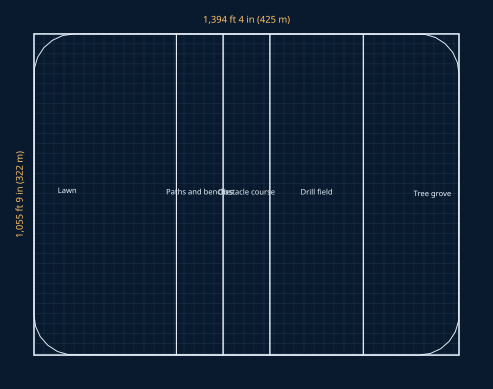

# P1-33 Training Field 8: plan

Footprint 1,394 ft 4 in (425 m) × 1,055 ft 9 in (322 m) · structural grid 32 ft 10 in (10 m)

## Levels

| Level | Floor above deck | Height | Floor area |
|---|---|---|---|
| Level 1 · Ground | 0 ft (0 mm) | 13 ft 1 in (4,000 mm) | — |

## Elements

| ID | Designation | Type | Name | Level(s) | Size / length | Area | Status |
|---|---|---|---|---|---|---|---|
| E001 | D5F6P1B13A2R1 | zone | Lawn | L1 | 467 ft 2 in (142 m) × 1,054 ft 9 in (322 m) | 484,547 sq ft (45,016 m²) | proposed |
| E002 | D5F6P1B13A2R2 | zone | Paths and benches | L1 | 153 ft 3 in (47 m) × 1,054 ft 9 in (322 m) | 161,560 sq ft (15,009 m²) | proposed |
| E003 | D5F6P1B13A2R3 | zone | Obstacle course | L1 | 153 ft 7 in (47 m) × 1,054 ft 6 in (321 m) | 161,906 sq ft (15,042 m²) | proposed |
| E004 | D5F6P1B13A2R4 | zone | Drill field | L1 | 306 ft 5 in (93 m) × 1,054 ft 9 in (322 m) | 323,119 sq ft (30,019 m²) | proposed |
| E005 | D5F6P1B13A2R5 | zone | Tree grove | L1 | 314 ft (96 m) × 1,054 ft 9 in (322 m) | 322,994 sq ft (30,007 m²) | proposed |

## Drawings

### Level 1 · Ground

