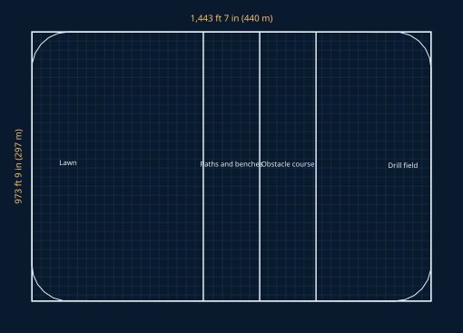

# P1-35 Training Field 9: plan

Footprint 1,443 ft 7 in (440 m) × 973 ft 9 in (297 m) · structural grid 32 ft 10 in (10 m)

## Levels

| Level | Floor above deck | Height | Floor area |
|---|---|---|---|
| Level 1 · Ground | 0 ft (0 mm) | 13 ft 1 in (4,000 mm) | — |

## Elements

| ID | Designation | Type | Name | Level(s) | Size / length | Area | Status |
|---|---|---|---|---|---|---|---|
| E001 | D5F6P1B17A3R1 | zone | Lawn | L1 | 619 ft 9 in (189 m) × 973 ft 1 in (297 m) | 594,649 sq ft (55,245 m²) | proposed |
| E002 | D5F6P1B17A3R2 | zone | Paths and benches | L1 | 204 ft 1 in (62 m) × 972 ft 5 in (296 m) | 198,444 sq ft (18,436 m²) | proposed |
| E003 | D5F6P1B17A3R3 | zone | Obstacle course | L1 | 203 ft 9 in (62 m) × 972 ft 9 in (296 m) | 198,125 sq ft (18,406 m²) | proposed |
| E004 | D5F6P1B17A3R4 | zone | Drill field | L1 | 416 ft (127 m) × 972 ft 9 in (296 m) | 396,537 sq ft (36,839 m²) | proposed |

## Drawings

### Level 1 · Ground

