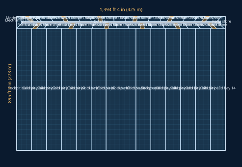
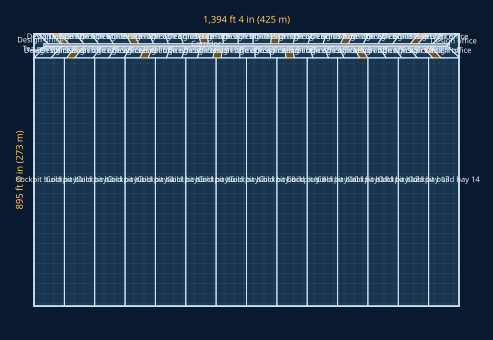

# P2-07 Simulator Workshops: plan

Footprint 1,394 ft 4 in (425 m) × 895 ft 4 in (273 m) · structural grid 32 ft 10 in (10 m)

## Levels

| Level | Floor above deck | Height | Floor area |
|---|---|---|---|
| Level 1 · Hall floor | 0 ft (0 mm) | 32 ft 10 in (10 m) | 1,219,877 sq ft (113,330 m²) |
| Level 2 · Gallery floor | 32 ft 10 in (10 m) | 14 ft 9 in (4,500 mm) | 1,219,877 sq ft (113,330 m²) |

## Elements

| ID | Designation | Type | Name | Level(s) | Size / length | Area | Status |
|---|---|---|---|---|---|---|---|
| E001 | D5F6P2B9A1L1R1, D5F6P2B9A1L2R1 | room | Cockpit build bay 1 | L1, L2 | 99 ft 9 in (30 m) × 816 ft 7 in (249 m) | 81,446 sq ft (7,567 m²) | proposed |
| E002 | D5F6P2B9A1L1R2, D5F6P2B9A1L2R2 | room | Cockpit build bay 2 | L1, L2 | 99 ft 5 in (30 m) × 816 ft 7 in (249 m) | 81,178 sq ft (7,542 m²) | proposed |
| E003 | D5F6P2B9A1L1R3, D5F6P2B9A1L2R3 | room | Cockpit build bay 3 | L1, L2 | 99 ft 9 in (30 m) × 816 ft 7 in (249 m) | 81,446 sq ft (7,567 m²) | proposed |
| E004 | D5F6P2B9A1L1R4, D5F6P2B9A1L2R4 | room | Cockpit build bay 4 | L1, L2 | 99 ft 5 in (30 m) × 816 ft 7 in (249 m) | 81,178 sq ft (7,542 m²) | proposed |
| E005 | D5F6P2B9A1L1R5, D5F6P2B9A1L2R5 | room | Cockpit build bay 5 | L1, L2 | 99 ft 9 in (30 m) × 816 ft 7 in (249 m) | 81,446 sq ft (7,567 m²) | proposed |
| E006 | D5F6P2B9A1L1R6, D5F6P2B9A1L2R6 | room | Cockpit build bay 6 | L1, L2 | 99 ft 5 in (30 m) × 816 ft 7 in (249 m) | 81,178 sq ft (7,542 m²) | proposed |
| E007 | D5F6P2B9A1L1R7, D5F6P2B9A1L2R7 | room | Cockpit build bay 7 | L1, L2 | 99 ft 9 in (30 m) × 816 ft 7 in (249 m) | 81,446 sq ft (7,567 m²) | proposed |
| E008 | D5F6P2B9A1L1R8, D5F6P2B9A1L2R8 | room | Cockpit build bay 8 | L1, L2 | 99 ft 9 in (30 m) × 816 ft 7 in (249 m) | 81,446 sq ft (7,567 m²) | proposed |
| E009 | D5F6P2B9A1L1R9, D5F6P2B9A1L2R9 | room | Cockpit build bay 9 | L1, L2 | 99 ft 5 in (30 m) × 816 ft 7 in (249 m) | 81,178 sq ft (7,542 m²) | proposed |
| E010 | D5F6P2B9A1L1R10, D5F6P2B9A1L2R10 | room | Cockpit build bay 10 | L1, L2 | 99 ft 9 in (30 m) × 816 ft 7 in (249 m) | 81,446 sq ft (7,567 m²) | proposed |
| E011 | D5F6P2B9A1L1R11, D5F6P2B9A1L2R11 | room | Cockpit build bay 11 | L1, L2 | 99 ft 5 in (30 m) × 816 ft 7 in (249 m) | 81,178 sq ft (7,542 m²) | proposed |
| E012 | D5F6P2B9A1L1R12, D5F6P2B9A1L2R12 | room | Cockpit build bay 12 | L1, L2 | 99 ft 9 in (30 m) × 816 ft 7 in (249 m) | 81,446 sq ft (7,567 m²) | proposed |
| E013 | D5F6P2B9A1L1R13, D5F6P2B9A1L2R13 | room | Cockpit build bay 13 | L1, L2 | 99 ft 5 in (30 m) × 816 ft 7 in (249 m) | 81,178 sq ft (7,542 m²) | proposed |
| E014 | D5F6P2B9A1L1R14, D5F6P2B9A1L2R14 | room | Cockpit build bay 14 | L1, L2 | 99 ft 9 in (30 m) × 816 ft 7 in (249 m) | 81,446 sq ft (7,567 m²) | proposed |
| E015 | D5F6P2B9A1L1R15, D5F6P2B9A1L2R15 | core | Stairs and lifts | L1, L2 | 55 ft 1 in (17 m) × 32 ft 6 in (9,900 mm) | 853 sq ft (79 m²) | proposed |
| E016 | D5F6P2B9A1L1R16, D5F6P2B9A1L2R16 | core | Stairs and lifts | L1, L2 | 44 ft 3 in (14 m) × 32 ft 6 in (9,900 mm) | 853 sq ft (79 m²) | proposed |
| E017 | D5F6P2B9A1L1R17, D5F6P2B9A1L2R17 | core | Stairs and lifts | L1, L2 | 32 ft 10 in (10 m) × 32 ft 6 in (9,900 mm) | 853 sq ft (79 m²) | proposed |
| E018 | D5F6P2B9A1L1R18, D5F6P2B9A1L2R18 | core | Stairs and lifts | L1, L2 | 30 ft 10 in (9,400 mm) × 32 ft 6 in (9,900 mm) | 853 sq ft (79 m²) | proposed |
| E019 | D5F6P2B9A1L1R19, D5F6P2B9A1L2R19 | core | Stairs and lifts | L1, L2 | 41 ft 8 in (13 m) × 32 ft 6 in (9,900 mm) | 853 sq ft (79 m²) | proposed |
| E020 | D5F6P2B9A1L1R20, D5F6P2B9A1L2R20 | core | Stairs and lifts | L1, L2 | 53 ft 2 in (16 m) × 32 ft 6 in (9,900 mm) | 853 sq ft (79 m²) | proposed |
| E021 | D5F6P2B9A1L1R21, D5F6P2B9A1L2R21 | core | Stairs and lifts | L1, L2 | 55 ft 1 in (17 m) × 32 ft 6 in (9,900 mm) | 853 sq ft (79 m²) | proposed |
| E022 | D5F6P2B9A1L1R22, D5F6P2B9A1L2R22 | core | Stairs and lifts | L1, L2 | 44 ft 3 in (14 m) × 32 ft 6 in (9,900 mm) | 853 sq ft (79 m²) | proposed |
| E023 | D5F6P2B9A1L1R23, D5F6P2B9A1L2R23 | core | Stairs and lifts | L1, L2 | 32 ft 10 in (10,000 mm) × 32 ft 6 in (9,900 mm) | 853 sq ft (79 m²) | proposed |
| E024 | D5F6P2B9A1L1R24, D5F6P2B9A1L2R24 | core | Stairs and lifts | L1, L2 | 30 ft 10 in (9,400 mm) × 32 ft 6 in (9,900 mm) | 853 sq ft (79 m²) | proposed |
| E025 | D5F6P2B9A1L1R25, D5F6P2B9A1L2R25 | core | Stairs and lifts | L1, L2 | 41 ft 8 in (13 m) × 32 ft 6 in (9,900 mm) | 853 sq ft (79 m²) | proposed |
| E026 | D5F6P2B9A1L1R26, D5F6P2B9A1L2R26 | core | Stairs and lifts | L1, L2 | 53 ft 2 in (16 m) × 32 ft 6 in (9,900 mm) | 853 sq ft (79 m²) | proposed |
| E027 | D5F6P2B9A1L1R27 | zone | Corridor | L1 | 1,329 ft 5 in (405 m) × 13 ft 9 in (4,200 mm) | 13,123 sq ft (1,219 m²) | proposed |
| E028 | D5F6P2B9A1L1R28 | room | Electronics shop | L1 | 35 ft 9 in (11 m) × 78 ft 9 in (24 m) | 1,614 sq ft (150 m²) | proposed |
| E029 | D5F6P2B9A1L1R29 | room | Motion system shop | L1 | 85 ft 4 in (26 m) × 32 ft 6 in (9,900 mm) | 1,769 sq ft (164 m²) | proposed |
| E030 | D5F6P2B9A1L1R30 | room | Locker room | L1 | 57 ft 5 in (17 m) × 32 ft 6 in (9,900 mm) | 970 sq ft (90 m²) | proposed |
| E031 | D5F6P2B9A1L1R31 | room | Staff toilets and showers | L1 | 49 ft 6 in (15 m) × 32 ft 6 in (9,900 mm) | 751 sq ft (70 m²) | proposed |
| E032 | D5F6P2B9A1L1R32 | room | Parts store | L1 | 103 ft 8 in (32 m) × 32 ft 6 in (9,900 mm) | 2,589 sq ft (241 m²) | proposed |
| E033 | D5F6P2B9A1L1R33 | room | Parts store | L1 | 96 ft 2 in (29 m) × 32 ft 6 in (9,900 mm) | 2,462 sq ft (229 m²) | proposed |
| E034 | D5F6P2B9A1L1R34 | room | Parts store | L1 | 95 ft 2 in (29 m) × 32 ft 6 in (9,900 mm) | 2,589 sq ft (241 m²) | proposed |
| E035 | D5F6P2B9A1L1R35 | room | Parts store | L1 | 91 ft 2 in (28 m) × 32 ft 6 in (9,900 mm) | 2,584 sq ft (240 m²) | proposed |
| E036 | D5F6P2B9A1L1R36 | room | Parts store | L1 | 57 ft 9 in (18 m) × 32 ft 6 in (9,900 mm) | 1,598 sq ft (149 m²) | proposed |
| E037 | D5F6P2B9A1L1R37 | room | Parts store | L1 | 83 ft 8 in (26 m) × 32 ft 6 in (9,900 mm) | 2,584 sq ft (240 m²) | proposed |
| E038 | D5F6P2B9A1L1R38 | room | Parts store | L1 | 81 ft 4 in (25 m) × 32 ft 6 in (9,900 mm) | 2,584 sq ft (240 m²) | proposed |
| E039 | D5F6P2B9A1L1R39 | room | Parts store | L1 | 51 ft 10 in (16 m) × 32 ft 6 in (9,900 mm) | 1,598 sq ft (148 m²) | proposed |
| E040 | D5F6P2B9A1L1R40 | room | Parts store | L1 | 86 ft 7 in (26 m) × 32 ft 6 in (9,900 mm) | 2,584 sq ft (240 m²) | proposed |
| E041 | D5F6P2B9A1L1R41 | room | Parts store | L1 | 90 ft 7 in (28 m) × 32 ft 6 in (9,900 mm) | 2,589 sq ft (241 m²) | proposed |
| E042 | D5F6P2B9A1L1R42 | room | Parts store | L1 | 63 ft (19 m) × 32 ft 6 in (9,900 mm) | 1,598 sq ft (148 m²) | proposed |
| E043 | D5F6P2B9A1L1R43 | room | Parts store | L1 | 97 ft 9 in (30 m) × 32 ft 6 in (9,900 mm) | 2,589 sq ft (241 m²) | proposed |
| E044 | D5F6P2B9A1L1R44 | room | Parts store | L1 | 101 ft 5 in (31 m) × 32 ft 6 in (9,900 mm) | 2,584 sq ft (240 m²) | proposed |
| E045 | D5F6P2B9A1L1R45 | room | Parts store | L1 | 74 ft 2 in (23 m) × 32 ft 6 in (9,900 mm) | 1,598 sq ft (149 m²) | proposed |
| E046 | D5F6P2B9A1L1R46 | room | Parts store | L1 | 108 ft 11 in (33 m) × 32 ft 6 in (9,900 mm) | 2,584 sq ft (240 m²) | proposed |
| E047 | D5F6P2B9A1L1R47 | room | Parts store | L1 | 56 ft 5 in (17 m) × 78 ft 9 in (24 m) | 2,584 sq ft (240 m²) | proposed |
| E048 | D5F6P2B9A1L1R48 | room | Parts store | L1 | 80 ft 1 in (24 m) × 32 ft 6 in (9,900 mm) | 1,598 sq ft (149 m²) | proposed |
| E049 | D5F6P2B9A1L1R49 | room | Parts store | L1 | 106 ft (32 m) × 32 ft 6 in (9,900 mm) | 2,584 sq ft (240 m²) | proposed |
| E050 | D5F6P2B9A1L1R50 | room | Parts store | L1 | 102 ft 4 in (31 m) × 32 ft 6 in (9,900 mm) | 2,589 sq ft (241 m²) | proposed |
| E051 | D5F6P2B9A1L1R51 | room | Parts store | L1 | 68 ft 11 in (21 m) × 32 ft 6 in (9,900 mm) | 1,598 sq ft (149 m²) | proposed |
| E052 | D5F6P2B9A1L1R52 | room | Parts store | L1 | 95 ft 2 in (29 m) × 32 ft 6 in (9,900 mm) | 2,589 sq ft (241 m²) | proposed |
| E053 | D5F6P2B9A1L1R53 | room | Parts store | L1 | 91 ft 2 in (28 m) × 32 ft 6 in (9,900 mm) | 2,584 sq ft (240 m²) | proposed |
| E054 | D5F6P2B9A1L1R54 | room | Parts store | L1 | 57 ft 9 in (18 m) × 32 ft 6 in (9,900 mm) | 1,598 sq ft (149 m²) | proposed |
| E055 | D5F6P2B9A1L1R55 | room | Parts store | L1 | 83 ft 8 in (26 m) × 32 ft 6 in (9,900 mm) | 2,584 sq ft (240 m²) | proposed |
| E056 | D5F6P2B9A1L1R56 | room | Parts store | L1 | 81 ft 4 in (25 m) × 32 ft 6 in (9,900 mm) | 2,584 sq ft (240 m²) | proposed |
| E057 | D5F6P2B9A1L1R57 | room | Parts store | L1 | 51 ft 10 in (16 m) × 32 ft 6 in (9,900 mm) | 1,598 sq ft (149 m²) | proposed |
| E058 | D5F6P2B9A1L1R58 | room | Parts store | L1 | 86 ft 7 in (26 m) × 32 ft 6 in (9,900 mm) | 2,584 sq ft (240 m²) | proposed |
| E059 | D5F6P2B9A1L1R59 | room | Parts store | L1 | 90 ft 7 in (28 m) × 32 ft 6 in (9,900 mm) | 2,589 sq ft (241 m²) | proposed |
| E060 | D5F6P2B9A1L1R60 | room | Parts store | L1 | 63 ft (19 m) × 32 ft 6 in (9,900 mm) | 1,598 sq ft (148 m²) | proposed |
| E061 | D5F6P2B9A1L1R61 | room | Parts store | L1 | 97 ft 9 in (30 m) × 32 ft 6 in (9,900 mm) | 2,589 sq ft (241 m²) | proposed |
| E062 | D5F6P2B9A1L1R62 | room | Parts store | L1 | 101 ft 5 in (31 m) × 32 ft 6 in (9,900 mm) | 2,584 sq ft (240 m²) | proposed |
| E063 | D5F6P2B9A1L1R63 | room | Parts store | L1 | 74 ft 2 in (23 m) × 32 ft 6 in (9,900 mm) | 1,598 sq ft (148 m²) | proposed |
| E064 | D5F6P2B9A1L1R64 | room | Parts store | L1 | 134 ft 2 in (41 m) × 32 ft 6 in (9,900 mm) | 3,383 sq ft (314 m²) | proposed |
| E065 | D5F6P2B9A1L2R27 | zone | Corridor | L2 | 1,329 ft 5 in (405 m) × 13 ft 9 in (4,200 mm) | 13,123 sq ft (1,219 m²) | proposed |
| E066 | D5F6P2B9A1L2R28 | room | Tea point | L2 | 32 ft 6 in (9,900 mm) × 35 ft 9 in (11 m) | 368 sq ft (34 m²) | proposed |
| E067 | D5F6P2B9A1L2R29 | room | Design office | L2 | 46 ft 11 in (14 m) × 59 ft 5 in (18 m) | 1,614 sq ft (150 m²) | proposed |
| E068 | D5F6P2B9A1L2R30 | room | Design office | L2 | 73 ft 10 in (22 m) × 32 ft 6 in (9,900 mm) | 1,401 sq ft (130 m²) | proposed |
| E069 | D5F6P2B9A1L2R31 | room | Design office | L2 | 76 ft 9 in (23 m) × 32 ft 6 in (9,900 mm) | 1,614 sq ft (150 m²) | proposed |
| E070 | D5F6P2B9A1L2R32 | room | Design office | L2 | 74 ft 6 in (23 m) × 32 ft 6 in (9,900 mm) | 1,614 sq ft (150 m²) | proposed |
| E071 | D5F6P2B9A1L2R33 | room | Design office | L2 | 72 ft 6 in (22 m) × 32 ft 6 in (9,900 mm) | 1,625 sq ft (151 m²) | proposed |
| E072 | D5F6P2B9A1L2R34 | room | Design office | L2 | 79 ft 1 in (24 m) × 32 ft 6 in (9,900 mm) | 1,918 sq ft (178 m²) | proposed |
| E073 | D5F6P2B9A1L2R35 | room | Design office | L2 | 65 ft 11 in (20 m) × 32 ft 6 in (9,900 mm) | 1,614 sq ft (150 m²) | proposed |
| E074 | D5F6P2B9A1L2R36 | room | Design office | L2 | 63 ft 8 in (19 m) × 32 ft 6 in (9,900 mm) | 1,620 sq ft (150 m²) | proposed |
| E075 | D5F6P2B9A1L2R37 | room | Design office | L2 | 61 ft (19 m) × 32 ft 6 in (9,900 mm) | 1,614 sq ft (150 m²) | proposed |
| E076 | D5F6P2B9A1L2R38 | room | Design office | L2 | 67 ft 11 in (21 m) × 32 ft 6 in (9,900 mm) | 1,923 sq ft (179 m²) | proposed |
| E077 | D5F6P2B9A1L2R39 | room | Design office | L2 | 54 ft 6 in (17 m) × 32 ft 6 in (9,900 mm) | 1,614 sq ft (150 m²) | proposed |
| E078 | D5F6P2B9A1L2R40 | room | Design office | L2 | 52 ft 2 in (16 m) × 32 ft 6 in (9,900 mm) | 1,614 sq ft (150 m²) | proposed |
| E079 | D5F6P2B9A1L2R41 | room | Design office | L2 | 50 ft 10 in (16 m) × 32 ft 6 in (9,900 mm) | 1,614 sq ft (150 m²) | proposed |
| E080 | D5F6P2B9A1L2R42 | room | Design office | L2 | 61 ft 8 in (19 m) × 32 ft 6 in (9,900 mm) | 1,923 sq ft (179 m²) | proposed |
| E081 | D5F6P2B9A1L2R43 | room | Design office | L2 | 56 ft 1 in (17 m) × 32 ft 6 in (9,900 mm) | 1,614 sq ft (150 m²) | proposed |
| E082 | D5F6P2B9A1L2R44 | room | Design office | L2 | 58 ft 9 in (18 m) × 32 ft 6 in (9,900 mm) | 1,620 sq ft (150 m²) | proposed |
| E083 | D5F6P2B9A1L2R45 | room | Design office | L2 | 61 ft (19 m) × 32 ft 6 in (9,900 mm) | 1,620 sq ft (150 m²) | proposed |
| E084 | D5F6P2B9A1L2R46 | room | Design office | L2 | 72 ft 6 in (22 m) × 32 ft 6 in (9,900 mm) | 1,918 sq ft (178 m²) | proposed |
| E085 | D5F6P2B9A1L2R47 | room | Design office | L2 | 67 ft 3 in (20 m) × 32 ft 6 in (9,900 mm) | 1,620 sq ft (150 m²) | proposed |
| E086 | D5F6P2B9A1L2R48 | room | Design office | L2 | 69 ft 7 in (21 m) × 32 ft 6 in (9,900 mm) | 1,614 sq ft (150 m²) | proposed |
| E087 | D5F6P2B9A1L2R49 | room | Design office | L2 | 71 ft 10 in (22 m) × 32 ft 6 in (9,900 mm) | 1,614 sq ft (150 m²) | proposed |
| E088 | D5F6P2B9A1L2R50 | room | Design office | L2 | 84 ft (26 m) × 32 ft 6 in (9,900 mm) | 1,923 sq ft (179 m²) | proposed |
| E089 | D5F6P2B9A1L2R51 | room | Design office | L2 | 78 ft 5 in (24 m) × 32 ft 6 in (9,900 mm) | 1,614 sq ft (150 m²) | proposed |
| E090 | D5F6P2B9A1L2R52 | room | Design office | L2 | 80 ft 9 in (25 m) × 32 ft 6 in (9,900 mm) | 1,614 sq ft (150 m²) | proposed |
| E091 | D5F6P2B9A1L2R53 | room | Design office | L2 | 37 ft 1 in (11 m) × 76 ft 9 in (23 m) | 1,620 sq ft (150 m²) | proposed |
| E092 | D5F6P2B9A1L2R54 | room | Design office | L2 | 88 ft 11 in (27 m) × 32 ft 10 in (10 m) | 1,918 sq ft (178 m²) | proposed |
| E093 | D5F6P2B9A1L2R55 | room | Design office | L2 | 76 ft 9 in (23 m) × 32 ft 6 in (9,900 mm) | 1,614 sq ft (150 m²) | proposed |
| E094 | D5F6P2B9A1L2R56 | room | Design office | L2 | 74 ft 6 in (23 m) × 32 ft 6 in (9,900 mm) | 1,614 sq ft (150 m²) | proposed |
| E095 | D5F6P2B9A1L2R57 | room | Design office | L2 | 72 ft 6 in (22 m) × 32 ft 6 in (9,900 mm) | 1,625 sq ft (151 m²) | proposed |
| E096 | D5F6P2B9A1L2R58 | room | Design office | L2 | 79 ft 1 in (24 m) × 32 ft 6 in (9,900 mm) | 1,918 sq ft (178 m²) | proposed |
| E097 | D5F6P2B9A1L2R59 | room | Design office | L2 | 65 ft 11 in (20 m) × 32 ft 6 in (9,900 mm) | 1,614 sq ft (150 m²) | proposed |
| E098 | D5F6P2B9A1L2R60 | room | Design office | L2 | 63 ft 8 in (19 m) × 32 ft 6 in (9,900 mm) | 1,620 sq ft (150 m²) | proposed |
| E099 | D5F6P2B9A1L2R61 | room | Design office | L2 | 61 ft (19 m) × 32 ft 6 in (9,900 mm) | 1,614 sq ft (150 m²) | proposed |
| E100 | D5F6P2B9A1L2R62 | room | Design office | L2 | 67 ft 11 in (21 m) × 32 ft 6 in (9,900 mm) | 1,923 sq ft (179 m²) | proposed |
| E101 | D5F6P2B9A1L2R63 | room | Design office | L2 | 54 ft 6 in (17 m) × 32 ft 6 in (9,900 mm) | 1,614 sq ft (150 m²) | proposed |
| E102 | D5F6P2B9A1L2R64 | room | Design office | L2 | 52 ft 2 in (16 m) × 32 ft 6 in (9,900 mm) | 1,614 sq ft (150 m²) | proposed |
| E103 | D5F6P2B9A1L2R65 | room | Design office | L2 | 50 ft 10 in (16 m) × 32 ft 6 in (9,900 mm) | 1,614 sq ft (150 m²) | proposed |
| E104 | D5F6P2B9A1L2R66 | room | Design office | L2 | 61 ft 8 in (19 m) × 32 ft 6 in (9,900 mm) | 1,923 sq ft (179 m²) | proposed |
| E105 | D5F6P2B9A1L2R67 | room | Design office | L2 | 56 ft 1 in (17 m) × 32 ft 6 in (9,900 mm) | 1,614 sq ft (150 m²) | proposed |
| E106 | D5F6P2B9A1L2R68 | room | Design office | L2 | 58 ft 9 in (18 m) × 32 ft 6 in (9,900 mm) | 1,620 sq ft (150 m²) | proposed |
| E107 | D5F6P2B9A1L2R69 | room | Design office | L2 | 61 ft (19 m) × 32 ft 6 in (9,900 mm) | 1,620 sq ft (150 m²) | proposed |
| E108 | D5F6P2B9A1L2R70 | room | Design office | L2 | 72 ft 6 in (22 m) × 32 ft 6 in (9,900 mm) | 1,918 sq ft (178 m²) | proposed |
| E109 | D5F6P2B9A1L2R71 | room | Design office | L2 | 67 ft 3 in (20 m) × 32 ft 6 in (9,900 mm) | 1,620 sq ft (150 m²) | proposed |
| E110 | D5F6P2B9A1L2R72 | room | Design office | L2 | 69 ft 7 in (21 m) × 32 ft 6 in (9,900 mm) | 1,614 sq ft (150 m²) | proposed |
| E111 | D5F6P2B9A1L2R73 | room | Design office | L2 | 71 ft 10 in (22 m) × 32 ft 6 in (9,900 mm) | 1,614 sq ft (150 m²) | proposed |
| E112 | D5F6P2B9A1L2R74 | room | Design office | L2 | 84 ft (26 m) × 32 ft 6 in (9,900 mm) | 1,923 sq ft (179 m²) | proposed |
| E113 | D5F6P2B9A1L2R75 | room | Design office | L2 | 78 ft 5 in (24 m) × 32 ft 6 in (9,900 mm) | 1,614 sq ft (150 m²) | proposed |
| E114 | D5F6P2B9A1L2R76 | room | Design office | L2 | 85 ft 8 in (26 m) × 32 ft 6 in (9,900 mm) | 1,769 sq ft (164 m²) | proposed |

## Drawings

### Level 1 · Hall floor

### Level 2 · Gallery floor

