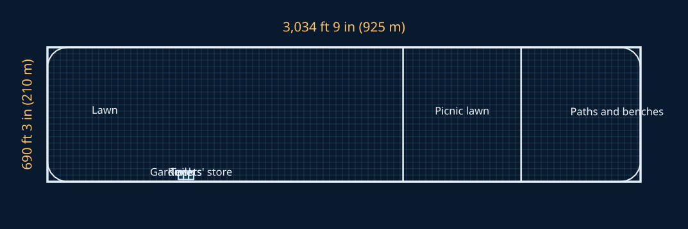

# P2-09 Starboard Lawn: plan

Footprint 3,034 ft 9 in (925 m) × 690 ft 3 in (210 m) · structural grid 32 ft 10 in (10 m)

## Levels

| Level | Floor above deck | Height | Floor area |
|---|---|---|---|
| Level 1 · Ground | 0 ft (0 mm) | 13 ft 1 in (4,000 mm) | 3,100 sq ft (288 m²) |

## Elements

| ID | Designation | Type | Name | Level(s) | Size / length | Area | Status |
|---|---|---|---|---|---|---|---|
| E001 | D5F6P2B12A1R1 | zone | Lawn | L1 | 1,819 ft 7 in (555 m) × 689 ft 8 in (210 m) | 1,248,688 sq ft (116,007 m²) | proposed |
| E002 | D5F6P2B12A1R2 | room | Kiosk | L1 | 26 ft 3 in (8,000 mm) × 39 ft 4 in (12 m) | 1,033 sq ft (96 m²) | proposed |
| E003 | D5F6P2B12A1R3 | room | Toilets | L1 | 26 ft 3 in (8,000 mm) × 39 ft 4 in (12 m) | 1,033 sq ft (96 m²) | proposed |
| E004 | D5F6P2B12A1R4 | room | Gardeners' store | L1 | 26 ft 3 in (8,000 mm) × 39 ft 4 in (12 m) | 1,033 sq ft (96 m²) | proposed |
| E005 | D5F6P2B12A1R5 | zone | Picnic lawn | L1 | 604 ft (184 m) × 689 ft 4 in (210 m) | 416,243 sq ft (38,670 m²) | proposed |
| E006 | D5F6P2B12A1R6 | zone | Paths and benches | L1 | 611 ft 3 in (186 m) × 689 ft 8 in (210 m) | 416,343 sq ft (38,680 m²) | proposed |

## Drawings

### Level 1 · Ground

