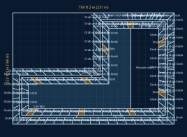

# P2-10 Simulator Halls Canteen: plan

Footprint 759 ft 2 in (231 m) × 523 ft 4 in (160 m) · structural grid 32 ft 10 in (10 m)

## Levels

| Level | Floor above deck | Height | Floor area |
|---|---|---|---|
| Level 1 · Dining floor | 0 ft (0 mm) | 17 ft 9 in (5,400 mm) | 217,731 sq ft (20,228 m²) |

## Elements

| ID | Designation | Type | Name | Level(s) | Size / length | Area | Status |
|---|---|---|---|---|---|---|---|
| E001 | D5F6P2B13A1R1 | room | Dining hall | L1 | 482 ft 7 in (147 m) × 378 ft 11 in (116 m) | 83,498 sq ft (7,757 m²) | proposed |
| E002 | D5F6P2B13A1R2 | zone | Terrace court | L1 | 132 ft 3 in (40 m) × 378 ft 11 in (116 m) | 50,102 sq ft (4,655 m²) | proposed |
| E003 | D5F6P2B13A1R3 | zone | Corridor | L1 | 317 ft 3 in (97 m) × 94 ft 2 in (29 m) | 3,875 sq ft (360 m²) | proposed |
| E004 | D5F6P2B13A1R4 | zone | Corridor | L1 | 38 ft 5 in (12 m) × 372 ft 8 in (114 m) | 3,875 sq ft (360 m²) | proposed |
| E005 | D5F6P2B13A1R5 | zone | Corridor | L1 | 399 ft 3 in (122 m) × 9 ft 10 in (3,000 mm) | 3,875 sq ft (360 m²) | proposed |
| E006 | D5F6P2B13A1R6 | zone | Corridor | L1 | 270 ft 4 in (82 m) × 135 ft 10 in (41 m) | 3,875 sq ft (360 m²) | proposed |
| E007 | D5F6P2B13A1R7 | zone | Corridor | L1 | 343 ft 6 in (105 m) × 66 ft 7 in (20 m) | 3,875 sq ft (360 m²) | proposed |
| E008 | D5F6P2B13A1R8 | zone | Corridor | L1 | 55 ft 9 in (17 m) × 271 ft 8 in (83 m) | 3,029 sq ft (281 m²) | proposed |
| E009 | D5F6P2B13A1R9 | core | Stairs and lifts | L1 | 29 ft 10 in (9,100 mm) × 31 ft 2 in (9,500 mm) | 813 sq ft (76 m²) | proposed |
| E010 | D5F6P2B13A1R10 | core | Stairs and lifts | L1 | 31 ft 2 in (9,500 mm) × 44 ft 3 in (14 m) | 818 sq ft (76 m²) | proposed |
| E011 | D5F6P2B13A1R11 | core | Stairs and lifts | L1 | 31 ft 2 in (9,500 mm) × 44 ft (13 m) | 823 sq ft (76 m²) | proposed |
| E012 | D5F6P2B13A1R12 | core | Stairs and lifts | L1 | 43 ft 4 in (13 m) × 31 ft 2 in (9,500 mm) | 818 sq ft (76 m²) | proposed |
| E013 | D5F6P2B13A1R13 | core | Stairs and lifts | L1 | 31 ft 10 in (9,700 mm) × 31 ft 2 in (9,500 mm) | 818 sq ft (76 m²) | proposed |
| E014 | D5F6P2B13A1R14 | core | Stairs and lifts | L1 | 54 ft 6 in (17 m) × 31 ft 2 in (9,500 mm) | 818 sq ft (76 m²) | proposed |
| E015 | D5F6P2B13A1R15 | core | Stairs and lifts | L1 | 57 ft 5 in (18 m) × 31 ft 2 in (9,500 mm) | 818 sq ft (76 m²) | proposed |
| E016 | D5F6P2B13A1R16 | core | Stairs and lifts | L1 | 57 ft 5 in (18 m) × 31 ft 2 in (9,500 mm) | 818 sq ft (76 m²) | proposed |
| E017 | D5F6P2B13A1R17 | core | Stairs and lifts | L1 | 31 ft 2 in (9,500 mm) × 57 ft 5 in (18 m) | 818 sq ft (76 m²) | proposed |
| E018 | D5F6P2B13A1R18 | room | Serving counter | L1 | 68 ft 11 in (21 m) × 31 ft 2 in (9,500 mm) | 1,294 sq ft (120 m²) | proposed |
| E019 | D5F6P2B13A1R19 | room | Main kitchen | L1 | 118 ft 1 in (36 m) × 31 ft 2 in (9,500 mm) | 3,231 sq ft (300 m²) | proposed |
| E020 | D5F6P2B13A1R20 | room | Cold room | L1 | 23 ft 11 in (7,300 mm) × 31 ft 2 in (9,500 mm) | 639 sq ft (59 m²) | proposed |
| E021 | D5F6P2B13A1R21 | room | Freezer room | L1 | 15 ft 1 in (4,600 mm) × 31 ft 2 in (9,500 mm) | 429 sq ft (40 m²) | proposed |
| E022 | D5F6P2B13A1R22 | room | Dry store | L1 | 31 ft 2 in (9,500 mm) × 31 ft 2 in (9,500 mm) | 864 sq ft (80 m²) | proposed |
| E023 | D5F6P2B13A1R23 | room | Dishwash room | L1 | 36 ft 1 in (11 m) × 31 ft 2 in (9,500 mm) | 864 sq ft (80 m²) | proposed |
| E024 | D5F6P2B13A1R24 | room | Goods-in bay | L1 | 33 ft 6 in (10 m) × 31 ft 2 in (9,500 mm) | 644 sq ft (60 m²) | proposed |
| E025 | D5F6P2B13A1R25 | room | Waste and recycling room | L1 | 26 ft 7 in (8,100 mm) × 31 ft 2 in (9,500 mm) | 343 sq ft (32 m²) | proposed |
| E026 | D5F6P2B13A1R26 | room | Coffee bar | L1 | 39 ft 1 in (12 m) × 31 ft 2 in (9,500 mm) | 644 sq ft (60 m²) | proposed |
| E027 | D5F6P2B13A1R27 | room | Toilets | L1 | 42 ft 8 in (13 m) × 31 ft 2 in (9,500 mm) | 644 sq ft (60 m²) | proposed |
| E028 | D5F6P2B13A1R28 | room | Grab-and-go kiosk | L1 | 67 ft 11 in (21 m) × 32 ft 2 in (9,800 mm) | 1,294 sq ft (120 m²) | proposed |
| E029 | D5F6P2B13A1R29 | room | Grab-and-go kiosk | L1 | 31 ft 2 in (9,500 mm) × 69 ft 11 in (21 m) | 1,288 sq ft (120 m²) | proposed |
| E030 | D5F6P2B13A1R30 | room | Grab-and-go kiosk | L1 | 31 ft 2 in (9,500 mm) × 64 ft 8 in (20 m) | 1,294 sq ft (120 m²) | proposed |
| E031 | D5F6P2B13A1R31 | room | Grab-and-go kiosk | L1 | 31 ft 2 in (9,500 mm) × 59 ft 5 in (18 m) | 1,294 sq ft (120 m²) | proposed |
| E032 | D5F6P2B13A1R32 | room | Grab-and-go kiosk | L1 | 31 ft 2 in (9,500 mm) × 54 ft 2 in (16 m) | 1,288 sq ft (120 m²) | proposed |
| E033 | D5F6P2B13A1R33 | room | Grab-and-go kiosk | L1 | 31 ft 2 in (9,500 mm) × 48 ft 11 in (15 m) | 1,294 sq ft (120 m²) | proposed |
| E034 | D5F6P2B13A1R34 | room | Grab-and-go kiosk | L1 | 31 ft 2 in (9,500 mm) × 44 ft (13 m) | 1,294 sq ft (120 m²) | proposed |
| E035 | D5F6P2B13A1R35 | room | Grab-and-go kiosk | L1 | 31 ft 2 in (9,500 mm) × 44 ft 3 in (14 m) | 1,288 sq ft (120 m²) | proposed |
| E036 | D5F6P2B13A1R36 | room | Grab-and-go kiosk | L1 | 31 ft 2 in (9,500 mm) × 49 ft 10 in (15 m) | 1,294 sq ft (120 m²) | proposed |
| E037 | D5F6P2B13A1R37 | room | Grab-and-go kiosk | L1 | 31 ft 2 in (9,500 mm) × 55 ft 1 in (17 m) | 1,288 sq ft (120 m²) | proposed |
| E038 | D5F6P2B13A1R38 | room | Grab-and-go kiosk | L1 | 31 ft 2 in (9,500 mm) × 60 ft 4 in (18 m) | 1,294 sq ft (120 m²) | proposed |
| E039 | D5F6P2B13A1R39 | room | Grab-and-go kiosk | L1 | 31 ft 2 in (9,500 mm) × 65 ft 3 in (20 m) | 1,288 sq ft (120 m²) | proposed |
| E040 | D5F6P2B13A1R40 | room | Grab-and-go kiosk | L1 | 37 ft 1 in (11 m) × 64 ft 4 in (20 m) | 1,294 sq ft (120 m²) | proposed |
| E041 | D5F6P2B13A1R41 | room | Grab-and-go kiosk | L1 | 70 ft 6 in (22 m) × 31 ft 2 in (9,500 mm) | 1,294 sq ft (120 m²) | proposed |
| E042 | D5F6P2B13A1R42 | room | Grab-and-go kiosk | L1 | 66 ft 11 in (20 m) × 31 ft 2 in (9,500 mm) | 1,294 sq ft (120 m²) | proposed |
| E043 | D5F6P2B13A1R43 | room | Grab-and-go kiosk | L1 | 63 ft 4 in (19 m) × 31 ft 2 in (9,500 mm) | 1,294 sq ft (120 m²) | proposed |
| E044 | D5F6P2B13A1R44 | room | Grab-and-go kiosk | L1 | 59 ft 5 in (18 m) × 31 ft 2 in (9,500 mm) | 1,283 sq ft (119 m²) | proposed |
| E045 | D5F6P2B13A1R45 | room | Grab-and-go kiosk | L1 | 56 ft 1 in (17 m) × 31 ft 2 in (9,500 mm) | 1,294 sq ft (120 m²) | proposed |
| E046 | D5F6P2B13A1R46 | room | Grab-and-go kiosk | L1 | 52 ft 6 in (16 m) × 31 ft 2 in (9,500 mm) | 1,294 sq ft (120 m²) | proposed |
| E047 | D5F6P2B13A1R47 | room | Grab-and-go kiosk | L1 | 48 ft 11 in (15 m) × 31 ft 2 in (9,500 mm) | 1,288 sq ft (120 m²) | proposed |
| E048 | D5F6P2B13A1R48 | room | Grab-and-go kiosk | L1 | 45 ft 7 in (14 m) × 31 ft 2 in (9,500 mm) | 1,294 sq ft (120 m²) | proposed |
| E049 | D5F6P2B13A1R49 | room | Grab-and-go kiosk | L1 | 43 ft 4 in (13 m) × 31 ft 2 in (9,500 mm) | 1,294 sq ft (120 m²) | proposed |
| E050 | D5F6P2B13A1R50 | room | Grab-and-go kiosk | L1 | 44 ft 7 in (14 m) × 31 ft 2 in (9,500 mm) | 1,294 sq ft (120 m²) | proposed |
| E051 | D5F6P2B13A1R51 | room | Grab-and-go kiosk | L1 | 47 ft 11 in (15 m) × 31 ft 2 in (9,500 mm) | 1,288 sq ft (120 m²) | proposed |
| E052 | D5F6P2B13A1R52 | room | Grab-and-go kiosk | L1 | 51 ft 6 in (16 m) × 31 ft 2 in (9,500 mm) | 1,294 sq ft (120 m²) | proposed |
| E053 | D5F6P2B13A1R53 | room | Grab-and-go kiosk | L1 | 55 ft 1 in (17 m) × 31 ft 2 in (9,500 mm) | 1,294 sq ft (120 m²) | proposed |
| E054 | D5F6P2B13A1R54 | room | Grab-and-go kiosk | L1 | 58 ft 9 in (18 m) × 31 ft 2 in (9,500 mm) | 1,294 sq ft (120 m²) | proposed |
| E055 | D5F6P2B13A1R55 | room | Grab-and-go kiosk | L1 | 62 ft (19 m) × 31 ft 2 in (9,500 mm) | 1,283 sq ft (119 m²) | proposed |
| E056 | D5F6P2B13A1R56 | room | Grab-and-go kiosk | L1 | 65 ft 11 in (20 m) × 31 ft 2 in (9,500 mm) | 1,294 sq ft (120 m²) | proposed |
| E057 | D5F6P2B13A1R57 | room | Grab-and-go kiosk | L1 | 69 ft 7 in (21 m) × 31 ft 2 in (9,500 mm) | 1,294 sq ft (120 m²) | proposed |
| E058 | D5F6P2B13A1R58 | room | Grab-and-go kiosk | L1 | 47 ft 11 in (15 m) × 51 ft 10 in (16 m) | 1,288 sq ft (120 m²) | proposed |
| E059 | D5F6P2B13A1R59 | room | Grab-and-go kiosk | L1 | 31 ft 2 in (9,500 mm) × 60 ft 8 in (18 m) | 1,299 sq ft (121 m²) | proposed |
| E060 | D5F6P2B13A1R60 | room | Grab-and-go kiosk | L1 | 31 ft 2 in (9,500 mm) × 49 ft 3 in (15 m) | 1,288 sq ft (120 m²) | proposed |
| E061 | D5F6P2B13A1R61 | room | Grab-and-go kiosk | L1 | 31 ft 2 in (9,500 mm) × 46 ft 11 in (14 m) | 1,288 sq ft (120 m²) | proposed |
| E062 | D5F6P2B13A1R62 | room | Grab-and-go kiosk | L1 | 31 ft 2 in (9,500 mm) × 56 ft 1 in (17 m) | 1,294 sq ft (120 m²) | proposed |
| E063 | D5F6P2B13A1R63 | room | Grab-and-go kiosk | L1 | 32 ft 2 in (9,800 mm) × 66 ft 3 in (20 m) | 1,294 sq ft (120 m²) | proposed |
| E064 | D5F6P2B13A1R64 | room | Grab-and-go kiosk | L1 | 72 ft 6 in (22 m) × 31 ft 2 in (9,500 mm) | 1,288 sq ft (120 m²) | proposed |
| E065 | D5F6P2B13A1R65 | room | Grab-and-go kiosk | L1 | 72 ft 10 in (22 m) × 31 ft 2 in (9,500 mm) | 1,299 sq ft (121 m²) | proposed |
| E066 | D5F6P2B13A1R66 | room | Grab-and-go kiosk | L1 | 72 ft 6 in (22 m) × 31 ft 2 in (9,500 mm) | 1,288 sq ft (120 m²) | proposed |
| E067 | D5F6P2B13A1R67 | room | Grab-and-go kiosk | L1 | 72 ft 6 in (22 m) × 31 ft 2 in (9,500 mm) | 1,288 sq ft (120 m²) | proposed |
| E068 | D5F6P2B13A1R68 | room | Grab-and-go kiosk | L1 | 72 ft 6 in (22 m) × 31 ft 2 in (9,500 mm) | 1,288 sq ft (120 m²) | proposed |
| E069 | D5F6P2B13A1R69 | room | Grab-and-go kiosk | L1 | 72 ft 10 in (22 m) × 31 ft 2 in (9,500 mm) | 1,299 sq ft (121 m²) | proposed |
| E070 | D5F6P2B13A1R70 | room | Grab-and-go kiosk | L1 | 72 ft 6 in (22 m) × 31 ft 2 in (9,500 mm) | 1,288 sq ft (120 m²) | proposed |
| E071 | D5F6P2B13A1R71 | room | Grab-and-go kiosk | L1 | 72 ft 6 in (22 m) × 31 ft 2 in (9,500 mm) | 1,288 sq ft (120 m²) | proposed |
| E072 | D5F6P2B13A1R72 | room | Grab-and-go kiosk | L1 | 72 ft 10 in (22 m) × 31 ft 2 in (9,500 mm) | 1,299 sq ft (121 m²) | proposed |
| E073 | D5F6P2B13A1R73 | room | Grab-and-go kiosk | L1 | 36 ft 9 in (11 m) × 66 ft 11 in (20 m) | 1,288 sq ft (120 m²) | proposed |
| E074 | D5F6P2B13A1R74 | room | Grab-and-go kiosk | L1 | 31 ft 2 in (9,500 mm) × 72 ft 6 in (22 m) | 1,288 sq ft (120 m²) | proposed |
| E075 | D5F6P2B13A1R75 | room | Grab-and-go kiosk | L1 | 31 ft 2 in (9,500 mm) × 72 ft 10 in (22 m) | 1,299 sq ft (121 m²) | proposed |
| E076 | D5F6P2B13A1R76 | room | Grab-and-go kiosk | L1 | 31 ft 2 in (9,500 mm) × 72 ft 6 in (22 m) | 1,288 sq ft (120 m²) | proposed |
| E077 | D5F6P2B13A1R77 | room | Grab-and-go kiosk | L1 | 31 ft 2 in (9,500 mm) × 72 ft 6 in (22 m) | 1,288 sq ft (120 m²) | proposed |
| E078 | D5F6P2B13A1R78 | room | Grab-and-go kiosk | L1 | 31 ft 2 in (9,500 mm) × 72 ft 10 in (22 m) | 1,299 sq ft (121 m²) | proposed |
| E079 | D5F6P2B13A1R79 | room | Grab-and-go kiosk | L1 | 31 ft 2 in (9,500 mm) × 49 ft 10 in (15 m) | 583 sq ft (54 m²) | proposed |
| E080 | D5F6P2B13A1R80 | room | Grab-and-go kiosk | L1 | 67 ft 11 in (21 m) × 31 ft 2 in (9,500 mm) | 1,294 sq ft (120 m²) | proposed |
| E081 | D5F6P2B13A1R81 | room | Grab-and-go kiosk | L1 | 58 ft 1 in (18 m) × 31 ft 2 in (9,500 mm) | 1,288 sq ft (120 m²) | proposed |
| E082 | D5F6P2B13A1R82 | room | Grab-and-go kiosk | L1 | 30 ft 10 in (9,400 mm) × 31 ft 2 in (9,500 mm) | 670 sq ft (62 m²) | proposed |
| E083 | D5F6P2B13A1R83 | room | Grab-and-go kiosk | L1 | 46 ft 3 in (14 m) × 31 ft 2 in (9,500 mm) | 1,294 sq ft (120 m²) | proposed |
| E084 | D5F6P2B13A1R84 | room | Grab-and-go kiosk | L1 | 55 ft 1 in (17 m) × 31 ft 2 in (9,500 mm) | 1,288 sq ft (120 m²) | proposed |
| E085 | D5F6P2B13A1R85 | room | Grab-and-go kiosk | L1 | 65 ft (20 m) × 31 ft 2 in (9,500 mm) | 1,294 sq ft (120 m²) | proposed |
| E086 | D5F6P2B13A1R86 | room | Grab-and-go kiosk | L1 | 41 ft 4 in (13 m) × 58 ft 9 in (18 m) | 1,294 sq ft (120 m²) | proposed |
| E087 | D5F6P2B13A1R87 | room | Grab-and-go kiosk | L1 | 31 ft 2 in (9,500 mm) × 65 ft (20 m) | 1,294 sq ft (120 m²) | proposed |
| E088 | D5F6P2B13A1R88 | room | Grab-and-go kiosk | L1 | 31 ft 2 in (9,500 mm) × 54 ft 6 in (17 m) | 1,294 sq ft (120 m²) | proposed |
| E089 | D5F6P2B13A1R89 | room | Grab-and-go kiosk | L1 | 31 ft 2 in (9,500 mm) × 48 ft 3 in (15 m) | 1,294 sq ft (120 m²) | proposed |
| E090 | D5F6P2B13A1R90 | room | Grab-and-go kiosk | L1 | 31 ft 2 in (9,500 mm) × 44 ft 7 in (14 m) | 1,288 sq ft (120 m²) | proposed |
| E091 | D5F6P2B13A1R91 | room | Grab-and-go kiosk | L1 | 31 ft 2 in (9,500 mm) × 47 ft 7 in (14 m) | 1,294 sq ft (120 m²) | proposed |
| E092 | D5F6P2B13A1R92 | room | Grab-and-go kiosk | L1 | 31 ft 2 in (9,500 mm) × 53 ft 6 in (16 m) | 1,288 sq ft (120 m²) | proposed |
| E093 | D5F6P2B13A1R93 | room | Grab-and-go kiosk | L1 | 31 ft 2 in (9,500 mm) × 64 ft (20 m) | 1,288 sq ft (120 m²) | proposed |
| E094 | D5F6P2B13A1R94 | room | Grab-and-go kiosk | L1 | 37 ft 1 in (11 m) × 63 ft 8 in (19 m) | 1,294 sq ft (120 m²) | proposed |
| E095 | D5F6P2B13A1R95 | room | Grab-and-go kiosk | L1 | 69 ft 11 in (21 m) × 31 ft 2 in (9,500 mm) | 1,288 sq ft (120 m²) | proposed |
| E096 | D5F6P2B13A1R96 | room | Grab-and-go kiosk | L1 | 65 ft 11 in (20 m) × 31 ft 2 in (9,500 mm) | 1,294 sq ft (120 m²) | proposed |
| E097 | D5F6P2B13A1R97 | room | Grab-and-go kiosk | L1 | 62 ft (19 m) × 31 ft 2 in (9,500 mm) | 1,294 sq ft (120 m²) | proposed |
| E098 | D5F6P2B13A1R98 | room | Grab-and-go kiosk | L1 | 55 ft 5 in (17 m) × 31 ft 2 in (9,500 mm) | 1,294 sq ft (120 m²) | proposed |
| E099 | D5F6P2B13A1R99 | room | Grab-and-go kiosk | L1 | 51 ft 6 in (16 m) × 31 ft 2 in (9,500 mm) | 1,294 sq ft (120 m²) | proposed |
| E100 | D5F6P2B13A1R100 | room | Grab-and-go kiosk | L1 | 47 ft 3 in (14 m) × 31 ft 2 in (9,500 mm) | 1,288 sq ft (120 m²) | proposed |
| E101 | D5F6P2B13A1R101 | room | Grab-and-go kiosk | L1 | 43 ft 8 in (13 m) × 31 ft 2 in (9,500 mm) | 1,294 sq ft (120 m²) | proposed |
| E102 | D5F6P2B13A1R102 | room | Grab-and-go kiosk | L1 | 43 ft 8 in (13 m) × 31 ft 2 in (9,500 mm) | 1,294 sq ft (120 m²) | proposed |
| E103 | D5F6P2B13A1R103 | room | Grab-and-go kiosk | L1 | 50 ft 2 in (15 m) × 31 ft 2 in (9,500 mm) | 1,288 sq ft (120 m²) | proposed |
| E104 | D5F6P2B13A1R104 | room | Grab-and-go kiosk | L1 | 54 ft 6 in (17 m) × 31 ft 2 in (9,500 mm) | 1,299 sq ft (121 m²) | proposed |
| E105 | D5F6P2B13A1R105 | room | Grab-and-go kiosk | L1 | 58 ft 1 in (18 m) × 31 ft 2 in (9,500 mm) | 1,288 sq ft (120 m²) | proposed |
| E106 | D5F6P2B13A1R106 | room | Grab-and-go kiosk | L1 | 62 ft (19 m) × 31 ft 2 in (9,500 mm) | 1,288 sq ft (120 m²) | proposed |
| E107 | D5F6P2B13A1R107 | room | Grab-and-go kiosk | L1 | 66 ft 3 in (20 m) × 31 ft 2 in (9,500 mm) | 1,294 sq ft (120 m²) | proposed |
| E108 | D5F6P2B13A1R108 | room | Grab-and-go kiosk | L1 | 48 ft 11 in (15 m) × 49 ft 3 in (15 m) | 1,288 sq ft (120 m²) | proposed |
| E109 | D5F6P2B13A1R109 | room | Grab-and-go kiosk | L1 | 31 ft 2 in (9,500 mm) × 54 ft 6 in (17 m) | 1,294 sq ft (120 m²) | proposed |
| E110 | D5F6P2B13A1R110 | room | Grab-and-go kiosk | L1 | 31 ft 2 in (9,500 mm) × 50 ft 2 in (15 m) | 1,294 sq ft (120 m²) | proposed |
| E111 | D5F6P2B13A1R111 | room | Grab-and-go kiosk | L1 | 31 ft 2 in (9,500 mm) × 63 ft 4 in (19 m) | 1,288 sq ft (120 m²) | proposed |
| E112 | D5F6P2B13A1R112 | room | Grab-and-go kiosk | L1 | 71 ft 6 in (22 m) × 32 ft 2 in (9,800 mm) | 1,294 sq ft (120 m²) | proposed |
| E113 | D5F6P2B13A1R113 | room | Grab-and-go kiosk | L1 | 72 ft 6 in (22 m) × 31 ft 2 in (9,500 mm) | 1,288 sq ft (120 m²) | proposed |
| E114 | D5F6P2B13A1R114 | room | Grab-and-go kiosk | L1 | 72 ft 6 in (22 m) × 31 ft 2 in (9,500 mm) | 1,288 sq ft (120 m²) | proposed |
| E115 | D5F6P2B13A1R115 | room | Grab-and-go kiosk | L1 | 72 ft 10 in (22 m) × 31 ft 2 in (9,500 mm) | 1,299 sq ft (121 m²) | proposed |
| E116 | D5F6P2B13A1R116 | room | Grab-and-go kiosk | L1 | 72 ft 6 in (22 m) × 31 ft 2 in (9,500 mm) | 1,288 sq ft (120 m²) | proposed |
| E117 | D5F6P2B13A1R117 | room | Grab-and-go kiosk | L1 | 72 ft 6 in (22 m) × 31 ft 2 in (9,500 mm) | 1,288 sq ft (120 m²) | proposed |
| E118 | D5F6P2B13A1R118 | room | Grab-and-go kiosk | L1 | 72 ft 6 in (22 m) × 31 ft 2 in (9,500 mm) | 1,288 sq ft (120 m²) | proposed |
| E119 | D5F6P2B13A1R119 | room | Grab-and-go kiosk | L1 | 66 ft 11 in (20 m) × 37 ft 1 in (11 m) | 1,299 sq ft (121 m²) | proposed |
| E120 | D5F6P2B13A1R120 | room | Grab-and-go kiosk | L1 | 31 ft 2 in (9,500 mm) × 72 ft 6 in (22 m) | 1,288 sq ft (120 m²) | proposed |
| E121 | D5F6P2B13A1R121 | room | Grab-and-go kiosk | L1 | 31 ft 2 in (9,500 mm) × 72 ft 6 in (22 m) | 1,288 sq ft (120 m²) | proposed |
| E122 | D5F6P2B13A1R122 | room | Grab-and-go kiosk | L1 | 31 ft 2 in (9,500 mm) × 72 ft 10 in (22 m) | 1,299 sq ft (121 m²) | proposed |
| E123 | D5F6P2B13A1R123 | room | Grab-and-go kiosk | L1 | 31 ft 2 in (9,500 mm) × 72 ft 10 in (22 m) | 1,299 sq ft (121 m²) | proposed |
| E124 | D5F6P2B13A1R124 | room | Grab-and-go kiosk | L1 | 31 ft 2 in (9,500 mm) × 72 ft 6 in (22 m) | 1,288 sq ft (120 m²) | proposed |
| E125 | D5F6P2B13A1R125 | room | Grab-and-go kiosk | L1 | 31 ft 2 in (9,500 mm) × 52 ft 6 in (16 m) | 665 sq ft (62 m²) | proposed |

## Drawings

### Level 1 · Dining floor

