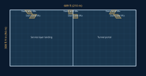
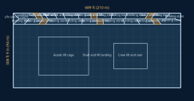
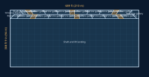

# P2-13 Simulator Halls Service Shaft: plan

Footprint 689 ft (210 m) × 308 ft 9 in (94 m) · structural grid 32 ft 10 in (10 m)

## Levels

| Level | Floor above deck | Height | Floor area |
|---|---|---|---|
| Level B1 · Service layer landing | −19 ft 8 in (6,000 mm) | 19 ft 8 in (6,000 mm) | 212,706 sq ft (19,761 m²) |
| Level 1 · Lift landing | 0 ft (0 mm) | 29 ft 6 in (9,000 mm) | 207,594 sq ft (19,286 m²) |
| Level 2 · Winding room | 29 ft 6 in (9,000 mm) | 19 ft 8 in (6,000 mm) | 207,594 sq ft (19,286 m²) |

## Elements

| ID | Designation | Type | Name | Level(s) | Size / length | Area | Status |
|---|---|---|---|---|---|---|---|
| E001 | D5F6P2B17A1L1R1, D5F6P2B17A1L2R1 | room | Shaft and lift landing | L1, L2 | 689 ft (210 m) × 262 ft 10 in (80 m) | 181,060 sq ft (16,821 m²) | proposed |
| E002 |  | fixture | Goods lift cage | L1 | 206 ft 8 in (63 m) × 157 ft 10 in (48 m) | 32,618 sq ft (3,030 m²) | proposed |
| E003 |  | fixture | Crew lift and stair | L1 | 137 ft 10 in (42 m) × 105 ft 4 in (32 m) | 14,512 sq ft (1,348 m²) | proposed |
| E004 | D5F6P2B17A1LB1R1, D5F6P2B17A1L1R2, D5F6P2B17A1L2R2 | core | Stairs and lifts | LB1, L1, L2 | 42 ft 4 in (13 m) × 21 ft 8 in (6,600 mm) | 572 sq ft (53 m²) | proposed |
| E005 | D5F6P2B17A1LB1R2, D5F6P2B17A1L1R3, D5F6P2B17A1L2R3 | core | Stairs and lifts | LB1, L1, L2 | 26 ft 11 in (8,200 mm) × 21 ft 8 in (6,600 mm) | 565 sq ft (52 m²) | proposed |
| E006 | D5F6P2B17A1LB1R3, D5F6P2B17A1L1R4, D5F6P2B17A1L2R4 | core | Stairs and lifts | LB1, L1, L2 | 40 ft 8 in (12 m) × 21 ft 8 in (6,600 mm) | 572 sq ft (53 m²) | proposed |
| E007 | D5F6P2B17A1LB1R4, D5F6P2B17A1L1R5, D5F6P2B17A1L2R5 | core | Stairs and lifts | LB1, L1, L2 | 42 ft 4 in (13 m) × 21 ft 8 in (6,600 mm) | 572 sq ft (53 m²) | proposed |
| E008 | D5F6P2B17A1LB1R5, D5F6P2B17A1L1R6, D5F6P2B17A1L2R6 | core | Stairs and lifts | LB1, L1, L2 | 26 ft 11 in (8,200 mm) × 21 ft 8 in (6,600 mm) | 565 sq ft (52 m²) | proposed |
| E009 | D5F6P2B17A1LB1R6, D5F6P2B17A1L1R7, D5F6P2B17A1L2R7 | core | Stairs and lifts | LB1, L1, L2 | 40 ft 8 in (12 m) × 21 ft 8 in (6,600 mm) | 572 sq ft (53 m²) | proposed |
| E010 | D5F6P2B17A1L1R8 | room | Lift control room | L1 | 22 ft 4 in (6,800 mm) × 45 ft 11 in (14 m) | 540 sq ft (50 m²) | proposed |
| E011 | D5F6P2B17A1L1R9 | room | Loading bay | L1 | 96 ft 5 in (29 m) × 21 ft 8 in (6,600 mm) | 1,673 sq ft (155 m²) | proposed |
| E012 | D5F6P2B17A1L1R10 | room | Crew check-in | L1 | 34 ft 1 in (10 m) × 21 ft 8 in (6,600 mm) | 426 sq ft (40 m²) | proposed |
| E013 | D5F6P2B17A1L1R11 | room | Tool store | L1 | 51 ft 10 in (16 m) × 21 ft 8 in (6,600 mm) | 856 sq ft (80 m²) | proposed |
| E014 | D5F6P2B17A1L1R12 | room | Staff toilets and showers | L1 | 44 ft 3 in (14 m) × 21 ft 8 in (6,600 mm) | 746 sq ft (69 m²) | proposed |
| E015 | D5F6P2B17A1L1R13 | room | Holding store | L1 | 66 ft 3 in (20 m) × 21 ft 8 in (6,600 mm) | 1,286 sq ft (119 m²) | proposed |
| E016 | D5F6P2B17A1L1R14 | room | Holding store | L1 | 54 ft 6 in (17 m) × 21 ft 8 in (6,600 mm) | 1,108 sq ft (103 m²) | proposed |
| E017 | D5F6P2B17A1L1R15 | room | Holding store | L1 | 61 ft 4 in (19 m) × 21 ft 8 in (6,600 mm) | 1,286 sq ft (119 m²) | proposed |
| E018 | D5F6P2B17A1L1R16 | room | Holding store | L1 | 65 ft (20 m) × 21 ft 8 in (6,600 mm) | 1,282 sq ft (119 m²) | proposed |
| E019 | D5F6P2B17A1L1R17 | room | Holding store | L1 | 96 ft 2 in (29 m) × 21 ft 8 in (6,600 mm) | 1,854 sq ft (172 m²) | proposed |
| E020 | D5F6P2B17A1L1R18 | room | Holding store | L1 | 76 ft 1 in (23 m) × 21 ft 8 in (6,600 mm) | 1,279 sq ft (119 m²) | proposed |
| E021 | D5F6P2B17A1L1R19 | room | Holding store | L1 | 63 ft 4 in (19 m) × 31 ft 2 in (9,500 mm) | 1,286 sq ft (119 m²) | proposed |
| E022 | D5F6P2B17A1L1R20 | room | Holding store | L1 | 97 ft 1 in (30 m) × 22 ft 8 in (6,900 mm) | 1,858 sq ft (173 m²) | proposed |
| E023 | D5F6P2B17A1L1R21 | room | Holding store | L1 | 72 ft 2 in (22 m) × 21 ft 8 in (6,600 mm) | 1,282 sq ft (119 m²) | proposed |
| E024 | D5F6P2B17A1L1R22 | room | Holding store | L1 | 68 ft 3 in (21 m) × 21 ft 8 in (6,600 mm) | 1,282 sq ft (119 m²) | proposed |
| E025 | D5F6P2B17A1L1R23 | room | Holding store | L1 | 90 ft 3 in (28 m) × 21 ft 8 in (6,600 mm) | 1,858 sq ft (173 m²) | proposed |
| E026 | D5F6P2B17A1L1R24 | room | Holding store | L1 | 61 ft 4 in (19 m) × 21 ft 8 in (6,600 mm) | 1,286 sq ft (119 m²) | proposed |
| E027 | D5F6P2B17A1L1R25 | room | Holding store | L1 | 65 ft (20 m) × 21 ft 8 in (6,600 mm) | 1,282 sq ft (119 m²) | proposed |
| E028 | D5F6P2B17A1L1R26 | room | Holding store | L1 | 96 ft 2 in (29 m) × 21 ft 8 in (6,600 mm) | 1,854 sq ft (172 m²) | proposed |
| E029 | D5F6P2B17A1L1R27 | room | Holding store | L1 | 76 ft 1 in (23 m) × 21 ft 8 in (6,600 mm) | 1,279 sq ft (119 m²) | proposed |
| E030 | D5F6P2B17A1L1R28 | room | Holding store | L1 | 63 ft 4 in (19 m) × 21 ft 8 in (6,600 mm) | 931 sq ft (86 m²) | proposed |
| E031 | D5F6P2B17A1L2R8 | room | Winding machinery | L2 | 70 ft 3 in (21 m) × 45 ft 11 in (14 m) | 1,609 sq ft (149 m²) | proposed |
| E032 | D5F6P2B17A1L2R9 | room | Shaft ventilation fans | L2 | 45 ft 7 in (14 m) × 21 ft 8 in (6,600 mm) | 604 sq ft (56 m²) | proposed |
| E033 | D5F6P2B17A1L2R10 | room | Machine gallery | L2 | 81 ft (25 m) × 21 ft 8 in (6,600 mm) | 1,478 sq ft (137 m²) | proposed |
| E034 | D5F6P2B17A1L2R11 | room | Machine gallery | L2 | 76 ft 5 in (23 m) × 21 ft 8 in (6,600 mm) | 1,478 sq ft (137 m²) | proposed |
| E035 | D5F6P2B17A1L2R12 | room | Machine gallery | L2 | 71 ft 6 in (22 m) × 21 ft 8 in (6,600 mm) | 1,467 sq ft (136 m²) | proposed |
| E036 | D5F6P2B17A1L2R13 | room | Machine gallery | L2 | 70 ft 6 in (22 m) × 21 ft 8 in (6,600 mm) | 1,478 sq ft (137 m²) | proposed |
| E037 | D5F6P2B17A1L2R14 | room | Machine gallery | L2 | 75 ft 2 in (23 m) × 21 ft 8 in (6,600 mm) | 1,481 sq ft (138 m²) | proposed |
| E038 | D5F6P2B17A1L2R15 | room | Machine gallery | L2 | 78 ft 9 in (24 m) × 21 ft 8 in (6,600 mm) | 1,463 sq ft (136 m²) | proposed |
| E039 | D5F6P2B17A1L2R16 | room | Machine gallery | L2 | 85 ft 4 in (26 m) × 21 ft 8 in (6,600 mm) | 1,474 sq ft (137 m²) | proposed |
| E040 | D5F6P2B17A1L2R17 | room | Machine gallery | L2 | 54 ft 6 in (17 m) × 45 ft 11 in (14 m) | 1,485 sq ft (138 m²) | proposed |
| E041 | D5F6P2B17A1L2R18 | room | Machine gallery | L2 | 86 ft 7 in (26 m) × 21 ft 8 in (6,600 mm) | 1,463 sq ft (136 m²) | proposed |
| E042 | D5F6P2B17A1L2R19 | room | Machine gallery | L2 | 81 ft (25 m) × 21 ft 8 in (6,600 mm) | 1,478 sq ft (137 m²) | proposed |
| E043 | D5F6P2B17A1L2R20 | room | Machine gallery | L2 | 76 ft 5 in (23 m) × 21 ft 8 in (6,600 mm) | 1,478 sq ft (137 m²) | proposed |
| E044 | D5F6P2B17A1L2R21 | room | Machine gallery | L2 | 71 ft 6 in (22 m) × 21 ft 8 in (6,600 mm) | 1,467 sq ft (136 m²) | proposed |
| E045 | D5F6P2B17A1L2R22 | room | Machine gallery | L2 | 70 ft 6 in (22 m) × 21 ft 8 in (6,600 mm) | 1,478 sq ft (137 m²) | proposed |
| E046 | D5F6P2B17A1L2R23 | room | Machine gallery | L2 | 75 ft 2 in (23 m) × 21 ft 8 in (6,600 mm) | 1,481 sq ft (138 m²) | proposed |
| E047 | D5F6P2B17A1L2R24 | room | Machine gallery | L2 | 78 ft 9 in (24 m) × 21 ft 8 in (6,600 mm) | 1,463 sq ft (136 m²) | proposed |
| E048 | D5F6P2B17A1L2R25 | room | Machine gallery | L2 | 85 ft 4 in (26 m) × 21 ft 8 in (6,600 mm) | 1,474 sq ft (137 m²) | proposed |
| E049 | D5F6P2B17A1L2R26 | room | Machine gallery | L2 | 54 ft 6 in (17 m) × 21 ft 8 in (6,600 mm) | 735 sq ft (68 m²) | proposed |
| E050 | D5F6P2B17A1LB1R7 | room | Service layer landing | LB1 | 344 ft 6 in (105 m) × 308 ft 9 in (94 m) | 106,353 sq ft (9,880 m²) | proposed |
| E051 | D5F6P2B17A1LB1R8 | room | Tunnel portal | LB1 | 344 ft 6 in (105 m) × 308 ft 9 in (94 m) | 106,353 sq ft (9,880 m²) | proposed |

## Drawings

### Level B1 · Service layer landing

### Level 1 · Lift landing

### Level 2 · Winding room

