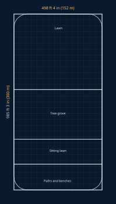

# P2-15 Lawn 1: plan

Footprint 498 ft 4 in (152 m) × 985 ft 3 in (300 m) · structural grid 32 ft 10 in (10 m)

## Levels

| Level | Floor above deck | Height | Floor area |
|---|---|---|---|
| Level 1 · Ground | 0 ft (0 mm) | 13 ft 1 in (4,000 mm) | — |

## Elements

| ID | Designation | Type | Name | Level(s) | Size / length | Area | Status |
|---|---|---|---|---|---|---|---|
| E001 | D5F6P2B6A2R1 | zone | Lawn | L1 | 498 ft (152 m) × 422 ft 11 in (129 m) | 207,897 sq ft (19,314 m²) | proposed |
| E002 | D5F6P2B6A2R2 | zone | Tree grove | L1 | 498 ft (152 m) × 278 ft 7 in (85 m) | 138,678 sq ft (12,884 m²) | proposed |
| E003 | D5F6P2B6A2R3 | zone | Sitting lawn | L1 | 498 ft (152 m) × 139 ft 5 in (42 m) | 69,420 sq ft (6,449 m²) | proposed |
| E004 | D5F6P2B6A2R4 | zone | Paths and benches | L1 | 497 ft 8 in (152 m) × 144 ft 4 in (44 m) | 69,262 sq ft (6,435 m²) | proposed |

## Drawings

### Level 1 · Ground

