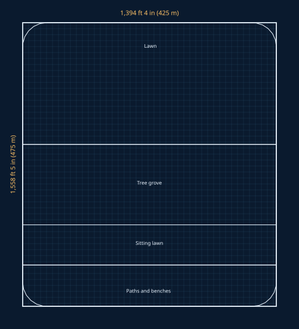

# P2-17 Lawn 2: plan

Footprint 1,394 ft 4 in (425 m) × 1,558 ft 5 in (475 m) · structural grid 32 ft 10 in (10 m)

## Levels

| Level | Floor above deck | Height | Floor area |
|---|---|---|---|
| Level 1 · Ground | 0 ft (0 mm) | 13 ft 1 in (4,000 mm) | — |

## Elements

| ID | Designation | Type | Name | Level(s) | Size / length | Area | Status |
|---|---|---|---|---|---|---|---|
| E001 | D5F6P2B8A1R1 | zone | Lawn | L1 | 1,393 ft 8 in (425 m) × 668 ft 8 in (204 m) | 923,141 sq ft (85,763 m²) | proposed |
| E002 | D5F6P2B8A1R2 | zone | Tree grove | L1 | 1,393 ft 4 in (425 m) × 441 ft 11 in (135 m) | 615,627 sq ft (57,194 m²) | proposed |
| E003 | D5F6P2B8A1R3 | zone | Sitting lawn | L1 | 1,393 ft 4 in (425 m) × 220 ft 10 in (67 m) | 307,585 sq ft (28,576 m²) | proposed |
| E004 | D5F6P2B8A1R4 | zone | Paths and benches | L1 | 1,393 ft 1 in (425 m) × 227 ft (69 m) | 307,965 sq ft (28,611 m²) | proposed |

## Drawings

### Level 1 · Ground

