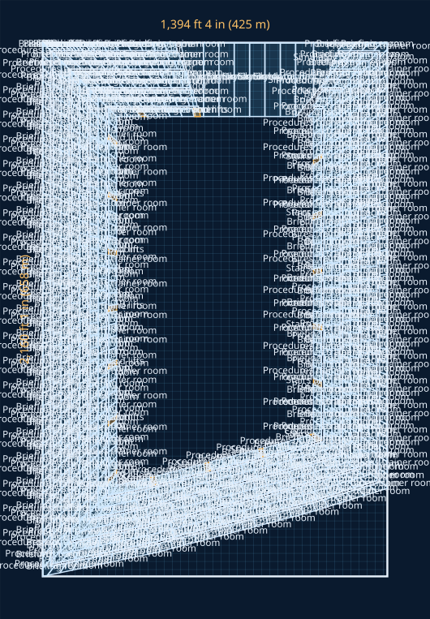
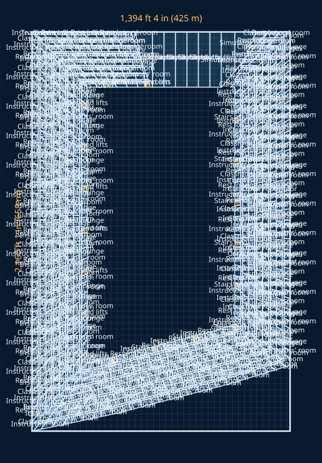

# P2-18 Simulator Annex 3: plan

Footprint 1,394 ft 4 in (425 m) × 2,160 ft 1 in (658 m) · structural grid 32 ft 10 in (10 m)

## Levels

| Level | Floor above deck | Height | Floor area |
|---|---|---|---|
| Level 1 · Hall floor | 0 ft (0 mm) | 26 ft 3 in (8,000 mm) | 1,458,554 sq ft (135,504 m²) |
| Level 2 · Gallery floor | 26 ft 3 in (8,000 mm) | 14 ft 9 in (4,500 mm) | 1,458,853 sq ft (135,532 m²) |

## Elements

| ID | Designation | Type | Name | Level(s) | Size / length | Area | Status |
|---|---|---|---|---|---|---|---|
| E001 | D5F6P2B11A1L1R1, D5F6P2B11A1L2R1 | room | Simulator bay 1 | L1, L2 | 91 ft 10 in (28 m) × 298 ft 11 in (91 m) | 18,582 sq ft (1,726 m²) | proposed |
| E002 | D5F6P2B11A1L1R2, D5F6P2B11A1L2R2 | room | Simulator bay 2 | L1, L2 | 62 ft 4 in (19 m) × 298 ft 11 in (91 m) | 18,631 sq ft (1,731 m²) | proposed |
| E003 | D5F6P2B11A1L1R3, D5F6P2B11A1L2R3 | room | Simulator bay 3 | L1, L2 | 62 ft (19 m) × 298 ft 11 in (91 m) | 18,533 sq ft (1,722 m²) | proposed |
| E004 | D5F6P2B11A1L1R4, D5F6P2B11A1L2R4 | room | Simulator bay 4 | L1, L2 | 62 ft 4 in (19 m) × 298 ft 11 in (91 m) | 18,631 sq ft (1,731 m²) | proposed |
| E005 | D5F6P2B11A1L1R5, D5F6P2B11A1L2R5 | room | Simulator bay 5 | L1, L2 | 62 ft (19 m) × 298 ft 11 in (91 m) | 18,533 sq ft (1,722 m²) | proposed |
| E006 | D5F6P2B11A1L1R6, D5F6P2B11A1L2R6 | room | Simulator bay 6 | L1, L2 | 62 ft 4 in (19 m) × 298 ft 11 in (91 m) | 18,631 sq ft (1,731 m²) | proposed |
| E007 | D5F6P2B11A1L1R7, D5F6P2B11A1L2R7 | room | Simulator bay 7 | L1, L2 | 62 ft (19 m) × 298 ft 11 in (91 m) | 18,533 sq ft (1,722 m²) | proposed |
| E008 | D5F6P2B11A1L1R8, D5F6P2B11A1L2R8 | room | Simulator bay 8 | L1, L2 | 72 ft 6 in (22 m) × 298 ft 11 in (91 m) | 18,614 sq ft (1,729 m²) | proposed |
| E009 | D5F6P2B11A1L1R9, D5F6P2B11A1L2R9 | room | Simulator bay 9 | L1, L2 | 174 ft 10 in (53 m) × 212 ft 7 in (65 m) | 18,588 sq ft (1,727 m²) | proposed |
| E010 | D5F6P2B11A1L1R10 | zone | Corridor | L1 | 400 ft 7 in (122 m) × 9 ft 10 in (3,000 mm) | 3,875 sq ft (360 m²) | proposed |
| E011 | D5F6P2B11A1L1R11 | zone | Corridor | L1 | 118 ft 5 in (36 m) × 9 ft 10 in (3,000 mm) | 1,137 sq ft (106 m²) | proposed |
| E012 | D5F6P2B11A1L1R12 | zone | Corridor | L1 | 169 ft 3 in (52 m) × 241 ft 10 in (74 m) | 3,875 sq ft (360 m²) | proposed |
| E013 | D5F6P2B11A1L1R13 | zone | Corridor | L1 | 9 ft 10 in (3,000 mm) × 399 ft 3 in (122 m) | 3,875 sq ft (360 m²) | proposed |
| E014 | D5F6P2B11A1L1R14 | zone | Corridor | L1 | 9 ft 10 in (3,000 mm) × 395 ft 8 in (121 m) | 3,875 sq ft (360 m²) | proposed |
| E015 | D5F6P2B11A1L1R15 | zone | Corridor | L1 | 9 ft 10 in (3,000 mm) × 395 ft 8 in (121 m) | 3,873 sq ft (360 m²) | proposed |
| E016 | D5F6P2B11A1L1R16 | zone | Corridor | L1 | 74 ft 10 in (23 m) × 351 ft 1 in (107 m) | 3,877 sq ft (360 m²) | proposed |
| E017 | D5F6P2B11A1L1R17 | zone | Corridor | L1 | 383 ft 6 in (117 m) × 118 ft 1 in (36 m) | 3,893 sq ft (362 m²) | proposed |
| E018 | D5F6P2B11A1L1R18 | zone | Corridor | L1 | 383 ft 6 in (117 m) × 109 ft 3 in (33 m) | 3,871 sq ft (360 m²) | proposed |
| E019 | D5F6P2B11A1L1R19 | zone | Corridor | L1 | 388 ft 9 in (118 m) × 95 ft 6 in (29 m) | 3,856 sq ft (358 m²) | proposed |
| E020 | D5F6P2B11A1L1R20 | zone | Corridor | L1 | 118 ft 9 in (36 m) × 291 ft 4 in (89 m) | 3,872 sq ft (360 m²) | proposed |
| E021 | D5F6P2B11A1L1R21 | zone | Corridor | L1 | 9 ft 10 in (3,000 mm) × 400 ft 11 in (122 m) | 3,877 sq ft (360 m²) | proposed |
| E022 | D5F6P2B11A1L1R22 | zone | Corridor | L1 | 9 ft 10 in (3,000 mm) × 396 ft 4 in (121 m) | 3,873 sq ft (360 m²) | proposed |
| E023 | D5F6P2B11A1L1R23 | zone | Corridor | L1 | 9 ft 10 in (3,000 mm) × 395 ft 8 in (121 m) | 3,875 sq ft (360 m²) | proposed |
| E024 | D5F6P2B11A1L1R24 | zone | Corridor | L1 | 9 ft 10 in (3,000 mm) × 399 ft 3 in (122 m) | 3,877 sq ft (360 m²) | proposed |
| E025 | D5F6P2B11A1L1R25 | zone | Corridor | L1 | 9 ft 10 in (3,000 mm) × 229 ft 8 in (70 m) | 2,175 sq ft (202 m²) | proposed |
| E026 | D5F6P2B11A1L1R26 | zone | Corridor | L1 | 400 ft 3 in (122 m) × 9 ft 10 in (3,000 mm) | 3,877 sq ft (360 m²) | proposed |
| E027 | D5F6P2B11A1L1R27 | zone | Corridor | L1 | 70 ft 10 in (22 m) × 9 ft 10 in (3,000 mm) | 673 sq ft (63 m²) | proposed |
| E028 | D5F6P2B11A1L1R28 | zone | Corridor | L1 | 127 ft 4 in (39 m) × 284 ft 1 in (87 m) | 3,878 sq ft (360 m²) | proposed |
| E029 | D5F6P2B11A1L1R29 | zone | Corridor | L1 | 9 ft 10 in (3,000 mm) × 398 ft 7 in (122 m) | 3,875 sq ft (360 m²) | proposed |
| E030 | D5F6P2B11A1L1R30 | zone | Corridor | L1 | 9 ft 10 in (3,000 mm) × 395 ft 8 in (121 m) | 3,875 sq ft (360 m²) | proposed |
| E031 | D5F6P2B11A1L1R31 | zone | Corridor | L1 | 9 ft 10 in (3,000 mm) × 397 ft 4 in (121 m) | 3,875 sq ft (360 m²) | proposed |
| E032 | D5F6P2B11A1L1R32 | zone | Corridor | L1 | 237 ft 2 in (72 m) × 231 ft (70 m) | 3,848 sq ft (357 m²) | proposed |
| E033 | D5F6P2B11A1L1R33 | zone | Corridor | L1 | 383 ft 2 in (117 m) × 109 ft 7 in (33 m) | 3,883 sq ft (361 m²) | proposed |
| E034 | D5F6P2B11A1L1R34 | zone | Corridor | L1 | 385 ft 2 in (117 m) × 102 ft 8 in (31 m) | 3,844 sq ft (357 m²) | proposed |
| E035 | D5F6P2B11A1L1R35 | zone | Corridor | L1 | 183 ft 1 in (56 m) × 224 ft 5 in (68 m) | 3,862 sq ft (359 m²) | proposed |
| E036 | D5F6P2B11A1L1R36 | zone | Corridor | L1 | 9 ft 10 in (3,000 mm) × 401 ft 3 in (122 m) | 3,875 sq ft (360 m²) | proposed |
| E037 | D5F6P2B11A1L1R37 | zone | Corridor | L1 | 9 ft 10 in (3,000 mm) × 396 ft 8 in (121 m) | 3,875 sq ft (360 m²) | proposed |
| E038 | D5F6P2B11A1L1R38 | zone | Corridor | L1 | 9 ft 10 in (3,000 mm) × 396 ft (121 m) | 3,875 sq ft (360 m²) | proposed |
| E039 | D5F6P2B11A1L1R39 | zone | Corridor | L1 | 9 ft 10 in (3,000 mm) × 399 ft 11 in (122 m) | 3,875 sq ft (360 m²) | proposed |
| E040 | D5F6P2B11A1L1R40 | zone | Corridor | L1 | 9 ft 10 in (3,000 mm) × 131 ft 3 in (40 m) | 1,201 sq ft (112 m²) | proposed |
| E041 | D5F6P2B11A1L1R41 | zone | Corridor | L1 | 399 ft 11 in (122 m) × 9 ft 10 in (3,000 mm) | 3,877 sq ft (360 m²) | proposed |
| E042 | D5F6P2B11A1L1R42 | zone | Corridor | L1 | 23 ft 4 in (7,100 mm) × 9 ft 10 in (3,000 mm) | 210 sq ft (20 m²) | proposed |
| E043 | D5F6P2B11A1L1R43 | zone | Corridor | L1 | 85 ft (26 m) × 325 ft 9 in (99 m) | 3,875 sq ft (360 m²) | proposed |
| E044 | D5F6P2B11A1L1R44 | zone | Corridor | L1 | 9 ft 10 in (3,000 mm) × 397 ft 8 in (121 m) | 3,875 sq ft (360 m²) | proposed |
| E045 | D5F6P2B11A1L1R45 | zone | Corridor | L1 | 9 ft 10 in (3,000 mm) × 396 ft (121 m) | 3,875 sq ft (360 m²) | proposed |
| E046 | D5F6P2B11A1L1R46 | zone | Corridor | L1 | 28 ft 3 in (8,600 mm) × 385 ft 2 in (117 m) | 3,876 sq ft (360 m²) | proposed |
| E047 | D5F6P2B11A1L1R47 | zone | Corridor | L1 | 384 ft 6 in (117 m) × 115 ft 6 in (35 m) | 3,880 sq ft (360 m²) | proposed |
| E048 | D5F6P2B11A1L1R48 | zone | Corridor | L1 | 383 ft 6 in (117 m) × 109 ft 3 in (33 m) | 3,933 sq ft (365 m²) | proposed |
| E049 | D5F6P2B11A1L1R49 | zone | Corridor | L1 | 248 ft 4 in (76 m) × 157 ft 2 in (48 m) | 3,909 sq ft (363 m²) | proposed |
| E050 | D5F6P2B11A1L1R50 | zone | Corridor | L1 | 9 ft 10 in (3,000 mm) × 401 ft 7 in (122 m) | 3,875 sq ft (360 m²) | proposed |
| E051 | D5F6P2B11A1L1R51 | zone | Corridor | L1 | 9 ft 10 in (3,000 mm) × 396 ft 4 in (121 m) | 3,873 sq ft (360 m²) | proposed |
| E052 | D5F6P2B11A1L1R52 | zone | Corridor | L1 | 9 ft 10 in (3,000 mm) × 396 ft 4 in (121 m) | 3,877 sq ft (360 m²) | proposed |
| E053 | D5F6P2B11A1L1R53 | zone | Corridor | L1 | 9 ft 10 in (3,000 mm) × 400 ft 7 in (122 m) | 3,873 sq ft (360 m²) | proposed |
| E054 | D5F6P2B11A1L1R54 | zone | Corridor | L1 | 9 ft 10 in (3,000 mm) × 32 ft 6 in (9,900 mm) | 224 sq ft (21 m²) | proposed |
| E055 | D5F6P2B11A1L1R55 | zone | Corridor | L1 | 373 ft 8 in (114 m) × 9 ft 10 in (3,000 mm) | 3,623 sq ft (337 m²) | proposed |
| E056 | D5F6P2B11A1L1R56 | zone | Corridor | L1 | 43 ft (13 m) × 367 ft 9 in (112 m) | 3,873 sq ft (360 m²) | proposed |
| E057 | D5F6P2B11A1L1R57 | zone | Corridor | L1 | 9 ft 10 in (3,000 mm) × 396 ft 8 in (121 m) | 3,875 sq ft (360 m²) | proposed |
| E058 | D5F6P2B11A1L1R58 | zone | Corridor | L1 | 9 ft 10 in (3,000 mm) × 396 ft 4 in (121 m) | 3,875 sq ft (360 m²) | proposed |
| E059 | D5F6P2B11A1L1R59 | zone | Corridor | L1 | 190 ft 3 in (58 m) × 263 ft 1 in (80 m) | 3,896 sq ft (362 m²) | proposed |
| E060 | D5F6P2B11A1L1R60 | zone | Corridor | L1 | 383 ft 2 in (117 m) × 109 ft 3 in (33 m) | 3,868 sq ft (359 m²) | proposed |
| E061 | D5F6P2B11A1L1R61 | zone | Corridor | L1 | 312 ft 8 in (95 m) × 90 ft 3 in (28 m) | 3,863 sq ft (359 m²) | proposed |
| E062 | D5F6P2B11A1L1R62 | zone | Corridor | L1 | 9 ft 10 in (3,000 mm) × 401 ft 11 in (122 m) | 3,873 sq ft (360 m²) | proposed |
| E063 | D5F6P2B11A1L1R63 | zone | Corridor | L1 | 9 ft 10 in (3,000 mm) × 396 ft 8 in (121 m) | 3,877 sq ft (360 m²) | proposed |
| E064 | D5F6P2B11A1L1R64 | zone | Corridor | L1 | 9 ft 10 in (3,000 mm) × 396 ft 4 in (121 m) | 3,875 sq ft (360 m²) | proposed |
| E065 | D5F6P2B11A1L1R65 | zone | Corridor | L1 | 9 ft 10 in (3,000 mm) × 324 ft 6 in (99 m) | 3,119 sq ft (290 m²) | proposed |
| E066 | D5F6P2B11A1L1R66, D5F6P2B11A1L2R10 | core | Stairs and lifts | L1, L2 | 49 ft 10 in (15 m) × 32 ft 6 in (9,900 mm) | 853 sq ft (79 m²) | proposed |
| E067 | D5F6P2B11A1L1R67, D5F6P2B11A1L2R11 | core | Stairs and lifts | L1, L2 | 32 ft 2 in (9,800 mm) × 32 ft 6 in (9,900 mm) | 853 sq ft (79 m²) | proposed |
| E068 | D5F6P2B11A1L1R68, D5F6P2B11A1L2R12 | core | Stairs and lifts | L1, L2 | 32 ft 6 in (9,900 mm) × 50 ft 6 in (15 m) | 853 sq ft (79 m²) | proposed |
| E069 | D5F6P2B11A1L1R69, D5F6P2B11A1L2R13 | core | Stairs and lifts | L1, L2 | 32 ft 6 in (9,900 mm) × 41 ft (12 m) | 858 sq ft (80 m²) | proposed |
| E070 | D5F6P2B11A1L1R70, D5F6P2B11A1L2R14 | core | Stairs and lifts | L1, L2 | 32 ft 6 in (9,900 mm) × 31 ft 2 in (9,500 mm) | 853 sq ft (79 m²) | proposed |
| E071 | D5F6P2B11A1L1R71, D5F6P2B11A1L2R15 | core | Stairs and lifts | L1, L2 | 32 ft 6 in (9,900 mm) × 31 ft 2 in (9,500 mm) | 853 sq ft (79 m²) | proposed |
| E072 | D5F6P2B11A1L1R72, D5F6P2B11A1L2R16 | core | Stairs and lifts | L1, L2 | 32 ft 6 in (9,900 mm) × 41 ft (12 m) | 858 sq ft (80 m²) | proposed |
| E073 | D5F6P2B11A1L1R73, D5F6P2B11A1L2R17 | core | Stairs and lifts | L1, L2 | 51 ft 6 in (16 m) × 34 ft 9 in (11 m) | 842 sq ft (78 m²) | proposed |
| E074 | D5F6P2B11A1L1R74, D5F6P2B11A1L2R18 | core | Stairs and lifts | L1, L2 | 33 ft 10 in (10 m) × 38 ft 1 in (12 m) | 849 sq ft (79 m²) | proposed |
| E075 | D5F6P2B11A1L1R75, D5F6P2B11A1L2R19 | core | Stairs and lifts | L1, L2 | 33 ft 6 in (10 m) × 38 ft 1 in (12 m) | 854 sq ft (79 m²) | proposed |
| E076 | D5F6P2B11A1L1R76, D5F6P2B11A1L2R20 | core | Stairs and lifts | L1, L2 | 32 ft 10 in (10 m) × 38 ft 1 in (12 m) | 845 sq ft (79 m²) | proposed |
| E077 | D5F6P2B11A1L1R77, D5F6P2B11A1L2R21 | core | Stairs and lifts | L1, L2 | 32 ft 6 in (9,900 mm) × 63 ft 8 in (19 m) | 858 sq ft (80 m²) | proposed |
| E078 | D5F6P2B11A1L1R78, D5F6P2B11A1L2R22 | core | Stairs and lifts | L1, L2 | 32 ft 6 in (9,900 mm) × 52 ft 6 in (16 m) | 847 sq ft (79 m²) | proposed |
| E079 | D5F6P2B11A1L1R79, D5F6P2B11A1L2R23 | core | Stairs and lifts | L1, L2 | 32 ft 6 in (9,900 mm) × 42 ft (13 m) | 853 sq ft (79 m²) | proposed |
| E080 | D5F6P2B11A1L1R80, D5F6P2B11A1L2R24 | core | Stairs and lifts | L1, L2 | 32 ft 6 in (9,900 mm) × 31 ft 2 in (9,500 mm) | 847 sq ft (79 m²) | proposed |
| E081 | D5F6P2B11A1L1R81, D5F6P2B11A1L2R25 | core | Stairs and lifts | L1, L2 | 32 ft 6 in (9,900 mm) × 31 ft 10 in (9,700 mm) | 853 sq ft (79 m²) | proposed |
| E082 | D5F6P2B11A1L1R82, D5F6P2B11A1L2R26 | core | Stairs and lifts | L1, L2 | 32 ft 6 in (9,900 mm) × 42 ft 4 in (13 m) | 847 sq ft (79 m²) | proposed |
| E083 | D5F6P2B11A1L1R83, D5F6P2B11A1L2R27 | core | Stairs and lifts | L1, L2 | 32 ft 6 in (9,900 mm) × 53 ft 6 in (16 m) | 858 sq ft (80 m²) | proposed |
| E084 | D5F6P2B11A1L1R84 | room | Briefing room | L1 | 51 ft 10 in (16 m) × 32 ft 6 in (9,900 mm) | 645 sq ft (60 m²) | proposed |
| E085 | D5F6P2B11A1L1R85 | room | Briefing room | L1 | 50 ft 10 in (16 m) × 32 ft 6 in (9,900 mm) | 645 sq ft (60 m²) | proposed |
| E086 | D5F6P2B11A1L1R86 | room | Briefing room | L1 | 50 ft 2 in (15 m) × 32 ft 6 in (9,900 mm) | 650 sq ft (60 m²) | proposed |
| E087 | D5F6P2B11A1L1R87 | room | Briefing room | L1 | 49 ft 3 in (15 m) × 32 ft 6 in (9,900 mm) | 650 sq ft (60 m²) | proposed |
| E088 | D5F6P2B11A1L1R88 | room | Debrief room | L1 | 41 ft 4 in (13 m) × 32 ft 6 in (9,900 mm) | 426 sq ft (40 m²) | proposed |
| E089 | D5F6P2B11A1L1R89 | room | Debrief room | L1 | 41 ft (12 m) × 32 ft 6 in (9,900 mm) | 437 sq ft (41 m²) | proposed |
| E090 | D5F6P2B11A1L1R90 | room | Debrief room | L1 | 40 ft (12 m) × 32 ft 6 in (9,900 mm) | 426 sq ft (40 m²) | proposed |
| E091 | D5F6P2B11A1L1R91 | room | Debrief room | L1 | 39 ft 8 in (12 m) × 32 ft 6 in (9,900 mm) | 432 sq ft (40 m²) | proposed |
| E092 | D5F6P2B11A1L1R92 | room | Locker room | L1 | 55 ft 5 in (17 m) × 32 ft 6 in (9,900 mm) | 975 sq ft (91 m²) | proposed |
| E093 | D5F6P2B11A1L1R93 | room | Toilets | L1 | 44 ft (13 m) × 32 ft 6 in (9,900 mm) | 645 sq ft (60 m²) | proposed |
| E094 | D5F6P2B11A1L1R94 | room | Procedures trainer room | L1 | 72 ft 2 in (22 m) × 32 ft 6 in (9,900 mm) | 1,614 sq ft (150 m²) | proposed |
| E095 | D5F6P2B11A1L1R95 | room | Briefing room | L1 | 70 ft 3 in (21 m) × 32 ft 6 in (9,900 mm) | 1,625 sq ft (151 m²) | proposed |
| E096 | D5F6P2B11A1L1R96 | room | Procedures trainer room | L1 | 67 ft 7 in (21 m) × 32 ft 6 in (9,900 mm) | 1,614 sq ft (150 m²) | proposed |
| E097 | D5F6P2B11A1L1R97 | room | Briefing room | L1 | 65 ft 3 in (20 m) × 32 ft 6 in (9,900 mm) | 1,614 sq ft (150 m²) | proposed |
| E098 | D5F6P2B11A1L1R98 | room | Procedures trainer room | L1 | 63 ft (19 m) × 32 ft 6 in (9,900 mm) | 1,620 sq ft (150 m²) | proposed |
| E099 | D5F6P2B11A1L1R99 | room | Briefing room | L1 | 60 ft 4 in (18 m) × 32 ft 6 in (9,900 mm) | 1,614 sq ft (150 m²) | proposed |
| E100 | D5F6P2B11A1L1R100 | room | Procedures trainer room | L1 | 49 ft 10 in (15 m) × 32 ft 6 in (9,900 mm) | 1,343 sq ft (125 m²) | proposed |
| E101 | D5F6P2B11A1L1R101 | room | Briefing room | L1 | 75 ft 2 in (23 m) × 32 ft 6 in (9,900 mm) | 1,620 sq ft (150 m²) | proposed |
| E102 | D5F6P2B11A1L1R102 | room | Procedures trainer room | L1 | 77 ft 5 in (24 m) × 32 ft 6 in (9,900 mm) | 1,614 sq ft (150 m²) | proposed |
| E103 | D5F6P2B11A1L1R103 | room | Briefing room | L1 | 80 ft 1 in (24 m) × 32 ft 6 in (9,900 mm) | 1,620 sq ft (150 m²) | proposed |
| E104 | D5F6P2B11A1L1R104 | room | Procedures trainer room | L1 | 55 ft 1 in (17 m) × 58 ft 9 in (18 m) | 1,614 sq ft (150 m²) | proposed |
| E105 | D5F6P2B11A1L1R105 | room | Briefing room | L1 | 32 ft 6 in (9,900 mm) × 80 ft 9 in (25 m) | 1,620 sq ft (150 m²) | proposed |
| E106 | D5F6P2B11A1L1R106 | room | Procedures trainer room | L1 | 32 ft 6 in (9,900 mm) × 78 ft 9 in (24 m) | 1,614 sq ft (150 m²) | proposed |
| E107 | D5F6P2B11A1L1R107 | room | Briefing room | L1 | 32 ft 6 in (9,900 mm) × 77 ft 5 in (24 m) | 1,620 sq ft (150 m²) | proposed |
| E108 | D5F6P2B11A1L1R108 | room | Procedures trainer room | L1 | 32 ft 6 in (9,900 mm) × 75 ft 9 in (23 m) | 1,614 sq ft (150 m²) | proposed |
| E109 | D5F6P2B11A1L1R109 | room | Briefing room | L1 | 32 ft 6 in (9,900 mm) × 74 ft 6 in (23 m) | 1,620 sq ft (150 m²) | proposed |
| E110 | D5F6P2B11A1L1R110 | room | Procedures trainer room | L1 | 32 ft 6 in (9,900 mm) × 72 ft 10 in (22 m) | 1,620 sq ft (150 m²) | proposed |
| E111 | D5F6P2B11A1L1R111 | room | Briefing room | L1 | 32 ft 6 in (9,900 mm) × 70 ft 10 in (22 m) | 1,614 sq ft (150 m²) | proposed |
| E112 | D5F6P2B11A1L1R112 | room | Procedures trainer room | L1 | 32 ft 6 in (9,900 mm) × 69 ft 7 in (21 m) | 1,620 sq ft (150 m²) | proposed |
| E113 | D5F6P2B11A1L1R113 | room | Briefing room | L1 | 32 ft 6 in (9,900 mm) × 67 ft 11 in (21 m) | 1,614 sq ft (150 m²) | proposed |
| E114 | D5F6P2B11A1L1R114 | room | Procedures trainer room | L1 | 32 ft 6 in (9,900 mm) × 66 ft 3 in (20 m) | 1,614 sq ft (150 m²) | proposed |
| E115 | D5F6P2B11A1L1R115 | room | Briefing room | L1 | 32 ft 6 in (9,900 mm) × 65 ft (20 m) | 1,625 sq ft (151 m²) | proposed |
| E116 | D5F6P2B11A1L1R116 | room | Procedures trainer room | L1 | 32 ft 6 in (9,900 mm) × 63 ft (19 m) | 1,614 sq ft (150 m²) | proposed |
| E117 | D5F6P2B11A1L1R117 | room | Briefing room | L1 | 32 ft 6 in (9,900 mm) × 61 ft 8 in (19 m) | 1,620 sq ft (150 m²) | proposed |
| E118 | D5F6P2B11A1L1R118 | room | Procedures trainer room | L1 | 32 ft 6 in (9,900 mm) × 60 ft (18 m) | 1,614 sq ft (150 m²) | proposed |
| E119 | D5F6P2B11A1L1R119 | room | Briefing room | L1 | 32 ft 6 in (9,900 mm) × 58 ft 5 in (18 m) | 1,614 sq ft (150 m²) | proposed |
| E120 | D5F6P2B11A1L1R120 | room | Procedures trainer room | L1 | 32 ft 6 in (9,900 mm) × 57 ft 1 in (17 m) | 1,625 sq ft (151 m²) | proposed |
| E121 | D5F6P2B11A1L1R121 | room | Briefing room | L1 | 32 ft 6 in (9,900 mm) × 55 ft 1 in (17 m) | 1,614 sq ft (150 m²) | proposed |
| E122 | D5F6P2B11A1L1R122 | room | Procedures trainer room | L1 | 32 ft 6 in (9,900 mm) × 53 ft 6 in (16 m) | 1,614 sq ft (150 m²) | proposed |
| E123 | D5F6P2B11A1L1R123 | room | Briefing room | L1 | 32 ft 6 in (9,900 mm) × 52 ft 2 in (16 m) | 1,620 sq ft (150 m²) | proposed |
| E124 | D5F6P2B11A1L1R124 | room | Procedures trainer room | L1 | 32 ft 6 in (9,900 mm) × 50 ft 6 in (15 m) | 1,614 sq ft (150 m²) | proposed |
| E125 | D5F6P2B11A1L1R125 | room | Briefing room | L1 | 32 ft 6 in (9,900 mm) × 50 ft 10 in (16 m) | 1,625 sq ft (151 m²) | proposed |
| E126 | D5F6P2B11A1L1R126 | room | Procedures trainer room | L1 | 32 ft 6 in (9,900 mm) × 52 ft 2 in (16 m) | 1,614 sq ft (150 m²) | proposed |
| E127 | D5F6P2B11A1L1R127 | room | Briefing room | L1 | 32 ft 6 in (9,900 mm) × 53 ft 10 in (16 m) | 1,614 sq ft (150 m²) | proposed |
| E128 | D5F6P2B11A1L1R128 | room | Procedures trainer room | L1 | 32 ft 6 in (9,900 mm) × 55 ft 5 in (17 m) | 1,620 sq ft (150 m²) | proposed |
| E129 | D5F6P2B11A1L1R129 | room | Briefing room | L1 | 32 ft 6 in (9,900 mm) × 56 ft 9 in (17 m) | 1,614 sq ft (150 m²) | proposed |
| E130 | D5F6P2B11A1L1R130 | room | Procedures trainer room | L1 | 32 ft 6 in (9,900 mm) × 58 ft 9 in (18 m) | 1,625 sq ft (151 m²) | proposed |
| E131 | D5F6P2B11A1L1R131 | room | Briefing room | L1 | 32 ft 6 in (9,900 mm) × 60 ft (18 m) | 1,614 sq ft (150 m²) | proposed |
| E132 | D5F6P2B11A1L1R132 | room | Procedures trainer room | L1 | 32 ft 6 in (9,900 mm) × 61 ft 8 in (19 m) | 1,614 sq ft (150 m²) | proposed |
| E133 | D5F6P2B11A1L1R133 | room | Briefing room | L1 | 32 ft 6 in (9,900 mm) × 63 ft 4 in (19 m) | 1,620 sq ft (150 m²) | proposed |
| E134 | D5F6P2B11A1L1R134 | room | Procedures trainer room | L1 | 32 ft 6 in (9,900 mm) × 64 ft 8 in (20 m) | 1,614 sq ft (150 m²) | proposed |
| E135 | D5F6P2B11A1L1R135 | room | Briefing room | L1 | 32 ft 6 in (9,900 mm) × 66 ft 7 in (20 m) | 1,620 sq ft (150 m²) | proposed |
| E136 | D5F6P2B11A1L1R136 | room | Procedures trainer room | L1 | 32 ft 6 in (9,900 mm) × 68 ft 3 in (21 m) | 1,620 sq ft (150 m²) | proposed |
| E137 | D5F6P2B11A1L1R137 | room | Briefing room | L1 | 32 ft 6 in (9,900 mm) × 69 ft 7 in (21 m) | 1,614 sq ft (150 m²) | proposed |
| E138 | D5F6P2B11A1L1R138 | room | Procedures trainer room | L1 | 32 ft 6 in (9,900 mm) × 71 ft 2 in (22 m) | 1,620 sq ft (150 m²) | proposed |
| E139 | D5F6P2B11A1L1R139 | room | Briefing room | L1 | 32 ft 6 in (9,900 mm) × 72 ft 6 in (22 m) | 1,614 sq ft (150 m²) | proposed |
| E140 | D5F6P2B11A1L1R140 | room | Procedures trainer room | L1 | 72 ft 10 in (22 m) × 43 ft 4 in (13 m) | 1,621 sq ft (151 m²) | proposed |
| E141 | D5F6P2B11A1L1R141 | room | Briefing room | L1 | 75 ft 2 in (23 m) × 40 ft (12 m) | 1,612 sq ft (150 m²) | proposed |
| E142 | D5F6P2B11A1L1R142 | room | Procedures trainer room | L1 | 71 ft 6 in (22 m) × 41 ft (12 m) | 1,608 sq ft (149 m²) | proposed |
| E143 | D5F6P2B11A1L1R143 | room | Briefing room | L1 | 67 ft 7 in (21 m) × 42 ft 4 in (13 m) | 1,604 sq ft (149 m²) | proposed |
| E144 | D5F6P2B11A1L1R144 | room | Procedures trainer room | L1 | 64 ft 4 in (20 m) × 43 ft 4 in (13 m) | 1,617 sq ft (150 m²) | proposed |
| E145 | D5F6P2B11A1L1R145 | room | Briefing room | L1 | 60 ft 8 in (18 m) × 44 ft 7 in (14 m) | 1,620 sq ft (150 m²) | proposed |
| E146 | D5F6P2B11A1L1R146 | room | Procedures trainer room | L1 | 58 ft 1 in (18 m) × 44 ft 11 in (14 m) | 1,620 sq ft (151 m²) | proposed |
| E147 | D5F6P2B11A1L1R147 | room | Briefing room | L1 | 56 ft 9 in (17 m) × 43 ft 8 in (13 m) | 1,606 sq ft (149 m²) | proposed |
| E148 | D5F6P2B11A1L1R148 | room | Procedures trainer room | L1 | 56 ft 9 in (17 m) × 44 ft (13 m) | 1,612 sq ft (150 m²) | proposed |
| E149 | D5F6P2B11A1L1R149 | room | Briefing room | L1 | 56 ft 9 in (17 m) × 43 ft 8 in (13 m) | 1,610 sq ft (150 m²) | proposed |
| E150 | D5F6P2B11A1L1R150 | room | Procedures trainer room | L1 | 56 ft 5 in (17 m) × 44 ft (13 m) | 1,612 sq ft (150 m²) | proposed |
| E151 | D5F6P2B11A1L1R151 | room | Briefing room | L1 | 56 ft 5 in (17 m) × 44 ft (13 m) | 1,615 sq ft (150 m²) | proposed |
| E152 | D5F6P2B11A1L1R152 | room | Procedures trainer room | L1 | 56 ft 5 in (17 m) × 44 ft (13 m) | 1,615 sq ft (150 m²) | proposed |
| E153 | D5F6P2B11A1L1R153 | room | Briefing room | L1 | 56 ft 1 in (17 m) × 44 ft (13 m) | 1,607 sq ft (149 m²) | proposed |
| E154 | D5F6P2B11A1L1R154 | room | Procedures trainer room | L1 | 56 ft 1 in (17 m) × 44 ft (13 m) | 1,611 sq ft (150 m²) | proposed |
| E155 | D5F6P2B11A1L1R155 | room | Briefing room | L1 | 56 ft 1 in (17 m) × 44 ft (13 m) | 1,617 sq ft (150 m²) | proposed |
| E156 | D5F6P2B11A1L1R156 | room | Procedures trainer room | L1 | 55 ft 9 in (17 m) × 44 ft 3 in (14 m) | 1,612 sq ft (150 m²) | proposed |
| E157 | D5F6P2B11A1L1R157 | room | Briefing room | L1 | 55 ft 9 in (17 m) × 44 ft (13 m) | 1,613 sq ft (150 m²) | proposed |
| E158 | D5F6P2B11A1L1R158 | room | Procedures trainer room | L1 | 55 ft 9 in (17 m) × 44 ft 3 in (14 m) | 1,616 sq ft (150 m²) | proposed |
| E159 | D5F6P2B11A1L1R159 | room | Briefing room | L1 | 54 ft 6 in (17 m) × 43 ft (13 m) | 1,613 sq ft (150 m²) | proposed |
| E160 | D5F6P2B11A1L1R160 | room | Procedures trainer room | L1 | 51 ft 2 in (16 m) × 43 ft (13 m) | 1,627 sq ft (151 m²) | proposed |
| E161 | D5F6P2B11A1L1R161 | room | Briefing room | L1 | 50 ft 10 in (16 m) × 44 ft (13 m) | 1,616 sq ft (150 m²) | proposed |
| E162 | D5F6P2B11A1L1R162 | room | Procedures trainer room | L1 | 55 ft 1 in (17 m) × 44 ft 11 in (14 m) | 1,620 sq ft (151 m²) | proposed |
| E163 | D5F6P2B11A1L1R163 | room | Briefing room | L1 | 59 ft 5 in (18 m) × 45 ft 7 in (14 m) | 1,610 sq ft (150 m²) | proposed |
| E164 | D5F6P2B11A1L1R164 | room | Procedures trainer room | L1 | 64 ft 4 in (20 m) × 46 ft 7 in (14 m) | 1,613 sq ft (150 m²) | proposed |
| E165 | D5F6P2B11A1L1R165 | room | Briefing room | L1 | 68 ft 7 in (21 m) × 47 ft 7 in (14 m) | 1,609 sq ft (149 m²) | proposed |
| E166 | D5F6P2B11A1L1R166 | room | Procedures trainer room | L1 | 72 ft 10 in (22 m) × 48 ft 3 in (15 m) | 1,621 sq ft (151 m²) | proposed |
| E167 | D5F6P2B11A1L1R167 | room | Briefing room | L1 | 77 ft 1 in (24 m) × 49 ft 6 in (15 m) | 1,617 sq ft (150 m²) | proposed |
| E168 | D5F6P2B11A1L1R168 | room | Procedures trainer room | L1 | 49 ft 3 in (15 m) × 71 ft 2 in (22 m) | 1,616 sq ft (150 m²) | proposed |
| E169 | D5F6P2B11A1L1R169 | room | Briefing room | L1 | 32 ft 6 in (9,900 mm) × 87 ft 11 in (27 m) | 1,620 sq ft (150 m²) | proposed |
| E170 | D5F6P2B11A1L1R170 | room | Procedures trainer room | L1 | 32 ft 6 in (9,900 mm) × 85 ft 11 in (26 m) | 1,614 sq ft (150 m²) | proposed |
| E171 | D5F6P2B11A1L1R171 | room | Briefing room | L1 | 32 ft 6 in (9,900 mm) × 84 ft 4 in (26 m) | 1,614 sq ft (150 m²) | proposed |
| E172 | D5F6P2B11A1L1R172 | room | Procedures trainer room | L1 | 32 ft 6 in (9,900 mm) × 82 ft 8 in (25 m) | 1,620 sq ft (150 m²) | proposed |
| E173 | D5F6P2B11A1L1R173 | room | Briefing room | L1 | 32 ft 6 in (9,900 mm) × 81 ft (25 m) | 1,620 sq ft (150 m²) | proposed |
| E174 | D5F6P2B11A1L1R174 | room | Procedures trainer room | L1 | 32 ft 6 in (9,900 mm) × 79 ft 5 in (24 m) | 1,614 sq ft (150 m²) | proposed |
| E175 | D5F6P2B11A1L1R175 | room | Briefing room | L1 | 32 ft 6 in (9,900 mm) × 77 ft 9 in (24 m) | 1,620 sq ft (150 m²) | proposed |
| E176 | D5F6P2B11A1L1R176 | room | Procedures trainer room | L1 | 32 ft 6 in (9,900 mm) × 75 ft 9 in (23 m) | 1,614 sq ft (150 m²) | proposed |
| E177 | D5F6P2B11A1L1R177 | room | Briefing room | L1 | 32 ft 6 in (9,900 mm) × 74 ft 2 in (23 m) | 1,620 sq ft (150 m²) | proposed |
| E178 | D5F6P2B11A1L1R178 | room | Procedures trainer room | L1 | 32 ft 6 in (9,900 mm) × 72 ft 6 in (22 m) | 1,620 sq ft (150 m²) | proposed |
| E179 | D5F6P2B11A1L1R179 | room | Briefing room | L1 | 32 ft 6 in (9,900 mm) × 70 ft 10 in (22 m) | 1,614 sq ft (150 m²) | proposed |
| E180 | D5F6P2B11A1L1R180 | room | Procedures trainer room | L1 | 32 ft 6 in (9,900 mm) × 69 ft 3 in (21 m) | 1,620 sq ft (150 m²) | proposed |
| E181 | D5F6P2B11A1L1R181 | room | Briefing room | L1 | 32 ft 6 in (9,900 mm) × 67 ft 3 in (20 m) | 1,614 sq ft (150 m²) | proposed |
| E182 | D5F6P2B11A1L1R182 | room | Procedures trainer room | L1 | 32 ft 6 in (9,900 mm) × 65 ft 11 in (20 m) | 1,620 sq ft (150 m²) | proposed |
| E183 | D5F6P2B11A1L1R183 | room | Briefing room | L1 | 32 ft 6 in (9,900 mm) × 64 ft 4 in (20 m) | 1,620 sq ft (150 m²) | proposed |
| E184 | D5F6P2B11A1L1R184 | room | Procedures trainer room | L1 | 32 ft 6 in (9,900 mm) × 62 ft 4 in (19 m) | 1,614 sq ft (150 m²) | proposed |
| E185 | D5F6P2B11A1L1R185 | room | Briefing room | L1 | 32 ft 6 in (9,900 mm) × 60 ft 8 in (18 m) | 1,620 sq ft (150 m²) | proposed |
| E186 | D5F6P2B11A1L1R186 | room | Procedures trainer room | L1 | 32 ft 6 in (9,900 mm) × 58 ft 9 in (18 m) | 1,614 sq ft (150 m²) | proposed |
| E187 | D5F6P2B11A1L1R187 | room | Briefing room | L1 | 32 ft 6 in (9,900 mm) × 57 ft 5 in (18 m) | 1,620 sq ft (150 m²) | proposed |
| E188 | D5F6P2B11A1L1R188 | room | Procedures trainer room | L1 | 32 ft 6 in (9,900 mm) × 55 ft 9 in (17 m) | 1,620 sq ft (150 m²) | proposed |
| E189 | D5F6P2B11A1L1R189 | room | Briefing room | L1 | 32 ft 6 in (9,900 mm) × 53 ft 10 in (16 m) | 1,614 sq ft (150 m²) | proposed |
| E190 | D5F6P2B11A1L1R190 | room | Procedures trainer room | L1 | 32 ft 6 in (9,900 mm) × 52 ft 2 in (16 m) | 1,614 sq ft (150 m²) | proposed |
| E191 | D5F6P2B11A1L1R191 | room | Briefing room | L1 | 32 ft 6 in (9,900 mm) × 50 ft 10 in (16 m) | 1,620 sq ft (150 m²) | proposed |
| E192 | D5F6P2B11A1L1R192 | room | Procedures trainer room | L1 | 32 ft 6 in (9,900 mm) × 50 ft 10 in (16 m) | 1,620 sq ft (150 m²) | proposed |
| E193 | D5F6P2B11A1L1R193 | room | Briefing room | L1 | 32 ft 6 in (9,900 mm) × 52 ft 6 in (16 m) | 1,620 sq ft (150 m²) | proposed |
| E194 | D5F6P2B11A1L1R194 | room | Procedures trainer room | L1 | 32 ft 6 in (9,900 mm) × 54 ft 2 in (16 m) | 1,614 sq ft (150 m²) | proposed |
| E195 | D5F6P2B11A1L1R195 | room | Briefing room | L1 | 32 ft 6 in (9,900 mm) × 55 ft 9 in (17 m) | 1,614 sq ft (150 m²) | proposed |
| E196 | D5F6P2B11A1L1R196 | room | Procedures trainer room | L1 | 32 ft 6 in (9,900 mm) × 57 ft 9 in (18 m) | 1,620 sq ft (150 m²) | proposed |
| E197 | D5F6P2B11A1L1R197 | room | Briefing room | L1 | 32 ft 6 in (9,900 mm) × 59 ft 5 in (18 m) | 1,620 sq ft (150 m²) | proposed |
| E198 | D5F6P2B11A1L1R198 | room | Procedures trainer room | L1 | 32 ft 6 in (9,900 mm) × 61 ft (19 m) | 1,620 sq ft (150 m²) | proposed |
| E199 | D5F6P2B11A1L1R199 | room | Briefing room | L1 | 32 ft 6 in (9,900 mm) × 62 ft 8 in (19 m) | 1,614 sq ft (150 m²) | proposed |
| E200 | D5F6P2B11A1L1R200 | room | Procedures trainer room | L1 | 32 ft 6 in (9,900 mm) × 64 ft 4 in (20 m) | 1,614 sq ft (150 m²) | proposed |
| E201 | D5F6P2B11A1L1R201 | room | Briefing room | L1 | 32 ft 6 in (9,900 mm) × 66 ft 3 in (20 m) | 1,620 sq ft (150 m²) | proposed |
| E202 | D5F6P2B11A1L1R202 | room | Procedures trainer room | L1 | 32 ft 6 in (9,900 mm) × 67 ft 11 in (21 m) | 1,620 sq ft (150 m²) | proposed |
| E203 | D5F6P2B11A1L1R203 | room | Briefing room | L1 | 32 ft 6 in (9,900 mm) × 69 ft 3 in (21 m) | 1,614 sq ft (150 m²) | proposed |
| E204 | D5F6P2B11A1L1R204 | room | Procedures trainer room | L1 | 32 ft 6 in (9,900 mm) × 71 ft 2 in (22 m) | 1,620 sq ft (150 m²) | proposed |
| E205 | D5F6P2B11A1L1R205 | room | Briefing room | L1 | 32 ft 6 in (9,900 mm) × 72 ft 10 in (22 m) | 1,614 sq ft (150 m²) | proposed |
| E206 | D5F6P2B11A1L1R206 | room | Procedures trainer room | L1 | 32 ft 6 in (9,900 mm) × 74 ft 10 in (23 m) | 1,620 sq ft (150 m²) | proposed |
| E207 | D5F6P2B11A1L1R207 | room | Briefing room | L1 | 32 ft 6 in (9,900 mm) × 76 ft 5 in (23 m) | 1,620 sq ft (150 m²) | proposed |
| E208 | D5F6P2B11A1L1R208 | room | Procedures trainer room | L1 | 32 ft 6 in (9,900 mm) × 77 ft 9 in (24 m) | 1,614 sq ft (150 m²) | proposed |
| E209 | D5F6P2B11A1L1R209 | room | Briefing room | L1 | 32 ft 6 in (9,900 mm) × 79 ft 9 in (24 m) | 1,620 sq ft (150 m²) | proposed |
| E210 | D5F6P2B11A1L1R210 | room | Procedures trainer room | L1 | 32 ft 6 in (9,900 mm) × 81 ft 4 in (25 m) | 1,614 sq ft (150 m²) | proposed |
| E211 | D5F6P2B11A1L1R211 | room | Briefing room | L1 | 81 ft (25 m) × 32 ft 6 in (9,900 mm) | 1,614 sq ft (150 m²) | proposed |
| E212 | D5F6P2B11A1L1R212 | room | Procedures trainer room | L1 | 78 ft 9 in (24 m) × 32 ft 6 in (9,900 mm) | 1,620 sq ft (150 m²) | proposed |
| E213 | D5F6P2B11A1L1R213 | room | Briefing room | L1 | 75 ft 9 in (23 m) × 32 ft 6 in (9,900 mm) | 1,614 sq ft (150 m²) | proposed |
| E214 | D5F6P2B11A1L1R214 | room | Procedures trainer room | L1 | 73 ft 2 in (22 m) × 32 ft 6 in (9,900 mm) | 1,614 sq ft (150 m²) | proposed |
| E215 | D5F6P2B11A1L1R215 | room | Briefing room | L1 | 70 ft 10 in (22 m) × 32 ft 6 in (9,900 mm) | 1,620 sq ft (150 m²) | proposed |
| E216 | D5F6P2B11A1L1R216 | room | Procedures trainer room | L1 | 68 ft 3 in (21 m) × 32 ft 6 in (9,900 mm) | 1,620 sq ft (150 m²) | proposed |
| E217 | D5F6P2B11A1L1R217 | room | Briefing room | L1 | 65 ft 7 in (20 m) × 32 ft 6 in (9,900 mm) | 1,614 sq ft (150 m²) | proposed |
| E218 | D5F6P2B11A1L1R218 | room | Procedures trainer room | L1 | 63 ft 4 in (19 m) × 32 ft 6 in (9,900 mm) | 1,620 sq ft (150 m²) | proposed |
| E219 | D5F6P2B11A1L1R219 | room | Briefing room | L1 | 60 ft 8 in (18 m) × 32 ft 6 in (9,900 mm) | 1,620 sq ft (150 m²) | proposed |
| E220 | D5F6P2B11A1L1R220 | room | Procedures trainer room | L1 | 56 ft 1 in (17 m) × 32 ft 6 in (9,900 mm) | 1,550 sq ft (144 m²) | proposed |
| E221 | D5F6P2B11A1L1R221 | room | Briefing room | L1 | 75 ft 9 in (23 m) × 32 ft 6 in (9,900 mm) | 1,614 sq ft (150 m²) | proposed |
| E222 | D5F6P2B11A1L1R222 | room | Procedures trainer room | L1 | 78 ft 5 in (24 m) × 32 ft 6 in (9,900 mm) | 1,620 sq ft (150 m²) | proposed |
| E223 | D5F6P2B11A1L1R223 | room | Briefing room | L1 | 80 ft 1 in (24 m) × 33 ft 2 in (10 m) | 1,609 sq ft (149 m²) | proposed |
| E224 | D5F6P2B11A1L1R224 | room | Procedures trainer room | L1 | 32 ft 6 in (9,900 mm) × 81 ft 4 in (25 m) | 1,614 sq ft (150 m²) | proposed |
| E225 | D5F6P2B11A1L1R225 | room | Briefing room | L1 | 32 ft 6 in (9,900 mm) × 79 ft 9 in (24 m) | 1,620 sq ft (150 m²) | proposed |
| E226 | D5F6P2B11A1L1R226 | room | Procedures trainer room | L1 | 32 ft 6 in (9,900 mm) × 78 ft 1 in (24 m) | 1,620 sq ft (150 m²) | proposed |
| E227 | D5F6P2B11A1L1R227 | room | Briefing room | L1 | 32 ft 6 in (9,900 mm) × 76 ft 5 in (23 m) | 1,614 sq ft (150 m²) | proposed |
| E228 | D5F6P2B11A1L1R228 | room | Procedures trainer room | L1 | 32 ft 6 in (9,900 mm) × 74 ft 10 in (23 m) | 1,620 sq ft (150 m²) | proposed |
| E229 | D5F6P2B11A1L1R229 | room | Briefing room | L1 | 32 ft 6 in (9,900 mm) × 73 ft 2 in (22 m) | 1,620 sq ft (150 m²) | proposed |
| E230 | D5F6P2B11A1L1R230 | room | Procedures trainer room | L1 | 32 ft 6 in (9,900 mm) × 71 ft 6 in (22 m) | 1,614 sq ft (150 m²) | proposed |
| E231 | D5F6P2B11A1L1R231 | room | Briefing room | L1 | 32 ft 6 in (9,900 mm) × 69 ft 11 in (21 m) | 1,620 sq ft (150 m²) | proposed |
| E232 | D5F6P2B11A1L1R232 | room | Procedures trainer room | L1 | 32 ft 6 in (9,900 mm) × 67 ft 11 in (21 m) | 1,614 sq ft (150 m²) | proposed |
| E233 | D5F6P2B11A1L1R233 | room | Briefing room | L1 | 32 ft 6 in (9,900 mm) × 66 ft 7 in (20 m) | 1,620 sq ft (150 m²) | proposed |
| E234 | D5F6P2B11A1L1R234 | room | Procedures trainer room | L1 | 32 ft 6 in (9,900 mm) × 65 ft (20 m) | 1,620 sq ft (150 m²) | proposed |
| E235 | D5F6P2B11A1L1R235 | room | Briefing room | L1 | 32 ft 6 in (9,900 mm) × 63 ft (19 m) | 1,614 sq ft (150 m²) | proposed |
| E236 | D5F6P2B11A1L1R236 | room | Procedures trainer room | L1 | 32 ft 6 in (9,900 mm) × 61 ft 8 in (19 m) | 1,620 sq ft (150 m²) | proposed |
| E237 | D5F6P2B11A1L1R237 | room | Briefing room | L1 | 32 ft 6 in (9,900 mm) × 60 ft (18 m) | 1,614 sq ft (150 m²) | proposed |
| E238 | D5F6P2B11A1L1R238 | room | Procedures trainer room | L1 | 32 ft 6 in (9,900 mm) × 58 ft 5 in (18 m) | 1,620 sq ft (150 m²) | proposed |
| E239 | D5F6P2B11A1L1R239 | room | Briefing room | L1 | 32 ft 6 in (9,900 mm) × 56 ft 5 in (17 m) | 1,614 sq ft (150 m²) | proposed |
| E240 | D5F6P2B11A1L1R240 | room | Procedures trainer room | L1 | 32 ft 6 in (9,900 mm) × 55 ft 1 in (17 m) | 1,620 sq ft (150 m²) | proposed |
| E241 | D5F6P2B11A1L1R241 | room | Briefing room | L1 | 32 ft 6 in (9,900 mm) × 53 ft 6 in (16 m) | 1,620 sq ft (150 m²) | proposed |
| E242 | D5F6P2B11A1L1R242 | room | Procedures trainer room | L1 | 32 ft 6 in (9,900 mm) × 51 ft 6 in (16 m) | 1,614 sq ft (150 m²) | proposed |
| E243 | D5F6P2B11A1L1R243 | room | Briefing room | L1 | 32 ft 6 in (9,900 mm) × 50 ft 6 in (15 m) | 1,620 sq ft (150 m²) | proposed |
| E244 | D5F6P2B11A1L1R244 | room | Procedures trainer room | L1 | 32 ft 6 in (9,900 mm) × 51 ft 2 in (16 m) | 1,620 sq ft (150 m²) | proposed |
| E245 | D5F6P2B11A1L1R245 | room | Briefing room | L1 | 32 ft 6 in (9,900 mm) × 52 ft 10 in (16 m) | 1,614 sq ft (150 m²) | proposed |
| E246 | D5F6P2B11A1L1R246 | room | Procedures trainer room | L1 | 32 ft 6 in (9,900 mm) × 54 ft 6 in (17 m) | 1,614 sq ft (150 m²) | proposed |
| E247 | D5F6P2B11A1L1R247 | room | Briefing room | L1 | 32 ft 6 in (9,900 mm) × 56 ft 5 in (17 m) | 1,625 sq ft (151 m²) | proposed |
| E248 | D5F6P2B11A1L1R248 | room | Procedures trainer room | L1 | 32 ft 6 in (9,900 mm) × 57 ft 9 in (18 m) | 1,614 sq ft (150 m²) | proposed |
| E249 | D5F6P2B11A1L1R249 | room | Briefing room | L1 | 32 ft 6 in (9,900 mm) × 59 ft 5 in (18 m) | 1,614 sq ft (150 m²) | proposed |
| E250 | D5F6P2B11A1L1R250 | room | Procedures trainer room | L1 | 32 ft 6 in (9,900 mm) × 61 ft (19 m) | 1,614 sq ft (150 m²) | proposed |
| E251 | D5F6P2B11A1L1R251 | room | Briefing room | L1 | 32 ft 6 in (9,900 mm) × 63 ft (19 m) | 1,625 sq ft (151 m²) | proposed |
| E252 | D5F6P2B11A1L1R252 | room | Procedures trainer room | L1 | 32 ft 6 in (9,900 mm) × 64 ft 4 in (20 m) | 1,614 sq ft (150 m²) | proposed |
| E253 | D5F6P2B11A1L1R253 | room | Briefing room | L1 | 32 ft 6 in (9,900 mm) × 65 ft 11 in (20 m) | 1,614 sq ft (150 m²) | proposed |
| E254 | D5F6P2B11A1L1R254 | room | Procedures trainer room | L1 | 32 ft 6 in (9,900 mm) × 67 ft 11 in (21 m) | 1,625 sq ft (151 m²) | proposed |
| E255 | D5F6P2B11A1L1R255 | room | Briefing room | L1 | 32 ft 6 in (9,900 mm) × 69 ft 3 in (21 m) | 1,614 sq ft (150 m²) | proposed |
| E256 | D5F6P2B11A1L1R256 | room | Procedures trainer room | L1 | 32 ft 6 in (9,900 mm) × 70 ft 10 in (22 m) | 1,614 sq ft (150 m²) | proposed |
| E257 | D5F6P2B11A1L1R257 | room | Briefing room | L1 | 32 ft 6 in (9,900 mm) × 72 ft 10 in (22 m) | 1,620 sq ft (150 m²) | proposed |
| E258 | D5F6P2B11A1L1R258 | room | Procedures trainer room | L1 | 70 ft 6 in (22 m) × 44 ft 11 in (14 m) | 1,616 sq ft (150 m²) | proposed |
| E259 | D5F6P2B11A1L1R259 | room | Briefing room | L1 | 74 ft 10 in (23 m) × 40 ft (12 m) | 1,610 sq ft (150 m²) | proposed |
| E260 | D5F6P2B11A1L1R260 | room | Procedures trainer room | L1 | 70 ft 10 in (22 m) × 41 ft 8 in (13 m) | 1,626 sq ft (151 m²) | proposed |
| E261 | D5F6P2B11A1L1R261 | room | Briefing room | L1 | 66 ft 7 in (20 m) × 42 ft 8 in (13 m) | 1,612 sq ft (150 m²) | proposed |
| E262 | D5F6P2B11A1L1R262 | room | Procedures trainer room | L1 | 62 ft 8 in (19 m) × 44 ft (13 m) | 1,612 sq ft (150 m²) | proposed |
| E263 | D5F6P2B11A1L1R263 | room | Briefing room | L1 | 58 ft 9 in (18 m) × 44 ft 11 in (14 m) | 1,613 sq ft (150 m²) | proposed |
| E264 | D5F6P2B11A1L1R264 | room | Procedures trainer room | L1 | 57 ft 1 in (17 m) × 44 ft (13 m) | 1,612 sq ft (150 m²) | proposed |
| E265 | D5F6P2B11A1L1R265 | room | Briefing room | L1 | 57 ft 1 in (17 m) × 44 ft (13 m) | 1,623 sq ft (151 m²) | proposed |
| E266 | D5F6P2B11A1L1R266 | room | Procedures trainer room | L1 | 56 ft 9 in (17 m) × 44 ft (13 m) | 1,616 sq ft (150 m²) | proposed |
| E267 | D5F6P2B11A1L1R267 | room | Briefing room | L1 | 56 ft 9 in (17 m) × 44 ft (13 m) | 1,619 sq ft (150 m²) | proposed |
| E268 | D5F6P2B11A1L1R268 | room | Procedures trainer room | L1 | 56 ft 9 in (17 m) × 44 ft (13 m) | 1,619 sq ft (150 m²) | proposed |
| E269 | D5F6P2B11A1L1R269 | room | Briefing room | L1 | 56 ft 5 in (17 m) × 44 ft (13 m) | 1,612 sq ft (150 m²) | proposed |
| E270 | D5F6P2B11A1L1R270 | room | Procedures trainer room | L1 | 56 ft 5 in (17 m) × 44 ft (13 m) | 1,621 sq ft (151 m²) | proposed |
| E271 | D5F6P2B11A1L1R271 | room | Briefing room | L1 | 56 ft 5 in (17 m) × 44 ft 3 in (14 m) | 1,624 sq ft (151 m²) | proposed |
| E272 | D5F6P2B11A1L1R272 | room | Procedures trainer room | L1 | 56 ft 1 in (17 m) × 44 ft (13 m) | 1,617 sq ft (150 m²) | proposed |
| E273 | D5F6P2B11A1L1R273 | room | Briefing room | L1 | 55 ft 9 in (17 m) × 44 ft 3 in (14 m) | 1,616 sq ft (150 m²) | proposed |
| E274 | D5F6P2B11A1L1R274 | room | Procedures trainer room | L1 | 55 ft 9 in (17 m) × 44 ft (13 m) | 1,613 sq ft (150 m²) | proposed |
| E275 | D5F6P2B11A1L1R275 | room | Briefing room | L1 | 55 ft 5 in (17 m) × 44 ft 3 in (14 m) | 1,615 sq ft (150 m²) | proposed |
| E276 | D5F6P2B11A1L1R276 | room | Procedures trainer room | L1 | 54 ft 9 in (17 m) × 43 ft 8 in (13 m) | 1,618 sq ft (150 m²) | proposed |
| E277 | D5F6P2B11A1L1R277 | room | Briefing room | L1 | 52 ft 2 in (16 m) × 42 ft 8 in (13 m) | 1,610 sq ft (150 m²) | proposed |
| E278 | D5F6P2B11A1L1R278 | room | Procedures trainer room | L1 | 51 ft 6 in (16 m) × 43 ft 8 in (13 m) | 1,611 sq ft (150 m²) | proposed |
| E279 | D5F6P2B11A1L1R279 | room | Briefing room | L1 | 55 ft 5 in (17 m) × 44 ft 7 in (14 m) | 1,610 sq ft (150 m²) | proposed |
| E280 | D5F6P2B11A1L1R280 | room | Procedures trainer room | L1 | 60 ft 4 in (18 m) × 45 ft 11 in (14 m) | 1,614 sq ft (150 m²) | proposed |
| E281 | D5F6P2B11A1L1R281 | room | Briefing room | L1 | 65 ft 3 in (20 m) × 46 ft 11 in (14 m) | 1,611 sq ft (150 m²) | proposed |
| E282 | D5F6P2B11A1L1R282 | room | Procedures trainer room | L1 | 70 ft 3 in (21 m) × 47 ft 11 in (15 m) | 1,620 sq ft (150 m²) | proposed |
| E283 | D5F6P2B11A1L1R283 | room | Briefing room | L1 | 75 ft 2 in (23 m) × 49 ft 3 in (15 m) | 1,621 sq ft (151 m²) | proposed |
| E284 | D5F6P2B11A1L1R284 | room | Procedures trainer room | L1 | 62 ft 8 in (19 m) × 56 ft 9 in (17 m) | 1,623 sq ft (151 m²) | proposed |
| E285 | D5F6P2B11A1L1R285 | room | Briefing room | L1 | 32 ft 6 in (9,900 mm) × 88 ft 3 in (27 m) | 1,614 sq ft (150 m²) | proposed |
| E286 | D5F6P2B11A1L1R286 | room | Procedures trainer room | L1 | 32 ft 6 in (9,900 mm) × 86 ft 7 in (26 m) | 1,620 sq ft (150 m²) | proposed |
| E287 | D5F6P2B11A1L1R287 | room | Briefing room | L1 | 32 ft 6 in (9,900 mm) × 84 ft 8 in (26 m) | 1,614 sq ft (150 m²) | proposed |
| E288 | D5F6P2B11A1L1R288 | room | Procedures trainer room | L1 | 32 ft 6 in (9,900 mm) × 83 ft (25 m) | 1,620 sq ft (150 m²) | proposed |
| E289 | D5F6P2B11A1L1R289 | room | Briefing room | L1 | 32 ft 6 in (9,900 mm) × 81 ft (25 m) | 1,614 sq ft (150 m²) | proposed |
| E290 | D5F6P2B11A1L1R290 | room | Procedures trainer room | L1 | 32 ft 6 in (9,900 mm) × 79 ft 5 in (24 m) | 1,620 sq ft (150 m²) | proposed |
| E291 | D5F6P2B11A1L1R291 | room | Briefing room | L1 | 32 ft 6 in (9,900 mm) × 77 ft 5 in (24 m) | 1,614 sq ft (150 m²) | proposed |
| E292 | D5F6P2B11A1L1R292 | room | Procedures trainer room | L1 | 32 ft 6 in (9,900 mm) × 75 ft 9 in (23 m) | 1,620 sq ft (150 m²) | proposed |
| E293 | D5F6P2B11A1L1R293 | room | Briefing room | L1 | 32 ft 6 in (9,900 mm) × 73 ft 10 in (22 m) | 1,614 sq ft (150 m²) | proposed |
| E294 | D5F6P2B11A1L1R294 | room | Procedures trainer room | L1 | 32 ft 6 in (9,900 mm) × 72 ft 2 in (22 m) | 1,620 sq ft (150 m²) | proposed |
| E295 | D5F6P2B11A1L1R295 | room | Briefing room | L1 | 32 ft 6 in (9,900 mm) × 70 ft 6 in (22 m) | 1,620 sq ft (150 m²) | proposed |
| E296 | D5F6P2B11A1L1R296 | room | Procedures trainer room | L1 | 32 ft 6 in (9,900 mm) × 68 ft 11 in (21 m) | 1,620 sq ft (150 m²) | proposed |
| E297 | D5F6P2B11A1L1R297 | room | Briefing room | L1 | 32 ft 6 in (9,900 mm) × 66 ft 11 in (20 m) | 1,614 sq ft (150 m²) | proposed |
| E298 | D5F6P2B11A1L1R298 | room | Procedures trainer room | L1 | 32 ft 6 in (9,900 mm) × 65 ft 3 in (20 m) | 1,620 sq ft (150 m²) | proposed |
| E299 | D5F6P2B11A1L1R299 | room | Briefing room | L1 | 32 ft 6 in (9,900 mm) × 63 ft 4 in (19 m) | 1,614 sq ft (150 m²) | proposed |
| E300 | D5F6P2B11A1L1R300 | room | Procedures trainer room | L1 | 32 ft 6 in (9,900 mm) × 61 ft 8 in (19 m) | 1,620 sq ft (150 m²) | proposed |
| E301 | D5F6P2B11A1L1R301 | room | Briefing room | L1 | 32 ft 6 in (9,900 mm) × 59 ft 9 in (18 m) | 1,614 sq ft (150 m²) | proposed |
| E302 | D5F6P2B11A1L1R302 | room | Procedures trainer room | L1 | 32 ft 6 in (9,900 mm) × 58 ft 1 in (18 m) | 1,620 sq ft (150 m²) | proposed |
| E303 | D5F6P2B11A1L1R303 | room | Briefing room | L1 | 32 ft 6 in (9,900 mm) × 56 ft 1 in (17 m) | 1,614 sq ft (150 m²) | proposed |
| E304 | D5F6P2B11A1L1R304 | room | Procedures trainer room | L1 | 32 ft 6 in (9,900 mm) × 54 ft 6 in (17 m) | 1,620 sq ft (150 m²) | proposed |
| E305 | D5F6P2B11A1L1R305 | room | Briefing room | L1 | 32 ft 6 in (9,900 mm) × 52 ft 6 in (16 m) | 1,614 sq ft (150 m²) | proposed |
| E306 | D5F6P2B11A1L1R306 | room | Procedures trainer room | L1 | 32 ft 6 in (9,900 mm) × 51 ft 2 in (16 m) | 1,625 sq ft (151 m²) | proposed |
| E307 | D5F6P2B11A1L1R307 | room | Briefing room | L1 | 32 ft 6 in (9,900 mm) × 50 ft 6 in (15 m) | 1,614 sq ft (150 m²) | proposed |
| E308 | D5F6P2B11A1L1R308 | room | Procedures trainer room | L1 | 32 ft 6 in (9,900 mm) × 52 ft 2 in (16 m) | 1,620 sq ft (150 m²) | proposed |
| E309 | D5F6P2B11A1L1R309 | room | Briefing room | L1 | 32 ft 6 in (9,900 mm) × 53 ft 10 in (16 m) | 1,614 sq ft (150 m²) | proposed |
| E310 | D5F6P2B11A1L1R310 | room | Procedures trainer room | L1 | 32 ft 6 in (9,900 mm) × 55 ft 9 in (17 m) | 1,620 sq ft (150 m²) | proposed |
| E311 | D5F6P2B11A1L1R311 | room | Briefing room | L1 | 32 ft 6 in (9,900 mm) × 57 ft 5 in (18 m) | 1,614 sq ft (150 m²) | proposed |
| E312 | D5F6P2B11A1L1R312 | room | Procedures trainer room | L1 | 32 ft 6 in (9,900 mm) × 59 ft 5 in (18 m) | 1,620 sq ft (150 m²) | proposed |
| E313 | D5F6P2B11A1L1R313 | room | Briefing room | L1 | 32 ft 6 in (9,900 mm) × 61 ft (19 m) | 1,614 sq ft (150 m²) | proposed |
| E314 | D5F6P2B11A1L1R314 | room | Procedures trainer room | L1 | 32 ft 6 in (9,900 mm) × 63 ft (19 m) | 1,620 sq ft (150 m²) | proposed |
| E315 | D5F6P2B11A1L1R315 | room | Briefing room | L1 | 32 ft 6 in (9,900 mm) × 64 ft 8 in (20 m) | 1,614 sq ft (150 m²) | proposed |
| E316 | D5F6P2B11A1L1R316 | room | Procedures trainer room | L1 | 32 ft 6 in (9,900 mm) × 66 ft 7 in (20 m) | 1,620 sq ft (150 m²) | proposed |
| E317 | D5F6P2B11A1L1R317 | room | Briefing room | L1 | 32 ft 6 in (9,900 mm) × 68 ft 3 in (21 m) | 1,614 sq ft (150 m²) | proposed |
| E318 | D5F6P2B11A1L1R318 | room | Procedures trainer room | L1 | 32 ft 6 in (9,900 mm) × 70 ft 3 in (21 m) | 1,625 sq ft (151 m²) | proposed |
| E319 | D5F6P2B11A1L1R319 | room | Briefing room | L1 | 32 ft 6 in (9,900 mm) × 71 ft 6 in (22 m) | 1,614 sq ft (150 m²) | proposed |
| E320 | D5F6P2B11A1L1R320 | room | Procedures trainer room | L1 | 32 ft 6 in (9,900 mm) × 73 ft 6 in (22 m) | 1,620 sq ft (150 m²) | proposed |
| E321 | D5F6P2B11A1L1R321 | room | Briefing room | L1 | 32 ft 6 in (9,900 mm) × 75 ft 2 in (23 m) | 1,614 sq ft (150 m²) | proposed |
| E322 | D5F6P2B11A1L1R322 | room | Procedures trainer room | L1 | 32 ft 6 in (9,900 mm) × 77 ft 1 in (23 m) | 1,620 sq ft (150 m²) | proposed |
| E323 | D5F6P2B11A1L1R323 | room | Briefing room | L1 | 32 ft 6 in (9,900 mm) × 78 ft 9 in (24 m) | 1,614 sq ft (150 m²) | proposed |
| E324 | D5F6P2B11A1L1R324 | room | Procedures trainer room | L1 | 32 ft 6 in (9,900 mm) × 101 ft 5 in (31 m) | 2,280 sq ft (212 m²) | proposed |
| E325 | D5F6P2B11A1L1R325 | room | Briefing room | L1 | 80 ft 9 in (25 m) × 32 ft 2 in (9,800 mm) | 1,598 sq ft (148 m²) | proposed |
| E326 | D5F6P2B11A1L1R326 | room | Procedures trainer room | L1 | 78 ft 5 in (24 m) × 32 ft 2 in (9,800 mm) | 1,603 sq ft (149 m²) | proposed |
| E327 | D5F6P2B11A1L1R327 | room | Briefing room | L1 | 75 ft 9 in (23 m) × 32 ft 2 in (9,800 mm) | 1,603 sq ft (149 m²) | proposed |
| E328 | D5F6P2B11A1L1R328 | room | Procedures trainer room | L1 | 72 ft 10 in (22 m) × 32 ft 2 in (9,800 mm) | 1,598 sq ft (148 m²) | proposed |
| E329 | D5F6P2B11A1L1R329 | room | Briefing room | L1 | 70 ft 3 in (21 m) × 32 ft 2 in (9,800 mm) | 1,603 sq ft (149 m²) | proposed |
| E330 | D5F6P2B11A1L1R330 | room | Procedures trainer room | L1 | 67 ft 7 in (21 m) × 32 ft 2 in (9,800 mm) | 1,603 sq ft (149 m²) | proposed |
| E331 | D5F6P2B11A1L1R331 | room | Briefing room | L1 | 65 ft (20 m) × 32 ft 2 in (9,800 mm) | 1,603 sq ft (149 m²) | proposed |
| E332 | D5F6P2B11A1L1R332 | room | Procedures trainer room | L1 | 62 ft (19 m) × 32 ft 2 in (9,800 mm) | 1,593 sq ft (148 m²) | proposed |
| E333 | D5F6P2B11A1L1R333 | room | Briefing room | L1 | 59 ft 9 in (18 m) × 32 ft 2 in (9,800 mm) | 1,603 sq ft (149 m²) | proposed |
| E334 | D5F6P2B11A1L1R334 | room | Procedures trainer room | L1 | 35 ft 1 in (11 m) × 32 ft 2 in (9,800 mm) | 881 sq ft (82 m²) | proposed |
| E335 | D5F6P2B11A1L1R335 | room | Briefing room | L1 | 76 ft 9 in (23 m) × 32 ft 2 in (9,800 mm) | 1,603 sq ft (149 m²) | proposed |
| E336 | D5F6P2B11A1L1R336 | room | Procedures trainer room | L1 | 79 ft 1 in (24 m) × 32 ft 2 in (9,800 mm) | 1,598 sq ft (148 m²) | proposed |
| E337 | D5F6P2B11A1L1R337 | room | Briefing room | L1 | 62 ft (19 m) × 51 ft 2 in (16 m) | 1,603 sq ft (149 m²) | proposed |
| E338 | D5F6P2B11A1L1R338 | room | Procedures trainer room | L1 | 32 ft 2 in (9,800 mm) × 80 ft 9 in (25 m) | 1,598 sq ft (148 m²) | proposed |
| E339 | D5F6P2B11A1L1R339 | room | Briefing room | L1 | 32 ft 2 in (9,800 mm) × 79 ft 1 in (24 m) | 1,603 sq ft (149 m²) | proposed |
| E340 | D5F6P2B11A1L1R340 | room | Procedures trainer room | L1 | 32 ft 2 in (9,800 mm) × 77 ft 1 in (23 m) | 1,598 sq ft (148 m²) | proposed |
| E341 | D5F6P2B11A1L1R341 | room | Briefing room | L1 | 32 ft 2 in (9,800 mm) × 75 ft 9 in (23 m) | 1,609 sq ft (149 m²) | proposed |
| E342 | D5F6P2B11A1L1R342 | room | Procedures trainer room | L1 | 32 ft 2 in (9,800 mm) × 73 ft 10 in (22 m) | 1,598 sq ft (148 m²) | proposed |
| E343 | D5F6P2B11A1L1R343 | room | Briefing room | L1 | 32 ft 2 in (9,800 mm) × 72 ft 2 in (22 m) | 1,598 sq ft (148 m²) | proposed |
| E344 | D5F6P2B11A1L1R344 | room | Procedures trainer room | L1 | 32 ft 2 in (9,800 mm) × 70 ft 6 in (22 m) | 1,603 sq ft (149 m²) | proposed |
| E345 | D5F6P2B11A1L1R345 | room | Briefing room | L1 | 32 ft 2 in (9,800 mm) × 68 ft 7 in (21 m) | 1,598 sq ft (148 m²) | proposed |
| E346 | D5F6P2B11A1L1R346 | room | Procedures trainer room | L1 | 32 ft 2 in (9,800 mm) × 67 ft 3 in (20 m) | 1,609 sq ft (149 m²) | proposed |
| E347 | D5F6P2B11A1L1R347 | room | Briefing room | L1 | 32 ft 2 in (9,800 mm) × 65 ft 3 in (20 m) | 1,598 sq ft (148 m²) | proposed |
| E348 | D5F6P2B11A1L1R348 | room | Procedures trainer room | L1 | 32 ft 2 in (9,800 mm) × 63 ft 8 in (19 m) | 1,598 sq ft (148 m²) | proposed |
| E349 | D5F6P2B11A1L1R349 | room | Briefing room | L1 | 32 ft 2 in (9,800 mm) × 62 ft (19 m) | 1,603 sq ft (149 m²) | proposed |
| E350 | D5F6P2B11A1L1R350 | room | Procedures trainer room | L1 | 32 ft 2 in (9,800 mm) × 60 ft (18 m) | 1,598 sq ft (148 m²) | proposed |
| E351 | D5F6P2B11A1L1R351 | room | Briefing room | L1 | 32 ft 2 in (9,800 mm) × 58 ft 9 in (18 m) | 1,609 sq ft (149 m²) | proposed |
| E352 | D5F6P2B11A1L1R352 | room | Procedures trainer room | L1 | 32 ft 2 in (9,800 mm) × 56 ft 9 in (17 m) | 1,598 sq ft (148 m²) | proposed |
| E353 | D5F6P2B11A1L1R353 | room | Briefing room | L1 | 32 ft 2 in (9,800 mm) × 55 ft 1 in (17 m) | 1,598 sq ft (148 m²) | proposed |
| E354 | D5F6P2B11A1L1R354 | room | Procedures trainer room | L1 | 32 ft 2 in (9,800 mm) × 53 ft 6 in (16 m) | 1,603 sq ft (149 m²) | proposed |
| E355 | D5F6P2B11A1L1R355 | room | Briefing room | L1 | 32 ft 2 in (9,800 mm) × 51 ft 6 in (16 m) | 1,598 sq ft (148 m²) | proposed |
| E356 | D5F6P2B11A1L1R356 | room | Procedures trainer room | L1 | 32 ft 2 in (9,800 mm) × 50 ft 6 in (15 m) | 1,603 sq ft (149 m²) | proposed |
| E357 | D5F6P2B11A1L1R357 | room | Briefing room | L1 | 32 ft 2 in (9,800 mm) × 51 ft 2 in (16 m) | 1,603 sq ft (149 m²) | proposed |
| E358 | D5F6P2B11A1L1R358 | room | Procedures trainer room | L1 | 32 ft 2 in (9,800 mm) × 52 ft 10 in (16 m) | 1,598 sq ft (148 m²) | proposed |
| E359 | D5F6P2B11A1L1R359 | room | Briefing room | L1 | 32 ft 2 in (9,800 mm) × 54 ft 9 in (17 m) | 1,603 sq ft (149 m²) | proposed |
| E360 | D5F6P2B11A1L1R360 | room | Procedures trainer room | L1 | 32 ft 2 in (9,800 mm) × 56 ft 5 in (17 m) | 1,598 sq ft (148 m²) | proposed |
| E361 | D5F6P2B11A1L1R361 | room | Briefing room | L1 | 32 ft 2 in (9,800 mm) × 58 ft 1 in (18 m) | 1,598 sq ft (148 m²) | proposed |
| E362 | D5F6P2B11A1L1R362 | room | Procedures trainer room | L1 | 32 ft 2 in (9,800 mm) × 60 ft (18 m) | 1,609 sq ft (149 m²) | proposed |
| E363 | D5F6P2B11A1L1R363 | room | Briefing room | L1 | 32 ft 2 in (9,800 mm) × 61 ft 4 in (19 m) | 1,598 sq ft (148 m²) | proposed |
| E364 | D5F6P2B11A1L1R364 | room | Procedures trainer room | L1 | 32 ft 2 in (9,800 mm) × 63 ft 4 in (19 m) | 1,603 sq ft (149 m²) | proposed |
| E365 | D5F6P2B11A1L1R365 | room | Briefing room | L1 | 32 ft 2 in (9,800 mm) × 65 ft (20 m) | 1,598 sq ft (148 m²) | proposed |
| E366 | D5F6P2B11A1L1R366 | room | Procedures trainer room | L1 | 32 ft 2 in (9,800 mm) × 66 ft 7 in (20 m) | 1,598 sq ft (148 m²) | proposed |
| E367 | D5F6P2B11A1L1R367 | room | Briefing room | L1 | 32 ft 2 in (9,800 mm) × 68 ft 7 in (21 m) | 1,609 sq ft (149 m²) | proposed |
| E368 | D5F6P2B11A1L1R368 | room | Procedures trainer room | L1 | 32 ft 2 in (9,800 mm) × 69 ft 11 in (21 m) | 1,598 sq ft (148 m²) | proposed |
| E369 | D5F6P2B11A1L1R369 | room | Briefing room | L1 | 32 ft 2 in (9,800 mm) × 71 ft 10 in (22 m) | 1,603 sq ft (149 m²) | proposed |
| E370 | D5F6P2B11A1L1R370 | room | Procedures trainer room | L1 | 47 ft 7 in (14 m) × 61 ft 8 in (19 m) | 1,605 sq ft (149 m²) | proposed |
| E371 | D5F6P2B11A1L1R371 | room | Briefing room | L1 | 76 ft 5 in (23 m) × 39 ft 8 in (12 m) | 1,617 sq ft (150 m²) | proposed |
| E372 | D5F6P2B11A1L1R372 | room | Procedures trainer room | L1 | 71 ft 10 in (22 m) × 41 ft (12 m) | 1,609 sq ft (149 m²) | proposed |
| E373 | D5F6P2B11A1L1R373 | room | Briefing room | L1 | 67 ft 7 in (21 m) × 42 ft 8 in (13 m) | 1,622 sq ft (151 m²) | proposed |
| E374 | D5F6P2B11A1L1R374 | room | Procedures trainer room | L1 | 63 ft 4 in (19 m) × 43 ft 8 in (13 m) | 1,619 sq ft (150 m²) | proposed |
| E375 | D5F6P2B11A1L1R375 | room | Briefing room | L1 | 58 ft 9 in (18 m) × 45 ft 3 in (14 m) | 1,616 sq ft (150 m²) | proposed |
| E376 | D5F6P2B11A1L1R376 | room | Procedures trainer room | L1 | 57 ft 1 in (17 m) × 44 ft (13 m) | 1,617 sq ft (150 m²) | proposed |
| E377 | D5F6P2B11A1L1R377 | room | Briefing room | L1 | 56 ft 9 in (17 m) × 43 ft 8 in (13 m) | 1,606 sq ft (149 m²) | proposed |
| E378 | D5F6P2B11A1L1R378 | room | Procedures trainer room | L1 | 56 ft 9 in (17 m) × 44 ft (13 m) | 1,619 sq ft (150 m²) | proposed |
| E379 | D5F6P2B11A1L1R379 | room | Briefing room | L1 | 56 ft 9 in (17 m) × 44 ft (13 m) | 1,619 sq ft (150 m²) | proposed |
| E380 | D5F6P2B11A1L1R380 | room | Procedures trainer room | L1 | 56 ft 5 in (17 m) × 44 ft (13 m) | 1,612 sq ft (150 m²) | proposed |
| E381 | D5F6P2B11A1L1R381 | room | Briefing room | L1 | 56 ft 5 in (17 m) × 44 ft (13 m) | 1,615 sq ft (150 m²) | proposed |
| E382 | D5F6P2B11A1L1R382 | room | Procedures trainer room | L1 | 56 ft 5 in (17 m) × 44 ft (13 m) | 1,615 sq ft (150 m²) | proposed |
| E383 | D5F6P2B11A1L1R383 | room | Briefing room | L1 | 56 ft 1 in (17 m) × 44 ft (13 m) | 1,607 sq ft (149 m²) | proposed |
| E384 | D5F6P2B11A1L1R384 | room | Procedures trainer room | L1 | 56 ft 1 in (17 m) × 44 ft (13 m) | 1,611 sq ft (150 m²) | proposed |
| E385 | D5F6P2B11A1L1R385 | room | Briefing room | L1 | 56 ft 1 in (17 m) × 44 ft (13 m) | 1,617 sq ft (150 m²) | proposed |
| E386 | D5F6P2B11A1L1R386 | room | Procedures trainer room | L1 | 55 ft 9 in (17 m) × 44 ft 3 in (14 m) | 1,612 sq ft (150 m²) | proposed |
| E387 | D5F6P2B11A1L1R387 | room | Briefing room | L1 | 55 ft 9 in (17 m) × 44 ft (13 m) | 1,613 sq ft (150 m²) | proposed |
| E388 | D5F6P2B11A1L1R388 | room | Procedures trainer room | L1 | 54 ft 9 in (17 m) × 43 ft 8 in (13 m) | 1,609 sq ft (149 m²) | proposed |
| E389 | D5F6P2B11A1L1R389 | room | Briefing room | L1 | 51 ft 6 in (16 m) × 42 ft 8 in (13 m) | 1,611 sq ft (150 m²) | proposed |
| E390 | D5F6P2B11A1L1R390 | room | Procedures trainer room | L1 | 51 ft 6 in (16 m) × 44 ft (13 m) | 1,610 sq ft (150 m²) | proposed |
| E391 | D5F6P2B11A1L1R391 | room | Briefing room | L1 | 57 ft 1 in (17 m) × 44 ft 11 in (14 m) | 1,617 sq ft (150 m²) | proposed |
| E392 | D5F6P2B11A1L1R392 | room | Procedures trainer room | L1 | 62 ft 4 in (19 m) × 46 ft 3 in (14 m) | 1,610 sq ft (150 m²) | proposed |
| E393 | D5F6P2B11A1L1R393 | room | Briefing room | L1 | 67 ft 11 in (21 m) × 47 ft 3 in (14 m) | 1,611 sq ft (150 m²) | proposed |
| E394 | D5F6P2B11A1L1R394 | room | Procedures trainer room | L1 | 73 ft 10 in (22 m) × 48 ft 11 in (15 m) | 1,615 sq ft (150 m²) | proposed |
| E395 | D5F6P2B11A1L1R395 | room | Briefing room | L1 | 69 ft 7 in (21 m) × 48 ft 11 in (15 m) | 1,606 sq ft (149 m²) | proposed |
| E396 | D5F6P2B11A1L1R396 | room | Procedures trainer room | L1 | 32 ft 2 in (9,800 mm) × 88 ft 7 in (27 m) | 1,603 sq ft (149 m²) | proposed |
| E397 | D5F6P2B11A1L1R397 | room | Briefing room | L1 | 32 ft 2 in (9,800 mm) × 86 ft 7 in (26 m) | 1,603 sq ft (149 m²) | proposed |
| E398 | D5F6P2B11A1L1R398 | room | Procedures trainer room | L1 | 32 ft 2 in (9,800 mm) × 84 ft 8 in (26 m) | 1,598 sq ft (148 m²) | proposed |
| E399 | D5F6P2B11A1L1R399 | room | Briefing room | L1 | 32 ft 2 in (9,800 mm) × 83 ft (25 m) | 1,603 sq ft (149 m²) | proposed |
| E400 | D5F6P2B11A1L1R400 | room | Procedures trainer room | L1 | 32 ft 2 in (9,800 mm) × 81 ft (25 m) | 1,598 sq ft (148 m²) | proposed |
| E401 | D5F6P2B11A1L1R401 | room | Briefing room | L1 | 32 ft 2 in (9,800 mm) × 79 ft 5 in (24 m) | 1,603 sq ft (149 m²) | proposed |
| E402 | D5F6P2B11A1L1R402 | room | Procedures trainer room | L1 | 32 ft 2 in (9,800 mm) × 77 ft 5 in (24 m) | 1,603 sq ft (149 m²) | proposed |
| E403 | D5F6P2B11A1L1R403 | room | Briefing room | L1 | 32 ft 2 in (9,800 mm) × 75 ft 6 in (23 m) | 1,598 sq ft (148 m²) | proposed |
| E404 | D5F6P2B11A1L1R404 | room | Procedures trainer room | L1 | 32 ft 2 in (9,800 mm) × 73 ft 10 in (22 m) | 1,603 sq ft (149 m²) | proposed |
| E405 | D5F6P2B11A1L1R405 | room | Briefing room | L1 | 32 ft 2 in (9,800 mm) × 71 ft 10 in (22 m) | 1,598 sq ft (148 m²) | proposed |
| E406 | D5F6P2B11A1L1R406 | room | Procedures trainer room | L1 | 32 ft 2 in (9,800 mm) × 70 ft 3 in (21 m) | 1,603 sq ft (149 m²) | proposed |
| E407 | D5F6P2B11A1L1R407 | room | Briefing room | L1 | 32 ft 2 in (9,800 mm) × 68 ft 3 in (21 m) | 1,603 sq ft (149 m²) | proposed |
| E408 | D5F6P2B11A1L1R408 | room | Procedures trainer room | L1 | 32 ft 2 in (9,800 mm) × 66 ft 3 in (20 m) | 1,598 sq ft (148 m²) | proposed |
| E409 | D5F6P2B11A1L1R409 | room | Briefing room | L1 | 32 ft 2 in (9,800 mm) × 64 ft 8 in (20 m) | 1,603 sq ft (149 m²) | proposed |
| E410 | D5F6P2B11A1L1R410 | room | Procedures trainer room | L1 | 32 ft 2 in (9,800 mm) × 62 ft 8 in (19 m) | 1,598 sq ft (148 m²) | proposed |
| E411 | D5F6P2B11A1L1R411 | room | Briefing room | L1 | 32 ft 2 in (9,800 mm) × 61 ft (19 m) | 1,603 sq ft (149 m²) | proposed |
| E412 | D5F6P2B11A1L1R412 | room | Procedures trainer room | L1 | 32 ft 2 in (9,800 mm) × 59 ft 1 in (18 m) | 1,603 sq ft (149 m²) | proposed |
| E413 | D5F6P2B11A1L1R413 | room | Briefing room | L1 | 32 ft 2 in (9,800 mm) × 57 ft 1 in (17 m) | 1,598 sq ft (148 m²) | proposed |
| E414 | D5F6P2B11A1L1R414 | room | Procedures trainer room | L1 | 32 ft 2 in (9,800 mm) × 55 ft 5 in (17 m) | 1,603 sq ft (149 m²) | proposed |
| E415 | D5F6P2B11A1L1R415 | room | Briefing room | L1 | 32 ft 2 in (9,800 mm) × 53 ft 6 in (16 m) | 1,598 sq ft (148 m²) | proposed |
| E416 | D5F6P2B11A1L1R416 | room | Procedures trainer room | L1 | 32 ft 2 in (9,800 mm) × 51 ft 10 in (16 m) | 1,603 sq ft (149 m²) | proposed |
| E417 | D5F6P2B11A1L1R417 | room | Briefing room | L1 | 32 ft 2 in (9,800 mm) × 50 ft 10 in (16 m) | 1,603 sq ft (149 m²) | proposed |
| E418 | D5F6P2B11A1L1R418 | room | Procedures trainer room | L1 | 32 ft 2 in (9,800 mm) × 51 ft 6 in (16 m) | 1,598 sq ft (148 m²) | proposed |
| E419 | D5F6P2B11A1L1R419 | room | Briefing room | L1 | 32 ft 2 in (9,800 mm) × 53 ft 6 in (16 m) | 1,603 sq ft (149 m²) | proposed |
| E420 | D5F6P2B11A1L1R420 | room | Procedures trainer room | L1 | 32 ft 2 in (9,800 mm) × 55 ft 1 in (17 m) | 1,598 sq ft (148 m²) | proposed |
| E421 | D5F6P2B11A1L1R421 | room | Briefing room | L1 | 32 ft 2 in (9,800 mm) × 57 ft 1 in (17 m) | 1,603 sq ft (149 m²) | proposed |
| E422 | D5F6P2B11A1L1R422 | room | Procedures trainer room | L1 | 32 ft 2 in (9,800 mm) × 59 ft 1 in (18 m) | 1,603 sq ft (149 m²) | proposed |
| E423 | D5F6P2B11A1L1R423 | room | Briefing room | L1 | 32 ft 2 in (9,800 mm) × 60 ft 8 in (18 m) | 1,598 sq ft (148 m²) | proposed |
| E424 | D5F6P2B11A1L1R424 | room | Procedures trainer room | L1 | 32 ft 2 in (9,800 mm) × 62 ft 8 in (19 m) | 1,603 sq ft (149 m²) | proposed |
| E425 | D5F6P2B11A1L1R425 | room | Briefing room | L1 | 32 ft 2 in (9,800 mm) × 64 ft 4 in (20 m) | 1,598 sq ft (148 m²) | proposed |
| E426 | D5F6P2B11A1L1R426 | room | Procedures trainer room | L1 | 32 ft 2 in (9,800 mm) × 66 ft 3 in (20 m) | 1,603 sq ft (149 m²) | proposed |
| E427 | D5F6P2B11A1L1R427 | room | Briefing room | L1 | 32 ft 2 in (9,800 mm) × 67 ft 11 in (21 m) | 1,598 sq ft (148 m²) | proposed |
| E428 | D5F6P2B11A1L1R428 | room | Procedures trainer room | L1 | 32 ft 2 in (9,800 mm) × 69 ft 11 in (21 m) | 1,603 sq ft (149 m²) | proposed |
| E429 | D5F6P2B11A1L1R429 | room | Briefing room | L1 | 32 ft 2 in (9,800 mm) × 71 ft 10 in (22 m) | 1,603 sq ft (149 m²) | proposed |
| E430 | D5F6P2B11A1L1R430 | room | Procedures trainer room | L1 | 32 ft 2 in (9,800 mm) × 73 ft 6 in (22 m) | 1,598 sq ft (148 m²) | proposed |
| E431 | D5F6P2B11A1L1R431 | room | Briefing room | L1 | 32 ft 2 in (9,800 mm) × 75 ft 6 in (23 m) | 1,603 sq ft (149 m²) | proposed |
| E432 | D5F6P2B11A1L1R432 | room | Procedures trainer room | L1 | 32 ft 2 in (9,800 mm) × 77 ft 1 in (24 m) | 1,598 sq ft (148 m²) | proposed |
| E433 | D5F6P2B11A1L1R433 | room | Briefing room | L1 | 32 ft 2 in (9,800 mm) × 79 ft 1 in (24 m) | 1,603 sq ft (149 m²) | proposed |
| E434 | D5F6P2B11A1L1R434 | room | Procedures trainer room | L1 | 32 ft 2 in (9,800 mm) × 86 ft 7 in (26 m) | 1,783 sq ft (166 m²) | proposed |
| E435 | D5F6P2B11A1L1R435 | room | Briefing room | L1 | 81 ft (25 m) × 32 ft 6 in (9,900 mm) | 1,625 sq ft (151 m²) | proposed |
| E436 | D5F6P2B11A1L1R436 | room | Procedures trainer room | L1 | 77 ft 9 in (24 m) × 32 ft 6 in (9,900 mm) | 1,614 sq ft (150 m²) | proposed |
| E437 | D5F6P2B11A1L1R437 | room | Briefing room | L1 | 75 ft 2 in (23 m) × 32 ft 6 in (9,900 mm) | 1,620 sq ft (150 m²) | proposed |
| E438 | D5F6P2B11A1L1R438 | room | Procedures trainer room | L1 | 72 ft 2 in (22 m) × 32 ft 6 in (9,900 mm) | 1,614 sq ft (150 m²) | proposed |
| E439 | D5F6P2B11A1L1R439 | room | Briefing room | L1 | 69 ft 3 in (21 m) × 32 ft 6 in (9,900 mm) | 1,614 sq ft (150 m²) | proposed |
| E440 | D5F6P2B11A1L1R440 | room | Procedures trainer room | L1 | 66 ft 7 in (20 m) × 32 ft 6 in (9,900 mm) | 1,620 sq ft (150 m²) | proposed |
| E441 | D5F6P2B11A1L1R441 | room | Briefing room | L1 | 63 ft 8 in (19 m) × 32 ft 6 in (9,900 mm) | 1,620 sq ft (150 m²) | proposed |
| E442 | D5F6P2B11A1L1R442 | room | Procedures trainer room | L1 | 60 ft 8 in (18 m) × 32 ft 6 in (9,900 mm) | 1,620 sq ft (150 m²) | proposed |
| E443 | D5F6P2B11A1L1R443 | room | Briefing room | L1 | 57 ft 9 in (18 m) × 32 ft 6 in (9,900 mm) | 1,614 sq ft (150 m²) | proposed |
| E444 | D5F6P2B11A1L1R444 | room | Procedures trainer room | L1 | 77 ft 5 in (24 m) × 32 ft 6 in (9,900 mm) | 1,620 sq ft (150 m²) | proposed |
| E445 | D5F6P2B11A1L1R445 | room | Briefing room | L1 | 80 ft 5 in (24 m) × 32 ft 6 in (9,900 mm) | 1,620 sq ft (150 m²) | proposed |
| E446 | D5F6P2B11A1L1R446 | room | Procedures trainer room | L1 | 39 ft 1 in (12 m) × 74 ft 10 in (23 m) | 1,620 sq ft (150 m²) | proposed |
| E447 | D5F6P2B11A1L1R447 | room | Briefing room | L1 | 32 ft 6 in (9,900 mm) × 79 ft 9 in (24 m) | 1,620 sq ft (150 m²) | proposed |
| E448 | D5F6P2B11A1L1R448 | room | Procedures trainer room | L1 | 32 ft 6 in (9,900 mm) × 78 ft 1 in (24 m) | 1,620 sq ft (150 m²) | proposed |
| E449 | D5F6P2B11A1L1R449 | room | Briefing room | L1 | 32 ft 6 in (9,900 mm) × 76 ft 5 in (23 m) | 1,620 sq ft (150 m²) | proposed |
| E450 | D5F6P2B11A1L1R450 | room | Procedures trainer room | L1 | 32 ft 6 in (9,900 mm) × 74 ft 6 in (23 m) | 1,614 sq ft (150 m²) | proposed |
| E451 | D5F6P2B11A1L1R451 | room | Briefing room | L1 | 32 ft 6 in (9,900 mm) × 72 ft 10 in (22 m) | 1,620 sq ft (150 m²) | proposed |
| E452 | D5F6P2B11A1L1R452 | room | Procedures trainer room | L1 | 32 ft 6 in (9,900 mm) × 70 ft 10 in (22 m) | 1,614 sq ft (150 m²) | proposed |
| E453 | D5F6P2B11A1L1R453 | room | Briefing room | L1 | 32 ft 6 in (9,900 mm) × 69 ft 3 in (21 m) | 1,620 sq ft (150 m²) | proposed |
| E454 | D5F6P2B11A1L1R454 | room | Procedures trainer room | L1 | 32 ft 6 in (9,900 mm) × 67 ft 3 in (20 m) | 1,614 sq ft (150 m²) | proposed |
| E455 | D5F6P2B11A1L1R455 | room | Briefing room | L1 | 32 ft 6 in (9,900 mm) × 65 ft 7 in (20 m) | 1,620 sq ft (150 m²) | proposed |
| E456 | D5F6P2B11A1L1R456 | room | Procedures trainer room | L1 | 32 ft 6 in (9,900 mm) × 63 ft 8 in (19 m) | 1,614 sq ft (150 m²) | proposed |
| E457 | D5F6P2B11A1L1R457 | room | Briefing room | L1 | 32 ft 6 in (9,900 mm) × 62 ft (19 m) | 1,620 sq ft (150 m²) | proposed |
| E458 | D5F6P2B11A1L1R458 | room | Procedures trainer room | L1 | 32 ft 6 in (9,900 mm) × 60 ft (18 m) | 1,614 sq ft (150 m²) | proposed |
| E459 | D5F6P2B11A1L1R459 | room | Briefing room | L1 | 32 ft 6 in (9,900 mm) × 58 ft 5 in (18 m) | 1,620 sq ft (150 m²) | proposed |
| E460 | D5F6P2B11A1L1R460 | room | Procedures trainer room | L1 | 32 ft 6 in (9,900 mm) × 56 ft 5 in (17 m) | 1,614 sq ft (150 m²) | proposed |
| E461 | D5F6P2B11A1L1R461 | room | Briefing room | L1 | 32 ft 6 in (9,900 mm) × 54 ft 9 in (17 m) | 1,620 sq ft (150 m²) | proposed |
| E462 | D5F6P2B11A1L1R462 | room | Procedures trainer room | L1 | 32 ft 6 in (9,900 mm) × 53 ft 2 in (16 m) | 1,620 sq ft (150 m²) | proposed |
| E463 | D5F6P2B11A1L1R463 | room | Briefing room | L1 | 32 ft 6 in (9,900 mm) × 51 ft 6 in (16 m) | 1,620 sq ft (150 m²) | proposed |
| E464 | D5F6P2B11A1L1R464 | room | Procedures trainer room | L1 | 32 ft 6 in (9,900 mm) × 50 ft 10 in (16 m) | 1,620 sq ft (150 m²) | proposed |
| E465 | D5F6P2B11A1L1R465 | room | Briefing room | L1 | 32 ft 6 in (9,900 mm) × 51 ft 10 in (16 m) | 1,614 sq ft (150 m²) | proposed |
| E466 | D5F6P2B11A1L1R466 | room | Procedures trainer room | L1 | 32 ft 6 in (9,900 mm) × 53 ft 10 in (16 m) | 1,620 sq ft (150 m²) | proposed |
| E467 | D5F6P2B11A1L1R467 | room | Briefing room | L1 | 32 ft 6 in (9,900 mm) × 55 ft 5 in (17 m) | 1,614 sq ft (150 m²) | proposed |
| E468 | D5F6P2B11A1L1R468 | room | Procedures trainer room | L1 | 32 ft 6 in (9,900 mm) × 57 ft 5 in (18 m) | 1,620 sq ft (150 m²) | proposed |
| E469 | D5F6P2B11A1L1R469 | room | Briefing room | L1 | 32 ft 6 in (9,900 mm) × 59 ft 1 in (18 m) | 1,614 sq ft (150 m²) | proposed |
| E470 | D5F6P2B11A1L1R470 | room | Procedures trainer room | L1 | 32 ft 6 in (9,900 mm) × 61 ft (19 m) | 1,620 sq ft (150 m²) | proposed |
| E471 | D5F6P2B11A1L1R471 | room | Briefing room | L1 | 32 ft 6 in (9,900 mm) × 62 ft 8 in (19 m) | 1,614 sq ft (150 m²) | proposed |
| E472 | D5F6P2B11A1L1R472 | room | Procedures trainer room | L1 | 32 ft 6 in (9,900 mm) × 64 ft 8 in (20 m) | 1,620 sq ft (150 m²) | proposed |
| E473 | D5F6P2B11A1L1R473 | room | Briefing room | L1 | 32 ft 6 in (9,900 mm) × 66 ft 3 in (20 m) | 1,614 sq ft (150 m²) | proposed |
| E474 | D5F6P2B11A1L1R474 | room | Procedures trainer room | L1 | 32 ft 6 in (9,900 mm) × 68 ft 3 in (21 m) | 1,620 sq ft (150 m²) | proposed |
| E475 | D5F6P2B11A1L1R475 | room | Briefing room | L1 | 32 ft 6 in (9,900 mm) × 69 ft 11 in (21 m) | 1,614 sq ft (150 m²) | proposed |
| E476 | D5F6P2B11A1L1R476 | room | Procedures trainer room | L1 | 32 ft 6 in (9,900 mm) × 71 ft 10 in (22 m) | 1,625 sq ft (151 m²) | proposed |
| E477 | D5F6P2B11A1L1R477 | room | Briefing room | L1 | 45 ft 11 in (14 m) × 63 ft (19 m) | 1,618 sq ft (150 m²) | proposed |
| E478 | D5F6P2B11A1L1R478 | room | Procedures trainer room | L1 | 76 ft 1 in (23 m) × 39 ft 8 in (12 m) | 1,614 sq ft (150 m²) | proposed |
| E479 | D5F6P2B11A1L1R479 | room | Briefing room | L1 | 71 ft 2 in (22 m) × 41 ft 4 in (13 m) | 1,615 sq ft (150 m²) | proposed |
| E480 | D5F6P2B11A1L1R480 | room | Procedures trainer room | L1 | 65 ft 11 in (20 m) × 42 ft 8 in (13 m) | 1,600 sq ft (149 m²) | proposed |
| E481 | D5F6P2B11A1L1R481 | room | Briefing room | L1 | 61 ft 4 in (19 m) × 44 ft 3 in (14 m) | 1,616 sq ft (150 m²) | proposed |
| E482 | D5F6P2B11A1L1R482 | room | Procedures trainer room | L1 | 57 ft 9 in (18 m) × 44 ft 7 in (14 m) | 1,617 sq ft (150 m²) | proposed |
| E483 | D5F6P2B11A1L1R483 | room | Briefing room | L1 | 56 ft 9 in (17 m) × 44 ft (13 m) | 1,619 sq ft (150 m²) | proposed |
| E484 | D5F6P2B11A1L1R484 | room | Procedures trainer room | L1 | 56 ft 9 in (17 m) × 44 ft (13 m) | 1,619 sq ft (150 m²) | proposed |
| E485 | D5F6P2B11A1L1R485 | room | Briefing room | L1 | 56 ft 5 in (17 m) × 44 ft (13 m) | 1,612 sq ft (150 m²) | proposed |
| E486 | D5F6P2B11A1L1R486 | room | Procedures trainer room | L1 | 56 ft 5 in (17 m) × 44 ft (13 m) | 1,615 sq ft (150 m²) | proposed |
| E487 | D5F6P2B11A1L1R487 | room | Briefing room | L1 | 56 ft 5 in (17 m) × 44 ft (13 m) | 1,615 sq ft (150 m²) | proposed |
| E488 | D5F6P2B11A1L1R488 | room | Procedures trainer room | L1 | 56 ft 1 in (17 m) × 44 ft (13 m) | 1,607 sq ft (149 m²) | proposed |
| E489 | D5F6P2B11A1L1R489 | room | Briefing room | L1 | 56 ft 1 in (17 m) × 44 ft (13 m) | 1,617 sq ft (150 m²) | proposed |
| E490 | D5F6P2B11A1L1R490 | room | Procedures trainer room | L1 | 56 ft 1 in (17 m) × 44 ft 3 in (14 m) | 1,620 sq ft (150 m²) | proposed |
| E491 | D5F6P2B11A1L1R491 | room | Briefing room | L1 | 55 ft 9 in (17 m) × 44 ft (13 m) | 1,610 sq ft (150 m²) | proposed |
| E492 | D5F6P2B11A1L1R492 | room | Procedures trainer room | L1 | 55 ft 9 in (17 m) × 44 ft 3 in (14 m) | 1,616 sq ft (150 m²) | proposed |
| E493 | D5F6P2B11A1L1R493 | room | Briefing room | L1 | 55 ft 9 in (17 m) × 44 ft (13 m) | 1,613 sq ft (150 m²) | proposed |
| E494 | D5F6P2B11A1L1R494 | room | Procedures trainer room | L1 | 55 ft 5 in (17 m) × 44 ft 3 in (14 m) | 1,615 sq ft (150 m²) | proposed |
| E495 | D5F6P2B11A1L1R495 | room | Briefing room | L1 | 52 ft 10 in (16 m) × 42 ft 8 in (13 m) | 1,611 sq ft (150 m²) | proposed |
| E496 | D5F6P2B11A1L1R496 | room | Procedures trainer room | L1 | 51 ft 10 in (16 m) × 44 ft (13 m) | 1,616 sq ft (150 m²) | proposed |
| E497 | D5F6P2B11A1L1R497 | room | Briefing room | L1 | 57 ft 5 in (18 m) × 45 ft 3 in (14 m) | 1,622 sq ft (151 m²) | proposed |
| E498 | D5F6P2B11A1L1R498 | room | Procedures trainer room | L1 | 64 ft (20 m) × 46 ft 7 in (14 m) | 1,619 sq ft (150 m²) | proposed |
| E499 | D5F6P2B11A1L1R499 | room | Briefing room | L1 | 70 ft 6 in (22 m) × 48 ft 3 in (15 m) | 1,609 sq ft (149 m²) | proposed |
| E500 | D5F6P2B11A1L1R500 | room | Procedures trainer room | L1 | 77 ft 5 in (24 m) × 49 ft 3 in (15 m) | 1,618 sq ft (150 m²) | proposed |
| E501 | D5F6P2B11A1L1R501 | room | Briefing room | L1 | 37 ft 5 in (11 m) × 83 ft 8 in (26 m) | 1,616 sq ft (150 m²) | proposed |
| E502 | D5F6P2B11A1L1R502 | room | Procedures trainer room | L1 | 32 ft 6 in (9,900 mm) × 87 ft 3 in (27 m) | 1,620 sq ft (150 m²) | proposed |
| E503 | D5F6P2B11A1L1R503 | room | Briefing room | L1 | 32 ft 6 in (9,900 mm) × 85 ft 4 in (26 m) | 1,620 sq ft (150 m²) | proposed |
| E504 | D5F6P2B11A1L1R504 | room | Procedures trainer room | L1 | 32 ft 6 in (9,900 mm) × 83 ft 4 in (25 m) | 1,620 sq ft (150 m²) | proposed |
| E505 | D5F6P2B11A1L1R505 | room | Briefing room | L1 | 32 ft 6 in (9,900 mm) × 81 ft (25 m) | 1,609 sq ft (149 m²) | proposed |
| E506 | D5F6P2B11A1L1R506 | room | Procedures trainer room | L1 | 32 ft 6 in (9,900 mm) × 79 ft 5 in (24 m) | 1,620 sq ft (150 m²) | proposed |
| E507 | D5F6P2B11A1L1R507 | room | Briefing room | L1 | 32 ft 6 in (9,900 mm) × 77 ft 5 in (24 m) | 1,620 sq ft (150 m²) | proposed |
| E508 | D5F6P2B11A1L1R508 | room | Procedures trainer room | L1 | 32 ft 6 in (9,900 mm) × 75 ft 6 in (23 m) | 1,620 sq ft (150 m²) | proposed |
| E509 | D5F6P2B11A1L1R509 | room | Briefing room | L1 | 32 ft 6 in (9,900 mm) × 73 ft 6 in (22 m) | 1,614 sq ft (150 m²) | proposed |
| E510 | D5F6P2B11A1L1R510 | room | Procedures trainer room | L1 | 32 ft 6 in (9,900 mm) × 71 ft 10 in (22 m) | 1,620 sq ft (150 m²) | proposed |
| E511 | D5F6P2B11A1L1R511 | room | Briefing room | L1 | 32 ft 6 in (9,900 mm) × 69 ft 7 in (21 m) | 1,614 sq ft (150 m²) | proposed |
| E512 | D5F6P2B11A1L1R512 | room | Procedures trainer room | L1 | 32 ft 6 in (9,900 mm) × 67 ft 7 in (21 m) | 1,620 sq ft (150 m²) | proposed |
| E513 | D5F6P2B11A1L1R513 | room | Briefing room | L1 | 32 ft 6 in (9,900 mm) × 65 ft 7 in (20 m) | 1,614 sq ft (150 m²) | proposed |
| E514 | D5F6P2B11A1L1R514 | room | Procedures trainer room | L1 | 32 ft 6 in (9,900 mm) × 64 ft (20 m) | 1,620 sq ft (150 m²) | proposed |
| E515 | D5F6P2B11A1L1R515 | room | Briefing room | L1 | 32 ft 6 in (9,900 mm) × 62 ft (19 m) | 1,620 sq ft (150 m²) | proposed |
| E516 | D5F6P2B11A1L1R516 | room | Procedures trainer room | L1 | 32 ft 6 in (9,900 mm) × 60 ft (18 m) | 1,620 sq ft (150 m²) | proposed |
| E517 | D5F6P2B11A1L1R517 | room | Briefing room | L1 | 32 ft 6 in (9,900 mm) × 58 ft 1 in (18 m) | 1,614 sq ft (150 m²) | proposed |
| E518 | D5F6P2B11A1L1R518 | room | Procedures trainer room | L1 | 32 ft 6 in (9,900 mm) × 56 ft 1 in (17 m) | 1,614 sq ft (150 m²) | proposed |
| E519 | D5F6P2B11A1L1R519 | room | Briefing room | L1 | 32 ft 6 in (9,900 mm) × 54 ft 2 in (16 m) | 1,620 sq ft (150 m²) | proposed |
| E520 | D5F6P2B11A1L1R520 | room | Procedures trainer room | L1 | 32 ft 6 in (9,900 mm) × 52 ft 2 in (16 m) | 1,620 sq ft (150 m²) | proposed |
| E521 | D5F6P2B11A1L1R521 | room | Briefing room | L1 | 32 ft 6 in (9,900 mm) × 50 ft 6 in (15 m) | 1,614 sq ft (150 m²) | proposed |
| E522 | D5F6P2B11A1L1R522 | room | Procedures trainer room | L1 | 32 ft 6 in (9,900 mm) × 51 ft 2 in (16 m) | 1,620 sq ft (150 m²) | proposed |
| E523 | D5F6P2B11A1L1R523 | room | Briefing room | L1 | 32 ft 6 in (9,900 mm) × 53 ft 2 in (16 m) | 1,620 sq ft (150 m²) | proposed |
| E524 | D5F6P2B11A1L1R524 | room | Procedures trainer room | L1 | 32 ft 6 in (9,900 mm) × 55 ft 1 in (17 m) | 1,614 sq ft (150 m²) | proposed |
| E525 | D5F6P2B11A1L1R525 | room | Briefing room | L1 | 32 ft 6 in (9,900 mm) × 57 ft 1 in (17 m) | 1,614 sq ft (150 m²) | proposed |
| E526 | D5F6P2B11A1L1R526 | room | Procedures trainer room | L1 | 32 ft 6 in (9,900 mm) × 59 ft 1 in (18 m) | 1,620 sq ft (150 m²) | proposed |
| E527 | D5F6P2B11A1L1R527 | room | Briefing room | L1 | 32 ft 6 in (9,900 mm) × 61 ft (19 m) | 1,620 sq ft (150 m²) | proposed |
| E528 | D5F6P2B11A1L1R528 | room | Procedures trainer room | L1 | 32 ft 6 in (9,900 mm) × 63 ft (19 m) | 1,620 sq ft (150 m²) | proposed |
| E529 | D5F6P2B11A1L1R529 | room | Briefing room | L1 | 32 ft 6 in (9,900 mm) × 64 ft 8 in (20 m) | 1,614 sq ft (150 m²) | proposed |
| E530 | D5F6P2B11A1L1R530 | room | Procedures trainer room | L1 | 32 ft 6 in (9,900 mm) × 66 ft 7 in (20 m) | 1,614 sq ft (150 m²) | proposed |
| E531 | D5F6P2B11A1L1R531 | room | Briefing room | L1 | 32 ft 6 in (9,900 mm) × 68 ft 11 in (21 m) | 1,620 sq ft (150 m²) | proposed |
| E532 | D5F6P2B11A1L1R532 | room | Procedures trainer room | L1 | 32 ft 6 in (9,900 mm) × 70 ft 6 in (22 m) | 1,614 sq ft (150 m²) | proposed |
| E533 | D5F6P2B11A1L1R533 | room | Briefing room | L1 | 32 ft 6 in (9,900 mm) × 72 ft 6 in (22 m) | 1,620 sq ft (150 m²) | proposed |
| E534 | D5F6P2B11A1L1R534 | room | Procedures trainer room | L1 | 32 ft 6 in (9,900 mm) × 74 ft 6 in (23 m) | 1,620 sq ft (150 m²) | proposed |
| E535 | D5F6P2B11A1L1R535 | room | Briefing room | L1 | 32 ft 6 in (9,900 mm) × 76 ft 5 in (23 m) | 1,620 sq ft (150 m²) | proposed |
| E536 | D5F6P2B11A1L1R536 | room | Procedures trainer room | L1 | 32 ft 6 in (9,900 mm) × 78 ft 1 in (24 m) | 1,614 sq ft (150 m²) | proposed |
| E537 | D5F6P2B11A1L1R537 | room | Briefing room | L1 | 32 ft 6 in (9,900 mm) × 80 ft 1 in (24 m) | 1,614 sq ft (150 m²) | proposed |
| E538 | D5F6P2B11A1L1R538 | room | Procedures trainer room | L1 | 32 ft 6 in (9,900 mm) × 57 ft 9 in (18 m) | 837 sq ft (78 m²) | proposed |
| E539 | D5F6P2B11A1L1R539 | room | Briefing room | L1 | 80 ft 9 in (25 m) × 32 ft 6 in (9,900 mm) | 1,620 sq ft (150 m²) | proposed |
| E540 | D5F6P2B11A1L1R540 | room | Procedures trainer room | L1 | 77 ft 5 in (24 m) × 32 ft 6 in (9,900 mm) | 1,614 sq ft (150 m²) | proposed |
| E541 | D5F6P2B11A1L1R541 | room | Briefing room | L1 | 74 ft 10 in (23 m) × 32 ft 6 in (9,900 mm) | 1,625 sq ft (151 m²) | proposed |
| E542 | D5F6P2B11A1L1R542 | room | Procedures trainer room | L1 | 71 ft 6 in (22 m) × 32 ft 6 in (9,900 mm) | 1,614 sq ft (150 m²) | proposed |
| E543 | D5F6P2B11A1L1R543 | room | Briefing room | L1 | 68 ft 7 in (21 m) × 32 ft 6 in (9,900 mm) | 1,614 sq ft (150 m²) | proposed |
| E544 | D5F6P2B11A1L1R544 | room | Procedures trainer room | L1 | 65 ft 7 in (20 m) × 32 ft 6 in (9,900 mm) | 1,620 sq ft (150 m²) | proposed |
| E545 | D5F6P2B11A1L1R545 | room | Briefing room | L1 | 62 ft 4 in (19 m) × 32 ft 6 in (9,900 mm) | 1,614 sq ft (150 m²) | proposed |
| E546 | D5F6P2B11A1L1R546 | room | Procedures trainer room | L1 | 59 ft 5 in (18 m) × 32 ft 6 in (9,900 mm) | 1,620 sq ft (150 m²) | proposed |
| E547 | D5F6P2B11A1L1R547 | room | Briefing room | L1 | 37 ft 1 in (11 m) × 32 ft 6 in (9,900 mm) | 975 sq ft (91 m²) | proposed |
| E548 | D5F6P2B11A1L1R548 | room | Procedures trainer room | L1 | 78 ft 5 in (24 m) × 32 ft 6 in (9,900 mm) | 1,614 sq ft (150 m²) | proposed |
| E549 | D5F6P2B11A1L1R549 | room | Briefing room | L1 | 69 ft 7 in (21 m) × 44 ft (13 m) | 1,625 sq ft (151 m²) | proposed |
| E550 | D5F6P2B11A1L1R550 | room | Procedures trainer room | L1 | 32 ft 6 in (9,900 mm) × 80 ft 9 in (25 m) | 1,614 sq ft (150 m²) | proposed |
| E551 | D5F6P2B11A1L1R551 | room | Briefing room | L1 | 32 ft 6 in (9,900 mm) × 79 ft 1 in (24 m) | 1,620 sq ft (150 m²) | proposed |
| E552 | D5F6P2B11A1L1R552 | room | Procedures trainer room | L1 | 32 ft 6 in (9,900 mm) × 77 ft 1 in (24 m) | 1,614 sq ft (150 m²) | proposed |
| E553 | D5F6P2B11A1L1R553 | room | Briefing room | L1 | 32 ft 6 in (9,900 mm) × 75 ft 6 in (23 m) | 1,620 sq ft (150 m²) | proposed |
| E554 | D5F6P2B11A1L1R554 | room | Procedures trainer room | L1 | 32 ft 6 in (9,900 mm) × 73 ft 6 in (22 m) | 1,620 sq ft (150 m²) | proposed |
| E555 | D5F6P2B11A1L1R555 | room | Briefing room | L1 | 32 ft 6 in (9,900 mm) × 71 ft 6 in (22 m) | 1,614 sq ft (150 m²) | proposed |
| E556 | D5F6P2B11A1L1R556 | room | Procedures trainer room | L1 | 32 ft 6 in (9,900 mm) × 69 ft 11 in (21 m) | 1,620 sq ft (150 m²) | proposed |
| E557 | D5F6P2B11A1L1R557 | room | Briefing room | L1 | 32 ft 6 in (9,900 mm) × 67 ft 11 in (21 m) | 1,620 sq ft (150 m²) | proposed |
| E558 | D5F6P2B11A1L1R558 | room | Procedures trainer room | L1 | 32 ft 6 in (9,900 mm) × 65 ft 11 in (20 m) | 1,614 sq ft (150 m²) | proposed |
| E559 | D5F6P2B11A1L1R559 | room | Briefing room | L1 | 32 ft 6 in (9,900 mm) × 64 ft 4 in (20 m) | 1,620 sq ft (150 m²) | proposed |
| E560 | D5F6P2B11A1L1R560 | room | Procedures trainer room | L1 | 32 ft 6 in (9,900 mm) × 62 ft 4 in (19 m) | 1,614 sq ft (150 m²) | proposed |
| E561 | D5F6P2B11A1L1R561 | room | Briefing room | L1 | 32 ft 6 in (9,900 mm) × 60 ft 8 in (18 m) | 1,620 sq ft (150 m²) | proposed |
| E562 | D5F6P2B11A1L1R562 | room | Procedures trainer room | L1 | 32 ft 6 in (9,900 mm) × 58 ft 9 in (18 m) | 1,620 sq ft (150 m²) | proposed |
| E563 | D5F6P2B11A1L1R563 | room | Briefing room | L1 | 32 ft 6 in (9,900 mm) × 56 ft 9 in (17 m) | 1,614 sq ft (150 m²) | proposed |
| E564 | D5F6P2B11A1L1R564 | room | Procedures trainer room | L1 | 32 ft 6 in (9,900 mm) × 55 ft 1 in (17 m) | 1,620 sq ft (150 m²) | proposed |
| E565 | D5F6P2B11A1L1R565 | room | Briefing room | L1 | 32 ft 6 in (9,900 mm) × 53 ft 2 in (16 m) | 1,614 sq ft (150 m²) | proposed |
| E566 | D5F6P2B11A1L1R566 | room | Procedures trainer room | L1 | 32 ft 6 in (9,900 mm) × 51 ft 6 in (16 m) | 1,620 sq ft (150 m²) | proposed |
| E567 | D5F6P2B11A1L1R567 | room | Briefing room | L1 | 32 ft 6 in (9,900 mm) × 50 ft 10 in (16 m) | 1,620 sq ft (150 m²) | proposed |
| E568 | D5F6P2B11A1L1R568 | room | Procedures trainer room | L1 | 32 ft 6 in (9,900 mm) × 51 ft 10 in (16 m) | 1,614 sq ft (150 m²) | proposed |
| E569 | D5F6P2B11A1L1R569 | room | Briefing room | L1 | 32 ft 6 in (9,900 mm) × 53 ft 10 in (16 m) | 1,620 sq ft (150 m²) | proposed |
| E570 | D5F6P2B11A1L1R570 | room | Procedures trainer room | L1 | 32 ft 6 in (9,900 mm) × 55 ft 9 in (17 m) | 1,620 sq ft (150 m²) | proposed |
| E571 | D5F6P2B11A1L1R571 | room | Briefing room | L1 | 32 ft 6 in (9,900 mm) × 57 ft 5 in (18 m) | 1,609 sq ft (149 m²) | proposed |
| E572 | D5F6P2B11A1L1R572 | room | Procedures trainer room | L1 | 32 ft 6 in (9,900 mm) × 59 ft 9 in (18 m) | 1,620 sq ft (150 m²) | proposed |
| E573 | D5F6P2B11A1L1R573 | room | Briefing room | L1 | 32 ft 6 in (9,900 mm) × 61 ft 4 in (19 m) | 1,614 sq ft (150 m²) | proposed |
| E574 | D5F6P2B11A1L1R574 | room | Procedures trainer room | L1 | 32 ft 6 in (9,900 mm) × 63 ft 4 in (19 m) | 1,620 sq ft (150 m²) | proposed |
| E575 | D5F6P2B11A1L1R575 | room | Briefing room | L1 | 32 ft 6 in (9,900 mm) × 65 ft 3 in (20 m) | 1,620 sq ft (150 m²) | proposed |
| E576 | D5F6P2B11A1L1R576 | room | Procedures trainer room | L1 | 32 ft 6 in (9,900 mm) × 66 ft 11 in (20 m) | 1,614 sq ft (150 m²) | proposed |
| E577 | D5F6P2B11A1L1R577 | room | Briefing room | L1 | 32 ft 6 in (9,900 mm) × 68 ft 11 in (21 m) | 1,620 sq ft (150 m²) | proposed |
| E578 | D5F6P2B11A1L1R578 | room | Procedures trainer room | L1 | 32 ft 6 in (9,900 mm) × 70 ft 6 in (22 m) | 1,614 sq ft (150 m²) | proposed |
| E579 | D5F6P2B11A1L1R579 | room | Briefing room | L1 | 32 ft 6 in (9,900 mm) × 72 ft 6 in (22 m) | 1,620 sq ft (150 m²) | proposed |
| E580 | D5F6P2B11A1L1R580 | room | Procedures trainer room | L1 | 68 ft 3 in (21 m) × 46 ft 3 in (14 m) | 1,617 sq ft (150 m²) | proposed |
| E581 | D5F6P2B11A1L1R581 | room | Briefing room | L1 | 72 ft 10 in (22 m) × 40 ft 8 in (12 m) | 1,610 sq ft (150 m²) | proposed |
| E582 | D5F6P2B11A1L1R582 | room | Procedures trainer room | L1 | 67 ft 3 in (20 m) × 42 ft 8 in (13 m) | 1,619 sq ft (150 m²) | proposed |
| E583 | D5F6P2B11A1L1R583 | room | Briefing room | L1 | 61 ft 8 in (19 m) × 44 ft 3 in (14 m) | 1,618 sq ft (150 m²) | proposed |
| E584 | D5F6P2B11A1L1R584 | room | Procedures trainer room | L1 | 58 ft 1 in (18 m) × 44 ft 3 in (14 m) | 1,614 sq ft (150 m²) | proposed |
| E585 | D5F6P2B11A1L1R585 | room | Briefing room | L1 | 57 ft 1 in (17 m) × 44 ft (13 m) | 1,617 sq ft (150 m²) | proposed |
| E586 | D5F6P2B11A1L1R586 | room | Procedures trainer room | L1 | 56 ft 9 in (17 m) × 43 ft 8 in (13 m) | 1,606 sq ft (149 m²) | proposed |
| E587 | D5F6P2B11A1L1R587 | room | Briefing room | L1 | 56 ft 9 in (17 m) × 44 ft (13 m) | 1,619 sq ft (150 m²) | proposed |
| E588 | D5F6P2B11A1L1R588 | room | Procedures trainer room | L1 | 56 ft 9 in (17 m) × 44 ft (13 m) | 1,619 sq ft (150 m²) | proposed |
| E589 | D5F6P2B11A1L1R589 | room | Briefing room | L1 | 56 ft 5 in (17 m) × 44 ft (13 m) | 1,612 sq ft (150 m²) | proposed |
| E590 | D5F6P2B11A1L1R590 | room | Procedures trainer room | L1 | 56 ft 5 in (17 m) × 44 ft (13 m) | 1,615 sq ft (150 m²) | proposed |
| E591 | D5F6P2B11A1L1R591 | room | Briefing room | L1 | 56 ft 5 in (17 m) × 44 ft (13 m) | 1,615 sq ft (150 m²) | proposed |
| E592 | D5F6P2B11A1L1R592 | room | Procedures trainer room | L1 | 56 ft 1 in (17 m) × 44 ft (13 m) | 1,607 sq ft (149 m²) | proposed |
| E593 | D5F6P2B11A1L1R593 | room | Briefing room | L1 | 56 ft 1 in (17 m) × 44 ft (13 m) | 1,611 sq ft (150 m²) | proposed |
| E594 | D5F6P2B11A1L1R594 | room | Procedures trainer room | L1 | 56 ft 1 in (17 m) × 44 ft (13 m) | 1,617 sq ft (150 m²) | proposed |
| E595 | D5F6P2B11A1L1R595 | room | Briefing room | L1 | 55 ft 9 in (17 m) × 44 ft 3 in (14 m) | 1,612 sq ft (150 m²) | proposed |
| E596 | D5F6P2B11A1L1R596 | room | Procedures trainer room | L1 | 55 ft 9 in (17 m) × 44 ft (13 m) | 1,613 sq ft (150 m²) | proposed |
| E597 | D5F6P2B11A1L1R597 | room | Briefing room | L1 | 52 ft 6 in (16 m) × 42 ft 8 in (13 m) | 1,613 sq ft (150 m²) | proposed |
| E598 | D5F6P2B11A1L1R598 | room | Procedures trainer room | L1 | 52 ft 6 in (16 m) × 44 ft 3 in (14 m) | 1,615 sq ft (150 m²) | proposed |
| E599 | D5F6P2B11A1L1R599 | room | Briefing room | L1 | 60 ft (18 m) × 45 ft 11 in (14 m) | 1,617 sq ft (150 m²) | proposed |
| E600 | D5F6P2B11A1L1R600 | room | Procedures trainer room | L1 | 67 ft 7 in (21 m) × 47 ft 3 in (14 m) | 1,614 sq ft (150 m²) | proposed |
| E601 | D5F6P2B11A1L1R601 | room | Briefing room | L1 | 75 ft 6 in (23 m) × 48 ft 11 in (15 m) | 1,622 sq ft (151 m²) | proposed |
| E602 | D5F6P2B11A1L1R602 | room | Procedures trainer room | L1 | 44 ft 3 in (14 m) × 75 ft 9 in (23 m) | 1,610 sq ft (150 m²) | proposed |
| E603 | D5F6P2B11A1L1R603 | room | Briefing room | L1 | 32 ft 6 in (9,900 mm) × 87 ft 3 in (27 m) | 1,620 sq ft (150 m²) | proposed |
| E604 | D5F6P2B11A1L1R604 | room | Procedures trainer room | L1 | 32 ft 6 in (9,900 mm) × 85 ft 4 in (26 m) | 1,620 sq ft (150 m²) | proposed |
| E605 | D5F6P2B11A1L1R605 | room | Briefing room | L1 | 32 ft 6 in (9,900 mm) × 83 ft 4 in (25 m) | 1,620 sq ft (150 m²) | proposed |
| E606 | D5F6P2B11A1L1R606 | room | Procedures trainer room | L1 | 32 ft 6 in (9,900 mm) × 81 ft (25 m) | 1,614 sq ft (150 m²) | proposed |
| E607 | D5F6P2B11A1L1R607 | room | Briefing room | L1 | 32 ft 6 in (9,900 mm) × 79 ft 1 in (24 m) | 1,614 sq ft (150 m²) | proposed |
| E608 | D5F6P2B11A1L1R608 | room | Procedures trainer room | L1 | 32 ft 6 in (9,900 mm) × 77 ft 5 in (24 m) | 1,620 sq ft (150 m²) | proposed |
| E609 | D5F6P2B11A1L1R609 | room | Briefing room | L1 | 32 ft 6 in (9,900 mm) × 75 ft 6 in (23 m) | 1,620 sq ft (150 m²) | proposed |
| E610 | D5F6P2B11A1L1R610 | room | Procedures trainer room | L1 | 32 ft 6 in (9,900 mm) × 73 ft 2 in (22 m) | 1,614 sq ft (150 m²) | proposed |
| E611 | D5F6P2B11A1L1R611 | room | Briefing room | L1 | 32 ft 6 in (9,900 mm) × 71 ft 2 in (22 m) | 1,620 sq ft (150 m²) | proposed |
| E612 | D5F6P2B11A1L1R612 | room | Procedures trainer room | L1 | 32 ft 6 in (9,900 mm) × 69 ft 3 in (21 m) | 1,620 sq ft (150 m²) | proposed |
| E613 | D5F6P2B11A1L1R613 | room | Briefing room | L1 | 32 ft 6 in (9,900 mm) × 66 ft 11 in (20 m) | 1,614 sq ft (150 m²) | proposed |
| E614 | D5F6P2B11A1L1R614 | room | Procedures trainer room | L1 | 32 ft 6 in (9,900 mm) × 65 ft (20 m) | 1,614 sq ft (150 m²) | proposed |
| E615 | D5F6P2B11A1L1R615 | room | Briefing room | L1 | 32 ft 6 in (9,900 mm) × 63 ft 4 in (19 m) | 1,620 sq ft (150 m²) | proposed |
| E616 | D5F6P2B11A1L1R616 | room | Procedures trainer room | L1 | 32 ft 6 in (9,900 mm) × 61 ft 4 in (19 m) | 1,620 sq ft (150 m²) | proposed |
| E617 | D5F6P2B11A1L1R617 | room | Briefing room | L1 | 32 ft 6 in (9,900 mm) × 59 ft 1 in (18 m) | 1,614 sq ft (150 m²) | proposed |
| E618 | D5F6P2B11A1L1R618 | room | Procedures trainer room | L1 | 32 ft 6 in (9,900 mm) × 57 ft 1 in (17 m) | 1,620 sq ft (150 m²) | proposed |
| E619 | D5F6P2B11A1L1R619 | room | Briefing room | L1 | 32 ft 6 in (9,900 mm) × 55 ft 1 in (17 m) | 1,620 sq ft (150 m²) | proposed |
| E620 | D5F6P2B11A1L1R620 | room | Procedures trainer room | L1 | 32 ft 6 in (9,900 mm) × 52 ft 10 in (16 m) | 1,614 sq ft (150 m²) | proposed |
| E621 | D5F6P2B11A1L1R621 | room | Briefing room | L1 | 32 ft 6 in (9,900 mm) × 50 ft 10 in (16 m) | 1,620 sq ft (150 m²) | proposed |
| E622 | D5F6P2B11A1L1R622 | room | Procedures trainer room | L1 | 32 ft 6 in (9,900 mm) × 50 ft 6 in (15 m) | 1,614 sq ft (150 m²) | proposed |
| E623 | D5F6P2B11A1L1R623 | room | Briefing room | L1 | 32 ft 6 in (9,900 mm) × 52 ft 6 in (16 m) | 1,620 sq ft (150 m²) | proposed |
| E624 | D5F6P2B11A1L1R624 | room | Procedures trainer room | L1 | 32 ft 6 in (9,900 mm) × 54 ft 6 in (17 m) | 1,614 sq ft (150 m²) | proposed |
| E625 | D5F6P2B11A1L1R625 | room | Briefing room | L1 | 32 ft 6 in (9,900 mm) × 56 ft 9 in (17 m) | 1,620 sq ft (150 m²) | proposed |
| E626 | D5F6P2B11A1L1R626 | room | Procedures trainer room | L1 | 32 ft 6 in (9,900 mm) × 58 ft 9 in (18 m) | 1,620 sq ft (150 m²) | proposed |
| E627 | D5F6P2B11A1L1R627 | room | Briefing room | L1 | 32 ft 6 in (9,900 mm) × 60 ft 8 in (18 m) | 1,620 sq ft (150 m²) | proposed |
| E628 | D5F6P2B11A1L1R628 | room | Procedures trainer room | L1 | 32 ft 6 in (9,900 mm) × 62 ft 8 in (19 m) | 1,614 sq ft (150 m²) | proposed |
| E629 | D5F6P2B11A1L1R629 | room | Briefing room | L1 | 32 ft 6 in (9,900 mm) × 64 ft 8 in (20 m) | 1,614 sq ft (150 m²) | proposed |
| E630 | D5F6P2B11A1L1R630 | room | Procedures trainer room | L1 | 32 ft 6 in (9,900 mm) × 66 ft 7 in (20 m) | 1,620 sq ft (150 m²) | proposed |
| E631 | D5F6P2B11A1L1R631 | room | Briefing room | L1 | 32 ft 6 in (9,900 mm) × 68 ft 7 in (21 m) | 1,614 sq ft (150 m²) | proposed |
| E632 | D5F6P2B11A1L1R632 | room | Procedures trainer room | L1 | 32 ft 6 in (9,900 mm) × 70 ft 10 in (22 m) | 1,620 sq ft (150 m²) | proposed |
| E633 | D5F6P2B11A1L1R633 | room | Briefing room | L1 | 32 ft 6 in (9,900 mm) × 72 ft 10 in (22 m) | 1,620 sq ft (150 m²) | proposed |
| E634 | D5F6P2B11A1L1R634 | room | Procedures trainer room | L1 | 32 ft 6 in (9,900 mm) × 74 ft 10 in (23 m) | 1,620 sq ft (150 m²) | proposed |
| E635 | D5F6P2B11A1L1R635 | room | Briefing room | L1 | 32 ft 6 in (9,900 mm) × 76 ft 9 in (23 m) | 1,614 sq ft (150 m²) | proposed |
| E636 | D5F6P2B11A1L1R636 | room | Procedures trainer room | L1 | 32 ft 6 in (9,900 mm) × 78 ft 9 in (24 m) | 1,614 sq ft (150 m²) | proposed |
| E637 | D5F6P2B11A1L1R637 | room | Briefing room | L1 | 32 ft 6 in (9,900 mm) × 91 ft 10 in (28 m) | 1,971 sq ft (183 m²) | proposed |
| E638 | D5F6P2B11A1L1R638 | room | Procedures trainer room | L1 | 80 ft 9 in (25 m) × 32 ft 6 in (9,900 mm) | 1,620 sq ft (150 m²) | proposed |
| E639 | D5F6P2B11A1L1R639 | room | Briefing room | L1 | 77 ft 1 in (24 m) × 32 ft 6 in (9,900 mm) | 1,614 sq ft (150 m²) | proposed |
| E640 | D5F6P2B11A1L1R640 | room | Procedures trainer room | L1 | 73 ft 10 in (22 m) × 32 ft 6 in (9,900 mm) | 1,620 sq ft (150 m²) | proposed |
| E641 | D5F6P2B11A1L1R641 | room | Briefing room | L1 | 70 ft 6 in (22 m) × 32 ft 6 in (9,900 mm) | 1,614 sq ft (150 m²) | proposed |
| E642 | D5F6P2B11A1L1R642 | room | Procedures trainer room | L1 | 67 ft 7 in (21 m) × 32 ft 6 in (9,900 mm) | 1,620 sq ft (150 m²) | proposed |
| E643 | D5F6P2B11A1L1R643 | room | Briefing room | L1 | 64 ft (20 m) × 32 ft 6 in (9,900 mm) | 1,614 sq ft (150 m²) | proposed |
| E644 | D5F6P2B11A1L1R644 | room | Procedures trainer room | L1 | 60 ft 8 in (18 m) × 32 ft 6 in (9,900 mm) | 1,620 sq ft (150 m²) | proposed |
| E645 | D5F6P2B11A1L1R645 | room | Briefing room | L1 | 60 ft 8 in (18 m) × 32 ft 6 in (9,900 mm) | 1,732 sq ft (161 m²) | proposed |
| E646 | D5F6P2B11A1L1R646 | room | Procedures trainer room | L1 | 79 ft 5 in (24 m) × 32 ft 6 in (9,900 mm) | 1,609 sq ft (149 m²) | proposed |
| E647 | D5F6P2B11A1L1R647 | room | Briefing room | L1 | 46 ft 3 in (14 m) × 67 ft 7 in (21 m) | 1,625 sq ft (151 m²) | proposed |
| E648 | D5F6P2B11A1L1R648 | room | Procedures trainer room | L1 | 32 ft 6 in (9,900 mm) × 79 ft 9 in (24 m) | 1,614 sq ft (150 m²) | proposed |
| E649 | D5F6P2B11A1L1R649 | room | Briefing room | L1 | 32 ft 6 in (9,900 mm) × 77 ft 9 in (24 m) | 1,620 sq ft (150 m²) | proposed |
| E650 | D5F6P2B11A1L1R650 | room | Procedures trainer room | L1 | 32 ft 6 in (9,900 mm) × 75 ft 9 in (23 m) | 1,614 sq ft (150 m²) | proposed |
| E651 | D5F6P2B11A1L1R651 | room | Briefing room | L1 | 32 ft 6 in (9,900 mm) × 74 ft 2 in (23 m) | 1,620 sq ft (150 m²) | proposed |
| E652 | D5F6P2B11A1L1R652 | room | Procedures trainer room | L1 | 32 ft 6 in (9,900 mm) × 72 ft 2 in (22 m) | 1,620 sq ft (150 m²) | proposed |
| E653 | D5F6P2B11A1L1R653 | room | Briefing room | L1 | 32 ft 6 in (9,900 mm) × 70 ft 3 in (21 m) | 1,620 sq ft (150 m²) | proposed |
| E654 | D5F6P2B11A1L1R654 | room | Procedures trainer room | L1 | 32 ft 6 in (9,900 mm) × 67 ft 11 in (21 m) | 1,609 sq ft (149 m²) | proposed |
| E655 | D5F6P2B11A1L1R655 | room | Briefing room | L1 | 32 ft 6 in (9,900 mm) × 66 ft 3 in (20 m) | 1,620 sq ft (150 m²) | proposed |
| E656 | D5F6P2B11A1L1R656 | room | Procedures trainer room | L1 | 32 ft 6 in (9,900 mm) × 64 ft 4 in (20 m) | 1,620 sq ft (150 m²) | proposed |
| E657 | D5F6P2B11A1L1R657 | room | Briefing room | L1 | 32 ft 6 in (9,900 mm) × 62 ft 4 in (19 m) | 1,620 sq ft (150 m²) | proposed |
| E658 | D5F6P2B11A1L1R658 | room | Procedures trainer room | L1 | 32 ft 6 in (9,900 mm) × 60 ft 4 in (18 m) | 1,614 sq ft (150 m²) | proposed |
| E659 | D5F6P2B11A1L1R659 | room | Briefing room | L1 | 32 ft 6 in (9,900 mm) × 58 ft 5 in (18 m) | 1,614 sq ft (150 m²) | proposed |
| E660 | D5F6P2B11A1L1R660 | room | Procedures trainer room | L1 | 32 ft 6 in (9,900 mm) × 56 ft 5 in (17 m) | 1,620 sq ft (150 m²) | proposed |
| E661 | D5F6P2B11A1L1R661 | room | Briefing room | L1 | 32 ft 6 in (9,900 mm) × 54 ft 6 in (17 m) | 1,620 sq ft (150 m²) | proposed |
| E662 | D5F6P2B11A1L1R662 | room | Procedures trainer room | L1 | 32 ft 6 in (9,900 mm) × 52 ft 6 in (16 m) | 1,614 sq ft (150 m²) | proposed |
| E663 | D5F6P2B11A1L1R663 | room | Briefing room | L1 | 32 ft 6 in (9,900 mm) × 50 ft 10 in (16 m) | 1,620 sq ft (150 m²) | proposed |
| E664 | D5F6P2B11A1L1R664 | room | Procedures trainer room | L1 | 32 ft 6 in (9,900 mm) × 50 ft 10 in (16 m) | 1,620 sq ft (150 m²) | proposed |
| E665 | D5F6P2B11A1L1R665 | room | Briefing room | L1 | 32 ft 6 in (9,900 mm) × 52 ft 10 in (16 m) | 1,614 sq ft (150 m²) | proposed |
| E666 | D5F6P2B11A1L1R666 | room | Procedures trainer room | L1 | 32 ft 6 in (9,900 mm) × 54 ft 9 in (17 m) | 1,614 sq ft (150 m²) | proposed |
| E667 | D5F6P2B11A1L1R667 | room | Briefing room | L1 | 32 ft 6 in (9,900 mm) × 56 ft 9 in (17 m) | 1,620 sq ft (150 m²) | proposed |
| E668 | D5F6P2B11A1L1R668 | room | Procedures trainer room | L1 | 32 ft 6 in (9,900 mm) × 58 ft 9 in (18 m) | 1,620 sq ft (150 m²) | proposed |
| E669 | D5F6P2B11A1L1R669 | room | Briefing room | L1 | 32 ft 6 in (9,900 mm) × 60 ft 8 in (18 m) | 1,620 sq ft (150 m²) | proposed |
| E670 | D5F6P2B11A1L1R670 | room | Procedures trainer room | L1 | 32 ft 6 in (9,900 mm) × 62 ft 4 in (19 m) | 1,614 sq ft (150 m²) | proposed |
| E671 | D5F6P2B11A1L1R671 | room | Briefing room | L1 | 32 ft 6 in (9,900 mm) × 64 ft 4 in (20 m) | 1,614 sq ft (150 m²) | proposed |
| E672 | D5F6P2B11A1L1R672 | room | Procedures trainer room | L1 | 32 ft 6 in (9,900 mm) × 66 ft 7 in (20 m) | 1,620 sq ft (150 m²) | proposed |
| E673 | D5F6P2B11A1L1R673 | room | Briefing room | L1 | 32 ft 6 in (9,900 mm) × 68 ft 7 in (21 m) | 1,620 sq ft (150 m²) | proposed |
| E674 | D5F6P2B11A1L1R674 | room | Procedures trainer room | L1 | 32 ft 6 in (9,900 mm) × 70 ft 3 in (21 m) | 1,614 sq ft (150 m²) | proposed |
| E675 | D5F6P2B11A1L1R675 | room | Briefing room | L1 | 32 ft 6 in (9,900 mm) × 72 ft 2 in (22 m) | 1,620 sq ft (150 m²) | proposed |
| E676 | D5F6P2B11A1L1R676 | room | Procedures trainer room | L1 | 65 ft 11 in (20 m) × 47 ft 7 in (14 m) | 1,614 sq ft (150 m²) | proposed |
| E677 | D5F6P2B11A1L1R677 | room | Briefing room | L1 | 71 ft 10 in (22 m) × 41 ft (12 m) | 1,611 sq ft (150 m²) | proposed |
| E678 | D5F6P2B11A1L1R678 | room | Procedures trainer room | L1 | 65 ft 3 in (20 m) × 43 ft 4 in (13 m) | 1,619 sq ft (150 m²) | proposed |
| E679 | D5F6P2B11A1L1R679 | room | Briefing room | L1 | 59 ft 5 in (18 m) × 44 ft 7 in (14 m) | 1,616 sq ft (150 m²) | proposed |
| E680 | D5F6P2B11A1L1R680 | room | Procedures trainer room | L1 | 56 ft 9 in (17 m) × 44 ft (13 m) | 1,616 sq ft (150 m²) | proposed |
| E681 | D5F6P2B11A1L1R681 | room | Briefing room | L1 | 56 ft 9 in (17 m) × 44 ft (13 m) | 1,619 sq ft (150 m²) | proposed |
| E682 | D5F6P2B11A1L1R682 | room | Procedures trainer room | L1 | 56 ft 9 in (17 m) × 44 ft (13 m) | 1,619 sq ft (150 m²) | proposed |
| E683 | D5F6P2B11A1L1R683 | room | Briefing room | L1 | 56 ft 5 in (17 m) × 44 ft (13 m) | 1,612 sq ft (150 m²) | proposed |
| E684 | D5F6P2B11A1L1R684 | room | Procedures trainer room | L1 | 56 ft 5 in (17 m) × 44 ft (13 m) | 1,615 sq ft (150 m²) | proposed |
| E685 | D5F6P2B11A1L1R685 | room | Briefing room | L1 | 56 ft 5 in (17 m) × 44 ft (13 m) | 1,621 sq ft (151 m²) | proposed |
| E686 | D5F6P2B11A1L1R686 | room | Procedures trainer room | L1 | 56 ft 1 in (17 m) × 44 ft 3 in (14 m) | 1,617 sq ft (150 m²) | proposed |
| E687 | D5F6P2B11A1L1R687 | room | Briefing room | L1 | 56 ft 1 in (17 m) × 44 ft (13 m) | 1,617 sq ft (150 m²) | proposed |
| E688 | D5F6P2B11A1L1R688 | room | Procedures trainer room | L1 | 56 ft 1 in (17 m) × 44 ft 3 in (14 m) | 1,620 sq ft (150 m²) | proposed |
| E689 | D5F6P2B11A1L1R689 | room | Briefing room | L1 | 55 ft 9 in (17 m) × 44 ft (13 m) | 1,610 sq ft (150 m²) | proposed |
| E690 | D5F6P2B11A1L1R690 | room | Procedures trainer room | L1 | 55 ft 9 in (17 m) × 44 ft 3 in (14 m) | 1,616 sq ft (150 m²) | proposed |
| E691 | D5F6P2B11A1L1R691 | room | Briefing room | L1 | 55 ft 9 in (17 m) × 44 ft (13 m) | 1,613 sq ft (150 m²) | proposed |
| E692 | D5F6P2B11A1L1R692 | room | Procedures trainer room | L1 | 52 ft 10 in (16 m) × 43 ft 4 in (13 m) | 1,608 sq ft (149 m²) | proposed |
| E693 | D5F6P2B11A1L1R693 | room | Briefing room | L1 | 53 ft 6 in (16 m) × 44 ft (13 m) | 1,611 sq ft (150 m²) | proposed |
| E694 | D5F6P2B11A1L1R694 | room | Procedures trainer room | L1 | 61 ft 8 in (19 m) × 46 ft 3 in (14 m) | 1,616 sq ft (150 m²) | proposed |
| E695 | D5F6P2B11A1L1R695 | room | Briefing room | L1 | 71 ft 2 in (22 m) × 48 ft 3 in (15 m) | 1,614 sq ft (150 m²) | proposed |
| E696 | D5F6P2B11A1L1R696 | room | Procedures trainer room | L1 | 57 ft 1 in (17 m) × 61 ft 8 in (19 m) | 1,625 sq ft (151 m²) | proposed |
| E697 | D5F6P2B11A1L1R697 | room | Briefing room | L1 | 32 ft 6 in (9,900 mm) × 87 ft 7 in (27 m) | 1,614 sq ft (150 m²) | proposed |
| E698 | D5F6P2B11A1L1R698 | room | Procedures trainer room | L1 | 32 ft 6 in (9,900 mm) × 85 ft 8 in (26 m) | 1,620 sq ft (150 m²) | proposed |
| E699 | D5F6P2B11A1L1R699 | room | Briefing room | L1 | 32 ft 6 in (9,900 mm) × 83 ft 4 in (25 m) | 1,614 sq ft (150 m²) | proposed |
| E700 | D5F6P2B11A1L1R700 | room | Procedures trainer room | L1 | 32 ft 6 in (9,900 mm) × 81 ft 4 in (25 m) | 1,620 sq ft (150 m²) | proposed |
| E701 | D5F6P2B11A1L1R701 | room | Briefing room | L1 | 32 ft 6 in (9,900 mm) × 79 ft 1 in (24 m) | 1,614 sq ft (150 m²) | proposed |
| E702 | D5F6P2B11A1L1R702 | room | Procedures trainer room | L1 | 32 ft 6 in (9,900 mm) × 77 ft 1 in (24 m) | 1,620 sq ft (150 m²) | proposed |
| E703 | D5F6P2B11A1L1R703 | room | Briefing room | L1 | 32 ft 6 in (9,900 mm) × 74 ft 10 in (23 m) | 1,614 sq ft (150 m²) | proposed |
| E704 | D5F6P2B11A1L1R704 | room | Procedures trainer room | L1 | 32 ft 6 in (9,900 mm) × 72 ft 10 in (22 m) | 1,620 sq ft (150 m²) | proposed |
| E705 | D5F6P2B11A1L1R705 | room | Briefing room | L1 | 32 ft 6 in (9,900 mm) × 70 ft 10 in (22 m) | 1,620 sq ft (150 m²) | proposed |
| E706 | D5F6P2B11A1L1R706 | room | Procedures trainer room | L1 | 32 ft 6 in (9,900 mm) × 68 ft 7 in (21 m) | 1,614 sq ft (150 m²) | proposed |
| E707 | D5F6P2B11A1L1R707 | room | Briefing room | L1 | 32 ft 6 in (9,900 mm) × 66 ft 7 in (20 m) | 1,620 sq ft (150 m²) | proposed |
| E708 | D5F6P2B11A1L1R708 | room | Procedures trainer room | L1 | 32 ft 6 in (9,900 mm) × 64 ft 4 in (20 m) | 1,614 sq ft (150 m²) | proposed |
| E709 | D5F6P2B11A1L1R709 | room | Briefing room | L1 | 32 ft 6 in (9,900 mm) × 62 ft 4 in (19 m) | 1,620 sq ft (150 m²) | proposed |
| E710 | D5F6P2B11A1L1R710 | room | Procedures trainer room | L1 | 32 ft 6 in (9,900 mm) × 60 ft (18 m) | 1,614 sq ft (150 m²) | proposed |
| E711 | D5F6P2B11A1L1R711 | room | Briefing room | L1 | 32 ft 6 in (9,900 mm) × 58 ft 1 in (18 m) | 1,620 sq ft (150 m²) | proposed |
| E712 | D5F6P2B11A1L1R712 | room | Procedures trainer room | L1 | 32 ft 6 in (9,900 mm) × 55 ft 9 in (17 m) | 1,614 sq ft (150 m²) | proposed |
| E713 | D5F6P2B11A1L1R713 | room | Briefing room | L1 | 32 ft 6 in (9,900 mm) × 53 ft 10 in (16 m) | 1,620 sq ft (150 m²) | proposed |
| E714 | D5F6P2B11A1L1R714 | room | Procedures trainer room | L1 | 32 ft 6 in (9,900 mm) × 51 ft 6 in (16 m) | 1,614 sq ft (150 m²) | proposed |
| E715 | D5F6P2B11A1L1R715 | room | Briefing room | L1 | 32 ft 6 in (9,900 mm) × 50 ft 10 in (16 m) | 1,620 sq ft (150 m²) | proposed |
| E716 | D5F6P2B11A1L1R716 | room | Procedures trainer room | L1 | 32 ft 6 in (9,900 mm) × 52 ft 2 in (16 m) | 1,620 sq ft (150 m²) | proposed |
| E717 | D5F6P2B11A1L1R717 | room | Briefing room | L1 | 32 ft 6 in (9,900 mm) × 54 ft 2 in (16 m) | 1,614 sq ft (150 m²) | proposed |
| E718 | D5F6P2B11A1L1R718 | room | Procedures trainer room | L1 | 32 ft 6 in (9,900 mm) × 56 ft 5 in (17 m) | 1,620 sq ft (150 m²) | proposed |
| E719 | D5F6P2B11A1L1R719 | room | Briefing room | L1 | 32 ft 6 in (9,900 mm) × 58 ft 5 in (18 m) | 1,614 sq ft (150 m²) | proposed |
| E720 | D5F6P2B11A1L1R720 | room | Procedures trainer room | L1 | 32 ft 6 in (9,900 mm) × 60 ft 8 in (18 m) | 1,620 sq ft (150 m²) | proposed |
| E721 | D5F6P2B11A1L1R721 | room | Briefing room | L1 | 32 ft 6 in (9,900 mm) × 62 ft 8 in (19 m) | 1,614 sq ft (150 m²) | proposed |
| E722 | D5F6P2B11A1L1R722 | room | Procedures trainer room | L1 | 32 ft 6 in (9,900 mm) × 65 ft (20 m) | 1,620 sq ft (150 m²) | proposed |
| E723 | D5F6P2B11A1L1R723 | room | Briefing room | L1 | 32 ft 6 in (9,900 mm) × 66 ft 11 in (20 m) | 1,614 sq ft (150 m²) | proposed |
| E724 | D5F6P2B11A1L1R724 | room | Procedures trainer room | L1 | 32 ft 6 in (9,900 mm) × 69 ft 3 in (21 m) | 1,620 sq ft (150 m²) | proposed |
| E725 | D5F6P2B11A1L1R725 | room | Briefing room | L1 | 32 ft 6 in (9,900 mm) × 71 ft 6 in (22 m) | 1,625 sq ft (151 m²) | proposed |
| E726 | D5F6P2B11A1L1R726 | room | Procedures trainer room | L1 | 32 ft 6 in (9,900 mm) × 73 ft 6 in (22 m) | 1,614 sq ft (150 m²) | proposed |
| E727 | D5F6P2B11A1L1R727 | room | Briefing room | L1 | 32 ft 6 in (9,900 mm) × 75 ft 9 in (23 m) | 1,620 sq ft (150 m²) | proposed |
| E728 | D5F6P2B11A1L1R728 | room | Procedures trainer room | L1 | 32 ft 6 in (9,900 mm) × 77 ft 9 in (24 m) | 1,614 sq ft (150 m²) | proposed |
| E729 | D5F6P2B11A1L1R729 | room | Briefing room | L1 | 32 ft 6 in (9,900 mm) × 80 ft 1 in (24 m) | 1,620 sq ft (150 m²) | proposed |
| E730 | D5F6P2B11A1L1R730 | room | Procedures trainer room | L1 | 32 ft 6 in (9,900 mm) × 62 ft 4 in (19 m) | 991 sq ft (92 m²) | proposed |
| E731 | D5F6P2B11A1L1R731 | room | Briefing room | L1 | 80 ft 5 in (24 m) × 32 ft 6 in (9,900 mm) | 1,614 sq ft (150 m²) | proposed |
| E732 | D5F6P2B11A1L1R732 | room | Procedures trainer room | L1 | 77 ft 1 in (24 m) × 32 ft 6 in (9,900 mm) | 1,620 sq ft (150 m²) | proposed |
| E733 | D5F6P2B11A1L1R733 | room | Briefing room | L1 | 73 ft 6 in (22 m) × 32 ft 6 in (9,900 mm) | 1,614 sq ft (150 m²) | proposed |
| E734 | D5F6P2B11A1L1R734 | room | Procedures trainer room | L1 | 69 ft 11 in (21 m) × 32 ft 6 in (9,900 mm) | 1,620 sq ft (150 m²) | proposed |
| E735 | D5F6P2B11A1L1R735 | room | Briefing room | L1 | 66 ft 3 in (20 m) × 32 ft 6 in (9,900 mm) | 1,620 sq ft (150 m²) | proposed |
| E736 | D5F6P2B11A1L1R736 | room | Procedures trainer room | L1 | 62 ft 8 in (19 m) × 32 ft 6 in (9,900 mm) | 1,614 sq ft (150 m²) | proposed |
| E737 | D5F6P2B11A1L1R737 | room | Briefing room | L1 | 59 ft 5 in (18 m) × 32 ft 6 in (9,900 mm) | 1,620 sq ft (150 m²) | proposed |
| E738 | D5F6P2B11A1L1R738 | room | Procedures trainer room | L1 | 39 ft 4 in (12 m) × 32 ft 6 in (9,900 mm) | 1,066 sq ft (99 m²) | proposed |
| E739 | D5F6P2B11A1L1R739 | room | Briefing room | L1 | 76 ft 5 in (23 m) × 36 ft 5 in (11 m) | 1,614 sq ft (150 m²) | proposed |
| E740 | D5F6P2B11A1L1R740 | room | Procedures trainer room | L1 | 32 ft 6 in (9,900 mm) × 81 ft (25 m) | 1,620 sq ft (150 m²) | proposed |
| E741 | D5F6P2B11A1L1R741 | room | Briefing room | L1 | 32 ft 6 in (9,900 mm) × 79 ft 1 in (24 m) | 1,620 sq ft (150 m²) | proposed |
| E742 | D5F6P2B11A1L1R742 | room | Procedures trainer room | L1 | 32 ft 6 in (9,900 mm) × 77 ft 1 in (24 m) | 1,620 sq ft (150 m²) | proposed |
| E743 | D5F6P2B11A1L1R743 | room | Briefing room | L1 | 32 ft 6 in (9,900 mm) × 74 ft 10 in (23 m) | 1,614 sq ft (150 m²) | proposed |
| E744 | D5F6P2B11A1L1R744 | room | Procedures trainer room | L1 | 32 ft 6 in (9,900 mm) × 72 ft 10 in (22 m) | 1,620 sq ft (150 m²) | proposed |
| E745 | D5F6P2B11A1L1R745 | room | Briefing room | L1 | 32 ft 6 in (9,900 mm) × 70 ft 10 in (22 m) | 1,614 sq ft (150 m²) | proposed |
| E746 | D5F6P2B11A1L1R746 | room | Procedures trainer room | L1 | 32 ft 6 in (9,900 mm) × 68 ft 11 in (21 m) | 1,614 sq ft (150 m²) | proposed |
| E747 | D5F6P2B11A1L1R747 | room | Briefing room | L1 | 32 ft 6 in (9,900 mm) × 66 ft 11 in (20 m) | 1,620 sq ft (150 m²) | proposed |
| E748 | D5F6P2B11A1L1R748 | room | Procedures trainer room | L1 | 32 ft 6 in (9,900 mm) × 65 ft (20 m) | 1,620 sq ft (150 m²) | proposed |
| E749 | D5F6P2B11A1L1R749 | room | Briefing room | L1 | 32 ft 6 in (9,900 mm) × 63 ft (19 m) | 1,620 sq ft (150 m²) | proposed |
| E750 | D5F6P2B11A1L1R750 | room | Procedures trainer room | L1 | 32 ft 6 in (9,900 mm) × 60 ft 8 in (18 m) | 1,614 sq ft (150 m²) | proposed |
| E751 | D5F6P2B11A1L1R751 | room | Briefing room | L1 | 32 ft 6 in (9,900 mm) × 58 ft 9 in (18 m) | 1,620 sq ft (150 m²) | proposed |
| E752 | D5F6P2B11A1L1R752 | room | Procedures trainer room | L1 | 32 ft 6 in (9,900 mm) × 56 ft 9 in (17 m) | 1,620 sq ft (150 m²) | proposed |
| E753 | D5F6P2B11A1L1R753 | room | Briefing room | L1 | 32 ft 6 in (9,900 mm) × 54 ft 6 in (17 m) | 1,614 sq ft (150 m²) | proposed |
| E754 | D5F6P2B11A1L1R754 | room | Procedures trainer room | L1 | 32 ft 6 in (9,900 mm) × 52 ft 6 in (16 m) | 1,614 sq ft (150 m²) | proposed |
| E755 | D5F6P2B11A1L1R755 | room | Briefing room | L1 | 32 ft 6 in (9,900 mm) × 50 ft 10 in (16 m) | 1,620 sq ft (150 m²) | proposed |
| E756 | D5F6P2B11A1L1R756 | room | Procedures trainer room | L1 | 32 ft 6 in (9,900 mm) × 50 ft 10 in (16 m) | 1,614 sq ft (150 m²) | proposed |
| E757 | D5F6P2B11A1L1R757 | room | Briefing room | L1 | 32 ft 6 in (9,900 mm) × 53 ft 2 in (16 m) | 1,620 sq ft (150 m²) | proposed |
| E758 | D5F6P2B11A1L1R758 | room | Procedures trainer room | L1 | 32 ft 6 in (9,900 mm) × 55 ft 1 in (17 m) | 1,620 sq ft (150 m²) | proposed |
| E759 | D5F6P2B11A1L1R759 | room | Briefing room | L1 | 32 ft 6 in (9,900 mm) × 57 ft 1 in (17 m) | 1,620 sq ft (150 m²) | proposed |
| E760 | D5F6P2B11A1L1R760 | room | Procedures trainer room | L1 | 32 ft 6 in (9,900 mm) × 59 ft 1 in (18 m) | 1,614 sq ft (150 m²) | proposed |
| E761 | D5F6P2B11A1L1R761 | room | Briefing room | L1 | 32 ft 6 in (9,900 mm) × 61 ft 4 in (19 m) | 1,620 sq ft (150 m²) | proposed |
| E762 | D5F6P2B11A1L1R762 | room | Procedures trainer room | L1 | 32 ft 6 in (9,900 mm) × 63 ft (19 m) | 1,614 sq ft (150 m²) | proposed |
| E763 | D5F6P2B11A1L1R763 | room | Briefing room | L1 | 32 ft 6 in (9,900 mm) × 65 ft (20 m) | 1,614 sq ft (150 m²) | proposed |
| E764 | D5F6P2B11A1L1R764 | room | Procedures trainer room | L1 | 32 ft 6 in (9,900 mm) × 67 ft 3 in (20 m) | 1,620 sq ft (150 m²) | proposed |
| E765 | D5F6P2B11A1L1R765 | room | Briefing room | L1 | 32 ft 6 in (9,900 mm) × 69 ft 3 in (21 m) | 1,620 sq ft (150 m²) | proposed |
| E766 | D5F6P2B11A1L1R766 | room | Procedures trainer room | L1 | 32 ft 6 in (9,900 mm) × 71 ft 2 in (22 m) | 1,620 sq ft (150 m²) | proposed |
| E767 | D5F6P2B11A1L1R767 | room | Briefing room | L1 | 43 ft 8 in (13 m) × 64 ft 4 in (20 m) | 1,618 sq ft (150 m²) | proposed |
| E768 | D5F6P2B11A1L1R768 | room | Procedures trainer room | L1 | 74 ft 2 in (23 m) × 40 ft 4 in (12 m) | 1,611 sq ft (150 m²) | proposed |
| E769 | D5F6P2B11A1L1R769 | room | Briefing room | L1 | 66 ft 11 in (20 m) × 42 ft 8 in (13 m) | 1,619 sq ft (150 m²) | proposed |
| E770 | D5F6P2B11A1L1R770 | room | Procedures trainer room | L1 | 59 ft 9 in (18 m) × 44 ft 7 in (14 m) | 1,612 sq ft (150 m²) | proposed |
| E771 | D5F6P2B11A1L1R771 | room | Briefing room | L1 | 57 ft 1 in (17 m) × 43 ft 8 in (13 m) | 1,614 sq ft (150 m²) | proposed |
| E772 | D5F6P2B11A1L1R772 | room | Procedures trainer room | L1 | 56 ft 9 in (17 m) × 44 ft (13 m) | 1,609 sq ft (150 m²) | proposed |
| E773 | D5F6P2B11A1L1R773 | room | Briefing room | L1 | 56 ft 9 in (17 m) × 43 ft 8 in (13 m) | 1,610 sq ft (150 m²) | proposed |
| E774 | D5F6P2B11A1L1R774 | room | Procedures trainer room | L1 | 56 ft 9 in (17 m) × 44 ft (13 m) | 1,619 sq ft (150 m²) | proposed |
| E775 | D5F6P2B11A1L1R775 | room | Briefing room | L1 | 56 ft 5 in (17 m) × 44 ft (13 m) | 1,612 sq ft (150 m²) | proposed |
| E776 | D5F6P2B11A1L1R776 | room | Procedures trainer room | L1 | 56 ft 5 in (17 m) × 44 ft (13 m) | 1,615 sq ft (150 m²) | proposed |
| E777 | D5F6P2B11A1L1R777 | room | Briefing room | L1 | 56 ft 5 in (17 m) × 44 ft (13 m) | 1,615 sq ft (150 m²) | proposed |
| E778 | D5F6P2B11A1L1R778 | room | Procedures trainer room | L1 | 56 ft 1 in (17 m) × 44 ft (13 m) | 1,607 sq ft (149 m²) | proposed |
| E779 | D5F6P2B11A1L1R779 | room | Briefing room | L1 | 56 ft 1 in (17 m) × 44 ft (13 m) | 1,617 sq ft (150 m²) | proposed |
| E780 | D5F6P2B11A1L1R780 | room | Procedures trainer room | L1 | 56 ft 1 in (17 m) × 44 ft 3 in (14 m) | 1,620 sq ft (150 m²) | proposed |
| E781 | D5F6P2B11A1L1R781 | room | Briefing room | L1 | 55 ft 9 in (17 m) × 44 ft (13 m) | 1,610 sq ft (150 m²) | proposed |
| E782 | D5F6P2B11A1L1R782 | room | Procedures trainer room | L1 | 55 ft 9 in (17 m) × 44 ft 3 in (14 m) | 1,616 sq ft (150 m²) | proposed |
| E783 | D5F6P2B11A1L1R783 | room | Briefing room | L1 | 52 ft 6 in (16 m) × 43 ft 4 in (13 m) | 1,612 sq ft (150 m²) | proposed |
| E784 | D5F6P2B11A1L1R784 | room | Procedures trainer room | L1 | 55 ft 1 in (17 m) × 44 ft 7 in (14 m) | 1,621 sq ft (151 m²) | proposed |
| E785 | D5F6P2B11A1L1R785 | room | Briefing room | L1 | 66 ft 7 in (20 m) × 47 ft 3 in (14 m) | 1,606 sq ft (149 m²) | proposed |
| E786 | D5F6P2B11A1L1R786 | room | Procedures trainer room | L1 | 63 ft (19 m) × 53 ft 10 in (16 m) | 1,607 sq ft (149 m²) | proposed |
| E787 | D5F6P2B11A1L1R787 | room | Briefing room | L1 | 32 ft 6 in (9,900 mm) × 87 ft 11 in (27 m) | 1,614 sq ft (150 m²) | proposed |
| E788 | D5F6P2B11A1L1R788 | room | Procedures trainer room | L1 | 32 ft 6 in (9,900 mm) × 85 ft 11 in (26 m) | 1,625 sq ft (151 m²) | proposed |
| E789 | D5F6P2B11A1L1R789 | room | Briefing room | L1 | 32 ft 6 in (9,900 mm) × 83 ft 4 in (25 m) | 1,614 sq ft (150 m²) | proposed |
| E790 | D5F6P2B11A1L1R790 | room | Procedures trainer room | L1 | 32 ft 6 in (9,900 mm) × 81 ft 4 in (25 m) | 1,620 sq ft (150 m²) | proposed |
| E791 | D5F6P2B11A1L1R791 | room | Briefing room | L1 | 32 ft 6 in (9,900 mm) × 79 ft 1 in (24 m) | 1,614 sq ft (150 m²) | proposed |
| E792 | D5F6P2B11A1L1R792 | room | Procedures trainer room | L1 | 32 ft 6 in (9,900 mm) × 76 ft 9 in (23 m) | 1,614 sq ft (150 m²) | proposed |
| E793 | D5F6P2B11A1L1R793 | room | Briefing room | L1 | 32 ft 6 in (9,900 mm) × 74 ft 10 in (23 m) | 1,620 sq ft (150 m²) | proposed |
| E794 | D5F6P2B11A1L1R794 | room | Procedures trainer room | L1 | 32 ft 6 in (9,900 mm) × 72 ft 6 in (22 m) | 1,620 sq ft (150 m²) | proposed |
| E795 | D5F6P2B11A1L1R795 | room | Briefing room | L1 | 32 ft 6 in (9,900 mm) × 70 ft 3 in (21 m) | 1,620 sq ft (150 m²) | proposed |
| E796 | D5F6P2B11A1L1R796 | room | Procedures trainer room | L1 | 32 ft 6 in (9,900 mm) × 67 ft 11 in (21 m) | 1,614 sq ft (150 m²) | proposed |
| E797 | D5F6P2B11A1L1R797 | room | Briefing room | L1 | 32 ft 6 in (9,900 mm) × 65 ft 11 in (20 m) | 1,620 sq ft (150 m²) | proposed |
| E798 | D5F6P2B11A1L1R798 | room | Procedures trainer room | L1 | 32 ft 6 in (9,900 mm) × 63 ft 8 in (19 m) | 1,614 sq ft (150 m²) | proposed |
| E799 | D5F6P2B11A1L1R799 | room | Briefing room | L1 | 32 ft 6 in (9,900 mm) × 61 ft 4 in (19 m) | 1,614 sq ft (150 m²) | proposed |
| E800 | D5F6P2B11A1L1R800 | room | Procedures trainer room | L1 | 32 ft 6 in (9,900 mm) × 59 ft 5 in (18 m) | 1,625 sq ft (151 m²) | proposed |
| E801 | D5F6P2B11A1L1R801 | room | Briefing room | L1 | 32 ft 6 in (9,900 mm) × 56 ft 9 in (17 m) | 1,614 sq ft (150 m²) | proposed |
| E802 | D5F6P2B11A1L1R802 | room | Procedures trainer room | L1 | 32 ft 6 in (9,900 mm) × 54 ft 9 in (17 m) | 1,620 sq ft (150 m²) | proposed |
| E803 | D5F6P2B11A1L1R803 | room | Briefing room | L1 | 32 ft 6 in (9,900 mm) × 52 ft 6 in (16 m) | 1,614 sq ft (150 m²) | proposed |
| E804 | D5F6P2B11A1L1R804 | room | Procedures trainer room | L1 | 32 ft 6 in (9,900 mm) × 50 ft 10 in (16 m) | 1,614 sq ft (150 m²) | proposed |
| E805 | D5F6P2B11A1L1R805 | room | Briefing room | L1 | 32 ft 6 in (9,900 mm) × 51 ft 10 in (16 m) | 1,625 sq ft (151 m²) | proposed |
| E806 | D5F6P2B11A1L1R806 | room | Procedures trainer room | L1 | 32 ft 6 in (9,900 mm) × 53 ft 10 in (16 m) | 1,614 sq ft (150 m²) | proposed |
| E807 | D5F6P2B11A1L1R807 | room | Briefing room | L1 | 32 ft 6 in (9,900 mm) × 56 ft 1 in (17 m) | 1,620 sq ft (150 m²) | proposed |
| E808 | D5F6P2B11A1L1R808 | room | Procedures trainer room | L1 | 32 ft 6 in (9,900 mm) × 58 ft 1 in (18 m) | 1,614 sq ft (150 m²) | proposed |
| E809 | D5F6P2B11A1L1R809 | room | Briefing room | L1 | 32 ft 6 in (9,900 mm) × 60 ft 4 in (18 m) | 1,614 sq ft (150 m²) | proposed |
| E810 | D5F6P2B11A1L1R810 | room | Procedures trainer room | L1 | 32 ft 6 in (9,900 mm) × 62 ft 8 in (19 m) | 1,620 sq ft (150 m²) | proposed |
| E811 | D5F6P2B11A1L1R811 | room | Briefing room | L1 | 32 ft 6 in (9,900 mm) × 65 ft (20 m) | 1,620 sq ft (150 m²) | proposed |
| E812 | D5F6P2B11A1L1R812 | room | Procedures trainer room | L1 | 32 ft 6 in (9,900 mm) × 67 ft 3 in (20 m) | 1,620 sq ft (150 m²) | proposed |
| E813 | D5F6P2B11A1L1R813 | room | Briefing room | L1 | 32 ft 6 in (9,900 mm) × 69 ft 3 in (21 m) | 1,614 sq ft (150 m²) | proposed |
| E814 | D5F6P2B11A1L1R814 | room | Procedures trainer room | L1 | 32 ft 6 in (9,900 mm) × 71 ft 6 in (22 m) | 1,614 sq ft (150 m²) | proposed |
| E815 | D5F6P2B11A1L1R815 | room | Briefing room | L1 | 32 ft 6 in (9,900 mm) × 73 ft 10 in (23 m) | 1,620 sq ft (150 m²) | proposed |
| E816 | D5F6P2B11A1L1R816 | room | Procedures trainer room | L1 | 32 ft 6 in (9,900 mm) × 75 ft 9 in (23 m) | 1,614 sq ft (150 m²) | proposed |
| E817 | D5F6P2B11A1L1R817 | room | Briefing room | L1 | 32 ft 6 in (9,900 mm) × 78 ft 5 in (24 m) | 1,625 sq ft (151 m²) | proposed |
| E818 | D5F6P2B11A1L1R818 | room | Procedures trainer room | L1 | 32 ft 6 in (9,900 mm) × 96 ft 5 in (29 m) | 2,126 sq ft (198 m²) | proposed |
| E819 | D5F6P2B11A1L1R819 | room | Briefing room | L1 | 80 ft 1 in (24 m) × 32 ft 6 in (9,900 mm) | 1,609 sq ft (149 m²) | proposed |
| E820 | D5F6P2B11A1L1R820 | room | Procedures trainer room | L1 | 76 ft 5 in (23 m) × 32 ft 6 in (9,900 mm) | 1,620 sq ft (150 m²) | proposed |
| E821 | D5F6P2B11A1L1R821 | room | Briefing room | L1 | 70 ft 3 in (21 m) × 32 ft 6 in (9,900 mm) | 1,614 sq ft (150 m²) | proposed |
| E822 | D5F6P2B11A1L1R822 | room | Procedures trainer room | L1 | 66 ft 3 in (20 m) × 32 ft 6 in (9,900 mm) | 1,614 sq ft (150 m²) | proposed |
| E823 | D5F6P2B11A1L1R823 | room | Briefing room | L1 | 62 ft 8 in (19 m) × 32 ft 6 in (9,900 mm) | 1,620 sq ft (150 m²) | proposed |
| E824 | D5F6P2B11A1L1R824 | room | Procedures trainer room | L1 | 58 ft 9 in (18 m) × 32 ft 6 in (9,900 mm) | 1,620 sq ft (150 m²) | proposed |
| E825 | D5F6P2B11A1L1R825 | room | Briefing room | L1 | 53 ft 2 in (16 m) × 60 ft (18 m) | 1,614 sq ft (150 m²) | proposed |
| E826 | D5F6P2B11A1L1R826 | room | Procedures trainer room | L1 | 32 ft 6 in (9,900 mm) × 79 ft 9 in (24 m) | 1,614 sq ft (150 m²) | proposed |
| E827 | D5F6P2B11A1L1R827 | room | Briefing room | L1 | 32 ft 6 in (9,900 mm) × 77 ft 9 in (24 m) | 1,620 sq ft (150 m²) | proposed |
| E828 | D5F6P2B11A1L1R828 | room | Procedures trainer room | L1 | 32 ft 6 in (9,900 mm) × 74 ft 6 in (23 m) | 1,577 sq ft (147 m²) | proposed |
| E829 | D5F6P2B11A1L1R829 | room | Briefing room | L1 | 32 ft 6 in (9,900 mm) × 72 ft 6 in (22 m) | 1,620 sq ft (150 m²) | proposed |
| E830 | D5F6P2B11A1L1R830 | room | Procedures trainer room | L1 | 32 ft 6 in (9,900 mm) × 70 ft 3 in (21 m) | 1,614 sq ft (150 m²) | proposed |
| E831 | D5F6P2B11A1L1R831 | room | Briefing room | L1 | 32 ft 6 in (9,900 mm) × 68 ft 3 in (21 m) | 1,620 sq ft (150 m²) | proposed |
| E832 | D5F6P2B11A1L1R832 | room | Procedures trainer room | L1 | 32 ft 6 in (9,900 mm) × 65 ft 11 in (20 m) | 1,614 sq ft (150 m²) | proposed |
| E833 | D5F6P2B11A1L1R833 | room | Briefing room | L1 | 32 ft 6 in (9,900 mm) × 62 ft 8 in (19 m) | 1,614 sq ft (150 m²) | proposed |
| E834 | D5F6P2B11A1L1R834 | room | Procedures trainer room | L1 | 32 ft 6 in (9,900 mm) × 60 ft 8 in (18 m) | 1,620 sq ft (150 m²) | proposed |
| E835 | D5F6P2B11A1L1R835 | room | Briefing room | L1 | 32 ft 6 in (9,900 mm) × 58 ft 5 in (18 m) | 1,614 sq ft (150 m²) | proposed |
| E836 | D5F6P2B11A1L1R836 | room | Procedures trainer room | L1 | 32 ft 6 in (9,900 mm) × 56 ft 5 in (17 m) | 1,620 sq ft (150 m²) | proposed |
| E837 | D5F6P2B11A1L1R837 | room | Briefing room | L1 | 32 ft 6 in (9,900 mm) × 53 ft 2 in (16 m) | 1,620 sq ft (150 m²) | proposed |
| E838 | D5F6P2B11A1L1R838 | room | Procedures trainer room | L1 | 32 ft 6 in (9,900 mm) × 50 ft 10 in (16 m) | 1,614 sq ft (150 m²) | proposed |
| E839 | D5F6P2B11A1L1R839 | room | Briefing room | L1 | 32 ft 6 in (9,900 mm) × 50 ft 10 in (16 m) | 1,620 sq ft (150 m²) | proposed |
| E840 | D5F6P2B11A1L1R840 | room | Procedures trainer room | L1 | 32 ft 6 in (9,900 mm) × 52 ft 10 in (16 m) | 1,614 sq ft (150 m²) | proposed |
| E841 | D5F6P2B11A1L1R841 | room | Briefing room | L1 | 32 ft 6 in (9,900 mm) × 56 ft 5 in (17 m) | 1,620 sq ft (150 m²) | proposed |
| E842 | D5F6P2B11A1L1R842 | room | Procedures trainer room | L1 | 32 ft 6 in (9,900 mm) × 58 ft 5 in (18 m) | 1,614 sq ft (150 m²) | proposed |
| E843 | D5F6P2B11A1L1R843 | room | Briefing room | L1 | 32 ft 6 in (9,900 mm) × 60 ft 8 in (18 m) | 1,620 sq ft (150 m²) | proposed |
| E844 | D5F6P2B11A1L1R844 | room | Procedures trainer room | L1 | 32 ft 6 in (9,900 mm) × 62 ft 8 in (19 m) | 1,614 sq ft (150 m²) | proposed |
| E845 | D5F6P2B11A1L1R845 | room | Briefing room | L1 | 32 ft 6 in (9,900 mm) × 65 ft 11 in (20 m) | 1,614 sq ft (150 m²) | proposed |
| E846 | D5F6P2B11A1L1R846 | room | Procedures trainer room | L1 | 32 ft 6 in (9,900 mm) × 68 ft 3 in (21 m) | 1,620 sq ft (150 m²) | proposed |
| E847 | D5F6P2B11A1L1R847 | room | Briefing room | L1 | 32 ft 6 in (9,900 mm) × 70 ft 3 in (21 m) | 1,614 sq ft (150 m²) | proposed |
| E848 | D5F6P2B11A1L1R848 | room | Procedures trainer room | L1 | 32 ft 6 in (9,900 mm) × 72 ft 6 in (22 m) | 1,620 sq ft (150 m²) | proposed |
| E849 | D5F6P2B11A1L1R849 | room | Briefing room | L1 | 71 ft 2 in (22 m) × 41 ft 8 in (13 m) | 1,627 sq ft (151 m²) | proposed |
| E850 | D5F6P2B11A1L1R850 | room | Procedures trainer room | L1 | 61 ft 4 in (19 m) × 44 ft 3 in (14 m) | 1,614 sq ft (150 m²) | proposed |
| E851 | D5F6P2B11A1L1R851 | room | Briefing room | L1 | 57 ft 1 in (17 m) × 43 ft 8 in (13 m) | 1,614 sq ft (150 m²) | proposed |
| E852 | D5F6P2B11A1L1R852 | room | Procedures trainer room | L1 | 56 ft 9 in (17 m) × 44 ft (13 m) | 1,609 sq ft (150 m²) | proposed |
| E853 | D5F6P2B11A1L1R853 | room | Briefing room | L1 | 56 ft 9 in (17 m) × 43 ft 8 in (13 m) | 1,610 sq ft (150 m²) | proposed |
| E854 | D5F6P2B11A1L1R854 | room | Procedures trainer room | L1 | 56 ft 9 in (17 m) × 44 ft (13 m) | 1,619 sq ft (150 m²) | proposed |
| E855 | D5F6P2B11A1L1R855 | room | Briefing room | L1 | 56 ft 5 in (17 m) × 44 ft (13 m) | 1,612 sq ft (150 m²) | proposed |
| E856 | D5F6P2B11A1L1R856 | room | Procedures trainer room | L1 | 56 ft 5 in (17 m) × 44 ft (13 m) | 1,615 sq ft (150 m²) | proposed |
| E857 | D5F6P2B11A1L1R857 | room | Briefing room | L1 | 56 ft 1 in (17 m) × 44 ft (13 m) | 1,611 sq ft (150 m²) | proposed |
| E858 | D5F6P2B11A1L1R858 | room | Procedures trainer room | L1 | 56 ft 1 in (17 m) × 44 ft (13 m) | 1,611 sq ft (150 m²) | proposed |
| E859 | D5F6P2B11A1L1R859 | room | Briefing room | L1 | 55 ft 9 in (17 m) × 44 ft (13 m) | 1,610 sq ft (150 m²) | proposed |
| E860 | D5F6P2B11A1L1R860 | room | Procedures trainer room | L1 | 55 ft 9 in (17 m) × 44 ft 3 in (14 m) | 1,616 sq ft (150 m²) | proposed |
| E861 | D5F6P2B11A1L1R861 | room | Briefing room | L1 | 54 ft 6 in (17 m) × 44 ft (13 m) | 1,614 sq ft (150 m²) | proposed |
| E862 | D5F6P2B11A1L1R862 | room | Procedures trainer room | L1 | 57 ft 5 in (18 m) × 44 ft 3 in (14 m) | 1,612 sq ft (150 m²) | proposed |
| E863 | D5F6P2B11A1L1R863 | room | Briefing room | L1 | 70 ft 3 in (21 m) × 47 ft 11 in (15 m) | 1,620 sq ft (150 m²) | proposed |
| E864 | D5F6P2B11A1L1R864 | room | Procedures trainer room | L1 | 37 ft 5 in (11 m) × 82 ft 8 in (25 m) | 1,613 sq ft (150 m²) | proposed |
| E865 | D5F6P2B11A1L1R865 | room | Briefing room | L1 | 32 ft 6 in (9,900 mm) × 85 ft 4 in (26 m) | 1,614 sq ft (150 m²) | proposed |
| E866 | D5F6P2B11A1L1R866 | room | Procedures trainer room | L1 | 32 ft 6 in (9,900 mm) × 83 ft (25 m) | 1,620 sq ft (150 m²) | proposed |
| E867 | D5F6P2B11A1L1R867 | room | Briefing room | L1 | 32 ft 6 in (9,900 mm) × 80 ft 5 in (24 m) | 1,614 sq ft (150 m²) | proposed |
| E868 | D5F6P2B11A1L1R868 | room | Procedures trainer room | L1 | 32 ft 6 in (9,900 mm) × 78 ft 1 in (24 m) | 1,620 sq ft (150 m²) | proposed |
| E869 | D5F6P2B11A1L1R869 | room | Briefing room | L1 | 32 ft 6 in (9,900 mm) × 74 ft 10 in (23 m) | 1,625 sq ft (151 m²) | proposed |
| E870 | D5F6P2B11A1L1R870 | room | Procedures trainer room | L1 | 32 ft 6 in (9,900 mm) × 72 ft 2 in (22 m) | 1,614 sq ft (150 m²) | proposed |
| E871 | D5F6P2B11A1L1R871 | room | Briefing room | L1 | 32 ft 6 in (9,900 mm) × 69 ft 11 in (21 m) | 1,620 sq ft (150 m²) | proposed |
| E872 | D5F6P2B11A1L1R872 | room | Procedures trainer room | L1 | 32 ft 6 in (9,900 mm) × 67 ft 3 in (20 m) | 1,614 sq ft (150 m²) | proposed |
| E873 | D5F6P2B11A1L1R873 | room | Briefing room | L1 | 32 ft 6 in (9,900 mm) × 63 ft 8 in (19 m) | 1,614 sq ft (150 m²) | proposed |
| E874 | D5F6P2B11A1L1R874 | room | Procedures trainer room | L1 | 32 ft 6 in (9,900 mm) × 61 ft 8 in (19 m) | 1,625 sq ft (151 m²) | proposed |
| E875 | D5F6P2B11A1L1R875 | room | Briefing room | L1 | 32 ft 6 in (9,900 mm) × 59 ft 1 in (18 m) | 1,614 sq ft (150 m²) | proposed |
| E876 | D5F6P2B11A1L1R876 | room | Procedures trainer room | L1 | 32 ft 6 in (9,900 mm) × 56 ft 9 in (17 m) | 1,620 sq ft (150 m²) | proposed |
| E877 | D5F6P2B11A1L1R877 | room | Briefing room | L1 | 32 ft 6 in (9,900 mm) × 53 ft 2 in (16 m) | 1,620 sq ft (150 m²) | proposed |
| E878 | D5F6P2B11A1L1R878 | room | Procedures trainer room | L1 | 32 ft 6 in (9,900 mm) × 50 ft 10 in (16 m) | 1,614 sq ft (150 m²) | proposed |
| E879 | D5F6P2B11A1L1R879 | room | Briefing room | L1 | 32 ft 6 in (9,900 mm) × 51 ft 6 in (16 m) | 1,625 sq ft (151 m²) | proposed |
| E880 | D5F6P2B11A1L1R880 | room | Procedures trainer room | L1 | 32 ft 6 in (9,900 mm) × 53 ft 6 in (16 m) | 1,614 sq ft (150 m²) | proposed |
| E881 | D5F6P2B11A1L1R881 | room | Briefing room | L1 | 32 ft 6 in (9,900 mm) × 57 ft 1 in (17 m) | 1,614 sq ft (150 m²) | proposed |
| E882 | D5F6P2B11A1L1R882 | room | Procedures trainer room | L1 | 32 ft 6 in (9,900 mm) × 59 ft 9 in (18 m) | 1,620 sq ft (150 m²) | proposed |
| E883 | D5F6P2B11A1L1R883 | room | Briefing room | L1 | 32 ft 6 in (9,900 mm) × 62 ft (19 m) | 1,620 sq ft (150 m²) | proposed |
| E884 | D5F6P2B11A1L1R884 | room | Procedures trainer room | L1 | 32 ft 6 in (9,900 mm) × 64 ft 4 in (20 m) | 1,620 sq ft (150 m²) | proposed |
| E885 | D5F6P2B11A1L1R885 | room | Briefing room | L1 | 32 ft 6 in (9,900 mm) × 67 ft 11 in (21 m) | 1,620 sq ft (150 m²) | proposed |
| E886 | D5F6P2B11A1L1R886 | room | Procedures trainer room | L1 | 32 ft 6 in (9,900 mm) × 70 ft 3 in (21 m) | 1,614 sq ft (150 m²) | proposed |
| E887 | D5F6P2B11A1L1R887 | room | Briefing room | L1 | 32 ft 6 in (9,900 mm) × 72 ft 10 in (22 m) | 1,620 sq ft (150 m²) | proposed |
| E888 | D5F6P2B11A1L1R888 | room | Procedures trainer room | L1 | 32 ft 6 in (9,900 mm) × 75 ft 2 in (23 m) | 1,620 sq ft (150 m²) | proposed |
| E889 | D5F6P2B11A1L1R889 | room | Briefing room | L1 | 32 ft 6 in (9,900 mm) × 78 ft 5 in (24 m) | 1,614 sq ft (150 m²) | proposed |
| E890 | D5F6P2B11A1L1R890 | room | Procedures trainer room | L1 | 32 ft 6 in (9,900 mm) × 81 ft (25 m) | 1,620 sq ft (150 m²) | proposed |
| E891 | D5F6P2B11A1L2R28 | zone | Corridor | L2 | 400 ft 7 in (122 m) × 9 ft 10 in (3,000 mm) | 3,875 sq ft (360 m²) | proposed |
| E892 | D5F6P2B11A1L2R29 | zone | Corridor | L2 | 118 ft 5 in (36 m) × 9 ft 10 in (3,000 mm) | 1,137 sq ft (106 m²) | proposed |
| E893 | D5F6P2B11A1L2R30 | zone | Corridor | L2 | 169 ft 3 in (52 m) × 241 ft 10 in (74 m) | 3,875 sq ft (360 m²) | proposed |
| E894 | D5F6P2B11A1L2R31 | zone | Corridor | L2 | 9 ft 10 in (3,000 mm) × 399 ft 3 in (122 m) | 3,875 sq ft (360 m²) | proposed |
| E895 | D5F6P2B11A1L2R32 | zone | Corridor | L2 | 9 ft 10 in (3,000 mm) × 395 ft 8 in (121 m) | 3,875 sq ft (360 m²) | proposed |
| E896 | D5F6P2B11A1L2R33 | zone | Corridor | L2 | 9 ft 10 in (3,000 mm) × 395 ft 8 in (121 m) | 3,873 sq ft (360 m²) | proposed |
| E897 | D5F6P2B11A1L2R34 | zone | Corridor | L2 | 74 ft 10 in (23 m) × 351 ft 1 in (107 m) | 3,877 sq ft (360 m²) | proposed |
| E898 | D5F6P2B11A1L2R35 | zone | Corridor | L2 | 383 ft 6 in (117 m) × 118 ft 1 in (36 m) | 3,893 sq ft (362 m²) | proposed |
| E899 | D5F6P2B11A1L2R36 | zone | Corridor | L2 | 383 ft 6 in (117 m) × 109 ft 3 in (33 m) | 3,871 sq ft (360 m²) | proposed |
| E900 | D5F6P2B11A1L2R37 | zone | Corridor | L2 | 388 ft 9 in (118 m) × 95 ft 6 in (29 m) | 3,856 sq ft (358 m²) | proposed |
| E901 | D5F6P2B11A1L2R38 | zone | Corridor | L2 | 118 ft 9 in (36 m) × 291 ft 4 in (89 m) | 3,872 sq ft (360 m²) | proposed |
| E902 | D5F6P2B11A1L2R39 | zone | Corridor | L2 | 9 ft 10 in (3,000 mm) × 400 ft 11 in (122 m) | 3,877 sq ft (360 m²) | proposed |
| E903 | D5F6P2B11A1L2R40 | zone | Corridor | L2 | 9 ft 10 in (3,000 mm) × 396 ft 4 in (121 m) | 3,873 sq ft (360 m²) | proposed |
| E904 | D5F6P2B11A1L2R41 | zone | Corridor | L2 | 9 ft 10 in (3,000 mm) × 395 ft 8 in (121 m) | 3,875 sq ft (360 m²) | proposed |
| E905 | D5F6P2B11A1L2R42 | zone | Corridor | L2 | 9 ft 10 in (3,000 mm) × 399 ft 3 in (122 m) | 3,877 sq ft (360 m²) | proposed |
| E906 | D5F6P2B11A1L2R43 | zone | Corridor | L2 | 9 ft 10 in (3,000 mm) × 229 ft 8 in (70 m) | 2,175 sq ft (202 m²) | proposed |
| E907 | D5F6P2B11A1L2R44 | zone | Corridor | L2 | 400 ft 3 in (122 m) × 9 ft 10 in (3,000 mm) | 3,877 sq ft (360 m²) | proposed |
| E908 | D5F6P2B11A1L2R45 | zone | Corridor | L2 | 70 ft 10 in (22 m) × 9 ft 10 in (3,000 mm) | 673 sq ft (63 m²) | proposed |
| E909 | D5F6P2B11A1L2R46 | zone | Corridor | L2 | 127 ft 4 in (39 m) × 284 ft 1 in (87 m) | 3,878 sq ft (360 m²) | proposed |
| E910 | D5F6P2B11A1L2R47 | zone | Corridor | L2 | 9 ft 10 in (3,000 mm) × 398 ft 7 in (122 m) | 3,875 sq ft (360 m²) | proposed |
| E911 | D5F6P2B11A1L2R48 | zone | Corridor | L2 | 9 ft 10 in (3,000 mm) × 395 ft 8 in (121 m) | 3,875 sq ft (360 m²) | proposed |
| E912 | D5F6P2B11A1L2R49 | zone | Corridor | L2 | 9 ft 10 in (3,000 mm) × 397 ft 4 in (121 m) | 3,875 sq ft (360 m²) | proposed |
| E913 | D5F6P2B11A1L2R50 | zone | Corridor | L2 | 237 ft 2 in (72 m) × 231 ft (70 m) | 3,848 sq ft (357 m²) | proposed |
| E914 | D5F6P2B11A1L2R51 | zone | Corridor | L2 | 383 ft 2 in (117 m) × 109 ft 7 in (33 m) | 3,883 sq ft (361 m²) | proposed |
| E915 | D5F6P2B11A1L2R52 | zone | Corridor | L2 | 385 ft 2 in (117 m) × 102 ft 8 in (31 m) | 3,844 sq ft (357 m²) | proposed |
| E916 | D5F6P2B11A1L2R53 | zone | Corridor | L2 | 183 ft 1 in (56 m) × 224 ft 5 in (68 m) | 3,862 sq ft (359 m²) | proposed |
| E917 | D5F6P2B11A1L2R54 | zone | Corridor | L2 | 9 ft 10 in (3,000 mm) × 401 ft 3 in (122 m) | 3,875 sq ft (360 m²) | proposed |
| E918 | D5F6P2B11A1L2R55 | zone | Corridor | L2 | 9 ft 10 in (3,000 mm) × 396 ft 8 in (121 m) | 3,875 sq ft (360 m²) | proposed |
| E919 | D5F6P2B11A1L2R56 | zone | Corridor | L2 | 9 ft 10 in (3,000 mm) × 396 ft (121 m) | 3,875 sq ft (360 m²) | proposed |
| E920 | D5F6P2B11A1L2R57 | zone | Corridor | L2 | 9 ft 10 in (3,000 mm) × 399 ft 11 in (122 m) | 3,875 sq ft (360 m²) | proposed |
| E921 | D5F6P2B11A1L2R58 | zone | Corridor | L2 | 9 ft 10 in (3,000 mm) × 131 ft 3 in (40 m) | 1,201 sq ft (112 m²) | proposed |
| E922 | D5F6P2B11A1L2R59 | zone | Corridor | L2 | 399 ft 11 in (122 m) × 9 ft 10 in (3,000 mm) | 3,877 sq ft (360 m²) | proposed |
| E923 | D5F6P2B11A1L2R60 | zone | Corridor | L2 | 23 ft 4 in (7,100 mm) × 9 ft 10 in (3,000 mm) | 210 sq ft (20 m²) | proposed |
| E924 | D5F6P2B11A1L2R61 | zone | Corridor | L2 | 85 ft (26 m) × 325 ft 9 in (99 m) | 3,875 sq ft (360 m²) | proposed |
| E925 | D5F6P2B11A1L2R62 | zone | Corridor | L2 | 9 ft 10 in (3,000 mm) × 397 ft 8 in (121 m) | 3,875 sq ft (360 m²) | proposed |
| E926 | D5F6P2B11A1L2R63 | zone | Corridor | L2 | 9 ft 10 in (3,000 mm) × 396 ft (121 m) | 3,875 sq ft (360 m²) | proposed |
| E927 | D5F6P2B11A1L2R64 | zone | Corridor | L2 | 28 ft 3 in (8,600 mm) × 385 ft 2 in (117 m) | 3,876 sq ft (360 m²) | proposed |
| E928 | D5F6P2B11A1L2R65 | zone | Corridor | L2 | 384 ft 6 in (117 m) × 115 ft 6 in (35 m) | 3,880 sq ft (360 m²) | proposed |
| E929 | D5F6P2B11A1L2R66 | zone | Corridor | L2 | 383 ft 6 in (117 m) × 109 ft 3 in (33 m) | 3,933 sq ft (365 m²) | proposed |
| E930 | D5F6P2B11A1L2R67 | zone | Corridor | L2 | 248 ft 4 in (76 m) × 157 ft 2 in (48 m) | 3,909 sq ft (363 m²) | proposed |
| E931 | D5F6P2B11A1L2R68 | zone | Corridor | L2 | 9 ft 10 in (3,000 mm) × 401 ft 7 in (122 m) | 3,875 sq ft (360 m²) | proposed |
| E932 | D5F6P2B11A1L2R69 | zone | Corridor | L2 | 9 ft 10 in (3,000 mm) × 396 ft 4 in (121 m) | 3,873 sq ft (360 m²) | proposed |
| E933 | D5F6P2B11A1L2R70 | zone | Corridor | L2 | 9 ft 10 in (3,000 mm) × 396 ft 4 in (121 m) | 3,877 sq ft (360 m²) | proposed |
| E934 | D5F6P2B11A1L2R71 | zone | Corridor | L2 | 9 ft 10 in (3,000 mm) × 400 ft 7 in (122 m) | 3,873 sq ft (360 m²) | proposed |
| E935 | D5F6P2B11A1L2R72 | zone | Corridor | L2 | 9 ft 10 in (3,000 mm) × 32 ft 6 in (9,900 mm) | 224 sq ft (21 m²) | proposed |
| E936 | D5F6P2B11A1L2R73 | zone | Corridor | L2 | 373 ft 8 in (114 m) × 9 ft 10 in (3,000 mm) | 3,623 sq ft (337 m²) | proposed |
| E937 | D5F6P2B11A1L2R74 | zone | Corridor | L2 | 43 ft (13 m) × 367 ft 9 in (112 m) | 3,873 sq ft (360 m²) | proposed |
| E938 | D5F6P2B11A1L2R75 | zone | Corridor | L2 | 9 ft 10 in (3,000 mm) × 396 ft 8 in (121 m) | 3,875 sq ft (360 m²) | proposed |
| E939 | D5F6P2B11A1L2R76 | zone | Corridor | L2 | 9 ft 10 in (3,000 mm) × 396 ft 4 in (121 m) | 3,875 sq ft (360 m²) | proposed |
| E940 | D5F6P2B11A1L2R77 | zone | Corridor | L2 | 190 ft 3 in (58 m) × 263 ft 1 in (80 m) | 3,896 sq ft (362 m²) | proposed |
| E941 | D5F6P2B11A1L2R78 | zone | Corridor | L2 | 383 ft 2 in (117 m) × 109 ft 3 in (33 m) | 3,868 sq ft (359 m²) | proposed |
| E942 | D5F6P2B11A1L2R79 | zone | Corridor | L2 | 312 ft 8 in (95 m) × 90 ft 3 in (28 m) | 3,863 sq ft (359 m²) | proposed |
| E943 | D5F6P2B11A1L2R80 | zone | Corridor | L2 | 9 ft 10 in (3,000 mm) × 401 ft 11 in (122 m) | 3,873 sq ft (360 m²) | proposed |
| E944 | D5F6P2B11A1L2R81 | zone | Corridor | L2 | 9 ft 10 in (3,000 mm) × 396 ft 8 in (121 m) | 3,877 sq ft (360 m²) | proposed |
| E945 | D5F6P2B11A1L2R82 | zone | Corridor | L2 | 9 ft 10 in (3,000 mm) × 396 ft 4 in (121 m) | 3,875 sq ft (360 m²) | proposed |
| E946 | D5F6P2B11A1L2R83 | zone | Corridor | L2 | 9 ft 10 in (3,000 mm) × 324 ft 6 in (99 m) | 3,119 sq ft (290 m²) | proposed |
| E947 | D5F6P2B11A1L2R84 | room | Tea point | L2 | 43 ft 8 in (13 m) × 32 ft 6 in (9,900 mm) | 368 sq ft (34 m²) | proposed |
| E948 | D5F6P2B11A1L2R85 | room | Instructors' room | L2 | 70 ft 10 in (22 m) × 32 ft 6 in (9,900 mm) | 1,295 sq ft (120 m²) | proposed |
| E949 | D5F6P2B11A1L2R86 | room | Classroom | L2 | 88 ft 3 in (27 m) × 32 ft 6 in (9,900 mm) | 1,939 sq ft (180 m²) | proposed |
| E950 | D5F6P2B11A1L2R87 | room | Rest lounge | L2 | 85 ft 8 in (26 m) × 32 ft 6 in (9,900 mm) | 1,945 sq ft (181 m²) | proposed |
| E951 | D5F6P2B11A1L2R88 | room | Instructors' room | L2 | 63 ft (19 m) × 32 ft 6 in (9,900 mm) | 1,289 sq ft (120 m²) | proposed |
| E952 | D5F6P2B11A1L2R89 | room | Classroom | L2 | 80 ft 9 in (25 m) × 32 ft 6 in (9,900 mm) | 1,945 sq ft (181 m²) | proposed |
| E953 | D5F6P2B11A1L2R90 | room | Rest lounge | L2 | 77 ft 9 in (24 m) × 32 ft 6 in (9,900 mm) | 1,939 sq ft (180 m²) | proposed |
| E954 | D5F6P2B11A1L2R91 | room | Instructors' room | L2 | 55 ft 5 in (17 m) × 32 ft 6 in (9,900 mm) | 1,289 sq ft (120 m²) | proposed |
| E955 | D5F6P2B11A1L2R92 | room | Classroom | L2 | 73 ft 2 in (22 m) × 32 ft 6 in (9,900 mm) | 1,945 sq ft (181 m²) | proposed |
| E956 | D5F6P2B11A1L2R93 | room | Rest lounge | L2 | 70 ft 3 in (21 m) × 32 ft 6 in (9,900 mm) | 1,939 sq ft (180 m²) | proposed |
| E957 | D5F6P2B11A1L2R94 | room | Instructors' room | L2 | 41 ft 8 in (13 m) × 32 ft 6 in (9,900 mm) | 1,082 sq ft (100 m²) | proposed |
| E958 | D5F6P2B11A1L2R95 | room | Classroom | L2 | 85 ft 4 in (26 m) × 32 ft 6 in (9,900 mm) | 1,939 sq ft (180 m²) | proposed |
| E959 | D5F6P2B11A1L2R96 | room | Rest lounge | L2 | 88 ft 3 in (27 m) × 32 ft 6 in (9,900 mm) | 1,939 sq ft (180 m²) | proposed |
| E960 | D5F6P2B11A1L2R97 | room | Instructors' room | L2 | 70 ft 10 in (22 m) × 32 ft 6 in (9,900 mm) | 1,300 sq ft (121 m²) | proposed |
| E961 | D5F6P2B11A1L2R98 | room | Classroom | L2 | 45 ft 3 in (14 m) × 78 ft 1 in (24 m) | 1,934 sq ft (180 m²) | proposed |
| E962 | D5F6P2B11A1L2R99 | room | Rest lounge | L2 | 32 ft 6 in (9,900 mm) × 89 ft 11 in (27 m) | 1,945 sq ft (181 m²) | proposed |
| E963 | D5F6P2B11A1L2R100 | room | Instructors' room | L2 | 32 ft 6 in (9,900 mm) × 68 ft 3 in (21 m) | 1,289 sq ft (120 m²) | proposed |
| E964 | D5F6P2B11A1L2R101 | room | Classroom | L2 | 32 ft 6 in (9,900 mm) × 86 ft 7 in (26 m) | 1,939 sq ft (180 m²) | proposed |
| E965 | D5F6P2B11A1L2R102 | room | Rest lounge | L2 | 32 ft 6 in (9,900 mm) × 85 ft (26 m) | 1,950 sq ft (181 m²) | proposed |
| E966 | D5F6P2B11A1L2R103 | room | Instructors' room | L2 | 32 ft 6 in (9,900 mm) × 63 ft (19 m) | 1,289 sq ft (120 m²) | proposed |
| E967 | D5F6P2B11A1L2R104 | room | Classroom | L2 | 32 ft 6 in (9,900 mm) × 81 ft 4 in (25 m) | 1,939 sq ft (180 m²) | proposed |
| E968 | D5F6P2B11A1L2R105 | room | Rest lounge | L2 | 32 ft 6 in (9,900 mm) × 79 ft 9 in (24 m) | 1,945 sq ft (181 m²) | proposed |
| E969 | D5F6P2B11A1L2R106 | room | Instructors' room | L2 | 32 ft 6 in (9,900 mm) × 58 ft 1 in (18 m) | 1,289 sq ft (120 m²) | proposed |
| E970 | D5F6P2B11A1L2R107 | room | Classroom | L2 | 32 ft 6 in (9,900 mm) × 76 ft 5 in (23 m) | 1,939 sq ft (180 m²) | proposed |
| E971 | D5F6P2B11A1L2R108 | room | Rest lounge | L2 | 32 ft 6 in (9,900 mm) × 74 ft 10 in (23 m) | 1,945 sq ft (181 m²) | proposed |
| E972 | D5F6P2B11A1L2R109 | room | Instructors' room | L2 | 32 ft 6 in (9,900 mm) × 53 ft 2 in (16 m) | 1,295 sq ft (120 m²) | proposed |
| E973 | D5F6P2B11A1L2R110 | room | Classroom | L2 | 32 ft 6 in (9,900 mm) × 71 ft 2 in (22 m) | 1,939 sq ft (180 m²) | proposed |
| E974 | D5F6P2B11A1L2R111 | room | Rest lounge | L2 | 32 ft 6 in (9,900 mm) × 69 ft 7 in (21 m) | 1,945 sq ft (181 m²) | proposed |
| E975 | D5F6P2B11A1L2R112 | room | Instructors' room | L2 | 32 ft 6 in (9,900 mm) × 47 ft 11 in (15 m) | 1,289 sq ft (120 m²) | proposed |
| E976 | D5F6P2B11A1L2R113 | room | Classroom | L2 | 32 ft 6 in (9,900 mm) × 66 ft 3 in (20 m) | 1,939 sq ft (180 m²) | proposed |
| E977 | D5F6P2B11A1L2R114 | room | Rest lounge | L2 | 32 ft 6 in (9,900 mm) × 64 ft 8 in (20 m) | 1,945 sq ft (181 m²) | proposed |
| E978 | D5F6P2B11A1L2R115 | room | Instructors' room | L2 | 32 ft 6 in (9,900 mm) × 43 ft (13 m) | 1,295 sq ft (120 m²) | proposed |
| E979 | D5F6P2B11A1L2R116 | room | Classroom | L2 | 32 ft 6 in (9,900 mm) × 61 ft 4 in (19 m) | 1,945 sq ft (181 m²) | proposed |
| E980 | D5F6P2B11A1L2R117 | room | Rest lounge | L2 | 32 ft 6 in (9,900 mm) × 60 ft 8 in (18 m) | 1,939 sq ft (180 m²) | proposed |
| E981 | D5F6P2B11A1L2R118 | room | Instructors' room | L2 | 32 ft 6 in (9,900 mm) × 41 ft 8 in (13 m) | 1,289 sq ft (120 m²) | proposed |
| E982 | D5F6P2B11A1L2R119 | room | Classroom | L2 | 32 ft 6 in (9,900 mm) × 63 ft 4 in (19 m) | 1,945 sq ft (181 m²) | proposed |
| E983 | D5F6P2B11A1L2R120 | room | Rest lounge | L2 | 32 ft 6 in (9,900 mm) × 65 ft (20 m) | 1,939 sq ft (180 m²) | proposed |
| E984 | D5F6P2B11A1L2R121 | room | Instructors' room | L2 | 32 ft 6 in (9,900 mm) × 46 ft 11 in (14 m) | 1,295 sq ft (120 m²) | proposed |
| E985 | D5F6P2B11A1L2R122 | room | Classroom | L2 | 32 ft 6 in (9,900 mm) × 68 ft 7 in (21 m) | 1,945 sq ft (181 m²) | proposed |
| E986 | D5F6P2B11A1L2R123 | room | Rest lounge | L2 | 32 ft 6 in (9,900 mm) × 70 ft 3 in (21 m) | 1,939 sq ft (180 m²) | proposed |
| E987 | D5F6P2B11A1L2R124 | room | Instructors' room | L2 | 32 ft 6 in (9,900 mm) × 51 ft 10 in (16 m) | 1,289 sq ft (120 m²) | proposed |
| E988 | D5F6P2B11A1L2R125 | room | Classroom | L2 | 32 ft 6 in (9,900 mm) × 73 ft 6 in (22 m) | 1,945 sq ft (181 m²) | proposed |
| E989 | D5F6P2B11A1L2R126 | room | Rest lounge | L2 | 32 ft 6 in (9,900 mm) × 75 ft 2 in (23 m) | 1,939 sq ft (180 m²) | proposed |
| E990 | D5F6P2B11A1L2R127 | room | Instructors' room | L2 | 32 ft 6 in (9,900 mm) × 56 ft 9 in (17 m) | 1,289 sq ft (120 m²) | proposed |
| E991 | D5F6P2B11A1L2R128 | room | Classroom | L2 | 32 ft 6 in (9,900 mm) × 78 ft 5 in (24 m) | 1,945 sq ft (181 m²) | proposed |
| E992 | D5F6P2B11A1L2R129 | room | Rest lounge | L2 | 32 ft 6 in (9,900 mm) × 80 ft 5 in (24 m) | 1,945 sq ft (181 m²) | proposed |
| E993 | D5F6P2B11A1L2R130 | room | Instructors' room | L2 | 32 ft 6 in (9,900 mm) × 62 ft (19 m) | 1,289 sq ft (120 m²) | proposed |
| E994 | D5F6P2B11A1L2R131 | room | Classroom | L2 | 54 ft 6 in (17 m) × 66 ft 7 in (20 m) | 1,940 sq ft (180 m²) | proposed |
| E995 | D5F6P2B11A1L2R132 | room | Rest lounge | L2 | 85 ft 8 in (26 m) × 42 ft 8 in (13 m) | 1,934 sq ft (180 m²) | proposed |
| E996 | D5F6P2B11A1L2R133 | room | Instructors' room | L2 | 63 ft (19 m) × 38 ft 1 in (12 m) | 1,296 sq ft (120 m²) | proposed |
| E997 | D5F6P2B11A1L2R134 | room | Classroom | L2 | 78 ft 5 in (24 m) × 44 ft 11 in (14 m) | 1,938 sq ft (180 m²) | proposed |
| E998 | D5F6P2B11A1L2R135 | room | Rest lounge | L2 | 74 ft 2 in (23 m) × 46 ft 3 in (14 m) | 1,940 sq ft (180 m²) | proposed |
| E999 | D5F6P2B11A1L2R136 | room | Instructors' room | L2 | 51 ft 6 in (16 m) × 41 ft 8 in (13 m) | 1,295 sq ft (120 m²) | proposed |
| E1000 | D5F6P2B11A1L2R137 | room | Classroom | L2 | 67 ft 11 in (21 m) × 47 ft 7 in (14 m) | 1,940 sq ft (180 m²) | proposed |
| E1001 | D5F6P2B11A1L2R138 | room | Rest lounge | L2 | 66 ft 7 in (20 m) × 46 ft 3 in (14 m) | 1,933 sq ft (180 m²) | proposed |
| E1002 | D5F6P2B11A1L2R139 | room | Instructors' room | L2 | 47 ft 3 in (14 m) × 41 ft 4 in (13 m) | 1,290 sq ft (120 m²) | proposed |
| E1003 | D5F6P2B11A1L2R140 | room | Classroom | L2 | 66 ft 3 in (20 m) × 46 ft 3 in (14 m) | 1,928 sq ft (179 m²) | proposed |
| E1004 | D5F6P2B11A1L2R141 | room | Rest lounge | L2 | 66 ft 3 in (20 m) × 46 ft 3 in (14 m) | 1,931 sq ft (179 m²) | proposed |
| E1005 | D5F6P2B11A1L2R142 | room | Instructors' room | L2 | 46 ft 7 in (14 m) × 41 ft 4 in (13 m) | 1,285 sq ft (119 m²) | proposed |
| E1006 | D5F6P2B11A1L2R143 | room | Classroom | L2 | 65 ft 11 in (20 m) × 46 ft 7 in (14 m) | 1,937 sq ft (180 m²) | proposed |
| E1007 | D5F6P2B11A1L2R144 | room | Rest lounge | L2 | 65 ft 7 in (20 m) × 46 ft 3 in (14 m) | 1,919 sq ft (178 m²) | proposed |
| E1008 | D5F6P2B11A1L2R145 | room | Instructors' room | L2 | 46 ft 7 in (14 m) × 41 ft 4 in (13 m) | 1,292 sq ft (120 m²) | proposed |
| E1009 | D5F6P2B11A1L2R146 | room | Classroom | L2 | 65 ft 7 in (20 m) × 46 ft 7 in (14 m) | 1,938 sq ft (180 m²) | proposed |
| E1010 | D5F6P2B11A1L2R147 | room | Rest lounge | L2 | 65 ft 7 in (20 m) × 46 ft 11 in (14 m) | 1,940 sq ft (180 m²) | proposed |
| E1011 | D5F6P2B11A1L2R148 | room | Instructors' room | L2 | 46 ft 3 in (14 m) × 41 ft 4 in (13 m) | 1,290 sq ft (120 m²) | proposed |
| E1012 | D5F6P2B11A1L2R149 | room | Classroom | L2 | 64 ft 8 in (20 m) × 45 ft 11 in (14 m) | 1,938 sq ft (180 m²) | proposed |
| E1013 | D5F6P2B11A1L2R150 | room | Rest lounge | L2 | 61 ft 4 in (19 m) × 44 ft 11 in (14 m) | 1,946 sq ft (181 m²) | proposed |
| E1014 | D5F6P2B11A1L2R151 | room | Instructors' room | L2 | 40 ft 8 in (12 m) × 41 ft 8 in (13 m) | 1,286 sq ft (119 m²) | proposed |
| E1015 | D5F6P2B11A1L2R152 | room | Classroom | L2 | 64 ft 8 in (20 m) × 46 ft 11 in (14 m) | 1,942 sq ft (180 m²) | proposed |
| E1016 | D5F6P2B11A1L2R153 | room | Rest lounge | L2 | 69 ft 7 in (21 m) × 47 ft 11 in (15 m) | 1,942 sq ft (180 m²) | proposed |
| E1017 | D5F6P2B11A1L2R154 | room | Instructors' room | L2 | 54 ft 9 in (17 m) × 44 ft 7 in (14 m) | 1,293 sq ft (120 m²) | proposed |
| E1018 | D5F6P2B11A1L2R155 | room | Classroom | L2 | 78 ft 9 in (24 m) × 49 ft 6 in (15 m) | 1,924 sq ft (179 m²) | proposed |
| E1019 | D5F6P2B11A1L2R156 | room | Rest lounge | L2 | 84 ft (26 m) × 50 ft 6 in (15 m) | 1,931 sq ft (179 m²) | proposed |
| E1020 | D5F6P2B11A1L2R157 | room | Instructors' room | L2 | 68 ft 11 in (21 m) × 47 ft 11 in (15 m) | 1,294 sq ft (120 m²) | proposed |
| E1021 | D5F6P2B11A1L2R158 | room | Classroom | L2 | 40 ft (12 m) × 90 ft 7 in (28 m) | 1,942 sq ft (180 m²) | proposed |
| E1022 | D5F6P2B11A1L2R159 | room | Rest lounge | L2 | 32 ft 6 in (9,900 mm) × 96 ft 9 in (30 m) | 1,939 sq ft (180 m²) | proposed |
| E1023 | D5F6P2B11A1L2R160 | room | Instructors' room | L2 | 32 ft 6 in (9,900 mm) × 75 ft 6 in (23 m) | 1,300 sq ft (121 m²) | proposed |
| E1024 | D5F6P2B11A1L2R161 | room | Classroom | L2 | 32 ft 6 in (9,900 mm) × 93 ft 6 in (28 m) | 1,939 sq ft (180 m²) | proposed |
| E1025 | D5F6P2B11A1L2R162 | room | Rest lounge | L2 | 32 ft 6 in (9,900 mm) × 91 ft 6 in (28 m) | 1,939 sq ft (180 m²) | proposed |
| E1026 | D5F6P2B11A1L2R163 | room | Instructors' room | L2 | 32 ft 6 in (9,900 mm) × 69 ft 11 in (21 m) | 1,295 sq ft (120 m²) | proposed |
| E1027 | D5F6P2B11A1L2R164 | room | Classroom | L2 | 32 ft 6 in (9,900 mm) × 87 ft 11 in (27 m) | 1,939 sq ft (180 m²) | proposed |
| E1028 | D5F6P2B11A1L2R165 | room | Rest lounge | L2 | 32 ft 6 in (9,900 mm) × 85 ft 11 in (26 m) | 1,939 sq ft (180 m²) | proposed |
| E1029 | D5F6P2B11A1L2R166 | room | Instructors' room | L2 | 32 ft 6 in (9,900 mm) × 64 ft 8 in (20 m) | 1,300 sq ft (121 m²) | proposed |
| E1030 | D5F6P2B11A1L2R167 | room | Classroom | L2 | 32 ft 6 in (9,900 mm) × 82 ft 8 in (25 m) | 1,939 sq ft (180 m²) | proposed |
| E1031 | D5F6P2B11A1L2R168 | room | Rest lounge | L2 | 32 ft 6 in (9,900 mm) × 80 ft 9 in (25 m) | 1,939 sq ft (180 m²) | proposed |
| E1032 | D5F6P2B11A1L2R169 | room | Instructors' room | L2 | 32 ft 6 in (9,900 mm) × 59 ft 1 in (18 m) | 1,295 sq ft (120 m²) | proposed |
| E1033 | D5F6P2B11A1L2R170 | room | Classroom | L2 | 32 ft 6 in (9,900 mm) × 77 ft 1 in (24 m) | 1,939 sq ft (180 m²) | proposed |
| E1034 | D5F6P2B11A1L2R171 | room | Rest lounge | L2 | 32 ft 6 in (9,900 mm) × 75 ft 2 in (23 m) | 1,939 sq ft (180 m²) | proposed |
| E1035 | D5F6P2B11A1L2R172 | room | Instructors' room | L2 | 32 ft 6 in (9,900 mm) × 53 ft 10 in (16 m) | 1,300 sq ft (121 m²) | proposed |
| E1036 | D5F6P2B11A1L2R173 | room | Classroom | L2 | 32 ft 6 in (9,900 mm) × 71 ft 10 in (22 m) | 1,939 sq ft (180 m²) | proposed |
| E1037 | D5F6P2B11A1L2R174 | room | Rest lounge | L2 | 32 ft 6 in (9,900 mm) × 69 ft 11 in (21 m) | 1,939 sq ft (180 m²) | proposed |
| E1038 | D5F6P2B11A1L2R175 | room | Instructors' room | L2 | 32 ft 6 in (9,900 mm) × 48 ft 3 in (15 m) | 1,295 sq ft (120 m²) | proposed |
| E1039 | D5F6P2B11A1L2R176 | room | Classroom | L2 | 32 ft 6 in (9,900 mm) × 66 ft 3 in (20 m) | 1,939 sq ft (180 m²) | proposed |
| E1040 | D5F6P2B11A1L2R177 | room | Rest lounge | L2 | 32 ft 6 in (9,900 mm) × 64 ft 4 in (20 m) | 1,939 sq ft (180 m²) | proposed |
| E1041 | D5F6P2B11A1L2R178 | room | Instructors' room | L2 | 32 ft 6 in (9,900 mm) × 42 ft 8 in (13 m) | 1,295 sq ft (120 m²) | proposed |
| E1042 | D5F6P2B11A1L2R179 | room | Classroom | L2 | 32 ft 6 in (9,900 mm) × 61 ft (19 m) | 1,945 sq ft (181 m²) | proposed |
| E1043 | D5F6P2B11A1L2R180 | room | Rest lounge | L2 | 32 ft 6 in (9,900 mm) × 60 ft 8 in (18 m) | 1,939 sq ft (180 m²) | proposed |
| E1044 | D5F6P2B11A1L2R181 | room | Instructors' room | L2 | 32 ft 6 in (9,900 mm) × 42 ft 4 in (13 m) | 1,295 sq ft (120 m²) | proposed |
| E1045 | D5F6P2B11A1L2R182 | room | Classroom | L2 | 32 ft 6 in (9,900 mm) × 64 ft (20 m) | 1,939 sq ft (180 m²) | proposed |
| E1046 | D5F6P2B11A1L2R183 | room | Rest lounge | L2 | 32 ft 6 in (9,900 mm) × 65 ft 11 in (20 m) | 1,939 sq ft (180 m²) | proposed |
| E1047 | D5F6P2B11A1L2R184 | room | Instructors' room | L2 | 32 ft 6 in (9,900 mm) × 47 ft 11 in (15 m) | 1,295 sq ft (120 m²) | proposed |
| E1048 | D5F6P2B11A1L2R185 | room | Classroom | L2 | 32 ft 6 in (9,900 mm) × 69 ft 7 in (21 m) | 1,939 sq ft (180 m²) | proposed |
| E1049 | D5F6P2B11A1L2R186 | room | Rest lounge | L2 | 32 ft 6 in (9,900 mm) × 71 ft 6 in (22 m) | 1,945 sq ft (181 m²) | proposed |
| E1050 | D5F6P2B11A1L2R187 | room | Instructors' room | L2 | 32 ft 6 in (9,900 mm) × 53 ft 2 in (16 m) | 1,295 sq ft (120 m²) | proposed |
| E1051 | D5F6P2B11A1L2R188 | room | Classroom | L2 | 32 ft 6 in (9,900 mm) × 74 ft 10 in (23 m) | 1,939 sq ft (180 m²) | proposed |
| E1052 | D5F6P2B11A1L2R189 | room | Rest lounge | L2 | 32 ft 6 in (9,900 mm) × 76 ft 9 in (23 m) | 1,939 sq ft (180 m²) | proposed |
| E1053 | D5F6P2B11A1L2R190 | room | Instructors' room | L2 | 32 ft 6 in (9,900 mm) × 58 ft 9 in (18 m) | 1,295 sq ft (120 m²) | proposed |
| E1054 | D5F6P2B11A1L2R191 | room | Classroom | L2 | 32 ft 6 in (9,900 mm) × 80 ft 5 in (24 m) | 1,939 sq ft (180 m²) | proposed |
| E1055 | D5F6P2B11A1L2R192 | room | Rest lounge | L2 | 32 ft 6 in (9,900 mm) × 82 ft 4 in (25 m) | 1,939 sq ft (180 m²) | proposed |
| E1056 | D5F6P2B11A1L2R193 | room | Instructors' room | L2 | 32 ft 6 in (9,900 mm) × 64 ft 4 in (20 m) | 1,300 sq ft (121 m²) | proposed |
| E1057 | D5F6P2B11A1L2R194 | room | Classroom | L2 | 32 ft 6 in (9,900 mm) × 85 ft 8 in (26 m) | 1,939 sq ft (180 m²) | proposed |
| E1058 | D5F6P2B11A1L2R195 | room | Rest lounge | L2 | 32 ft 6 in (9,900 mm) × 87 ft 7 in (27 m) | 1,939 sq ft (180 m²) | proposed |
| E1059 | D5F6P2B11A1L2R196 | room | Instructors' room | L2 | 32 ft 6 in (9,900 mm) × 69 ft 7 in (21 m) | 1,295 sq ft (120 m²) | proposed |
| E1060 | D5F6P2B11A1L2R197 | room | Classroom | L2 | 32 ft 6 in (9,900 mm) × 91 ft 2 in (28 m) | 1,939 sq ft (180 m²) | proposed |
| E1061 | D5F6P2B11A1L2R198 | room | Rest lounge | L2 | 90 ft 7 in (28 m) × 32 ft 6 in (9,900 mm) | 1,939 sq ft (180 m²) | proposed |
| E1062 | D5F6P2B11A1L2R199 | room | Instructors' room | L2 | 68 ft 3 in (21 m) × 32 ft 6 in (9,900 mm) | 1,295 sq ft (120 m²) | proposed |
| E1063 | D5F6P2B11A1L2R200 | room | Classroom | L2 | 85 ft 8 in (26 m) × 32 ft 6 in (9,900 mm) | 1,939 sq ft (180 m²) | proposed |
| E1064 | D5F6P2B11A1L2R201 | room | Rest lounge | L2 | 82 ft 8 in (25 m) × 32 ft 6 in (9,900 mm) | 1,945 sq ft (181 m²) | proposed |
| E1065 | D5F6P2B11A1L2R202 | room | Instructors' room | L2 | 60 ft (18 m) × 32 ft 6 in (9,900 mm) | 1,289 sq ft (120 m²) | proposed |
| E1066 | D5F6P2B11A1L2R203 | room | Classroom | L2 | 77 ft 5 in (24 m) × 32 ft 6 in (9,900 mm) | 1,939 sq ft (180 m²) | proposed |
| E1067 | D5F6P2B11A1L2R204 | room | Rest lounge | L2 | 74 ft 6 in (23 m) × 32 ft 6 in (9,900 mm) | 1,945 sq ft (181 m²) | proposed |
| E1068 | D5F6P2B11A1L2R205 | room | Instructors' room | L2 | 51 ft 10 in (16 m) × 32 ft 6 in (9,900 mm) | 1,289 sq ft (120 m²) | proposed |
| E1069 | D5F6P2B11A1L2R206 | room | Classroom | L2 | 86 ft 11 in (26 m) × 32 ft 6 in (9,900 mm) | 2,526 sq ft (235 m²) | proposed |
| E1070 | D5F6P2B11A1L2R207 | room | Rest lounge | L2 | 85 ft 11 in (26 m) × 32 ft 6 in (9,900 mm) | 1,934 sq ft (180 m²) | proposed |
| E1071 | D5F6P2B11A1L2R208 | room | Instructors' room | L2 | 68 ft 11 in (21 m) × 32 ft 6 in (9,900 mm) | 1,300 sq ft (121 m²) | proposed |
| E1072 | D5F6P2B11A1L2R209 | room | Classroom | L2 | 80 ft 1 in (24 m) × 43 ft (13 m) | 1,934 sq ft (180 m²) | proposed |
| E1073 | D5F6P2B11A1L2R210 | room | Rest lounge | L2 | 32 ft 6 in (9,900 mm) × 90 ft 11 in (28 m) | 1,939 sq ft (180 m²) | proposed |
| E1074 | D5F6P2B11A1L2R211 | room | Instructors' room | L2 | 32 ft 6 in (9,900 mm) × 69 ft 3 in (21 m) | 1,295 sq ft (120 m²) | proposed |
| E1075 | D5F6P2B11A1L2R212 | room | Classroom | L2 | 32 ft 6 in (9,900 mm) × 87 ft 3 in (27 m) | 1,939 sq ft (180 m²) | proposed |
| E1076 | D5F6P2B11A1L2R213 | room | Rest lounge | L2 | 32 ft 6 in (9,900 mm) × 85 ft 8 in (26 m) | 1,945 sq ft (181 m²) | proposed |
| E1077 | D5F6P2B11A1L2R214 | room | Instructors' room | L2 | 32 ft 6 in (9,900 mm) × 64 ft (20 m) | 1,289 sq ft (120 m²) | proposed |
| E1078 | D5F6P2B11A1L2R215 | room | Classroom | L2 | 32 ft 6 in (9,900 mm) × 82 ft 4 in (25 m) | 1,945 sq ft (181 m²) | proposed |
| E1079 | D5F6P2B11A1L2R216 | room | Rest lounge | L2 | 32 ft 6 in (9,900 mm) × 80 ft 1 in (24 m) | 1,939 sq ft (180 m²) | proposed |
| E1080 | D5F6P2B11A1L2R217 | room | Instructors' room | L2 | 32 ft 6 in (9,900 mm) × 58 ft 9 in (18 m) | 1,295 sq ft (120 m²) | proposed |
| E1081 | D5F6P2B11A1L2R218 | room | Classroom | L2 | 32 ft 6 in (9,900 mm) × 77 ft 1 in (24 m) | 1,939 sq ft (180 m²) | proposed |
| E1082 | D5F6P2B11A1L2R219 | room | Rest lounge | L2 | 32 ft 6 in (9,900 mm) × 75 ft 2 in (23 m) | 1,945 sq ft (181 m²) | proposed |
| E1083 | D5F6P2B11A1L2R220 | room | Instructors' room | L2 | 32 ft 6 in (9,900 mm) × 53 ft 2 in (16 m) | 1,289 sq ft (120 m²) | proposed |
| E1084 | D5F6P2B11A1L2R221 | room | Classroom | L2 | 32 ft 6 in (9,900 mm) × 71 ft 10 in (22 m) | 1,945 sq ft (181 m²) | proposed |
| E1085 | D5F6P2B11A1L2R222 | room | Rest lounge | L2 | 32 ft 6 in (9,900 mm) × 69 ft 11 in (21 m) | 1,939 sq ft (180 m²) | proposed |
| E1086 | D5F6P2B11A1L2R223 | room | Instructors' room | L2 | 32 ft 6 in (9,900 mm) × 48 ft 3 in (15 m) | 1,295 sq ft (120 m²) | proposed |
| E1087 | D5F6P2B11A1L2R224 | room | Classroom | L2 | 32 ft 6 in (9,900 mm) × 66 ft 3 in (20 m) | 1,939 sq ft (180 m²) | proposed |
| E1088 | D5F6P2B11A1L2R225 | room | Rest lounge | L2 | 32 ft 6 in (9,900 mm) × 64 ft 4 in (20 m) | 1,939 sq ft (180 m²) | proposed |
| E1089 | D5F6P2B11A1L2R226 | room | Instructors' room | L2 | 32 ft 6 in (9,900 mm) × 43 ft (13 m) | 1,300 sq ft (121 m²) | proposed |
| E1090 | D5F6P2B11A1L2R227 | room | Classroom | L2 | 32 ft 6 in (9,900 mm) × 61 ft (19 m) | 1,939 sq ft (180 m²) | proposed |
| E1091 | D5F6P2B11A1L2R228 | room | Rest lounge | L2 | 32 ft 6 in (9,900 mm) × 60 ft 8 in (18 m) | 1,939 sq ft (180 m²) | proposed |
| E1092 | D5F6P2B11A1L2R229 | room | Instructors' room | L2 | 32 ft 6 in (9,900 mm) × 42 ft (13 m) | 1,295 sq ft (120 m²) | proposed |
| E1093 | D5F6P2B11A1L2R230 | room | Classroom | L2 | 32 ft 6 in (9,900 mm) × 63 ft 8 in (19 m) | 1,945 sq ft (181 m²) | proposed |
| E1094 | D5F6P2B11A1L2R231 | room | Rest lounge | L2 | 32 ft 6 in (9,900 mm) × 65 ft 7 in (20 m) | 1,939 sq ft (180 m²) | proposed |
| E1095 | D5F6P2B11A1L2R232 | room | Instructors' room | L2 | 32 ft 6 in (9,900 mm) × 47 ft 3 in (14 m) | 1,289 sq ft (120 m²) | proposed |
| E1096 | D5F6P2B11A1L2R233 | room | Classroom | L2 | 32 ft 6 in (9,900 mm) × 68 ft 11 in (21 m) | 1,939 sq ft (180 m²) | proposed |
| E1097 | D5F6P2B11A1L2R234 | room | Rest lounge | L2 | 32 ft 6 in (9,900 mm) × 70 ft 10 in (22 m) | 1,939 sq ft (180 m²) | proposed |
| E1098 | D5F6P2B11A1L2R235 | room | Instructors' room | L2 | 32 ft 6 in (9,900 mm) × 52 ft 10 in (16 m) | 1,300 sq ft (121 m²) | proposed |
| E1099 | D5F6P2B11A1L2R236 | room | Classroom | L2 | 32 ft 6 in (9,900 mm) × 74 ft 2 in (23 m) | 1,939 sq ft (180 m²) | proposed |
| E1100 | D5F6P2B11A1L2R237 | room | Rest lounge | L2 | 32 ft 6 in (9,900 mm) × 76 ft 1 in (23 m) | 1,939 sq ft (180 m²) | proposed |
| E1101 | D5F6P2B11A1L2R238 | room | Instructors' room | L2 | 32 ft 6 in (9,900 mm) × 58 ft 1 in (18 m) | 1,300 sq ft (121 m²) | proposed |
| E1102 | D5F6P2B11A1L2R239 | room | Classroom | L2 | 32 ft 6 in (9,900 mm) × 79 ft 5 in (24 m) | 1,939 sq ft (180 m²) | proposed |
| E1103 | D5F6P2B11A1L2R240 | room | Rest lounge | L2 | 32 ft 6 in (9,900 mm) × 81 ft 4 in (25 m) | 1,939 sq ft (180 m²) | proposed |
| E1104 | D5F6P2B11A1L2R241 | room | Instructors' room | L2 | 34 ft 1 in (10 m) × 62 ft (19 m) | 1,292 sq ft (120 m²) | proposed |
| E1105 | D5F6P2B11A1L2R242 | room | Classroom | L2 | 86 ft 11 in (26 m) × 42 ft 4 in (13 m) | 1,938 sq ft (180 m²) | proposed |
| E1106 | D5F6P2B11A1L2R243 | room | Rest lounge | L2 | 82 ft (25 m) × 43 ft 8 in (13 m) | 1,927 sq ft (179 m²) | proposed |
| E1107 | D5F6P2B11A1L2R244 | room | Instructors' room | L2 | 59 ft 1 in (18 m) × 39 ft 1 in (12 m) | 1,287 sq ft (120 m²) | proposed |
| E1108 | D5F6P2B11A1L2R245 | room | Classroom | L2 | 74 ft 2 in (23 m) × 46 ft 3 in (14 m) | 1,940 sq ft (180 m²) | proposed |
| E1109 | D5F6P2B11A1L2R246 | room | Rest lounge | L2 | 69 ft 3 in (21 m) × 47 ft 11 in (15 m) | 1,938 sq ft (180 m²) | proposed |
| E1110 | D5F6P2B11A1L2R247 | room | Instructors' room | L2 | 47 ft 7 in (14 m) × 41 ft 8 in (13 m) | 1,290 sq ft (120 m²) | proposed |
| E1111 | D5F6P2B11A1L2R248 | room | Classroom | L2 | 66 ft 3 in (20 m) × 46 ft 3 in (14 m) | 1,928 sq ft (179 m²) | proposed |
| E1112 | D5F6P2B11A1L2R249 | room | Rest lounge | L2 | 66 ft 3 in (20 m) × 46 ft 3 in (14 m) | 1,928 sq ft (179 m²) | proposed |
| E1113 | D5F6P2B11A1L2R250 | room | Instructors' room | L2 | 47 ft 3 in (14 m) × 41 ft 4 in (13 m) | 1,298 sq ft (121 m²) | proposed |
| E1114 | D5F6P2B11A1L2R251 | room | Classroom | L2 | 66 ft 3 in (20 m) × 46 ft 7 in (14 m) | 1,939 sq ft (180 m²) | proposed |
| E1115 | D5F6P2B11A1L2R252 | room | Rest lounge | L2 | 66 ft 3 in (20 m) × 46 ft 3 in (14 m) | 1,931 sq ft (179 m²) | proposed |
| E1116 | D5F6P2B11A1L2R253 | room | Instructors' room | L2 | 46 ft 7 in (14 m) × 41 ft 4 in (13 m) | 1,285 sq ft (119 m²) | proposed |
| E1117 | D5F6P2B11A1L2R254 | room | Classroom | L2 | 65 ft 11 in (20 m) × 46 ft 7 in (14 m) | 1,945 sq ft (181 m²) | proposed |
| E1118 | D5F6P2B11A1L2R255 | room | Rest lounge | L2 | 65 ft 7 in (20 m) × 46 ft 7 in (14 m) | 1,929 sq ft (179 m²) | proposed |
| E1119 | D5F6P2B11A1L2R256 | room | Instructors' room | L2 | 46 ft 3 in (14 m) × 41 ft 4 in (13 m) | 1,285 sq ft (119 m²) | proposed |
| E1120 | D5F6P2B11A1L2R257 | room | Classroom | L2 | 65 ft 3 in (20 m) × 46 ft 7 in (14 m) | 1,933 sq ft (180 m²) | proposed |
| E1121 | D5F6P2B11A1L2R258 | room | Rest lounge | L2 | 65 ft 3 in (20 m) × 46 ft 11 in (14 m) | 1,938 sq ft (180 m²) | proposed |
| E1122 | D5F6P2B11A1L2R259 | room | Instructors' room | L2 | 44 ft 7 in (14 m) × 40 ft 4 in (12 m) | 1,301 sq ft (121 m²) | proposed |
| E1123 | D5F6P2B11A1L2R260 | room | Classroom | L2 | 61 ft 4 in (19 m) × 45 ft 3 in (14 m) | 1,938 sq ft (180 m²) | proposed |
| E1124 | D5F6P2B11A1L2R261 | room | Rest lounge | L2 | 63 ft 8 in (19 m) × 46 ft 3 in (14 m) | 1,936 sq ft (180 m²) | proposed |
| E1125 | D5F6P2B11A1L2R262 | room | Instructors' room | L2 | 49 ft 3 in (15 m) × 43 ft 8 in (13 m) | 1,292 sq ft (120 m²) | proposed |
| E1126 | D5F6P2B11A1L2R263 | room | Classroom | L2 | 73 ft 6 in (22 m) × 48 ft 7 in (15 m) | 1,931 sq ft (179 m²) | proposed |
| E1127 | D5F6P2B11A1L2R264 | room | Rest lounge | L2 | 79 ft 5 in (24 m) × 49 ft 10 in (15 m) | 1,935 sq ft (180 m²) | proposed |
| E1128 | D5F6P2B11A1L2R265 | room | Instructors' room | L2 | 65 ft (20 m) × 46 ft 11 in (14 m) | 1,299 sq ft (121 m²) | proposed |
| E1129 | D5F6P2B11A1L2R266 | room | Classroom | L2 | 71 ft 10 in (22 m) × 56 ft 9 in (17 m) | 1,939 sq ft (180 m²) | proposed |
| E1130 | D5F6P2B11A1L2R267 | room | Rest lounge | L2 | 32 ft 6 in (9,900 mm) × 98 ft 1 in (30 m) | 1,939 sq ft (180 m²) | proposed |
| E1131 | D5F6P2B11A1L2R268 | room | Instructors' room | L2 | 32 ft 6 in (9,900 mm) × 76 ft 5 in (23 m) | 1,295 sq ft (120 m²) | proposed |
| E1132 | D5F6P2B11A1L2R269 | room | Classroom | L2 | 32 ft 6 in (9,900 mm) × 94 ft 6 in (29 m) | 1,939 sq ft (180 m²) | proposed |
| E1133 | D5F6P2B11A1L2R270 | room | Rest lounge | L2 | 32 ft 6 in (9,900 mm) × 92 ft 6 in (28 m) | 1,939 sq ft (180 m²) | proposed |
| E1134 | D5F6P2B11A1L2R271 | room | Instructors' room | L2 | 32 ft 6 in (9,900 mm) × 70 ft 10 in (22 m) | 1,295 sq ft (120 m²) | proposed |
| E1135 | D5F6P2B11A1L2R272 | room | Classroom | L2 | 32 ft 6 in (9,900 mm) × 88 ft 11 in (27 m) | 1,939 sq ft (180 m²) | proposed |
| E1136 | D5F6P2B11A1L2R273 | room | Rest lounge | L2 | 32 ft 6 in (9,900 mm) × 86 ft 11 in (26 m) | 1,945 sq ft (181 m²) | proposed |
| E1137 | D5F6P2B11A1L2R274 | room | Instructors' room | L2 | 32 ft 6 in (9,900 mm) × 65 ft (20 m) | 1,289 sq ft (120 m²) | proposed |
| E1138 | D5F6P2B11A1L2R275 | room | Classroom | L2 | 32 ft 6 in (9,900 mm) × 83 ft 4 in (25 m) | 1,945 sq ft (181 m²) | proposed |
| E1139 | D5F6P2B11A1L2R276 | room | Rest lounge | L2 | 32 ft 6 in (9,900 mm) × 81 ft (25 m) | 1,939 sq ft (180 m²) | proposed |
| E1140 | D5F6P2B11A1L2R277 | room | Instructors' room | L2 | 32 ft 6 in (9,900 mm) × 59 ft 5 in (18 m) | 1,295 sq ft (120 m²) | proposed |
| E1141 | D5F6P2B11A1L2R278 | room | Classroom | L2 | 32 ft 6 in (9,900 mm) × 77 ft 5 in (24 m) | 1,939 sq ft (180 m²) | proposed |
| E1142 | D5F6P2B11A1L2R279 | room | Rest lounge | L2 | 32 ft 6 in (9,900 mm) × 75 ft 6 in (23 m) | 1,945 sq ft (181 m²) | proposed |
| E1143 | D5F6P2B11A1L2R280 | room | Instructors' room | L2 | 32 ft 6 in (9,900 mm) × 53 ft 6 in (16 m) | 1,289 sq ft (120 m²) | proposed |
| E1144 | D5F6P2B11A1L2R281 | room | Classroom | L2 | 32 ft 6 in (9,900 mm) × 71 ft 10 in (22 m) | 1,945 sq ft (181 m²) | proposed |
| E1145 | D5F6P2B11A1L2R282 | room | Rest lounge | L2 | 32 ft 6 in (9,900 mm) × 69 ft 7 in (21 m) | 1,939 sq ft (180 m²) | proposed |
| E1146 | D5F6P2B11A1L2R283 | room | Instructors' room | L2 | 32 ft 6 in (9,900 mm) × 47 ft 11 in (15 m) | 1,295 sq ft (120 m²) | proposed |
| E1147 | D5F6P2B11A1L2R284 | room | Classroom | L2 | 32 ft 6 in (9,900 mm) × 65 ft 11 in (20 m) | 1,939 sq ft (180 m²) | proposed |
| E1148 | D5F6P2B11A1L2R285 | room | Rest lounge | L2 | 32 ft 6 in (9,900 mm) × 64 ft (20 m) | 1,939 sq ft (180 m²) | proposed |
| E1149 | D5F6P2B11A1L2R286 | room | Instructors' room | L2 | 32 ft 6 in (9,900 mm) × 42 ft 4 in (13 m) | 1,295 sq ft (120 m²) | proposed |
| E1150 | D5F6P2B11A1L2R287 | room | Classroom | L2 | 32 ft 6 in (9,900 mm) × 60 ft 8 in (18 m) | 1,939 sq ft (180 m²) | proposed |
| E1151 | D5F6P2B11A1L2R288 | room | Rest lounge | L2 | 32 ft 6 in (9,900 mm) × 61 ft 4 in (19 m) | 1,945 sq ft (181 m²) | proposed |
| E1152 | D5F6P2B11A1L2R289 | room | Instructors' room | L2 | 32 ft 6 in (9,900 mm) × 43 ft (13 m) | 1,289 sq ft (120 m²) | proposed |
| E1153 | D5F6P2B11A1L2R290 | room | Classroom | L2 | 32 ft 6 in (9,900 mm) × 65 ft (20 m) | 1,945 sq ft (181 m²) | proposed |
| E1154 | D5F6P2B11A1L2R291 | room | Rest lounge | L2 | 32 ft 6 in (9,900 mm) × 66 ft 11 in (20 m) | 1,939 sq ft (180 m²) | proposed |
| E1155 | D5F6P2B11A1L2R292 | room | Instructors' room | L2 | 32 ft 6 in (9,900 mm) × 48 ft 11 in (15 m) | 1,295 sq ft (120 m²) | proposed |
| E1156 | D5F6P2B11A1L2R293 | room | Classroom | L2 | 32 ft 6 in (9,900 mm) × 70 ft 6 in (22 m) | 1,939 sq ft (180 m²) | proposed |
| E1157 | D5F6P2B11A1L2R294 | room | Rest lounge | L2 | 32 ft 6 in (9,900 mm) × 72 ft 10 in (22 m) | 1,945 sq ft (181 m²) | proposed |
| E1158 | D5F6P2B11A1L2R295 | room | Instructors' room | L2 | 32 ft 6 in (9,900 mm) × 54 ft 6 in (17 m) | 1,289 sq ft (120 m²) | proposed |
| E1159 | D5F6P2B11A1L2R296 | room | Classroom | L2 | 32 ft 6 in (9,900 mm) × 76 ft 5 in (23 m) | 1,945 sq ft (181 m²) | proposed |
| E1160 | D5F6P2B11A1L2R297 | room | Rest lounge | L2 | 32 ft 6 in (9,900 mm) × 78 ft 5 in (24 m) | 1,939 sq ft (180 m²) | proposed |
| E1161 | D5F6P2B11A1L2R298 | room | Instructors' room | L2 | 32 ft 6 in (9,900 mm) × 60 ft 4 in (18 m) | 1,300 sq ft (121 m²) | proposed |
| E1162 | D5F6P2B11A1L2R299 | room | Classroom | L2 | 32 ft 6 in (9,900 mm) × 81 ft 8 in (25 m) | 1,934 sq ft (180 m²) | proposed |
| E1163 | D5F6P2B11A1L2R300 | room | Rest lounge | L2 | 32 ft 6 in (9,900 mm) × 84 ft (26 m) | 1,939 sq ft (180 m²) | proposed |
| E1164 | D5F6P2B11A1L2R301 | room | Instructors' room | L2 | 32 ft 6 in (9,900 mm) × 65 ft 11 in (20 m) | 1,300 sq ft (121 m²) | proposed |
| E1165 | D5F6P2B11A1L2R302 | room | Classroom | L2 | 32 ft 6 in (9,900 mm) × 87 ft 3 in (27 m) | 1,939 sq ft (180 m²) | proposed |
| E1166 | D5F6P2B11A1L2R303 | room | Rest lounge | L2 | 32 ft 6 in (9,900 mm) × 89 ft 7 in (27 m) | 1,939 sq ft (180 m²) | proposed |
| E1167 | D5F6P2B11A1L2R304 | room | Instructors' room | L2 | 32 ft 6 in (9,900 mm) × 71 ft 6 in (22 m) | 1,295 sq ft (120 m²) | proposed |
| E1168 | D5F6P2B11A1L2R305 | room | Classroom | L2 | 90 ft 7 in (28 m) × 32 ft 2 in (9,800 mm) | 1,925 sq ft (179 m²) | proposed |
| E1169 | D5F6P2B11A1L2R306 | room | Rest lounge | L2 | 87 ft 3 in (27 m) × 32 ft 2 in (9,800 mm) | 1,920 sq ft (178 m²) | proposed |
| E1170 | D5F6P2B11A1L2R307 | room | Instructors' room | L2 | 64 ft 8 in (20 m) × 32 ft 2 in (9,800 mm) | 1,276 sq ft (119 m²) | proposed |
| E1171 | D5F6P2B11A1L2R308 | room | Classroom | L2 | 82 ft (25 m) × 32 ft 2 in (9,800 mm) | 1,920 sq ft (178 m²) | proposed |
| E1172 | D5F6P2B11A1L2R309 | room | Rest lounge | L2 | 79 ft 1 in (24 m) × 32 ft 2 in (9,800 mm) | 1,925 sq ft (179 m²) | proposed |
| E1173 | D5F6P2B11A1L2R310 | room | Instructors' room | L2 | 56 ft 5 in (17 m) × 32 ft 2 in (9,800 mm) | 1,282 sq ft (119 m²) | proposed |
| E1174 | D5F6P2B11A1L2R311 | room | Classroom | L2 | 73 ft 6 in (22 m) × 32 ft 2 in (9,800 mm) | 1,920 sq ft (178 m²) | proposed |
| E1175 | D5F6P2B11A1L2R312 | room | Rest lounge | L2 | 70 ft 6 in (22 m) × 32 ft 2 in (9,800 mm) | 1,925 sq ft (179 m²) | proposed |
| E1176 | D5F6P2B11A1L2R313 | room | Instructors' room | L2 | 45 ft 3 in (14 m) × 32 ft 2 in (9,800 mm) | 1,197 sq ft (111 m²) | proposed |
| E1177 | D5F6P2B11A1L2R314 | room | Classroom | L2 | 86 ft 11 in (26 m) × 32 ft 2 in (9,800 mm) | 1,920 sq ft (178 m²) | proposed |
| E1178 | D5F6P2B11A1L2R315 | room | Rest lounge | L2 | 90 ft 3 in (28 m) × 32 ft 2 in (9,800 mm) | 1,925 sq ft (179 m²) | proposed |
| E1179 | D5F6P2B11A1L2R316 | room | Instructors' room | L2 | 42 ft 8 in (13 m) × 61 ft (19 m) | 1,282 sq ft (119 m²) | proposed |
| E1180 | D5F6P2B11A1L2R317 | room | Classroom | L2 | 32 ft 2 in (9,800 mm) × 90 ft 3 in (27 m) | 1,920 sq ft (178 m²) | proposed |
| E1181 | D5F6P2B11A1L2R318 | room | Rest lounge | L2 | 32 ft 2 in (9,800 mm) × 88 ft 3 in (27 m) | 1,920 sq ft (178 m²) | proposed |
| E1182 | D5F6P2B11A1L2R319 | room | Instructors' room | L2 | 32 ft 2 in (9,800 mm) × 66 ft 7 in (20 m) | 1,282 sq ft (119 m²) | proposed |
| E1183 | D5F6P2B11A1L2R320 | room | Classroom | L2 | 32 ft 2 in (9,800 mm) × 84 ft 8 in (26 m) | 1,920 sq ft (178 m²) | proposed |
| E1184 | D5F6P2B11A1L2R321 | room | Rest lounge | L2 | 32 ft 2 in (9,800 mm) × 82 ft 8 in (25 m) | 1,920 sq ft (178 m²) | proposed |
| E1185 | D5F6P2B11A1L2R322 | room | Instructors' room | L2 | 32 ft 2 in (9,800 mm) × 61 ft 4 in (19 m) | 1,287 sq ft (120 m²) | proposed |
| E1186 | D5F6P2B11A1L2R323 | room | Classroom | L2 | 32 ft 2 in (9,800 mm) × 79 ft 5 in (24 m) | 1,920 sq ft (178 m²) | proposed |
| E1187 | D5F6P2B11A1L2R324 | room | Rest lounge | L2 | 32 ft 2 in (9,800 mm) × 77 ft 5 in (24 m) | 1,925 sq ft (179 m²) | proposed |
| E1188 | D5F6P2B11A1L2R325 | room | Instructors' room | L2 | 32 ft 2 in (9,800 mm) × 55 ft 5 in (17 m) | 1,276 sq ft (119 m²) | proposed |
| E1189 | D5F6P2B11A1L2R326 | room | Classroom | L2 | 32 ft 2 in (9,800 mm) × 73 ft 10 in (22 m) | 1,920 sq ft (178 m²) | proposed |
| E1190 | D5F6P2B11A1L2R327 | room | Rest lounge | L2 | 32 ft 2 in (9,800 mm) × 71 ft 10 in (22 m) | 1,925 sq ft (179 m²) | proposed |
| E1191 | D5F6P2B11A1L2R328 | room | Instructors' room | L2 | 32 ft 2 in (9,800 mm) × 49 ft 10 in (15 m) | 1,276 sq ft (119 m²) | proposed |
| E1192 | D5F6P2B11A1L2R329 | room | Classroom | L2 | 32 ft 2 in (9,800 mm) × 68 ft 3 in (21 m) | 1,920 sq ft (178 m²) | proposed |
| E1193 | D5F6P2B11A1L2R330 | room | Rest lounge | L2 | 32 ft 2 in (9,800 mm) × 66 ft 3 in (20 m) | 1,925 sq ft (179 m²) | proposed |
| E1194 | D5F6P2B11A1L2R331 | room | Instructors' room | L2 | 32 ft 2 in (9,800 mm) × 44 ft 7 in (14 m) | 1,282 sq ft (119 m²) | proposed |
| E1195 | D5F6P2B11A1L2R332 | room | Classroom | L2 | 32 ft 2 in (9,800 mm) × 63 ft (19 m) | 1,920 sq ft (178 m²) | proposed |
| E1196 | D5F6P2B11A1L2R333 | room | Rest lounge | L2 | 32 ft 2 in (9,800 mm) × 61 ft (19 m) | 1,925 sq ft (179 m²) | proposed |
| E1197 | D5F6P2B11A1L2R334 | room | Instructors' room | L2 | 32 ft 2 in (9,800 mm) × 40 ft 4 in (12 m) | 1,276 sq ft (119 m²) | proposed |
| E1198 | D5F6P2B11A1L2R335 | room | Classroom | L2 | 32 ft 2 in (9,800 mm) × 62 ft (19 m) | 1,920 sq ft (178 m²) | proposed |
| E1199 | D5F6P2B11A1L2R336 | room | Rest lounge | L2 | 32 ft 2 in (9,800 mm) × 64 ft 4 in (20 m) | 1,925 sq ft (179 m²) | proposed |
| E1200 | D5F6P2B11A1L2R337 | room | Instructors' room | L2 | 32 ft 2 in (9,800 mm) × 45 ft 11 in (14 m) | 1,282 sq ft (119 m²) | proposed |
| E1201 | D5F6P2B11A1L2R338 | room | Classroom | L2 | 32 ft 2 in (9,800 mm) × 67 ft 7 in (21 m) | 1,925 sq ft (179 m²) | proposed |
| E1202 | D5F6P2B11A1L2R339 | room | Rest lounge | L2 | 32 ft 2 in (9,800 mm) × 69 ft 7 in (21 m) | 1,920 sq ft (178 m²) | proposed |
| E1203 | D5F6P2B11A1L2R340 | room | Instructors' room | L2 | 32 ft 2 in (9,800 mm) × 51 ft 2 in (16 m) | 1,276 sq ft (119 m²) | proposed |
| E1204 | D5F6P2B11A1L2R341 | room | Classroom | L2 | 32 ft 2 in (9,800 mm) × 73 ft 2 in (22 m) | 1,925 sq ft (179 m²) | proposed |
| E1205 | D5F6P2B11A1L2R342 | room | Rest lounge | L2 | 32 ft 2 in (9,800 mm) × 75 ft 2 in (23 m) | 1,920 sq ft (178 m²) | proposed |
| E1206 | D5F6P2B11A1L2R343 | room | Instructors' room | L2 | 32 ft 2 in (9,800 mm) × 56 ft 9 in (17 m) | 1,276 sq ft (119 m²) | proposed |
| E1207 | D5F6P2B11A1L2R344 | room | Classroom | L2 | 32 ft 2 in (9,800 mm) × 78 ft 9 in (24 m) | 1,925 sq ft (179 m²) | proposed |
| E1208 | D5F6P2B11A1L2R345 | room | Rest lounge | L2 | 32 ft 2 in (9,800 mm) × 80 ft 9 in (25 m) | 1,920 sq ft (178 m²) | proposed |
| E1209 | D5F6P2B11A1L2R346 | room | Instructors' room | L2 | 32 ft 2 in (9,800 mm) × 62 ft 4 in (19 m) | 1,282 sq ft (119 m²) | proposed |
| E1210 | D5F6P2B11A1L2R347 | room | Classroom | L2 | 65 ft 11 in (20 m) × 57 ft 9 in (18 m) | 1,933 sq ft (180 m²) | proposed |
| E1211 | D5F6P2B11A1L2R348 | room | Rest lounge | L2 | 83 ft 8 in (26 m) × 43 ft 4 in (13 m) | 1,937 sq ft (180 m²) | proposed |
| E1212 | D5F6P2B11A1L2R349 | room | Instructors' room | L2 | 60 ft (18 m) × 39 ft 1 in (12 m) | 1,293 sq ft (120 m²) | proposed |
| E1213 | D5F6P2B11A1L2R350 | room | Classroom | L2 | 74 ft 10 in (23 m) × 46 ft 3 in (14 m) | 1,950 sq ft (181 m²) | proposed |
| E1214 | D5F6P2B11A1L2R351 | room | Rest lounge | L2 | 69 ft 11 in (21 m) × 47 ft 11 in (15 m) | 1,952 sq ft (181 m²) | proposed |
| E1215 | D5F6P2B11A1L2R352 | room | Instructors' room | L2 | 47 ft 11 in (15 m) × 41 ft 4 in (13 m) | 1,288 sq ft (120 m²) | proposed |
| E1216 | D5F6P2B11A1L2R353 | room | Classroom | L2 | 66 ft 7 in (20 m) × 46 ft 7 in (14 m) | 1,944 sq ft (181 m²) | proposed |
| E1217 | D5F6P2B11A1L2R354 | room | Rest lounge | L2 | 66 ft 7 in (20 m) × 46 ft 7 in (14 m) | 1,955 sq ft (182 m²) | proposed |
| E1218 | D5F6P2B11A1L2R355 | room | Instructors' room | L2 | 46 ft 11 in (14 m) × 41 ft 8 in (13 m) | 1,296 sq ft (120 m²) | proposed |
| E1219 | D5F6P2B11A1L2R356 | room | Classroom | L2 | 66 ft 3 in (20 m) × 46 ft 7 in (14 m) | 1,950 sq ft (181 m²) | proposed |
| E1220 | D5F6P2B11A1L2R357 | room | Rest lounge | L2 | 65 ft 11 in (20 m) × 46 ft 7 in (14 m) | 1,942 sq ft (180 m²) | proposed |
| E1221 | D5F6P2B11A1L2R358 | room | Instructors' room | L2 | 46 ft 11 in (14 m) × 41 ft 8 in (13 m) | 1,303 sq ft (121 m²) | proposed |
| E1222 | D5F6P2B11A1L2R359 | room | Classroom | L2 | 65 ft 11 in (20 m) × 46 ft 7 in (14 m) | 1,942 sq ft (180 m²) | proposed |
| E1223 | D5F6P2B11A1L2R360 | room | Rest lounge | L2 | 65 ft 11 in (20 m) × 46 ft 7 in (14 m) | 1,945 sq ft (181 m²) | proposed |
| E1224 | D5F6P2B11A1L2R361 | room | Instructors' room | L2 | 46 ft 3 in (14 m) × 41 ft 8 in (13 m) | 1,289 sq ft (120 m²) | proposed |
| E1225 | D5F6P2B11A1L2R362 | room | Classroom | L2 | 65 ft 7 in (20 m) × 46 ft 7 in (14 m) | 1,940 sq ft (180 m²) | proposed |
| E1226 | D5F6P2B11A1L2R363 | room | Rest lounge | L2 | 65 ft 3 in (20 m) × 46 ft 7 in (14 m) | 1,933 sq ft (180 m²) | proposed |
| E1227 | D5F6P2B11A1L2R364 | room | Instructors' room | L2 | 44 ft 3 in (14 m) × 40 ft 4 in (12 m) | 1,284 sq ft (119 m²) | proposed |
| E1228 | D5F6P2B11A1L2R365 | room | Classroom | L2 | 62 ft (19 m) × 45 ft 3 in (14 m) | 1,929 sq ft (179 m²) | proposed |
| E1229 | D5F6P2B11A1L2R366 | room | Rest lounge | L2 | 65 ft 3 in (20 m) × 46 ft 11 in (14 m) | 1,937 sq ft (180 m²) | proposed |
| E1230 | D5F6P2B11A1L2R367 | room | Instructors' room | L2 | 51 ft 6 in (16 m) × 44 ft (13 m) | 1,301 sq ft (121 m²) | proposed |
| E1231 | D5F6P2B11A1L2R368 | room | Classroom | L2 | 76 ft 1 in (23 m) × 49 ft 3 in (15 m) | 1,938 sq ft (180 m²) | proposed |
| E1232 | D5F6P2B11A1L2R369 | room | Rest lounge | L2 | 83 ft (25 m) × 50 ft 10 in (16 m) | 1,943 sq ft (181 m²) | proposed |
| E1233 | D5F6P2B11A1L2R370 | room | Instructors' room | L2 | 68 ft 11 in (21 m) × 47 ft 7 in (14 m) | 1,296 sq ft (120 m²) | proposed |
| E1234 | D5F6P2B11A1L2R371 | room | Classroom | L2 | 32 ft 10 in (10,000 mm) × 97 ft 9 in (30 m) | 1,920 sq ft (178 m²) | proposed |
| E1235 | D5F6P2B11A1L2R372 | room | Rest lounge | L2 | 32 ft 2 in (9,800 mm) × 96 ft 5 in (29 m) | 1,920 sq ft (178 m²) | proposed |
| E1236 | D5F6P2B11A1L2R373 | room | Instructors' room | L2 | 32 ft 2 in (9,800 mm) × 74 ft 10 in (23 m) | 1,282 sq ft (119 m²) | proposed |
| E1237 | D5F6P2B11A1L2R374 | room | Classroom | L2 | 32 ft 2 in (9,800 mm) × 92 ft 10 in (28 m) | 1,925 sq ft (179 m²) | proposed |
| E1238 | D5F6P2B11A1L2R375 | room | Rest lounge | L2 | 32 ft 2 in (9,800 mm) × 90 ft 7 in (28 m) | 1,920 sq ft (178 m²) | proposed |
| E1239 | D5F6P2B11A1L2R376 | room | Instructors' room | L2 | 32 ft 2 in (9,800 mm) × 68 ft 11 in (21 m) | 1,282 sq ft (119 m²) | proposed |
| E1240 | D5F6P2B11A1L2R377 | room | Classroom | L2 | 32 ft 2 in (9,800 mm) × 86 ft 11 in (26 m) | 1,920 sq ft (178 m²) | proposed |
| E1241 | D5F6P2B11A1L2R378 | room | Rest lounge | L2 | 32 ft 2 in (9,800 mm) × 84 ft 8 in (26 m) | 1,920 sq ft (178 m²) | proposed |
| E1242 | D5F6P2B11A1L2R379 | room | Instructors' room | L2 | 32 ft 2 in (9,800 mm) × 63 ft (19 m) | 1,287 sq ft (120 m²) | proposed |
| E1243 | D5F6P2B11A1L2R380 | room | Classroom | L2 | 32 ft 2 in (9,800 mm) × 80 ft 9 in (25 m) | 1,915 sq ft (178 m²) | proposed |
| E1244 | D5F6P2B11A1L2R381 | room | Rest lounge | L2 | 32 ft 2 in (9,800 mm) × 78 ft 9 in (24 m) | 1,925 sq ft (179 m²) | proposed |
| E1245 | D5F6P2B11A1L2R382 | room | Instructors' room | L2 | 32 ft 2 in (9,800 mm) × 56 ft 9 in (17 m) | 1,276 sq ft (119 m²) | proposed |
| E1246 | D5F6P2B11A1L2R383 | room | Classroom | L2 | 32 ft 2 in (9,800 mm) × 75 ft 2 in (23 m) | 1,925 sq ft (179 m²) | proposed |
| E1247 | D5F6P2B11A1L2R384 | room | Rest lounge | L2 | 32 ft 2 in (9,800 mm) × 72 ft 10 in (22 m) | 1,920 sq ft (178 m²) | proposed |
| E1248 | D5F6P2B11A1L2R385 | room | Instructors' room | L2 | 32 ft 2 in (9,800 mm) × 51 ft 2 in (16 m) | 1,282 sq ft (119 m²) | proposed |
| E1249 | D5F6P2B11A1L2R386 | room | Classroom | L2 | 32 ft 2 in (9,800 mm) × 69 ft 3 in (21 m) | 1,925 sq ft (179 m²) | proposed |
| E1250 | D5F6P2B11A1L2R387 | room | Rest lounge | L2 | 32 ft 2 in (9,800 mm) × 66 ft 11 in (20 m) | 1,920 sq ft (178 m²) | proposed |
| E1251 | D5F6P2B11A1L2R388 | room | Instructors' room | L2 | 32 ft 2 in (9,800 mm) × 45 ft 3 in (14 m) | 1,282 sq ft (119 m²) | proposed |
| E1252 | D5F6P2B11A1L2R389 | room | Classroom | L2 | 32 ft 2 in (9,800 mm) × 63 ft 4 in (19 m) | 1,920 sq ft (178 m²) | proposed |
| E1253 | D5F6P2B11A1L2R390 | room | Rest lounge | L2 | 32 ft 2 in (9,800 mm) × 61 ft (19 m) | 1,920 sq ft (178 m²) | proposed |
| E1254 | D5F6P2B11A1L2R391 | room | Instructors' room | L2 | 32 ft 2 in (9,800 mm) × 40 ft 4 in (12 m) | 1,282 sq ft (119 m²) | proposed |
| E1255 | D5F6P2B11A1L2R392 | room | Classroom | L2 | 32 ft 2 in (9,800 mm) × 62 ft (19 m) | 1,920 sq ft (178 m²) | proposed |
| E1256 | D5F6P2B11A1L2R393 | room | Rest lounge | L2 | 32 ft 2 in (9,800 mm) × 64 ft 4 in (20 m) | 1,920 sq ft (178 m²) | proposed |
| E1257 | D5F6P2B11A1L2R394 | room | Instructors' room | L2 | 32 ft 2 in (9,800 mm) × 46 ft 3 in (14 m) | 1,282 sq ft (119 m²) | proposed |
| E1258 | D5F6P2B11A1L2R395 | room | Classroom | L2 | 32 ft 2 in (9,800 mm) × 68 ft 3 in (21 m) | 1,925 sq ft (179 m²) | proposed |
| E1259 | D5F6P2B11A1L2R396 | room | Rest lounge | L2 | 32 ft 2 in (9,800 mm) × 70 ft 3 in (21 m) | 1,920 sq ft (178 m²) | proposed |
| E1260 | D5F6P2B11A1L2R397 | room | Instructors' room | L2 | 32 ft 2 in (9,800 mm) × 52 ft 2 in (16 m) | 1,282 sq ft (119 m²) | proposed |
| E1261 | D5F6P2B11A1L2R398 | room | Classroom | L2 | 32 ft 2 in (9,800 mm) × 73 ft 10 in (22 m) | 1,920 sq ft (178 m²) | proposed |
| E1262 | D5F6P2B11A1L2R399 | room | Rest lounge | L2 | 32 ft 2 in (9,800 mm) × 76 ft 1 in (23 m) | 1,925 sq ft (179 m²) | proposed |
| E1263 | D5F6P2B11A1L2R400 | room | Instructors' room | L2 | 32 ft 2 in (9,800 mm) × 58 ft 1 in (18 m) | 1,282 sq ft (119 m²) | proposed |
| E1264 | D5F6P2B11A1L2R401 | room | Classroom | L2 | 32 ft 2 in (9,800 mm) × 79 ft 9 in (24 m) | 1,920 sq ft (178 m²) | proposed |
| E1265 | D5F6P2B11A1L2R402 | room | Rest lounge | L2 | 32 ft 2 in (9,800 mm) × 82 ft (25 m) | 1,920 sq ft (178 m²) | proposed |
| E1266 | D5F6P2B11A1L2R403 | room | Instructors' room | L2 | 32 ft 2 in (9,800 mm) × 64 ft (20 m) | 1,282 sq ft (119 m²) | proposed |
| E1267 | D5F6P2B11A1L2R404 | room | Classroom | L2 | 32 ft 2 in (9,800 mm) × 85 ft 8 in (26 m) | 1,920 sq ft (178 m²) | proposed |
| E1268 | D5F6P2B11A1L2R405 | room | Rest lounge | L2 | 32 ft 2 in (9,800 mm) × 87 ft 11 in (27 m) | 1,920 sq ft (178 m²) | proposed |
| E1269 | D5F6P2B11A1L2R406 | room | Instructors' room | L2 | 32 ft 2 in (9,800 mm) × 69 ft 11 in (21 m) | 1,282 sq ft (119 m²) | proposed |
| E1270 | D5F6P2B11A1L2R407 | room | Classroom | L2 | 32 ft 2 in (9,800 mm) × 77 ft 1 in (23 m) | 1,466 sq ft (136 m²) | proposed |
| E1271 | D5F6P2B11A1L2R408 | room | Rest lounge | L2 | 90 ft 7 in (28 m) × 32 ft 6 in (9,900 mm) | 1,945 sq ft (181 m²) | proposed |
| E1272 | D5F6P2B11A1L2R409 | room | Instructors' room | L2 | 67 ft 7 in (21 m) × 32 ft 6 in (9,900 mm) | 1,295 sq ft (120 m²) | proposed |
| E1273 | D5F6P2B11A1L2R410 | room | Classroom | L2 | 84 ft 8 in (26 m) × 32 ft 6 in (9,900 mm) | 1,939 sq ft (180 m²) | proposed |
| E1274 | D5F6P2B11A1L2R411 | room | Rest lounge | L2 | 81 ft 4 in (25 m) × 32 ft 6 in (9,900 mm) | 1,945 sq ft (181 m²) | proposed |
| E1275 | D5F6P2B11A1L2R412 | room | Instructors' room | L2 | 58 ft 5 in (18 m) × 32 ft 6 in (9,900 mm) | 1,289 sq ft (120 m²) | proposed |
| E1276 | D5F6P2B11A1L2R413 | room | Classroom | L2 | 75 ft 9 in (23 m) × 32 ft 6 in (9,900 mm) | 1,945 sq ft (181 m²) | proposed |
| E1277 | D5F6P2B11A1L2R414 | room | Rest lounge | L2 | 72 ft 2 in (22 m) × 32 ft 6 in (9,900 mm) | 1,939 sq ft (180 m²) | proposed |
| E1278 | D5F6P2B11A1L2R415 | room | Instructors' room | L2 | 49 ft 6 in (15 m) × 32 ft 6 in (9,900 mm) | 1,295 sq ft (120 m²) | proposed |
| E1279 | D5F6P2B11A1L2R416 | room | Classroom | L2 | 38 ft 1 in (12 m) × 32 ft 6 in (9,900 mm) | 991 sq ft (92 m²) | proposed |
| E1280 | D5F6P2B11A1L2R417 | room | Rest lounge | L2 | 87 ft 11 in (27 m) × 32 ft 6 in (9,900 mm) | 1,945 sq ft (181 m²) | proposed |
| E1281 | D5F6P2B11A1L2R418 | room | Instructors' room | L2 | 70 ft 10 in (22 m) × 32 ft 6 in (9,900 mm) | 1,295 sq ft (120 m²) | proposed |
| E1282 | D5F6P2B11A1L2R419 | room | Classroom | L2 | 39 ft 1 in (12 m) × 84 ft 8 in (26 m) | 1,945 sq ft (181 m²) | proposed |
| E1283 | D5F6P2B11A1L2R420 | room | Rest lounge | L2 | 32 ft 6 in (9,900 mm) × 89 ft 3 in (27 m) | 1,945 sq ft (181 m²) | proposed |
| E1284 | D5F6P2B11A1L2R421 | room | Instructors' room | L2 | 32 ft 6 in (9,900 mm) × 67 ft 3 in (20 m) | 1,289 sq ft (120 m²) | proposed |
| E1285 | D5F6P2B11A1L2R422 | room | Classroom | L2 | 32 ft 6 in (9,900 mm) × 85 ft 8 in (26 m) | 1,945 sq ft (181 m²) | proposed |
| E1286 | D5F6P2B11A1L2R423 | room | Rest lounge | L2 | 32 ft 6 in (9,900 mm) × 83 ft 4 in (25 m) | 1,939 sq ft (180 m²) | proposed |
| E1287 | D5F6P2B11A1L2R424 | room | Instructors' room | L2 | 32 ft 6 in (9,900 mm) × 61 ft 8 in (19 m) | 1,295 sq ft (120 m²) | proposed |
| E1288 | D5F6P2B11A1L2R425 | room | Classroom | L2 | 32 ft 6 in (9,900 mm) × 79 ft 9 in (24 m) | 1,939 sq ft (180 m²) | proposed |
| E1289 | D5F6P2B11A1L2R426 | room | Rest lounge | L2 | 32 ft 6 in (9,900 mm) × 77 ft 9 in (24 m) | 1,939 sq ft (180 m²) | proposed |
| E1290 | D5F6P2B11A1L2R427 | room | Instructors' room | L2 | 32 ft 6 in (9,900 mm) × 56 ft 1 in (17 m) | 1,295 sq ft (120 m²) | proposed |
| E1291 | D5F6P2B11A1L2R428 | room | Classroom | L2 | 32 ft 6 in (9,900 mm) × 74 ft 2 in (23 m) | 1,939 sq ft (180 m²) | proposed |
| E1292 | D5F6P2B11A1L2R429 | room | Rest lounge | L2 | 32 ft 6 in (9,900 mm) × 72 ft 2 in (22 m) | 1,945 sq ft (181 m²) | proposed |
| E1293 | D5F6P2B11A1L2R430 | room | Instructors' room | L2 | 32 ft 6 in (9,900 mm) × 50 ft 2 in (15 m) | 1,295 sq ft (120 m²) | proposed |
| E1294 | D5F6P2B11A1L2R431 | room | Classroom | L2 | 32 ft 6 in (9,900 mm) × 68 ft 3 in (21 m) | 1,939 sq ft (180 m²) | proposed |
| E1295 | D5F6P2B11A1L2R432 | room | Rest lounge | L2 | 32 ft 6 in (9,900 mm) × 66 ft 3 in (20 m) | 1,939 sq ft (180 m²) | proposed |
| E1296 | D5F6P2B11A1L2R433 | room | Instructors' room | L2 | 32 ft 6 in (9,900 mm) × 44 ft 7 in (14 m) | 1,295 sq ft (120 m²) | proposed |
| E1297 | D5F6P2B11A1L2R434 | room | Classroom | L2 | 32 ft 6 in (9,900 mm) × 62 ft 8 in (19 m) | 1,939 sq ft (180 m²) | proposed |
| E1298 | D5F6P2B11A1L2R435 | room | Rest lounge | L2 | 32 ft 6 in (9,900 mm) × 61 ft (19 m) | 1,945 sq ft (181 m²) | proposed |
| E1299 | D5F6P2B11A1L2R436 | room | Instructors' room | L2 | 32 ft 6 in (9,900 mm) × 40 ft 8 in (12 m) | 1,289 sq ft (120 m²) | proposed |
| E1300 | D5F6P2B11A1L2R437 | room | Classroom | L2 | 32 ft 6 in (9,900 mm) × 62 ft 8 in (19 m) | 1,945 sq ft (181 m²) | proposed |
| E1301 | D5F6P2B11A1L2R438 | room | Rest lounge | L2 | 32 ft 6 in (9,900 mm) × 64 ft 8 in (20 m) | 1,939 sq ft (180 m²) | proposed |
| E1302 | D5F6P2B11A1L2R439 | room | Instructors' room | L2 | 32 ft 6 in (9,900 mm) × 46 ft 7 in (14 m) | 1,295 sq ft (120 m²) | proposed |
| E1303 | D5F6P2B11A1L2R440 | room | Classroom | L2 | 32 ft 6 in (9,900 mm) × 68 ft 3 in (21 m) | 1,939 sq ft (180 m²) | proposed |
| E1304 | D5F6P2B11A1L2R441 | room | Rest lounge | L2 | 32 ft 6 in (9,900 mm) × 70 ft 6 in (22 m) | 1,945 sq ft (181 m²) | proposed |
| E1305 | D5F6P2B11A1L2R442 | room | Instructors' room | L2 | 32 ft 6 in (9,900 mm) × 52 ft 2 in (16 m) | 1,295 sq ft (120 m²) | proposed |
| E1306 | D5F6P2B11A1L2R443 | room | Classroom | L2 | 32 ft 6 in (9,900 mm) × 73 ft 10 in (22 m) | 1,939 sq ft (180 m²) | proposed |
| E1307 | D5F6P2B11A1L2R444 | room | Rest lounge | L2 | 32 ft 6 in (9,900 mm) × 76 ft 1 in (23 m) | 1,939 sq ft (180 m²) | proposed |
| E1308 | D5F6P2B11A1L2R445 | room | Instructors' room | L2 | 32 ft 6 in (9,900 mm) × 58 ft 1 in (18 m) | 1,300 sq ft (121 m²) | proposed |
| E1309 | D5F6P2B11A1L2R446 | room | Classroom | L2 | 32 ft 6 in (9,900 mm) × 79 ft 5 in (24 m) | 1,934 sq ft (180 m²) | proposed |
| E1310 | D5F6P2B11A1L2R447 | room | Rest lounge | L2 | 32 ft 6 in (9,900 mm) × 82 ft (25 m) | 1,945 sq ft (181 m²) | proposed |
| E1311 | D5F6P2B11A1L2R448 | room | Instructors' room | L2 | 45 ft 11 in (14 m) × 53 ft 6 in (16 m) | 1,299 sq ft (121 m²) | proposed |
| E1312 | D5F6P2B11A1L2R449 | room | Classroom | L2 | 85 ft 4 in (26 m) × 43 ft (13 m) | 1,948 sq ft (181 m²) | proposed |
| E1313 | D5F6P2B11A1L2R450 | room | Rest lounge | L2 | 79 ft 1 in (24 m) × 44 ft 7 in (14 m) | 1,931 sq ft (179 m²) | proposed |
| E1314 | D5F6P2B11A1L2R451 | room | Instructors' room | L2 | 55 ft 1 in (17 m) × 40 ft 4 in (12 m) | 1,291 sq ft (120 m²) | proposed |
| E1315 | D5F6P2B11A1L2R452 | room | Classroom | L2 | 69 ft 3 in (21 m) × 47 ft 11 in (15 m) | 1,946 sq ft (181 m²) | proposed |
| E1316 | D5F6P2B11A1L2R453 | room | Rest lounge | L2 | 66 ft 7 in (20 m) × 46 ft 7 in (14 m) | 1,942 sq ft (180 m²) | proposed |
| E1317 | D5F6P2B11A1L2R454 | room | Instructors' room | L2 | 47 ft 3 in (14 m) × 41 ft 4 in (13 m) | 1,295 sq ft (120 m²) | proposed |
| E1318 | D5F6P2B11A1L2R455 | room | Classroom | L2 | 66 ft 7 in (20 m) × 46 ft 7 in (14 m) | 1,947 sq ft (181 m²) | proposed |
| E1319 | D5F6P2B11A1L2R456 | room | Rest lounge | L2 | 66 ft 3 in (20 m) × 46 ft 7 in (14 m) | 1,947 sq ft (181 m²) | proposed |
| E1320 | D5F6P2B11A1L2R457 | room | Instructors' room | L2 | 46 ft 11 in (14 m) × 41 ft 8 in (13 m) | 1,299 sq ft (121 m²) | proposed |
| E1321 | D5F6P2B11A1L2R458 | room | Classroom | L2 | 65 ft 11 in (20 m) × 46 ft 7 in (14 m) | 1,942 sq ft (180 m²) | proposed |
| E1322 | D5F6P2B11A1L2R459 | room | Rest lounge | L2 | 65 ft 11 in (20 m) × 46 ft 7 in (14 m) | 1,945 sq ft (181 m²) | proposed |
| E1323 | D5F6P2B11A1L2R460 | room | Instructors' room | L2 | 46 ft 3 in (14 m) × 41 ft 8 in (13 m) | 1,289 sq ft (120 m²) | proposed |
| E1324 | D5F6P2B11A1L2R461 | room | Classroom | L2 | 65 ft 7 in (20 m) × 46 ft 7 in (14 m) | 1,940 sq ft (180 m²) | proposed |
| E1325 | D5F6P2B11A1L2R462 | room | Rest lounge | L2 | 65 ft 3 in (20 m) × 46 ft 7 in (14 m) | 1,933 sq ft (180 m²) | proposed |
| E1326 | D5F6P2B11A1L2R463 | room | Instructors' room | L2 | 46 ft 3 in (14 m) × 41 ft 8 in (13 m) | 1,296 sq ft (120 m²) | proposed |
| E1327 | D5F6P2B11A1L2R464 | room | Classroom | L2 | 64 ft 8 in (20 m) × 46 ft 3 in (14 m) | 1,929 sq ft (179 m²) | proposed |
| E1328 | D5F6P2B11A1L2R465 | room | Rest lounge | L2 | 62 ft 4 in (19 m) × 44 ft 11 in (14 m) | 1,933 sq ft (180 m²) | proposed |
| E1329 | D5F6P2B11A1L2R466 | room | Instructors' room | L2 | 43 ft (13 m) × 42 ft (13 m) | 1,287 sq ft (120 m²) | proposed |
| E1330 | D5F6P2B11A1L2R467 | room | Classroom | L2 | 69 ft 3 in (21 m) × 47 ft 7 in (14 m) | 1,934 sq ft (180 m²) | proposed |
| E1331 | D5F6P2B11A1L2R468 | room | Rest lounge | L2 | 77 ft 1 in (24 m) × 49 ft 3 in (15 m) | 1,933 sq ft (180 m²) | proposed |
| E1332 | D5F6P2B11A1L2R469 | room | Instructors' room | L2 | 64 ft (20 m) × 46 ft 7 in (14 m) | 1,287 sq ft (120 m²) | proposed |
| E1333 | D5F6P2B11A1L2R470 | room | Classroom | L2 | 64 ft 8 in (20 m) × 64 ft (20 m) | 1,946 sq ft (181 m²) | proposed |
| E1334 | D5F6P2B11A1L2R471 | room | Rest lounge | L2 | 32 ft 6 in (9,900 mm) × 97 ft 5 in (30 m) | 1,939 sq ft (180 m²) | proposed |
| E1335 | D5F6P2B11A1L2R472 | room | Instructors' room | L2 | 32 ft 6 in (9,900 mm) × 75 ft 9 in (23 m) | 1,295 sq ft (120 m²) | proposed |
| E1336 | D5F6P2B11A1L2R473 | room | Classroom | L2 | 32 ft 6 in (9,900 mm) × 93 ft 10 in (29 m) | 1,945 sq ft (181 m²) | proposed |
| E1337 | D5F6P2B11A1L2R474 | room | Rest lounge | L2 | 32 ft 6 in (9,900 mm) × 91 ft 2 in (28 m) | 1,934 sq ft (180 m²) | proposed |
| E1338 | D5F6P2B11A1L2R475 | room | Instructors' room | L2 | 32 ft 6 in (9,900 mm) × 69 ft 7 in (21 m) | 1,295 sq ft (120 m²) | proposed |
| E1339 | D5F6P2B11A1L2R476 | room | Classroom | L2 | 32 ft 6 in (9,900 mm) × 87 ft 7 in (27 m) | 1,945 sq ft (181 m²) | proposed |
| E1340 | D5F6P2B11A1L2R477 | room | Rest lounge | L2 | 32 ft 6 in (9,900 mm) × 85 ft 4 in (26 m) | 1,945 sq ft (181 m²) | proposed |
| E1341 | D5F6P2B11A1L2R478 | room | Instructors' room | L2 | 32 ft 6 in (9,900 mm) × 63 ft 4 in (19 m) | 1,289 sq ft (120 m²) | proposed |
| E1342 | D5F6P2B11A1L2R479 | room | Classroom | L2 | 32 ft 6 in (9,900 mm) × 81 ft 4 in (25 m) | 1,939 sq ft (180 m²) | proposed |
| E1343 | D5F6P2B11A1L2R480 | room | Rest lounge | L2 | 32 ft 6 in (9,900 mm) × 79 ft 1 in (24 m) | 1,945 sq ft (181 m²) | proposed |
| E1344 | D5F6P2B11A1L2R481 | room | Instructors' room | L2 | 32 ft 6 in (9,900 mm) × 57 ft 1 in (17 m) | 1,295 sq ft (120 m²) | proposed |
| E1345 | D5F6P2B11A1L2R482 | room | Classroom | L2 | 32 ft 6 in (9,900 mm) × 75 ft 2 in (23 m) | 1,939 sq ft (180 m²) | proposed |
| E1346 | D5F6P2B11A1L2R483 | room | Rest lounge | L2 | 32 ft 6 in (9,900 mm) × 72 ft 10 in (22 m) | 1,939 sq ft (180 m²) | proposed |
| E1347 | D5F6P2B11A1L2R484 | room | Instructors' room | L2 | 32 ft 6 in (9,900 mm) × 50 ft 10 in (16 m) | 1,295 sq ft (120 m²) | proposed |
| E1348 | D5F6P2B11A1L2R485 | room | Classroom | L2 | 32 ft 6 in (9,900 mm) × 68 ft 11 in (21 m) | 1,939 sq ft (180 m²) | proposed |
| E1349 | D5F6P2B11A1L2R486 | room | Rest lounge | L2 | 32 ft 6 in (9,900 mm) × 66 ft 11 in (20 m) | 1,945 sq ft (181 m²) | proposed |
| E1350 | D5F6P2B11A1L2R487 | room | Instructors' room | L2 | 32 ft 6 in (9,900 mm) × 44 ft 11 in (14 m) | 1,295 sq ft (120 m²) | proposed |
| E1351 | D5F6P2B11A1L2R488 | room | Classroom | L2 | 32 ft 6 in (9,900 mm) × 62 ft 8 in (19 m) | 1,939 sq ft (180 m²) | proposed |
| E1352 | D5F6P2B11A1L2R489 | room | Rest lounge | L2 | 32 ft 6 in (9,900 mm) × 60 ft 8 in (18 m) | 1,939 sq ft (180 m²) | proposed |
| E1353 | D5F6P2B11A1L2R490 | room | Instructors' room | L2 | 32 ft 6 in (9,900 mm) × 41 ft (12 m) | 1,295 sq ft (120 m²) | proposed |
| E1354 | D5F6P2B11A1L2R491 | room | Classroom | L2 | 32 ft 6 in (9,900 mm) × 63 ft (19 m) | 1,945 sq ft (181 m²) | proposed |
| E1355 | D5F6P2B11A1L2R492 | room | Rest lounge | L2 | 32 ft 6 in (9,900 mm) × 65 ft (20 m) | 1,934 sq ft (180 m²) | proposed |
| E1356 | D5F6P2B11A1L2R493 | room | Instructors' room | L2 | 32 ft 6 in (9,900 mm) × 47 ft 3 in (14 m) | 1,295 sq ft (120 m²) | proposed |
| E1357 | D5F6P2B11A1L2R494 | room | Classroom | L2 | 32 ft 6 in (9,900 mm) × 69 ft 3 in (21 m) | 1,945 sq ft (181 m²) | proposed |
| E1358 | D5F6P2B11A1L2R495 | room | Rest lounge | L2 | 32 ft 6 in (9,900 mm) × 71 ft 6 in (22 m) | 1,939 sq ft (180 m²) | proposed |
| E1359 | D5F6P2B11A1L2R496 | room | Instructors' room | L2 | 32 ft 6 in (9,900 mm) × 53 ft 6 in (16 m) | 1,295 sq ft (120 m²) | proposed |
| E1360 | D5F6P2B11A1L2R497 | room | Classroom | L2 | 32 ft 6 in (9,900 mm) × 75 ft 2 in (23 m) | 1,939 sq ft (180 m²) | proposed |
| E1361 | D5F6P2B11A1L2R498 | room | Rest lounge | L2 | 32 ft 6 in (9,900 mm) × 77 ft 9 in (24 m) | 1,945 sq ft (181 m²) | proposed |
| E1362 | D5F6P2B11A1L2R499 | room | Instructors' room | L2 | 32 ft 6 in (9,900 mm) × 59 ft 9 in (18 m) | 1,295 sq ft (120 m²) | proposed |
| E1363 | D5F6P2B11A1L2R500 | room | Classroom | L2 | 32 ft 6 in (9,900 mm) × 81 ft 4 in (25 m) | 1,934 sq ft (180 m²) | proposed |
| E1364 | D5F6P2B11A1L2R501 | room | Rest lounge | L2 | 32 ft 6 in (9,900 mm) × 84 ft (26 m) | 1,945 sq ft (181 m²) | proposed |
| E1365 | D5F6P2B11A1L2R502 | room | Instructors' room | L2 | 32 ft 6 in (9,900 mm) × 65 ft 11 in (20 m) | 1,295 sq ft (120 m²) | proposed |
| E1366 | D5F6P2B11A1L2R503 | room | Classroom | L2 | 32 ft 6 in (9,900 mm) × 87 ft 7 in (27 m) | 1,939 sq ft (180 m²) | proposed |
| E1367 | D5F6P2B11A1L2R504 | room | Rest lounge | L2 | 32 ft 6 in (9,900 mm) × 89 ft 11 in (27 m) | 1,939 sq ft (180 m²) | proposed |
| E1368 | D5F6P2B11A1L2R505 | room | Instructors' room | L2 | 32 ft 6 in (9,900 mm) × 57 ft 9 in (18 m) | 837 sq ft (78 m²) | proposed |
| E1369 | D5F6P2B11A1L2R506 | room | Classroom | L2 | 90 ft 7 in (28 m) × 32 ft 6 in (9,900 mm) | 1,945 sq ft (181 m²) | proposed |
| E1370 | D5F6P2B11A1L2R507 | room | Rest lounge | L2 | 86 ft 7 in (26 m) × 32 ft 6 in (9,900 mm) | 1,939 sq ft (180 m²) | proposed |
| E1371 | D5F6P2B11A1L2R508 | room | Instructors' room | L2 | 63 ft 8 in (19 m) × 32 ft 6 in (9,900 mm) | 1,295 sq ft (120 m²) | proposed |
| E1372 | D5F6P2B11A1L2R509 | room | Classroom | L2 | 80 ft 9 in (25 m) × 32 ft 6 in (9,900 mm) | 1,945 sq ft (181 m²) | proposed |
| E1373 | D5F6P2B11A1L2R510 | room | Rest lounge | L2 | 76 ft 9 in (23 m) × 32 ft 6 in (9,900 mm) | 1,934 sq ft (180 m²) | proposed |
| E1374 | D5F6P2B11A1L2R511 | room | Instructors' room | L2 | 54 ft 2 in (16 m) × 32 ft 6 in (9,900 mm) | 1,295 sq ft (120 m²) | proposed |
| E1375 | D5F6P2B11A1L2R512 | room | Classroom | L2 | 71 ft 2 in (22 m) × 32 ft 6 in (9,900 mm) | 1,945 sq ft (181 m²) | proposed |
| E1376 | D5F6P2B11A1L2R513 | room | Rest lounge | L2 | 57 ft 9 in (18 m) × 32 ft 6 in (9,900 mm) | 1,620 sq ft (150 m²) | proposed |
| E1377 | D5F6P2B11A1L2R514 | room | Instructors' room | L2 | 68 ft 3 in (21 m) × 32 ft 6 in (9,900 mm) | 1,295 sq ft (120 m²) | proposed |
| E1378 | D5F6P2B11A1L2R515 | room | Classroom | L2 | 79 ft 1 in (24 m) × 44 ft (13 m) | 1,945 sq ft (181 m²) | proposed |
| E1379 | D5F6P2B11A1L2R516 | room | Rest lounge | L2 | 32 ft 6 in (9,900 mm) × 90 ft 7 in (28 m) | 1,939 sq ft (180 m²) | proposed |
| E1380 | D5F6P2B11A1L2R517 | room | Instructors' room | L2 | 32 ft 6 in (9,900 mm) × 68 ft 11 in (21 m) | 1,295 sq ft (120 m²) | proposed |
| E1381 | D5F6P2B11A1L2R518 | room | Classroom | L2 | 32 ft 6 in (9,900 mm) × 86 ft 11 in (26 m) | 1,939 sq ft (180 m²) | proposed |
| E1382 | D5F6P2B11A1L2R519 | room | Rest lounge | L2 | 32 ft 6 in (9,900 mm) × 85 ft (26 m) | 1,945 sq ft (181 m²) | proposed |
| E1383 | D5F6P2B11A1L2R520 | room | Instructors' room | L2 | 32 ft 6 in (9,900 mm) × 63 ft (19 m) | 1,295 sq ft (120 m²) | proposed |
| E1384 | D5F6P2B11A1L2R521 | room | Classroom | L2 | 32 ft 6 in (9,900 mm) × 81 ft (25 m) | 1,939 sq ft (180 m²) | proposed |
| E1385 | D5F6P2B11A1L2R522 | room | Rest lounge | L2 | 32 ft 6 in (9,900 mm) × 78 ft 9 in (24 m) | 1,939 sq ft (180 m²) | proposed |
| E1386 | D5F6P2B11A1L2R523 | room | Instructors' room | L2 | 32 ft 6 in (9,900 mm) × 56 ft 9 in (17 m) | 1,289 sq ft (120 m²) | proposed |
| E1387 | D5F6P2B11A1L2R524 | room | Classroom | L2 | 32 ft 6 in (9,900 mm) × 75 ft 2 in (23 m) | 1,945 sq ft (181 m²) | proposed |
| E1388 | D5F6P2B11A1L2R525 | room | Rest lounge | L2 | 32 ft 6 in (9,900 mm) × 72 ft 10 in (22 m) | 1,939 sq ft (180 m²) | proposed |
| E1389 | D5F6P2B11A1L2R526 | room | Instructors' room | L2 | 32 ft 6 in (9,900 mm) × 51 ft 2 in (16 m) | 1,295 sq ft (120 m²) | proposed |
| E1390 | D5F6P2B11A1L2R527 | room | Classroom | L2 | 32 ft 6 in (9,900 mm) × 69 ft 3 in (21 m) | 1,945 sq ft (181 m²) | proposed |
| E1391 | D5F6P2B11A1L2R528 | room | Rest lounge | L2 | 32 ft 6 in (9,900 mm) × 66 ft 11 in (20 m) | 1,939 sq ft (180 m²) | proposed |
| E1392 | D5F6P2B11A1L2R529 | room | Instructors' room | L2 | 32 ft 6 in (9,900 mm) × 45 ft 3 in (14 m) | 1,295 sq ft (120 m²) | proposed |
| E1393 | D5F6P2B11A1L2R530 | room | Classroom | L2 | 32 ft 6 in (9,900 mm) × 63 ft 4 in (19 m) | 1,939 sq ft (180 m²) | proposed |
| E1394 | D5F6P2B11A1L2R531 | room | Rest lounge | L2 | 32 ft 6 in (9,900 mm) × 61 ft (19 m) | 1,939 sq ft (180 m²) | proposed |
| E1395 | D5F6P2B11A1L2R532 | room | Instructors' room | L2 | 32 ft 6 in (9,900 mm) × 40 ft 8 in (12 m) | 1,300 sq ft (121 m²) | proposed |
| E1396 | D5F6P2B11A1L2R533 | room | Classroom | L2 | 32 ft 6 in (9,900 mm) × 62 ft (19 m) | 1,934 sq ft (180 m²) | proposed |
| E1397 | D5F6P2B11A1L2R534 | room | Rest lounge | L2 | 32 ft 6 in (9,900 mm) × 64 ft 8 in (20 m) | 1,945 sq ft (181 m²) | proposed |
| E1398 | D5F6P2B11A1L2R535 | room | Instructors' room | L2 | 32 ft 6 in (9,900 mm) × 46 ft 3 in (14 m) | 1,289 sq ft (120 m²) | proposed |
| E1399 | D5F6P2B11A1L2R536 | room | Classroom | L2 | 32 ft 6 in (9,900 mm) × 68 ft 3 in (21 m) | 1,945 sq ft (181 m²) | proposed |
| E1400 | D5F6P2B11A1L2R537 | room | Rest lounge | L2 | 32 ft 6 in (9,900 mm) × 70 ft 6 in (22 m) | 1,945 sq ft (181 m²) | proposed |
| E1401 | D5F6P2B11A1L2R538 | room | Instructors' room | L2 | 32 ft 6 in (9,900 mm) × 52 ft 2 in (16 m) | 1,289 sq ft (120 m²) | proposed |
| E1402 | D5F6P2B11A1L2R539 | room | Classroom | L2 | 32 ft 6 in (9,900 mm) × 74 ft 2 in (23 m) | 1,945 sq ft (181 m²) | proposed |
| E1403 | D5F6P2B11A1L2R540 | room | Rest lounge | L2 | 32 ft 6 in (9,900 mm) × 76 ft 1 in (23 m) | 1,939 sq ft (180 m²) | proposed |
| E1404 | D5F6P2B11A1L2R541 | room | Instructors' room | L2 | 32 ft 6 in (9,900 mm) × 58 ft 1 in (18 m) | 1,295 sq ft (120 m²) | proposed |
| E1405 | D5F6P2B11A1L2R542 | room | Classroom | L2 | 32 ft 6 in (9,900 mm) × 80 ft 1 in (24 m) | 1,939 sq ft (180 m²) | proposed |
| E1406 | D5F6P2B11A1L2R543 | room | Rest lounge | L2 | 32 ft 6 in (9,900 mm) × 82 ft 4 in (25 m) | 1,939 sq ft (180 m²) | proposed |
| E1407 | D5F6P2B11A1L2R544 | room | Instructors' room | L2 | 59 ft 1 in (18 m) × 43 ft 4 in (13 m) | 1,296 sq ft (120 m²) | proposed |
| E1408 | D5F6P2B11A1L2R545 | room | Classroom | L2 | 82 ft 8 in (25 m) × 43 ft 4 in (13 m) | 1,925 sq ft (179 m²) | proposed |
| E1409 | D5F6P2B11A1L2R546 | room | Rest lounge | L2 | 76 ft 1 in (23 m) × 45 ft 7 in (14 m) | 1,929 sq ft (179 m²) | proposed |
| E1410 | D5F6P2B11A1L2R547 | room | Instructors' room | L2 | 51 ft 10 in (16 m) × 41 ft 4 in (13 m) | 1,293 sq ft (120 m²) | proposed |
| E1411 | D5F6P2B11A1L2R548 | room | Classroom | L2 | 67 ft 7 in (21 m) × 46 ft 11 in (14 m) | 1,934 sq ft (180 m²) | proposed |
| E1412 | D5F6P2B11A1L2R549 | room | Rest lounge | L2 | 66 ft 7 in (20 m) × 46 ft 3 in (14 m) | 1,936 sq ft (180 m²) | proposed |
| E1413 | D5F6P2B11A1L2R550 | room | Instructors' room | L2 | 47 ft 3 in (14 m) × 41 ft 4 in (13 m) | 1,290 sq ft (120 m²) | proposed |
| E1414 | D5F6P2B11A1L2R551 | room | Classroom | L2 | 66 ft 7 in (20 m) × 46 ft 3 in (14 m) | 1,936 sq ft (180 m²) | proposed |
| E1415 | D5F6P2B11A1L2R552 | room | Rest lounge | L2 | 66 ft 3 in (20 m) × 46 ft 3 in (14 m) | 1,928 sq ft (179 m²) | proposed |
| E1416 | D5F6P2B11A1L2R553 | room | Instructors' room | L2 | 46 ft 11 in (14 m) × 41 ft 4 in (13 m) | 1,287 sq ft (120 m²) | proposed |
| E1417 | D5F6P2B11A1L2R554 | room | Classroom | L2 | 65 ft 11 in (20 m) × 46 ft 3 in (14 m) | 1,924 sq ft (179 m²) | proposed |
| E1418 | D5F6P2B11A1L2R555 | room | Rest lounge | L2 | 65 ft 11 in (20 m) × 46 ft 7 in (14 m) | 1,937 sq ft (180 m²) | proposed |
| E1419 | D5F6P2B11A1L2R556 | room | Instructors' room | L2 | 46 ft 3 in (14 m) × 41 ft 4 in (13 m) | 1,281 sq ft (119 m²) | proposed |
| E1420 | D5F6P2B11A1L2R557 | room | Classroom | L2 | 65 ft 7 in (20 m) × 46 ft 7 in (14 m) | 1,932 sq ft (179 m²) | proposed |
| E1421 | D5F6P2B11A1L2R558 | room | Rest lounge | L2 | 65 ft 3 in (20 m) × 46 ft 7 in (14 m) | 1,933 sq ft (180 m²) | proposed |
| E1422 | D5F6P2B11A1L2R559 | room | Instructors' room | L2 | 46 ft 3 in (14 m) × 41 ft 8 in (13 m) | 1,301 sq ft (121 m²) | proposed |
| E1423 | D5F6P2B11A1L2R560 | room | Classroom | L2 | 62 ft (19 m) × 45 ft 3 in (14 m) | 1,932 sq ft (179 m²) | proposed |
| E1424 | D5F6P2B11A1L2R561 | room | Rest lounge | L2 | 63 ft (19 m) × 46 ft 7 in (14 m) | 1,935 sq ft (180 m²) | proposed |
| E1425 | D5F6P2B11A1L2R562 | room | Instructors' room | L2 | 51 ft 2 in (16 m) × 44 ft (13 m) | 1,297 sq ft (120 m²) | proposed |
| E1426 | D5F6P2B11A1L2R563 | room | Classroom | L2 | 78 ft 1 in (24 m) × 49 ft 6 in (15 m) | 1,945 sq ft (181 m²) | proposed |
| E1427 | D5F6P2B11A1L2R564 | room | Rest lounge | L2 | 80 ft 5 in (24 m) × 50 ft 2 in (15 m) | 1,945 sq ft (181 m²) | proposed |
| E1428 | D5F6P2B11A1L2R565 | room | Instructors' room | L2 | 32 ft 6 in (9,900 mm) × 78 ft 9 in (24 m) | 1,295 sq ft (120 m²) | proposed |
| E1429 | D5F6P2B11A1L2R566 | room | Classroom | L2 | 32 ft 6 in (9,900 mm) × 96 ft 9 in (30 m) | 1,945 sq ft (181 m²) | proposed |
| E1430 | D5F6P2B11A1L2R567 | room | Rest lounge | L2 | 32 ft 6 in (9,900 mm) × 94 ft 2 in (29 m) | 1,939 sq ft (180 m²) | proposed |
| E1431 | D5F6P2B11A1L2R568 | room | Instructors' room | L2 | 32 ft 6 in (9,900 mm) × 72 ft 2 in (22 m) | 1,295 sq ft (120 m²) | proposed |
| E1432 | D5F6P2B11A1L2R569 | room | Classroom | L2 | 32 ft 6 in (9,900 mm) × 90 ft 3 in (28 m) | 1,945 sq ft (181 m²) | proposed |
| E1433 | D5F6P2B11A1L2R570 | room | Rest lounge | L2 | 32 ft 6 in (9,900 mm) × 87 ft 7 in (27 m) | 1,934 sq ft (180 m²) | proposed |
| E1434 | D5F6P2B11A1L2R571 | room | Instructors' room | L2 | 32 ft 6 in (9,900 mm) × 65 ft 11 in (20 m) | 1,295 sq ft (120 m²) | proposed |
| E1435 | D5F6P2B11A1L2R572 | room | Classroom | L2 | 32 ft 6 in (9,900 mm) × 83 ft 8 in (26 m) | 1,939 sq ft (180 m²) | proposed |
| E1436 | D5F6P2B11A1L2R573 | room | Rest lounge | L2 | 32 ft 6 in (9,900 mm) × 81 ft 4 in (25 m) | 1,945 sq ft (181 m²) | proposed |
| E1437 | D5F6P2B11A1L2R574 | room | Instructors' room | L2 | 32 ft 6 in (9,900 mm) × 59 ft 5 in (18 m) | 1,295 sq ft (120 m²) | proposed |
| E1438 | D5F6P2B11A1L2R575 | room | Classroom | L2 | 32 ft 6 in (9,900 mm) × 77 ft 1 in (24 m) | 1,939 sq ft (180 m²) | proposed |
| E1439 | D5F6P2B11A1L2R576 | room | Rest lounge | L2 | 32 ft 6 in (9,900 mm) × 74 ft 10 in (23 m) | 1,939 sq ft (180 m²) | proposed |
| E1440 | D5F6P2B11A1L2R577 | room | Instructors' room | L2 | 32 ft 6 in (9,900 mm) × 53 ft 2 in (16 m) | 1,295 sq ft (120 m²) | proposed |
| E1441 | D5F6P2B11A1L2R578 | room | Classroom | L2 | 32 ft 6 in (9,900 mm) × 70 ft 10 in (22 m) | 1,939 sq ft (180 m²) | proposed |
| E1442 | D5F6P2B11A1L2R579 | room | Rest lounge | L2 | 32 ft 6 in (9,900 mm) × 68 ft 7 in (21 m) | 1,945 sq ft (181 m²) | proposed |
| E1443 | D5F6P2B11A1L2R580 | room | Instructors' room | L2 | 32 ft 6 in (9,900 mm) × 46 ft 7 in (14 m) | 1,295 sq ft (120 m²) | proposed |
| E1444 | D5F6P2B11A1L2R581 | room | Classroom | L2 | 32 ft 6 in (9,900 mm) × 64 ft 4 in (20 m) | 1,939 sq ft (180 m²) | proposed |
| E1445 | D5F6P2B11A1L2R582 | room | Rest lounge | L2 | 32 ft 6 in (9,900 mm) × 62 ft (19 m) | 1,945 sq ft (181 m²) | proposed |
| E1446 | D5F6P2B11A1L2R583 | room | Instructors' room | L2 | 32 ft 6 in (9,900 mm) × 40 ft 4 in (12 m) | 1,289 sq ft (120 m²) | proposed |
| E1447 | D5F6P2B11A1L2R584 | room | Classroom | L2 | 32 ft 6 in (9,900 mm) × 61 ft 4 in (19 m) | 1,939 sq ft (180 m²) | proposed |
| E1448 | D5F6P2B11A1L2R585 | room | Rest lounge | L2 | 32 ft 6 in (9,900 mm) × 64 ft (20 m) | 1,945 sq ft (181 m²) | proposed |
| E1449 | D5F6P2B11A1L2R586 | room | Instructors' room | L2 | 32 ft 6 in (9,900 mm) × 45 ft 11 in (14 m) | 1,295 sq ft (120 m²) | proposed |
| E1450 | D5F6P2B11A1L2R587 | room | Classroom | L2 | 32 ft 6 in (9,900 mm) × 67 ft 11 in (21 m) | 1,939 sq ft (180 m²) | proposed |
| E1451 | D5F6P2B11A1L2R588 | room | Rest lounge | L2 | 32 ft 6 in (9,900 mm) × 70 ft 6 in (22 m) | 1,945 sq ft (181 m²) | proposed |
| E1452 | D5F6P2B11A1L2R589 | room | Instructors' room | L2 | 32 ft 6 in (9,900 mm) × 52 ft 6 in (16 m) | 1,295 sq ft (120 m²) | proposed |
| E1453 | D5F6P2B11A1L2R590 | room | Classroom | L2 | 32 ft 6 in (9,900 mm) × 74 ft 2 in (23 m) | 1,934 sq ft (180 m²) | proposed |
| E1454 | D5F6P2B11A1L2R591 | room | Rest lounge | L2 | 32 ft 6 in (9,900 mm) × 76 ft 9 in (23 m) | 1,939 sq ft (180 m²) | proposed |
| E1455 | D5F6P2B11A1L2R592 | room | Instructors' room | L2 | 32 ft 6 in (9,900 mm) × 59 ft 1 in (18 m) | 1,295 sq ft (120 m²) | proposed |
| E1456 | D5F6P2B11A1L2R593 | room | Classroom | L2 | 32 ft 6 in (9,900 mm) × 81 ft (25 m) | 1,945 sq ft (181 m²) | proposed |
| E1457 | D5F6P2B11A1L2R594 | room | Rest lounge | L2 | 32 ft 6 in (9,900 mm) × 83 ft 4 in (25 m) | 1,939 sq ft (180 m²) | proposed |
| E1458 | D5F6P2B11A1L2R595 | room | Instructors' room | L2 | 32 ft 6 in (9,900 mm) × 65 ft 7 in (20 m) | 1,295 sq ft (120 m²) | proposed |
| E1459 | D5F6P2B11A1L2R596 | room | Classroom | L2 | 32 ft 6 in (9,900 mm) × 87 ft 7 in (27 m) | 1,945 sq ft (181 m²) | proposed |
| E1460 | D5F6P2B11A1L2R597 | room | Rest lounge | L2 | 32 ft 6 in (9,900 mm) × 89 ft 7 in (27 m) | 1,934 sq ft (180 m²) | proposed |
| E1461 | D5F6P2B11A1L2R598 | room | Instructors' room | L2 | 32 ft 6 in (9,900 mm) × 62 ft 8 in (19 m) | 1,002 sq ft (93 m²) | proposed |
| E1462 | D5F6P2B11A1L2R599 | room | Classroom | L2 | 90 ft 3 in (28 m) × 32 ft 6 in (9,900 mm) | 1,939 sq ft (180 m²) | proposed |
| E1463 | D5F6P2B11A1L2R600 | room | Rest lounge | L2 | 86 ft 3 in (26 m) × 32 ft 6 in (9,900 mm) | 1,939 sq ft (180 m²) | proposed |
| E1464 | D5F6P2B11A1L2R601 | room | Instructors' room | L2 | 63 ft 4 in (19 m) × 32 ft 6 in (9,900 mm) | 1,300 sq ft (121 m²) | proposed |
| E1465 | D5F6P2B11A1L2R602 | room | Classroom | L2 | 79 ft 9 in (24 m) × 32 ft 6 in (9,900 mm) | 1,939 sq ft (180 m²) | proposed |
| E1466 | D5F6P2B11A1L2R603 | room | Rest lounge | L2 | 75 ft 9 in (23 m) × 32 ft 6 in (9,900 mm) | 1,939 sq ft (180 m²) | proposed |
| E1467 | D5F6P2B11A1L2R604 | room | Instructors' room | L2 | 52 ft 6 in (16 m) × 32 ft 6 in (9,900 mm) | 1,295 sq ft (120 m²) | proposed |
| E1468 | D5F6P2B11A1L2R605 | room | Classroom | L2 | 91 ft 6 in (28 m) × 32 ft 6 in (9,900 mm) | 2,701 sq ft (251 m²) | proposed |
| E1469 | D5F6P2B11A1L2R606 | room | Rest lounge | L2 | 89 ft 11 in (27 m) × 32 ft 6 in (9,900 mm) | 1,939 sq ft (180 m²) | proposed |
| E1470 | D5F6P2B11A1L2R607 | room | Instructors' room | L2 | 36 ft 5 in (11 m) × 67 ft 7 in (21 m) | 1,295 sq ft (120 m²) | proposed |
| E1471 | D5F6P2B11A1L2R608 | room | Classroom | L2 | 32 ft 6 in (9,900 mm) × 89 ft 7 in (27 m) | 1,939 sq ft (180 m²) | proposed |
| E1472 | D5F6P2B11A1L2R609 | room | Rest lounge | L2 | 32 ft 6 in (9,900 mm) × 87 ft 3 in (27 m) | 1,939 sq ft (180 m²) | proposed |
| E1473 | D5F6P2B11A1L2R610 | room | Instructors' room | L2 | 32 ft 6 in (9,900 mm) × 65 ft 7 in (20 m) | 1,295 sq ft (120 m²) | proposed |
| E1474 | D5F6P2B11A1L2R611 | room | Classroom | L2 | 32 ft 6 in (9,900 mm) × 83 ft 4 in (25 m) | 1,939 sq ft (180 m²) | proposed |
| E1475 | D5F6P2B11A1L2R612 | room | Rest lounge | L2 | 32 ft 6 in (9,900 mm) × 81 ft (25 m) | 1,945 sq ft (181 m²) | proposed |
| E1476 | D5F6P2B11A1L2R613 | room | Instructors' room | L2 | 32 ft 6 in (9,900 mm) × 59 ft 1 in (18 m) | 1,289 sq ft (120 m²) | proposed |
| E1477 | D5F6P2B11A1L2R614 | room | Classroom | L2 | 32 ft 6 in (9,900 mm) × 77 ft 5 in (24 m) | 1,945 sq ft (181 m²) | proposed |
| E1478 | D5F6P2B11A1L2R615 | room | Rest lounge | L2 | 32 ft 6 in (9,900 mm) × 74 ft 10 in (23 m) | 1,939 sq ft (180 m²) | proposed |
| E1479 | D5F6P2B11A1L2R616 | room | Instructors' room | L2 | 32 ft 6 in (9,900 mm) × 52 ft 10 in (16 m) | 1,295 sq ft (120 m²) | proposed |
| E1480 | D5F6P2B11A1L2R617 | room | Classroom | L2 | 32 ft 6 in (9,900 mm) × 70 ft 10 in (22 m) | 1,939 sq ft (180 m²) | proposed |
| E1481 | D5F6P2B11A1L2R618 | room | Rest lounge | L2 | 32 ft 6 in (9,900 mm) × 68 ft 7 in (21 m) | 1,939 sq ft (180 m²) | proposed |
| E1482 | D5F6P2B11A1L2R619 | room | Instructors' room | L2 | 32 ft 6 in (9,900 mm) × 46 ft 11 in (14 m) | 1,300 sq ft (121 m²) | proposed |
| E1483 | D5F6P2B11A1L2R620 | room | Classroom | L2 | 32 ft 6 in (9,900 mm) × 64 ft 8 in (20 m) | 1,939 sq ft (180 m²) | proposed |
| E1484 | D5F6P2B11A1L2R621 | room | Rest lounge | L2 | 32 ft 6 in (9,900 mm) × 62 ft 4 in (19 m) | 1,939 sq ft (180 m²) | proposed |
| E1485 | D5F6P2B11A1L2R622 | room | Instructors' room | L2 | 32 ft 6 in (9,900 mm) × 40 ft 8 in (12 m) | 1,295 sq ft (120 m²) | proposed |
| E1486 | D5F6P2B11A1L2R623 | room | Classroom | L2 | 32 ft 6 in (9,900 mm) × 61 ft (19 m) | 1,939 sq ft (180 m²) | proposed |
| E1487 | D5F6P2B11A1L2R624 | room | Rest lounge | L2 | 32 ft 6 in (9,900 mm) × 63 ft 8 in (19 m) | 1,945 sq ft (181 m²) | proposed |
| E1488 | D5F6P2B11A1L2R625 | room | Instructors' room | L2 | 32 ft 6 in (9,900 mm) × 45 ft 3 in (14 m) | 1,289 sq ft (120 m²) | proposed |
| E1489 | D5F6P2B11A1L2R626 | room | Classroom | L2 | 32 ft 6 in (9,900 mm) × 67 ft 3 in (20 m) | 1,945 sq ft (181 m²) | proposed |
| E1490 | D5F6P2B11A1L2R627 | room | Rest lounge | L2 | 32 ft 6 in (9,900 mm) × 69 ft 7 in (21 m) | 1,939 sq ft (180 m²) | proposed |
| E1491 | D5F6P2B11A1L2R628 | room | Instructors' room | L2 | 32 ft 6 in (9,900 mm) × 51 ft 10 in (16 m) | 1,295 sq ft (120 m²) | proposed |
| E1492 | D5F6P2B11A1L2R629 | room | Classroom | L2 | 32 ft 6 in (9,900 mm) × 73 ft 6 in (22 m) | 1,939 sq ft (180 m²) | proposed |
| E1493 | D5F6P2B11A1L2R630 | room | Rest lounge | L2 | 32 ft 6 in (9,900 mm) × 75 ft 9 in (23 m) | 1,939 sq ft (180 m²) | proposed |
| E1494 | D5F6P2B11A1L2R631 | room | Instructors' room | L2 | 32 ft 6 in (9,900 mm) × 58 ft 1 in (18 m) | 1,300 sq ft (121 m²) | proposed |
| E1495 | D5F6P2B11A1L2R632 | room | Classroom | L2 | 32 ft 6 in (9,900 mm) × 79 ft 9 in (24 m) | 1,939 sq ft (180 m²) | proposed |
| E1496 | D5F6P2B11A1L2R633 | room | Rest lounge | L2 | 32 ft 6 in (9,900 mm) × 82 ft (25 m) | 1,939 sq ft (180 m²) | proposed |
| E1497 | D5F6P2B11A1L2R634 | room | Instructors' room | L2 | 57 ft 1 in (17 m) × 44 ft 7 in (14 m) | 1,296 sq ft (120 m²) | proposed |
| E1498 | D5F6P2B11A1L2R635 | room | Classroom | L2 | 82 ft (25 m) × 44 ft (13 m) | 1,945 sq ft (181 m²) | proposed |
| E1499 | D5F6P2B11A1L2R636 | room | Rest lounge | L2 | 74 ft 2 in (23 m) × 46 ft 3 in (14 m) | 1,938 sq ft (180 m²) | proposed |
| E1500 | D5F6P2B11A1L2R637 | room | Instructors' room | L2 | 49 ft 3 in (15 m) × 42 ft (13 m) | 1,293 sq ft (120 m²) | proposed |
| E1501 | D5F6P2B11A1L2R638 | room | Classroom | L2 | 66 ft 7 in (20 m) × 46 ft 3 in (14 m) | 1,933 sq ft (180 m²) | proposed |
| E1502 | D5F6P2B11A1L2R639 | room | Rest lounge | L2 | 66 ft 7 in (20 m) × 46 ft 3 in (14 m) | 1,936 sq ft (180 m²) | proposed |
| E1503 | D5F6P2B11A1L2R640 | room | Instructors' room | L2 | 46 ft 11 in (14 m) × 41 ft 4 in (13 m) | 1,283 sq ft (119 m²) | proposed |
| E1504 | D5F6P2B11A1L2R641 | room | Classroom | L2 | 66 ft 3 in (20 m) × 46 ft 3 in (14 m) | 1,931 sq ft (179 m²) | proposed |
| E1505 | D5F6P2B11A1L2R642 | room | Rest lounge | L2 | 65 ft 11 in (20 m) × 46 ft 7 in (14 m) | 1,934 sq ft (180 m²) | proposed |
| E1506 | D5F6P2B11A1L2R643 | room | Instructors' room | L2 | 46 ft 7 in (14 m) × 41 ft 4 in (13 m) | 1,288 sq ft (120 m²) | proposed |
| E1507 | D5F6P2B11A1L2R644 | room | Classroom | L2 | 65 ft 7 in (20 m) × 46 ft 7 in (14 m) | 1,929 sq ft (179 m²) | proposed |
| E1508 | D5F6P2B11A1L2R645 | room | Rest lounge | L2 | 65 ft 7 in (20 m) × 46 ft 7 in (14 m) | 1,938 sq ft (180 m²) | proposed |
| E1509 | D5F6P2B11A1L2R646 | room | Instructors' room | L2 | 46 ft 7 in (14 m) × 41 ft 8 in (13 m) | 1,299 sq ft (121 m²) | proposed |
| E1510 | D5F6P2B11A1L2R647 | room | Classroom | L2 | 65 ft 7 in (20 m) × 46 ft 7 in (14 m) | 1,938 sq ft (180 m²) | proposed |
| E1511 | D5F6P2B11A1L2R648 | room | Rest lounge | L2 | 65 ft 7 in (20 m) × 46 ft 7 in (14 m) | 1,940 sq ft (180 m²) | proposed |
| E1512 | D5F6P2B11A1L2R649 | room | Instructors' room | L2 | 44 ft 3 in (14 m) × 41 ft (12 m) | 1,289 sq ft (120 m²) | proposed |
| E1513 | D5F6P2B11A1L2R650 | room | Classroom | L2 | 64 ft 4 in (20 m) × 45 ft 11 in (14 m) | 1,936 sq ft (180 m²) | proposed |
| E1514 | D5F6P2B11A1L2R651 | room | Rest lounge | L2 | 72 ft 6 in (22 m) × 48 ft 7 in (15 m) | 1,940 sq ft (180 m²) | proposed |
| E1515 | D5F6P2B11A1L2R652 | room | Instructors' room | L2 | 62 ft 4 in (19 m) × 46 ft 3 in (14 m) | 1,287 sq ft (120 m²) | proposed |
| E1516 | D5F6P2B11A1L2R653 | room | Classroom | L2 | 57 ft 1 in (17 m) × 71 ft 2 in (22 m) | 1,945 sq ft (181 m²) | proposed |
| E1517 | D5F6P2B11A1L2R654 | room | Rest lounge | L2 | 32 ft 6 in (9,900 mm) × 97 ft 1 in (30 m) | 1,945 sq ft (181 m²) | proposed |
| E1518 | D5F6P2B11A1L2R655 | room | Instructors' room | L2 | 32 ft 6 in (9,900 mm) × 74 ft 10 in (23 m) | 1,289 sq ft (120 m²) | proposed |
| E1519 | D5F6P2B11A1L2R656 | room | Classroom | L2 | 32 ft 6 in (9,900 mm) × 92 ft 10 in (28 m) | 1,945 sq ft (181 m²) | proposed |
| E1520 | D5F6P2B11A1L2R657 | room | Rest lounge | L2 | 32 ft 6 in (9,900 mm) × 90 ft 3 in (27 m) | 1,939 sq ft (180 m²) | proposed |
| E1521 | D5F6P2B11A1L2R658 | room | Instructors' room | L2 | 32 ft 6 in (9,900 mm) × 68 ft 3 in (21 m) | 1,295 sq ft (120 m²) | proposed |
| E1522 | D5F6P2B11A1L2R659 | room | Classroom | L2 | 32 ft 6 in (9,900 mm) × 85 ft 11 in (26 m) | 1,939 sq ft (180 m²) | proposed |
| E1523 | D5F6P2B11A1L2R660 | room | Rest lounge | L2 | 32 ft 6 in (9,900 mm) × 83 ft 4 in (25 m) | 1,939 sq ft (180 m²) | proposed |
| E1524 | D5F6P2B11A1L2R661 | room | Instructors' room | L2 | 32 ft 6 in (9,900 mm) × 61 ft 4 in (19 m) | 1,295 sq ft (120 m²) | proposed |
| E1525 | D5F6P2B11A1L2R662 | room | Classroom | L2 | 32 ft 6 in (9,900 mm) × 79 ft 1 in (24 m) | 1,939 sq ft (180 m²) | proposed |
| E1526 | D5F6P2B11A1L2R663 | room | Rest lounge | L2 | 32 ft 6 in (9,900 mm) × 76 ft 9 in (23 m) | 1,945 sq ft (181 m²) | proposed |
| E1527 | D5F6P2B11A1L2R664 | room | Instructors' room | L2 | 32 ft 6 in (9,900 mm) × 54 ft 6 in (17 m) | 1,289 sq ft (120 m²) | proposed |
| E1528 | D5F6P2B11A1L2R665 | room | Classroom | L2 | 32 ft 6 in (9,900 mm) × 72 ft 6 in (22 m) | 1,945 sq ft (181 m²) | proposed |
| E1529 | D5F6P2B11A1L2R666 | room | Rest lounge | L2 | 32 ft 6 in (9,900 mm) × 69 ft 11 in (21 m) | 1,939 sq ft (180 m²) | proposed |
| E1530 | D5F6P2B11A1L2R667 | room | Instructors' room | L2 | 32 ft 6 in (9,900 mm) × 47 ft 11 in (15 m) | 1,295 sq ft (120 m²) | proposed |
| E1531 | D5F6P2B11A1L2R668 | room | Classroom | L2 | 32 ft 6 in (9,900 mm) × 65 ft 7 in (20 m) | 1,939 sq ft (180 m²) | proposed |
| E1532 | D5F6P2B11A1L2R669 | room | Rest lounge | L2 | 32 ft 6 in (9,900 mm) × 63 ft (19 m) | 1,939 sq ft (180 m²) | proposed |
| E1533 | D5F6P2B11A1L2R670 | room | Instructors' room | L2 | 32 ft 6 in (9,900 mm) × 41 ft (12 m) | 1,295 sq ft (120 m²) | proposed |
| E1534 | D5F6P2B11A1L2R671 | room | Classroom | L2 | 32 ft 6 in (9,900 mm) × 61 ft (19 m) | 1,939 sq ft (180 m²) | proposed |
| E1535 | D5F6P2B11A1L2R672 | room | Rest lounge | L2 | 32 ft 6 in (9,900 mm) × 63 ft 4 in (19 m) | 1,945 sq ft (181 m²) | proposed |
| E1536 | D5F6P2B11A1L2R673 | room | Instructors' room | L2 | 32 ft 6 in (9,900 mm) × 45 ft 3 in (14 m) | 1,295 sq ft (120 m²) | proposed |
| E1537 | D5F6P2B11A1L2R674 | room | Classroom | L2 | 32 ft 6 in (9,900 mm) × 67 ft 3 in (20 m) | 1,939 sq ft (180 m²) | proposed |
| E1538 | D5F6P2B11A1L2R675 | room | Rest lounge | L2 | 32 ft 6 in (9,900 mm) × 69 ft 11 in (21 m) | 1,939 sq ft (180 m²) | proposed |
| E1539 | D5F6P2B11A1L2R676 | room | Instructors' room | L2 | 32 ft 6 in (9,900 mm) × 52 ft 2 in (16 m) | 1,295 sq ft (120 m²) | proposed |
| E1540 | D5F6P2B11A1L2R677 | room | Classroom | L2 | 32 ft 6 in (9,900 mm) × 74 ft 2 in (23 m) | 1,939 sq ft (180 m²) | proposed |
| E1541 | D5F6P2B11A1L2R678 | room | Rest lounge | L2 | 32 ft 6 in (9,900 mm) × 76 ft 9 in (23 m) | 1,939 sq ft (180 m²) | proposed |
| E1542 | D5F6P2B11A1L2R679 | room | Instructors' room | L2 | 32 ft 6 in (9,900 mm) × 59 ft 1 in (18 m) | 1,295 sq ft (120 m²) | proposed |
| E1543 | D5F6P2B11A1L2R680 | room | Classroom | L2 | 32 ft 6 in (9,900 mm) × 81 ft 4 in (25 m) | 1,950 sq ft (181 m²) | proposed |
| E1544 | D5F6P2B11A1L2R681 | room | Rest lounge | L2 | 32 ft 6 in (9,900 mm) × 83 ft 8 in (26 m) | 1,939 sq ft (180 m²) | proposed |
| E1545 | D5F6P2B11A1L2R682 | room | Instructors' room | L2 | 32 ft 6 in (9,900 mm) × 65 ft 11 in (20 m) | 1,295 sq ft (120 m²) | proposed |
| E1546 | D5F6P2B11A1L2R683 | room | Classroom | L2 | 32 ft 6 in (9,900 mm) × 87 ft 11 in (27 m) | 1,939 sq ft (180 m²) | proposed |
| E1547 | D5F6P2B11A1L2R684 | room | Rest lounge | L2 | 32 ft 6 in (9,900 mm) × 101 ft 5 in (31 m) | 2,286 sq ft (212 m²) | proposed |
| E1548 | D5F6P2B11A1L2R685 | room | Instructors' room | L2 | 70 ft 10 in (22 m) × 32 ft 6 in (9,900 mm) | 1,295 sq ft (120 m²) | proposed |
| E1549 | D5F6P2B11A1L2R686 | room | Classroom | L2 | 87 ft 3 in (27 m) × 32 ft 6 in (9,900 mm) | 1,939 sq ft (180 m²) | proposed |
| E1550 | D5F6P2B11A1L2R687 | room | Rest lounge | L2 | 83 ft (25 m) × 32 ft 6 in (9,900 mm) | 1,939 sq ft (180 m²) | proposed |
| E1551 | D5F6P2B11A1L2R688 | room | Instructors' room | L2 | 59 ft 5 in (18 m) × 32 ft 6 in (9,900 mm) | 1,295 sq ft (120 m²) | proposed |
| E1552 | D5F6P2B11A1L2R689 | room | Classroom | L2 | 75 ft 9 in (23 m) × 32 ft 6 in (9,900 mm) | 1,939 sq ft (180 m²) | proposed |
| E1553 | D5F6P2B11A1L2R690 | room | Rest lounge | L2 | 71 ft 10 in (22 m) × 32 ft 6 in (9,900 mm) | 1,945 sq ft (181 m²) | proposed |
| E1554 | D5F6P2B11A1L2R691 | room | Instructors' room | L2 | 70 ft 3 in (21 m) × 32 ft 6 in (9,900 mm) | 2,035 sq ft (189 m²) | proposed |
| E1555 | D5F6P2B11A1L2R692 | room | Classroom | L2 | 76 ft 5 in (23 m) × 46 ft 3 in (14 m) | 1,939 sq ft (180 m²) | proposed |
| E1556 | D5F6P2B11A1L2R693 | room | Rest lounge | L2 | 32 ft 6 in (9,900 mm) × 90 ft 7 in (28 m) | 1,945 sq ft (181 m²) | proposed |
| E1557 | D5F6P2B11A1L2R694 | room | Instructors' room | L2 | 32 ft 6 in (9,900 mm) × 68 ft 7 in (21 m) | 1,295 sq ft (120 m²) | proposed |
| E1558 | D5F6P2B11A1L2R695 | room | Classroom | L2 | 32 ft 6 in (9,900 mm) × 86 ft 3 in (26 m) | 1,939 sq ft (180 m²) | proposed |
| E1559 | D5F6P2B11A1L2R696 | room | Rest lounge | L2 | 32 ft 6 in (9,900 mm) × 84 ft (26 m) | 1,945 sq ft (181 m²) | proposed |
| E1560 | D5F6P2B11A1L2R697 | room | Instructors' room | L2 | 32 ft 6 in (9,900 mm) × 62 ft (19 m) | 1,295 sq ft (120 m²) | proposed |
| E1561 | D5F6P2B11A1L2R698 | room | Classroom | L2 | 32 ft 6 in (9,900 mm) × 79 ft 9 in (24 m) | 1,934 sq ft (180 m²) | proposed |
| E1562 | D5F6P2B11A1L2R699 | room | Rest lounge | L2 | 32 ft 6 in (9,900 mm) × 77 ft 5 in (24 m) | 1,939 sq ft (180 m²) | proposed |
| E1563 | D5F6P2B11A1L2R700 | room | Instructors' room | L2 | 32 ft 6 in (9,900 mm) × 55 ft 5 in (17 m) | 1,295 sq ft (120 m²) | proposed |
| E1564 | D5F6P2B11A1L2R701 | room | Classroom | L2 | 32 ft 6 in (9,900 mm) × 73 ft 6 in (22 m) | 1,945 sq ft (181 m²) | proposed |
| E1565 | D5F6P2B11A1L2R702 | room | Rest lounge | L2 | 32 ft 6 in (9,900 mm) × 70 ft 10 in (22 m) | 1,939 sq ft (180 m²) | proposed |
| E1566 | D5F6P2B11A1L2R703 | room | Instructors' room | L2 | 32 ft 6 in (9,900 mm) × 48 ft 11 in (15 m) | 1,295 sq ft (120 m²) | proposed |
| E1567 | D5F6P2B11A1L2R704 | room | Classroom | L2 | 32 ft 6 in (9,900 mm) × 66 ft 11 in (20 m) | 1,945 sq ft (181 m²) | proposed |
| E1568 | D5F6P2B11A1L2R705 | room | Rest lounge | L2 | 32 ft 6 in (9,900 mm) × 64 ft 4 in (20 m) | 1,934 sq ft (180 m²) | proposed |
| E1569 | D5F6P2B11A1L2R706 | room | Instructors' room | L2 | 32 ft 6 in (9,900 mm) × 42 ft 8 in (13 m) | 1,295 sq ft (120 m²) | proposed |
| E1570 | D5F6P2B11A1L2R707 | room | Classroom | L2 | 32 ft 6 in (9,900 mm) × 61 ft (19 m) | 1,945 sq ft (181 m²) | proposed |
| E1571 | D5F6P2B11A1L2R708 | room | Rest lounge | L2 | 32 ft 6 in (9,900 mm) × 61 ft 4 in (19 m) | 1,939 sq ft (180 m²) | proposed |
| E1572 | D5F6P2B11A1L2R709 | room | Instructors' room | L2 | 32 ft 6 in (9,900 mm) × 43 ft 8 in (13 m) | 1,295 sq ft (120 m²) | proposed |
| E1573 | D5F6P2B11A1L2R710 | room | Classroom | L2 | 32 ft 6 in (9,900 mm) × 65 ft 7 in (20 m) | 1,939 sq ft (180 m²) | proposed |
| E1574 | D5F6P2B11A1L2R711 | room | Rest lounge | L2 | 32 ft 6 in (9,900 mm) × 68 ft 3 in (21 m) | 1,945 sq ft (181 m²) | proposed |
| E1575 | D5F6P2B11A1L2R712 | room | Instructors' room | L2 | 32 ft 6 in (9,900 mm) × 50 ft 2 in (15 m) | 1,295 sq ft (120 m²) | proposed |
| E1576 | D5F6P2B11A1L2R713 | room | Classroom | L2 | 32 ft 6 in (9,900 mm) × 71 ft 10 in (22 m) | 1,934 sq ft (180 m²) | proposed |
| E1577 | D5F6P2B11A1L2R714 | room | Rest lounge | L2 | 32 ft 6 in (9,900 mm) × 74 ft 6 in (23 m) | 1,945 sq ft (181 m²) | proposed |
| E1578 | D5F6P2B11A1L2R715 | room | Instructors' room | L2 | 32 ft 6 in (9,900 mm) × 56 ft 5 in (17 m) | 1,295 sq ft (120 m²) | proposed |
| E1579 | D5F6P2B11A1L2R716 | room | Classroom | L2 | 32 ft 6 in (9,900 mm) × 78 ft 5 in (24 m) | 1,939 sq ft (180 m²) | proposed |
| E1580 | D5F6P2B11A1L2R717 | room | Rest lounge | L2 | 32 ft 6 in (9,900 mm) × 81 ft (25 m) | 1,945 sq ft (181 m²) | proposed |
| E1581 | D5F6P2B11A1L2R718 | room | Instructors' room | L2 | 34 ft 9 in (11 m) × 61 ft (19 m) | 1,290 sq ft (120 m²) | proposed |
| E1582 | D5F6P2B11A1L2R719 | room | Classroom | L2 | 84 ft 8 in (26 m) × 43 ft (13 m) | 1,935 sq ft (180 m²) | proposed |
| E1583 | D5F6P2B11A1L2R720 | room | Rest lounge | L2 | 75 ft 6 in (23 m) × 45 ft 11 in (14 m) | 1,943 sq ft (180 m²) | proposed |
| E1584 | D5F6P2B11A1L2R721 | room | Instructors' room | L2 | 49 ft 6 in (15 m) × 42 ft (13 m) | 1,296 sq ft (120 m²) | proposed |
| E1585 | D5F6P2B11A1L2R722 | room | Classroom | L2 | 66 ft 7 in (20 m) × 46 ft 3 in (14 m) | 1,936 sq ft (180 m²) | proposed |
| E1586 | D5F6P2B11A1L2R723 | room | Rest lounge | L2 | 66 ft 3 in (20 m) × 46 ft 3 in (14 m) | 1,928 sq ft (179 m²) | proposed |
| E1587 | D5F6P2B11A1L2R724 | room | Instructors' room | L2 | 46 ft 11 in (14 m) × 41 ft 4 in (13 m) | 1,287 sq ft (120 m²) | proposed |
| E1588 | D5F6P2B11A1L2R725 | room | Classroom | L2 | 65 ft 11 in (20 m) × 46 ft 3 in (14 m) | 1,924 sq ft (179 m²) | proposed |
| E1589 | D5F6P2B11A1L2R726 | room | Rest lounge | L2 | 65 ft 11 in (20 m) × 46 ft 3 in (14 m) | 1,924 sq ft (179 m²) | proposed |
| E1590 | D5F6P2B11A1L2R727 | room | Instructors' room | L2 | 46 ft 11 in (14 m) × 41 ft 4 in (13 m) | 1,290 sq ft (120 m²) | proposed |
| E1591 | D5F6P2B11A1L2R728 | room | Classroom | L2 | 65 ft 11 in (20 m) × 46 ft 3 in (14 m) | 1,924 sq ft (179 m²) | proposed |
| E1592 | D5F6P2B11A1L2R729 | room | Rest lounge | L2 | 65 ft 11 in (20 m) × 46 ft 7 in (14 m) | 1,937 sq ft (180 m²) | proposed |
| E1593 | D5F6P2B11A1L2R730 | room | Instructors' room | L2 | 46 ft 3 in (14 m) × 41 ft 4 in (13 m) | 1,281 sq ft (119 m²) | proposed |
| E1594 | D5F6P2B11A1L2R731 | room | Classroom | L2 | 65 ft 7 in (20 m) × 46 ft 7 in (14 m) | 1,932 sq ft (179 m²) | proposed |
| E1595 | D5F6P2B11A1L2R732 | room | Rest lounge | L2 | 65 ft 3 in (20 m) × 46 ft 7 in (14 m) | 1,933 sq ft (180 m²) | proposed |
| E1596 | D5F6P2B11A1L2R733 | room | Instructors' room | L2 | 43 ft 8 in (13 m) × 41 ft (12 m) | 1,293 sq ft (120 m²) | proposed |
| E1597 | D5F6P2B11A1L2R734 | room | Classroom | L2 | 65 ft 7 in (20 m) × 46 ft 7 in (14 m) | 1,945 sq ft (181 m²) | proposed |
| E1598 | D5F6P2B11A1L2R735 | room | Rest lounge | L2 | 77 ft 9 in (24 m) × 49 ft 6 in (15 m) | 1,936 sq ft (180 m²) | proposed |
| E1599 | D5F6P2B11A1L2R736 | room | Instructors' room | L2 | 54 ft 6 in (17 m) × 53 ft 10 in (16 m) | 1,281 sq ft (119 m²) | proposed |
| E1600 | D5F6P2B11A1L2R737 | room | Classroom | L2 | 32 ft 6 in (9,900 mm) × 97 ft 9 in (30 m) | 1,939 sq ft (180 m²) | proposed |
| E1601 | D5F6P2B11A1L2R738 | room | Rest lounge | L2 | 32 ft 6 in (9,900 mm) × 95 ft 2 in (29 m) | 1,945 sq ft (181 m²) | proposed |
| E1602 | D5F6P2B11A1L2R739 | room | Instructors' room | L2 | 32 ft 6 in (9,900 mm) × 72 ft 10 in (22 m) | 1,295 sq ft (120 m²) | proposed |
| E1603 | D5F6P2B11A1L2R740 | room | Classroom | L2 | 32 ft 6 in (9,900 mm) × 90 ft 7 in (28 m) | 1,939 sq ft (180 m²) | proposed |
| E1604 | D5F6P2B11A1L2R741 | room | Rest lounge | L2 | 32 ft 6 in (9,900 mm) × 87 ft 11 in (27 m) | 1,939 sq ft (180 m²) | proposed |
| E1605 | D5F6P2B11A1L2R742 | room | Instructors' room | L2 | 32 ft 6 in (9,900 mm) × 65 ft 11 in (20 m) | 1,295 sq ft (120 m²) | proposed |
| E1606 | D5F6P2B11A1L2R743 | room | Classroom | L2 | 32 ft 6 in (9,900 mm) × 83 ft 8 in (26 m) | 1,945 sq ft (181 m²) | proposed |
| E1607 | D5F6P2B11A1L2R744 | room | Rest lounge | L2 | 32 ft 6 in (9,900 mm) × 80 ft 9 in (25 m) | 1,939 sq ft (180 m²) | proposed |
| E1608 | D5F6P2B11A1L2R745 | room | Instructors' room | L2 | 32 ft 6 in (9,900 mm) × 58 ft 9 in (18 m) | 1,295 sq ft (120 m²) | proposed |
| E1609 | D5F6P2B11A1L2R746 | room | Classroom | L2 | 32 ft 6 in (9,900 mm) × 76 ft 5 in (23 m) | 1,939 sq ft (180 m²) | proposed |
| E1610 | D5F6P2B11A1L2R747 | room | Rest lounge | L2 | 32 ft 6 in (9,900 mm) × 73 ft 10 in (22 m) | 1,939 sq ft (180 m²) | proposed |
| E1611 | D5F6P2B11A1L2R748 | room | Instructors' room | L2 | 32 ft 6 in (9,900 mm) × 51 ft 10 in (16 m) | 1,295 sq ft (120 m²) | proposed |
| E1612 | D5F6P2B11A1L2R749 | room | Classroom | L2 | 32 ft 6 in (9,900 mm) × 69 ft 7 in (21 m) | 1,945 sq ft (181 m²) | proposed |
| E1613 | D5F6P2B11A1L2R750 | room | Rest lounge | L2 | 32 ft 6 in (9,900 mm) × 66 ft 7 in (20 m) | 1,939 sq ft (180 m²) | proposed |
| E1614 | D5F6P2B11A1L2R751 | room | Instructors' room | L2 | 32 ft 6 in (9,900 mm) × 44 ft 7 in (14 m) | 1,295 sq ft (120 m²) | proposed |
| E1615 | D5F6P2B11A1L2R752 | room | Classroom | L2 | 32 ft 6 in (9,900 mm) × 62 ft 4 in (19 m) | 1,939 sq ft (180 m²) | proposed |
| E1616 | D5F6P2B11A1L2R753 | room | Rest lounge | L2 | 32 ft 6 in (9,900 mm) × 61 ft (19 m) | 1,939 sq ft (180 m²) | proposed |
| E1617 | D5F6P2B11A1L2R754 | room | Instructors' room | L2 | 32 ft 6 in (9,900 mm) × 42 ft 4 in (13 m) | 1,295 sq ft (120 m²) | proposed |
| E1618 | D5F6P2B11A1L2R755 | room | Classroom | L2 | 32 ft 6 in (9,900 mm) × 64 ft 8 in (20 m) | 1,945 sq ft (181 m²) | proposed |
| E1619 | D5F6P2B11A1L2R756 | room | Rest lounge | L2 | 32 ft 6 in (9,900 mm) × 66 ft 11 in (20 m) | 1,939 sq ft (180 m²) | proposed |
| E1620 | D5F6P2B11A1L2R757 | room | Instructors' room | L2 | 32 ft 6 in (9,900 mm) × 49 ft 3 in (15 m) | 1,289 sq ft (120 m²) | proposed |
| E1621 | D5F6P2B11A1L2R758 | room | Classroom | L2 | 32 ft 6 in (9,900 mm) × 71 ft 6 in (22 m) | 1,939 sq ft (180 m²) | proposed |
| E1622 | D5F6P2B11A1L2R759 | room | Rest lounge | L2 | 32 ft 6 in (9,900 mm) × 74 ft 6 in (23 m) | 1,950 sq ft (181 m²) | proposed |
| E1623 | D5F6P2B11A1L2R760 | room | Instructors' room | L2 | 32 ft 6 in (9,900 mm) × 56 ft 5 in (17 m) | 1,289 sq ft (120 m²) | proposed |
| E1624 | D5F6P2B11A1L2R761 | room | Classroom | L2 | 32 ft 6 in (9,900 mm) × 78 ft 9 in (24 m) | 1,939 sq ft (180 m²) | proposed |
| E1625 | D5F6P2B11A1L2R762 | room | Rest lounge | L2 | 32 ft 6 in (9,900 mm) × 81 ft 4 in (25 m) | 1,939 sq ft (180 m²) | proposed |
| E1626 | D5F6P2B11A1L2R763 | room | Instructors' room | L2 | 32 ft 6 in (9,900 mm) × 63 ft 8 in (19 m) | 1,295 sq ft (120 m²) | proposed |
| E1627 | D5F6P2B11A1L2R764 | room | Classroom | L2 | 32 ft 6 in (9,900 mm) × 85 ft 8 in (26 m) | 1,939 sq ft (180 m²) | proposed |
| E1628 | D5F6P2B11A1L2R765 | room | Rest lounge | L2 | 32 ft 6 in (9,900 mm) × 88 ft 7 in (27 m) | 1,945 sq ft (181 m²) | proposed |
| E1629 | D5F6P2B11A1L2R766 | room | Instructors' room | L2 | 32 ft 6 in (9,900 mm) × 86 ft 11 in (26 m) | 1,806 sq ft (168 m²) | proposed |
| E1630 | D5F6P2B11A1L2R767 | room | Classroom | L2 | 89 ft 11 in (27 m) × 32 ft 6 in (9,900 mm) | 1,939 sq ft (180 m²) | proposed |
| E1631 | D5F6P2B11A1L2R768 | room | Rest lounge | L2 | 66 ft 7 in (20 m) × 32 ft 6 in (9,900 mm) | 1,311 sq ft (122 m²) | proposed |
| E1632 | D5F6P2B11A1L2R769 | room | Instructors' room | L2 | 60 ft 8 in (18 m) × 32 ft 6 in (9,900 mm) | 1,289 sq ft (120 m²) | proposed |
| E1633 | D5F6P2B11A1L2R770 | room | Classroom | L2 | 76 ft 9 in (23 m) × 32 ft 6 in (9,900 mm) | 1,939 sq ft (180 m²) | proposed |
| E1634 | D5F6P2B11A1L2R771 | room | Rest lounge | L2 | 72 ft 2 in (22 m) × 32 ft 6 in (9,900 mm) | 1,945 sq ft (181 m²) | proposed |
| E1635 | D5F6P2B11A1L2R772 | room | Instructors' room | L2 | 48 ft 3 in (15 m) × 32 ft 6 in (9,900 mm) | 1,295 sq ft (120 m²) | proposed |
| E1636 | D5F6P2B11A1L2R773 | room | Classroom | L2 | 53 ft 2 in (16 m) × 69 ft 7 in (21 m) | 1,934 sq ft (180 m²) | proposed |
| E1637 | D5F6P2B11A1L2R774 | room | Rest lounge | L2 | 32 ft 6 in (9,900 mm) × 89 ft 3 in (27 m) | 1,945 sq ft (181 m²) | proposed |
| E1638 | D5F6P2B11A1L2R775 | room | Instructors' room | L2 | 32 ft 6 in (9,900 mm) × 67 ft 3 in (20 m) | 1,295 sq ft (120 m²) | proposed |
| E1639 | D5F6P2B11A1L2R776 | room | Classroom | L2 | 32 ft 6 in (9,900 mm) × 64 ft 4 in (20 m) | 1,252 sq ft (116 m²) | proposed |
| E1640 | D5F6P2B11A1L2R777 | room | Rest lounge | L2 | 32 ft 6 in (9,900 mm) × 82 ft 4 in (25 m) | 1,945 sq ft (181 m²) | proposed |
| E1641 | D5F6P2B11A1L2R778 | room | Instructors' room | L2 | 32 ft 6 in (9,900 mm) × 60 ft (18 m) | 1,289 sq ft (120 m²) | proposed |
| E1642 | D5F6P2B11A1L2R779 | room | Classroom | L2 | 32 ft 6 in (9,900 mm) × 78 ft 1 in (24 m) | 1,945 sq ft (181 m²) | proposed |
| E1643 | D5F6P2B11A1L2R780 | room | Rest lounge | L2 | 32 ft 6 in (9,900 mm) × 56 ft 9 in (17 m) | 1,321 sq ft (123 m²) | proposed |
| E1644 | D5F6P2B11A1L2R781 | room | Instructors' room | L2 | 32 ft 6 in (9,900 mm) × 52 ft 10 in (16 m) | 1,289 sq ft (120 m²) | proposed |
| E1645 | D5F6P2B11A1L2R782 | room | Classroom | L2 | 32 ft 6 in (9,900 mm) × 70 ft 10 in (22 m) | 1,945 sq ft (181 m²) | proposed |
| E1646 | D5F6P2B11A1L2R783 | room | Rest lounge | L2 | 32 ft 6 in (9,900 mm) × 68 ft 3 in (21 m) | 1,939 sq ft (180 m²) | proposed |
| E1647 | D5F6P2B11A1L2R784 | room | Instructors' room | L2 | 32 ft 6 in (9,900 mm) × 46 ft 3 in (14 m) | 1,295 sq ft (120 m²) | proposed |
| E1648 | D5F6P2B11A1L2R785 | room | Classroom | L2 | 32 ft 6 in (9,900 mm) × 62 ft 8 in (19 m) | 1,939 sq ft (180 m²) | proposed |
| E1649 | D5F6P2B11A1L2R786 | room | Rest lounge | L2 | 32 ft 6 in (9,900 mm) × 61 ft (19 m) | 1,939 sq ft (180 m²) | proposed |
| E1650 | D5F6P2B11A1L2R787 | room | Instructors' room | L2 | 32 ft 6 in (9,900 mm) × 41 ft 8 in (13 m) | 1,295 sq ft (120 m²) | proposed |
| E1651 | D5F6P2B11A1L2R788 | room | Classroom | L2 | 32 ft 6 in (9,900 mm) × 44 ft 3 in (14 m) | 1,327 sq ft (123 m²) | proposed |
| E1652 | D5F6P2B11A1L2R789 | room | Rest lounge | L2 | 32 ft 6 in (9,900 mm) × 66 ft 7 in (20 m) | 1,945 sq ft (181 m²) | proposed |
| E1653 | D5F6P2B11A1L2R790 | room | Instructors' room | L2 | 32 ft 6 in (9,900 mm) × 48 ft 7 in (15 m) | 1,289 sq ft (120 m²) | proposed |
| E1654 | D5F6P2B11A1L2R791 | room | Classroom | L2 | 32 ft 6 in (9,900 mm) × 70 ft 10 in (22 m) | 1,945 sq ft (181 m²) | proposed |
| E1655 | D5F6P2B11A1L2R792 | room | Rest lounge | L2 | 32 ft 6 in (9,900 mm) × 53 ft 10 in (16 m) | 1,321 sq ft (123 m²) | proposed |
| E1656 | D5F6P2B11A1L2R793 | room | Instructors' room | L2 | 32 ft 6 in (9,900 mm) × 55 ft 9 in (17 m) | 1,295 sq ft (120 m²) | proposed |
| E1657 | D5F6P2B11A1L2R794 | room | Classroom | L2 | 32 ft 6 in (9,900 mm) × 77 ft 9 in (24 m) | 1,939 sq ft (180 m²) | proposed |
| E1658 | D5F6P2B11A1L2R795 | room | Rest lounge | L2 | 32 ft 6 in (9,900 mm) × 80 ft 5 in (24 m) | 1,939 sq ft (180 m²) | proposed |
| E1659 | D5F6P2B11A1L2R796 | room | Instructors' room | L2 | 32 ft 6 in (9,900 mm) × 62 ft 8 in (19 m) | 1,295 sq ft (120 m²) | proposed |
| E1660 | D5F6P2B11A1L2R797 | room | Classroom | L2 | 79 ft 9 in (24 m) × 44 ft 7 in (14 m) | 1,938 sq ft (180 m²) | proposed |
| E1661 | D5F6P2B11A1L2R798 | room | Rest lounge | L2 | 70 ft 3 in (21 m) × 46 ft 7 in (14 m) | 1,934 sq ft (180 m²) | proposed |
| E1662 | D5F6P2B11A1L2R799 | room | Instructors' room | L2 | 47 ft 3 in (14 m) × 41 ft 4 in (13 m) | 1,287 sq ft (120 m²) | proposed |
| E1663 | D5F6P2B11A1L2R800 | room | Classroom | L2 | 48 ft 3 in (15 m) × 41 ft 8 in (13 m) | 1,329 sq ft (123 m²) | proposed |
| E1664 | D5F6P2B11A1L2R801 | room | Rest lounge | L2 | 66 ft 3 in (20 m) × 46 ft 3 in (14 m) | 1,931 sq ft (179 m²) | proposed |
| E1665 | D5F6P2B11A1L2R802 | room | Instructors' room | L2 | 46 ft 11 in (14 m) × 41 ft 4 in (13 m) | 1,292 sq ft (120 m²) | proposed |
| E1666 | D5F6P2B11A1L2R803 | room | Classroom | L2 | 66 ft 3 in (20 m) × 46 ft 7 in (14 m) | 1,950 sq ft (181 m²) | proposed |
| E1667 | D5F6P2B11A1L2R804 | room | Rest lounge | L2 | 47 ft 7 in (14 m) × 42 ft (13 m) | 1,326 sq ft (123 m²) | proposed |
| E1668 | D5F6P2B11A1L2R805 | room | Instructors' room | L2 | 46 ft 7 in (14 m) × 41 ft 8 in (13 m) | 1,296 sq ft (120 m²) | proposed |
| E1669 | D5F6P2B11A1L2R806 | room | Classroom | L2 | 65 ft 11 in (20 m) × 46 ft 7 in (14 m) | 1,945 sq ft (181 m²) | proposed |
| E1670 | D5F6P2B11A1L2R807 | room | Rest lounge | L2 | 65 ft 7 in (20 m) × 46 ft 7 in (14 m) | 1,938 sq ft (180 m²) | proposed |
| E1671 | D5F6P2B11A1L2R808 | room | Instructors' room | L2 | 46 ft 3 in (14 m) × 41 ft 8 in (13 m) | 1,293 sq ft (120 m²) | proposed |
| E1672 | D5F6P2B11A1L2R809 | room | Classroom | L2 | 62 ft 4 in (19 m) × 46 ft 7 in (14 m) | 1,937 sq ft (180 m²) | proposed |
| E1673 | D5F6P2B11A1L2R810 | room | Rest lounge | L2 | 68 ft 11 in (21 m) × 47 ft 7 in (14 m) | 1,950 sq ft (181 m²) | proposed |
| E1674 | D5F6P2B11A1L2R811 | room | Instructors' room | L2 | 61 ft 4 in (19 m) × 46 ft 3 in (14 m) | 1,291 sq ft (120 m²) | proposed |
| E1675 | D5F6P2B11A1L2R812 | room | Classroom | L2 | 32 ft 6 in (9,900 mm) × 79 ft 5 in (24 m) | 1,321 sq ft (123 m²) | proposed |
| E1676 | D5F6P2B11A1L2R813 | room | Rest lounge | L2 | 32 ft 6 in (9,900 mm) × 94 ft 10 in (29 m) | 1,934 sq ft (180 m²) | proposed |
| E1677 | D5F6P2B11A1L2R814 | room | Instructors' room | L2 | 32 ft 6 in (9,900 mm) × 72 ft 10 in (22 m) | 1,300 sq ft (121 m²) | proposed |
| E1678 | D5F6P2B11A1L2R815 | room | Classroom | L2 | 32 ft 6 in (9,900 mm) × 90 ft 3 in (28 m) | 1,939 sq ft (180 m²) | proposed |
| E1679 | D5F6P2B11A1L2R816 | room | Rest lounge | L2 | 32 ft 6 in (9,900 mm) × 68 ft 11 in (21 m) | 1,327 sq ft (123 m²) | proposed |
| E1680 | D5F6P2B11A1L2R817 | room | Instructors' room | L2 | 32 ft 6 in (9,900 mm) × 65 ft (20 m) | 1,300 sq ft (121 m²) | proposed |
| E1681 | D5F6P2B11A1L2R818 | room | Classroom | L2 | 32 ft 6 in (9,900 mm) × 82 ft 4 in (25 m) | 1,939 sq ft (180 m²) | proposed |
| E1682 | D5F6P2B11A1L2R819 | room | Rest lounge | L2 | 32 ft 6 in (9,900 mm) × 79 ft 9 in (24 m) | 1,945 sq ft (181 m²) | proposed |
| E1683 | D5F6P2B11A1L2R820 | room | Instructors' room | L2 | 32 ft 6 in (9,900 mm) × 57 ft 1 in (17 m) | 1,289 sq ft (120 m²) | proposed |
| E1684 | D5F6P2B11A1L2R821 | room | Classroom | L2 | 32 ft 6 in (9,900 mm) × 73 ft 6 in (22 m) | 1,939 sq ft (180 m²) | proposed |
| E1685 | D5F6P2B11A1L2R822 | room | Rest lounge | L2 | 32 ft 6 in (9,900 mm) × 70 ft 10 in (22 m) | 1,945 sq ft (181 m²) | proposed |
| E1686 | D5F6P2B11A1L2R823 | room | Instructors' room | L2 | 32 ft 6 in (9,900 mm) × 48 ft 3 in (15 m) | 1,289 sq ft (120 m²) | proposed |
| E1687 | D5F6P2B11A1L2R824 | room | Classroom | L2 | 32 ft 6 in (9,900 mm) × 47 ft 7 in (14 m) | 1,332 sq ft (124 m²) | proposed |
| E1688 | D5F6P2B11A1L2R825 | room | Rest lounge | L2 | 32 ft 6 in (9,900 mm) × 63 ft (19 m) | 1,945 sq ft (181 m²) | proposed |
| E1689 | D5F6P2B11A1L2R826 | room | Instructors' room | L2 | 32 ft 6 in (9,900 mm) × 40 ft 8 in (12 m) | 1,289 sq ft (120 m²) | proposed |
| E1690 | D5F6P2B11A1L2R827 | room | Classroom | L2 | 32 ft 6 in (9,900 mm) × 61 ft 8 in (19 m) | 1,945 sq ft (181 m²) | proposed |
| E1691 | D5F6P2B11A1L2R828 | room | Rest lounge | L2 | 32 ft 6 in (9,900 mm) × 44 ft 11 in (14 m) | 1,327 sq ft (123 m²) | proposed |
| E1692 | D5F6P2B11A1L2R829 | room | Instructors' room | L2 | 32 ft 6 in (9,900 mm) × 46 ft 11 in (14 m) | 1,289 sq ft (120 m²) | proposed |
| E1693 | D5F6P2B11A1L2R830 | room | Classroom | L2 | 32 ft 6 in (9,900 mm) × 69 ft 7 in (21 m) | 1,945 sq ft (181 m²) | proposed |
| E1694 | D5F6P2B11A1L2R831 | room | Rest lounge | L2 | 32 ft 6 in (9,900 mm) × 72 ft 2 in (22 m) | 1,939 sq ft (180 m²) | proposed |
| E1695 | D5F6P2B11A1L2R832 | room | Instructors' room | L2 | 32 ft 6 in (9,900 mm) × 54 ft 9 in (17 m) | 1,300 sq ft (121 m²) | proposed |
| E1696 | D5F6P2B11A1L2R833 | room | Classroom | L2 | 32 ft 6 in (9,900 mm) × 78 ft 1 in (24 m) | 1,945 sq ft (181 m²) | proposed |
| E1697 | D5F6P2B11A1L2R834 | room | Rest lounge | L2 | 32 ft 6 in (9,900 mm) × 80 ft 9 in (25 m) | 1,934 sq ft (180 m²) | proposed |
| E1698 | D5F6P2B11A1L2R835 | room | Instructors' room | L2 | 32 ft 6 in (9,900 mm) × 63 ft 8 in (19 m) | 1,300 sq ft (121 m²) | proposed |
| E1699 | D5F6P2B11A1L2R836 | room | Classroom | L2 | 32 ft 6 in (9,900 mm) × 66 ft 3 in (20 m) | 1,321 sq ft (123 m²) | proposed |
| E1700 | D5F6P2B11A1L2R837 | room | Rest lounge | L2 | 32 ft 6 in (9,900 mm) × 88 ft 7 in (27 m) | 1,934 sq ft (180 m²) | proposed |
| E1701 | D5F6P2B11A1L2R838 | room | Instructors' room | L2 | 32 ft 6 in (9,900 mm) × 71 ft 6 in (22 m) | 1,300 sq ft (121 m²) | proposed |

## Drawings

### Level 1 · Hall floor

### Level 2 · Gallery floor

