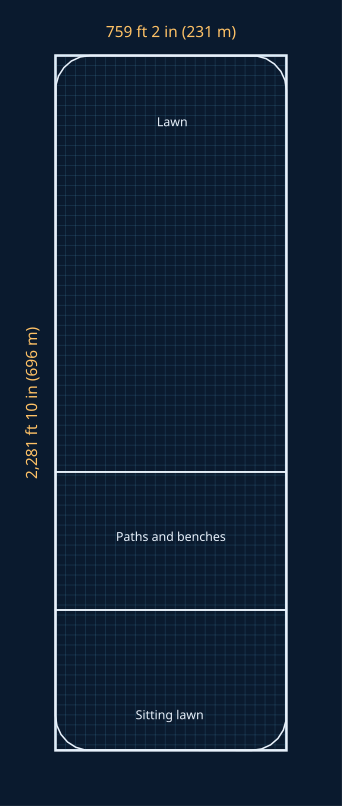

# P2-19 Lawn 3: plan

Footprint 759 ft 2 in (231 m) × 2,281 ft 10 in (696 m) · structural grid 32 ft 10 in (10 m)

## Levels

| Level | Floor above deck | Height | Floor area |
|---|---|---|---|
| Level 1 · Ground | 0 ft (0 mm) | 13 ft 1 in (4,000 mm) | — |

## Elements

| ID | Designation | Type | Name | Level(s) | Size / length | Area | Status |
|---|---|---|---|---|---|---|---|
| E001 | D5F6P2B13A2R1 | zone | Lawn | L1 | 758 ft 6 in (231 m) × 1,367 ft 5 in (417 m) | 1,030,332 sq ft (95,721 m²) | proposed |
| E002 | D5F6P2B13A2R2 | zone | Paths and benches | L1 | 758 ft 2 in (231 m) × 453 ft 5 in (138 m) | 343,629 sq ft (31,924 m²) | proposed |
| E003 | D5F6P2B13A2R3 | zone | Sitting lawn | L1 | 758 ft 2 in (231 m) × 460 ft 11 in (140 m) | 343,431 sq ft (31,906 m²) | proposed |

## Drawings

### Level 1 · Ground

