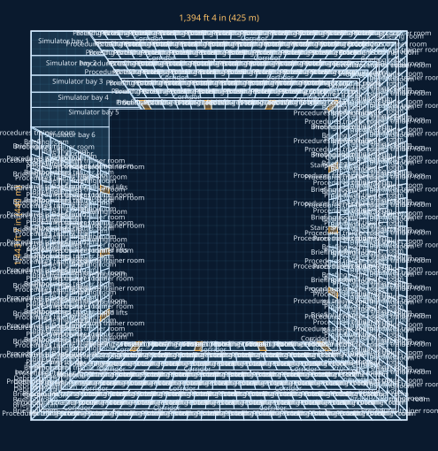
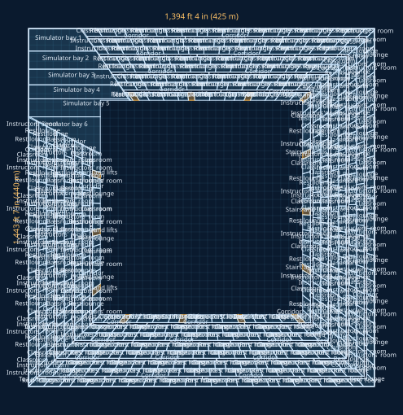

# P2-20 Simulator Annex 4: plan

Footprint 1,394 ft 4 in (425 m) × 1,443 ft 7 in (440 m) · structural grid 32 ft 10 in (10 m)

## Levels

| Level | Floor above deck | Height | Floor area |
|---|---|---|---|
| Level 1 · Hall floor | 0 ft (0 mm) | 26 ft 3 in (8,000 mm) | 1,134,596 sq ft (105,407 m²) |
| Level 2 · Gallery floor | 26 ft 3 in (8,000 mm) | 14 ft 9 in (4,500 mm) | 1,134,550 sq ft (105,403 m²) |

## Elements

| ID | Designation | Type | Name | Level(s) | Size / length | Area | Status |
|---|---|---|---|---|---|---|---|
| E001 | D5F6P2B15A1L1R1, D5F6P2B15A1L2R1 | room | Simulator bay 1 | L1, L2 | 272 ft (83 m) × 90 ft 7 in (28 m) | 21,761 sq ft (2,022 m²) | proposed |
| E002 | D5F6P2B15A1L1R2, D5F6P2B15A1L2R2 | room | Simulator bay 2 | L1, L2 | 323 ft 6 in (99 m) × 73 ft 2 in (22 m) | 21,783 sq ft (2,024 m²) | proposed |
| E003 | D5F6P2B15A1L1R3, D5F6P2B15A1L2R3 | room | Simulator bay 3 | L1, L2 | 367 ft 5 in (112 m) × 63 ft (19 m) | 21,762 sq ft (2,022 m²) | proposed |
| E004 | D5F6P2B15A1L1R4, D5F6P2B15A1L2R4 | room | Simulator bay 4 | L1, L2 | 406 ft 10 in (124 m) × 56 ft 5 in (17 m) | 21,846 sq ft (2,030 m²) | proposed |
| E005 | D5F6P2B15A1L1R5, D5F6P2B15A1L2R5 | room | Simulator bay 5 | L1, L2 | 411 ft 1 in (125 m) × 72 ft 10 in (22 m) | 21,760 sq ft (2,022 m²) | proposed |
| E006 | D5F6P2B15A1L1R6, D5F6P2B15A1L2R6 | room | Simulator bay 6 | L1, L2 | 289 ft 1 in (88 m) × 148 ft (45 m) | 21,763 sq ft (2,022 m²) | proposed |
| E007 | D5F6P2B15A1L1R7 | zone | Corridor | L1 | 9 ft 10 in (3,000 mm) × 400 ft 7 in (122 m) | 3,875 sq ft (360 m²) | proposed |
| E008 | D5F6P2B15A1L1R8 | zone | Corridor | L1 | 9 ft 10 in (3,000 mm) × 396 ft 4 in (121 m) | 3,875 sq ft (360 m²) | proposed |
| E009 | D5F6P2B15A1L1R9 | zone | Corridor | L1 | 9 ft 10 in (3,000 mm) × 250 ft (76 m) | 2,430 sq ft (226 m²) | proposed |
| E010 | D5F6P2B15A1L1R10 | zone | Corridor | L1 | 397 ft 8 in (121 m) × 9 ft 10 in (3,000 mm) | 3,875 sq ft (360 m²) | proposed |
| E011 | D5F6P2B15A1L1R11 | zone | Corridor | L1 | 396 ft 8 in (121 m) × 9 ft 10 in (3,000 mm) | 3,875 sq ft (360 m²) | proposed |
| E012 | D5F6P2B15A1L1R12 | zone | Corridor | L1 | 340 ft 7 in (104 m) × 70 ft 3 in (21 m) | 3,877 sq ft (360 m²) | proposed |
| E013 | D5F6P2B15A1L1R13 | zone | Corridor | L1 | 9 ft 10 in (3,000 mm) × 399 ft 11 in (122 m) | 3,875 sq ft (360 m²) | proposed |
| E014 | D5F6P2B15A1L1R14 | zone | Corridor | L1 | 9 ft 10 in (3,000 mm) × 396 ft 8 in (121 m) | 3,875 sq ft (360 m²) | proposed |
| E015 | D5F6P2B15A1L1R15 | zone | Corridor | L1 | 9 ft 10 in (3,000 mm) × 398 ft 11 in (122 m) | 3,875 sq ft (360 m²) | proposed |
| E016 | D5F6P2B15A1L1R16 | zone | Corridor | L1 | 272 ft (83 m) × 138 ft 5 in (42 m) | 3,875 sq ft (360 m²) | proposed |
| E017 | D5F6P2B15A1L1R17 | zone | Corridor | L1 | 396 ft 8 in (121 m) × 9 ft 10 in (3,000 mm) | 3,875 sq ft (360 m²) | proposed |
| E018 | D5F6P2B15A1L1R18 | zone | Corridor | L1 | 396 ft 8 in (121 m) × 9 ft 10 in (3,000 mm) | 3,875 sq ft (360 m²) | proposed |
| E019 | D5F6P2B15A1L1R19 | zone | Corridor | L1 | 278 ft 7 in (85 m) × 9 ft 10 in (3,000 mm) | 2,664 sq ft (248 m²) | proposed |
| E020 | D5F6P2B15A1L1R20 | zone | Corridor | L1 | 9 ft 10 in (3,000 mm) × 400 ft 7 in (122 m) | 3,877 sq ft (360 m²) | proposed |
| E021 | D5F6P2B15A1L1R21 | zone | Corridor | L1 | 9 ft 10 in (3,000 mm) × 396 ft 8 in (121 m) | 3,873 sq ft (360 m²) | proposed |
| E022 | D5F6P2B15A1L1R22 | zone | Corridor | L1 | 9 ft 10 in (3,000 mm) × 139 ft 9 in (43 m) | 1,338 sq ft (124 m²) | proposed |
| E023 | D5F6P2B15A1L1R23 | zone | Corridor | L1 | 397 ft 4 in (121 m) × 9 ft 10 in (3,000 mm) | 3,875 sq ft (360 m²) | proposed |
| E024 | D5F6P2B15A1L1R24 | zone | Corridor | L1 | 397 ft (121 m) × 9 ft 10 in (3,000 mm) | 3,873 sq ft (360 m²) | proposed |
| E025 | D5F6P2B15A1L1R25 | zone | Corridor | L1 | 221 ft 2 in (67 m) × 189 ft 4 in (58 m) | 3,877 sq ft (360 m²) | proposed |
| E026 | D5F6P2B15A1L1R26 | zone | Corridor | L1 | 9 ft 10 in (3,000 mm) × 397 ft 4 in (121 m) | 3,875 sq ft (360 m²) | proposed |
| E027 | D5F6P2B15A1L1R27 | zone | Corridor | L1 | 9 ft 10 in (3,000 mm) × 396 ft 8 in (121 m) | 3,875 sq ft (360 m²) | proposed |
| E028 | D5F6P2B15A1L1R28 | zone | Corridor | L1 | 143 ft 8 in (44 m) × 266 ft 5 in (81 m) | 3,875 sq ft (360 m²) | proposed |
| E029 | D5F6P2B15A1L1R29 | zone | Corridor | L1 | 398 ft (121 m) × 9 ft 10 in (3,000 mm) | 3,875 sq ft (360 m²) | proposed |
| E030 | D5F6P2B15A1L1R30 | zone | Corridor | L1 | 397 ft (121 m) × 9 ft 10 in (3,000 mm) | 3,875 sq ft (360 m²) | proposed |
| E031 | D5F6P2B15A1L1R31 | zone | Corridor | L1 | 263 ft 1 in (80 m) × 9 ft 10 in (3,000 mm) | 2,514 sq ft (234 m²) | proposed |
| E032 | D5F6P2B15A1L1R32 | zone | Corridor | L1 | 9 ft 10 in (3,000 mm) × 399 ft 11 in (122 m) | 3,875 sq ft (360 m²) | proposed |
| E033 | D5F6P2B15A1L1R33 | zone | Corridor | L1 | 9 ft 10 in (3,000 mm) × 397 ft 4 in (121 m) | 3,877 sq ft (360 m²) | proposed |
| E034 | D5F6P2B15A1L1R34 | zone | Corridor | L1 | 9 ft 10 in (3,000 mm) × 29 ft 6 in (9,000 mm) | 245 sq ft (23 m²) | proposed |
| E035 | D5F6P2B15A1L1R35 | zone | Corridor | L1 | 397 ft 4 in (121 m) × 9 ft 10 in (3,000 mm) | 3,873 sq ft (360 m²) | proposed |
| E036 | D5F6P2B15A1L1R36 | zone | Corridor | L1 | 398 ft 4 in (121 m) × 9 ft 10 in (3,000 mm) | 3,877 sq ft (360 m²) | proposed |
| E037 | D5F6P2B15A1L1R37 | zone | Corridor | L1 | 101 ft 8 in (31 m) × 308 ft 5 in (94 m) | 3,877 sq ft (360 m²) | proposed |
| E038 | D5F6P2B15A1L1R38 | zone | Corridor | L1 | 9 ft 10 in (3,000 mm) × 397 ft 4 in (121 m) | 3,875 sq ft (360 m²) | proposed |
| E039 | D5F6P2B15A1L1R39 | zone | Corridor | L1 | 15 ft 9 in (4,800 mm) × 394 ft (120 m) | 3,877 sq ft (360 m²) | proposed |
| E040 | D5F6P2B15A1L1R40 | zone | Corridor | L1 | 399 ft 7 in (122 m) × 9 ft 10 in (3,000 mm) | 3,875 sq ft (360 m²) | proposed |
| E041 | D5F6P2B15A1L1R41 | zone | Corridor | L1 | 397 ft 8 in (121 m) × 9 ft 10 in (3,000 mm) | 3,877 sq ft (360 m²) | proposed |
| E042 | D5F6P2B15A1L1R42 | zone | Corridor | L1 | 247 ft 5 in (75 m) × 9 ft 10 in (3,000 mm) | 2,361 sq ft (219 m²) | proposed |
| E043 | D5F6P2B15A1L1R43 | zone | Corridor | L1 | 9 ft 10 in (3,000 mm) × 399 ft 7 in (122 m) | 3,877 sq ft (360 m²) | proposed |
| E044 | D5F6P2B15A1L1R44 | zone | Corridor | L1 | 9 ft 10 in (3,000 mm) × 311 ft (95 m) | 3,029 sq ft (281 m²) | proposed |
| E045 | D5F6P2B15A1L1R45 | zone | Corridor | L1 | 398 ft (121 m) × 9 ft 10 in (3,000 mm) | 3,875 sq ft (360 m²) | proposed |
| E046 | D5F6P2B15A1L1R46 | zone | Corridor | L1 | 372 ft 1 in (113 m) × 37 ft 1 in (11 m) | 3,877 sq ft (360 m²) | proposed |
| E047 | D5F6P2B15A1L1R47 | zone | Corridor | L1 | 9 ft 10 in (3,000 mm) × 398 ft 11 in (122 m) | 3,877 sq ft (360 m²) | proposed |
| E048 | D5F6P2B15A1L1R48 | zone | Corridor | L1 | 9 ft 10 in (3,000 mm) × 397 ft 8 in (121 m) | 3,873 sq ft (360 m²) | proposed |
| E049 | D5F6P2B15A1L1R49 | zone | Corridor | L1 | 277 ft 7 in (85 m) × 131 ft 11 in (40 m) | 3,878 sq ft (360 m²) | proposed |
| E050 | D5F6P2B15A1L1R50 | zone | Corridor | L1 | 398 ft 4 in (121 m) × 9 ft 10 in (3,000 mm) | 3,877 sq ft (360 m²) | proposed |
| E051 | D5F6P2B15A1L1R51 | zone | Corridor | L1 | 231 ft 11 in (71 m) × 9 ft 10 in (3,000 mm) | 2,210 sq ft (205 m²) | proposed |
| E052 | D5F6P2B15A1L1R52, D5F6P2B15A1L2R7 | core | Stairs and lifts | L1, L2 | 31 ft 6 in (9,600 mm) × 49 ft 3 in (15 m) | 827 sq ft (77 m²) | proposed |
| E053 | D5F6P2B15A1L1R53, D5F6P2B15A1L2R8 | core | Stairs and lifts | L1, L2 | 31 ft 6 in (9,600 mm) × 33 ft 2 in (10 m) | 822 sq ft (76 m²) | proposed |
| E054 | D5F6P2B15A1L1R54, D5F6P2B15A1L2R9 | core | Stairs and lifts | L1, L2 | 31 ft 6 in (9,600 mm) × 35 ft 5 in (11 m) | 827 sq ft (77 m²) | proposed |
| E055 | D5F6P2B15A1L1R55, D5F6P2B15A1L2R10 | core | Stairs and lifts | L1, L2 | 46 ft 3 in (14 m) × 31 ft 6 in (9,600 mm) | 827 sq ft (77 m²) | proposed |
| E056 | D5F6P2B15A1L1R56, D5F6P2B15A1L2R11 | core | Stairs and lifts | L1, L2 | 29 ft 2 in (8,900 mm) × 31 ft 6 in (9,600 mm) | 827 sq ft (77 m²) | proposed |
| E057 | D5F6P2B15A1L1R57, D5F6P2B15A1L2R12 | core | Stairs and lifts | L1, L2 | 40 ft 4 in (12 m) × 31 ft 6 in (9,600 mm) | 827 sq ft (77 m²) | proposed |
| E058 | D5F6P2B15A1L1R58, D5F6P2B15A1L2R13 | core | Stairs and lifts | L1, L2 | 44 ft (13 m) × 44 ft (13 m) | 827 sq ft (77 m²) | proposed |
| E059 | D5F6P2B15A1L1R59, D5F6P2B15A1L2R14 | core | Stairs and lifts | L1, L2 | 31 ft 6 in (9,600 mm) × 41 ft 4 in (13 m) | 832 sq ft (77 m²) | proposed |
| E060 | D5F6P2B15A1L1R60, D5F6P2B15A1L2R15 | core | Stairs and lifts | L1, L2 | 31 ft 6 in (9,600 mm) × 27 ft 3 in (8,300 mm) | 822 sq ft (76 m²) | proposed |
| E061 | D5F6P2B15A1L1R61, D5F6P2B15A1L2R16 | core | Stairs and lifts | L1, L2 | 31 ft 6 in (9,600 mm) × 43 ft 8 in (13 m) | 827 sq ft (77 m²) | proposed |
| E062 | D5F6P2B15A1L1R62, D5F6P2B15A1L2R17 | core | Stairs and lifts | L1, L2 | 55 ft 1 in (17 m) × 31 ft 6 in (9,600 mm) | 827 sq ft (77 m²) | proposed |
| E063 | D5F6P2B15A1L1R63, D5F6P2B15A1L2R18 | core | Stairs and lifts | L1, L2 | 38 ft 1 in (12 m) × 31 ft 6 in (9,600 mm) | 832 sq ft (77 m²) | proposed |
| E064 | D5F6P2B15A1L1R64, D5F6P2B15A1L2R19 | core | Stairs and lifts | L1, L2 | 31 ft 10 in (9,700 mm) × 31 ft 6 in (9,600 mm) | 832 sq ft (77 m²) | proposed |
| E065 | D5F6P2B15A1L1R65, D5F6P2B15A1L2R20 | core | Stairs and lifts | L1, L2 | 48 ft 11 in (15 m) × 31 ft 6 in (9,600 mm) | 832 sq ft (77 m²) | proposed |
| E066 | D5F6P2B15A1L1R66 | room | Briefing room | L1 | 31 ft 2 in (9,500 mm) × 51 ft 6 in (16 m) | 649 sq ft (60 m²) | proposed |
| E067 | D5F6P2B15A1L1R67 | room | Briefing room | L1 | 31 ft 2 in (9,500 mm) × 50 ft 6 in (15 m) | 644 sq ft (60 m²) | proposed |
| E068 | D5F6P2B15A1L1R68 | room | Briefing room | L1 | 31 ft 2 in (9,500 mm) × 49 ft 6 in (15 m) | 644 sq ft (60 m²) | proposed |
| E069 | D5F6P2B15A1L1R69 | room | Briefing room | L1 | 31 ft 2 in (9,500 mm) × 48 ft 7 in (15 m) | 644 sq ft (60 m²) | proposed |
| E070 | D5F6P2B15A1L1R70 | room | Debrief room | L1 | 31 ft 2 in (9,500 mm) × 41 ft (12 m) | 429 sq ft (40 m²) | proposed |
| E071 | D5F6P2B15A1L1R71 | room | Debrief room | L1 | 31 ft 2 in (9,500 mm) × 40 ft 4 in (12 m) | 429 sq ft (40 m²) | proposed |
| E072 | D5F6P2B15A1L1R72 | room | Debrief room | L1 | 31 ft 2 in (9,500 mm) × 39 ft 8 in (12 m) | 429 sq ft (40 m²) | proposed |
| E073 | D5F6P2B15A1L1R73 | room | Debrief room | L1 | 31 ft 2 in (9,500 mm) × 39 ft 4 in (12 m) | 435 sq ft (40 m²) | proposed |
| E074 | D5F6P2B15A1L1R74 | room | Locker room | L1 | 31 ft 2 in (9,500 mm) × 55 ft 5 in (17 m) | 966 sq ft (90 m²) | proposed |
| E075 | D5F6P2B15A1L1R75 | room | Toilets | L1 | 31 ft 2 in (9,500 mm) × 44 ft (13 m) | 644 sq ft (60 m²) | proposed |
| E076 | D5F6P2B15A1L1R76 | room | Procedures trainer room | L1 | 31 ft 2 in (9,500 mm) × 73 ft 6 in (22 m) | 1,616 sq ft (150 m²) | proposed |
| E077 | D5F6P2B15A1L1R77 | room | Briefing room | L1 | 31 ft 2 in (9,500 mm) × 70 ft 10 in (22 m) | 1,611 sq ft (150 m²) | proposed |
| E078 | D5F6P2B15A1L1R78 | room | Procedures trainer room | L1 | 31 ft 2 in (9,500 mm) × 68 ft 11 in (21 m) | 1,616 sq ft (150 m²) | proposed |
| E079 | D5F6P2B15A1L1R79 | room | Briefing room | L1 | 31 ft 2 in (9,500 mm) × 66 ft 7 in (20 m) | 1,611 sq ft (150 m²) | proposed |
| E080 | D5F6P2B15A1L1R80 | room | Procedures trainer room | L1 | 31 ft 2 in (9,500 mm) × 64 ft 4 in (20 m) | 1,616 sq ft (150 m²) | proposed |
| E081 | D5F6P2B15A1L1R81 | room | Briefing room | L1 | 31 ft 2 in (9,500 mm) × 62 ft (19 m) | 1,616 sq ft (150 m²) | proposed |
| E082 | D5F6P2B15A1L1R82 | room | Procedures trainer room | L1 | 31 ft 2 in (9,500 mm) × 59 ft 9 in (18 m) | 1,611 sq ft (150 m²) | proposed |
| E083 | D5F6P2B15A1L1R83 | room | Briefing room | L1 | 31 ft 2 in (9,500 mm) × 57 ft 5 in (18 m) | 1,611 sq ft (150 m²) | proposed |
| E084 | D5F6P2B15A1L1R84 | room | Procedures trainer room | L1 | 31 ft 2 in (9,500 mm) × 55 ft 5 in (17 m) | 1,621 sq ft (151 m²) | proposed |
| E085 | D5F6P2B15A1L1R85 | room | Briefing room | L1 | 31 ft 2 in (9,500 mm) × 52 ft 10 in (16 m) | 1,611 sq ft (150 m²) | proposed |
| E086 | D5F6P2B15A1L1R86 | room | Procedures trainer room | L1 | 31 ft 2 in (9,500 mm) × 52 ft 10 in (16 m) | 1,611 sq ft (150 m²) | proposed |
| E087 | D5F6P2B15A1L1R87 | room | Briefing room | L1 | 31 ft 2 in (9,500 mm) × 55 ft 5 in (17 m) | 1,616 sq ft (150 m²) | proposed |
| E088 | D5F6P2B15A1L1R88 | room | Procedures trainer room | L1 | 31 ft 2 in (9,500 mm) × 57 ft 9 in (18 m) | 1,616 sq ft (150 m²) | proposed |
| E089 | D5F6P2B15A1L1R89 | room | Briefing room | L1 | 31 ft 2 in (9,500 mm) × 59 ft 9 in (18 m) | 1,611 sq ft (150 m²) | proposed |
| E090 | D5F6P2B15A1L1R90 | room | Procedures trainer room | L1 | 31 ft 2 in (9,500 mm) × 62 ft (19 m) | 1,611 sq ft (150 m²) | proposed |
| E091 | D5F6P2B15A1L1R91 | room | Briefing room | L1 | 31 ft 2 in (9,500 mm) × 64 ft 8 in (20 m) | 1,621 sq ft (151 m²) | proposed |
| E092 | D5F6P2B15A1L1R92 | room | Procedures trainer room | L1 | 31 ft 2 in (9,500 mm) × 62 ft 8 in (19 m) | 1,488 sq ft (138 m²) | proposed |
| E093 | D5F6P2B15A1L1R93 | room | Briefing room | L1 | 72 ft 6 in (22 m) × 31 ft 2 in (9,500 mm) | 1,621 sq ft (151 m²) | proposed |
| E094 | D5F6P2B15A1L1R94 | room | Procedures trainer room | L1 | 69 ft 11 in (21 m) × 31 ft 2 in (9,500 mm) | 1,611 sq ft (150 m²) | proposed |
| E095 | D5F6P2B15A1L1R95 | room | Briefing room | L1 | 67 ft 7 in (21 m) × 31 ft 2 in (9,500 mm) | 1,616 sq ft (150 m²) | proposed |
| E096 | D5F6P2B15A1L1R96 | room | Procedures trainer room | L1 | 65 ft (20 m) × 31 ft 2 in (9,500 mm) | 1,611 sq ft (150 m²) | proposed |
| E097 | D5F6P2B15A1L1R97 | room | Briefing room | L1 | 62 ft 8 in (19 m) × 31 ft 2 in (9,500 mm) | 1,611 sq ft (150 m²) | proposed |
| E098 | D5F6P2B15A1L1R98 | room | Procedures trainer room | L1 | 60 ft 4 in (18 m) × 31 ft 2 in (9,500 mm) | 1,616 sq ft (150 m²) | proposed |
| E099 | D5F6P2B15A1L1R99 | room | Briefing room | L1 | 58 ft 1 in (18 m) × 31 ft 2 in (9,500 mm) | 1,616 sq ft (150 m²) | proposed |
| E100 | D5F6P2B15A1L1R100 | room | Procedures trainer room | L1 | 55 ft 9 in (17 m) × 31 ft 2 in (9,500 mm) | 1,616 sq ft (150 m²) | proposed |
| E101 | D5F6P2B15A1L1R101 | room | Briefing room | L1 | 53 ft 2 in (16 m) × 31 ft 2 in (9,500 mm) | 1,611 sq ft (150 m²) | proposed |
| E102 | D5F6P2B15A1L1R102 | room | Procedures trainer room | L1 | 52 ft 10 in (16 m) × 31 ft 2 in (9,500 mm) | 1,611 sq ft (150 m²) | proposed |
| E103 | D5F6P2B15A1L1R103 | room | Briefing room | L1 | 55 ft 1 in (17 m) × 31 ft 2 in (9,500 mm) | 1,616 sq ft (150 m²) | proposed |
| E104 | D5F6P2B15A1L1R104 | room | Procedures trainer room | L1 | 57 ft 5 in (18 m) × 31 ft 2 in (9,500 mm) | 1,611 sq ft (150 m²) | proposed |
| E105 | D5F6P2B15A1L1R105 | room | Briefing room | L1 | 60 ft (18 m) × 31 ft 2 in (9,500 mm) | 1,621 sq ft (151 m²) | proposed |
| E106 | D5F6P2B15A1L1R106 | room | Procedures trainer room | L1 | 62 ft (19 m) × 31 ft 2 in (9,500 mm) | 1,611 sq ft (150 m²) | proposed |
| E107 | D5F6P2B15A1L1R107 | room | Briefing room | L1 | 64 ft 4 in (20 m) × 31 ft 2 in (9,500 mm) | 1,611 sq ft (150 m²) | proposed |
| E108 | D5F6P2B15A1L1R108 | room | Procedures trainer room | L1 | 66 ft 11 in (20 m) × 31 ft 2 in (9,500 mm) | 1,616 sq ft (150 m²) | proposed |
| E109 | D5F6P2B15A1L1R109 | room | Briefing room | L1 | 69 ft 3 in (21 m) × 31 ft 2 in (9,500 mm) | 1,611 sq ft (150 m²) | proposed |
| E110 | D5F6P2B15A1L1R110 | room | Procedures trainer room | L1 | 71 ft 6 in (22 m) × 31 ft 2 in (9,500 mm) | 1,611 sq ft (150 m²) | proposed |
| E111 | D5F6P2B15A1L1R111 | room | Briefing room | L1 | 74 ft 2 in (23 m) × 31 ft 2 in (9,500 mm) | 1,621 sq ft (151 m²) | proposed |
| E112 | D5F6P2B15A1L1R112 | room | Procedures trainer room | L1 | 76 ft 1 in (23 m) × 31 ft 2 in (9,500 mm) | 1,611 sq ft (150 m²) | proposed |
| E113 | D5F6P2B15A1L1R113 | room | Briefing room | L1 | 78 ft 9 in (24 m) × 31 ft 2 in (9,500 mm) | 1,616 sq ft (150 m²) | proposed |
| E114 | D5F6P2B15A1L1R114 | room | Procedures trainer room | L1 | 81 ft (25 m) × 31 ft 2 in (9,500 mm) | 1,611 sq ft (150 m²) | proposed |
| E115 | D5F6P2B15A1L1R115 | room | Briefing room | L1 | 46 ft 7 in (14 m) × 66 ft 7 in (20 m) | 1,616 sq ft (150 m²) | proposed |
| E116 | D5F6P2B15A1L1R116 | room | Procedures trainer room | L1 | 31 ft 2 in (9,500 mm) × 80 ft 5 in (25 m) | 1,616 sq ft (150 m²) | proposed |
| E117 | D5F6P2B15A1L1R117 | room | Briefing room | L1 | 31 ft 2 in (9,500 mm) × 77 ft 9 in (24 m) | 1,611 sq ft (150 m²) | proposed |
| E118 | D5F6P2B15A1L1R118 | room | Procedures trainer room | L1 | 31 ft 2 in (9,500 mm) × 75 ft 6 in (23 m) | 1,611 sq ft (150 m²) | proposed |
| E119 | D5F6P2B15A1L1R119 | room | Briefing room | L1 | 31 ft 2 in (9,500 mm) × 73 ft 6 in (22 m) | 1,616 sq ft (150 m²) | proposed |
| E120 | D5F6P2B15A1L1R120 | room | Procedures trainer room | L1 | 31 ft 2 in (9,500 mm) × 71 ft 2 in (22 m) | 1,616 sq ft (150 m²) | proposed |
| E121 | D5F6P2B15A1L1R121 | room | Briefing room | L1 | 31 ft 2 in (9,500 mm) × 68 ft 7 in (21 m) | 1,611 sq ft (150 m²) | proposed |
| E122 | D5F6P2B15A1L1R122 | room | Procedures trainer room | L1 | 31 ft 2 in (9,500 mm) × 66 ft 7 in (20 m) | 1,616 sq ft (150 m²) | proposed |
| E123 | D5F6P2B15A1L1R123 | room | Briefing room | L1 | 31 ft 2 in (9,500 mm) × 64 ft 4 in (20 m) | 1,611 sq ft (150 m²) | proposed |
| E124 | D5F6P2B15A1L1R124 | room | Procedures trainer room | L1 | 31 ft 2 in (9,500 mm) × 62 ft (19 m) | 1,616 sq ft (150 m²) | proposed |
| E125 | D5F6P2B15A1L1R125 | room | Briefing room | L1 | 31 ft 2 in (9,500 mm) × 59 ft 9 in (18 m) | 1,616 sq ft (150 m²) | proposed |
| E126 | D5F6P2B15A1L1R126 | room | Procedures trainer room | L1 | 31 ft 2 in (9,500 mm) × 57 ft 5 in (18 m) | 1,611 sq ft (150 m²) | proposed |
| E127 | D5F6P2B15A1L1R127 | room | Briefing room | L1 | 31 ft 2 in (9,500 mm) × 55 ft 1 in (17 m) | 1,616 sq ft (150 m²) | proposed |
| E128 | D5F6P2B15A1L1R128 | room | Procedures trainer room | L1 | 31 ft 2 in (9,500 mm) × 52 ft 10 in (16 m) | 1,611 sq ft (150 m²) | proposed |
| E129 | D5F6P2B15A1L1R129 | room | Briefing room | L1 | 31 ft 2 in (9,500 mm) × 53 ft 2 in (16 m) | 1,616 sq ft (150 m²) | proposed |
| E130 | D5F6P2B15A1L1R130 | room | Procedures trainer room | L1 | 31 ft 2 in (9,500 mm) × 55 ft 1 in (17 m) | 1,611 sq ft (150 m²) | proposed |
| E131 | D5F6P2B15A1L1R131 | room | Briefing room | L1 | 31 ft 2 in (9,500 mm) × 57 ft 9 in (18 m) | 1,616 sq ft (150 m²) | proposed |
| E132 | D5F6P2B15A1L1R132 | room | Procedures trainer room | L1 | 31 ft 2 in (9,500 mm) × 60 ft (18 m) | 1,616 sq ft (150 m²) | proposed |
| E133 | D5F6P2B15A1L1R133 | room | Briefing room | L1 | 31 ft 2 in (9,500 mm) × 62 ft (19 m) | 1,611 sq ft (150 m²) | proposed |
| E134 | D5F6P2B15A1L1R134 | room | Procedures trainer room | L1 | 31 ft 2 in (9,500 mm) × 64 ft 4 in (20 m) | 1,611 sq ft (150 m²) | proposed |
| E135 | D5F6P2B15A1L1R135 | room | Briefing room | L1 | 31 ft 2 in (9,500 mm) × 66 ft 11 in (20 m) | 1,621 sq ft (151 m²) | proposed |
| E136 | D5F6P2B15A1L1R136 | room | Procedures trainer room | L1 | 31 ft 2 in (9,500 mm) × 68 ft 11 in (21 m) | 1,611 sq ft (150 m²) | proposed |
| E137 | D5F6P2B15A1L1R137 | room | Briefing room | L1 | 31 ft 2 in (9,500 mm) × 71 ft 2 in (22 m) | 1,611 sq ft (150 m²) | proposed |
| E138 | D5F6P2B15A1L1R138 | room | Procedures trainer room | L1 | 31 ft 2 in (9,500 mm) × 73 ft 10 in (22 m) | 1,616 sq ft (150 m²) | proposed |
| E139 | D5F6P2B15A1L1R139 | room | Briefing room | L1 | 31 ft 2 in (9,500 mm) × 76 ft 1 in (23 m) | 1,616 sq ft (150 m²) | proposed |
| E140 | D5F6P2B15A1L1R140 | room | Procedures trainer room | L1 | 31 ft 2 in (9,500 mm) × 78 ft 1 in (24 m) | 1,611 sq ft (150 m²) | proposed |
| E141 | D5F6P2B15A1L1R141 | room | Briefing room | L1 | 31 ft 2 in (9,500 mm) × 80 ft 5 in (24 m) | 1,611 sq ft (150 m²) | proposed |
| E142 | D5F6P2B15A1L1R142 | room | Procedures trainer room | L1 | 52 ft 2 in (16 m) × 61 ft (19 m) | 1,621 sq ft (151 m²) | proposed |
| E143 | D5F6P2B15A1L1R143 | room | Briefing room | L1 | 80 ft 9 in (25 m) × 31 ft 2 in (9,500 mm) | 1,611 sq ft (150 m²) | proposed |
| E144 | D5F6P2B15A1L1R144 | room | Procedures trainer room | L1 | 78 ft 5 in (24 m) × 31 ft 2 in (9,500 mm) | 1,611 sq ft (150 m²) | proposed |
| E145 | D5F6P2B15A1L1R145 | room | Briefing room | L1 | 76 ft 1 in (23 m) × 31 ft 2 in (9,500 mm) | 1,616 sq ft (150 m²) | proposed |
| E146 | D5F6P2B15A1L1R146 | room | Procedures trainer room | L1 | 73 ft 6 in (22 m) × 31 ft 2 in (9,500 mm) | 1,611 sq ft (150 m²) | proposed |
| E147 | D5F6P2B15A1L1R147 | room | Briefing room | L1 | 71 ft 6 in (22 m) × 31 ft 2 in (9,500 mm) | 1,621 sq ft (151 m²) | proposed |
| E148 | D5F6P2B15A1L1R148 | room | Procedures trainer room | L1 | 68 ft 11 in (21 m) × 31 ft 2 in (9,500 mm) | 1,611 sq ft (150 m²) | proposed |
| E149 | D5F6P2B15A1L1R149 | room | Briefing room | L1 | 66 ft 7 in (20 m) × 31 ft 2 in (9,500 mm) | 1,611 sq ft (150 m²) | proposed |
| E150 | D5F6P2B15A1L1R150 | room | Procedures trainer room | L1 | 64 ft 4 in (20 m) × 31 ft 2 in (9,500 mm) | 1,616 sq ft (150 m²) | proposed |
| E151 | D5F6P2B15A1L1R151 | room | Briefing room | L1 | 61 ft 8 in (19 m) × 31 ft 2 in (9,500 mm) | 1,611 sq ft (150 m²) | proposed |
| E152 | D5F6P2B15A1L1R152 | room | Procedures trainer room | L1 | 59 ft 5 in (18 m) × 31 ft 2 in (9,500 mm) | 1,616 sq ft (150 m²) | proposed |
| E153 | D5F6P2B15A1L1R153 | room | Briefing room | L1 | 57 ft 1 in (17 m) × 31 ft 2 in (9,500 mm) | 1,616 sq ft (150 m²) | proposed |
| E154 | D5F6P2B15A1L1R154 | room | Procedures trainer room | L1 | 54 ft 9 in (17 m) × 31 ft 2 in (9,500 mm) | 1,611 sq ft (150 m²) | proposed |
| E155 | D5F6P2B15A1L1R155 | room | Briefing room | L1 | 53 ft 2 in (16 m) × 31 ft 2 in (9,500 mm) | 1,616 sq ft (150 m²) | proposed |
| E156 | D5F6P2B15A1L1R156 | room | Procedures trainer room | L1 | 53 ft 6 in (16 m) × 31 ft 2 in (9,500 mm) | 1,611 sq ft (150 m²) | proposed |
| E157 | D5F6P2B15A1L1R157 | room | Briefing room | L1 | 56 ft 1 in (17 m) × 31 ft 2 in (9,500 mm) | 1,616 sq ft (150 m²) | proposed |
| E158 | D5F6P2B15A1L1R158 | room | Procedures trainer room | L1 | 58 ft 5 in (18 m) × 31 ft 2 in (9,500 mm) | 1,611 sq ft (150 m²) | proposed |
| E159 | D5F6P2B15A1L1R159 | room | Briefing room | L1 | 60 ft 8 in (18 m) × 31 ft 2 in (9,500 mm) | 1,616 sq ft (150 m²) | proposed |
| E160 | D5F6P2B15A1L1R160 | room | Procedures trainer room | L1 | 63 ft (19 m) × 31 ft 2 in (9,500 mm) | 1,616 sq ft (150 m²) | proposed |
| E161 | D5F6P2B15A1L1R161 | room | Briefing room | L1 | 65 ft 3 in (20 m) × 31 ft 2 in (9,500 mm) | 1,611 sq ft (150 m²) | proposed |
| E162 | D5F6P2B15A1L1R162 | room | Procedures trainer room | L1 | 67 ft 7 in (21 m) × 31 ft 2 in (9,500 mm) | 1,611 sq ft (150 m²) | proposed |
| E163 | D5F6P2B15A1L1R163 | room | Briefing room | L1 | 70 ft 3 in (21 m) × 31 ft 2 in (9,500 mm) | 1,616 sq ft (150 m²) | proposed |
| E164 | D5F6P2B15A1L1R164 | room | Procedures trainer room | L1 | 72 ft 6 in (22 m) × 31 ft 2 in (9,500 mm) | 1,616 sq ft (150 m²) | proposed |
| E165 | D5F6P2B15A1L1R165 | room | Briefing room | L1 | 74 ft 10 in (23 m) × 31 ft 2 in (9,500 mm) | 1,616 sq ft (150 m²) | proposed |
| E166 | D5F6P2B15A1L1R166 | room | Procedures trainer room | L1 | 77 ft 1 in (24 m) × 31 ft 2 in (9,500 mm) | 1,611 sq ft (150 m²) | proposed |
| E167 | D5F6P2B15A1L1R167 | room | Briefing room | L1 | 79 ft 5 in (24 m) × 31 ft 2 in (9,500 mm) | 1,611 sq ft (150 m²) | proposed |
| E168 | D5F6P2B15A1L1R168 | room | Procedures trainer room | L1 | 77 ft 9 in (24 m) × 31 ft 2 in (9,500 mm) | 1,488 sq ft (138 m²) | proposed |
| E169 | D5F6P2B15A1L1R169 | room | Briefing room | L1 | 31 ft 2 in (9,500 mm) × 81 ft 8 in (25 m) | 1,616 sq ft (150 m²) | proposed |
| E170 | D5F6P2B15A1L1R170 | room | Procedures trainer room | L1 | 31 ft 2 in (9,500 mm) × 79 ft 1 in (24 m) | 1,611 sq ft (150 m²) | proposed |
| E171 | D5F6P2B15A1L1R171 | room | Briefing room | L1 | 31 ft 2 in (9,500 mm) × 76 ft 9 in (23 m) | 1,616 sq ft (150 m²) | proposed |
| E172 | D5F6P2B15A1L1R172 | room | Procedures trainer room | L1 | 31 ft 2 in (9,500 mm) × 74 ft 2 in (23 m) | 1,611 sq ft (150 m²) | proposed |
| E173 | D5F6P2B15A1L1R173 | room | Briefing room | L1 | 31 ft 2 in (9,500 mm) × 72 ft 2 in (22 m) | 1,616 sq ft (150 m²) | proposed |
| E174 | D5F6P2B15A1L1R174 | room | Procedures trainer room | L1 | 31 ft 2 in (9,500 mm) × 69 ft 11 in (21 m) | 1,616 sq ft (150 m²) | proposed |
| E175 | D5F6P2B15A1L1R175 | room | Briefing room | L1 | 31 ft 2 in (9,500 mm) × 67 ft 3 in (20 m) | 1,611 sq ft (150 m²) | proposed |
| E176 | D5F6P2B15A1L1R176 | room | Procedures trainer room | L1 | 31 ft 2 in (9,500 mm) × 65 ft (20 m) | 1,616 sq ft (150 m²) | proposed |
| E177 | D5F6P2B15A1L1R177 | room | Briefing room | L1 | 31 ft 2 in (9,500 mm) × 62 ft 4 in (19 m) | 1,611 sq ft (150 m²) | proposed |
| E178 | D5F6P2B15A1L1R178 | room | Procedures trainer room | L1 | 31 ft 2 in (9,500 mm) × 60 ft (18 m) | 1,616 sq ft (150 m²) | proposed |
| E179 | D5F6P2B15A1L1R179 | room | Briefing room | L1 | 31 ft 2 in (9,500 mm) × 57 ft 5 in (18 m) | 1,611 sq ft (150 m²) | proposed |
| E180 | D5F6P2B15A1L1R180 | room | Procedures trainer room | L1 | 31 ft 2 in (9,500 mm) × 55 ft 1 in (17 m) | 1,616 sq ft (150 m²) | proposed |
| E181 | D5F6P2B15A1L1R181 | room | Briefing room | L1 | 31 ft 2 in (9,500 mm) × 52 ft 10 in (16 m) | 1,611 sq ft (150 m²) | proposed |
| E182 | D5F6P2B15A1L1R182 | room | Procedures trainer room | L1 | 31 ft 2 in (9,500 mm) × 53 ft 6 in (16 m) | 1,616 sq ft (150 m²) | proposed |
| E183 | D5F6P2B15A1L1R183 | room | Briefing room | L1 | 31 ft 2 in (9,500 mm) × 55 ft 9 in (17 m) | 1,611 sq ft (150 m²) | proposed |
| E184 | D5F6P2B15A1L1R184 | room | Procedures trainer room | L1 | 31 ft 2 in (9,500 mm) × 58 ft 5 in (18 m) | 1,616 sq ft (150 m²) | proposed |
| E185 | D5F6P2B15A1L1R185 | room | Briefing room | L1 | 31 ft 2 in (9,500 mm) × 60 ft 8 in (18 m) | 1,616 sq ft (150 m²) | proposed |
| E186 | D5F6P2B15A1L1R186 | room | Procedures trainer room | L1 | 31 ft 2 in (9,500 mm) × 63 ft (19 m) | 1,616 sq ft (150 m²) | proposed |
| E187 | D5F6P2B15A1L1R187 | room | Briefing room | L1 | 31 ft 2 in (9,500 mm) × 85 ft (26 m) | 2,209 sq ft (205 m²) | proposed |
| E188 | D5F6P2B15A1L1R188 | room | Procedures trainer room | L1 | 72 ft 2 in (22 m) × 31 ft 2 in (9,500 mm) | 1,611 sq ft (150 m²) | proposed |
| E189 | D5F6P2B15A1L1R189 | room | Briefing room | L1 | 69 ft 7 in (21 m) × 31 ft 2 in (9,500 mm) | 1,616 sq ft (150 m²) | proposed |
| E190 | D5F6P2B15A1L1R190 | room | Procedures trainer room | L1 | 66 ft 11 in (20 m) × 31 ft 2 in (9,500 mm) | 1,611 sq ft (150 m²) | proposed |
| E191 | D5F6P2B15A1L1R191 | room | Briefing room | L1 | 64 ft 8 in (20 m) × 31 ft 2 in (9,500 mm) | 1,616 sq ft (150 m²) | proposed |
| E192 | D5F6P2B15A1L1R192 | room | Procedures trainer room | L1 | 62 ft (19 m) × 31 ft 2 in (9,500 mm) | 1,611 sq ft (150 m²) | proposed |
| E193 | D5F6P2B15A1L1R193 | room | Briefing room | L1 | 59 ft 9 in (18 m) × 31 ft 2 in (9,500 mm) | 1,616 sq ft (150 m²) | proposed |
| E194 | D5F6P2B15A1L1R194 | room | Procedures trainer room | L1 | 57 ft 1 in (17 m) × 31 ft 2 in (9,500 mm) | 1,616 sq ft (150 m²) | proposed |
| E195 | D5F6P2B15A1L1R195 | room | Briefing room | L1 | 54 ft 6 in (17 m) × 31 ft 2 in (9,500 mm) | 1,611 sq ft (150 m²) | proposed |
| E196 | D5F6P2B15A1L1R196 | room | Procedures trainer room | L1 | 53 ft 2 in (16 m) × 31 ft 2 in (9,500 mm) | 1,616 sq ft (150 m²) | proposed |
| E197 | D5F6P2B15A1L1R197 | room | Briefing room | L1 | 54 ft 2 in (16 m) × 31 ft 2 in (9,500 mm) | 1,616 sq ft (150 m²) | proposed |
| E198 | D5F6P2B15A1L1R198 | room | Procedures trainer room | L1 | 56 ft 5 in (17 m) × 31 ft 2 in (9,500 mm) | 1,611 sq ft (150 m²) | proposed |
| E199 | D5F6P2B15A1L1R199 | room | Briefing room | L1 | 59 ft 1 in (18 m) × 31 ft 2 in (9,500 mm) | 1,616 sq ft (150 m²) | proposed |
| E200 | D5F6P2B15A1L1R200 | room | Procedures trainer room | L1 | 61 ft 4 in (19 m) × 31 ft 2 in (9,500 mm) | 1,611 sq ft (150 m²) | proposed |
| E201 | D5F6P2B15A1L1R201 | room | Briefing room | L1 | 64 ft (20 m) × 31 ft 2 in (9,500 mm) | 1,616 sq ft (150 m²) | proposed |
| E202 | D5F6P2B15A1L1R202 | room | Procedures trainer room | L1 | 66 ft 7 in (20 m) × 31 ft 2 in (9,500 mm) | 1,616 sq ft (150 m²) | proposed |
| E203 | D5F6P2B15A1L1R203 | room | Briefing room | L1 | 68 ft 11 in (21 m) × 31 ft 2 in (9,500 mm) | 1,611 sq ft (150 m²) | proposed |
| E204 | D5F6P2B15A1L1R204 | room | Procedures trainer room | L1 | 71 ft 6 in (22 m) × 31 ft 2 in (9,500 mm) | 1,616 sq ft (150 m²) | proposed |
| E205 | D5F6P2B15A1L1R205 | room | Briefing room | L1 | 74 ft 2 in (23 m) × 31 ft 2 in (9,500 mm) | 1,611 sq ft (150 m²) | proposed |
| E206 | D5F6P2B15A1L1R206 | room | Procedures trainer room | L1 | 76 ft 9 in (23 m) × 31 ft 2 in (9,500 mm) | 1,611 sq ft (150 m²) | proposed |
| E207 | D5F6P2B15A1L1R207 | room | Briefing room | L1 | 79 ft 5 in (24 m) × 31 ft 2 in (9,500 mm) | 1,616 sq ft (150 m²) | proposed |
| E208 | D5F6P2B15A1L1R208 | room | Procedures trainer room | L1 | 81 ft (25 m) × 32 ft 2 in (9,800 mm) | 1,621 sq ft (151 m²) | proposed |
| E209 | D5F6P2B15A1L1R209 | room | Briefing room | L1 | 31 ft 2 in (9,500 mm) × 81 ft 8 in (25 m) | 1,611 sq ft (150 m²) | proposed |
| E210 | D5F6P2B15A1L1R210 | room | Procedures trainer room | L1 | 31 ft 2 in (9,500 mm) × 79 ft 5 in (24 m) | 1,616 sq ft (150 m²) | proposed |
| E211 | D5F6P2B15A1L1R211 | room | Briefing room | L1 | 31 ft 2 in (9,500 mm) × 76 ft 9 in (23 m) | 1,611 sq ft (150 m²) | proposed |
| E212 | D5F6P2B15A1L1R212 | room | Procedures trainer room | L1 | 31 ft 2 in (9,500 mm) × 74 ft 6 in (23 m) | 1,616 sq ft (150 m²) | proposed |
| E213 | D5F6P2B15A1L1R213 | room | Briefing room | L1 | 31 ft 2 in (9,500 mm) × 71 ft 10 in (22 m) | 1,611 sq ft (150 m²) | proposed |
| E214 | D5F6P2B15A1L1R214 | room | Procedures trainer room | L1 | 31 ft 2 in (9,500 mm) × 69 ft 7 in (21 m) | 1,611 sq ft (150 m²) | proposed |
| E215 | D5F6P2B15A1L1R215 | room | Briefing room | L1 | 31 ft 2 in (9,500 mm) × 67 ft 3 in (20 m) | 1,616 sq ft (150 m²) | proposed |
| E216 | D5F6P2B15A1L1R216 | room | Procedures trainer room | L1 | 31 ft 2 in (9,500 mm) × 64 ft 8 in (20 m) | 1,611 sq ft (150 m²) | proposed |
| E217 | D5F6P2B15A1L1R217 | room | Briefing room | L1 | 31 ft 2 in (9,500 mm) × 62 ft 4 in (19 m) | 1,616 sq ft (150 m²) | proposed |
| E218 | D5F6P2B15A1L1R218 | room | Procedures trainer room | L1 | 31 ft 2 in (9,500 mm) × 59 ft 9 in (18 m) | 1,611 sq ft (150 m²) | proposed |
| E219 | D5F6P2B15A1L1R219 | room | Briefing room | L1 | 31 ft 2 in (9,500 mm) × 57 ft 5 in (18 m) | 1,616 sq ft (150 m²) | proposed |
| E220 | D5F6P2B15A1L1R220 | room | Procedures trainer room | L1 | 31 ft 2 in (9,500 mm) × 55 ft 1 in (17 m) | 1,616 sq ft (150 m²) | proposed |
| E221 | D5F6P2B15A1L1R221 | room | Briefing room | L1 | 31 ft 2 in (9,500 mm) × 53 ft 2 in (16 m) | 1,616 sq ft (150 m²) | proposed |
| E222 | D5F6P2B15A1L1R222 | room | Procedures trainer room | L1 | 31 ft 2 in (9,500 mm) × 53 ft 2 in (16 m) | 1,611 sq ft (150 m²) | proposed |
| E223 | D5F6P2B15A1L1R223 | room | Briefing room | L1 | 31 ft 2 in (9,500 mm) × 55 ft 9 in (17 m) | 1,616 sq ft (150 m²) | proposed |
| E224 | D5F6P2B15A1L1R224 | room | Procedures trainer room | L1 | 31 ft 2 in (9,500 mm) × 58 ft 1 in (18 m) | 1,611 sq ft (150 m²) | proposed |
| E225 | D5F6P2B15A1L1R225 | room | Briefing room | L1 | 31 ft 2 in (9,500 mm) × 60 ft 8 in (18 m) | 1,616 sq ft (150 m²) | proposed |
| E226 | D5F6P2B15A1L1R226 | room | Procedures trainer room | L1 | 31 ft 2 in (9,500 mm) × 63 ft (19 m) | 1,611 sq ft (150 m²) | proposed |
| E227 | D5F6P2B15A1L1R227 | room | Briefing room | L1 | 31 ft 2 in (9,500 mm) × 65 ft 7 in (20 m) | 1,616 sq ft (150 m²) | proposed |
| E228 | D5F6P2B15A1L1R228 | room | Procedures trainer room | L1 | 31 ft 2 in (9,500 mm) × 67 ft 11 in (21 m) | 1,611 sq ft (150 m²) | proposed |
| E229 | D5F6P2B15A1L1R229 | room | Briefing room | L1 | 31 ft 2 in (9,500 mm) × 70 ft 6 in (22 m) | 1,616 sq ft (150 m²) | proposed |
| E230 | D5F6P2B15A1L1R230 | room | Procedures trainer room | L1 | 31 ft 2 in (9,500 mm) × 72 ft 10 in (22 m) | 1,611 sq ft (150 m²) | proposed |
| E231 | D5F6P2B15A1L1R231 | room | Briefing room | L1 | 31 ft 2 in (9,500 mm) × 75 ft 6 in (23 m) | 1,616 sq ft (150 m²) | proposed |
| E232 | D5F6P2B15A1L1R232 | room | Procedures trainer room | L1 | 31 ft 2 in (9,500 mm) × 77 ft 9 in (24 m) | 1,616 sq ft (150 m²) | proposed |
| E233 | D5F6P2B15A1L1R233 | room | Briefing room | L1 | 31 ft 2 in (9,500 mm) × 80 ft 1 in (24 m) | 1,616 sq ft (150 m²) | proposed |
| E234 | D5F6P2B15A1L1R234 | room | Procedures trainer room | L1 | 47 ft 3 in (14 m) × 65 ft 7 in (20 m) | 1,611 sq ft (150 m²) | proposed |
| E235 | D5F6P2B15A1L1R235 | room | Briefing room | L1 | 81 ft (25 m) × 31 ft 2 in (9,500 mm) | 1,616 sq ft (150 m²) | proposed |
| E236 | D5F6P2B15A1L1R236 | room | Procedures trainer room | L1 | 78 ft 5 in (24 m) × 31 ft 2 in (9,500 mm) | 1,616 sq ft (150 m²) | proposed |
| E237 | D5F6P2B15A1L1R237 | room | Briefing room | L1 | 75 ft 9 in (23 m) × 31 ft 2 in (9,500 mm) | 1,611 sq ft (150 m²) | proposed |
| E238 | D5F6P2B15A1L1R238 | room | Procedures trainer room | L1 | 73 ft 6 in (22 m) × 31 ft 2 in (9,500 mm) | 1,616 sq ft (150 m²) | proposed |
| E239 | D5F6P2B15A1L1R239 | room | Briefing room | L1 | 70 ft 10 in (22 m) × 31 ft 2 in (9,500 mm) | 1,611 sq ft (150 m²) | proposed |
| E240 | D5F6P2B15A1L1R240 | room | Procedures trainer room | L1 | 68 ft 7 in (21 m) × 31 ft 2 in (9,500 mm) | 1,616 sq ft (150 m²) | proposed |
| E241 | D5F6P2B15A1L1R241 | room | Briefing room | L1 | 65 ft 11 in (20 m) × 31 ft 2 in (9,500 mm) | 1,616 sq ft (150 m²) | proposed |
| E242 | D5F6P2B15A1L1R242 | room | Procedures trainer room | L1 | 63 ft (19 m) × 31 ft 2 in (9,500 mm) | 1,605 sq ft (149 m²) | proposed |
| E243 | D5F6P2B15A1L1R243 | room | Briefing room | L1 | 60 ft 8 in (18 m) × 31 ft 2 in (9,500 mm) | 1,616 sq ft (150 m²) | proposed |
| E244 | D5F6P2B15A1L1R244 | room | Procedures trainer room | L1 | 58 ft 1 in (18 m) × 31 ft 2 in (9,500 mm) | 1,616 sq ft (150 m²) | proposed |
| E245 | D5F6P2B15A1L1R245 | room | Briefing room | L1 | 55 ft 5 in (17 m) × 31 ft 2 in (9,500 mm) | 1,611 sq ft (150 m²) | proposed |
| E246 | D5F6P2B15A1L1R246 | room | Procedures trainer room | L1 | 53 ft 2 in (16 m) × 31 ft 2 in (9,500 mm) | 1,616 sq ft (150 m²) | proposed |
| E247 | D5F6P2B15A1L1R247 | room | Briefing room | L1 | 52 ft 10 in (16 m) × 31 ft 2 in (9,500 mm) | 1,611 sq ft (150 m²) | proposed |
| E248 | D5F6P2B15A1L1R248 | room | Procedures trainer room | L1 | 55 ft 5 in (17 m) × 31 ft 2 in (9,500 mm) | 1,616 sq ft (150 m²) | proposed |
| E249 | D5F6P2B15A1L1R249 | room | Briefing room | L1 | 58 ft 1 in (18 m) × 31 ft 2 in (9,500 mm) | 1,616 sq ft (150 m²) | proposed |
| E250 | D5F6P2B15A1L1R250 | room | Procedures trainer room | L1 | 60 ft 4 in (18 m) × 31 ft 2 in (9,500 mm) | 1,611 sq ft (150 m²) | proposed |
| E251 | D5F6P2B15A1L1R251 | room | Briefing room | L1 | 63 ft (19 m) × 31 ft 2 in (9,500 mm) | 1,616 sq ft (150 m²) | proposed |
| E252 | D5F6P2B15A1L1R252 | room | Procedures trainer room | L1 | 65 ft 7 in (20 m) × 31 ft 2 in (9,500 mm) | 1,616 sq ft (150 m²) | proposed |
| E253 | D5F6P2B15A1L1R253 | room | Briefing room | L1 | 67 ft 11 in (21 m) × 31 ft 2 in (9,500 mm) | 1,611 sq ft (150 m²) | proposed |
| E254 | D5F6P2B15A1L1R254 | room | Procedures trainer room | L1 | 70 ft 6 in (22 m) × 31 ft 2 in (9,500 mm) | 1,616 sq ft (150 m²) | proposed |
| E255 | D5F6P2B15A1L1R255 | room | Briefing room | L1 | 72 ft 10 in (22 m) × 31 ft 2 in (9,500 mm) | 1,611 sq ft (150 m²) | proposed |
| E256 | D5F6P2B15A1L1R256 | room | Procedures trainer room | L1 | 75 ft 6 in (23 m) × 31 ft 2 in (9,500 mm) | 1,616 sq ft (150 m²) | proposed |
| E257 | D5F6P2B15A1L1R257 | room | Briefing room | L1 | 78 ft 1 in (24 m) × 31 ft 2 in (9,500 mm) | 1,616 sq ft (150 m²) | proposed |
| E258 | D5F6P2B15A1L1R258 | room | Procedures trainer room | L1 | 103 ft 4 in (32 m) × 31 ft 2 in (9,500 mm) | 2,306 sq ft (214 m²) | proposed |
| E259 | D5F6P2B15A1L1R259 | room | Briefing room | L1 | 31 ft 2 in (9,500 mm) × 81 ft 8 in (25 m) | 1,616 sq ft (150 m²) | proposed |
| E260 | D5F6P2B15A1L1R260 | room | Procedures trainer room | L1 | 31 ft 2 in (9,500 mm) × 79 ft 1 in (24 m) | 1,611 sq ft (150 m²) | proposed |
| E261 | D5F6P2B15A1L1R261 | room | Briefing room | L1 | 31 ft 2 in (9,500 mm) × 76 ft 9 in (23 m) | 1,616 sq ft (150 m²) | proposed |
| E262 | D5F6P2B15A1L1R262 | room | Procedures trainer room | L1 | 31 ft 2 in (9,500 mm) × 74 ft 2 in (23 m) | 1,616 sq ft (150 m²) | proposed |
| E263 | D5F6P2B15A1L1R263 | room | Briefing room | L1 | 31 ft 2 in (9,500 mm) × 71 ft 6 in (22 m) | 1,611 sq ft (150 m²) | proposed |
| E264 | D5F6P2B15A1L1R264 | room | Procedures trainer room | L1 | 31 ft 2 in (9,500 mm) × 69 ft 3 in (21 m) | 1,616 sq ft (150 m²) | proposed |
| E265 | D5F6P2B15A1L1R265 | room | Briefing room | L1 | 31 ft 2 in (9,500 mm) × 66 ft 7 in (20 m) | 1,616 sq ft (150 m²) | proposed |
| E266 | D5F6P2B15A1L1R266 | room | Procedures trainer room | L1 | 31 ft 2 in (9,500 mm) × 63 ft 8 in (19 m) | 1,605 sq ft (149 m²) | proposed |
| E267 | D5F6P2B15A1L1R267 | room | Briefing room | L1 | 31 ft 2 in (9,500 mm) × 61 ft 4 in (19 m) | 1,616 sq ft (150 m²) | proposed |
| E268 | D5F6P2B15A1L1R268 | room | Procedures trainer room | L1 | 31 ft 2 in (9,500 mm) × 58 ft 9 in (18 m) | 1,616 sq ft (150 m²) | proposed |
| E269 | D5F6P2B15A1L1R269 | room | Briefing room | L1 | 31 ft 2 in (9,500 mm) × 56 ft 1 in (17 m) | 1,611 sq ft (150 m²) | proposed |
| E270 | D5F6P2B15A1L1R270 | room | Procedures trainer room | L1 | 31 ft 2 in (9,500 mm) × 53 ft 10 in (16 m) | 1,616 sq ft (150 m²) | proposed |
| E271 | D5F6P2B15A1L1R271 | room | Briefing room | L1 | 31 ft 2 in (9,500 mm) × 53 ft 2 in (16 m) | 1,616 sq ft (150 m²) | proposed |
| E272 | D5F6P2B15A1L1R272 | room | Procedures trainer room | L1 | 31 ft 2 in (9,500 mm) × 54 ft 9 in (17 m) | 1,611 sq ft (150 m²) | proposed |
| E273 | D5F6P2B15A1L1R273 | room | Briefing room | L1 | 31 ft 2 in (9,500 mm) × 57 ft 5 in (18 m) | 1,616 sq ft (150 m²) | proposed |
| E274 | D5F6P2B15A1L1R274 | room | Procedures trainer room | L1 | 31 ft 2 in (9,500 mm) × 60 ft (18 m) | 1,616 sq ft (150 m²) | proposed |
| E275 | D5F6P2B15A1L1R275 | room | Briefing room | L1 | 31 ft 2 in (9,500 mm) × 62 ft 4 in (19 m) | 1,611 sq ft (150 m²) | proposed |
| E276 | D5F6P2B15A1L1R276 | room | Procedures trainer room | L1 | 31 ft 2 in (9,500 mm) × 88 ft 7 in (27 m) | 2,331 sq ft (217 m²) | proposed |
| E277 | D5F6P2B15A1L1R277 | room | Briefing room | L1 | 72 ft 2 in (22 m) × 31 ft 2 in (9,500 mm) | 1,611 sq ft (150 m²) | proposed |
| E278 | D5F6P2B15A1L1R278 | room | Procedures trainer room | L1 | 69 ft 7 in (21 m) × 31 ft 2 in (9,500 mm) | 1,616 sq ft (150 m²) | proposed |
| E279 | D5F6P2B15A1L1R279 | room | Briefing room | L1 | 66 ft 11 in (20 m) × 31 ft 2 in (9,500 mm) | 1,616 sq ft (150 m²) | proposed |
| E280 | D5F6P2B15A1L1R280 | room | Procedures trainer room | L1 | 64 ft 4 in (20 m) × 31 ft 2 in (9,500 mm) | 1,616 sq ft (150 m²) | proposed |
| E281 | D5F6P2B15A1L1R281 | room | Briefing room | L1 | 61 ft 4 in (19 m) × 31 ft 2 in (9,500 mm) | 1,605 sq ft (149 m²) | proposed |
| E282 | D5F6P2B15A1L1R282 | room | Procedures trainer room | L1 | 59 ft 1 in (18 m) × 31 ft 2 in (9,500 mm) | 1,616 sq ft (150 m²) | proposed |
| E283 | D5F6P2B15A1L1R283 | room | Briefing room | L1 | 56 ft 5 in (17 m) × 31 ft 2 in (9,500 mm) | 1,616 sq ft (150 m²) | proposed |
| E284 | D5F6P2B15A1L1R284 | room | Procedures trainer room | L1 | 53 ft 10 in (16 m) × 31 ft 2 in (9,500 mm) | 1,616 sq ft (150 m²) | proposed |
| E285 | D5F6P2B15A1L1R285 | room | Briefing room | L1 | 53 ft 2 in (16 m) × 31 ft 2 in (9,500 mm) | 1,611 sq ft (150 m²) | proposed |
| E286 | D5F6P2B15A1L1R286 | room | Procedures trainer room | L1 | 55 ft 5 in (17 m) × 31 ft 2 in (9,500 mm) | 1,616 sq ft (150 m²) | proposed |
| E287 | D5F6P2B15A1L1R287 | room | Briefing room | L1 | 57 ft 9 in (18 m) × 31 ft 2 in (9,500 mm) | 1,611 sq ft (150 m²) | proposed |
| E288 | D5F6P2B15A1L1R288 | room | Procedures trainer room | L1 | 60 ft 4 in (18 m) × 31 ft 2 in (9,500 mm) | 1,616 sq ft (150 m²) | proposed |
| E289 | D5F6P2B15A1L1R289 | room | Briefing room | L1 | 63 ft (19 m) × 31 ft 2 in (9,500 mm) | 1,611 sq ft (150 m²) | proposed |
| E290 | D5F6P2B15A1L1R290 | room | Procedures trainer room | L1 | 65 ft 11 in (20 m) × 31 ft 2 in (9,500 mm) | 1,616 sq ft (150 m²) | proposed |
| E291 | D5F6P2B15A1L1R291 | room | Briefing room | L1 | 68 ft 7 in (21 m) × 31 ft 2 in (9,500 mm) | 1,616 sq ft (150 m²) | proposed |
| E292 | D5F6P2B15A1L1R292 | room | Procedures trainer room | L1 | 71 ft 2 in (22 m) × 31 ft 2 in (9,500 mm) | 1,616 sq ft (150 m²) | proposed |
| E293 | D5F6P2B15A1L1R293 | room | Briefing room | L1 | 73 ft 6 in (22 m) × 31 ft 2 in (9,500 mm) | 1,605 sq ft (149 m²) | proposed |
| E294 | D5F6P2B15A1L1R294 | room | Procedures trainer room | L1 | 76 ft 5 in (23 m) × 31 ft 2 in (9,500 mm) | 1,616 sq ft (150 m²) | proposed |
| E295 | D5F6P2B15A1L1R295 | room | Briefing room | L1 | 79 ft 1 in (24 m) × 31 ft 2 in (9,500 mm) | 1,616 sq ft (150 m²) | proposed |
| E296 | D5F6P2B15A1L1R296 | room | Procedures trainer room | L1 | 80 ft 9 in (25 m) × 32 ft 2 in (9,800 mm) | 1,616 sq ft (150 m²) | proposed |
| E297 | D5F6P2B15A1L1R297 | room | Briefing room | L1 | 31 ft 2 in (9,500 mm) × 81 ft 8 in (25 m) | 1,616 sq ft (150 m²) | proposed |
| E298 | D5F6P2B15A1L1R298 | room | Procedures trainer room | L1 | 31 ft 2 in (9,500 mm) × 79 ft 1 in (24 m) | 1,611 sq ft (150 m²) | proposed |
| E299 | D5F6P2B15A1L1R299 | room | Briefing room | L1 | 31 ft 2 in (9,500 mm) × 76 ft 9 in (23 m) | 1,616 sq ft (150 m²) | proposed |
| E300 | D5F6P2B15A1L1R300 | room | Procedures trainer room | L1 | 31 ft 2 in (9,500 mm) × 74 ft 2 in (23 m) | 1,616 sq ft (150 m²) | proposed |
| E301 | D5F6P2B15A1L1R301 | room | Briefing room | L1 | 31 ft 2 in (9,500 mm) × 71 ft 6 in (22 m) | 1,611 sq ft (150 m²) | proposed |
| E302 | D5F6P2B15A1L1R302 | room | Procedures trainer room | L1 | 31 ft 2 in (9,500 mm) × 68 ft 11 in (21 m) | 1,611 sq ft (150 m²) | proposed |
| E303 | D5F6P2B15A1L1R303 | room | Briefing room | L1 | 31 ft 2 in (9,500 mm) × 66 ft 3 in (20 m) | 1,616 sq ft (150 m²) | proposed |
| E304 | D5F6P2B15A1L1R304 | room | Procedures trainer room | L1 | 31 ft 2 in (9,500 mm) × 63 ft 8 in (19 m) | 1,611 sq ft (150 m²) | proposed |
| E305 | D5F6P2B15A1L1R305 | room | Briefing room | L1 | 31 ft 2 in (9,500 mm) × 61 ft 4 in (19 m) | 1,616 sq ft (150 m²) | proposed |
| E306 | D5F6P2B15A1L1R306 | room | Procedures trainer room | L1 | 31 ft 2 in (9,500 mm) × 58 ft 9 in (18 m) | 1,616 sq ft (150 m²) | proposed |
| E307 | D5F6P2B15A1L1R307 | room | Briefing room | L1 | 31 ft 2 in (9,500 mm) × 56 ft 1 in (17 m) | 1,611 sq ft (150 m²) | proposed |
| E308 | D5F6P2B15A1L1R308 | room | Procedures trainer room | L1 | 31 ft 2 in (9,500 mm) × 53 ft 10 in (16 m) | 1,616 sq ft (150 m²) | proposed |
| E309 | D5F6P2B15A1L1R309 | room | Briefing room | L1 | 31 ft 2 in (9,500 mm) × 53 ft 2 in (16 m) | 1,616 sq ft (150 m²) | proposed |
| E310 | D5F6P2B15A1L1R310 | room | Procedures trainer room | L1 | 31 ft 2 in (9,500 mm) × 54 ft 9 in (17 m) | 1,611 sq ft (150 m²) | proposed |
| E311 | D5F6P2B15A1L1R311 | room | Briefing room | L1 | 31 ft 2 in (9,500 mm) × 57 ft 5 in (18 m) | 1,616 sq ft (150 m²) | proposed |
| E312 | D5F6P2B15A1L1R312 | room | Procedures trainer room | L1 | 31 ft 2 in (9,500 mm) × 60 ft (18 m) | 1,611 sq ft (150 m²) | proposed |
| E313 | D5F6P2B15A1L1R313 | room | Briefing room | L1 | 31 ft 2 in (9,500 mm) × 62 ft 8 in (19 m) | 1,611 sq ft (150 m²) | proposed |
| E314 | D5F6P2B15A1L1R314 | room | Procedures trainer room | L1 | 31 ft 2 in (9,500 mm) × 65 ft 3 in (20 m) | 1,616 sq ft (150 m²) | proposed |
| E315 | D5F6P2B15A1L1R315 | room | Briefing room | L1 | 31 ft 2 in (9,500 mm) × 67 ft 11 in (21 m) | 1,616 sq ft (150 m²) | proposed |
| E316 | D5F6P2B15A1L1R316 | room | Procedures trainer room | L1 | 31 ft 2 in (9,500 mm) × 70 ft 3 in (21 m) | 1,611 sq ft (150 m²) | proposed |
| E317 | D5F6P2B15A1L1R317 | room | Briefing room | L1 | 31 ft 2 in (9,500 mm) × 72 ft 10 in (22 m) | 1,616 sq ft (150 m²) | proposed |
| E318 | D5F6P2B15A1L1R318 | room | Procedures trainer room | L1 | 31 ft 2 in (9,500 mm) × 75 ft 6 in (23 m) | 1,616 sq ft (150 m²) | proposed |
| E319 | D5F6P2B15A1L1R319 | room | Briefing room | L1 | 31 ft 2 in (9,500 mm) × 77 ft 9 in (24 m) | 1,611 sq ft (150 m²) | proposed |
| E320 | D5F6P2B15A1L1R320 | room | Procedures trainer room | L1 | 31 ft 2 in (9,500 mm) × 80 ft 5 in (24 m) | 1,616 sq ft (150 m²) | proposed |
| E321 | D5F6P2B15A1L1R321 | room | Briefing room | L1 | 57 ft 9 in (18 m) × 55 ft 1 in (17 m) | 1,616 sq ft (150 m²) | proposed |
| E322 | D5F6P2B15A1L1R322 | room | Procedures trainer room | L1 | 80 ft 5 in (24 m) × 31 ft 2 in (9,500 mm) | 1,616 sq ft (150 m²) | proposed |
| E323 | D5F6P2B15A1L1R323 | room | Briefing room | L1 | 77 ft 5 in (24 m) × 31 ft 2 in (9,500 mm) | 1,611 sq ft (150 m²) | proposed |
| E324 | D5F6P2B15A1L1R324 | room | Procedures trainer room | L1 | 74 ft 10 in (23 m) × 31 ft 2 in (9,500 mm) | 1,611 sq ft (150 m²) | proposed |
| E325 | D5F6P2B15A1L1R325 | room | Briefing room | L1 | 72 ft 6 in (22 m) × 31 ft 2 in (9,500 mm) | 1,616 sq ft (150 m²) | proposed |
| E326 | D5F6P2B15A1L1R326 | room | Procedures trainer room | L1 | 69 ft 11 in (21 m) × 31 ft 2 in (9,500 mm) | 1,616 sq ft (150 m²) | proposed |
| E327 | D5F6P2B15A1L1R327 | room | Briefing room | L1 | 66 ft 11 in (20 m) × 31 ft 2 in (9,500 mm) | 1,611 sq ft (150 m²) | proposed |
| E328 | D5F6P2B15A1L1R328 | room | Procedures trainer room | L1 | 64 ft 4 in (20 m) × 31 ft 2 in (9,500 mm) | 1,616 sq ft (150 m²) | proposed |
| E329 | D5F6P2B15A1L1R329 | room | Briefing room | L1 | 61 ft 8 in (19 m) × 31 ft 2 in (9,500 mm) | 1,616 sq ft (150 m²) | proposed |
| E330 | D5F6P2B15A1L1R330 | room | Procedures trainer room | L1 | 59 ft 1 in (18 m) × 31 ft 2 in (9,500 mm) | 1,611 sq ft (150 m²) | proposed |
| E331 | D5F6P2B15A1L1R331 | room | Briefing room | L1 | 56 ft 5 in (17 m) × 31 ft 2 in (9,500 mm) | 1,611 sq ft (150 m²) | proposed |
| E332 | D5F6P2B15A1L1R332 | room | Procedures trainer room | L1 | 53 ft 10 in (16 m) × 31 ft 2 in (9,500 mm) | 1,616 sq ft (150 m²) | proposed |
| E333 | D5F6P2B15A1L1R333 | room | Briefing room | L1 | 53 ft 2 in (16 m) × 31 ft 2 in (9,500 mm) | 1,616 sq ft (150 m²) | proposed |
| E334 | D5F6P2B15A1L1R334 | room | Procedures trainer room | L1 | 55 ft 1 in (17 m) × 31 ft 2 in (9,500 mm) | 1,616 sq ft (150 m²) | proposed |
| E335 | D5F6P2B15A1L1R335 | room | Briefing room | L1 | 57 ft 9 in (18 m) × 31 ft 2 in (9,500 mm) | 1,611 sq ft (150 m²) | proposed |
| E336 | D5F6P2B15A1L1R336 | room | Procedures trainer room | L1 | 60 ft 4 in (18 m) × 31 ft 2 in (9,500 mm) | 1,611 sq ft (150 m²) | proposed |
| E337 | D5F6P2B15A1L1R337 | room | Briefing room | L1 | 63 ft (19 m) × 31 ft 2 in (9,500 mm) | 1,616 sq ft (150 m²) | proposed |
| E338 | D5F6P2B15A1L1R338 | room | Procedures trainer room | L1 | 65 ft 7 in (20 m) × 31 ft 2 in (9,500 mm) | 1,616 sq ft (150 m²) | proposed |
| E339 | D5F6P2B15A1L1R339 | room | Briefing room | L1 | 68 ft 3 in (21 m) × 31 ft 2 in (9,500 mm) | 1,611 sq ft (150 m²) | proposed |
| E340 | D5F6P2B15A1L1R340 | room | Procedures trainer room | L1 | 71 ft 2 in (22 m) × 31 ft 2 in (9,500 mm) | 1,616 sq ft (150 m²) | proposed |
| E341 | D5F6P2B15A1L1R341 | room | Briefing room | L1 | 73 ft 6 in (22 m) × 31 ft 2 in (9,500 mm) | 1,611 sq ft (150 m²) | proposed |
| E342 | D5F6P2B15A1L1R342 | room | Procedures trainer room | L1 | 76 ft 1 in (23 m) × 31 ft 2 in (9,500 mm) | 1,611 sq ft (150 m²) | proposed |
| E343 | D5F6P2B15A1L1R343 | room | Briefing room | L1 | 79 ft 1 in (24 m) × 31 ft 2 in (9,500 mm) | 1,616 sq ft (150 m²) | proposed |
| E344 | D5F6P2B15A1L1R344 | room | Procedures trainer room | L1 | 81 ft 8 in (25 m) × 31 ft 2 in (9,500 mm) | 1,616 sq ft (150 m²) | proposed |
| E345 | D5F6P2B15A1L1R345 | room | Briefing room | L1 | 31 ft 2 in (9,500 mm) × 81 ft 8 in (25 m) | 1,616 sq ft (150 m²) | proposed |
| E346 | D5F6P2B15A1L1R346 | room | Procedures trainer room | L1 | 31 ft 2 in (9,500 mm) × 79 ft 1 in (24 m) | 1,616 sq ft (150 m²) | proposed |
| E347 | D5F6P2B15A1L1R347 | room | Briefing room | L1 | 31 ft 2 in (9,500 mm) × 76 ft 1 in (23 m) | 1,611 sq ft (150 m²) | proposed |
| E348 | D5F6P2B15A1L1R348 | room | Procedures trainer room | L1 | 31 ft 2 in (9,500 mm) × 73 ft 6 in (22 m) | 1,616 sq ft (150 m²) | proposed |
| E349 | D5F6P2B15A1L1R349 | room | Briefing room | L1 | 31 ft 2 in (9,500 mm) × 70 ft 6 in (22 m) | 1,611 sq ft (150 m²) | proposed |
| E350 | D5F6P2B15A1L1R350 | room | Procedures trainer room | L1 | 31 ft 2 in (9,500 mm) × 67 ft 11 in (21 m) | 1,616 sq ft (150 m²) | proposed |
| E351 | D5F6P2B15A1L1R351 | room | Briefing room | L1 | 31 ft 2 in (9,500 mm) × 65 ft 3 in (20 m) | 1,616 sq ft (150 m²) | proposed |
| E352 | D5F6P2B15A1L1R352 | room | Procedures trainer room | L1 | 31 ft 2 in (9,500 mm) × 62 ft 4 in (19 m) | 1,611 sq ft (150 m²) | proposed |
| E353 | D5F6P2B15A1L1R353 | room | Briefing room | L1 | 31 ft 2 in (9,500 mm) × 59 ft 9 in (18 m) | 1,616 sq ft (150 m²) | proposed |
| E354 | D5F6P2B15A1L1R354 | room | Procedures trainer room | L1 | 31 ft 2 in (9,500 mm) × 57 ft 1 in (17 m) | 1,616 sq ft (150 m²) | proposed |
| E355 | D5F6P2B15A1L1R355 | room | Briefing room | L1 | 31 ft 2 in (9,500 mm) × 54 ft 2 in (16 m) | 1,605 sq ft (149 m²) | proposed |
| E356 | D5F6P2B15A1L1R356 | room | Procedures trainer room | L1 | 31 ft 2 in (9,500 mm) × 53 ft 2 in (16 m) | 1,616 sq ft (150 m²) | proposed |
| E357 | D5F6P2B15A1L1R357 | room | Briefing room | L1 | 31 ft 2 in (9,500 mm) × 54 ft 6 in (17 m) | 1,611 sq ft (150 m²) | proposed |
| E358 | D5F6P2B15A1L1R358 | room | Procedures trainer room | L1 | 31 ft 2 in (9,500 mm) × 57 ft 5 in (18 m) | 1,616 sq ft (150 m²) | proposed |
| E359 | D5F6P2B15A1L1R359 | room | Briefing room | L1 | 31 ft 2 in (9,500 mm) × 60 ft (18 m) | 1,616 sq ft (150 m²) | proposed |
| E360 | D5F6P2B15A1L1R360 | room | Procedures trainer room | L1 | 31 ft 2 in (9,500 mm) × 62 ft 8 in (19 m) | 1,611 sq ft (150 m²) | proposed |
| E361 | D5F6P2B15A1L1R361 | room | Briefing room | L1 | 31 ft 2 in (9,500 mm) × 77 ft 9 in (24 m) | 1,984 sq ft (184 m²) | proposed |
| E362 | D5F6P2B15A1L1R362 | room | Procedures trainer room | L1 | 72 ft 2 in (22 m) × 31 ft 2 in (9,500 mm) | 1,611 sq ft (150 m²) | proposed |
| E363 | D5F6P2B15A1L1R363 | room | Briefing room | L1 | 69 ft 7 in (21 m) × 31 ft 2 in (9,500 mm) | 1,621 sq ft (151 m²) | proposed |
| E364 | D5F6P2B15A1L1R364 | room | Procedures trainer room | L1 | 66 ft 3 in (20 m) × 31 ft 2 in (9,500 mm) | 1,611 sq ft (150 m²) | proposed |
| E365 | D5F6P2B15A1L1R365 | room | Briefing room | L1 | 63 ft 8 in (19 m) × 31 ft 2 in (9,500 mm) | 1,616 sq ft (150 m²) | proposed |
| E366 | D5F6P2B15A1L1R366 | room | Procedures trainer room | L1 | 60 ft 8 in (18 m) × 31 ft 2 in (9,500 mm) | 1,611 sq ft (150 m²) | proposed |
| E367 | D5F6P2B15A1L1R367 | room | Briefing room | L1 | 58 ft 1 in (18 m) × 31 ft 2 in (9,500 mm) | 1,616 sq ft (150 m²) | proposed |
| E368 | D5F6P2B15A1L1R368 | room | Procedures trainer room | L1 | 55 ft 1 in (17 m) × 31 ft 2 in (9,500 mm) | 1,611 sq ft (150 m²) | proposed |
| E369 | D5F6P2B15A1L1R369 | room | Briefing room | L1 | 53 ft 2 in (16 m) × 31 ft 2 in (9,500 mm) | 1,611 sq ft (150 m²) | proposed |
| E370 | D5F6P2B15A1L1R370 | room | Procedures trainer room | L1 | 54 ft 2 in (16 m) × 31 ft 2 in (9,500 mm) | 1,616 sq ft (150 m²) | proposed |
| E371 | D5F6P2B15A1L1R371 | room | Briefing room | L1 | 56 ft 9 in (17 m) × 31 ft 2 in (9,500 mm) | 1,611 sq ft (150 m²) | proposed |
| E372 | D5F6P2B15A1L1R372 | room | Procedures trainer room | L1 | 60 ft (18 m) × 31 ft 2 in (9,500 mm) | 1,621 sq ft (151 m²) | proposed |
| E373 | D5F6P2B15A1L1R373 | room | Briefing room | L1 | 62 ft 8 in (19 m) × 31 ft 2 in (9,500 mm) | 1,611 sq ft (150 m²) | proposed |
| E374 | D5F6P2B15A1L1R374 | room | Procedures trainer room | L1 | 65 ft 7 in (20 m) × 31 ft 2 in (9,500 mm) | 1,616 sq ft (150 m²) | proposed |
| E375 | D5F6P2B15A1L1R375 | room | Briefing room | L1 | 68 ft 3 in (21 m) × 31 ft 2 in (9,500 mm) | 1,611 sq ft (150 m²) | proposed |
| E376 | D5F6P2B15A1L1R376 | room | Procedures trainer room | L1 | 71 ft 2 in (22 m) × 31 ft 2 in (9,500 mm) | 1,616 sq ft (150 m²) | proposed |
| E377 | D5F6P2B15A1L1R377 | room | Briefing room | L1 | 73 ft 10 in (22 m) × 31 ft 2 in (9,500 mm) | 1,611 sq ft (150 m²) | proposed |
| E378 | D5F6P2B15A1L1R378 | room | Procedures trainer room | L1 | 76 ft 9 in (23 m) × 31 ft 2 in (9,500 mm) | 1,616 sq ft (150 m²) | proposed |
| E379 | D5F6P2B15A1L1R379 | room | Briefing room | L1 | 79 ft 5 in (24 m) × 31 ft 2 in (9,500 mm) | 1,611 sq ft (150 m²) | proposed |
| E380 | D5F6P2B15A1L1R380 | room | Procedures trainer room | L1 | 64 ft 8 in (20 m) × 48 ft 3 in (15 m) | 1,621 sq ft (151 m²) | proposed |
| E381 | D5F6P2B15A1L1R381 | room | Briefing room | L1 | 31 ft 2 in (9,500 mm) × 80 ft 9 in (25 m) | 1,616 sq ft (150 m²) | proposed |
| E382 | D5F6P2B15A1L1R382 | room | Procedures trainer room | L1 | 31 ft 2 in (9,500 mm) × 77 ft 9 in (24 m) | 1,611 sq ft (150 m²) | proposed |
| E383 | D5F6P2B15A1L1R383 | room | Briefing room | L1 | 31 ft 2 in (9,500 mm) × 75 ft 2 in (23 m) | 1,616 sq ft (150 m²) | proposed |
| E384 | D5F6P2B15A1L1R384 | room | Procedures trainer room | L1 | 31 ft 2 in (9,500 mm) × 72 ft 6 in (22 m) | 1,616 sq ft (150 m²) | proposed |
| E385 | D5F6P2B15A1L1R385 | room | Briefing room | L1 | 31 ft 2 in (9,500 mm) × 69 ft 7 in (21 m) | 1,605 sq ft (149 m²) | proposed |
| E386 | D5F6P2B15A1L1R386 | room | Procedures trainer room | L1 | 31 ft 2 in (9,500 mm) × 67 ft 3 in (20 m) | 1,616 sq ft (150 m²) | proposed |
| E387 | D5F6P2B15A1L1R387 | room | Briefing room | L1 | 31 ft 2 in (9,500 mm) × 64 ft 4 in (20 m) | 1,611 sq ft (150 m²) | proposed |
| E388 | D5F6P2B15A1L1R388 | room | Procedures trainer room | L1 | 31 ft 2 in (9,500 mm) × 61 ft 8 in (19 m) | 1,616 sq ft (150 m²) | proposed |
| E389 | D5F6P2B15A1L1R389 | room | Briefing room | L1 | 31 ft 2 in (9,500 mm) × 59 ft 1 in (18 m) | 1,616 sq ft (150 m²) | proposed |
| E390 | D5F6P2B15A1L1R390 | room | Procedures trainer room | L1 | 31 ft 2 in (9,500 mm) × 56 ft 1 in (17 m) | 1,611 sq ft (150 m²) | proposed |
| E391 | D5F6P2B15A1L1R391 | room | Briefing room | L1 | 31 ft 2 in (9,500 mm) × 53 ft 6 in (16 m) | 1,616 sq ft (150 m²) | proposed |
| E392 | D5F6P2B15A1L1R392 | room | Procedures trainer room | L1 | 31 ft 2 in (9,500 mm) × 53 ft 2 in (16 m) | 1,616 sq ft (150 m²) | proposed |
| E393 | D5F6P2B15A1L1R393 | room | Briefing room | L1 | 31 ft 2 in (9,500 mm) × 55 ft 5 in (17 m) | 1,611 sq ft (150 m²) | proposed |
| E394 | D5F6P2B15A1L1R394 | room | Procedures trainer room | L1 | 31 ft 2 in (9,500 mm) × 58 ft 5 in (18 m) | 1,616 sq ft (150 m²) | proposed |
| E395 | D5F6P2B15A1L1R395 | room | Briefing room | L1 | 31 ft 2 in (9,500 mm) × 61 ft (19 m) | 1,616 sq ft (150 m²) | proposed |
| E396 | D5F6P2B15A1L1R396 | room | Procedures trainer room | L1 | 31 ft 2 in (9,500 mm) × 63 ft 8 in (19 m) | 1,611 sq ft (150 m²) | proposed |
| E397 | D5F6P2B15A1L1R397 | room | Briefing room | L1 | 31 ft 2 in (9,500 mm) × 66 ft 7 in (20 m) | 1,616 sq ft (150 m²) | proposed |
| E398 | D5F6P2B15A1L1R398 | room | Procedures trainer room | L1 | 31 ft 2 in (9,500 mm) × 69 ft 3 in (21 m) | 1,611 sq ft (150 m²) | proposed |
| E399 | D5F6P2B15A1L1R399 | room | Briefing room | L1 | 31 ft 2 in (9,500 mm) × 72 ft 2 in (22 m) | 1,616 sq ft (150 m²) | proposed |
| E400 | D5F6P2B15A1L1R400 | room | Procedures trainer room | L1 | 31 ft 2 in (9,500 mm) × 74 ft 6 in (23 m) | 1,611 sq ft (150 m²) | proposed |
| E401 | D5F6P2B15A1L1R401 | room | Briefing room | L1 | 31 ft 2 in (9,500 mm) × 77 ft 1 in (24 m) | 1,611 sq ft (150 m²) | proposed |
| E402 | D5F6P2B15A1L1R402 | room | Procedures trainer room | L1 | 31 ft 2 in (9,500 mm) × 80 ft 1 in (24 m) | 1,616 sq ft (150 m²) | proposed |
| E403 | D5F6P2B15A1L1R403 | room | Briefing room | L1 | 52 ft 10 in (16 m) × 60 ft (18 m) | 1,621 sq ft (151 m²) | proposed |
| E404 | D5F6P2B15A1L1R404 | room | Procedures trainer room | L1 | 80 ft 5 in (24 m) × 31 ft 2 in (9,500 mm) | 1,616 sq ft (150 m²) | proposed |
| E405 | D5F6P2B15A1L1R405 | room | Briefing room | L1 | 77 ft 5 in (24 m) × 31 ft 2 in (9,500 mm) | 1,611 sq ft (150 m²) | proposed |
| E406 | D5F6P2B15A1L1R406 | room | Procedures trainer room | L1 | 74 ft 6 in (23 m) × 31 ft 2 in (9,500 mm) | 1,611 sq ft (150 m²) | proposed |
| E407 | D5F6P2B15A1L1R407 | room | Briefing room | L1 | 71 ft 10 in (22 m) × 31 ft 2 in (9,500 mm) | 1,616 sq ft (150 m²) | proposed |
| E408 | D5F6P2B15A1L1R408 | room | Procedures trainer room | L1 | 68 ft 11 in (21 m) × 31 ft 2 in (9,500 mm) | 1,611 sq ft (150 m²) | proposed |
| E409 | D5F6P2B15A1L1R409 | room | Briefing room | L1 | 66 ft 3 in (20 m) × 31 ft 2 in (9,500 mm) | 1,616 sq ft (150 m²) | proposed |
| E410 | D5F6P2B15A1L1R410 | room | Procedures trainer room | L1 | 63 ft 4 in (19 m) × 31 ft 2 in (9,500 mm) | 1,616 sq ft (150 m²) | proposed |
| E411 | D5F6P2B15A1L1R411 | room | Briefing room | L1 | 60 ft 4 in (18 m) × 31 ft 2 in (9,500 mm) | 1,616 sq ft (150 m²) | proposed |
| E412 | D5F6P2B15A1L1R412 | room | Procedures trainer room | L1 | 57 ft 5 in (18 m) × 31 ft 2 in (9,500 mm) | 1,611 sq ft (150 m²) | proposed |
| E413 | D5F6P2B15A1L1R413 | room | Briefing room | L1 | 54 ft 9 in (17 m) × 31 ft 2 in (9,500 mm) | 1,616 sq ft (150 m²) | proposed |
| E414 | D5F6P2B15A1L1R414 | room | Procedures trainer room | L1 | 53 ft 2 in (16 m) × 31 ft 2 in (9,500 mm) | 1,611 sq ft (150 m²) | proposed |
| E415 | D5F6P2B15A1L1R415 | room | Briefing room | L1 | 54 ft 6 in (17 m) × 31 ft 2 in (9,500 mm) | 1,616 sq ft (150 m²) | proposed |
| E416 | D5F6P2B15A1L1R416 | room | Procedures trainer room | L1 | 57 ft 1 in (17 m) × 31 ft 2 in (9,500 mm) | 1,611 sq ft (150 m²) | proposed |
| E417 | D5F6P2B15A1L1R417 | room | Briefing room | L1 | 60 ft (18 m) × 31 ft 2 in (9,500 mm) | 1,611 sq ft (150 m²) | proposed |
| E418 | D5F6P2B15A1L1R418 | room | Procedures trainer room | L1 | 63 ft (19 m) × 31 ft 2 in (9,500 mm) | 1,616 sq ft (150 m²) | proposed |
| E419 | D5F6P2B15A1L1R419 | room | Briefing room | L1 | 65 ft 11 in (20 m) × 31 ft 2 in (9,500 mm) | 1,616 sq ft (150 m²) | proposed |
| E420 | D5F6P2B15A1L1R420 | room | Procedures trainer room | L1 | 68 ft 11 in (21 m) × 31 ft 2 in (9,500 mm) | 1,616 sq ft (150 m²) | proposed |
| E421 | D5F6P2B15A1L1R421 | room | Briefing room | L1 | 71 ft 6 in (22 m) × 31 ft 2 in (9,500 mm) | 1,611 sq ft (150 m²) | proposed |
| E422 | D5F6P2B15A1L1R422 | room | Procedures trainer room | L1 | 74 ft 6 in (23 m) × 31 ft 2 in (9,500 mm) | 1,616 sq ft (150 m²) | proposed |
| E423 | D5F6P2B15A1L1R423 | room | Briefing room | L1 | 77 ft 1 in (24 m) × 31 ft 2 in (9,500 mm) | 1,611 sq ft (150 m²) | proposed |
| E424 | D5F6P2B15A1L1R424 | room | Procedures trainer room | L1 | 80 ft 1 in (24 m) × 31 ft 2 in (9,500 mm) | 1,616 sq ft (150 m²) | proposed |
| E425 | D5F6P2B15A1L1R425 | room | Briefing room | L1 | 57 ft 9 in (18 m) × 31 ft 2 in (9,500 mm) | 854 sq ft (79 m²) | proposed |
| E426 | D5F6P2B15A1L1R426 | room | Procedures trainer room | L1 | 31 ft 2 in (9,500 mm) × 81 ft 8 in (25 m) | 1,616 sq ft (150 m²) | proposed |
| E427 | D5F6P2B15A1L1R427 | room | Briefing room | L1 | 31 ft 2 in (9,500 mm) × 78 ft 9 in (24 m) | 1,616 sq ft (150 m²) | proposed |
| E428 | D5F6P2B15A1L1R428 | room | Procedures trainer room | L1 | 31 ft 2 in (9,500 mm) × 75 ft 9 in (23 m) | 1,616 sq ft (150 m²) | proposed |
| E429 | D5F6P2B15A1L1R429 | room | Briefing room | L1 | 31 ft 2 in (9,500 mm) × 72 ft 10 in (22 m) | 1,611 sq ft (150 m²) | proposed |
| E430 | D5F6P2B15A1L1R430 | room | Procedures trainer room | L1 | 31 ft 2 in (9,500 mm) × 69 ft 11 in (21 m) | 1,611 sq ft (150 m²) | proposed |
| E431 | D5F6P2B15A1L1R431 | room | Briefing room | L1 | 31 ft 2 in (9,500 mm) × 67 ft 3 in (20 m) | 1,616 sq ft (150 m²) | proposed |
| E432 | D5F6P2B15A1L1R432 | room | Procedures trainer room | L1 | 31 ft 2 in (9,500 mm) × 64 ft 4 in (20 m) | 1,611 sq ft (150 m²) | proposed |
| E433 | D5F6P2B15A1L1R433 | room | Briefing room | L1 | 31 ft 2 in (9,500 mm) × 61 ft 8 in (19 m) | 1,621 sq ft (151 m²) | proposed |
| E434 | D5F6P2B15A1L1R434 | room | Procedures trainer room | L1 | 31 ft 2 in (9,500 mm) × 58 ft 5 in (18 m) | 1,611 sq ft (150 m²) | proposed |
| E435 | D5F6P2B15A1L1R435 | room | Briefing room | L1 | 31 ft 2 in (9,500 mm) × 55 ft 5 in (17 m) | 1,611 sq ft (150 m²) | proposed |
| E436 | D5F6P2B15A1L1R436 | room | Procedures trainer room | L1 | 31 ft 2 in (9,500 mm) × 53 ft 2 in (16 m) | 1,616 sq ft (150 m²) | proposed |
| E437 | D5F6P2B15A1L1R437 | room | Briefing room | L1 | 31 ft 2 in (9,500 mm) × 53 ft 6 in (16 m) | 1,611 sq ft (150 m²) | proposed |
| E438 | D5F6P2B15A1L1R438 | room | Procedures trainer room | L1 | 31 ft 2 in (9,500 mm) × 56 ft 5 in (17 m) | 1,616 sq ft (150 m²) | proposed |
| E439 | D5F6P2B15A1L1R439 | room | Briefing room | L1 | 31 ft 2 in (9,500 mm) × 59 ft 5 in (18 m) | 1,616 sq ft (150 m²) | proposed |
| E440 | D5F6P2B15A1L1R440 | room | Procedures trainer room | L1 | 31 ft 2 in (9,500 mm) × 62 ft 4 in (19 m) | 1,611 sq ft (150 m²) | proposed |
| E441 | D5F6P2B15A1L1R441 | room | Briefing room | L1 | 31 ft 2 in (9,500 mm) × 81 ft 4 in (25 m) | 2,101 sq ft (195 m²) | proposed |
| E442 | D5F6P2B15A1L1R442 | room | Procedures trainer room | L1 | 72 ft 2 in (22 m) × 31 ft 2 in (9,500 mm) | 1,616 sq ft (150 m²) | proposed |
| E443 | D5F6P2B15A1L1R443 | room | Briefing room | L1 | 68 ft 11 in (21 m) × 31 ft 2 in (9,500 mm) | 1,611 sq ft (150 m²) | proposed |
| E444 | D5F6P2B15A1L1R444 | room | Procedures trainer room | L1 | 66 ft 3 in (20 m) × 31 ft 2 in (9,500 mm) | 1,616 sq ft (150 m²) | proposed |
| E445 | D5F6P2B15A1L1R445 | room | Briefing room | L1 | 63 ft 4 in (19 m) × 31 ft 2 in (9,500 mm) | 1,616 sq ft (150 m²) | proposed |
| E446 | D5F6P2B15A1L1R446 | room | Procedures trainer room | L1 | 60 ft (18 m) × 31 ft 2 in (9,500 mm) | 1,611 sq ft (150 m²) | proposed |
| E447 | D5F6P2B15A1L1R447 | room | Briefing room | L1 | 57 ft 1 in (17 m) × 31 ft 2 in (9,500 mm) | 1,616 sq ft (150 m²) | proposed |
| E448 | D5F6P2B15A1L1R448 | room | Procedures trainer room | L1 | 53 ft 10 in (16 m) × 31 ft 2 in (9,500 mm) | 1,611 sq ft (150 m²) | proposed |
| E449 | D5F6P2B15A1L1R449 | room | Briefing room | L1 | 53 ft 2 in (16 m) × 31 ft 2 in (9,500 mm) | 1,616 sq ft (150 m²) | proposed |
| E450 | D5F6P2B15A1L1R450 | room | Procedures trainer room | L1 | 55 ft 5 in (17 m) × 31 ft 2 in (9,500 mm) | 1,616 sq ft (150 m²) | proposed |
| E451 | D5F6P2B15A1L1R451 | room | Briefing room | L1 | 58 ft 5 in (18 m) × 31 ft 2 in (9,500 mm) | 1,611 sq ft (150 m²) | proposed |
| E452 | D5F6P2B15A1L1R452 | room | Procedures trainer room | L1 | 61 ft 4 in (19 m) × 31 ft 2 in (9,500 mm) | 1,611 sq ft (150 m²) | proposed |
| E453 | D5F6P2B15A1L1R453 | room | Briefing room | L1 | 64 ft 8 in (20 m) × 31 ft 2 in (9,500 mm) | 1,616 sq ft (150 m²) | proposed |
| E454 | D5F6P2B15A1L1R454 | room | Procedures trainer room | L1 | 67 ft 7 in (21 m) × 31 ft 2 in (9,500 mm) | 1,616 sq ft (150 m²) | proposed |
| E455 | D5F6P2B15A1L1R455 | room | Briefing room | L1 | 70 ft 3 in (21 m) × 31 ft 2 in (9,500 mm) | 1,611 sq ft (150 m²) | proposed |
| E456 | D5F6P2B15A1L1R456 | room | Procedures trainer room | L1 | 73 ft 6 in (22 m) × 31 ft 2 in (9,500 mm) | 1,616 sq ft (150 m²) | proposed |
| E457 | D5F6P2B15A1L1R457 | room | Briefing room | L1 | 76 ft 5 in (23 m) × 31 ft 2 in (9,500 mm) | 1,611 sq ft (150 m²) | proposed |
| E458 | D5F6P2B15A1L1R458 | room | Procedures trainer room | L1 | 79 ft 9 in (24 m) × 31 ft 2 in (9,500 mm) | 1,616 sq ft (150 m²) | proposed |
| E459 | D5F6P2B15A1L1R459 | room | Briefing room | L1 | 64 ft 8 in (20 m) × 48 ft 3 in (15 m) | 1,616 sq ft (150 m²) | proposed |
| E460 | D5F6P2B15A1L1R460 | room | Procedures trainer room | L1 | 31 ft 2 in (9,500 mm) × 80 ft 9 in (25 m) | 1,621 sq ft (151 m²) | proposed |
| E461 | D5F6P2B15A1L1R461 | room | Briefing room | L1 | 31 ft 2 in (9,500 mm) × 77 ft 5 in (24 m) | 1,611 sq ft (150 m²) | proposed |
| E462 | D5F6P2B15A1L1R462 | room | Procedures trainer room | L1 | 31 ft 2 in (9,500 mm) × 74 ft 10 in (23 m) | 1,616 sq ft (150 m²) | proposed |
| E463 | D5F6P2B15A1L1R463 | room | Briefing room | L1 | 31 ft 2 in (9,500 mm) × 71 ft 10 in (22 m) | 1,611 sq ft (150 m²) | proposed |
| E464 | D5F6P2B15A1L1R464 | room | Procedures trainer room | L1 | 31 ft 2 in (9,500 mm) × 68 ft 11 in (21 m) | 1,611 sq ft (150 m²) | proposed |
| E465 | D5F6P2B15A1L1R465 | room | Briefing room | L1 | 31 ft 2 in (9,500 mm) × 66 ft 3 in (20 m) | 1,616 sq ft (150 m²) | proposed |
| E466 | D5F6P2B15A1L1R466 | room | Procedures trainer room | L1 | 31 ft 2 in (9,500 mm) × 63 ft 4 in (19 m) | 1,611 sq ft (150 m²) | proposed |
| E467 | D5F6P2B15A1L1R467 | room | Briefing room | L1 | 31 ft 2 in (9,500 mm) × 60 ft 8 in (18 m) | 1,621 sq ft (151 m²) | proposed |
| E468 | D5F6P2B15A1L1R468 | room | Procedures trainer room | L1 | 31 ft 2 in (9,500 mm) × 57 ft 5 in (18 m) | 1,611 sq ft (150 m²) | proposed |
| E469 | D5F6P2B15A1L1R469 | room | Briefing room | L1 | 31 ft 2 in (9,500 mm) × 54 ft 6 in (17 m) | 1,611 sq ft (150 m²) | proposed |
| E470 | D5F6P2B15A1L1R470 | room | Procedures trainer room | L1 | 31 ft 2 in (9,500 mm) × 53 ft 2 in (16 m) | 1,616 sq ft (150 m²) | proposed |
| E471 | D5F6P2B15A1L1R471 | room | Briefing room | L1 | 31 ft 2 in (9,500 mm) × 54 ft 6 in (17 m) | 1,611 sq ft (150 m²) | proposed |
| E472 | D5F6P2B15A1L1R472 | room | Procedures trainer room | L1 | 31 ft 2 in (9,500 mm) × 57 ft 5 in (18 m) | 1,616 sq ft (150 m²) | proposed |
| E473 | D5F6P2B15A1L1R473 | room | Briefing room | L1 | 31 ft 2 in (9,500 mm) × 60 ft 4 in (18 m) | 1,616 sq ft (150 m²) | proposed |
| E474 | D5F6P2B15A1L1R474 | room | Procedures trainer room | L1 | 31 ft 2 in (9,500 mm) × 63 ft 4 in (19 m) | 1,611 sq ft (150 m²) | proposed |
| E475 | D5F6P2B15A1L1R475 | room | Briefing room | L1 | 31 ft 2 in (9,500 mm) × 66 ft 3 in (20 m) | 1,616 sq ft (150 m²) | proposed |
| E476 | D5F6P2B15A1L1R476 | room | Procedures trainer room | L1 | 31 ft 2 in (9,500 mm) × 68 ft 11 in (21 m) | 1,611 sq ft (150 m²) | proposed |
| E477 | D5F6P2B15A1L1R477 | room | Briefing room | L1 | 31 ft 2 in (9,500 mm) × 71 ft 10 in (22 m) | 1,616 sq ft (150 m²) | proposed |
| E478 | D5F6P2B15A1L1R478 | room | Procedures trainer room | L1 | 31 ft 2 in (9,500 mm) × 74 ft 6 in (23 m) | 1,611 sq ft (150 m²) | proposed |
| E479 | D5F6P2B15A1L1R479 | room | Briefing room | L1 | 31 ft 2 in (9,500 mm) × 77 ft 9 in (24 m) | 1,616 sq ft (150 m²) | proposed |
| E480 | D5F6P2B15A1L1R480 | room | Procedures trainer room | L1 | 31 ft 2 in (9,500 mm) × 80 ft 9 in (25 m) | 1,616 sq ft (150 m²) | proposed |
| E481 | D5F6P2B15A1L1R481 | room | Briefing room | L1 | 63 ft 4 in (19 m) × 49 ft 6 in (15 m) | 1,621 sq ft (151 m²) | proposed |
| E482 | D5F6P2B15A1L1R482 | room | Procedures trainer room | L1 | 79 ft 5 in (24 m) × 31 ft 2 in (9,500 mm) | 1,611 sq ft (150 m²) | proposed |
| E483 | D5F6P2B15A1L1R483 | room | Briefing room | L1 | 76 ft 5 in (23 m) × 31 ft 2 in (9,500 mm) | 1,611 sq ft (150 m²) | proposed |
| E484 | D5F6P2B15A1L1R484 | room | Procedures trainer room | L1 | 73 ft 6 in (22 m) × 31 ft 2 in (9,500 mm) | 1,616 sq ft (150 m²) | proposed |
| E485 | D5F6P2B15A1L1R485 | room | Briefing room | L1 | 70 ft 6 in (22 m) × 31 ft 2 in (9,500 mm) | 1,616 sq ft (150 m²) | proposed |
| E486 | D5F6P2B15A1L1R486 | room | Procedures trainer room | L1 | 67 ft 7 in (21 m) × 31 ft 2 in (9,500 mm) | 1,611 sq ft (150 m²) | proposed |
| E487 | D5F6P2B15A1L1R487 | room | Briefing room | L1 | 64 ft 8 in (20 m) × 31 ft 2 in (9,500 mm) | 1,616 sq ft (150 m²) | proposed |
| E488 | D5F6P2B15A1L1R488 | room | Procedures trainer room | L1 | 61 ft 4 in (19 m) × 31 ft 2 in (9,500 mm) | 1,611 sq ft (150 m²) | proposed |
| E489 | D5F6P2B15A1L1R489 | room | Briefing room | L1 | 58 ft 5 in (18 m) × 31 ft 2 in (9,500 mm) | 1,616 sq ft (150 m²) | proposed |
| E490 | D5F6P2B15A1L1R490 | room | Procedures trainer room | L1 | 55 ft 5 in (17 m) × 31 ft 2 in (9,500 mm) | 1,616 sq ft (150 m²) | proposed |
| E491 | D5F6P2B15A1L1R491 | room | Briefing room | L1 | 53 ft 2 in (16 m) × 31 ft 2 in (9,500 mm) | 1,611 sq ft (150 m²) | proposed |
| E492 | D5F6P2B15A1L1R492 | room | Procedures trainer room | L1 | 54 ft 2 in (16 m) × 31 ft 2 in (9,500 mm) | 1,616 sq ft (150 m²) | proposed |
| E493 | D5F6P2B15A1L1R493 | room | Briefing room | L1 | 57 ft 1 in (17 m) × 31 ft 2 in (9,500 mm) | 1,611 sq ft (150 m²) | proposed |
| E494 | D5F6P2B15A1L1R494 | room | Procedures trainer room | L1 | 60 ft (18 m) × 31 ft 2 in (9,500 mm) | 1,611 sq ft (150 m²) | proposed |
| E495 | D5F6P2B15A1L1R495 | room | Briefing room | L1 | 63 ft 4 in (19 m) × 31 ft 2 in (9,500 mm) | 1,621 sq ft (151 m²) | proposed |
| E496 | D5F6P2B15A1L1R496 | room | Procedures trainer room | L1 | 65 ft 11 in (20 m) × 31 ft 2 in (9,500 mm) | 1,611 sq ft (150 m²) | proposed |
| E497 | D5F6P2B15A1L1R497 | room | Briefing room | L1 | 68 ft 11 in (21 m) × 31 ft 2 in (9,500 mm) | 1,611 sq ft (150 m²) | proposed |
| E498 | D5F6P2B15A1L1R498 | room | Procedures trainer room | L1 | 72 ft 2 in (22 m) × 31 ft 2 in (9,500 mm) | 1,616 sq ft (150 m²) | proposed |
| E499 | D5F6P2B15A1L1R499 | room | Briefing room | L1 | 75 ft 2 in (23 m) × 31 ft 2 in (9,500 mm) | 1,611 sq ft (150 m²) | proposed |
| E500 | D5F6P2B15A1L1R500 | room | Procedures trainer room | L1 | 78 ft 5 in (24 m) × 31 ft 2 in (9,500 mm) | 1,621 sq ft (151 m²) | proposed |
| E501 | D5F6P2B15A1L1R501 | room | Briefing room | L1 | 87 ft 3 in (27 m) × 31 ft 2 in (9,500 mm) | 1,800 sq ft (167 m²) | proposed |
| E502 | D5F6P2B15A1L1R502 | room | Procedures trainer room | L1 | 31 ft 2 in (9,500 mm) × 81 ft 4 in (25 m) | 1,616 sq ft (150 m²) | proposed |
| E503 | D5F6P2B15A1L1R503 | room | Briefing room | L1 | 31 ft 2 in (9,500 mm) × 78 ft 5 in (24 m) | 1,616 sq ft (150 m²) | proposed |
| E504 | D5F6P2B15A1L1R504 | room | Procedures trainer room | L1 | 31 ft 2 in (9,500 mm) × 75 ft 6 in (23 m) | 1,616 sq ft (150 m²) | proposed |
| E505 | D5F6P2B15A1L1R505 | room | Briefing room | L1 | 31 ft 2 in (9,500 mm) × 72 ft 2 in (22 m) | 1,611 sq ft (150 m²) | proposed |
| E506 | D5F6P2B15A1L1R506 | room | Procedures trainer room | L1 | 31 ft 2 in (9,500 mm) × 69 ft 3 in (21 m) | 1,616 sq ft (150 m²) | proposed |
| E507 | D5F6P2B15A1L1R507 | room | Briefing room | L1 | 31 ft 2 in (9,500 mm) × 65 ft 11 in (20 m) | 1,611 sq ft (150 m²) | proposed |
| E508 | D5F6P2B15A1L1R508 | room | Procedures trainer room | L1 | 31 ft 2 in (9,500 mm) × 63 ft (19 m) | 1,616 sq ft (150 m²) | proposed |
| E509 | D5F6P2B15A1L1R509 | room | Briefing room | L1 | 31 ft 2 in (9,500 mm) × 59 ft 9 in (18 m) | 1,611 sq ft (150 m²) | proposed |
| E510 | D5F6P2B15A1L1R510 | room | Procedures trainer room | L1 | 31 ft 2 in (9,500 mm) × 56 ft 9 in (17 m) | 1,616 sq ft (150 m²) | proposed |
| E511 | D5F6P2B15A1L1R511 | room | Briefing room | L1 | 31 ft 2 in (9,500 mm) × 53 ft 6 in (16 m) | 1,611 sq ft (150 m²) | proposed |
| E512 | D5F6P2B15A1L1R512 | room | Procedures trainer room | L1 | 31 ft 2 in (9,500 mm) × 53 ft 6 in (16 m) | 1,616 sq ft (150 m²) | proposed |
| E513 | D5F6P2B15A1L1R513 | room | Briefing room | L1 | 31 ft 2 in (9,500 mm) × 56 ft 1 in (17 m) | 1,611 sq ft (150 m²) | proposed |
| E514 | D5F6P2B15A1L1R514 | room | Procedures trainer room | L1 | 31 ft 2 in (9,500 mm) × 59 ft 5 in (18 m) | 1,616 sq ft (150 m²) | proposed |
| E515 | D5F6P2B15A1L1R515 | room | Briefing room | L1 | 31 ft 2 in (9,500 mm) × 62 ft 4 in (19 m) | 1,611 sq ft (150 m²) | proposed |
| E516 | D5F6P2B15A1L1R516 | room | Procedures trainer room | L1 | 31 ft 2 in (9,500 mm) × 70 ft 3 in (21 m) | 1,759 sq ft (163 m²) | proposed |
| E517 | D5F6P2B15A1L1R517 | room | Briefing room | L1 | 72 ft 2 in (22 m) × 31 ft 2 in (9,500 mm) | 1,616 sq ft (150 m²) | proposed |
| E518 | D5F6P2B15A1L1R518 | room | Procedures trainer room | L1 | 68 ft 11 in (21 m) × 31 ft 2 in (9,500 mm) | 1,616 sq ft (150 m²) | proposed |
| E519 | D5F6P2B15A1L1R519 | room | Briefing room | L1 | 65 ft 7 in (20 m) × 31 ft 2 in (9,500 mm) | 1,611 sq ft (150 m²) | proposed |
| E520 | D5F6P2B15A1L1R520 | room | Procedures trainer room | L1 | 62 ft 8 in (19 m) × 31 ft 2 in (9,500 mm) | 1,616 sq ft (150 m²) | proposed |
| E521 | D5F6P2B15A1L1R521 | room | Briefing room | L1 | 59 ft 1 in (18 m) × 31 ft 2 in (9,500 mm) | 1,611 sq ft (150 m²) | proposed |
| E522 | D5F6P2B15A1L1R522 | room | Procedures trainer room | L1 | 55 ft 9 in (17 m) × 31 ft 2 in (9,500 mm) | 1,616 sq ft (150 m²) | proposed |
| E523 | D5F6P2B15A1L1R523 | room | Briefing room | L1 | 53 ft 2 in (16 m) × 31 ft 2 in (9,500 mm) | 1,611 sq ft (150 m²) | proposed |
| E524 | D5F6P2B15A1L1R524 | room | Procedures trainer room | L1 | 54 ft 2 in (16 m) × 31 ft 2 in (9,500 mm) | 1,616 sq ft (150 m²) | proposed |
| E525 | D5F6P2B15A1L1R525 | room | Briefing room | L1 | 57 ft 5 in (18 m) × 31 ft 2 in (9,500 mm) | 1,616 sq ft (150 m²) | proposed |
| E526 | D5F6P2B15A1L1R526 | room | Procedures trainer room | L1 | 60 ft 8 in (18 m) × 31 ft 2 in (9,500 mm) | 1,611 sq ft (150 m²) | proposed |
| E527 | D5F6P2B15A1L1R527 | room | Briefing room | L1 | 64 ft (20 m) × 31 ft 2 in (9,500 mm) | 1,611 sq ft (150 m²) | proposed |
| E528 | D5F6P2B15A1L1R528 | room | Procedures trainer room | L1 | 67 ft 3 in (20 m) × 31 ft 2 in (9,500 mm) | 1,616 sq ft (150 m²) | proposed |
| E529 | D5F6P2B15A1L1R529 | room | Briefing room | L1 | 70 ft 6 in (22 m) × 31 ft 2 in (9,500 mm) | 1,616 sq ft (150 m²) | proposed |
| E530 | D5F6P2B15A1L1R530 | room | Procedures trainer room | L1 | 73 ft 10 in (22 m) × 31 ft 2 in (9,500 mm) | 1,616 sq ft (150 m²) | proposed |
| E531 | D5F6P2B15A1L1R531 | room | Briefing room | L1 | 76 ft 9 in (23 m) × 31 ft 2 in (9,500 mm) | 1,611 sq ft (150 m²) | proposed |
| E532 | D5F6P2B15A1L1R532 | room | Procedures trainer room | L1 | 80 ft 1 in (24 m) × 31 ft 2 in (9,500 mm) | 1,611 sq ft (150 m²) | proposed |
| E533 | D5F6P2B15A1L1R533 | room | Briefing room | L1 | 48 ft 7 in (15 m) × 64 ft 4 in (20 m) | 1,621 sq ft (151 m²) | proposed |
| E534 | D5F6P2B15A1L1R534 | room | Procedures trainer room | L1 | 31 ft 2 in (9,500 mm) × 79 ft 5 in (24 m) | 1,616 sq ft (150 m²) | proposed |
| E535 | D5F6P2B15A1L1R535 | room | Briefing room | L1 | 31 ft 2 in (9,500 mm) × 76 ft 1 in (23 m) | 1,611 sq ft (150 m²) | proposed |
| E536 | D5F6P2B15A1L1R536 | room | Procedures trainer room | L1 | 31 ft 2 in (9,500 mm) × 73 ft 2 in (22 m) | 1,616 sq ft (150 m²) | proposed |
| E537 | D5F6P2B15A1L1R537 | room | Briefing room | L1 | 31 ft 2 in (9,500 mm) × 69 ft 11 in (21 m) | 1,611 sq ft (150 m²) | proposed |
| E538 | D5F6P2B15A1L1R538 | room | Procedures trainer room | L1 | 31 ft 2 in (9,500 mm) × 66 ft 11 in (20 m) | 1,616 sq ft (150 m²) | proposed |
| E539 | D5F6P2B15A1L1R539 | room | Briefing room | L1 | 31 ft 2 in (9,500 mm) × 64 ft (20 m) | 1,616 sq ft (150 m²) | proposed |
| E540 | D5F6P2B15A1L1R540 | room | Procedures trainer room | L1 | 31 ft 2 in (9,500 mm) × 61 ft (19 m) | 1,616 sq ft (150 m²) | proposed |
| E541 | D5F6P2B15A1L1R541 | room | Briefing room | L1 | 31 ft 2 in (9,500 mm) × 57 ft 9 in (18 m) | 1,611 sq ft (150 m²) | proposed |
| E542 | D5F6P2B15A1L1R542 | room | Procedures trainer room | L1 | 31 ft 2 in (9,500 mm) × 54 ft 9 in (17 m) | 1,616 sq ft (150 m²) | proposed |
| E543 | D5F6P2B15A1L1R543 | room | Briefing room | L1 | 31 ft 2 in (9,500 mm) × 53 ft 2 in (16 m) | 1,611 sq ft (150 m²) | proposed |
| E544 | D5F6P2B15A1L1R544 | room | Procedures trainer room | L1 | 31 ft 2 in (9,500 mm) × 55 ft 1 in (17 m) | 1,616 sq ft (150 m²) | proposed |
| E545 | D5F6P2B15A1L1R545 | room | Briefing room | L1 | 31 ft 2 in (9,500 mm) × 58 ft 1 in (18 m) | 1,611 sq ft (150 m²) | proposed |
| E546 | D5F6P2B15A1L1R546 | room | Procedures trainer room | L1 | 31 ft 2 in (9,500 mm) × 61 ft 4 in (19 m) | 1,616 sq ft (150 m²) | proposed |
| E547 | D5F6P2B15A1L1R547 | room | Briefing room | L1 | 31 ft 2 in (9,500 mm) × 64 ft 4 in (20 m) | 1,611 sq ft (150 m²) | proposed |
| E548 | D5F6P2B15A1L1R548 | room | Procedures trainer room | L1 | 31 ft 2 in (9,500 mm) × 67 ft 7 in (21 m) | 1,616 sq ft (150 m²) | proposed |
| E549 | D5F6P2B15A1L1R549 | room | Briefing room | L1 | 31 ft 2 in (9,500 mm) × 70 ft 6 in (22 m) | 1,611 sq ft (150 m²) | proposed |
| E550 | D5F6P2B15A1L1R550 | room | Procedures trainer room | L1 | 31 ft 2 in (9,500 mm) × 73 ft 10 in (22 m) | 1,616 sq ft (150 m²) | proposed |
| E551 | D5F6P2B15A1L1R551 | room | Briefing room | L1 | 31 ft 2 in (9,500 mm) × 76 ft 9 in (23 m) | 1,611 sq ft (150 m²) | proposed |
| E552 | D5F6P2B15A1L1R552 | room | Procedures trainer room | L1 | 31 ft 2 in (9,500 mm) × 80 ft 1 in (24 m) | 1,616 sq ft (150 m²) | proposed |
| E553 | D5F6P2B15A1L1R553 | room | Briefing room | L1 | 58 ft 5 in (18 m) × 54 ft 6 in (17 m) | 1,621 sq ft (151 m²) | proposed |
| E554 | D5F6P2B15A1L1R554 | room | Procedures trainer room | L1 | 79 ft 9 in (24 m) × 31 ft 2 in (9,500 mm) | 1,616 sq ft (150 m²) | proposed |
| E555 | D5F6P2B15A1L1R555 | room | Briefing room | L1 | 76 ft 5 in (23 m) × 31 ft 2 in (9,500 mm) | 1,616 sq ft (150 m²) | proposed |
| E556 | D5F6P2B15A1L1R556 | room | Procedures trainer room | L1 | 72 ft 10 in (22 m) × 31 ft 2 in (9,500 mm) | 1,611 sq ft (150 m²) | proposed |
| E557 | D5F6P2B15A1L1R557 | room | Briefing room | L1 | 69 ft 7 in (21 m) × 31 ft 2 in (9,500 mm) | 1,611 sq ft (150 m²) | proposed |
| E558 | D5F6P2B15A1L1R558 | room | Procedures trainer room | L1 | 66 ft 7 in (20 m) × 31 ft 2 in (9,500 mm) | 1,616 sq ft (150 m²) | proposed |
| E559 | D5F6P2B15A1L1R559 | room | Briefing room | L1 | 63 ft 4 in (19 m) × 31 ft 2 in (9,500 mm) | 1,616 sq ft (150 m²) | proposed |
| E560 | D5F6P2B15A1L1R560 | room | Procedures trainer room | L1 | 60 ft (18 m) × 31 ft 2 in (9,500 mm) | 1,616 sq ft (150 m²) | proposed |
| E561 | D5F6P2B15A1L1R561 | room | Briefing room | L1 | 56 ft 9 in (17 m) × 31 ft 2 in (9,500 mm) | 1,611 sq ft (150 m²) | proposed |
| E562 | D5F6P2B15A1L1R562 | room | Procedures trainer room | L1 | 53 ft 6 in (16 m) × 31 ft 2 in (9,500 mm) | 1,611 sq ft (150 m²) | proposed |
| E563 | D5F6P2B15A1L1R563 | room | Briefing room | L1 | 53 ft 6 in (16 m) × 31 ft 2 in (9,500 mm) | 1,616 sq ft (150 m²) | proposed |
| E564 | D5F6P2B15A1L1R564 | room | Procedures trainer room | L1 | 56 ft 5 in (17 m) × 31 ft 2 in (9,500 mm) | 1,611 sq ft (150 m²) | proposed |
| E565 | D5F6P2B15A1L1R565 | room | Briefing room | L1 | 59 ft 9 in (18 m) × 31 ft 2 in (9,500 mm) | 1,616 sq ft (150 m²) | proposed |
| E566 | D5F6P2B15A1L1R566 | room | Procedures trainer room | L1 | 63 ft (19 m) × 31 ft 2 in (9,500 mm) | 1,616 sq ft (150 m²) | proposed |
| E567 | D5F6P2B15A1L1R567 | room | Briefing room | L1 | 66 ft 3 in (20 m) × 31 ft 2 in (9,500 mm) | 1,616 sq ft (150 m²) | proposed |
| E568 | D5F6P2B15A1L1R568 | room | Procedures trainer room | L1 | 69 ft 3 in (21 m) × 31 ft 2 in (9,500 mm) | 1,605 sq ft (149 m²) | proposed |
| E569 | D5F6P2B15A1L1R569 | room | Briefing room | L1 | 72 ft 10 in (22 m) × 31 ft 2 in (9,500 mm) | 1,616 sq ft (150 m²) | proposed |
| E570 | D5F6P2B15A1L1R570 | room | Procedures trainer room | L1 | 76 ft 1 in (23 m) × 31 ft 2 in (9,500 mm) | 1,616 sq ft (150 m²) | proposed |
| E571 | D5F6P2B15A1L1R571 | room | Briefing room | L1 | 79 ft 5 in (24 m) × 31 ft 2 in (9,500 mm) | 1,616 sq ft (150 m²) | proposed |
| E572 | D5F6P2B15A1L1R572 | room | Procedures trainer room | L1 | 62 ft 8 in (19 m) × 31 ft 2 in (9,500 mm) | 1,012 sq ft (94 m²) | proposed |
| E573 | D5F6P2B15A1L1R573 | room | Briefing room | L1 | 31 ft 2 in (9,500 mm) × 81 ft 4 in (25 m) | 1,616 sq ft (150 m²) | proposed |
| E574 | D5F6P2B15A1L1R574 | room | Procedures trainer room | L1 | 31 ft 2 in (9,500 mm) × 78 ft 1 in (24 m) | 1,616 sq ft (150 m²) | proposed |
| E575 | D5F6P2B15A1L1R575 | room | Briefing room | L1 | 31 ft 2 in (9,500 mm) × 74 ft 10 in (23 m) | 1,616 sq ft (150 m²) | proposed |
| E576 | D5F6P2B15A1L1R576 | room | Procedures trainer room | L1 | 31 ft 2 in (9,500 mm) × 71 ft 2 in (22 m) | 1,611 sq ft (150 m²) | proposed |
| E577 | D5F6P2B15A1L1R577 | room | Briefing room | L1 | 31 ft 2 in (9,500 mm) × 67 ft 11 in (21 m) | 1,611 sq ft (150 m²) | proposed |
| E578 | D5F6P2B15A1L1R578 | room | Procedures trainer room | L1 | 31 ft 2 in (9,500 mm) × 65 ft (20 m) | 1,616 sq ft (150 m²) | proposed |
| E579 | D5F6P2B15A1L1R579 | room | Briefing room | L1 | 31 ft 2 in (9,500 mm) × 61 ft 8 in (19 m) | 1,616 sq ft (150 m²) | proposed |
| E580 | D5F6P2B15A1L1R580 | room | Procedures trainer room | L1 | 31 ft 2 in (9,500 mm) × 58 ft 5 in (18 m) | 1,616 sq ft (150 m²) | proposed |
| E581 | D5F6P2B15A1L1R581 | room | Briefing room | L1 | 31 ft 2 in (9,500 mm) × 54 ft 9 in (17 m) | 1,611 sq ft (150 m²) | proposed |
| E582 | D5F6P2B15A1L1R582 | room | Procedures trainer room | L1 | 31 ft 2 in (9,500 mm) × 53 ft 2 in (16 m) | 1,611 sq ft (150 m²) | proposed |
| E583 | D5F6P2B15A1L1R583 | room | Briefing room | L1 | 31 ft 2 in (9,500 mm) × 55 ft 1 in (17 m) | 1,616 sq ft (150 m²) | proposed |
| E584 | D5F6P2B15A1L1R584 | room | Procedures trainer room | L1 | 31 ft 2 in (9,500 mm) × 58 ft 5 in (18 m) | 1,616 sq ft (150 m²) | proposed |
| E585 | D5F6P2B15A1L1R585 | room | Briefing room | L1 | 31 ft 2 in (9,500 mm) × 61 ft 8 in (19 m) | 1,611 sq ft (150 m²) | proposed |
| E586 | D5F6P2B15A1L1R586 | room | Procedures trainer room | L1 | 31 ft 2 in (9,500 mm) × 73 ft 10 in (22 m) | 1,876 sq ft (174 m²) | proposed |
| E587 | D5F6P2B15A1L1R587 | room | Briefing room | L1 | 72 ft 2 in (22 m) × 31 ft 2 in (9,500 mm) | 1,616 sq ft (150 m²) | proposed |
| E588 | D5F6P2B15A1L1R588 | room | Procedures trainer room | L1 | 68 ft 7 in (21 m) × 31 ft 2 in (9,500 mm) | 1,611 sq ft (150 m²) | proposed |
| E589 | D5F6P2B15A1L1R589 | room | Briefing room | L1 | 65 ft 3 in (20 m) × 31 ft 2 in (9,500 mm) | 1,616 sq ft (150 m²) | proposed |
| E590 | D5F6P2B15A1L1R590 | room | Procedures trainer room | L1 | 61 ft 8 in (19 m) × 31 ft 2 in (9,500 mm) | 1,611 sq ft (150 m²) | proposed |
| E591 | D5F6P2B15A1L1R591 | room | Briefing room | L1 | 58 ft 5 in (18 m) × 31 ft 2 in (9,500 mm) | 1,621 sq ft (151 m²) | proposed |
| E592 | D5F6P2B15A1L1R592 | room | Procedures trainer room | L1 | 54 ft 6 in (17 m) × 31 ft 2 in (9,500 mm) | 1,611 sq ft (150 m²) | proposed |
| E593 | D5F6P2B15A1L1R593 | room | Briefing room | L1 | 53 ft 6 in (16 m) × 31 ft 2 in (9,500 mm) | 1,616 sq ft (150 m²) | proposed |
| E594 | D5F6P2B15A1L1R594 | room | Procedures trainer room | L1 | 55 ft 9 in (17 m) × 31 ft 2 in (9,500 mm) | 1,611 sq ft (150 m²) | proposed |
| E595 | D5F6P2B15A1L1R595 | room | Briefing room | L1 | 59 ft 5 in (18 m) × 31 ft 2 in (9,500 mm) | 1,616 sq ft (150 m²) | proposed |
| E596 | D5F6P2B15A1L1R596 | room | Procedures trainer room | L1 | 62 ft 8 in (19 m) × 31 ft 2 in (9,500 mm) | 1,611 sq ft (150 m²) | proposed |
| E597 | D5F6P2B15A1L1R597 | room | Briefing room | L1 | 66 ft 3 in (20 m) × 31 ft 2 in (9,500 mm) | 1,616 sq ft (150 m²) | proposed |
| E598 | D5F6P2B15A1L1R598 | room | Procedures trainer room | L1 | 69 ft 7 in (21 m) × 31 ft 2 in (9,500 mm) | 1,611 sq ft (150 m²) | proposed |
| E599 | D5F6P2B15A1L1R599 | room | Briefing room | L1 | 73 ft 2 in (22 m) × 31 ft 2 in (9,500 mm) | 1,616 sq ft (150 m²) | proposed |
| E600 | D5F6P2B15A1L1R600 | room | Procedures trainer room | L1 | 76 ft 5 in (23 m) × 31 ft 2 in (9,500 mm) | 1,611 sq ft (150 m²) | proposed |
| E601 | D5F6P2B15A1L1R601 | room | Briefing room | L1 | 80 ft 1 in (24 m) × 31 ft 2 in (9,500 mm) | 1,616 sq ft (150 m²) | proposed |
| E602 | D5F6P2B15A1L1R602 | room | Procedures trainer room | L1 | 48 ft 3 in (15 m) × 64 ft 4 in (20 m) | 1,621 sq ft (151 m²) | proposed |
| E603 | D5F6P2B15A1L1R603 | room | Briefing room | L1 | 31 ft 2 in (9,500 mm) × 79 ft 1 in (24 m) | 1,616 sq ft (150 m²) | proposed |
| E604 | D5F6P2B15A1L1R604 | room | Procedures trainer room | L1 | 31 ft 2 in (9,500 mm) × 75 ft 9 in (23 m) | 1,616 sq ft (150 m²) | proposed |
| E605 | D5F6P2B15A1L1R605 | room | Briefing room | L1 | 31 ft 2 in (9,500 mm) × 72 ft 6 in (22 m) | 1,611 sq ft (150 m²) | proposed |
| E606 | D5F6P2B15A1L1R606 | room | Procedures trainer room | L1 | 31 ft 2 in (9,500 mm) × 69 ft 3 in (21 m) | 1,611 sq ft (150 m²) | proposed |
| E607 | D5F6P2B15A1L1R607 | room | Briefing room | L1 | 31 ft 2 in (9,500 mm) × 65 ft 11 in (20 m) | 1,616 sq ft (150 m²) | proposed |
| E608 | D5F6P2B15A1L1R608 | room | Procedures trainer room | L1 | 31 ft 2 in (9,500 mm) × 62 ft 8 in (19 m) | 1,616 sq ft (150 m²) | proposed |
| E609 | D5F6P2B15A1L1R609 | room | Briefing room | L1 | 31 ft 2 in (9,500 mm) × 59 ft 5 in (18 m) | 1,616 sq ft (150 m²) | proposed |
| E610 | D5F6P2B15A1L1R610 | room | Procedures trainer room | L1 | 31 ft 2 in (9,500 mm) × 55 ft 9 in (17 m) | 1,605 sq ft (149 m²) | proposed |
| E611 | D5F6P2B15A1L1R611 | room | Briefing room | L1 | 31 ft 2 in (9,500 mm) × 53 ft 6 in (16 m) | 1,616 sq ft (150 m²) | proposed |
| E612 | D5F6P2B15A1L1R612 | room | Procedures trainer room | L1 | 31 ft 2 in (9,500 mm) × 54 ft 2 in (16 m) | 1,616 sq ft (150 m²) | proposed |
| E613 | D5F6P2B15A1L1R613 | room | Briefing room | L1 | 31 ft 2 in (9,500 mm) × 57 ft 5 in (18 m) | 1,616 sq ft (150 m²) | proposed |
| E614 | D5F6P2B15A1L1R614 | room | Procedures trainer room | L1 | 31 ft 2 in (9,500 mm) × 60 ft 8 in (18 m) | 1,616 sq ft (150 m²) | proposed |
| E615 | D5F6P2B15A1L1R615 | room | Briefing room | L1 | 31 ft 2 in (9,500 mm) × 64 ft (20 m) | 1,611 sq ft (150 m²) | proposed |
| E616 | D5F6P2B15A1L1R616 | room | Procedures trainer room | L1 | 31 ft 2 in (9,500 mm) × 67 ft 3 in (20 m) | 1,611 sq ft (150 m²) | proposed |
| E617 | D5F6P2B15A1L1R617 | room | Briefing room | L1 | 31 ft 2 in (9,500 mm) × 70 ft 6 in (22 m) | 1,616 sq ft (150 m²) | proposed |
| E618 | D5F6P2B15A1L1R618 | room | Procedures trainer room | L1 | 31 ft 2 in (9,500 mm) × 73 ft 10 in (22 m) | 1,616 sq ft (150 m²) | proposed |
| E619 | D5F6P2B15A1L1R619 | room | Briefing room | L1 | 31 ft 2 in (9,500 mm) × 77 ft 1 in (24 m) | 1,611 sq ft (150 m²) | proposed |
| E620 | D5F6P2B15A1L1R620 | room | Procedures trainer room | L1 | 31 ft 2 in (9,500 mm) × 80 ft 9 in (25 m) | 1,616 sq ft (150 m²) | proposed |
| E621 | D5F6P2B15A1L1R621 | room | Briefing room | L1 | 68 ft 11 in (21 m) × 44 ft (13 m) | 1,621 sq ft (151 m²) | proposed |
| E622 | D5F6P2B15A1L1R622 | room | Procedures trainer room | L1 | 78 ft 9 in (24 m) × 31 ft 2 in (9,500 mm) | 1,611 sq ft (150 m²) | proposed |
| E623 | D5F6P2B15A1L1R623 | room | Briefing room | L1 | 75 ft 6 in (23 m) × 31 ft 2 in (9,500 mm) | 1,621 sq ft (151 m²) | proposed |
| E624 | D5F6P2B15A1L1R624 | room | Procedures trainer room | L1 | 71 ft 6 in (22 m) × 31 ft 2 in (9,500 mm) | 1,611 sq ft (150 m²) | proposed |
| E625 | D5F6P2B15A1L1R625 | room | Briefing room | L1 | 68 ft 3 in (21 m) × 31 ft 2 in (9,500 mm) | 1,616 sq ft (150 m²) | proposed |
| E626 | D5F6P2B15A1L1R626 | room | Procedures trainer room | L1 | 64 ft 8 in (20 m) × 31 ft 2 in (9,500 mm) | 1,611 sq ft (150 m²) | proposed |
| E627 | D5F6P2B15A1L1R627 | room | Briefing room | L1 | 61 ft (19 m) × 31 ft 2 in (9,500 mm) | 1,611 sq ft (150 m²) | proposed |
| E628 | D5F6P2B15A1L1R628 | room | Procedures trainer room | L1 | 57 ft 9 in (18 m) × 31 ft 2 in (9,500 mm) | 1,616 sq ft (150 m²) | proposed |
| E629 | D5F6P2B15A1L1R629 | room | Briefing room | L1 | 54 ft 2 in (16 m) × 31 ft 2 in (9,500 mm) | 1,611 sq ft (150 m²) | proposed |
| E630 | D5F6P2B15A1L1R630 | room | Procedures trainer room | L1 | 53 ft 6 in (16 m) × 31 ft 2 in (9,500 mm) | 1,616 sq ft (150 m²) | proposed |
| E631 | D5F6P2B15A1L1R631 | room | Briefing room | L1 | 56 ft 1 in (17 m) × 31 ft 2 in (9,500 mm) | 1,611 sq ft (150 m²) | proposed |
| E632 | D5F6P2B15A1L1R632 | room | Procedures trainer room | L1 | 59 ft 9 in (18 m) × 31 ft 2 in (9,500 mm) | 1,616 sq ft (150 m²) | proposed |
| E633 | D5F6P2B15A1L1R633 | room | Briefing room | L1 | 63 ft (19 m) × 31 ft 2 in (9,500 mm) | 1,611 sq ft (150 m²) | proposed |
| E634 | D5F6P2B15A1L1R634 | room | Procedures trainer room | L1 | 66 ft 7 in (20 m) × 31 ft 2 in (9,500 mm) | 1,616 sq ft (150 m²) | proposed |
| E635 | D5F6P2B15A1L1R635 | room | Briefing room | L1 | 69 ft 11 in (21 m) × 31 ft 2 in (9,500 mm) | 1,611 sq ft (150 m²) | proposed |
| E636 | D5F6P2B15A1L1R636 | room | Procedures trainer room | L1 | 73 ft 10 in (22 m) × 31 ft 2 in (9,500 mm) | 1,621 sq ft (151 m²) | proposed |
| E637 | D5F6P2B15A1L1R637 | room | Briefing room | L1 | 77 ft 1 in (24 m) × 31 ft 2 in (9,500 mm) | 1,611 sq ft (150 m²) | proposed |
| E638 | D5F6P2B15A1L1R638 | room | Procedures trainer room | L1 | 92 ft 2 in (28 m) × 31 ft 2 in (9,500 mm) | 1,963 sq ft (182 m²) | proposed |
| E639 | D5F6P2B15A1L1R639 | room | Briefing room | L1 | 31 ft 6 in (9,600 mm) × 81 ft 4 in (25 m) | 1,633 sq ft (152 m²) | proposed |
| E640 | D5F6P2B15A1L1R640 | room | Procedures trainer room | L1 | 31 ft 6 in (9,600 mm) × 77 ft 1 in (24 m) | 1,617 sq ft (150 m²) | proposed |
| E641 | D5F6P2B15A1L1R641 | room | Briefing room | L1 | 31 ft 6 in (9,600 mm) × 72 ft 2 in (22 m) | 1,633 sq ft (152 m²) | proposed |
| E642 | D5F6P2B15A1L1R642 | room | Procedures trainer room | L1 | 31 ft 6 in (9,600 mm) × 68 ft 7 in (21 m) | 1,628 sq ft (151 m²) | proposed |
| E643 | D5F6P2B15A1L1R643 | room | Briefing room | L1 | 31 ft 6 in (9,600 mm) × 65 ft (20 m) | 1,633 sq ft (152 m²) | proposed |
| E644 | D5F6P2B15A1L1R644 | room | Procedures trainer room | L1 | 31 ft 6 in (9,600 mm) × 60 ft 8 in (19 m) | 1,612 sq ft (150 m²) | proposed |
| E645 | D5F6P2B15A1L1R645 | room | Briefing room | L1 | 31 ft 6 in (9,600 mm) × 56 ft 1 in (17 m) | 1,633 sq ft (152 m²) | proposed |
| E646 | D5F6P2B15A1L1R646 | room | Procedures trainer room | L1 | 31 ft 6 in (9,600 mm) × 53 ft 6 in (16 m) | 1,628 sq ft (151 m²) | proposed |
| E647 | D5F6P2B15A1L1R647 | room | Briefing room | L1 | 31 ft 6 in (9,600 mm) × 54 ft 9 in (17 m) | 1,633 sq ft (152 m²) | proposed |
| E648 | D5F6P2B15A1L1R648 | room | Procedures trainer room | L1 | 31 ft 6 in (9,600 mm) × 57 ft 5 in (18 m) | 1,607 sq ft (149 m²) | proposed |
| E649 | D5F6P2B15A1L1R649 | room | Briefing room | L1 | 31 ft 6 in (9,600 mm) × 63 ft 8 in (19 m) | 1,628 sq ft (151 m²) | proposed |
| E650 | D5F6P2B15A1L1R650 | room | Procedures trainer room | L1 | 31 ft 6 in (9,600 mm) × 38 ft 5 in (12 m) | 749 sq ft (70 m²) | proposed |
| E651 | D5F6P2B15A1L1R651 | room | Briefing room | L1 | 36 ft 5 in (11 m) × 31 ft 6 in (9,600 mm) | 465 sq ft (43 m²) | proposed |
| E652 | D5F6P2B15A1L1R652 | room | Procedures trainer room | L1 | 68 ft 11 in (21 m) × 31 ft 6 in (9,600 mm) | 1,628 sq ft (151 m²) | proposed |
| E653 | D5F6P2B15A1L1R653 | room | Briefing room | L1 | 65 ft 3 in (20 m) × 31 ft 6 in (9,600 mm) | 1,633 sq ft (152 m²) | proposed |
| E654 | D5F6P2B15A1L1R654 | room | Procedures trainer room | L1 | 61 ft 4 in (19 m) × 31 ft 6 in (9,600 mm) | 1,628 sq ft (151 m²) | proposed |
| E655 | D5F6P2B15A1L1R655 | room | Briefing room | L1 | 57 ft 1 in (17 m) × 31 ft 6 in (9,600 mm) | 1,612 sq ft (150 m²) | proposed |
| E656 | D5F6P2B15A1L1R656 | room | Procedures trainer room | L1 | 53 ft 6 in (16 m) × 31 ft 6 in (9,600 mm) | 1,628 sq ft (151 m²) | proposed |
| E657 | D5F6P2B15A1L1R657 | room | Briefing room | L1 | 55 ft 5 in (17 m) × 31 ft 6 in (9,600 mm) | 1,633 sq ft (152 m²) | proposed |
| E658 | D5F6P2B15A1L1R658 | room | Procedures trainer room | L1 | 59 ft 1 in (18 m) × 31 ft 6 in (9,600 mm) | 1,628 sq ft (151 m²) | proposed |
| E659 | D5F6P2B15A1L1R659 | room | Briefing room | L1 | 62 ft 4 in (19 m) × 31 ft 6 in (9,600 mm) | 1,612 sq ft (150 m²) | proposed |
| E660 | D5F6P2B15A1L1R660 | room | Procedures trainer room | L1 | 68 ft 7 in (21 m) × 31 ft 6 in (9,600 mm) | 1,628 sq ft (151 m²) | proposed |
| E661 | D5F6P2B15A1L1R661 | room | Briefing room | L1 | 72 ft 6 in (22 m) × 31 ft 6 in (9,600 mm) | 1,633 sq ft (152 m²) | proposed |
| E662 | D5F6P2B15A1L1R662 | room | Procedures trainer room | L1 | 76 ft 5 in (23 m) × 31 ft 6 in (9,600 mm) | 1,633 sq ft (152 m²) | proposed |
| E663 | D5F6P2B15A1L1R663 | room | Briefing room | L1 | 79 ft 5 in (24 m) × 31 ft 6 in (9,600 mm) | 1,607 sq ft (149 m²) | proposed |
| E664 | D5F6P2B15A1L1R664 | room | Procedures trainer room | L1 | 31 ft 6 in (9,600 mm) × 80 ft 1 in (24 m) | 1,628 sq ft (151 m²) | proposed |
| E665 | D5F6P2B15A1L1R665 | room | Briefing room | L1 | 31 ft 6 in (9,600 mm) × 76 ft 9 in (23 m) | 1,633 sq ft (152 m²) | proposed |
| E666 | D5F6P2B15A1L1R666 | room | Procedures trainer room | L1 | 31 ft 6 in (9,600 mm) × 73 ft 2 in (22 m) | 1,633 sq ft (152 m²) | proposed |
| E667 | D5F6P2B15A1L1R667 | room | Briefing room | L1 | 31 ft 6 in (9,600 mm) × 68 ft 7 in (21 m) | 1,607 sq ft (149 m²) | proposed |
| E668 | D5F6P2B15A1L1R668 | room | Procedures trainer room | L1 | 31 ft 6 in (9,600 mm) × 64 ft (20 m) | 1,628 sq ft (151 m²) | proposed |
| E669 | D5F6P2B15A1L1R669 | room | Briefing room | L1 | 31 ft 6 in (9,600 mm) × 60 ft 4 in (18 m) | 1,628 sq ft (151 m²) | proposed |
| E670 | D5F6P2B15A1L1R670 | room | Procedures trainer room | L1 | 31 ft 6 in (9,600 mm) × 56 ft 9 in (17 m) | 1,628 sq ft (151 m²) | proposed |
| E671 | D5F6P2B15A1L1R671 | room | Briefing room | L1 | 31 ft 6 in (9,600 mm) × 53 ft 2 in (16 m) | 1,617 sq ft (150 m²) | proposed |
| E672 | D5F6P2B15A1L1R672 | room | Procedures trainer room | L1 | 31 ft 6 in (9,600 mm) × 55 ft 9 in (17 m) | 1,633 sq ft (152 m²) | proposed |
| E673 | D5F6P2B15A1L1R673 | room | Briefing room | L1 | 31 ft 6 in (9,600 mm) × 59 ft 5 in (18 m) | 1,633 sq ft (152 m²) | proposed |
| E674 | D5F6P2B15A1L1R674 | room | Procedures trainer room | L1 | 31 ft 6 in (9,600 mm) × 62 ft 8 in (19 m) | 1,628 sq ft (151 m²) | proposed |
| E675 | D5F6P2B15A1L1R675 | room | Briefing room | L1 | 31 ft 6 in (9,600 mm) × 65 ft 7 in (20 m) | 1,607 sq ft (149 m²) | proposed |
| E676 | D5F6P2B15A1L1R676 | room | Procedures trainer room | L1 | 31 ft 6 in (9,600 mm) × 71 ft 10 in (22 m) | 1,633 sq ft (152 m²) | proposed |
| E677 | D5F6P2B15A1L1R677 | room | Briefing room | L1 | 31 ft 6 in (9,600 mm) × 75 ft 6 in (23 m) | 1,633 sq ft (152 m²) | proposed |
| E678 | D5F6P2B15A1L1R678 | room | Procedures trainer room | L1 | 31 ft 6 in (9,600 mm) × 79 ft 1 in (24 m) | 1,628 sq ft (151 m²) | proposed |
| E679 | D5F6P2B15A1L1R679 | room | Briefing room | L1 | 51 ft 2 in (16 m) × 61 ft (19 m) | 1,612 sq ft (150 m²) | proposed |
| E680 | D5F6P2B15A1L1R680 | room | Procedures trainer room | L1 | 77 ft 9 in (24 m) × 31 ft 6 in (9,600 mm) | 1,633 sq ft (152 m²) | proposed |
| E681 | D5F6P2B15A1L1R681 | room | Briefing room | L1 | 73 ft 10 in (22 m) × 31 ft 6 in (9,600 mm) | 1,628 sq ft (151 m²) | proposed |
| E682 | D5F6P2B15A1L1R682 | room | Procedures trainer room | L1 | 70 ft 3 in (21 m) × 31 ft 6 in (9,600 mm) | 1,633 sq ft (152 m²) | proposed |
| E683 | D5F6P2B15A1L1R683 | room | Briefing room | L1 | 65 ft 3 in (20 m) × 31 ft 6 in (9,600 mm) | 1,602 sq ft (149 m²) | proposed |
| E684 | D5F6P2B15A1L1R684 | room | Procedures trainer room | L1 | 60 ft 8 in (18 m) × 31 ft 6 in (9,600 mm) | 1,633 sq ft (152 m²) | proposed |
| E685 | D5F6P2B15A1L1R685 | room | Briefing room | L1 | 56 ft 9 in (17 m) × 31 ft 6 in (9,600 mm) | 1,628 sq ft (151 m²) | proposed |
| E686 | D5F6P2B15A1L1R686 | room | Procedures trainer room | L1 | 53 ft 10 in (16 m) × 31 ft 6 in (9,600 mm) | 1,628 sq ft (151 m²) | proposed |
| E687 | D5F6P2B15A1L1R687 | room | Briefing room | L1 | 53 ft 10 in (16 m) × 31 ft 6 in (9,600 mm) | 1,607 sq ft (149 m²) | proposed |
| E688 | D5F6P2B15A1L1R688 | room | Procedures trainer room | L1 | 60 ft (18 m) × 31 ft 6 in (9,600 mm) | 1,633 sq ft (152 m²) | proposed |
| E689 | D5F6P2B15A1L1R689 | room | Briefing room | L1 | 63 ft 8 in (19 m) × 31 ft 6 in (9,600 mm) | 1,622 sq ft (151 m²) | proposed |
| E690 | D5F6P2B15A1L1R690 | room | Procedures trainer room | L1 | 67 ft 11 in (21 m) × 31 ft 6 in (9,600 mm) | 1,633 sq ft (152 m²) | proposed |
| E691 | D5F6P2B15A1L1R691 | room | Briefing room | L1 | 70 ft 10 in (22 m) × 31 ft 6 in (9,600 mm) | 1,607 sq ft (149 m²) | proposed |
| E692 | D5F6P2B15A1L1R692 | room | Procedures trainer room | L1 | 77 ft 1 in (24 m) × 31 ft 6 in (9,600 mm) | 1,628 sq ft (151 m²) | proposed |
| E693 | D5F6P2B15A1L1R693 | room | Briefing room | L1 | 81 ft (25 m) × 31 ft 6 in (9,600 mm) | 1,622 sq ft (151 m²) | proposed |
| E694 | D5F6P2B15A1L2R21 | zone | Corridor | L2 | 9 ft 10 in (3,000 mm) × 400 ft 7 in (122 m) | 3,875 sq ft (360 m²) | proposed |
| E695 | D5F6P2B15A1L2R22 | zone | Corridor | L2 | 9 ft 10 in (3,000 mm) × 396 ft 4 in (121 m) | 3,875 sq ft (360 m²) | proposed |
| E696 | D5F6P2B15A1L2R23 | zone | Corridor | L2 | 9 ft 10 in (3,000 mm) × 250 ft (76 m) | 2,430 sq ft (226 m²) | proposed |
| E697 | D5F6P2B15A1L2R24 | zone | Corridor | L2 | 397 ft 8 in (121 m) × 9 ft 10 in (3,000 mm) | 3,875 sq ft (360 m²) | proposed |
| E698 | D5F6P2B15A1L2R25 | zone | Corridor | L2 | 396 ft 8 in (121 m) × 9 ft 10 in (3,000 mm) | 3,875 sq ft (360 m²) | proposed |
| E699 | D5F6P2B15A1L2R26 | zone | Corridor | L2 | 340 ft 7 in (104 m) × 70 ft 3 in (21 m) | 3,877 sq ft (360 m²) | proposed |
| E700 | D5F6P2B15A1L2R27 | zone | Corridor | L2 | 9 ft 10 in (3,000 mm) × 399 ft 11 in (122 m) | 3,875 sq ft (360 m²) | proposed |
| E701 | D5F6P2B15A1L2R28 | zone | Corridor | L2 | 9 ft 10 in (3,000 mm) × 396 ft 8 in (121 m) | 3,875 sq ft (360 m²) | proposed |
| E702 | D5F6P2B15A1L2R29 | zone | Corridor | L2 | 9 ft 10 in (3,000 mm) × 398 ft 11 in (122 m) | 3,875 sq ft (360 m²) | proposed |
| E703 | D5F6P2B15A1L2R30 | zone | Corridor | L2 | 272 ft (83 m) × 138 ft 5 in (42 m) | 3,875 sq ft (360 m²) | proposed |
| E704 | D5F6P2B15A1L2R31 | zone | Corridor | L2 | 396 ft 8 in (121 m) × 9 ft 10 in (3,000 mm) | 3,875 sq ft (360 m²) | proposed |
| E705 | D5F6P2B15A1L2R32 | zone | Corridor | L2 | 396 ft 8 in (121 m) × 9 ft 10 in (3,000 mm) | 3,875 sq ft (360 m²) | proposed |
| E706 | D5F6P2B15A1L2R33 | zone | Corridor | L2 | 278 ft 7 in (85 m) × 9 ft 10 in (3,000 mm) | 2,664 sq ft (248 m²) | proposed |
| E707 | D5F6P2B15A1L2R34 | zone | Corridor | L2 | 9 ft 10 in (3,000 mm) × 400 ft 7 in (122 m) | 3,877 sq ft (360 m²) | proposed |
| E708 | D5F6P2B15A1L2R35 | zone | Corridor | L2 | 9 ft 10 in (3,000 mm) × 396 ft 8 in (121 m) | 3,873 sq ft (360 m²) | proposed |
| E709 | D5F6P2B15A1L2R36 | zone | Corridor | L2 | 9 ft 10 in (3,000 mm) × 139 ft 9 in (43 m) | 1,338 sq ft (124 m²) | proposed |
| E710 | D5F6P2B15A1L2R37 | zone | Corridor | L2 | 397 ft 4 in (121 m) × 9 ft 10 in (3,000 mm) | 3,875 sq ft (360 m²) | proposed |
| E711 | D5F6P2B15A1L2R38 | zone | Corridor | L2 | 397 ft (121 m) × 9 ft 10 in (3,000 mm) | 3,873 sq ft (360 m²) | proposed |
| E712 | D5F6P2B15A1L2R39 | zone | Corridor | L2 | 221 ft 2 in (67 m) × 189 ft 4 in (58 m) | 3,877 sq ft (360 m²) | proposed |
| E713 | D5F6P2B15A1L2R40 | zone | Corridor | L2 | 9 ft 10 in (3,000 mm) × 397 ft 4 in (121 m) | 3,875 sq ft (360 m²) | proposed |
| E714 | D5F6P2B15A1L2R41 | zone | Corridor | L2 | 9 ft 10 in (3,000 mm) × 396 ft 8 in (121 m) | 3,875 sq ft (360 m²) | proposed |
| E715 | D5F6P2B15A1L2R42 | zone | Corridor | L2 | 143 ft 8 in (44 m) × 266 ft 5 in (81 m) | 3,875 sq ft (360 m²) | proposed |
| E716 | D5F6P2B15A1L2R43 | zone | Corridor | L2 | 398 ft (121 m) × 9 ft 10 in (3,000 mm) | 3,875 sq ft (360 m²) | proposed |
| E717 | D5F6P2B15A1L2R44 | zone | Corridor | L2 | 397 ft (121 m) × 9 ft 10 in (3,000 mm) | 3,875 sq ft (360 m²) | proposed |
| E718 | D5F6P2B15A1L2R45 | zone | Corridor | L2 | 263 ft 1 in (80 m) × 9 ft 10 in (3,000 mm) | 2,514 sq ft (234 m²) | proposed |
| E719 | D5F6P2B15A1L2R46 | zone | Corridor | L2 | 9 ft 10 in (3,000 mm) × 399 ft 11 in (122 m) | 3,875 sq ft (360 m²) | proposed |
| E720 | D5F6P2B15A1L2R47 | zone | Corridor | L2 | 9 ft 10 in (3,000 mm) × 397 ft 4 in (121 m) | 3,877 sq ft (360 m²) | proposed |
| E721 | D5F6P2B15A1L2R48 | zone | Corridor | L2 | 9 ft 10 in (3,000 mm) × 29 ft 6 in (9,000 mm) | 245 sq ft (23 m²) | proposed |
| E722 | D5F6P2B15A1L2R49 | zone | Corridor | L2 | 397 ft 4 in (121 m) × 9 ft 10 in (3,000 mm) | 3,873 sq ft (360 m²) | proposed |
| E723 | D5F6P2B15A1L2R50 | zone | Corridor | L2 | 398 ft 4 in (121 m) × 9 ft 10 in (3,000 mm) | 3,877 sq ft (360 m²) | proposed |
| E724 | D5F6P2B15A1L2R51 | zone | Corridor | L2 | 101 ft 8 in (31 m) × 308 ft 5 in (94 m) | 3,877 sq ft (360 m²) | proposed |
| E725 | D5F6P2B15A1L2R52 | zone | Corridor | L2 | 9 ft 10 in (3,000 mm) × 397 ft 4 in (121 m) | 3,875 sq ft (360 m²) | proposed |
| E726 | D5F6P2B15A1L2R53 | zone | Corridor | L2 | 15 ft 9 in (4,800 mm) × 394 ft (120 m) | 3,877 sq ft (360 m²) | proposed |
| E727 | D5F6P2B15A1L2R54 | zone | Corridor | L2 | 399 ft 7 in (122 m) × 9 ft 10 in (3,000 mm) | 3,875 sq ft (360 m²) | proposed |
| E728 | D5F6P2B15A1L2R55 | zone | Corridor | L2 | 397 ft 8 in (121 m) × 9 ft 10 in (3,000 mm) | 3,877 sq ft (360 m²) | proposed |
| E729 | D5F6P2B15A1L2R56 | zone | Corridor | L2 | 247 ft 5 in (75 m) × 9 ft 10 in (3,000 mm) | 2,361 sq ft (219 m²) | proposed |
| E730 | D5F6P2B15A1L2R57 | zone | Corridor | L2 | 9 ft 10 in (3,000 mm) × 399 ft 7 in (122 m) | 3,877 sq ft (360 m²) | proposed |
| E731 | D5F6P2B15A1L2R58 | zone | Corridor | L2 | 9 ft 10 in (3,000 mm) × 311 ft (95 m) | 3,029 sq ft (281 m²) | proposed |
| E732 | D5F6P2B15A1L2R59 | zone | Corridor | L2 | 398 ft (121 m) × 9 ft 10 in (3,000 mm) | 3,875 sq ft (360 m²) | proposed |
| E733 | D5F6P2B15A1L2R60 | zone | Corridor | L2 | 372 ft 1 in (113 m) × 37 ft 1 in (11 m) | 3,877 sq ft (360 m²) | proposed |
| E734 | D5F6P2B15A1L2R61 | zone | Corridor | L2 | 9 ft 10 in (3,000 mm) × 398 ft 11 in (122 m) | 3,877 sq ft (360 m²) | proposed |
| E735 | D5F6P2B15A1L2R62 | zone | Corridor | L2 | 9 ft 10 in (3,000 mm) × 397 ft 8 in (121 m) | 3,873 sq ft (360 m²) | proposed |
| E736 | D5F6P2B15A1L2R63 | zone | Corridor | L2 | 277 ft 7 in (85 m) × 131 ft 11 in (40 m) | 3,878 sq ft (360 m²) | proposed |
| E737 | D5F6P2B15A1L2R64 | zone | Corridor | L2 | 398 ft 4 in (121 m) × 9 ft 10 in (3,000 mm) | 3,877 sq ft (360 m²) | proposed |
| E738 | D5F6P2B15A1L2R65 | zone | Corridor | L2 | 231 ft 11 in (71 m) × 9 ft 10 in (3,000 mm) | 2,210 sq ft (205 m²) | proposed |
| E739 | D5F6P2B15A1L2R66 | room | Tea point | L2 | 31 ft 2 in (9,500 mm) × 42 ft (13 m) | 343 sq ft (32 m²) | proposed |
| E740 | D5F6P2B15A1L2R67 | room | Instructors' room | L2 | 31 ft 2 in (9,500 mm) × 71 ft 2 in (22 m) | 1,288 sq ft (120 m²) | proposed |
| E741 | D5F6P2B15A1L2R68 | room | Classroom | L2 | 31 ft 2 in (9,500 mm) × 89 ft 7 in (27 m) | 1,938 sq ft (180 m²) | proposed |
| E742 | D5F6P2B15A1L2R69 | room | Rest lounge | L2 | 31 ft 2 in (9,500 mm) × 86 ft 7 in (26 m) | 1,933 sq ft (180 m²) | proposed |
| E743 | D5F6P2B15A1L2R70 | room | Instructors' room | L2 | 31 ft 2 in (9,500 mm) × 64 ft (20 m) | 1,294 sq ft (120 m²) | proposed |
| E744 | D5F6P2B15A1L2R71 | room | Classroom | L2 | 31 ft 2 in (9,500 mm) × 82 ft 4 in (25 m) | 1,938 sq ft (180 m²) | proposed |
| E745 | D5F6P2B15A1L2R72 | room | Rest lounge | L2 | 31 ft 2 in (9,500 mm) × 79 ft 5 in (24 m) | 1,933 sq ft (180 m²) | proposed |
| E746 | D5F6P2B15A1L2R73 | room | Instructors' room | L2 | 31 ft 2 in (9,500 mm) × 56 ft 9 in (17 m) | 1,294 sq ft (120 m²) | proposed |
| E747 | D5F6P2B15A1L2R74 | room | Classroom | L2 | 31 ft 2 in (9,500 mm) × 75 ft 2 in (23 m) | 1,938 sq ft (180 m²) | proposed |
| E748 | D5F6P2B15A1L2R75 | room | Rest lounge | L2 | 31 ft 2 in (9,500 mm) × 72 ft 2 in (22 m) | 1,933 sq ft (180 m²) | proposed |
| E749 | D5F6P2B15A1L2R76 | room | Instructors' room | L2 | 31 ft 2 in (9,500 mm) × 49 ft 3 in (15 m) | 1,288 sq ft (120 m²) | proposed |
| E750 | D5F6P2B15A1L2R77 | room | Classroom | L2 | 31 ft 2 in (9,500 mm) × 67 ft 7 in (21 m) | 1,938 sq ft (180 m²) | proposed |
| E751 | D5F6P2B15A1L2R78 | room | Rest lounge | L2 | 31 ft 2 in (9,500 mm) × 65 ft (20 m) | 1,938 sq ft (180 m²) | proposed |
| E752 | D5F6P2B15A1L2R79 | room | Instructors' room | L2 | 31 ft 2 in (9,500 mm) × 42 ft 4 in (13 m) | 1,288 sq ft (120 m²) | proposed |
| E753 | D5F6P2B15A1L2R80 | room | Classroom | L2 | 31 ft 2 in (9,500 mm) × 64 ft (20 m) | 1,938 sq ft (180 m²) | proposed |
| E754 | D5F6P2B15A1L2R81 | room | Rest lounge | L2 | 31 ft 2 in (9,500 mm) × 66 ft 7 in (20 m) | 1,933 sq ft (180 m²) | proposed |
| E755 | D5F6P2B15A1L2R82 | room | Instructors' room | L2 | 31 ft 2 in (9,500 mm) × 48 ft 3 in (15 m) | 1,294 sq ft (120 m²) | proposed |
| E756 | D5F6P2B15A1L2R83 | room | Classroom | L2 | 31 ft 2 in (9,500 mm) × 71 ft 2 in (22 m) | 1,938 sq ft (180 m²) | proposed |
| E757 | D5F6P2B15A1L2R84 | room | Rest lounge | L2 | 31 ft 2 in (9,500 mm) × 73 ft 10 in (22 m) | 1,933 sq ft (180 m²) | proposed |
| E758 | D5F6P2B15A1L2R85 | room | Instructors' room | L2 | 31 ft 2 in (9,500 mm) × 75 ft 9 in (23 m) | 1,907 sq ft (177 m²) | proposed |
| E759 | D5F6P2B15A1L2R86 | room | Classroom | L2 | 82 ft 4 in (25 m) × 31 ft 2 in (9,500 mm) | 1,938 sq ft (180 m²) | proposed |
| E760 | D5F6P2B15A1L2R87 | room | Rest lounge | L2 | 79 ft 5 in (24 m) × 31 ft 2 in (9,500 mm) | 1,938 sq ft (180 m²) | proposed |
| E761 | D5F6P2B15A1L2R88 | room | Instructors' room | L2 | 56 ft 5 in (17 m) × 31 ft 2 in (9,500 mm) | 1,294 sq ft (120 m²) | proposed |
| E762 | D5F6P2B15A1L2R89 | room | Classroom | L2 | 74 ft 10 in (23 m) × 31 ft 2 in (9,500 mm) | 1,938 sq ft (180 m²) | proposed |
| E763 | D5F6P2B15A1L2R90 | room | Rest lounge | L2 | 71 ft 10 in (22 m) × 31 ft 2 in (9,500 mm) | 1,933 sq ft (180 m²) | proposed |
| E764 | D5F6P2B15A1L2R91 | room | Instructors' room | L2 | 48 ft 11 in (15 m) × 31 ft 2 in (9,500 mm) | 1,288 sq ft (120 m²) | proposed |
| E765 | D5F6P2B15A1L2R92 | room | Classroom | L2 | 67 ft 3 in (20 m) × 31 ft 2 in (9,500 mm) | 1,938 sq ft (180 m²) | proposed |
| E766 | D5F6P2B15A1L2R93 | room | Rest lounge | L2 | 64 ft 4 in (20 m) × 31 ft 2 in (9,500 mm) | 1,938 sq ft (180 m²) | proposed |
| E767 | D5F6P2B15A1L2R94 | room | Instructors' room | L2 | 42 ft 4 in (13 m) × 31 ft 2 in (9,500 mm) | 1,288 sq ft (120 m²) | proposed |
| E768 | D5F6P2B15A1L2R95 | room | Classroom | L2 | 64 ft 8 in (20 m) × 31 ft 2 in (9,500 mm) | 1,933 sq ft (180 m²) | proposed |
| E769 | D5F6P2B15A1L2R96 | room | Rest lounge | L2 | 67 ft 7 in (21 m) × 31 ft 2 in (9,500 mm) | 1,938 sq ft (180 m²) | proposed |
| E770 | D5F6P2B15A1L2R97 | room | Instructors' room | L2 | 49 ft 3 in (15 m) × 31 ft 2 in (9,500 mm) | 1,294 sq ft (120 m²) | proposed |
| E771 | D5F6P2B15A1L2R98 | room | Classroom | L2 | 72 ft 2 in (22 m) × 31 ft 2 in (9,500 mm) | 1,938 sq ft (180 m²) | proposed |
| E772 | D5F6P2B15A1L2R99 | room | Rest lounge | L2 | 75 ft 2 in (23 m) × 31 ft 2 in (9,500 mm) | 1,938 sq ft (180 m²) | proposed |
| E773 | D5F6P2B15A1L2R100 | room | Instructors' room | L2 | 56 ft 9 in (17 m) × 31 ft 2 in (9,500 mm) | 1,288 sq ft (120 m²) | proposed |
| E774 | D5F6P2B15A1L2R101 | room | Classroom | L2 | 79 ft 9 in (24 m) × 31 ft 2 in (9,500 mm) | 1,933 sq ft (180 m²) | proposed |
| E775 | D5F6P2B15A1L2R102 | room | Rest lounge | L2 | 82 ft 8 in (25 m) × 31 ft 2 in (9,500 mm) | 1,938 sq ft (180 m²) | proposed |
| E776 | D5F6P2B15A1L2R103 | room | Instructors' room | L2 | 64 ft 4 in (20 m) × 31 ft 2 in (9,500 mm) | 1,288 sq ft (120 m²) | proposed |
| E777 | D5F6P2B15A1L2R104 | room | Classroom | L2 | 87 ft 7 in (27 m) × 31 ft 2 in (9,500 mm) | 1,943 sq ft (180 m²) | proposed |
| E778 | D5F6P2B15A1L2R105 | room | Rest lounge | L2 | 90 ft 3 in (28 m) × 31 ft 2 in (9,500 mm) | 1,938 sq ft (180 m²) | proposed |
| E779 | D5F6P2B15A1L2R106 | room | Instructors' room | L2 | 66 ft 7 in (20 m) × 36 ft 1 in (11 m) | 1,288 sq ft (120 m²) | proposed |
| E780 | D5F6P2B15A1L2R107 | room | Classroom | L2 | 31 ft 2 in (9,500 mm) × 91 ft 6 in (28 m) | 1,933 sq ft (180 m²) | proposed |
| E781 | D5F6P2B15A1L2R108 | room | Rest lounge | L2 | 31 ft 2 in (9,500 mm) × 88 ft 11 in (27 m) | 1,938 sq ft (180 m²) | proposed |
| E782 | D5F6P2B15A1L2R109 | room | Instructors' room | L2 | 31 ft 2 in (9,500 mm) × 65 ft 11 in (20 m) | 1,294 sq ft (120 m²) | proposed |
| E783 | D5F6P2B15A1L2R110 | room | Classroom | L2 | 31 ft 2 in (9,500 mm) × 84 ft 4 in (26 m) | 1,933 sq ft (180 m²) | proposed |
| E784 | D5F6P2B15A1L2R111 | room | Rest lounge | L2 | 31 ft 2 in (9,500 mm) × 81 ft 8 in (25 m) | 1,938 sq ft (180 m²) | proposed |
| E785 | D5F6P2B15A1L2R112 | room | Instructors' room | L2 | 31 ft 2 in (9,500 mm) × 58 ft 9 in (18 m) | 1,294 sq ft (120 m²) | proposed |
| E786 | D5F6P2B15A1L2R113 | room | Classroom | L2 | 31 ft 2 in (9,500 mm) × 77 ft 1 in (24 m) | 1,933 sq ft (180 m²) | proposed |
| E787 | D5F6P2B15A1L2R114 | room | Rest lounge | L2 | 31 ft 2 in (9,500 mm) × 74 ft 6 in (23 m) | 1,938 sq ft (180 m²) | proposed |
| E788 | D5F6P2B15A1L2R115 | room | Instructors' room | L2 | 31 ft 2 in (9,500 mm) × 51 ft 2 in (16 m) | 1,288 sq ft (120 m²) | proposed |
| E789 | D5F6P2B15A1L2R116 | room | Classroom | L2 | 31 ft 2 in (9,500 mm) × 69 ft 7 in (21 m) | 1,933 sq ft (180 m²) | proposed |
| E790 | D5F6P2B15A1L2R117 | room | Rest lounge | L2 | 31 ft 2 in (9,500 mm) × 67 ft 3 in (20 m) | 1,943 sq ft (180 m²) | proposed |
| E791 | D5F6P2B15A1L2R118 | room | Instructors' room | L2 | 31 ft 2 in (9,500 mm) × 44 ft (13 m) | 1,288 sq ft (120 m²) | proposed |
| E792 | D5F6P2B15A1L2R119 | room | Classroom | L2 | 31 ft 2 in (9,500 mm) × 63 ft 4 in (19 m) | 1,933 sq ft (180 m²) | proposed |
| E793 | D5F6P2B15A1L2R120 | room | Rest lounge | L2 | 31 ft 2 in (9,500 mm) × 64 ft 8 in (20 m) | 1,938 sq ft (180 m²) | proposed |
| E794 | D5F6P2B15A1L2R121 | room | Instructors' room | L2 | 31 ft 2 in (9,500 mm) × 46 ft 3 in (14 m) | 1,294 sq ft (120 m²) | proposed |
| E795 | D5F6P2B15A1L2R122 | room | Classroom | L2 | 31 ft 2 in (9,500 mm) × 68 ft 11 in (21 m) | 1,933 sq ft (180 m²) | proposed |
| E796 | D5F6P2B15A1L2R123 | room | Rest lounge | L2 | 31 ft 2 in (9,500 mm) × 71 ft 10 in (22 m) | 1,938 sq ft (180 m²) | proposed |
| E797 | D5F6P2B15A1L2R124 | room | Instructors' room | L2 | 31 ft 2 in (9,500 mm) × 53 ft 6 in (16 m) | 1,294 sq ft (120 m²) | proposed |
| E798 | D5F6P2B15A1L2R125 | room | Classroom | L2 | 31 ft 2 in (9,500 mm) × 76 ft 1 in (23 m) | 1,933 sq ft (180 m²) | proposed |
| E799 | D5F6P2B15A1L2R126 | room | Rest lounge | L2 | 31 ft 2 in (9,500 mm) × 79 ft 1 in (24 m) | 1,938 sq ft (180 m²) | proposed |
| E800 | D5F6P2B15A1L2R127 | room | Instructors' room | L2 | 31 ft 2 in (9,500 mm) × 60 ft 8 in (18 m) | 1,288 sq ft (120 m²) | proposed |
| E801 | D5F6P2B15A1L2R128 | room | Classroom | L2 | 31 ft 2 in (9,500 mm) × 84 ft (26 m) | 1,938 sq ft (180 m²) | proposed |
| E802 | D5F6P2B15A1L2R129 | room | Rest lounge | L2 | 31 ft 2 in (9,500 mm) × 86 ft 7 in (26 m) | 1,938 sq ft (180 m²) | proposed |
| E803 | D5F6P2B15A1L2R130 | room | Instructors' room | L2 | 31 ft 2 in (9,500 mm) × 67 ft 11 in (21 m) | 1,288 sq ft (120 m²) | proposed |
| E804 | D5F6P2B15A1L2R131 | room | Classroom | L2 | 31 ft 2 in (9,500 mm) × 91 ft 2 in (28 m) | 1,938 sq ft (180 m²) | proposed |
| E805 | D5F6P2B15A1L2R132 | room | Rest lounge | L2 | 72 ft 2 in (22 m) × 50 ft 10 in (16 m) | 1,933 sq ft (180 m²) | proposed |
| E806 | D5F6P2B15A1L2R133 | room | Instructors' room | L2 | 69 ft 11 in (21 m) × 31 ft 2 in (9,500 mm) | 1,294 sq ft (120 m²) | proposed |
| E807 | D5F6P2B15A1L2R134 | room | Classroom | L2 | 88 ft 3 in (27 m) × 31 ft 2 in (9,500 mm) | 1,938 sq ft (180 m²) | proposed |
| E808 | D5F6P2B15A1L2R135 | room | Rest lounge | L2 | 85 ft 4 in (26 m) × 31 ft 2 in (9,500 mm) | 1,938 sq ft (180 m²) | proposed |
| E809 | D5F6P2B15A1L2R136 | room | Instructors' room | L2 | 62 ft (19 m) × 31 ft 2 in (9,500 mm) | 1,288 sq ft (120 m²) | proposed |
| E810 | D5F6P2B15A1L2R137 | room | Classroom | L2 | 80 ft 5 in (24 m) × 31 ft 2 in (9,500 mm) | 1,933 sq ft (180 m²) | proposed |
| E811 | D5F6P2B15A1L2R138 | room | Rest lounge | L2 | 77 ft 9 in (24 m) × 31 ft 2 in (9,500 mm) | 1,938 sq ft (180 m²) | proposed |
| E812 | D5F6P2B15A1L2R139 | room | Instructors' room | L2 | 54 ft 6 in (17 m) × 31 ft 2 in (9,500 mm) | 1,288 sq ft (120 m²) | proposed |
| E813 | D5F6P2B15A1L2R140 | room | Classroom | L2 | 72 ft 10 in (22 m) × 31 ft 2 in (9,500 mm) | 1,938 sq ft (180 m²) | proposed |
| E814 | D5F6P2B15A1L2R141 | room | Rest lounge | L2 | 69 ft 11 in (21 m) × 31 ft 2 in (9,500 mm) | 1,938 sq ft (180 m²) | proposed |
| E815 | D5F6P2B15A1L2R142 | room | Instructors' room | L2 | 46 ft 11 in (14 m) × 31 ft 2 in (9,500 mm) | 1,294 sq ft (120 m²) | proposed |
| E816 | D5F6P2B15A1L2R143 | room | Classroom | L2 | 65 ft 3 in (20 m) × 31 ft 2 in (9,500 mm) | 1,933 sq ft (180 m²) | proposed |
| E817 | D5F6P2B15A1L2R144 | room | Rest lounge | L2 | 63 ft 8 in (19 m) × 31 ft 2 in (9,500 mm) | 1,938 sq ft (180 m²) | proposed |
| E818 | D5F6P2B15A1L2R145 | room | Instructors' room | L2 | 43 ft 4 in (13 m) × 31 ft 2 in (9,500 mm) | 1,288 sq ft (120 m²) | proposed |
| E819 | D5F6P2B15A1L2R146 | room | Classroom | L2 | 66 ft 7 in (20 m) × 31 ft 2 in (9,500 mm) | 1,938 sq ft (180 m²) | proposed |
| E820 | D5F6P2B15A1L2R147 | room | Rest lounge | L2 | 69 ft 3 in (21 m) × 31 ft 2 in (9,500 mm) | 1,933 sq ft (180 m²) | proposed |
| E821 | D5F6P2B15A1L2R148 | room | Instructors' room | L2 | 51 ft 2 in (16 m) × 31 ft 2 in (9,500 mm) | 1,294 sq ft (120 m²) | proposed |
| E822 | D5F6P2B15A1L2R149 | room | Classroom | L2 | 74 ft 2 in (23 m) × 31 ft 2 in (9,500 mm) | 1,933 sq ft (180 m²) | proposed |
| E823 | D5F6P2B15A1L2R150 | room | Rest lounge | L2 | 77 ft 1 in (24 m) × 31 ft 2 in (9,500 mm) | 1,938 sq ft (180 m²) | proposed |
| E824 | D5F6P2B15A1L2R151 | room | Instructors' room | L2 | 58 ft 9 in (18 m) × 31 ft 2 in (9,500 mm) | 1,294 sq ft (120 m²) | proposed |
| E825 | D5F6P2B15A1L2R152 | room | Classroom | L2 | 81 ft 8 in (25 m) × 31 ft 2 in (9,500 mm) | 1,938 sq ft (180 m²) | proposed |
| E826 | D5F6P2B15A1L2R153 | room | Rest lounge | L2 | 84 ft 4 in (26 m) × 31 ft 2 in (9,500 mm) | 1,933 sq ft (180 m²) | proposed |
| E827 | D5F6P2B15A1L2R154 | room | Instructors' room | L2 | 65 ft 11 in (20 m) × 31 ft 2 in (9,500 mm) | 1,288 sq ft (120 m²) | proposed |
| E828 | D5F6P2B15A1L2R155 | room | Classroom | L2 | 89 ft 3 in (27 m) × 31 ft 2 in (9,500 mm) | 1,938 sq ft (180 m²) | proposed |
| E829 | D5F6P2B15A1L2R156 | room | Rest lounge | L2 | 87 ft 11 in (27 m) × 31 ft 2 in (9,500 mm) | 1,810 sq ft (168 m²) | proposed |
| E830 | D5F6P2B15A1L2R157 | room | Instructors' room | L2 | 31 ft 2 in (9,500 mm) × 71 ft 6 in (22 m) | 1,288 sq ft (120 m²) | proposed |
| E831 | D5F6P2B15A1L2R158 | room | Classroom | L2 | 31 ft 2 in (9,500 mm) × 89 ft 11 in (27 m) | 1,938 sq ft (180 m²) | proposed |
| E832 | D5F6P2B15A1L2R159 | room | Rest lounge | L2 | 31 ft 2 in (9,500 mm) × 86 ft 11 in (26 m) | 1,938 sq ft (180 m²) | proposed |
| E833 | D5F6P2B15A1L2R160 | room | Instructors' room | L2 | 31 ft 2 in (9,500 mm) × 63 ft 8 in (19 m) | 1,288 sq ft (120 m²) | proposed |
| E834 | D5F6P2B15A1L2R161 | room | Classroom | L2 | 31 ft 2 in (9,500 mm) × 82 ft (25 m) | 1,938 sq ft (180 m²) | proposed |
| E835 | D5F6P2B15A1L2R162 | room | Rest lounge | L2 | 31 ft 2 in (9,500 mm) × 79 ft 1 in (24 m) | 1,938 sq ft (180 m²) | proposed |
| E836 | D5F6P2B15A1L2R163 | room | Instructors' room | L2 | 31 ft 2 in (9,500 mm) × 56 ft 1 in (17 m) | 1,294 sq ft (120 m²) | proposed |
| E837 | D5F6P2B15A1L2R164 | room | Classroom | L2 | 31 ft 2 in (9,500 mm) × 74 ft 2 in (23 m) | 1,933 sq ft (180 m²) | proposed |
| E838 | D5F6P2B15A1L2R165 | room | Rest lounge | L2 | 31 ft 2 in (9,500 mm) × 71 ft 2 in (22 m) | 1,933 sq ft (180 m²) | proposed |
| E839 | D5F6P2B15A1L2R166 | room | Instructors' room | L2 | 31 ft 2 in (9,500 mm) × 48 ft 7 in (15 m) | 1,294 sq ft (120 m²) | proposed |
| E840 | D5F6P2B15A1L2R167 | room | Classroom | L2 | 31 ft 2 in (9,500 mm) × 66 ft 11 in (20 m) | 1,938 sq ft (180 m²) | proposed |
| E841 | D5F6P2B15A1L2R168 | room | Rest lounge | L2 | 31 ft 2 in (9,500 mm) × 63 ft 8 in (19 m) | 1,933 sq ft (180 m²) | proposed |
| E842 | D5F6P2B15A1L2R169 | room | Instructors' room | L2 | 31 ft 2 in (9,500 mm) × 42 ft 4 in (13 m) | 1,294 sq ft (120 m²) | proposed |
| E843 | D5F6P2B15A1L2R170 | room | Classroom | L2 | 31 ft 2 in (9,500 mm) × 65 ft 3 in (20 m) | 1,938 sq ft (180 m²) | proposed |
| E844 | D5F6P2B15A1L2R171 | room | Rest lounge | L2 | 31 ft 2 in (9,500 mm) × 68 ft 3 in (21 m) | 1,933 sq ft (180 m²) | proposed |
| E845 | D5F6P2B15A1L2R172 | room | Instructors' room | L2 | 31 ft 2 in (9,500 mm) × 50 ft 2 in (15 m) | 1,294 sq ft (120 m²) | proposed |
| E846 | D5F6P2B15A1L2R173 | room | Classroom | L2 | 31 ft 2 in (9,500 mm) × 73 ft 2 in (22 m) | 1,938 sq ft (180 m²) | proposed |
| E847 | D5F6P2B15A1L2R174 | room | Rest lounge | L2 | 31 ft 2 in (9,500 mm) × 85 ft (26 m) | 2,209 sq ft (205 m²) | proposed |
| E848 | D5F6P2B15A1L2R175 | room | Instructors' room | L2 | 62 ft 4 in (19 m) × 31 ft 2 in (9,500 mm) | 1,294 sq ft (120 m²) | proposed |
| E849 | D5F6P2B15A1L2R176 | room | Classroom | L2 | 80 ft 1 in (24 m) × 31 ft 2 in (9,500 mm) | 1,933 sq ft (180 m²) | proposed |
| E850 | D5F6P2B15A1L2R177 | room | Rest lounge | L2 | 77 ft 1 in (23 m) × 31 ft 2 in (9,500 mm) | 1,938 sq ft (180 m²) | proposed |
| E851 | D5F6P2B15A1L2R178 | room | Instructors' room | L2 | 53 ft 10 in (16 m) × 31 ft 2 in (9,500 mm) | 1,288 sq ft (120 m²) | proposed |
| E852 | D5F6P2B15A1L2R179 | room | Classroom | L2 | 72 ft 2 in (22 m) × 31 ft 2 in (9,500 mm) | 1,938 sq ft (180 m²) | proposed |
| E853 | D5F6P2B15A1L2R180 | room | Rest lounge | L2 | 69 ft 3 in (21 m) × 31 ft 2 in (9,500 mm) | 1,938 sq ft (180 m²) | proposed |
| E854 | D5F6P2B15A1L2R181 | room | Instructors' room | L2 | 45 ft 11 in (14 m) × 31 ft 2 in (9,500 mm) | 1,288 sq ft (120 m²) | proposed |
| E855 | D5F6P2B15A1L2R182 | room | Classroom | L2 | 64 ft 4 in (20 m) × 31 ft 2 in (9,500 mm) | 1,938 sq ft (180 m²) | proposed |
| E856 | D5F6P2B15A1L2R183 | room | Rest lounge | L2 | 63 ft 8 in (19 m) × 31 ft 2 in (9,500 mm) | 1,933 sq ft (180 m²) | proposed |
| E857 | D5F6P2B15A1L2R184 | room | Instructors' room | L2 | 44 ft 11 in (14 m) × 31 ft 2 in (9,500 mm) | 1,288 sq ft (120 m²) | proposed |
| E858 | D5F6P2B15A1L2R185 | room | Classroom | L2 | 68 ft 3 in (21 m) × 31 ft 2 in (9,500 mm) | 1,938 sq ft (180 m²) | proposed |
| E859 | D5F6P2B15A1L2R186 | room | Rest lounge | L2 | 71 ft 2 in (22 m) × 31 ft 2 in (9,500 mm) | 1,938 sq ft (180 m²) | proposed |
| E860 | D5F6P2B15A1L2R187 | room | Instructors' room | L2 | 52 ft 10 in (16 m) × 31 ft 2 in (9,500 mm) | 1,288 sq ft (120 m²) | proposed |
| E861 | D5F6P2B15A1L2R188 | room | Classroom | L2 | 76 ft 1 in (23 m) × 31 ft 2 in (9,500 mm) | 1,938 sq ft (180 m²) | proposed |
| E862 | D5F6P2B15A1L2R189 | room | Rest lounge | L2 | 79 ft 1 in (24 m) × 31 ft 2 in (9,500 mm) | 1,938 sq ft (180 m²) | proposed |
| E863 | D5F6P2B15A1L2R190 | room | Instructors' room | L2 | 61 ft (19 m) × 31 ft 2 in (9,500 mm) | 1,294 sq ft (120 m²) | proposed |
| E864 | D5F6P2B15A1L2R191 | room | Classroom | L2 | 84 ft 4 in (26 m) × 31 ft 2 in (9,500 mm) | 1,933 sq ft (180 m²) | proposed |
| E865 | D5F6P2B15A1L2R192 | room | Rest lounge | L2 | 87 ft 7 in (27 m) × 31 ft 2 in (9,500 mm) | 1,938 sq ft (180 m²) | proposed |
| E866 | D5F6P2B15A1L2R193 | room | Instructors' room | L2 | 69 ft 3 in (21 m) × 31 ft 2 in (9,500 mm) | 1,288 sq ft (120 m²) | proposed |
| E867 | D5F6P2B15A1L2R194 | room | Classroom | L2 | 81 ft (25 m) × 42 ft (13 m) | 1,938 sq ft (180 m²) | proposed |
| E868 | D5F6P2B15A1L2R195 | room | Rest lounge | L2 | 31 ft 2 in (9,500 mm) × 91 ft 2 in (28 m) | 1,938 sq ft (180 m²) | proposed |
| E869 | D5F6P2B15A1L2R196 | room | Instructors' room | L2 | 31 ft 2 in (9,500 mm) × 68 ft 3 in (21 m) | 1,294 sq ft (120 m²) | proposed |
| E870 | D5F6P2B15A1L2R197 | room | Classroom | L2 | 31 ft 2 in (9,500 mm) × 86 ft 3 in (26 m) | 1,933 sq ft (180 m²) | proposed |
| E871 | D5F6P2B15A1L2R198 | room | Rest lounge | L2 | 31 ft 2 in (9,500 mm) × 83 ft 4 in (25 m) | 1,933 sq ft (180 m²) | proposed |
| E872 | D5F6P2B15A1L2R199 | room | Instructors' room | L2 | 31 ft 2 in (9,500 mm) × 60 ft 8 in (18 m) | 1,299 sq ft (121 m²) | proposed |
| E873 | D5F6P2B15A1L2R200 | room | Classroom | L2 | 31 ft 2 in (9,500 mm) × 78 ft 5 in (24 m) | 1,928 sq ft (179 m²) | proposed |
| E874 | D5F6P2B15A1L2R201 | room | Rest lounge | L2 | 31 ft 2 in (9,500 mm) × 75 ft 9 in (23 m) | 1,938 sq ft (180 m²) | proposed |
| E875 | D5F6P2B15A1L2R202 | room | Instructors' room | L2 | 31 ft 2 in (9,500 mm) × 52 ft 10 in (16 m) | 1,294 sq ft (120 m²) | proposed |
| E876 | D5F6P2B15A1L2R203 | room | Classroom | L2 | 31 ft 2 in (9,500 mm) × 71 ft 2 in (22 m) | 1,938 sq ft (180 m²) | proposed |
| E877 | D5F6P2B15A1L2R204 | room | Rest lounge | L2 | 31 ft 2 in (9,500 mm) × 67 ft 11 in (21 m) | 1,933 sq ft (180 m²) | proposed |
| E878 | D5F6P2B15A1L2R205 | room | Instructors' room | L2 | 31 ft 2 in (9,500 mm) × 44 ft 11 in (14 m) | 1,294 sq ft (120 m²) | proposed |
| E879 | D5F6P2B15A1L2R206 | room | Classroom | L2 | 31 ft 2 in (9,500 mm) × 63 ft 8 in (19 m) | 1,938 sq ft (180 m²) | proposed |
| E880 | D5F6P2B15A1L2R207 | room | Rest lounge | L2 | 31 ft 2 in (9,500 mm) × 64 ft (20 m) | 1,938 sq ft (180 m²) | proposed |
| E881 | D5F6P2B15A1L2R208 | room | Instructors' room | L2 | 31 ft 2 in (9,500 mm) × 45 ft 7 in (14 m) | 1,288 sq ft (120 m²) | proposed |
| E882 | D5F6P2B15A1L2R209 | room | Classroom | L2 | 31 ft 2 in (9,500 mm) × 68 ft 11 in (21 m) | 1,938 sq ft (180 m²) | proposed |
| E883 | D5F6P2B15A1L2R210 | room | Rest lounge | L2 | 31 ft 2 in (9,500 mm) × 71 ft 6 in (22 m) | 1,933 sq ft (180 m²) | proposed |
| E884 | D5F6P2B15A1L2R211 | room | Instructors' room | L2 | 31 ft 2 in (9,500 mm) × 53 ft 6 in (16 m) | 1,294 sq ft (120 m²) | proposed |
| E885 | D5F6P2B15A1L2R212 | room | Classroom | L2 | 31 ft 2 in (9,500 mm) × 76 ft 5 in (23 m) | 1,933 sq ft (180 m²) | proposed |
| E886 | D5F6P2B15A1L2R213 | room | Rest lounge | L2 | 31 ft 2 in (9,500 mm) × 79 ft 5 in (24 m) | 1,938 sq ft (180 m²) | proposed |
| E887 | D5F6P2B15A1L2R214 | room | Instructors' room | L2 | 31 ft 2 in (9,500 mm) × 61 ft (19 m) | 1,288 sq ft (120 m²) | proposed |
| E888 | D5F6P2B15A1L2R215 | room | Classroom | L2 | 31 ft 2 in (9,500 mm) × 84 ft 4 in (26 m) | 1,938 sq ft (180 m²) | proposed |
| E889 | D5F6P2B15A1L2R216 | room | Rest lounge | L2 | 31 ft 2 in (9,500 mm) × 87 ft 3 in (27 m) | 1,938 sq ft (180 m²) | proposed |
| E890 | D5F6P2B15A1L2R217 | room | Instructors' room | L2 | 31 ft 2 in (9,500 mm) × 68 ft 11 in (21 m) | 1,288 sq ft (120 m²) | proposed |
| E891 | D5F6P2B15A1L2R218 | room | Classroom | L2 | 37 ft 1 in (11 m) × 85 ft 11 in (26 m) | 1,938 sq ft (180 m²) | proposed |
| E892 | D5F6P2B15A1L2R219 | room | Rest lounge | L2 | 91 ft 6 in (28 m) × 31 ft 2 in (9,500 mm) | 1,938 sq ft (180 m²) | proposed |
| E893 | D5F6P2B15A1L2R220 | room | Instructors' room | L2 | 68 ft 3 in (21 m) × 31 ft 2 in (9,500 mm) | 1,288 sq ft (120 m²) | proposed |
| E894 | D5F6P2B15A1L2R221 | room | Classroom | L2 | 86 ft 7 in (26 m) × 31 ft 2 in (9,500 mm) | 1,938 sq ft (180 m²) | proposed |
| E895 | D5F6P2B15A1L2R222 | room | Rest lounge | L2 | 83 ft 4 in (25 m) × 31 ft 2 in (9,500 mm) | 1,933 sq ft (180 m²) | proposed |
| E896 | D5F6P2B15A1L2R223 | room | Instructors' room | L2 | 60 ft 4 in (18 m) × 31 ft 2 in (9,500 mm) | 1,294 sq ft (120 m²) | proposed |
| E897 | D5F6P2B15A1L2R224 | room | Classroom | L2 | 78 ft 5 in (24 m) × 31 ft 2 in (9,500 mm) | 1,933 sq ft (180 m²) | proposed |
| E898 | D5F6P2B15A1L2R225 | room | Rest lounge | L2 | 75 ft 6 in (23 m) × 31 ft 2 in (9,500 mm) | 1,938 sq ft (180 m²) | proposed |
| E899 | D5F6P2B15A1L2R226 | room | Instructors' room | L2 | 52 ft 2 in (16 m) × 31 ft 2 in (9,500 mm) | 1,294 sq ft (120 m²) | proposed |
| E900 | D5F6P2B15A1L2R227 | room | Classroom | L2 | 70 ft 3 in (21 m) × 31 ft 2 in (9,500 mm) | 1,938 sq ft (180 m²) | proposed |
| E901 | D5F6P2B15A1L2R228 | room | Rest lounge | L2 | 67 ft 3 in (20 m) × 31 ft 2 in (9,500 mm) | 1,938 sq ft (180 m²) | proposed |
| E902 | D5F6P2B15A1L2R229 | room | Instructors' room | L2 | 44 ft (13 m) × 31 ft 2 in (9,500 mm) | 1,288 sq ft (120 m²) | proposed |
| E903 | D5F6P2B15A1L2R230 | room | Classroom | L2 | 63 ft 8 in (19 m) × 31 ft 2 in (9,500 mm) | 1,938 sq ft (180 m²) | proposed |
| E904 | D5F6P2B15A1L2R231 | room | Rest lounge | L2 | 65 ft (20 m) × 31 ft 2 in (9,500 mm) | 1,933 sq ft (180 m²) | proposed |
| E905 | D5F6P2B15A1L2R232 | room | Instructors' room | L2 | 46 ft 11 in (14 m) × 31 ft 2 in (9,500 mm) | 1,288 sq ft (120 m²) | proposed |
| E906 | D5F6P2B15A1L2R233 | room | Classroom | L2 | 70 ft 3 in (21 m) × 31 ft 2 in (9,500 mm) | 1,938 sq ft (180 m²) | proposed |
| E907 | D5F6P2B15A1L2R234 | room | Rest lounge | L2 | 73 ft 2 in (22 m) × 31 ft 2 in (9,500 mm) | 1,938 sq ft (180 m²) | proposed |
| E908 | D5F6P2B15A1L2R235 | room | Instructors' room | L2 | 54 ft 9 in (17 m) × 31 ft 2 in (9,500 mm) | 1,288 sq ft (120 m²) | proposed |
| E909 | D5F6P2B15A1L2R236 | room | Classroom | L2 | 78 ft 1 in (24 m) × 31 ft 2 in (9,500 mm) | 1,938 sq ft (180 m²) | proposed |
| E910 | D5F6P2B15A1L2R237 | room | Rest lounge | L2 | 81 ft (25 m) × 31 ft 2 in (9,500 mm) | 1,938 sq ft (180 m²) | proposed |
| E911 | D5F6P2B15A1L2R238 | room | Instructors' room | L2 | 62 ft 8 in (19 m) × 31 ft 2 in (9,500 mm) | 1,288 sq ft (120 m²) | proposed |
| E912 | D5F6P2B15A1L2R239 | room | Classroom | L2 | 85 ft 11 in (26 m) × 31 ft 2 in (9,500 mm) | 1,933 sq ft (180 m²) | proposed |
| E913 | D5F6P2B15A1L2R240 | room | Rest lounge | L2 | 89 ft 3 in (27 m) × 31 ft 2 in (9,500 mm) | 1,938 sq ft (180 m²) | proposed |
| E914 | D5F6P2B15A1L2R241 | room | Instructors' room | L2 | 83 ft 4 in (25 m) × 31 ft 2 in (9,500 mm) | 1,667 sq ft (155 m²) | proposed |
| E915 | D5F6P2B15A1L2R242 | room | Classroom | L2 | 31 ft 2 in (9,500 mm) × 91 ft 10 in (28 m) | 1,938 sq ft (180 m²) | proposed |
| E916 | D5F6P2B15A1L2R243 | room | Rest lounge | L2 | 31 ft 2 in (9,500 mm) × 88 ft 11 in (27 m) | 1,938 sq ft (180 m²) | proposed |
| E917 | D5F6P2B15A1L2R244 | room | Instructors' room | L2 | 31 ft 2 in (9,500 mm) × 65 ft 7 in (20 m) | 1,288 sq ft (120 m²) | proposed |
| E918 | D5F6P2B15A1L2R245 | room | Classroom | L2 | 31 ft 2 in (9,500 mm) × 83 ft 8 in (26 m) | 1,933 sq ft (180 m²) | proposed |
| E919 | D5F6P2B15A1L2R246 | room | Rest lounge | L2 | 31 ft 2 in (9,500 mm) × 80 ft 9 in (25 m) | 1,938 sq ft (180 m²) | proposed |
| E920 | D5F6P2B15A1L2R247 | room | Instructors' room | L2 | 31 ft 2 in (9,500 mm) × 57 ft 5 in (18 m) | 1,294 sq ft (120 m²) | proposed |
| E921 | D5F6P2B15A1L2R248 | room | Classroom | L2 | 31 ft 2 in (9,500 mm) × 75 ft 6 in (23 m) | 1,938 sq ft (180 m²) | proposed |
| E922 | D5F6P2B15A1L2R249 | room | Rest lounge | L2 | 31 ft 2 in (9,500 mm) × 72 ft 6 in (22 m) | 1,938 sq ft (180 m²) | proposed |
| E923 | D5F6P2B15A1L2R250 | room | Instructors' room | L2 | 31 ft 2 in (9,500 mm) × 49 ft 3 in (15 m) | 1,288 sq ft (120 m²) | proposed |
| E924 | D5F6P2B15A1L2R251 | room | Classroom | L2 | 31 ft 2 in (9,500 mm) × 67 ft 3 in (20 m) | 1,933 sq ft (180 m²) | proposed |
| E925 | D5F6P2B15A1L2R252 | room | Rest lounge | L2 | 31 ft 2 in (9,500 mm) × 64 ft 4 in (20 m) | 1,938 sq ft (180 m²) | proposed |
| E926 | D5F6P2B15A1L2R253 | room | Instructors' room | L2 | 31 ft 2 in (9,500 mm) × 42 ft 4 in (13 m) | 1,288 sq ft (120 m²) | proposed |
| E927 | D5F6P2B15A1L2R254 | room | Classroom | L2 | 31 ft 2 in (9,500 mm) × 65 ft (20 m) | 1,938 sq ft (180 m²) | proposed |
| E928 | D5F6P2B15A1L2R255 | room | Rest lounge | L2 | 31 ft 2 in (9,500 mm) × 67 ft 11 in (21 m) | 1,938 sq ft (180 m²) | proposed |
| E929 | D5F6P2B15A1L2R256 | room | Instructors' room | L2 | 31 ft 2 in (9,500 mm) × 49 ft 10 in (15 m) | 1,294 sq ft (120 m²) | proposed |
| E930 | D5F6P2B15A1L2R257 | room | Classroom | L2 | 31 ft 2 in (9,500 mm) × 73 ft 2 in (22 m) | 1,933 sq ft (180 m²) | proposed |
| E931 | D5F6P2B15A1L2R258 | room | Rest lounge | L2 | 31 ft 2 in (9,500 mm) × 78 ft 9 in (24 m) | 2,009 sq ft (187 m²) | proposed |
| E932 | D5F6P2B15A1L2R259 | room | Instructors' room | L2 | 62 ft 4 in (19 m) × 31 ft 2 in (9,500 mm) | 1,294 sq ft (120 m²) | proposed |
| E933 | D5F6P2B15A1L2R260 | room | Classroom | L2 | 80 ft 1 in (24 m) × 31 ft 2 in (9,500 mm) | 1,933 sq ft (180 m²) | proposed |
| E934 | D5F6P2B15A1L2R261 | room | Rest lounge | L2 | 77 ft 1 in (24 m) × 31 ft 2 in (9,500 mm) | 1,938 sq ft (180 m²) | proposed |
| E935 | D5F6P2B15A1L2R262 | room | Instructors' room | L2 | 53 ft 10 in (16 m) × 31 ft 2 in (9,500 mm) | 1,294 sq ft (120 m²) | proposed |
| E936 | D5F6P2B15A1L2R263 | room | Classroom | L2 | 71 ft 6 in (22 m) × 31 ft 2 in (9,500 mm) | 1,933 sq ft (180 m²) | proposed |
| E937 | D5F6P2B15A1L2R264 | room | Rest lounge | L2 | 68 ft 7 in (21 m) × 31 ft 2 in (9,500 mm) | 1,938 sq ft (180 m²) | proposed |
| E938 | D5F6P2B15A1L2R265 | room | Instructors' room | L2 | 45 ft 3 in (14 m) × 31 ft 2 in (9,500 mm) | 1,294 sq ft (120 m²) | proposed |
| E939 | D5F6P2B15A1L2R266 | room | Classroom | L2 | 63 ft 8 in (19 m) × 31 ft 2 in (9,500 mm) | 1,933 sq ft (180 m²) | proposed |
| E940 | D5F6P2B15A1L2R267 | room | Rest lounge | L2 | 64 ft 4 in (20 m) × 31 ft 2 in (9,500 mm) | 1,938 sq ft (180 m²) | proposed |
| E941 | D5F6P2B15A1L2R268 | room | Instructors' room | L2 | 45 ft 11 in (14 m) × 31 ft 2 in (9,500 mm) | 1,288 sq ft (120 m²) | proposed |
| E942 | D5F6P2B15A1L2R269 | room | Classroom | L2 | 69 ft 7 in (21 m) × 31 ft 2 in (9,500 mm) | 1,938 sq ft (180 m²) | proposed |
| E943 | D5F6P2B15A1L2R270 | room | Rest lounge | L2 | 72 ft 10 in (22 m) × 31 ft 2 in (9,500 mm) | 1,938 sq ft (180 m²) | proposed |
| E944 | D5F6P2B15A1L2R271 | room | Instructors' room | L2 | 54 ft 6 in (17 m) × 31 ft 2 in (9,500 mm) | 1,288 sq ft (120 m²) | proposed |
| E945 | D5F6P2B15A1L2R272 | room | Classroom | L2 | 77 ft 9 in (24 m) × 31 ft 2 in (9,500 mm) | 1,933 sq ft (180 m²) | proposed |
| E946 | D5F6P2B15A1L2R273 | room | Rest lounge | L2 | 81 ft 4 in (25 m) × 31 ft 2 in (9,500 mm) | 1,943 sq ft (180 m²) | proposed |
| E947 | D5F6P2B15A1L2R274 | room | Instructors' room | L2 | 63 ft (19 m) × 31 ft 2 in (9,500 mm) | 1,288 sq ft (120 m²) | proposed |
| E948 | D5F6P2B15A1L2R275 | room | Classroom | L2 | 86 ft 3 in (26 m) × 31 ft 2 in (9,500 mm) | 1,933 sq ft (180 m²) | proposed |
| E949 | D5F6P2B15A1L2R276 | room | Rest lounge | L2 | 89 ft 7 in (27 m) × 31 ft 2 in (9,500 mm) | 1,938 sq ft (180 m²) | proposed |
| E950 | D5F6P2B15A1L2R277 | room | Instructors' room | L2 | 70 ft 6 in (22 m) × 32 ft 2 in (9,800 mm) | 1,294 sq ft (120 m²) | proposed |
| E951 | D5F6P2B15A1L2R278 | room | Classroom | L2 | 31 ft 2 in (9,500 mm) × 91 ft 10 in (28 m) | 1,938 sq ft (180 m²) | proposed |
| E952 | D5F6P2B15A1L2R279 | room | Rest lounge | L2 | 31 ft 2 in (9,500 mm) × 88 ft 7 in (27 m) | 1,933 sq ft (180 m²) | proposed |
| E953 | D5F6P2B15A1L2R280 | room | Instructors' room | L2 | 31 ft 2 in (9,500 mm) × 65 ft 3 in (20 m) | 1,288 sq ft (120 m²) | proposed |
| E954 | D5F6P2B15A1L2R281 | room | Classroom | L2 | 31 ft 2 in (9,500 mm) × 83 ft 8 in (26 m) | 1,938 sq ft (180 m²) | proposed |
| E955 | D5F6P2B15A1L2R282 | room | Rest lounge | L2 | 31 ft 2 in (9,500 mm) × 80 ft 9 in (25 m) | 1,938 sq ft (180 m²) | proposed |
| E956 | D5F6P2B15A1L2R283 | room | Instructors' room | L2 | 31 ft 2 in (9,500 mm) × 57 ft 5 in (18 m) | 1,294 sq ft (120 m²) | proposed |
| E957 | D5F6P2B15A1L2R284 | room | Classroom | L2 | 31 ft 2 in (9,500 mm) × 75 ft 6 in (23 m) | 1,938 sq ft (180 m²) | proposed |
| E958 | D5F6P2B15A1L2R285 | room | Rest lounge | L2 | 31 ft 2 in (9,500 mm) × 72 ft 2 in (22 m) | 1,933 sq ft (180 m²) | proposed |
| E959 | D5F6P2B15A1L2R286 | room | Instructors' room | L2 | 31 ft 2 in (9,500 mm) × 48 ft 11 in (15 m) | 1,288 sq ft (120 m²) | proposed |
| E960 | D5F6P2B15A1L2R287 | room | Classroom | L2 | 31 ft 2 in (9,500 mm) × 67 ft 3 in (20 m) | 1,938 sq ft (180 m²) | proposed |
| E961 | D5F6P2B15A1L2R288 | room | Rest lounge | L2 | 31 ft 2 in (9,500 mm) × 64 ft 4 in (20 m) | 1,938 sq ft (180 m²) | proposed |
| E962 | D5F6P2B15A1L2R289 | room | Instructors' room | L2 | 31 ft 2 in (9,500 mm) × 42 ft 4 in (13 m) | 1,288 sq ft (120 m²) | proposed |
| E963 | D5F6P2B15A1L2R290 | room | Classroom | L2 | 31 ft 2 in (9,500 mm) × 65 ft (20 m) | 1,938 sq ft (180 m²) | proposed |
| E964 | D5F6P2B15A1L2R291 | room | Rest lounge | L2 | 31 ft 2 in (9,500 mm) × 67 ft 11 in (21 m) | 1,933 sq ft (180 m²) | proposed |
| E965 | D5F6P2B15A1L2R292 | room | Instructors' room | L2 | 31 ft 2 in (9,500 mm) × 50 ft 2 in (15 m) | 1,294 sq ft (120 m²) | proposed |
| E966 | D5F6P2B15A1L2R293 | room | Classroom | L2 | 31 ft 2 in (9,500 mm) × 73 ft 6 in (22 m) | 1,938 sq ft (180 m²) | proposed |
| E967 | D5F6P2B15A1L2R294 | room | Rest lounge | L2 | 31 ft 2 in (9,500 mm) × 76 ft 5 in (23 m) | 1,938 sq ft (180 m²) | proposed |
| E968 | D5F6P2B15A1L2R295 | room | Instructors' room | L2 | 31 ft 2 in (9,500 mm) × 58 ft 1 in (18 m) | 1,288 sq ft (120 m²) | proposed |
| E969 | D5F6P2B15A1L2R296 | room | Classroom | L2 | 31 ft 2 in (9,500 mm) × 81 ft 4 in (25 m) | 1,938 sq ft (180 m²) | proposed |
| E970 | D5F6P2B15A1L2R297 | room | Rest lounge | L2 | 31 ft 2 in (9,500 mm) × 84 ft 4 in (26 m) | 1,933 sq ft (180 m²) | proposed |
| E971 | D5F6P2B15A1L2R298 | room | Instructors' room | L2 | 31 ft 2 in (9,500 mm) × 66 ft 3 in (20 m) | 1,288 sq ft (120 m²) | proposed |
| E972 | D5F6P2B15A1L2R299 | room | Classroom | L2 | 31 ft 2 in (9,500 mm) × 89 ft 7 in (27 m) | 1,938 sq ft (180 m²) | proposed |
| E973 | D5F6P2B15A1L2R300 | room | Rest lounge | L2 | 47 ft 7 in (14 m) × 75 ft 6 in (23 m) | 1,943 sq ft (180 m²) | proposed |
| E974 | D5F6P2B15A1L2R301 | room | Instructors' room | L2 | 70 ft 6 in (22 m) × 31 ft 2 in (9,500 mm) | 1,288 sq ft (120 m²) | proposed |
| E975 | D5F6P2B15A1L2R302 | room | Classroom | L2 | 88 ft 11 in (27 m) × 31 ft 2 in (9,500 mm) | 1,938 sq ft (180 m²) | proposed |
| E976 | D5F6P2B15A1L2R303 | room | Rest lounge | L2 | 85 ft 8 in (26 m) × 31 ft 2 in (9,500 mm) | 1,933 sq ft (180 m²) | proposed |
| E977 | D5F6P2B15A1L2R304 | room | Instructors' room | L2 | 62 ft 4 in (19 m) × 31 ft 2 in (9,500 mm) | 1,294 sq ft (120 m²) | proposed |
| E978 | D5F6P2B15A1L2R305 | room | Classroom | L2 | 80 ft 5 in (24 m) × 31 ft 2 in (9,500 mm) | 1,938 sq ft (180 m²) | proposed |
| E979 | D5F6P2B15A1L2R306 | room | Rest lounge | L2 | 77 ft 1 in (24 m) × 31 ft 2 in (9,500 mm) | 1,933 sq ft (180 m²) | proposed |
| E980 | D5F6P2B15A1L2R307 | room | Instructors' room | L2 | 53 ft 10 in (16 m) × 31 ft 2 in (9,500 mm) | 1,294 sq ft (120 m²) | proposed |
| E981 | D5F6P2B15A1L2R308 | room | Classroom | L2 | 71 ft 10 in (22 m) × 31 ft 2 in (9,500 mm) | 1,938 sq ft (180 m²) | proposed |
| E982 | D5F6P2B15A1L2R309 | room | Rest lounge | L2 | 68 ft 7 in (21 m) × 31 ft 2 in (9,500 mm) | 1,933 sq ft (180 m²) | proposed |
| E983 | D5F6P2B15A1L2R310 | room | Instructors' room | L2 | 45 ft 3 in (14 m) × 31 ft 2 in (9,500 mm) | 1,294 sq ft (120 m²) | proposed |
| E984 | D5F6P2B15A1L2R311 | room | Classroom | L2 | 63 ft 8 in (19 m) × 31 ft 2 in (9,500 mm) | 1,938 sq ft (180 m²) | proposed |
| E985 | D5F6P2B15A1L2R312 | room | Rest lounge | L2 | 64 ft (20 m) × 31 ft 2 in (9,500 mm) | 1,933 sq ft (180 m²) | proposed |
| E986 | D5F6P2B15A1L2R313 | room | Instructors' room | L2 | 45 ft 11 in (14 m) × 31 ft 2 in (9,500 mm) | 1,288 sq ft (120 m²) | proposed |
| E987 | D5F6P2B15A1L2R314 | room | Classroom | L2 | 69 ft 7 in (21 m) × 31 ft 2 in (9,500 mm) | 1,943 sq ft (180 m²) | proposed |
| E988 | D5F6P2B15A1L2R315 | room | Rest lounge | L2 | 72 ft 6 in (22 m) × 31 ft 2 in (9,500 mm) | 1,933 sq ft (180 m²) | proposed |
| E989 | D5F6P2B15A1L2R316 | room | Instructors' room | L2 | 54 ft 6 in (17 m) × 31 ft 2 in (9,500 mm) | 1,288 sq ft (120 m²) | proposed |
| E990 | D5F6P2B15A1L2R317 | room | Classroom | L2 | 77 ft 9 in (24 m) × 31 ft 2 in (9,500 mm) | 1,938 sq ft (180 m²) | proposed |
| E991 | D5F6P2B15A1L2R318 | room | Rest lounge | L2 | 81 ft (25 m) × 31 ft 2 in (9,500 mm) | 1,938 sq ft (180 m²) | proposed |
| E992 | D5F6P2B15A1L2R319 | room | Instructors' room | L2 | 63 ft (19 m) × 31 ft 2 in (9,500 mm) | 1,288 sq ft (120 m²) | proposed |
| E993 | D5F6P2B15A1L2R320 | room | Classroom | L2 | 86 ft 3 in (26 m) × 31 ft 2 in (9,500 mm) | 1,933 sq ft (180 m²) | proposed |
| E994 | D5F6P2B15A1L2R321 | room | Rest lounge | L2 | 89 ft 7 in (27 m) × 31 ft 2 in (9,500 mm) | 1,938 sq ft (180 m²) | proposed |
| E995 | D5F6P2B15A1L2R322 | room | Instructors' room | L2 | 71 ft 6 in (22 m) × 31 ft 2 in (9,500 mm) | 1,294 sq ft (120 m²) | proposed |
| E996 | D5F6P2B15A1L2R323 | room | Classroom | L2 | 31 ft 2 in (9,500 mm) × 91 ft 10 in (28 m) | 1,943 sq ft (180 m²) | proposed |
| E997 | D5F6P2B15A1L2R324 | room | Rest lounge | L2 | 31 ft 2 in (9,500 mm) × 88 ft 3 in (27 m) | 1,933 sq ft (180 m²) | proposed |
| E998 | D5F6P2B15A1L2R325 | room | Instructors' room | L2 | 31 ft 2 in (9,500 mm) × 65 ft (20 m) | 1,288 sq ft (120 m²) | proposed |
| E999 | D5F6P2B15A1L2R326 | room | Classroom | L2 | 31 ft 2 in (9,500 mm) × 83 ft (25 m) | 1,938 sq ft (180 m²) | proposed |
| E1000 | D5F6P2B15A1L2R327 | room | Rest lounge | L2 | 31 ft 2 in (9,500 mm) × 79 ft 9 in (24 m) | 1,938 sq ft (180 m²) | proposed |
| E1001 | D5F6P2B15A1L2R328 | room | Instructors' room | L2 | 31 ft 2 in (9,500 mm) × 56 ft 5 in (17 m) | 1,294 sq ft (120 m²) | proposed |
| E1002 | D5F6P2B15A1L2R329 | room | Classroom | L2 | 31 ft 2 in (9,500 mm) × 74 ft 2 in (23 m) | 1,933 sq ft (180 m²) | proposed |
| E1003 | D5F6P2B15A1L2R330 | room | Rest lounge | L2 | 31 ft 2 in (9,500 mm) × 70 ft 10 in (22 m) | 1,933 sq ft (180 m²) | proposed |
| E1004 | D5F6P2B15A1L2R331 | room | Instructors' room | L2 | 31 ft 2 in (9,500 mm) × 47 ft 7 in (14 m) | 1,294 sq ft (120 m²) | proposed |
| E1005 | D5F6P2B15A1L2R332 | room | Classroom | L2 | 31 ft 2 in (9,500 mm) × 65 ft 7 in (20 m) | 1,938 sq ft (180 m²) | proposed |
| E1006 | D5F6P2B15A1L2R333 | room | Rest lounge | L2 | 31 ft 2 in (9,500 mm) × 63 ft 8 in (19 m) | 1,933 sq ft (180 m²) | proposed |
| E1007 | D5F6P2B15A1L2R334 | room | Instructors' room | L2 | 31 ft 2 in (9,500 mm) × 44 ft (13 m) | 1,294 sq ft (120 m²) | proposed |
| E1008 | D5F6P2B15A1L2R335 | room | Classroom | L2 | 31 ft 2 in (9,500 mm) × 67 ft 3 in (20 m) | 1,933 sq ft (180 m²) | proposed |
| E1009 | D5F6P2B15A1L2R336 | room | Rest lounge | L2 | 31 ft 2 in (9,500 mm) × 70 ft 10 in (22 m) | 1,938 sq ft (180 m²) | proposed |
| E1010 | D5F6P2B15A1L2R337 | room | Instructors' room | L2 | 31 ft 2 in (9,500 mm) × 52 ft 10 in (16 m) | 1,288 sq ft (120 m²) | proposed |
| E1011 | D5F6P2B15A1L2R338 | room | Classroom | L2 | 31 ft 2 in (9,500 mm) × 76 ft 1 in (23 m) | 1,938 sq ft (180 m²) | proposed |
| E1012 | D5F6P2B15A1L2R339 | room | Rest lounge | L2 | 82 ft 4 in (25 m) × 31 ft 2 in (9,500 mm) | 1,938 sq ft (180 m²) | proposed |
| E1013 | D5F6P2B15A1L2R340 | room | Instructors' room | L2 | 58 ft 9 in (18 m) × 31 ft 2 in (9,500 mm) | 1,294 sq ft (120 m²) | proposed |
| E1014 | D5F6P2B15A1L2R341 | room | Classroom | L2 | 76 ft 5 in (23 m) × 31 ft 2 in (9,500 mm) | 1,933 sq ft (180 m²) | proposed |
| E1015 | D5F6P2B15A1L2R342 | room | Rest lounge | L2 | 73 ft 2 in (22 m) × 31 ft 2 in (9,500 mm) | 1,938 sq ft (180 m²) | proposed |
| E1016 | D5F6P2B15A1L2R343 | room | Instructors' room | L2 | 49 ft 6 in (15 m) × 31 ft 2 in (9,500 mm) | 1,288 sq ft (120 m²) | proposed |
| E1017 | D5F6P2B15A1L2R344 | room | Classroom | L2 | 67 ft 7 in (21 m) × 31 ft 2 in (9,500 mm) | 1,938 sq ft (180 m²) | proposed |
| E1018 | D5F6P2B15A1L2R345 | room | Rest lounge | L2 | 64 ft (20 m) × 31 ft 2 in (9,500 mm) | 1,933 sq ft (180 m²) | proposed |
| E1019 | D5F6P2B15A1L2R346 | room | Instructors' room | L2 | 42 ft 8 in (13 m) × 31 ft 2 in (9,500 mm) | 1,294 sq ft (120 m²) | proposed |
| E1020 | D5F6P2B15A1L2R347 | room | Classroom | L2 | 65 ft 11 in (20 m) × 31 ft 2 in (9,500 mm) | 1,938 sq ft (180 m²) | proposed |
| E1021 | D5F6P2B15A1L2R348 | room | Rest lounge | L2 | 69 ft 3 in (21 m) × 31 ft 2 in (9,500 mm) | 1,933 sq ft (180 m²) | proposed |
| E1022 | D5F6P2B15A1L2R349 | room | Instructors' room | L2 | 51 ft 6 in (16 m) × 31 ft 2 in (9,500 mm) | 1,294 sq ft (120 m²) | proposed |
| E1023 | D5F6P2B15A1L2R350 | room | Classroom | L2 | 74 ft 10 in (23 m) × 31 ft 2 in (9,500 mm) | 1,933 sq ft (180 m²) | proposed |
| E1024 | D5F6P2B15A1L2R351 | room | Rest lounge | L2 | 78 ft 5 in (24 m) × 31 ft 2 in (9,500 mm) | 1,938 sq ft (180 m²) | proposed |
| E1025 | D5F6P2B15A1L2R352 | room | Instructors' room | L2 | 60 ft 8 in (18 m) × 31 ft 2 in (9,500 mm) | 1,294 sq ft (120 m²) | proposed |
| E1026 | D5F6P2B15A1L2R353 | room | Classroom | L2 | 84 ft (26 m) × 31 ft 2 in (9,500 mm) | 1,933 sq ft (180 m²) | proposed |
| E1027 | D5F6P2B15A1L2R354 | room | Rest lounge | L2 | 87 ft 7 in (27 m) × 31 ft 2 in (9,500 mm) | 1,938 sq ft (180 m²) | proposed |
| E1028 | D5F6P2B15A1L2R355 | room | Instructors' room | L2 | 69 ft 7 in (21 m) × 31 ft 2 in (9,500 mm) | 1,288 sq ft (120 m²) | proposed |
| E1029 | D5F6P2B15A1L2R356 | room | Classroom | L2 | 64 ft 8 in (20 m) × 58 ft 5 in (18 m) | 1,943 sq ft (180 m²) | proposed |
| E1030 | D5F6P2B15A1L2R357 | room | Rest lounge | L2 | 31 ft 2 in (9,500 mm) × 90 ft 3 in (28 m) | 1,933 sq ft (180 m²) | proposed |
| E1031 | D5F6P2B15A1L2R358 | room | Instructors' room | L2 | 31 ft 2 in (9,500 mm) × 66 ft 11 in (20 m) | 1,294 sq ft (120 m²) | proposed |
| E1032 | D5F6P2B15A1L2R359 | room | Classroom | L2 | 31 ft 2 in (9,500 mm) × 84 ft 8 in (26 m) | 1,933 sq ft (180 m²) | proposed |
| E1033 | D5F6P2B15A1L2R360 | room | Rest lounge | L2 | 31 ft 2 in (9,500 mm) × 81 ft 8 in (25 m) | 1,943 sq ft (180 m²) | proposed |
| E1034 | D5F6P2B15A1L2R361 | room | Instructors' room | L2 | 31 ft 2 in (9,500 mm) × 58 ft 1 in (18 m) | 1,288 sq ft (120 m²) | proposed |
| E1035 | D5F6P2B15A1L2R362 | room | Classroom | L2 | 31 ft 2 in (9,500 mm) × 76 ft 1 in (23 m) | 1,938 sq ft (180 m²) | proposed |
| E1036 | D5F6P2B15A1L2R363 | room | Rest lounge | L2 | 31 ft 2 in (9,500 mm) × 72 ft 6 in (22 m) | 1,933 sq ft (180 m²) | proposed |
| E1037 | D5F6P2B15A1L2R364 | room | Instructors' room | L2 | 31 ft 2 in (9,500 mm) × 49 ft 3 in (15 m) | 1,288 sq ft (120 m²) | proposed |
| E1038 | D5F6P2B15A1L2R365 | room | Classroom | L2 | 31 ft 2 in (9,500 mm) × 67 ft 7 in (21 m) | 1,943 sq ft (180 m²) | proposed |
| E1039 | D5F6P2B15A1L2R366 | room | Rest lounge | L2 | 31 ft 2 in (9,500 mm) × 64 ft (20 m) | 1,933 sq ft (180 m²) | proposed |
| E1040 | D5F6P2B15A1L2R367 | room | Instructors' room | L2 | 31 ft 2 in (9,500 mm) × 42 ft 8 in (13 m) | 1,294 sq ft (120 m²) | proposed |
| E1041 | D5F6P2B15A1L2R368 | room | Classroom | L2 | 31 ft 2 in (9,500 mm) × 65 ft 7 in (20 m) | 1,933 sq ft (180 m²) | proposed |
| E1042 | D5F6P2B15A1L2R369 | room | Rest lounge | L2 | 31 ft 2 in (9,500 mm) × 68 ft 11 in (21 m) | 1,938 sq ft (180 m²) | proposed |
| E1043 | D5F6P2B15A1L2R370 | room | Instructors' room | L2 | 31 ft 2 in (9,500 mm) × 50 ft 10 in (16 m) | 1,294 sq ft (120 m²) | proposed |
| E1044 | D5F6P2B15A1L2R371 | room | Classroom | L2 | 31 ft 2 in (9,500 mm) × 74 ft 2 in (23 m) | 1,933 sq ft (180 m²) | proposed |
| E1045 | D5F6P2B15A1L2R372 | room | Rest lounge | L2 | 31 ft 2 in (9,500 mm) × 77 ft 5 in (24 m) | 1,933 sq ft (180 m²) | proposed |
| E1046 | D5F6P2B15A1L2R373 | room | Instructors' room | L2 | 31 ft 2 in (9,500 mm) × 59 ft 9 in (18 m) | 1,294 sq ft (120 m²) | proposed |
| E1047 | D5F6P2B15A1L2R374 | room | Classroom | L2 | 31 ft 2 in (9,500 mm) × 83 ft (25 m) | 1,938 sq ft (180 m²) | proposed |
| E1048 | D5F6P2B15A1L2R375 | room | Rest lounge | L2 | 31 ft 2 in (9,500 mm) × 86 ft 3 in (26 m) | 1,938 sq ft (180 m²) | proposed |
| E1049 | D5F6P2B15A1L2R376 | room | Instructors' room | L2 | 31 ft 2 in (9,500 mm) × 68 ft 3 in (21 m) | 1,288 sq ft (120 m²) | proposed |
| E1050 | D5F6P2B15A1L2R377 | room | Classroom | L2 | 32 ft 10 in (10 m) × 90 ft 3 in (28 m) | 1,943 sq ft (180 m²) | proposed |
| E1051 | D5F6P2B15A1L2R378 | room | Rest lounge | L2 | 91 ft 6 in (28 m) × 31 ft 2 in (9,500 mm) | 1,933 sq ft (180 m²) | proposed |
| E1052 | D5F6P2B15A1L2R379 | room | Instructors' room | L2 | 68 ft 3 in (21 m) × 31 ft 2 in (9,500 mm) | 1,294 sq ft (120 m²) | proposed |
| E1053 | D5F6P2B15A1L2R380 | room | Classroom | L2 | 85 ft 11 in (26 m) × 31 ft 2 in (9,500 mm) | 1,938 sq ft (180 m²) | proposed |
| E1054 | D5F6P2B15A1L2R381 | room | Rest lounge | L2 | 82 ft 4 in (25 m) × 31 ft 2 in (9,500 mm) | 1,933 sq ft (180 m²) | proposed |
| E1055 | D5F6P2B15A1L2R382 | room | Instructors' room | L2 | 59 ft 1 in (18 m) × 31 ft 2 in (9,500 mm) | 1,294 sq ft (120 m²) | proposed |
| E1056 | D5F6P2B15A1L2R383 | room | Classroom | L2 | 76 ft 9 in (23 m) × 31 ft 2 in (9,500 mm) | 1,933 sq ft (180 m²) | proposed |
| E1057 | D5F6P2B15A1L2R384 | room | Rest lounge | L2 | 73 ft 6 in (22 m) × 31 ft 2 in (9,500 mm) | 1,938 sq ft (180 m²) | proposed |
| E1058 | D5F6P2B15A1L2R385 | room | Instructors' room | L2 | 49 ft 10 in (15 m) × 31 ft 2 in (9,500 mm) | 1,294 sq ft (120 m²) | proposed |
| E1059 | D5F6P2B15A1L2R386 | room | Classroom | L2 | 67 ft 7 in (21 m) × 31 ft 2 in (9,500 mm) | 1,933 sq ft (180 m²) | proposed |
| E1060 | D5F6P2B15A1L2R387 | room | Rest lounge | L2 | 64 ft 4 in (20 m) × 31 ft 2 in (9,500 mm) | 1,938 sq ft (180 m²) | proposed |
| E1061 | D5F6P2B15A1L2R388 | room | Instructors' room | L2 | 42 ft 4 in (13 m) × 31 ft 2 in (9,500 mm) | 1,288 sq ft (120 m²) | proposed |
| E1062 | D5F6P2B15A1L2R389 | room | Classroom | L2 | 65 ft 7 in (20 m) × 31 ft 2 in (9,500 mm) | 1,938 sq ft (180 m²) | proposed |
| E1063 | D5F6P2B15A1L2R390 | room | Rest lounge | L2 | 68 ft 11 in (21 m) × 31 ft 2 in (9,500 mm) | 1,933 sq ft (180 m²) | proposed |
| E1064 | D5F6P2B15A1L2R391 | room | Instructors' room | L2 | 51 ft 2 in (16 m) × 31 ft 2 in (9,500 mm) | 1,294 sq ft (120 m²) | proposed |
| E1065 | D5F6P2B15A1L2R392 | room | Classroom | L2 | 74 ft 10 in (23 m) × 31 ft 2 in (9,500 mm) | 1,938 sq ft (180 m²) | proposed |
| E1066 | D5F6P2B15A1L2R393 | room | Rest lounge | L2 | 78 ft 1 in (24 m) × 31 ft 2 in (9,500 mm) | 1,933 sq ft (180 m²) | proposed |
| E1067 | D5F6P2B15A1L2R394 | room | Instructors' room | L2 | 60 ft 4 in (18 m) × 31 ft 2 in (9,500 mm) | 1,294 sq ft (120 m²) | proposed |
| E1068 | D5F6P2B15A1L2R395 | room | Classroom | L2 | 83 ft 8 in (26 m) × 31 ft 2 in (9,500 mm) | 1,933 sq ft (180 m²) | proposed |
| E1069 | D5F6P2B15A1L2R396 | room | Rest lounge | L2 | 87 ft 3 in (27 m) × 31 ft 2 in (9,500 mm) | 1,938 sq ft (180 m²) | proposed |
| E1070 | D5F6P2B15A1L2R397 | room | Instructors' room | L2 | 69 ft 7 in (21 m) × 31 ft 2 in (9,500 mm) | 1,294 sq ft (120 m²) | proposed |
| E1071 | D5F6P2B15A1L2R398 | room | Classroom | L2 | 67 ft 11 in (21 m) × 31 ft 2 in (9,500 mm) | 1,176 sq ft (109 m²) | proposed |
| E1072 | D5F6P2B15A1L2R399 | room | Rest lounge | L2 | 31 ft 2 in (9,500 mm) × 91 ft 6 in (28 m) | 1,938 sq ft (180 m²) | proposed |
| E1073 | D5F6P2B15A1L2R400 | room | Instructors' room | L2 | 31 ft 2 in (9,500 mm) × 67 ft 11 in (21 m) | 1,294 sq ft (120 m²) | proposed |
| E1074 | D5F6P2B15A1L2R401 | room | Classroom | L2 | 31 ft 2 in (9,500 mm) × 85 ft 8 in (26 m) | 1,933 sq ft (180 m²) | proposed |
| E1075 | D5F6P2B15A1L2R402 | room | Rest lounge | L2 | 31 ft 2 in (9,500 mm) × 82 ft 4 in (25 m) | 1,938 sq ft (180 m²) | proposed |
| E1076 | D5F6P2B15A1L2R403 | room | Instructors' room | L2 | 31 ft 2 in (9,500 mm) × 58 ft 9 in (18 m) | 1,294 sq ft (120 m²) | proposed |
| E1077 | D5F6P2B15A1L2R404 | room | Classroom | L2 | 31 ft 2 in (9,500 mm) × 76 ft 5 in (23 m) | 1,933 sq ft (180 m²) | proposed |
| E1078 | D5F6P2B15A1L2R405 | room | Rest lounge | L2 | 31 ft 2 in (9,500 mm) × 73 ft 2 in (22 m) | 1,938 sq ft (180 m²) | proposed |
| E1079 | D5F6P2B15A1L2R406 | room | Instructors' room | L2 | 31 ft 2 in (9,500 mm) × 49 ft 6 in (15 m) | 1,288 sq ft (120 m²) | proposed |
| E1080 | D5F6P2B15A1L2R407 | room | Classroom | L2 | 31 ft 2 in (9,500 mm) × 67 ft 7 in (21 m) | 1,938 sq ft (180 m²) | proposed |
| E1081 | D5F6P2B15A1L2R408 | room | Rest lounge | L2 | 31 ft 2 in (9,500 mm) × 64 ft (20 m) | 1,938 sq ft (180 m²) | proposed |
| E1082 | D5F6P2B15A1L2R409 | room | Instructors' room | L2 | 31 ft 2 in (9,500 mm) × 42 ft 4 in (13 m) | 1,288 sq ft (120 m²) | proposed |
| E1083 | D5F6P2B15A1L2R410 | room | Classroom | L2 | 31 ft 2 in (9,500 mm) × 65 ft 11 in (20 m) | 1,938 sq ft (180 m²) | proposed |
| E1084 | D5F6P2B15A1L2R411 | room | Rest lounge | L2 | 31 ft 2 in (9,500 mm) × 69 ft 7 in (21 m) | 1,938 sq ft (180 m²) | proposed |
| E1085 | D5F6P2B15A1L2R412 | room | Instructors' room | L2 | 31 ft 2 in (9,500 mm) × 51 ft 6 in (16 m) | 1,288 sq ft (120 m²) | proposed |
| E1086 | D5F6P2B15A1L2R413 | room | Classroom | L2 | 31 ft 2 in (9,500 mm) × 91 ft 2 in (28 m) | 2,423 sq ft (225 m²) | proposed |
| E1087 | D5F6P2B15A1L2R414 | room | Rest lounge | L2 | 82 ft 4 in (25 m) × 31 ft 2 in (9,500 mm) | 1,938 sq ft (180 m²) | proposed |
| E1088 | D5F6P2B15A1L2R415 | room | Instructors' room | L2 | 58 ft 5 in (18 m) × 31 ft 2 in (9,500 mm) | 1,288 sq ft (120 m²) | proposed |
| E1089 | D5F6P2B15A1L2R416 | room | Classroom | L2 | 76 ft 1 in (23 m) × 31 ft 2 in (9,500 mm) | 1,938 sq ft (180 m²) | proposed |
| E1090 | D5F6P2B15A1L2R417 | room | Rest lounge | L2 | 72 ft 6 in (22 m) × 31 ft 2 in (9,500 mm) | 1,938 sq ft (180 m²) | proposed |
| E1091 | D5F6P2B15A1L2R418 | room | Instructors' room | L2 | 48 ft 11 in (15 m) × 31 ft 2 in (9,500 mm) | 1,294 sq ft (120 m²) | proposed |
| E1092 | D5F6P2B15A1L2R419 | room | Classroom | L2 | 66 ft 7 in (20 m) × 31 ft 2 in (9,500 mm) | 1,933 sq ft (180 m²) | proposed |
| E1093 | D5F6P2B15A1L2R420 | room | Rest lounge | L2 | 64 ft (20 m) × 31 ft 2 in (9,500 mm) | 1,933 sq ft (180 m²) | proposed |
| E1094 | D5F6P2B15A1L2R421 | room | Instructors' room | L2 | 43 ft 8 in (13 m) × 31 ft 2 in (9,500 mm) | 1,294 sq ft (120 m²) | proposed |
| E1095 | D5F6P2B15A1L2R422 | room | Classroom | L2 | 67 ft 3 in (20 m) × 31 ft 2 in (9,500 mm) | 1,938 sq ft (180 m²) | proposed |
| E1096 | D5F6P2B15A1L2R423 | room | Rest lounge | L2 | 70 ft 10 in (22 m) × 31 ft 2 in (9,500 mm) | 1,938 sq ft (180 m²) | proposed |
| E1097 | D5F6P2B15A1L2R424 | room | Instructors' room | L2 | 53 ft 2 in (16 m) × 31 ft 2 in (9,500 mm) | 1,288 sq ft (120 m²) | proposed |
| E1098 | D5F6P2B15A1L2R425 | room | Classroom | L2 | 77 ft 1 in (24 m) × 31 ft 2 in (9,500 mm) | 1,938 sq ft (180 m²) | proposed |
| E1099 | D5F6P2B15A1L2R426 | room | Rest lounge | L2 | 80 ft 5 in (24 m) × 31 ft 2 in (9,500 mm) | 1,933 sq ft (180 m²) | proposed |
| E1100 | D5F6P2B15A1L2R427 | room | Instructors' room | L2 | 62 ft 8 in (19 m) × 31 ft 2 in (9,500 mm) | 1,288 sq ft (120 m²) | proposed |
| E1101 | D5F6P2B15A1L2R428 | room | Classroom | L2 | 86 ft 7 in (26 m) × 31 ft 2 in (9,500 mm) | 1,938 sq ft (180 m²) | proposed |
| E1102 | D5F6P2B15A1L2R429 | room | Rest lounge | L2 | 90 ft 3 in (28 m) × 31 ft 2 in (9,500 mm) | 1,938 sq ft (180 m²) | proposed |
| E1103 | D5F6P2B15A1L2R430 | room | Instructors' room | L2 | 54 ft 6 in (17 m) × 48 ft 3 in (15 m) | 1,294 sq ft (120 m²) | proposed |
| E1104 | D5F6P2B15A1L2R431 | room | Classroom | L2 | 31 ft 2 in (9,500 mm) × 90 ft 11 in (28 m) | 1,943 sq ft (180 m²) | proposed |
| E1105 | D5F6P2B15A1L2R432 | room | Rest lounge | L2 | 31 ft 2 in (9,500 mm) × 87 ft 3 in (27 m) | 1,938 sq ft (180 m²) | proposed |
| E1106 | D5F6P2B15A1L2R433 | room | Instructors' room | L2 | 31 ft 2 in (9,500 mm) × 63 ft 4 in (19 m) | 1,283 sq ft (119 m²) | proposed |
| E1107 | D5F6P2B15A1L2R434 | room | Classroom | L2 | 31 ft 2 in (9,500 mm) × 81 ft 4 in (25 m) | 1,938 sq ft (180 m²) | proposed |
| E1108 | D5F6P2B15A1L2R435 | room | Rest lounge | L2 | 31 ft 2 in (9,500 mm) × 77 ft 9 in (24 m) | 1,933 sq ft (180 m²) | proposed |
| E1109 | D5F6P2B15A1L2R436 | room | Instructors' room | L2 | 31 ft 2 in (9,500 mm) × 54 ft 6 in (17 m) | 1,294 sq ft (120 m²) | proposed |
| E1110 | D5F6P2B15A1L2R437 | room | Classroom | L2 | 31 ft 2 in (9,500 mm) × 72 ft 2 in (22 m) | 1,938 sq ft (180 m²) | proposed |
| E1111 | D5F6P2B15A1L2R438 | room | Rest lounge | L2 | 31 ft 2 in (9,500 mm) × 68 ft 7 in (21 m) | 1,933 sq ft (180 m²) | proposed |
| E1112 | D5F6P2B15A1L2R439 | room | Instructors' room | L2 | 31 ft 2 in (9,500 mm) × 45 ft 3 in (14 m) | 1,294 sq ft (120 m²) | proposed |
| E1113 | D5F6P2B15A1L2R440 | room | Classroom | L2 | 31 ft 2 in (9,500 mm) × 64 ft (20 m) | 1,938 sq ft (180 m²) | proposed |
| E1114 | D5F6P2B15A1L2R441 | room | Rest lounge | L2 | 31 ft 2 in (9,500 mm) × 64 ft 8 in (20 m) | 1,933 sq ft (180 m²) | proposed |
| E1115 | D5F6P2B15A1L2R442 | room | Instructors' room | L2 | 31 ft 2 in (9,500 mm) × 46 ft 11 in (14 m) | 1,294 sq ft (120 m²) | proposed |
| E1116 | D5F6P2B15A1L2R443 | room | Classroom | L2 | 31 ft 2 in (9,500 mm) × 70 ft 6 in (22 m) | 1,938 sq ft (180 m²) | proposed |
| E1117 | D5F6P2B15A1L2R444 | room | Rest lounge | L2 | 31 ft 2 in (9,500 mm) × 73 ft 10 in (22 m) | 1,933 sq ft (180 m²) | proposed |
| E1118 | D5F6P2B15A1L2R445 | room | Instructors' room | L2 | 31 ft 2 in (9,500 mm) × 56 ft 1 in (17 m) | 1,294 sq ft (120 m²) | proposed |
| E1119 | D5F6P2B15A1L2R446 | room | Classroom | L2 | 31 ft 2 in (9,500 mm) × 79 ft 9 in (24 m) | 1,938 sq ft (180 m²) | proposed |
| E1120 | D5F6P2B15A1L2R447 | room | Rest lounge | L2 | 31 ft 2 in (9,500 mm) × 83 ft (25 m) | 1,933 sq ft (180 m²) | proposed |
| E1121 | D5F6P2B15A1L2R448 | room | Instructors' room | L2 | 31 ft 2 in (9,500 mm) × 65 ft 3 in (20 m) | 1,294 sq ft (120 m²) | proposed |
| E1122 | D5F6P2B15A1L2R449 | room | Classroom | L2 | 31 ft 2 in (9,500 mm) × 88 ft 7 in (27 m) | 1,933 sq ft (180 m²) | proposed |
| E1123 | D5F6P2B15A1L2R450 | room | Rest lounge | L2 | 43 ft 4 in (13 m) × 79 ft 9 in (24 m) | 1,948 sq ft (181 m²) | proposed |
| E1124 | D5F6P2B15A1L2R451 | room | Instructors' room | L2 | 70 ft 6 in (22 m) × 31 ft 2 in (9,500 mm) | 1,288 sq ft (120 m²) | proposed |
| E1125 | D5F6P2B15A1L2R452 | room | Classroom | L2 | 88 ft 3 in (27 m) × 31 ft 2 in (9,500 mm) | 1,933 sq ft (180 m²) | proposed |
| E1126 | D5F6P2B15A1L2R453 | room | Rest lounge | L2 | 85 ft (26 m) × 31 ft 2 in (9,500 mm) | 1,938 sq ft (180 m²) | proposed |
| E1127 | D5F6P2B15A1L2R454 | room | Instructors' room | L2 | 61 ft (19 m) × 31 ft 2 in (9,500 mm) | 1,288 sq ft (120 m²) | proposed |
| E1128 | D5F6P2B15A1L2R455 | room | Classroom | L2 | 78 ft 9 in (24 m) × 31 ft 2 in (9,500 mm) | 1,938 sq ft (180 m²) | proposed |
| E1129 | D5F6P2B15A1L2R456 | room | Rest lounge | L2 | 75 ft 2 in (23 m) × 31 ft 2 in (9,500 mm) | 1,938 sq ft (180 m²) | proposed |
| E1130 | D5F6P2B15A1L2R457 | room | Instructors' room | L2 | 51 ft 6 in (16 m) × 31 ft 2 in (9,500 mm) | 1,294 sq ft (120 m²) | proposed |
| E1131 | D5F6P2B15A1L2R458 | room | Classroom | L2 | 68 ft 11 in (21 m) × 31 ft 2 in (9,500 mm) | 1,933 sq ft (180 m²) | proposed |
| E1132 | D5F6P2B15A1L2R459 | room | Rest lounge | L2 | 65 ft 3 in (20 m) × 31 ft 2 in (9,500 mm) | 1,933 sq ft (180 m²) | proposed |
| E1133 | D5F6P2B15A1L2R460 | room | Instructors' room | L2 | 42 ft 8 in (13 m) × 31 ft 2 in (9,500 mm) | 1,294 sq ft (120 m²) | proposed |
| E1134 | D5F6P2B15A1L2R461 | room | Classroom | L2 | 64 ft 8 in (20 m) × 31 ft 2 in (9,500 mm) | 1,938 sq ft (180 m²) | proposed |
| E1135 | D5F6P2B15A1L2R462 | room | Rest lounge | L2 | 68 ft 3 in (21 m) × 31 ft 2 in (9,500 mm) | 1,938 sq ft (180 m²) | proposed |
| E1136 | D5F6P2B15A1L2R463 | room | Instructors' room | L2 | 50 ft 6 in (15 m) × 31 ft 2 in (9,500 mm) | 1,288 sq ft (120 m²) | proposed |
| E1137 | D5F6P2B15A1L2R464 | room | Classroom | L2 | 74 ft 6 in (23 m) × 31 ft 2 in (9,500 mm) | 1,938 sq ft (180 m²) | proposed |
| E1138 | D5F6P2B15A1L2R465 | room | Rest lounge | L2 | 77 ft 9 in (24 m) × 31 ft 2 in (9,500 mm) | 1,933 sq ft (180 m²) | proposed |
| E1139 | D5F6P2B15A1L2R466 | room | Instructors' room | L2 | 60 ft (18 m) × 31 ft 2 in (9,500 mm) | 1,288 sq ft (120 m²) | proposed |
| E1140 | D5F6P2B15A1L2R467 | room | Classroom | L2 | 84 ft (26 m) × 31 ft 2 in (9,500 mm) | 1,938 sq ft (180 m²) | proposed |
| E1141 | D5F6P2B15A1L2R468 | room | Rest lounge | L2 | 87 ft 7 in (27 m) × 31 ft 2 in (9,500 mm) | 1,938 sq ft (180 m²) | proposed |
| E1142 | D5F6P2B15A1L2R469 | room | Instructors' room | L2 | 97 ft 5 in (30 m) × 31 ft 2 in (9,500 mm) | 2,127 sq ft (198 m²) | proposed |
| E1143 | D5F6P2B15A1L2R470 | room | Classroom | L2 | 31 ft 2 in (9,500 mm) × 91 ft 6 in (28 m) | 1,938 sq ft (180 m²) | proposed |
| E1144 | D5F6P2B15A1L2R471 | room | Rest lounge | L2 | 31 ft 2 in (9,500 mm) × 87 ft 11 in (27 m) | 1,938 sq ft (180 m²) | proposed |
| E1145 | D5F6P2B15A1L2R472 | room | Instructors' room | L2 | 31 ft 2 in (9,500 mm) × 64 ft (20 m) | 1,288 sq ft (120 m²) | proposed |
| E1146 | D5F6P2B15A1L2R473 | room | Classroom | L2 | 31 ft 2 in (9,500 mm) × 81 ft 8 in (25 m) | 1,938 sq ft (180 m²) | proposed |
| E1147 | D5F6P2B15A1L2R474 | room | Rest lounge | L2 | 31 ft 2 in (9,500 mm) × 78 ft 1 in (24 m) | 1,938 sq ft (180 m²) | proposed |
| E1148 | D5F6P2B15A1L2R475 | room | Instructors' room | L2 | 31 ft 2 in (9,500 mm) × 54 ft 2 in (16 m) | 1,288 sq ft (120 m²) | proposed |
| E1149 | D5F6P2B15A1L2R476 | room | Classroom | L2 | 31 ft 2 in (9,500 mm) × 71 ft 10 in (22 m) | 1,938 sq ft (180 m²) | proposed |
| E1150 | D5F6P2B15A1L2R477 | room | Rest lounge | L2 | 31 ft 2 in (9,500 mm) × 67 ft 11 in (21 m) | 1,933 sq ft (180 m²) | proposed |
| E1151 | D5F6P2B15A1L2R478 | room | Instructors' room | L2 | 31 ft 2 in (9,500 mm) × 44 ft 3 in (14 m) | 1,294 sq ft (120 m²) | proposed |
| E1152 | D5F6P2B15A1L2R479 | room | Classroom | L2 | 31 ft 2 in (9,500 mm) × 64 ft (20 m) | 1,933 sq ft (180 m²) | proposed |
| E1153 | D5F6P2B15A1L2R480 | room | Rest lounge | L2 | 31 ft 2 in (9,500 mm) × 66 ft 3 in (20 m) | 1,938 sq ft (180 m²) | proposed |
| E1154 | D5F6P2B15A1L2R481 | room | Instructors' room | L2 | 31 ft 2 in (9,500 mm) × 48 ft 7 in (15 m) | 1,294 sq ft (120 m²) | proposed |
| E1155 | D5F6P2B15A1L2R482 | room | Classroom | L2 | 31 ft 2 in (9,500 mm) × 72 ft 2 in (22 m) | 1,933 sq ft (180 m²) | proposed |
| E1156 | D5F6P2B15A1L2R483 | room | Rest lounge | L2 | 31 ft 2 in (9,500 mm) × 70 ft 3 in (21 m) | 1,759 sq ft (163 m²) | proposed |
| E1157 | D5F6P2B15A1L2R484 | room | Instructors' room | L2 | 62 ft (19 m) × 31 ft 2 in (9,500 mm) | 1,288 sq ft (120 m²) | proposed |
| E1158 | D5F6P2B15A1L2R485 | room | Classroom | L2 | 79 ft 9 in (24 m) × 31 ft 2 in (9,500 mm) | 1,943 sq ft (181 m²) | proposed |
| E1159 | D5F6P2B15A1L2R486 | room | Rest lounge | L2 | 75 ft 6 in (23 m) × 31 ft 2 in (9,500 mm) | 1,933 sq ft (180 m²) | proposed |
| E1160 | D5F6P2B15A1L2R487 | room | Instructors' room | L2 | 51 ft 10 in (16 m) × 31 ft 2 in (9,500 mm) | 1,294 sq ft (120 m²) | proposed |
| E1161 | D5F6P2B15A1L2R488 | room | Classroom | L2 | 69 ft 3 in (21 m) × 31 ft 2 in (9,500 mm) | 1,933 sq ft (180 m²) | proposed |
| E1162 | D5F6P2B15A1L2R489 | room | Rest lounge | L2 | 65 ft 3 in (20 m) × 31 ft 2 in (9,500 mm) | 1,938 sq ft (180 m²) | proposed |
| E1163 | D5F6P2B15A1L2R490 | room | Instructors' room | L2 | 42 ft 8 in (13 m) × 31 ft 2 in (9,500 mm) | 1,294 sq ft (120 m²) | proposed |
| E1164 | D5F6P2B15A1L2R491 | room | Classroom | L2 | 65 ft 3 in (20 m) × 31 ft 2 in (9,500 mm) | 1,933 sq ft (180 m²) | proposed |
| E1165 | D5F6P2B15A1L2R492 | room | Rest lounge | L2 | 69 ft 7 in (21 m) × 31 ft 2 in (9,500 mm) | 1,938 sq ft (180 m²) | proposed |
| E1166 | D5F6P2B15A1L2R493 | room | Instructors' room | L2 | 52 ft 2 in (16 m) × 31 ft 2 in (9,500 mm) | 1,294 sq ft (120 m²) | proposed |
| E1167 | D5F6P2B15A1L2R494 | room | Classroom | L2 | 75 ft 9 in (23 m) × 31 ft 2 in (9,500 mm) | 1,933 sq ft (180 m²) | proposed |
| E1168 | D5F6P2B15A1L2R495 | room | Rest lounge | L2 | 79 ft 9 in (24 m) × 31 ft 2 in (9,500 mm) | 1,933 sq ft (180 m²) | proposed |
| E1169 | D5F6P2B15A1L2R496 | room | Instructors' room | L2 | 62 ft 8 in (19 m) × 31 ft 2 in (9,500 mm) | 1,299 sq ft (121 m²) | proposed |
| E1170 | D5F6P2B15A1L2R497 | room | Classroom | L2 | 86 ft 3 in (26 m) × 31 ft 2 in (9,500 mm) | 1,933 sq ft (180 m²) | proposed |
| E1171 | D5F6P2B15A1L2R498 | room | Rest lounge | L2 | 90 ft 3 in (28 m) × 31 ft 2 in (9,500 mm) | 1,933 sq ft (180 m²) | proposed |
| E1172 | D5F6P2B15A1L2R499 | room | Instructors' room | L2 | 48 ft 7 in (15 m) × 54 ft 6 in (17 m) | 1,304 sq ft (121 m²) | proposed |
| E1173 | D5F6P2B15A1L2R500 | room | Classroom | L2 | 31 ft 2 in (9,500 mm) × 89 ft 11 in (27 m) | 1,933 sq ft (180 m²) | proposed |
| E1174 | D5F6P2B15A1L2R501 | room | Rest lounge | L2 | 31 ft 2 in (9,500 mm) × 86 ft 3 in (26 m) | 1,938 sq ft (180 m²) | proposed |
| E1175 | D5F6P2B15A1L2R502 | room | Instructors' room | L2 | 31 ft 2 in (9,500 mm) × 62 ft 4 in (19 m) | 1,288 sq ft (120 m²) | proposed |
| E1176 | D5F6P2B15A1L2R503 | room | Classroom | L2 | 31 ft 2 in (9,500 mm) × 80 ft 1 in (24 m) | 1,938 sq ft (180 m²) | proposed |
| E1177 | D5F6P2B15A1L2R504 | room | Rest lounge | L2 | 31 ft 2 in (9,500 mm) × 76 ft 5 in (23 m) | 1,938 sq ft (180 m²) | proposed |
| E1178 | D5F6P2B15A1L2R505 | room | Instructors' room | L2 | 31 ft 2 in (9,500 mm) × 52 ft 6 in (16 m) | 1,288 sq ft (120 m²) | proposed |
| E1179 | D5F6P2B15A1L2R506 | room | Classroom | L2 | 31 ft 2 in (9,500 mm) × 70 ft 3 in (21 m) | 1,938 sq ft (180 m²) | proposed |
| E1180 | D5F6P2B15A1L2R507 | room | Rest lounge | L2 | 31 ft 2 in (9,500 mm) × 66 ft 3 in (20 m) | 1,933 sq ft (180 m²) | proposed |
| E1181 | D5F6P2B15A1L2R508 | room | Instructors' room | L2 | 31 ft 2 in (9,500 mm) × 42 ft 8 in (13 m) | 1,294 sq ft (120 m²) | proposed |
| E1182 | D5F6P2B15A1L2R509 | room | Classroom | L2 | 31 ft 2 in (9,500 mm) × 64 ft (20 m) | 1,938 sq ft (180 m²) | proposed |
| E1183 | D5F6P2B15A1L2R510 | room | Rest lounge | L2 | 31 ft 2 in (9,500 mm) × 67 ft 7 in (21 m) | 1,933 sq ft (180 m²) | proposed |
| E1184 | D5F6P2B15A1L2R511 | room | Instructors' room | L2 | 31 ft 2 in (9,500 mm) × 50 ft 2 in (15 m) | 1,294 sq ft (120 m²) | proposed |
| E1185 | D5F6P2B15A1L2R512 | room | Classroom | L2 | 31 ft 2 in (9,500 mm) × 73 ft 10 in (22 m) | 1,933 sq ft (180 m²) | proposed |
| E1186 | D5F6P2B15A1L2R513 | room | Rest lounge | L2 | 31 ft 2 in (9,500 mm) × 77 ft 9 in (24 m) | 1,938 sq ft (180 m²) | proposed |
| E1187 | D5F6P2B15A1L2R514 | room | Instructors' room | L2 | 31 ft 2 in (9,500 mm) × 60 ft (18 m) | 1,288 sq ft (120 m²) | proposed |
| E1188 | D5F6P2B15A1L2R515 | room | Classroom | L2 | 31 ft 2 in (9,500 mm) × 84 ft (26 m) | 1,938 sq ft (180 m²) | proposed |
| E1189 | D5F6P2B15A1L2R516 | room | Rest lounge | L2 | 31 ft 2 in (9,500 mm) × 87 ft 7 in (27 m) | 1,938 sq ft (180 m²) | proposed |
| E1190 | D5F6P2B15A1L2R517 | room | Instructors' room | L2 | 31 ft 2 in (9,500 mm) × 69 ft 11 in (21 m) | 1,288 sq ft (120 m²) | proposed |
| E1191 | D5F6P2B15A1L2R518 | room | Classroom | L2 | 68 ft 7 in (21 m) × 54 ft 6 in (17 m) | 1,948 sq ft (181 m²) | proposed |
| E1192 | D5F6P2B15A1L2R519 | room | Rest lounge | L2 | 88 ft 11 in (27 m) × 31 ft 2 in (9,500 mm) | 1,933 sq ft (180 m²) | proposed |
| E1193 | D5F6P2B15A1L2R520 | room | Instructors' room | L2 | 65 ft (20 m) × 31 ft 2 in (9,500 mm) | 1,288 sq ft (120 m²) | proposed |
| E1194 | D5F6P2B15A1L2R521 | room | Classroom | L2 | 82 ft 8 in (25 m) × 31 ft 2 in (9,500 mm) | 1,943 sq ft (180 m²) | proposed |
| E1195 | D5F6P2B15A1L2R522 | room | Rest lounge | L2 | 78 ft 5 in (24 m) × 31 ft 2 in (9,500 mm) | 1,933 sq ft (180 m²) | proposed |
| E1196 | D5F6P2B15A1L2R523 | room | Instructors' room | L2 | 54 ft 6 in (17 m) × 31 ft 2 in (9,500 mm) | 1,288 sq ft (120 m²) | proposed |
| E1197 | D5F6P2B15A1L2R524 | room | Classroom | L2 | 72 ft 2 in (22 m) × 31 ft 2 in (9,500 mm) | 1,938 sq ft (180 m²) | proposed |
| E1198 | D5F6P2B15A1L2R525 | room | Rest lounge | L2 | 68 ft 3 in (21 m) × 31 ft 2 in (9,500 mm) | 1,938 sq ft (180 m²) | proposed |
| E1199 | D5F6P2B15A1L2R526 | room | Instructors' room | L2 | 44 ft (13 m) × 31 ft 2 in (9,500 mm) | 1,288 sq ft (120 m²) | proposed |
| E1200 | D5F6P2B15A1L2R527 | room | Classroom | L2 | 64 ft (20 m) × 31 ft 2 in (9,500 mm) | 1,938 sq ft (180 m²) | proposed |
| E1201 | D5F6P2B15A1L2R528 | room | Rest lounge | L2 | 66 ft 3 in (20 m) × 31 ft 2 in (9,500 mm) | 1,933 sq ft (180 m²) | proposed |
| E1202 | D5F6P2B15A1L2R529 | room | Instructors' room | L2 | 49 ft 3 in (15 m) × 31 ft 2 in (9,500 mm) | 1,294 sq ft (120 m²) | proposed |
| E1203 | D5F6P2B15A1L2R530 | room | Classroom | L2 | 73 ft 2 in (22 m) × 31 ft 2 in (9,500 mm) | 1,938 sq ft (180 m²) | proposed |
| E1204 | D5F6P2B15A1L2R531 | room | Rest lounge | L2 | 76 ft 9 in (23 m) × 31 ft 2 in (9,500 mm) | 1,933 sq ft (180 m²) | proposed |
| E1205 | D5F6P2B15A1L2R532 | room | Instructors' room | L2 | 59 ft 5 in (18 m) × 31 ft 2 in (9,500 mm) | 1,288 sq ft (120 m²) | proposed |
| E1206 | D5F6P2B15A1L2R533 | room | Classroom | L2 | 83 ft 8 in (26 m) × 31 ft 2 in (9,500 mm) | 1,943 sq ft (180 m²) | proposed |
| E1207 | D5F6P2B15A1L2R534 | room | Rest lounge | L2 | 87 ft 3 in (27 m) × 31 ft 2 in (9,500 mm) | 1,933 sq ft (180 m²) | proposed |
| E1208 | D5F6P2B15A1L2R535 | room | Instructors' room | L2 | 92 ft 10 in (28 m) × 31 ft 2 in (9,500 mm) | 1,984 sq ft (184 m²) | proposed |
| E1209 | D5F6P2B15A1L2R536 | room | Classroom | L2 | 31 ft 2 in (9,500 mm) × 91 ft 6 in (28 m) | 1,943 sq ft (180 m²) | proposed |
| E1210 | D5F6P2B15A1L2R537 | room | Rest lounge | L2 | 31 ft 2 in (9,500 mm) × 87 ft 3 in (27 m) | 1,933 sq ft (180 m²) | proposed |
| E1211 | D5F6P2B15A1L2R538 | room | Instructors' room | L2 | 31 ft 2 in (9,500 mm) × 63 ft 4 in (19 m) | 1,288 sq ft (120 m²) | proposed |
| E1212 | D5F6P2B15A1L2R539 | room | Classroom | L2 | 31 ft 2 in (9,500 mm) × 81 ft (25 m) | 1,943 sq ft (180 m²) | proposed |
| E1213 | D5F6P2B15A1L2R540 | room | Rest lounge | L2 | 31 ft 2 in (9,500 mm) × 76 ft 9 in (23 m) | 1,933 sq ft (180 m²) | proposed |
| E1214 | D5F6P2B15A1L2R541 | room | Instructors' room | L2 | 31 ft 2 in (9,500 mm) × 52 ft 10 in (16 m) | 1,288 sq ft (120 m²) | proposed |
| E1215 | D5F6P2B15A1L2R542 | room | Classroom | L2 | 31 ft 2 in (9,500 mm) × 70 ft 3 in (21 m) | 1,938 sq ft (180 m²) | proposed |
| E1216 | D5F6P2B15A1L2R543 | room | Rest lounge | L2 | 31 ft 2 in (9,500 mm) × 66 ft 3 in (20 m) | 1,938 sq ft (180 m²) | proposed |
| E1217 | D5F6P2B15A1L2R544 | room | Instructors' room | L2 | 31 ft 2 in (9,500 mm) × 42 ft 8 in (13 m) | 1,288 sq ft (120 m²) | proposed |
| E1218 | D5F6P2B15A1L2R545 | room | Classroom | L2 | 31 ft 2 in (9,500 mm) × 64 ft 8 in (20 m) | 1,938 sq ft (180 m²) | proposed |
| E1219 | D5F6P2B15A1L2R546 | room | Rest lounge | L2 | 31 ft 2 in (9,500 mm) × 68 ft 7 in (21 m) | 1,938 sq ft (180 m²) | proposed |
| E1220 | D5F6P2B15A1L2R547 | room | Instructors' room | L2 | 31 ft 2 in (9,500 mm) × 50 ft 10 in (16 m) | 1,288 sq ft (120 m²) | proposed |
| E1221 | D5F6P2B15A1L2R548 | room | Classroom | L2 | 31 ft 2 in (9,500 mm) × 83 ft 8 in (26 m) | 2,199 sq ft (204 m²) | proposed |
| E1222 | D5F6P2B15A1L2R549 | room | Rest lounge | L2 | 82 ft (25 m) × 31 ft 2 in (9,500 mm) | 1,938 sq ft (180 m²) | proposed |
| E1223 | D5F6P2B15A1L2R550 | room | Instructors' room | L2 | 57 ft 9 in (18 m) × 31 ft 2 in (9,500 mm) | 1,288 sq ft (120 m²) | proposed |
| E1224 | D5F6P2B15A1L2R551 | room | Classroom | L2 | 75 ft 2 in (23 m) × 31 ft 2 in (9,500 mm) | 1,938 sq ft (180 m²) | proposed |
| E1225 | D5F6P2B15A1L2R552 | room | Rest lounge | L2 | 70 ft 10 in (22 m) × 31 ft 2 in (9,500 mm) | 1,938 sq ft (180 m²) | proposed |
| E1226 | D5F6P2B15A1L2R553 | room | Instructors' room | L2 | 46 ft 7 in (14 m) × 31 ft 2 in (9,500 mm) | 1,288 sq ft (120 m²) | proposed |
| E1227 | D5F6P2B15A1L2R554 | room | Classroom | L2 | 64 ft 4 in (20 m) × 31 ft 2 in (9,500 mm) | 1,938 sq ft (180 m²) | proposed |
| E1228 | D5F6P2B15A1L2R555 | room | Rest lounge | L2 | 64 ft 8 in (20 m) × 31 ft 2 in (9,500 mm) | 1,938 sq ft (180 m²) | proposed |
| E1229 | D5F6P2B15A1L2R556 | room | Instructors' room | L2 | 47 ft 3 in (14 m) × 31 ft 2 in (9,500 mm) | 1,288 sq ft (120 m²) | proposed |
| E1230 | D5F6P2B15A1L2R557 | room | Classroom | L2 | 71 ft 6 in (22 m) × 31 ft 2 in (9,500 mm) | 1,938 sq ft (180 m²) | proposed |
| E1231 | D5F6P2B15A1L2R558 | room | Rest lounge | L2 | 75 ft 6 in (23 m) × 31 ft 2 in (9,500 mm) | 1,933 sq ft (180 m²) | proposed |
| E1232 | D5F6P2B15A1L2R559 | room | Instructors' room | L2 | 58 ft 5 in (18 m) × 31 ft 2 in (9,500 mm) | 1,294 sq ft (120 m²) | proposed |
| E1233 | D5F6P2B15A1L2R560 | room | Classroom | L2 | 82 ft 8 in (25 m) × 31 ft 2 in (9,500 mm) | 1,938 sq ft (180 m²) | proposed |
| E1234 | D5F6P2B15A1L2R561 | room | Rest lounge | L2 | 86 ft 7 in (26 m) × 31 ft 2 in (9,500 mm) | 1,933 sq ft (180 m²) | proposed |
| E1235 | D5F6P2B15A1L2R562 | room | Instructors' room | L2 | 69 ft 7 in (21 m) × 31 ft 2 in (9,500 mm) | 1,294 sq ft (120 m²) | proposed |
| E1236 | D5F6P2B15A1L2R563 | room | Classroom | L2 | 58 ft 5 in (18 m) × 64 ft 4 in (20 m) | 1,943 sq ft (181 m²) | proposed |
| E1237 | D5F6P2B15A1L2R564 | room | Rest lounge | L2 | 31 ft 2 in (9,500 mm) × 89 ft 3 in (27 m) | 1,938 sq ft (180 m²) | proposed |
| E1238 | D5F6P2B15A1L2R565 | room | Instructors' room | L2 | 31 ft 2 in (9,500 mm) × 65 ft 3 in (20 m) | 1,294 sq ft (120 m²) | proposed |
| E1239 | D5F6P2B15A1L2R566 | room | Classroom | L2 | 31 ft 2 in (9,500 mm) × 82 ft 4 in (25 m) | 1,933 sq ft (180 m²) | proposed |
| E1240 | D5F6P2B15A1L2R567 | room | Rest lounge | L2 | 31 ft 2 in (9,500 mm) × 78 ft 9 in (24 m) | 1,938 sq ft (180 m²) | proposed |
| E1241 | D5F6P2B15A1L2R568 | room | Instructors' room | L2 | 31 ft 2 in (9,500 mm) × 54 ft 9 in (17 m) | 1,294 sq ft (120 m²) | proposed |
| E1242 | D5F6P2B15A1L2R569 | room | Classroom | L2 | 31 ft 2 in (9,500 mm) × 71 ft 10 in (22 m) | 1,933 sq ft (180 m²) | proposed |
| E1243 | D5F6P2B15A1L2R570 | room | Rest lounge | L2 | 31 ft 2 in (9,500 mm) × 67 ft 11 in (21 m) | 1,933 sq ft (180 m²) | proposed |
| E1244 | D5F6P2B15A1L2R571 | room | Instructors' room | L2 | 31 ft 2 in (9,500 mm) × 44 ft 3 in (14 m) | 1,299 sq ft (121 m²) | proposed |
| E1245 | D5F6P2B15A1L2R572 | room | Classroom | L2 | 31 ft 2 in (9,500 mm) × 64 ft (20 m) | 1,933 sq ft (180 m²) | proposed |
| E1246 | D5F6P2B15A1L2R573 | room | Rest lounge | L2 | 31 ft 2 in (9,500 mm) × 66 ft 7 in (20 m) | 1,933 sq ft (180 m²) | proposed |
| E1247 | D5F6P2B15A1L2R574 | room | Instructors' room | L2 | 31 ft 2 in (9,500 mm) × 49 ft 6 in (15 m) | 1,294 sq ft (120 m²) | proposed |
| E1248 | D5F6P2B15A1L2R575 | room | Classroom | L2 | 31 ft 2 in (9,500 mm) × 73 ft 6 in (22 m) | 1,938 sq ft (180 m²) | proposed |
| E1249 | D5F6P2B15A1L2R576 | room | Rest lounge | L2 | 31 ft 2 in (9,500 mm) × 77 ft 1 in (24 m) | 1,933 sq ft (180 m²) | proposed |
| E1250 | D5F6P2B15A1L2R577 | room | Instructors' room | L2 | 31 ft 2 in (9,500 mm) × 60 ft (18 m) | 1,294 sq ft (120 m²) | proposed |
| E1251 | D5F6P2B15A1L2R578 | room | Classroom | L2 | 31 ft 2 in (9,500 mm) × 84 ft (26 m) | 1,938 sq ft (180 m²) | proposed |
| E1252 | D5F6P2B15A1L2R579 | room | Rest lounge | L2 | 31 ft 2 in (9,500 mm) × 87 ft 7 in (27 m) | 1,933 sq ft (180 m²) | proposed |
| E1253 | D5F6P2B15A1L2R580 | room | Instructors' room | L2 | 31 ft 2 in (9,500 mm) × 70 ft 6 in (22 m) | 1,294 sq ft (120 m²) | proposed |
| E1254 | D5F6P2B15A1L2R581 | room | Classroom | L2 | 78 ft 9 in (24 m) × 44 ft (13 m) | 1,943 sq ft (180 m²) | proposed |
| E1255 | D5F6P2B15A1L2R582 | room | Rest lounge | L2 | 87 ft 11 in (27 m) × 31 ft 2 in (9,500 mm) | 1,938 sq ft (180 m²) | proposed |
| E1256 | D5F6P2B15A1L2R583 | room | Instructors' room | L2 | 63 ft 8 in (19 m) × 31 ft 2 in (9,500 mm) | 1,288 sq ft (120 m²) | proposed |
| E1257 | D5F6P2B15A1L2R584 | room | Classroom | L2 | 81 ft (25 m) × 31 ft 2 in (9,500 mm) | 1,938 sq ft (180 m²) | proposed |
| E1258 | D5F6P2B15A1L2R585 | room | Rest lounge | L2 | 76 ft 9 in (23 m) × 31 ft 2 in (9,500 mm) | 1,938 sq ft (180 m²) | proposed |
| E1259 | D5F6P2B15A1L2R586 | room | Instructors' room | L2 | 52 ft 6 in (16 m) × 31 ft 2 in (9,500 mm) | 1,288 sq ft (120 m²) | proposed |
| E1260 | D5F6P2B15A1L2R587 | room | Classroom | L2 | 69 ft 11 in (21 m) × 31 ft 2 in (9,500 mm) | 1,938 sq ft (180 m²) | proposed |
| E1261 | D5F6P2B15A1L2R588 | room | Rest lounge | L2 | 65 ft 7 in (20 m) × 31 ft 2 in (9,500 mm) | 1,933 sq ft (180 m²) | proposed |
| E1262 | D5F6P2B15A1L2R589 | room | Instructors' room | L2 | 43 ft (13 m) × 31 ft 2 in (9,500 mm) | 1,294 sq ft (120 m²) | proposed |
| E1263 | D5F6P2B15A1L2R590 | room | Classroom | L2 | 65 ft 7 in (20 m) × 31 ft 2 in (9,500 mm) | 1,938 sq ft (180 m²) | proposed |
| E1264 | D5F6P2B15A1L2R591 | room | Rest lounge | L2 | 69 ft 7 in (21 m) × 31 ft 2 in (9,500 mm) | 1,933 sq ft (180 m²) | proposed |
| E1265 | D5F6P2B15A1L2R592 | room | Instructors' room | L2 | 52 ft 6 in (16 m) × 31 ft 2 in (9,500 mm) | 1,294 sq ft (120 m²) | proposed |
| E1266 | D5F6P2B15A1L2R593 | room | Classroom | L2 | 76 ft 5 in (23 m) × 31 ft 2 in (9,500 mm) | 1,933 sq ft (180 m²) | proposed |
| E1267 | D5F6P2B15A1L2R594 | room | Rest lounge | L2 | 80 ft 9 in (25 m) × 31 ft 2 in (9,500 mm) | 1,938 sq ft (180 m²) | proposed |
| E1268 | D5F6P2B15A1L2R595 | room | Instructors' room | L2 | 63 ft 8 in (19 m) × 31 ft 2 in (9,500 mm) | 1,294 sq ft (120 m²) | proposed |
| E1269 | D5F6P2B15A1L2R596 | room | Classroom | L2 | 87 ft 7 in (27 m) × 31 ft 2 in (9,500 mm) | 1,933 sq ft (180 m²) | proposed |
| E1270 | D5F6P2B15A1L2R597 | room | Rest lounge | L2 | 82 ft (25 m) × 31 ft 2 in (9,500 mm) | 1,641 sq ft (152 m²) | proposed |
| E1271 | D5F6P2B15A1L2R598 | room | Instructors' room | L2 | 31 ft 6 in (9,600 mm) × 71 ft 2 in (22 m) | 1,302 sq ft (121 m²) | proposed |
| E1272 | D5F6P2B15A1L2R599 | room | Classroom | L2 | 31 ft 6 in (9,600 mm) × 87 ft 11 in (27 m) | 1,948 sq ft (181 m²) | proposed |
| E1273 | D5F6P2B15A1L2R600 | room | Rest lounge | L2 | 31 ft 6 in (9,600 mm) × 82 ft (25 m) | 1,958 sq ft (182 m²) | proposed |
| E1274 | D5F6P2B15A1L2R601 | room | Instructors' room | L2 | 31 ft 6 in (9,600 mm) × 57 ft 9 in (18 m) | 1,302 sq ft (121 m²) | proposed |
| E1275 | D5F6P2B15A1L2R602 | room | Classroom | L2 | 31 ft 6 in (9,600 mm) × 75 ft 2 in (23 m) | 1,958 sq ft (182 m²) | proposed |
| E1276 | D5F6P2B15A1L2R603 | room | Rest lounge | L2 | 31 ft 6 in (9,600 mm) × 50 ft 2 in (15 m) | 1,287 sq ft (120 m²) | proposed |
| E1277 | D5F6P2B15A1L2R604 | room | Instructors' room | L2 | 31 ft 6 in (9,600 mm) × 46 ft 3 in (14 m) | 1,307 sq ft (121 m²) | proposed |
| E1278 | D5F6P2B15A1L2R605 | room | Classroom | L2 | 31 ft 6 in (9,600 mm) × 64 ft 4 in (20 m) | 1,953 sq ft (181 m²) | proposed |
| E1279 | D5F6P2B15A1L2R606 | room | Rest lounge | L2 | 31 ft 6 in (9,600 mm) × 65 ft 7 in (20 m) | 1,958 sq ft (182 m²) | proposed |
| E1280 | D5F6P2B15A1L2R607 | room | Instructors' room | L2 | 31 ft 6 in (9,600 mm) × 47 ft 7 in (14 m) | 1,281 sq ft (119 m²) | proposed |
| E1281 | D5F6P2B15A1L2R608 | room | Classroom | L2 | 31 ft 6 in (9,600 mm) × 88 ft 3 in (27 m) | 2,377 sq ft (221 m²) | proposed |
| E1282 | D5F6P2B15A1L2R609 | room | Rest lounge | L2 | 36 ft 5 in (11 m) × 31 ft 6 in (9,600 mm) | 465 sq ft (43 m²) | proposed |
| E1283 | D5F6P2B15A1L2R610 | room | Instructors' room | L2 | 59 ft 1 in (18 m) × 31 ft 6 in (9,600 mm) | 1,302 sq ft (121 m²) | proposed |
| E1284 | D5F6P2B15A1L2R611 | room | Classroom | L2 | 76 ft 1 in (23 m) × 31 ft 6 in (9,600 mm) | 1,958 sq ft (182 m²) | proposed |
| E1285 | D5F6P2B15A1L2R612 | room | Rest lounge | L2 | 71 ft 2 in (22 m) × 31 ft 6 in (9,600 mm) | 1,953 sq ft (181 m²) | proposed |
| E1286 | D5F6P2B15A1L2R613 | room | Instructors' room | L2 | 46 ft 3 in (14 m) × 31 ft 6 in (9,600 mm) | 1,287 sq ft (120 m²) | proposed |
| E1287 | D5F6P2B15A1L2R614 | room | Classroom | L2 | 64 ft 4 in (20 m) × 31 ft 6 in (9,600 mm) | 1,953 sq ft (181 m²) | proposed |
| E1288 | D5F6P2B15A1L2R615 | room | Rest lounge | L2 | 66 ft 11 in (20 m) × 31 ft 6 in (9,600 mm) | 1,958 sq ft (182 m²) | proposed |
| E1289 | D5F6P2B15A1L2R616 | room | Instructors' room | L2 | 49 ft 10 in (15 m) × 31 ft 6 in (9,600 mm) | 1,302 sq ft (121 m²) | proposed |
| E1290 | D5F6P2B15A1L2R617 | room | Classroom | L2 | 52 ft 6 in (16 m) × 31 ft 6 in (9,600 mm) | 1,287 sq ft (120 m²) | proposed |
| E1291 | D5F6P2B15A1L2R618 | room | Rest lounge | L2 | 79 ft 5 in (24 m) × 31 ft 6 in (9,600 mm) | 1,953 sq ft (181 m²) | proposed |
| E1292 | D5F6P2B15A1L2R619 | room | Instructors' room | L2 | 62 ft 8 in (19 m) × 31 ft 6 in (9,600 mm) | 1,307 sq ft (121 m²) | proposed |
| E1293 | D5F6P2B15A1L2R620 | room | Classroom | L2 | 86 ft 11 in (26 m) × 31 ft 6 in (9,600 mm) | 1,953 sq ft (181 m²) | proposed |
| E1294 | D5F6P2B15A1L2R621 | room | Rest lounge | L2 | 69 ft 7 in (21 m) × 31 ft 6 in (9,600 mm) | 1,287 sq ft (120 m²) | proposed |
| E1295 | D5F6P2B15A1L2R622 | room | Instructors' room | L2 | 31 ft 6 in (9,600 mm) × 70 ft 3 in (21 m) | 1,302 sq ft (121 m²) | proposed |
| E1296 | D5F6P2B15A1L2R623 | room | Classroom | L2 | 31 ft 6 in (9,600 mm) × 87 ft 7 in (27 m) | 1,958 sq ft (182 m²) | proposed |
| E1297 | D5F6P2B15A1L2R624 | room | Rest lounge | L2 | 31 ft 6 in (9,600 mm) × 83 ft (25 m) | 1,953 sq ft (181 m²) | proposed |
| E1298 | D5F6P2B15A1L2R625 | room | Instructors' room | L2 | 31 ft 6 in (9,600 mm) × 58 ft 1 in (18 m) | 1,287 sq ft (120 m²) | proposed |
| E1299 | D5F6P2B15A1L2R626 | room | Classroom | L2 | 31 ft 6 in (9,600 mm) × 73 ft 10 in (22 m) | 1,953 sq ft (181 m²) | proposed |
| E1300 | D5F6P2B15A1L2R627 | room | Rest lounge | L2 | 31 ft 6 in (9,600 mm) × 69 ft 7 in (21 m) | 1,953 sq ft (181 m²) | proposed |
| E1301 | D5F6P2B15A1L2R628 | room | Instructors' room | L2 | 31 ft 6 in (9,600 mm) × 45 ft 7 in (14 m) | 1,307 sq ft (121 m²) | proposed |
| E1302 | D5F6P2B15A1L2R629 | room | Classroom | L2 | 31 ft 6 in (9,600 mm) × 42 ft 4 in (13 m) | 1,287 sq ft (120 m²) | proposed |
| E1303 | D5F6P2B15A1L2R630 | room | Rest lounge | L2 | 31 ft 6 in (9,600 mm) × 66 ft 3 in (20 m) | 1,958 sq ft (182 m²) | proposed |
| E1304 | D5F6P2B15A1L2R631 | room | Instructors' room | L2 | 31 ft 6 in (9,600 mm) × 49 ft 3 in (15 m) | 1,307 sq ft (121 m²) | proposed |
| E1305 | D5F6P2B15A1L2R632 | room | Classroom | L2 | 31 ft 6 in (9,600 mm) × 73 ft 6 in (22 m) | 1,953 sq ft (181 m²) | proposed |
| E1306 | D5F6P2B15A1L2R633 | room | Rest lounge | L2 | 31 ft 6 in (9,600 mm) × 55 ft 9 in (17 m) | 1,281 sq ft (119 m²) | proposed |
| E1307 | D5F6P2B15A1L2R634 | room | Instructors' room | L2 | 31 ft 6 in (9,600 mm) × 61 ft 4 in (19 m) | 1,307 sq ft (121 m²) | proposed |
| E1308 | D5F6P2B15A1L2R635 | room | Classroom | L2 | 31 ft 6 in (9,600 mm) × 85 ft 8 in (26 m) | 1,958 sq ft (182 m²) | proposed |
| E1309 | D5F6P2B15A1L2R636 | room | Rest lounge | L2 | 31 ft 6 in (9,600 mm) × 89 ft 7 in (27 m) | 1,953 sq ft (181 m²) | proposed |
| E1310 | D5F6P2B15A1L2R637 | room | Instructors' room | L2 | 51 ft 2 in (16 m) × 50 ft 10 in (16 m) | 1,287 sq ft (120 m²) | proposed |
| E1311 | D5F6P2B15A1L2R638 | room | Classroom | L2 | 87 ft 7 in (27 m) × 31 ft 6 in (9,600 mm) | 1,953 sq ft (181 m²) | proposed |
| E1312 | D5F6P2B15A1L2R639 | room | Rest lounge | L2 | 83 ft (25 m) × 31 ft 6 in (9,600 mm) | 1,958 sq ft (182 m²) | proposed |
| E1313 | D5F6P2B15A1L2R640 | room | Instructors' room | L2 | 58 ft 5 in (18 m) × 31 ft 6 in (9,600 mm) | 1,302 sq ft (121 m²) | proposed |
| E1314 | D5F6P2B15A1L2R641 | room | Classroom | L2 | 54 ft 9 in (17 m) × 31 ft 6 in (9,600 mm) | 1,281 sq ft (119 m²) | proposed |
| E1315 | D5F6P2B15A1L2R642 | room | Rest lounge | L2 | 70 ft 6 in (22 m) × 31 ft 6 in (9,600 mm) | 1,953 sq ft (181 m²) | proposed |
| E1316 | D5F6P2B15A1L2R643 | room | Instructors' room | L2 | 46 ft 3 in (14 m) × 31 ft 6 in (9,600 mm) | 1,307 sq ft (121 m²) | proposed |
| E1317 | D5F6P2B15A1L2R644 | room | Classroom | L2 | 64 ft 8 in (20 m) × 31 ft 6 in (9,600 mm) | 1,958 sq ft (182 m²) | proposed |
| E1318 | D5F6P2B15A1L2R645 | room | Rest lounge | L2 | 43 ft 8 in (13 m) × 31 ft 6 in (9,600 mm) | 1,276 sq ft (119 m²) | proposed |
| E1319 | D5F6P2B15A1L2R646 | room | Instructors' room | L2 | 49 ft 3 in (15 m) × 31 ft 6 in (9,600 mm) | 1,302 sq ft (121 m²) | proposed |
| E1320 | D5F6P2B15A1L2R647 | room | Classroom | L2 | 73 ft 10 in (22 m) × 31 ft 6 in (9,600 mm) | 1,953 sq ft (181 m²) | proposed |
| E1321 | D5F6P2B15A1L2R648 | room | Rest lounge | L2 | 78 ft 9 in (24 m) × 31 ft 6 in (9,600 mm) | 1,963 sq ft (182 m²) | proposed |
| E1322 | D5F6P2B15A1L2R649 | room | Instructors' room | L2 | 60 ft 8 in (18 m) × 31 ft 6 in (9,600 mm) | 1,276 sq ft (119 m²) | proposed |
| E1323 | D5F6P2B15A1L2R650 | room | Classroom | L2 | 87 ft 11 in (27 m) × 31 ft 6 in (9,600 mm) | 1,958 sq ft (182 m²) | proposed |
| E1324 | D5F6P2B15A1L2R651 | room | Rest lounge | L2 | 70 ft 10 in (22 m) × 31 ft 6 in (9,600 mm) | 1,292 sq ft (120 m²) | proposed |

## Drawings

### Level 1 · Hall floor

### Level 2 · Gallery floor

