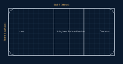

# P2-21 Lawn 4: plan

Footprint 689 ft (210 m) × 308 ft 9 in (94 m) · structural grid 32 ft 10 in (10 m)

## Levels

| Level | Floor above deck | Height | Floor area |
|---|---|---|---|
| Level 1 · Ground | 0 ft (0 mm) | 13 ft 1 in (4,000 mm) | — |

## Elements

| ID | Designation | Type | Name | Level(s) | Size / length | Area | Status |
|---|---|---|---|---|---|---|---|
| E001 | D5F6P2B17A2R1 | zone | Lawn | L1 | 295 ft 7 in (90 m) × 306 ft 9 in (94 m) | 89,369 sq ft (8,303 m²) | proposed |
| E002 | D5F6P2B17A2R2 | zone | Sitting lawn | L1 | 97 ft 5 in (30 m) × 306 ft 5 in (93 m) | 29,843 sq ft (2,772 m²) | proposed |
| E003 | D5F6P2B17A2R3 | zone | Paths and benches | L1 | 97 ft 1 in (30 m) × 306 ft 9 in (94 m) | 29,758 sq ft (2,765 m²) | proposed |
| E004 | D5F6P2B17A2R4 | zone | Tree grove | L1 | 198 ft 2 in (60 m) × 306 ft 9 in (94 m) | 59,606 sq ft (5,538 m²) | proposed |

## Drawings

### Level 1 · Ground

