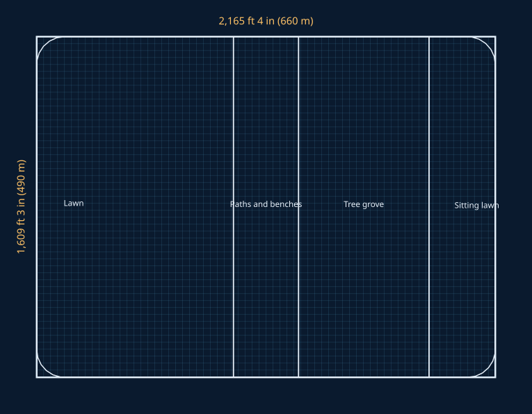

# P2-23 Lawn 5: plan

Footprint 2,165 ft 4 in (660 m) × 1,609 ft 3 in (490 m) · structural grid 32 ft 10 in (10 m)

## Levels

| Level | Floor above deck | Height | Floor area |
|---|---|---|---|
| Level 1 · Ground | 0 ft (0 mm) | 13 ft 1 in (4,000 mm) | — |

## Elements

| ID | Designation | Type | Name | Level(s) | Size / length | Area | Status |
|---|---|---|---|---|---|---|---|
| E001 | D5F6P2B1A2R1 | zone | Lawn | L1 | 928 ft 10 in (283 m) × 1,608 ft 7 in (490 m) | 1,485,015 sq ft (137,962 m²) | proposed |
| E002 | D5F6P2B1A2R2 | zone | Paths and benches | L1 | 307 ft 9 in (94 m) × 1,607 ft 11 in (490 m) | 494,832 sq ft (45,971 m²) | proposed |
| E003 | D5F6P2B1A2R3 | zone | Tree grove | L1 | 615 ft 10 in (188 m) × 1,608 ft 7 in (490 m) | 990,191 sq ft (91,992 m²) | proposed |
| E004 | D5F6P2B1A2R4 | zone | Sitting lawn | L1 | 313 ft (95 m) × 1,607 ft 11 in (490 m) | 494,828 sq ft (45,971 m²) | proposed |

## Drawings

### Level 1 · Ground

