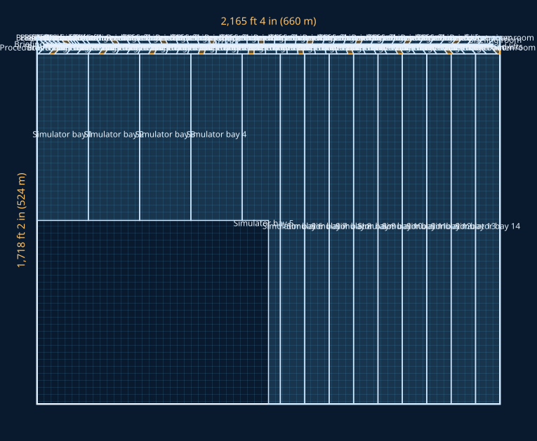
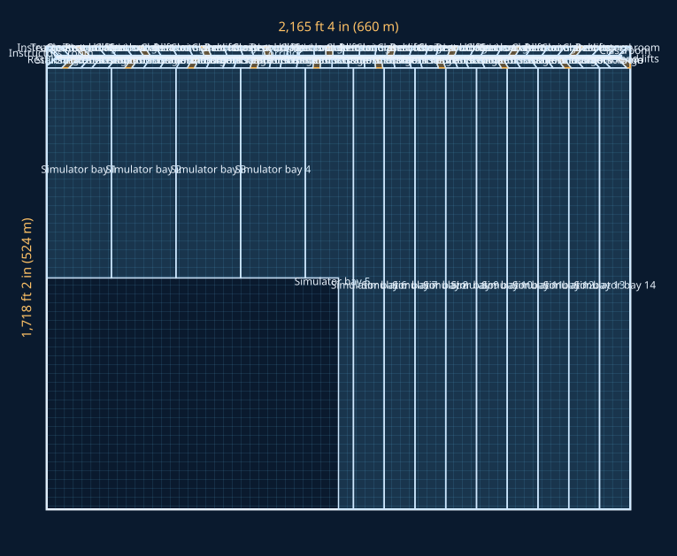

# P2-24 Simulator Annex 6: plan

Footprint 2,165 ft 4 in (660 m) × 1,718 ft 2 in (524 m) · structural grid 32 ft 10 in (10 m)

## Levels

| Level | Floor above deck | Height | Floor area |
|---|---|---|---|
| Level 1 · Hall floor | 0 ft (0 mm) | 26 ft 3 in (8,000 mm) | 2,745,027 sq ft (255,021 m²) |
| Level 2 · Gallery floor | 26 ft 3 in (8,000 mm) | 14 ft 9 in (4,500 mm) | 2,745,027 sq ft (255,021 m²) |

## Elements

| ID | Designation | Type | Name | Level(s) | Size / length | Area | Status |
|---|---|---|---|---|---|---|---|
| E001 | D5F6P2B2A2L1R1, D5F6P2B2A2L2R1 | room | Simulator bay 1 | L1, L2 | 239 ft 10 in (73 m) × 780 ft 2 in (238 m) | 187,111 sq ft (17,383 m²) | proposed |
| E002 | D5F6P2B2A2L1R2, D5F6P2B2A2L2R2 | room | Simulator bay 2 | L1, L2 | 239 ft 10 in (73 m) × 780 ft 2 in (238 m) | 187,111 sq ft (17,383 m²) | proposed |
| E003 | D5F6P2B2A2L1R3, D5F6P2B2A2L2R3 | room | Simulator bay 3 | L1, L2 | 239 ft 10 in (73 m) × 780 ft 2 in (238 m) | 187,111 sq ft (17,383 m²) | proposed |
| E004 | D5F6P2B2A2L1R4, D5F6P2B2A2L2R4 | room | Simulator bay 4 | L1, L2 | 239 ft 10 in (73 m) × 780 ft 2 in (238 m) | 187,111 sq ft (17,383 m²) | proposed |
| E005 | D5F6P2B2A2L1R5, D5F6P2B2A2L2R5 | room | Simulator bay 5 | L1, L2 | 178 ft 10 in (54 m) × 1,639 ft 5 in (500 m) | 187,144 sq ft (17,386 m²) | proposed |
| E006 | D5F6P2B2A2L1R6, D5F6P2B2A2L2R6 | room | Simulator bay 6 | L1, L2 | 114 ft 2 in (35 m) × 1,639 ft 5 in (500 m) | 187,180 sq ft (17,390 m²) | proposed |
| E007 | D5F6P2B2A2L1R7, D5F6P2B2A2L2R7 | room | Simulator bay 7 | L1, L2 | 114 ft 2 in (35 m) × 1,639 ft 5 in (500 m) | 187,180 sq ft (17,390 m²) | proposed |
| E008 | D5F6P2B2A2L1R8, D5F6P2B2A2L2R8 | room | Simulator bay 8 | L1, L2 | 114 ft 2 in (35 m) × 1,639 ft 5 in (500 m) | 187,180 sq ft (17,390 m²) | proposed |
| E009 | D5F6P2B2A2L1R9, D5F6P2B2A2L2R9 | room | Simulator bay 9 | L1, L2 | 114 ft 2 in (35 m) × 1,639 ft 5 in (500 m) | 187,180 sq ft (17,390 m²) | proposed |
| E010 | D5F6P2B2A2L1R10, D5F6P2B2A2L2R10 | room | Simulator bay 10 | L1, L2 | 113 ft 10 in (35 m) × 1,639 ft 5 in (500 m) | 186,642 sq ft (17,340 m²) | proposed |
| E011 | D5F6P2B2A2L1R11, D5F6P2B2A2L2R11 | room | Simulator bay 11 | L1, L2 | 114 ft 2 in (35 m) × 1,639 ft 5 in (500 m) | 187,180 sq ft (17,390 m²) | proposed |
| E012 | D5F6P2B2A2L1R12, D5F6P2B2A2L2R12 | room | Simulator bay 12 | L1, L2 | 114 ft 2 in (35 m) × 1,639 ft 5 in (500 m) | 187,180 sq ft (17,390 m²) | proposed |
| E013 | D5F6P2B2A2L1R13, D5F6P2B2A2L2R13 | room | Simulator bay 13 | L1, L2 | 114 ft 2 in (35 m) × 1,639 ft 5 in (500 m) | 187,180 sq ft (17,390 m²) | proposed |
| E014 | D5F6P2B2A2L1R14, D5F6P2B2A2L2R14 | room | Simulator bay 14 | L1, L2 | 114 ft 2 in (35 m) × 1,639 ft 5 in (500 m) | 187,180 sq ft (17,390 m²) | proposed |
| E015 | D5F6P2B2A2L1R15, D5F6P2B2A2L2R15 | core | Stairs and lifts | L1, L2 | 55 ft 5 in (17 m) × 32 ft 6 in (9,900 mm) | 858 sq ft (80 m²) | proposed |
| E016 | D5F6P2B2A2L1R16, D5F6P2B2A2L2R16 | core | Stairs and lifts | L1, L2 | 48 ft 3 in (15 m) × 32 ft 6 in (9,900 mm) | 853 sq ft (79 m²) | proposed |
| E017 | D5F6P2B2A2L1R17, D5F6P2B2A2L2R17 | core | Stairs and lifts | L1, L2 | 41 ft 4 in (13 m) × 32 ft 6 in (9,900 mm) | 853 sq ft (79 m²) | proposed |
| E018 | D5F6P2B2A2L1R18, D5F6P2B2A2L2R18 | core | Stairs and lifts | L1, L2 | 34 ft 1 in (10 m) × 32 ft 6 in (9,900 mm) | 853 sq ft (79 m²) | proposed |
| E019 | D5F6P2B2A2L1R19, D5F6P2B2A2L2R19 | core | Stairs and lifts | L1, L2 | 27 ft 3 in (8,300 mm) × 32 ft 6 in (9,900 mm) | 853 sq ft (79 m²) | proposed |
| E020 | D5F6P2B2A2L1R20, D5F6P2B2A2L2R20 | core | Stairs and lifts | L1, L2 | 32 ft 2 in (9,800 mm) × 32 ft 6 in (9,900 mm) | 853 sq ft (79 m²) | proposed |
| E021 | D5F6P2B2A2L1R21, D5F6P2B2A2L2R21 | core | Stairs and lifts | L1, L2 | 39 ft 1 in (12 m) × 32 ft 6 in (9,900 mm) | 853 sq ft (79 m²) | proposed |
| E022 | D5F6P2B2A2L1R22, D5F6P2B2A2L2R22 | core | Stairs and lifts | L1, L2 | 45 ft 11 in (14 m) × 32 ft 6 in (9,900 mm) | 847 sq ft (79 m²) | proposed |
| E023 | D5F6P2B2A2L1R23, D5F6P2B2A2L2R23 | core | Stairs and lifts | L1, L2 | 53 ft 2 in (16 m) × 32 ft 6 in (9,900 mm) | 853 sq ft (79 m²) | proposed |
| E024 | D5F6P2B2A2L1R24, D5F6P2B2A2L2R24 | core | Stairs and lifts | L1, L2 | 45 ft 3 in (14 m) × 36 ft 5 in (11 m) | 853 sq ft (79 m²) | proposed |
| E025 | D5F6P2B2A2L1R25, D5F6P2B2A2L2R25 | core | Stairs and lifts | L1, L2 | 51 ft 10 in (16 m) × 32 ft 6 in (9,900 mm) | 853 sq ft (79 m²) | proposed |
| E026 | D5F6P2B2A2L1R26, D5F6P2B2A2L2R26 | core | Stairs and lifts | L1, L2 | 44 ft 7 in (14 m) × 32 ft 6 in (9,900 mm) | 847 sq ft (79 m²) | proposed |
| E027 | D5F6P2B2A2L1R27, D5F6P2B2A2L2R27 | core | Stairs and lifts | L1, L2 | 37 ft 9 in (12 m) × 32 ft 6 in (9,900 mm) | 853 sq ft (79 m²) | proposed |
| E028 | D5F6P2B2A2L1R28, D5F6P2B2A2L2R28 | core | Stairs and lifts | L1, L2 | 30 ft 6 in (9,300 mm) × 32 ft 6 in (9,900 mm) | 847 sq ft (79 m²) | proposed |
| E029 | D5F6P2B2A2L1R29, D5F6P2B2A2L2R29 | core | Stairs and lifts | L1, L2 | 28 ft 10 in (8,800 mm) × 32 ft 6 in (9,900 mm) | 858 sq ft (80 m²) | proposed |
| E030 | D5F6P2B2A2L1R30, D5F6P2B2A2L2R30 | core | Stairs and lifts | L1, L2 | 35 ft 9 in (11 m) × 32 ft 6 in (9,900 mm) | 858 sq ft (80 m²) | proposed |
| E031 | D5F6P2B2A2L1R31, D5F6P2B2A2L2R31 | core | Stairs and lifts | L1, L2 | 42 ft 8 in (13 m) × 32 ft 6 in (9,900 mm) | 853 sq ft (79 m²) | proposed |
| E032 | D5F6P2B2A2L1R32, D5F6P2B2A2L2R32 | core | Stairs and lifts | L1, L2 | 49 ft 6 in (15 m) × 32 ft 6 in (9,900 mm) | 853 sq ft (79 m²) | proposed |
| E033 | D5F6P2B2A2L1R33, D5F6P2B2A2L2R33 | core | Stairs and lifts | L1, L2 | 56 ft 9 in (17 m) × 32 ft 6 in (9,900 mm) | 853 sq ft (79 m²) | proposed |
| E034 | D5F6P2B2A2L1R34 | zone | Corridor | L1 | 2,100 ft 5 in (640 m) × 13 ft 9 in (4,200 mm) | 20,712 sq ft (1,924 m²) | proposed |
| E035 | D5F6P2B2A2L1R35 | room | Briefing room | L1 | 52 ft 2 in (16 m) × 32 ft 6 in (9,900 mm) | 650 sq ft (60 m²) | proposed |
| E036 | D5F6P2B2A2L1R36 | room | Briefing room | L1 | 51 ft 2 in (16 m) × 32 ft 6 in (9,900 mm) | 639 sq ft (59 m²) | proposed |
| E037 | D5F6P2B2A2L1R37 | room | Briefing room | L1 | 50 ft 10 in (16 m) × 32 ft 6 in (9,900 mm) | 650 sq ft (60 m²) | proposed |
| E038 | D5F6P2B2A2L1R38 | room | Briefing room | L1 | 50 ft 2 in (15 m) × 32 ft 6 in (9,900 mm) | 645 sq ft (60 m²) | proposed |
| E039 | D5F6P2B2A2L1R39 | room | Debrief room | L1 | 51 ft 10 in (16 m) × 32 ft 6 in (9,900 mm) | 714 sq ft (66 m²) | proposed |
| E040 | D5F6P2B2A2L1R40 | room | Debrief room | L1 | 41 ft 4 in (13 m) × 32 ft 6 in (9,900 mm) | 426 sq ft (40 m²) | proposed |
| E041 | D5F6P2B2A2L1R41 | room | Debrief room | L1 | 41 ft (12 m) × 32 ft 6 in (9,900 mm) | 432 sq ft (40 m²) | proposed |
| E042 | D5F6P2B2A2L1R42 | room | Debrief room | L1 | 40 ft 8 in (12 m) × 32 ft 6 in (9,900 mm) | 432 sq ft (40 m²) | proposed |
| E043 | D5F6P2B2A2L1R43 | room | Locker room | L1 | 56 ft 9 in (17 m) × 32 ft 6 in (9,900 mm) | 970 sq ft (90 m²) | proposed |
| E044 | D5F6P2B2A2L1R44 | room | Toilets | L1 | 45 ft 11 in (14 m) × 32 ft 6 in (9,900 mm) | 645 sq ft (60 m²) | proposed |
| E045 | D5F6P2B2A2L1R45 | room | Procedures trainer room | L1 | 74 ft 10 in (23 m) × 32 ft 6 in (9,900 mm) | 1,620 sq ft (150 m²) | proposed |
| E046 | D5F6P2B2A2L1R46 | room | Briefing room | L1 | 86 ft 11 in (26 m) × 32 ft 6 in (9,900 mm) | 2,067 sq ft (192 m²) | proposed |
| E047 | D5F6P2B2A2L1R47 | room | Procedures trainer room | L1 | 70 ft 6 in (22 m) × 32 ft 6 in (9,900 mm) | 1,614 sq ft (150 m²) | proposed |
| E048 | D5F6P2B2A2L1R48 | room | Briefing room | L1 | 69 ft 3 in (21 m) × 32 ft 6 in (9,900 mm) | 1,620 sq ft (150 m²) | proposed |
| E049 | D5F6P2B2A2L1R49 | room | Procedures trainer room | L1 | 67 ft 7 in (21 m) × 32 ft 6 in (9,900 mm) | 1,614 sq ft (150 m²) | proposed |
| E050 | D5F6P2B2A2L1R50 | room | Briefing room | L1 | 70 ft 3 in (21 m) × 32 ft 6 in (9,900 mm) | 1,753 sq ft (163 m²) | proposed |
| E051 | D5F6P2B2A2L1R51 | room | Procedures trainer room | L1 | 63 ft 8 in (19 m) × 32 ft 6 in (9,900 mm) | 1,614 sq ft (150 m²) | proposed |
| E052 | D5F6P2B2A2L1R52 | room | Briefing room | L1 | 62 ft (19 m) × 32 ft 6 in (9,900 mm) | 1,614 sq ft (150 m²) | proposed |
| E053 | D5F6P2B2A2L1R53 | room | Procedures trainer room | L1 | 60 ft 8 in (18 m) × 32 ft 6 in (9,900 mm) | 1,620 sq ft (150 m²) | proposed |
| E054 | D5F6P2B2A2L1R54 | room | Briefing room | L1 | 63 ft (19 m) × 32 ft 6 in (9,900 mm) | 1,748 sq ft (162 m²) | proposed |
| E055 | D5F6P2B2A2L1R55 | room | Procedures trainer room | L1 | 56 ft 9 in (17 m) × 32 ft 6 in (9,900 mm) | 1,620 sq ft (150 m²) | proposed |
| E056 | D5F6P2B2A2L1R56 | room | Briefing room | L1 | 55 ft 1 in (17 m) × 32 ft 6 in (9,900 mm) | 1,614 sq ft (150 m²) | proposed |
| E057 | D5F6P2B2A2L1R57 | room | Procedures trainer room | L1 | 53 ft 6 in (16 m) × 32 ft 6 in (9,900 mm) | 1,614 sq ft (150 m²) | proposed |
| E058 | D5F6P2B2A2L1R58 | room | Briefing room | L1 | 56 ft 1 in (17 m) × 32 ft 6 in (9,900 mm) | 1,753 sq ft (163 m²) | proposed |
| E059 | D5F6P2B2A2L1R59 | room | Procedures trainer room | L1 | 50 ft 6 in (15 m) × 32 ft 6 in (9,900 mm) | 1,614 sq ft (150 m²) | proposed |
| E060 | D5F6P2B2A2L1R60 | room | Briefing room | L1 | 51 ft 6 in (16 m) × 32 ft 6 in (9,900 mm) | 1,620 sq ft (150 m²) | proposed |
| E061 | D5F6P2B2A2L1R61 | room | Procedures trainer room | L1 | 52 ft 10 in (16 m) × 32 ft 6 in (9,900 mm) | 1,614 sq ft (150 m²) | proposed |
| E062 | D5F6P2B2A2L1R62 | room | Briefing room | L1 | 58 ft 5 in (18 m) × 32 ft 6 in (9,900 mm) | 1,748 sq ft (162 m²) | proposed |
| E063 | D5F6P2B2A2L1R63 | room | Procedures trainer room | L1 | 57 ft 1 in (17 m) × 32 ft 6 in (9,900 mm) | 1,620 sq ft (150 m²) | proposed |
| E064 | D5F6P2B2A2L1R64 | room | Briefing room | L1 | 58 ft 5 in (18 m) × 32 ft 6 in (9,900 mm) | 1,614 sq ft (150 m²) | proposed |
| E065 | D5F6P2B2A2L1R65 | room | Procedures trainer room | L1 | 60 ft (18 m) × 32 ft 6 in (9,900 mm) | 1,614 sq ft (150 m²) | proposed |
| E066 | D5F6P2B2A2L1R66 | room | Briefing room | L1 | 65 ft 7 in (20 m) × 32 ft 6 in (9,900 mm) | 1,748 sq ft (162 m²) | proposed |
| E067 | D5F6P2B2A2L1R67 | room | Procedures trainer room | L1 | 63 ft 8 in (19 m) × 32 ft 6 in (9,900 mm) | 1,614 sq ft (150 m²) | proposed |
| E068 | D5F6P2B2A2L1R68 | room | Briefing room | L1 | 65 ft 3 in (20 m) × 32 ft 6 in (9,900 mm) | 1,620 sq ft (150 m²) | proposed |
| E069 | D5F6P2B2A2L1R69 | room | Procedures trainer room | L1 | 66 ft 7 in (20 m) × 32 ft 6 in (9,900 mm) | 1,614 sq ft (150 m²) | proposed |
| E070 | D5F6P2B2A2L1R70 | room | Briefing room | L1 | 72 ft 6 in (22 m) × 32 ft 6 in (9,900 mm) | 1,753 sq ft (163 m²) | proposed |
| E071 | D5F6P2B2A2L1R71 | room | Procedures trainer room | L1 | 70 ft 10 in (22 m) × 32 ft 6 in (9,900 mm) | 1,620 sq ft (150 m²) | proposed |
| E072 | D5F6P2B2A2L1R72 | room | Briefing room | L1 | 72 ft 2 in (22 m) × 32 ft 6 in (9,900 mm) | 1,614 sq ft (150 m²) | proposed |
| E073 | D5F6P2B2A2L1R73 | room | Procedures trainer room | L1 | 73 ft 10 in (22 m) × 32 ft 6 in (9,900 mm) | 1,620 sq ft (150 m²) | proposed |
| E074 | D5F6P2B2A2L1R74 | room | Briefing room | L1 | 79 ft 5 in (24 m) × 32 ft 6 in (9,900 mm) | 1,748 sq ft (162 m²) | proposed |
| E075 | D5F6P2B2A2L1R75 | room | Procedures trainer room | L1 | 77 ft 9 in (24 m) × 32 ft 6 in (9,900 mm) | 1,614 sq ft (150 m²) | proposed |
| E076 | D5F6P2B2A2L1R76 | room | Briefing room | L1 | 79 ft 5 in (24 m) × 32 ft 6 in (9,900 mm) | 1,620 sq ft (150 m²) | proposed |
| E077 | D5F6P2B2A2L1R77 | room | Procedures trainer room | L1 | 80 ft 9 in (25 m) × 32 ft 6 in (9,900 mm) | 1,614 sq ft (150 m²) | proposed |
| E078 | D5F6P2B2A2L1R78 | room | Briefing room | L1 | 52 ft 10 in (16 m) × 56 ft 5 in (17 m) | 1,748 sq ft (162 m²) | proposed |
| E079 | D5F6P2B2A2L1R79 | room | Procedures trainer room | L1 | 81 ft (25 m) × 32 ft 6 in (9,900 mm) | 1,620 sq ft (150 m²) | proposed |
| E080 | D5F6P2B2A2L1R80 | room | Briefing room | L1 | 79 ft 5 in (24 m) × 32 ft 6 in (9,900 mm) | 1,614 sq ft (150 m²) | proposed |
| E081 | D5F6P2B2A2L1R81 | room | Procedures trainer room | L1 | 77 ft 9 in (24 m) × 32 ft 6 in (9,900 mm) | 1,614 sq ft (150 m²) | proposed |
| E082 | D5F6P2B2A2L1R82 | room | Briefing room | L1 | 80 ft 5 in (24 m) × 32 ft 6 in (9,900 mm) | 1,748 sq ft (162 m²) | proposed |
| E083 | D5F6P2B2A2L1R83 | room | Procedures trainer room | L1 | 74 ft 2 in (23 m) × 32 ft 6 in (9,900 mm) | 1,614 sq ft (150 m²) | proposed |
| E084 | D5F6P2B2A2L1R84 | room | Briefing room | L1 | 72 ft 10 in (22 m) × 32 ft 6 in (9,900 mm) | 1,620 sq ft (150 m²) | proposed |
| E085 | D5F6P2B2A2L1R85 | room | Procedures trainer room | L1 | 71 ft 2 in (22 m) × 32 ft 6 in (9,900 mm) | 1,614 sq ft (150 m²) | proposed |
| E086 | D5F6P2B2A2L1R86 | room | Briefing room | L1 | 73 ft 10 in (22 m) × 32 ft 6 in (9,900 mm) | 1,753 sq ft (163 m²) | proposed |
| E087 | D5F6P2B2A2L1R87 | room | Procedures trainer room | L1 | 67 ft 3 in (20 m) × 32 ft 6 in (9,900 mm) | 1,620 sq ft (150 m²) | proposed |
| E088 | D5F6P2B2A2L1R88 | room | Briefing room | L1 | 65 ft 7 in (20 m) × 32 ft 6 in (9,900 mm) | 1,614 sq ft (150 m²) | proposed |
| E089 | D5F6P2B2A2L1R89 | room | Procedures trainer room | L1 | 64 ft 4 in (20 m) × 32 ft 6 in (9,900 mm) | 1,620 sq ft (150 m²) | proposed |
| E090 | D5F6P2B2A2L1R90 | room | Briefing room | L1 | 66 ft 7 in (20 m) × 32 ft 6 in (9,900 mm) | 1,748 sq ft (162 m²) | proposed |
| E091 | D5F6P2B2A2L1R91 | room | Procedures trainer room | L1 | 60 ft (18 m) × 32 ft 6 in (9,900 mm) | 1,614 sq ft (150 m²) | proposed |
| E092 | D5F6P2B2A2L1R92 | room | Briefing room | L1 | 58 ft 9 in (18 m) × 32 ft 6 in (9,900 mm) | 1,620 sq ft (150 m²) | proposed |
| E093 | D5F6P2B2A2L1R93 | room | Procedures trainer room | L1 | 57 ft 1 in (17 m) × 32 ft 6 in (9,900 mm) | 1,614 sq ft (150 m²) | proposed |
| E094 | D5F6P2B2A2L1R94 | room | Briefing room | L1 | 59 ft 9 in (18 m) × 32 ft 6 in (9,900 mm) | 1,753 sq ft (163 m²) | proposed |
| E095 | D5F6P2B2A2L1R95 | room | Procedures trainer room | L1 | 53 ft 2 in (16 m) × 32 ft 6 in (9,900 mm) | 1,620 sq ft (150 m²) | proposed |
| E096 | D5F6P2B2A2L1R96 | room | Briefing room | L1 | 51 ft 6 in (16 m) × 32 ft 6 in (9,900 mm) | 1,614 sq ft (150 m²) | proposed |
| E097 | D5F6P2B2A2L1R97 | room | Procedures trainer room | L1 | 50 ft 6 in (15 m) × 32 ft 6 in (9,900 mm) | 1,620 sq ft (150 m²) | proposed |
| E098 | D5F6P2B2A2L1R98 | room | Briefing room | L1 | 54 ft 9 in (17 m) × 32 ft 6 in (9,900 mm) | 1,742 sq ft (162 m²) | proposed |
| E099 | D5F6P2B2A2L1R99 | room | Procedures trainer room | L1 | 53 ft 6 in (16 m) × 32 ft 6 in (9,900 mm) | 1,614 sq ft (150 m²) | proposed |
| E100 | D5F6P2B2A2L1R100 | room | Briefing room | L1 | 55 ft 1 in (17 m) × 32 ft 6 in (9,900 mm) | 1,620 sq ft (150 m²) | proposed |
| E101 | D5F6P2B2A2L1R101 | room | Procedures trainer room | L1 | 56 ft 5 in (17 m) × 32 ft 6 in (9,900 mm) | 1,614 sq ft (150 m²) | proposed |
| E102 | D5F6P2B2A2L1R102 | room | Briefing room | L1 | 62 ft (19 m) × 32 ft 6 in (9,900 mm) | 1,748 sq ft (162 m²) | proposed |
| E103 | D5F6P2B2A2L1R103 | room | Procedures trainer room | L1 | 60 ft 4 in (18 m) × 32 ft 6 in (9,900 mm) | 1,614 sq ft (150 m²) | proposed |
| E104 | D5F6P2B2A2L1R104 | room | Briefing room | L1 | 62 ft (19 m) × 32 ft 6 in (9,900 mm) | 1,614 sq ft (150 m²) | proposed |
| E105 | D5F6P2B2A2L1R105 | room | Procedures trainer room | L1 | 63 ft 8 in (19 m) × 32 ft 6 in (9,900 mm) | 1,620 sq ft (150 m²) | proposed |
| E106 | D5F6P2B2A2L1R106 | room | Briefing room | L1 | 68 ft 11 in (21 m) × 32 ft 6 in (9,900 mm) | 1,742 sq ft (162 m²) | proposed |
| E107 | D5F6P2B2A2L1R107 | room | Procedures trainer room | L1 | 67 ft 3 in (20 m) × 32 ft 6 in (9,900 mm) | 1,614 sq ft (150 m²) | proposed |
| E108 | D5F6P2B2A2L1R108 | room | Briefing room | L1 | 68 ft 11 in (21 m) × 32 ft 6 in (9,900 mm) | 1,620 sq ft (150 m²) | proposed |
| E109 | D5F6P2B2A2L1R109 | room | Procedures trainer room | L1 | 70 ft 3 in (21 m) × 32 ft 6 in (9,900 mm) | 1,614 sq ft (150 m²) | proposed |
| E110 | D5F6P2B2A2L1R110 | room | Briefing room | L1 | 76 ft 1 in (23 m) × 32 ft 6 in (9,900 mm) | 1,753 sq ft (163 m²) | proposed |
| E111 | D5F6P2B2A2L1R111 | room | Procedures trainer room | L1 | 74 ft 2 in (23 m) × 32 ft 6 in (9,900 mm) | 1,614 sq ft (150 m²) | proposed |
| E112 | D5F6P2B2A2L1R112 | room | Briefing room | L1 | 75 ft 9 in (23 m) × 32 ft 6 in (9,900 mm) | 1,614 sq ft (150 m²) | proposed |
| E113 | D5F6P2B2A2L1R113 | room | Procedures trainer room | L1 | 77 ft 5 in (24 m) × 32 ft 6 in (9,900 mm) | 1,620 sq ft (150 m²) | proposed |
| E114 | D5F6P2B2A2L1R114 | room | Briefing room | L1 | 83 ft (25 m) × 32 ft 6 in (9,900 mm) | 1,748 sq ft (162 m²) | proposed |
| E115 | D5F6P2B2A2L1R115 | room | Procedures trainer room | L1 | 81 ft 4 in (25 m) × 32 ft 6 in (9,900 mm) | 1,620 sq ft (150 m²) | proposed |
| E116 | D5F6P2B2A2L1R116 | room | Briefing room | L1 | 37 ft 9 in (12 m) × 78 ft 9 in (24 m) | 1,678 sq ft (156 m²) | proposed |
| E117 | D5F6P2B2A2L2R34 | zone | Corridor | L2 | 2,100 ft 5 in (640 m) × 13 ft 9 in (4,200 mm) | 20,712 sq ft (1,924 m²) | proposed |
| E118 | D5F6P2B2A2L2R35 | room | Tea point | L2 | 43 ft 8 in (13 m) × 32 ft 6 in (9,900 mm) | 368 sq ft (34 m²) | proposed |
| E119 | D5F6P2B2A2L2R36 | room | Instructors' room | L2 | 71 ft 2 in (22 m) × 32 ft 6 in (9,900 mm) | 1,289 sq ft (120 m²) | proposed |
| E120 | D5F6P2B2A2L2R37 | room | Classroom | L2 | 80 ft 9 in (25 m) × 32 ft 6 in (9,900 mm) | 1,641 sq ft (152 m²) | proposed |
| E121 | D5F6P2B2A2L2R38 | room | Rest lounge | L2 | 87 ft 3 in (27 m) × 32 ft 6 in (9,900 mm) | 1,934 sq ft (180 m²) | proposed |
| E122 | D5F6P2B2A2L2R39 | room | Instructors' room | L2 | 65 ft 11 in (20 m) × 32 ft 6 in (9,900 mm) | 1,295 sq ft (120 m²) | proposed |
| E123 | D5F6P2B2A2L2R40 | room | Classroom | L2 | 84 ft 4 in (26 m) × 32 ft 6 in (9,900 mm) | 1,939 sq ft (180 m²) | proposed |
| E124 | D5F6P2B2A2L2R41 | room | Rest lounge | L2 | 66 ft 11 in (20 m) × 32 ft 6 in (9,900 mm) | 1,423 sq ft (132 m²) | proposed |
| E125 | D5F6P2B2A2L2R42 | room | Instructors' room | L2 | 61 ft (19 m) × 32 ft 6 in (9,900 mm) | 1,300 sq ft (121 m²) | proposed |
| E126 | D5F6P2B2A2L2R43 | room | Classroom | L2 | 79 ft 1 in (24 m) × 32 ft 6 in (9,900 mm) | 1,934 sq ft (180 m²) | proposed |
| E127 | D5F6P2B2A2L2R44 | room | Rest lounge | L2 | 77 ft 5 in (24 m) × 32 ft 6 in (9,900 mm) | 1,939 sq ft (180 m²) | proposed |
| E128 | D5F6P2B2A2L2R45 | room | Instructors' room | L2 | 60 ft (18 m) × 32 ft 6 in (9,900 mm) | 1,428 sq ft (133 m²) | proposed |
| E129 | D5F6P2B2A2L2R46 | room | Classroom | L2 | 73 ft 6 in (22 m) × 32 ft 6 in (9,900 mm) | 1,939 sq ft (180 m²) | proposed |
| E130 | D5F6P2B2A2L2R47 | room | Rest lounge | L2 | 71 ft 6 in (22 m) × 32 ft 6 in (9,900 mm) | 1,939 sq ft (180 m²) | proposed |
| E131 | D5F6P2B2A2L2R48 | room | Instructors' room | L2 | 50 ft 2 in (15 m) × 32 ft 6 in (9,900 mm) | 1,295 sq ft (120 m²) | proposed |
| E132 | D5F6P2B2A2L2R49 | room | Classroom | L2 | 52 ft 10 in (16 m) × 32 ft 6 in (9,900 mm) | 1,423 sq ft (132 m²) | proposed |
| E133 | D5F6P2B2A2L2R50 | room | Rest lounge | L2 | 66 ft 3 in (20 m) × 32 ft 6 in (9,900 mm) | 1,939 sq ft (180 m²) | proposed |
| E134 | D5F6P2B2A2L2R51 | room | Instructors' room | L2 | 44 ft 11 in (14 m) × 32 ft 6 in (9,900 mm) | 1,295 sq ft (120 m²) | proposed |
| E135 | D5F6P2B2A2L2R52 | room | Classroom | L2 | 63 ft 4 in (19 m) × 32 ft 6 in (9,900 mm) | 1,939 sq ft (180 m²) | proposed |
| E136 | D5F6P2B2A2L2R53 | room | Rest lounge | L2 | 45 ft 11 in (14 m) × 32 ft 6 in (9,900 mm) | 1,428 sq ft (133 m²) | proposed |
| E137 | D5F6P2B2A2L2R54 | room | Instructors' room | L2 | 40 ft 4 in (12 m) × 32 ft 6 in (9,900 mm) | 1,289 sq ft (120 m²) | proposed |
| E138 | D5F6P2B2A2L2R55 | room | Classroom | L2 | 61 ft 4 in (19 m) × 32 ft 6 in (9,900 mm) | 1,945 sq ft (181 m²) | proposed |
| E139 | D5F6P2B2A2L2R56 | room | Rest lounge | L2 | 63 ft (19 m) × 32 ft 6 in (9,900 mm) | 1,939 sq ft (180 m²) | proposed |
| E140 | D5F6P2B2A2L2R57 | room | Instructors' room | L2 | 48 ft 7 in (15 m) × 32 ft 6 in (9,900 mm) | 1,423 sq ft (132 m²) | proposed |
| E141 | D5F6P2B2A2L2R58 | room | Classroom | L2 | 66 ft 11 in (20 m) × 32 ft 6 in (9,900 mm) | 1,939 sq ft (180 m²) | proposed |
| E142 | D5F6P2B2A2L2R59 | room | Rest lounge | L2 | 68 ft 7 in (21 m) × 32 ft 6 in (9,900 mm) | 1,939 sq ft (180 m²) | proposed |
| E143 | D5F6P2B2A2L2R60 | room | Instructors' room | L2 | 50 ft 2 in (15 m) × 32 ft 6 in (9,900 mm) | 1,289 sq ft (120 m²) | proposed |
| E144 | D5F6P2B2A2L2R61 | room | Classroom | L2 | 55 ft 9 in (17 m) × 32 ft 6 in (9,900 mm) | 1,428 sq ft (133 m²) | proposed |
| E145 | D5F6P2B2A2L2R62 | room | Rest lounge | L2 | 73 ft 10 in (22 m) × 32 ft 6 in (9,900 mm) | 1,939 sq ft (180 m²) | proposed |
| E146 | D5F6P2B2A2L2R63 | room | Instructors' room | L2 | 55 ft 5 in (17 m) × 32 ft 6 in (9,900 mm) | 1,295 sq ft (120 m²) | proposed |
| E147 | D5F6P2B2A2L2R64 | room | Classroom | L2 | 76 ft 9 in (23 m) × 32 ft 6 in (9,900 mm) | 1,939 sq ft (180 m²) | proposed |
| E148 | D5F6P2B2A2L2R65 | room | Rest lounge | L2 | 62 ft 8 in (19 m) × 32 ft 6 in (9,900 mm) | 1,428 sq ft (133 m²) | proposed |
| E149 | D5F6P2B2A2L2R66 | room | Instructors' room | L2 | 60 ft 8 in (18 m) × 32 ft 6 in (9,900 mm) | 1,295 sq ft (120 m²) | proposed |
| E150 | D5F6P2B2A2L2R67 | room | Classroom | L2 | 82 ft (25 m) × 32 ft 6 in (9,900 mm) | 1,939 sq ft (180 m²) | proposed |
| E151 | D5F6P2B2A2L2R68 | room | Rest lounge | L2 | 84 ft (26 m) × 32 ft 6 in (9,900 mm) | 1,939 sq ft (180 m²) | proposed |
| E152 | D5F6P2B2A2L2R69 | room | Instructors' room | L2 | 69 ft 11 in (21 m) × 32 ft 6 in (9,900 mm) | 1,428 sq ft (133 m²) | proposed |
| E153 | D5F6P2B2A2L2R70 | room | Classroom | L2 | 87 ft 11 in (27 m) × 32 ft 6 in (9,900 mm) | 1,939 sq ft (180 m²) | proposed |
| E154 | D5F6P2B2A2L2R71 | room | Rest lounge | L2 | 89 ft 11 in (27 m) × 32 ft 6 in (9,900 mm) | 1,939 sq ft (180 m²) | proposed |
| E155 | D5F6P2B2A2L2R72 | room | Instructors' room | L2 | 71 ft 6 in (22 m) × 32 ft 6 in (9,900 mm) | 1,295 sq ft (120 m²) | proposed |
| E156 | D5F6P2B2A2L2R73 | room | Classroom | L2 | 43 ft (13 m) × 56 ft 5 in (17 m) | 1,423 sq ft (132 m²) | proposed |
| E157 | D5F6P2B2A2L2R74 | room | Rest lounge | L2 | 90 ft 11 in (28 m) × 32 ft 6 in (9,900 mm) | 1,939 sq ft (180 m²) | proposed |
| E158 | D5F6P2B2A2L2R75 | room | Instructors' room | L2 | 69 ft 7 in (21 m) × 32 ft 6 in (9,900 mm) | 1,295 sq ft (120 m²) | proposed |
| E159 | D5F6P2B2A2L2R76 | room | Classroom | L2 | 87 ft 7 in (27 m) × 32 ft 6 in (9,900 mm) | 1,934 sq ft (180 m²) | proposed |
| E160 | D5F6P2B2A2L2R77 | room | Rest lounge | L2 | 70 ft 6 in (22 m) × 32 ft 6 in (9,900 mm) | 1,428 sq ft (133 m²) | proposed |
| E161 | D5F6P2B2A2L2R78 | room | Instructors' room | L2 | 64 ft 4 in (20 m) × 32 ft 6 in (9,900 mm) | 1,295 sq ft (120 m²) | proposed |
| E162 | D5F6P2B2A2L2R79 | room | Classroom | L2 | 82 ft 8 in (25 m) × 32 ft 6 in (9,900 mm) | 1,939 sq ft (180 m²) | proposed |
| E163 | D5F6P2B2A2L2R80 | room | Rest lounge | L2 | 81 ft (25 m) × 32 ft 6 in (9,900 mm) | 1,939 sq ft (180 m²) | proposed |
| E164 | D5F6P2B2A2L2R81 | room | Instructors' room | L2 | 63 ft 8 in (19 m) × 32 ft 6 in (9,900 mm) | 1,428 sq ft (133 m²) | proposed |
| E165 | D5F6P2B2A2L2R82 | room | Classroom | L2 | 77 ft 1 in (24 m) × 32 ft 6 in (9,900 mm) | 1,945 sq ft (181 m²) | proposed |
| E166 | D5F6P2B2A2L2R83 | room | Rest lounge | L2 | 75 ft 2 in (23 m) × 32 ft 6 in (9,900 mm) | 1,939 sq ft (180 m²) | proposed |
| E167 | D5F6P2B2A2L2R84 | room | Instructors' room | L2 | 53 ft 6 in (16 m) × 32 ft 6 in (9,900 mm) | 1,289 sq ft (120 m²) | proposed |
| E168 | D5F6P2B2A2L2R85 | room | Classroom | L2 | 56 ft 5 in (17 m) × 32 ft 6 in (9,900 mm) | 1,428 sq ft (133 m²) | proposed |
| E169 | D5F6P2B2A2L2R86 | room | Rest lounge | L2 | 69 ft 11 in (21 m) × 32 ft 6 in (9,900 mm) | 1,939 sq ft (180 m²) | proposed |
| E170 | D5F6P2B2A2L2R87 | room | Instructors' room | L2 | 48 ft 7 in (15 m) × 32 ft 6 in (9,900 mm) | 1,295 sq ft (120 m²) | proposed |
| E171 | D5F6P2B2A2L2R88 | room | Classroom | L2 | 66 ft 11 in (20 m) × 32 ft 6 in (9,900 mm) | 1,939 sq ft (180 m²) | proposed |
| E172 | D5F6P2B2A2L2R89 | room | Rest lounge | L2 | 49 ft 6 in (15 m) × 32 ft 6 in (9,900 mm) | 1,428 sq ft (133 m²) | proposed |
| E173 | D5F6P2B2A2L2R90 | room | Instructors' room | L2 | 43 ft 4 in (13 m) × 32 ft 6 in (9,900 mm) | 1,295 sq ft (120 m²) | proposed |
| E174 | D5F6P2B2A2L2R91 | room | Classroom | L2 | 61 ft 8 in (19 m) × 32 ft 6 in (9,900 mm) | 1,939 sq ft (180 m²) | proposed |
| E175 | D5F6P2B2A2L2R92 | room | Rest lounge | L2 | 60 ft 8 in (18 m) × 32 ft 6 in (9,900 mm) | 1,939 sq ft (180 m²) | proposed |
| E176 | D5F6P2B2A2L2R93 | room | Instructors' room | L2 | 45 ft 3 in (14 m) × 32 ft 6 in (9,900 mm) | 1,423 sq ft (132 m²) | proposed |
| E177 | D5F6P2B2A2L2R94 | room | Classroom | L2 | 63 ft 4 in (19 m) × 32 ft 6 in (9,900 mm) | 1,934 sq ft (180 m²) | proposed |
| E178 | D5F6P2B2A2L2R95 | room | Rest lounge | L2 | 65 ft 3 in (20 m) × 32 ft 6 in (9,900 mm) | 1,945 sq ft (181 m²) | proposed |
| E179 | D5F6P2B2A2L2R96 | room | Instructors' room | L2 | 46 ft 7 in (14 m) × 32 ft 6 in (9,900 mm) | 1,289 sq ft (120 m²) | proposed |
| E180 | D5F6P2B2A2L2R97 | room | Classroom | L2 | 52 ft 2 in (16 m) × 32 ft 6 in (9,900 mm) | 1,428 sq ft (133 m²) | proposed |
| E181 | D5F6P2B2A2L2R98 | room | Rest lounge | L2 | 70 ft 3 in (21 m) × 32 ft 6 in (9,900 mm) | 1,934 sq ft (180 m²) | proposed |
| E182 | D5F6P2B2A2L2R99 | room | Instructors' room | L2 | 52 ft 2 in (16 m) × 32 ft 6 in (9,900 mm) | 1,295 sq ft (120 m²) | proposed |
| E183 | D5F6P2B2A2L2R100 | room | Classroom | L2 | 73 ft 6 in (22 m) × 32 ft 6 in (9,900 mm) | 1,939 sq ft (180 m²) | proposed |
| E184 | D5F6P2B2A2L2R101 | room | Rest lounge | L2 | 59 ft 1 in (18 m) × 32 ft 6 in (9,900 mm) | 1,423 sq ft (132 m²) | proposed |
| E185 | D5F6P2B2A2L2R102 | room | Instructors' room | L2 | 57 ft 5 in (18 m) × 32 ft 6 in (9,900 mm) | 1,300 sq ft (121 m²) | proposed |
| E186 | D5F6P2B2A2L2R103 | room | Classroom | L2 | 78 ft 5 in (24 m) × 32 ft 6 in (9,900 mm) | 1,934 sq ft (180 m²) | proposed |
| E187 | D5F6P2B2A2L2R104 | room | Rest lounge | L2 | 80 ft 5 in (25 m) × 32 ft 6 in (9,900 mm) | 1,939 sq ft (180 m²) | proposed |
| E188 | D5F6P2B2A2L2R105 | room | Instructors' room | L2 | 66 ft 3 in (20 m) × 32 ft 6 in (9,900 mm) | 1,428 sq ft (133 m²) | proposed |
| E189 | D5F6P2B2A2L2R106 | room | Classroom | L2 | 84 ft 4 in (26 m) × 32 ft 6 in (9,900 mm) | 1,939 sq ft (180 m²) | proposed |
| E190 | D5F6P2B2A2L2R107 | room | Rest lounge | L2 | 86 ft 3 in (26 m) × 32 ft 6 in (9,900 mm) | 1,939 sq ft (180 m²) | proposed |
| E191 | D5F6P2B2A2L2R108 | room | Instructors' room | L2 | 67 ft 11 in (21 m) × 32 ft 6 in (9,900 mm) | 1,295 sq ft (120 m²) | proposed |
| E192 | D5F6P2B2A2L2R109 | room | Classroom | L2 | 73 ft 2 in (22 m) × 32 ft 6 in (9,900 mm) | 1,423 sq ft (132 m²) | proposed |
| E193 | D5F6P2B2A2L2R110 | room | Rest lounge | L2 | 86 ft 11 in (26 m) × 33 ft 10 in (10 m) | 1,939 sq ft (180 m²) | proposed |
| E194 | D5F6P2B2A2L2R111 | room | Instructors' room | L2 | 32 ft 6 in (9,900 mm) × 71 ft 2 in (22 m) | 1,359 sq ft (126 m²) | proposed |

## Drawings

### Level 1 · Hall floor

### Level 2 · Gallery floor

