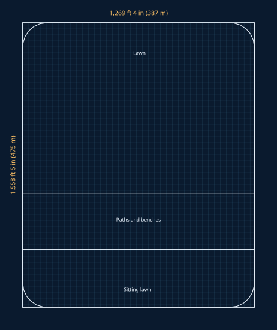

# P2-25 Lawn 6: plan

Footprint 1,269 ft 4 in (387 m) × 1,558 ft 5 in (475 m) · structural grid 32 ft 10 in (10 m)

## Levels

| Level | Floor above deck | Height | Floor area |
|---|---|---|---|
| Level 1 · Ground | 0 ft (0 mm) | 13 ft 1 in (4,000 mm) | — |

## Elements

| ID | Designation | Type | Name | Level(s) | Size / length | Area | Status |
|---|---|---|---|---|---|---|---|
| E001 | D5F6P2B3A2R1 | zone | Lawn | L1 | 1,268 ft 8 in (387 m) × 933 ft 9 in (285 m) | 1,175,808 sq ft (109,236 m²) | proposed |
| E002 | D5F6P2B3A2R2 | zone | Paths and benches | L1 | 1,268 ft 4 in (387 m) × 309 ft 1 in (94 m) | 391,896 sq ft (36,408 m²) | proposed |
| E003 | D5F6P2B3A2R3 | zone | Sitting lawn | L1 | 1,268 ft 4 in (387 m) × 315 ft 7 in (96 m) | 392,003 sq ft (36,418 m²) | proposed |

## Drawings

### Level 1 · Ground

