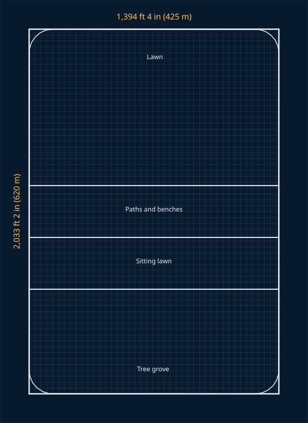

# P2-27 Lawn 7: plan

Footprint 1,394 ft 4 in (425 m) × 2,033 ft 2 in (620 m) · structural grid 32 ft 10 in (10 m)

## Levels

| Level | Floor above deck | Height | Floor area |
|---|---|---|---|
| Level 1 · Ground | 0 ft (0 mm) | 13 ft 1 in (4,000 mm) | — |

## Elements

| ID | Designation | Type | Name | Level(s) | Size / length | Area | Status |
|---|---|---|---|---|---|---|---|
| E001 | D5F6P2B6A3R1 | zone | Lawn | L1 | 1,393 ft 8 in (425 m) × 872 ft 1 in (266 m) | 1,206,503 sq ft (112,088 m²) | proposed |
| E002 | D5F6P2B6A3R2 | zone | Paths and benches | L1 | 1,393 ft 1 in (425 m) × 289 ft 1 in (88 m) | 402,648 sq ft (37,407 m²) | proposed |
| E003 | D5F6P2B6A3R3 | zone | Sitting lawn | L1 | 1,393 ft 4 in (425 m) × 288 ft 9 in (88 m) | 402,191 sq ft (37,365 m²) | proposed |
| E004 | D5F6P2B6A3R4 | zone | Tree grove | L1 | 1,393 ft 4 in (425 m) × 583 ft 4 in (178 m) | 804,309 sq ft (74,723 m²) | proposed |

## Drawings

### Level 1 · Ground

