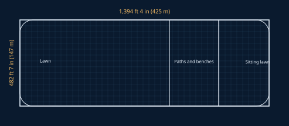

# P2-29 Lawn 8: plan

Footprint 1,394 ft 4 in (425 m) × 482 ft 7 in (147 m) · structural grid 32 ft 10 in (10 m)

## Levels

| Level | Floor above deck | Height | Floor area |
|---|---|---|---|
| Level 1 · Ground | 0 ft (0 mm) | 13 ft 1 in (4,000 mm) | — |

## Elements

| ID | Designation | Type | Name | Level(s) | Size / length | Area | Status |
|---|---|---|---|---|---|---|---|
| E001 | D5F6P2B9A2R1 | zone | Lawn | L1 | 835 ft 8 in (255 m) × 482 ft 3 in (147 m) | 400,321 sq ft (37,191 m²) | proposed |
| E002 | D5F6P2B9A2R2 | zone | Paths and benches | L1 | 276 ft 11 in (84 m) × 482 ft 3 in (147 m) | 133,455 sq ft (12,398 m²) | proposed |
| E003 | D5F6P2B9A2R3 | zone | Sitting lawn | L1 | 281 ft 10 in (86 m) × 481 ft 11 in (147 m) | 133,416 sq ft (12,395 m²) | proposed |

## Drawings

### Level 1 · Ground

