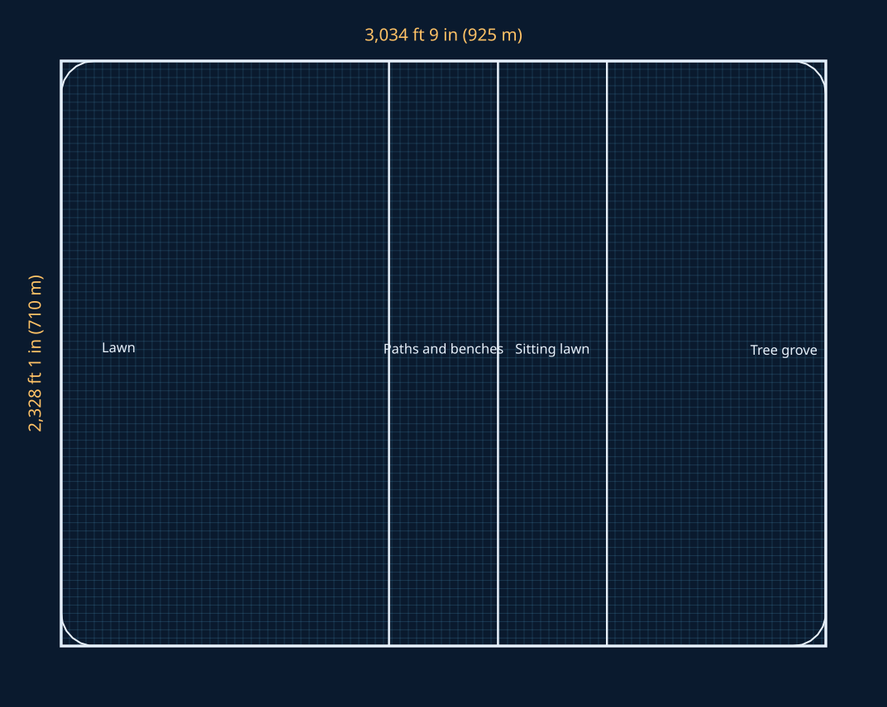

# P2-31 Lawn 9: plan

Footprint 3,034 ft 9 in (925 m) × 2,328 ft 1 in (710 m) · structural grid 32 ft 10 in (10 m)

## Levels

| Level | Floor above deck | Height | Floor area |
|---|---|---|---|
| Level 1 · Ground | 0 ft (0 mm) | 13 ft 1 in (4,000 mm) | — |

## Elements

| ID | Designation | Type | Name | Level(s) | Size / length | Area | Status |
|---|---|---|---|---|---|---|---|
| E001 | D5F6P2B12A2R1 | zone | Lawn | L1 | 1,301 ft 2 in (397 m) × 2,327 ft 5 in (709 m) | 3,018,646 sq ft (280,441 m²) | proposed |
| E002 | D5F6P2B12A2R2 | zone | Paths and benches | L1 | 432 ft 5 in (132 m) × 2,326 ft 9 in (709 m) | 1,006,130 sq ft (93,473 m²) | proposed |
| E003 | D5F6P2B12A2R3 | zone | Sitting lawn | L1 | 432 ft 5 in (132 m) × 2,327 ft 1 in (709 m) | 1,006,130 sq ft (93,473 m²) | proposed |
| E004 | D5F6P2B12A2R4 | zone | Tree grove | L1 | 868 ft 9 in (265 m) × 2,327 ft 1 in (709 m) | 2,012,524 sq ft (186,970 m²) | proposed |

## Drawings

### Level 1 · Ground

