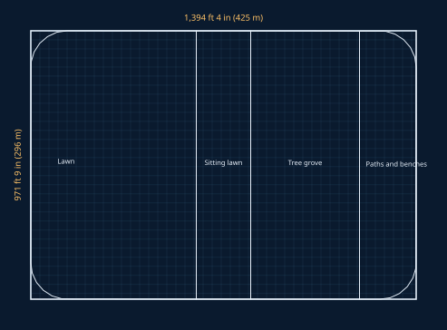

# P2-33 Lawn 10: plan

Footprint 1,394 ft 4 in (425 m) × 971 ft 9 in (296 m) · structural grid 32 ft 10 in (10 m)

## Levels

| Level | Floor above deck | Height | Floor area |
|---|---|---|---|
| Level 1 · Ground | 0 ft (0 mm) | 13 ft 1 in (4,000 mm) | — |

## Elements

| ID | Designation | Type | Name | Level(s) | Size / length | Area | Status |
|---|---|---|---|---|---|---|---|
| E001 | D5F6P2B14A2R1 | zone | Lawn | L1 | 598 ft 9 in (182 m) × 971 ft 2 in (296 m) | 573,043 sq ft (53,237 m²) | proposed |
| E002 | D5F6P2B14A2R2 | zone | Sitting lawn | L1 | 196 ft 10 in (60 m) × 970 ft 6 in (296 m) | 191,038 sq ft (17,748 m²) | proposed |
| E003 | D5F6P2B14A2R3 | zone | Tree grove | L1 | 393 ft 8 in (120 m) × 971 ft 2 in (296 m) | 382,076 sq ft (35,496 m²) | proposed |
| E004 | D5F6P2B14A2R4 | zone | Paths and benches | L1 | 205 ft 1 in (62 m) × 970 ft 6 in (296 m) | 190,968 sq ft (17,741 m²) | proposed |

## Drawings

### Level 1 · Ground

