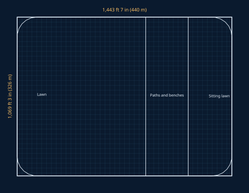

# P2-35 Lawn 11: plan

Footprint 1,443 ft 7 in (440 m) × 1,069 ft 3 in (326 m) · structural grid 32 ft 10 in (10 m)

## Levels

| Level | Floor above deck | Height | Floor area |
|---|---|---|---|
| Level 1 · Ground | 0 ft (0 mm) | 13 ft 1 in (4,000 mm) | — |

## Elements

| ID | Designation | Type | Name | Level(s) | Size / length | Area | Status |
|---|---|---|---|---|---|---|---|
| E001 | D5F6P2B17A3R1 | zone | Lawn | L1 | 864 ft 6 in (264 m) × 1,068 ft 11 in (326 m) | 915,252 sq ft (85,030 m²) | proposed |
| E002 | D5F6P2B17A3R2 | zone | Paths and benches | L1 | 285 ft 9 in (87 m) × 1,068 ft 3 in (326 m) | 305,215 sq ft (28,355 m²) | proposed |
| E003 | D5F6P2B17A3R3 | zone | Sitting lawn | L1 | 293 ft 4 in (89 m) × 1,068 ft 3 in (326 m) | 305,155 sq ft (28,350 m²) | proposed |

## Drawings

### Level 1 · Ground

