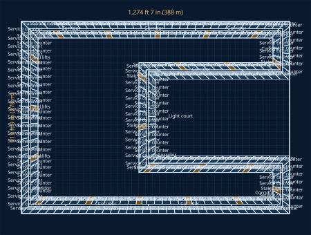
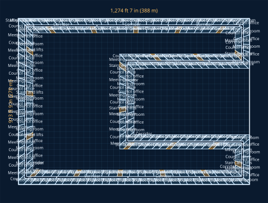

# P3-01 Pilots' Quarter Town Hall: plan

Footprint 1,274 ft 7 in (388 m) × 913 ft 9 in (278 m) · structural grid 32 ft 10 in (10 m)

## Levels

| Level | Floor above deck | Height | Floor area |
|---|---|---|---|
| Level 1 · Ground floor | 0 ft (0 mm) | 18 ft 1 in (5,500 mm) | 347,794 sq ft (32,311 m²) |
| Level 2 · Office floor 1 | 18 ft 1 in (5,500 mm) | 13 ft 9 in (4,200 mm) | 347,794 sq ft (32,311 m²) |
| Level 3 · Office floor 2 | 31 ft 10 in (9,700 mm) | 13 ft 9 in (4,200 mm) | 347,794 sq ft (32,311 m²) |

## Elements

| ID | Designation | Type | Name | Level(s) | Size / length | Area | Status |
|---|---|---|---|---|---|---|---|
| E001 | D5F6P3B1A1L1R1 | zone | Light court | L1 | 1,117 ft 2 in (340 m) × 756 ft 3 in (230 m) | 511,435 sq ft (47,514 m²) | proposed |
| E002 | D5F6P3B1A1L1R2 | zone | Corridor | L1 | 400 ft 3 in (122 m) × 9 ft 10 in (3,000 mm) | 3,875 sq ft (360 m²) | proposed |
| E003 | D5F6P3B1A1L1R3 | zone | Corridor | L1 | 397 ft (121 m) × 9 ft 10 in (3,000 mm) | 3,875 sq ft (360 m²) | proposed |
| E004 | D5F6P3B1A1L1R4 | zone | Corridor | L1 | 400 ft 3 in (122 m) × 9 ft 10 in (3,000 mm) | 3,875 sq ft (360 m²) | proposed |
| E005 | D5F6P3B1A1L1R5 | zone | Corridor | L1 | 193 ft 3 in (59 m) × 205 ft 5 in (63 m) | 3,875 sq ft (360 m²) | proposed |
| E006 | D5F6P3B1A1L1R6 | zone | Corridor | L1 | 403 ft 7 in (123 m) × 9 ft 10 in (3,000 mm) | 3,875 sq ft (360 m²) | proposed |
| E007 | D5F6P3B1A1L1R7 | zone | Corridor | L1 | 70 ft 3 in (21 m) × 340 ft 11 in (104 m) | 3,875 sq ft (360 m²) | proposed |
| E008 | D5F6P3B1A1L1R8 | zone | Corridor | L1 | 292 ft 8 in (89 m) × 118 ft 5 in (36 m) | 3,875 sq ft (360 m²) | proposed |
| E009 | D5F6P3B1A1L1R9 | zone | Corridor | L1 | 364 ft 6 in (111 m) × 46 ft 11 in (14 m) | 3,875 sq ft (360 m²) | proposed |
| E010 | D5F6P3B1A1L1R10 | zone | Corridor | L1 | 245 ft 5 in (75 m) × 164 ft 1 in (50 m) | 3,875 sq ft (360 m²) | proposed |
| E011 | D5F6P3B1A1L1R11 | zone | Corridor | L1 | 397 ft (121 m) × 9 ft 10 in (3,000 mm) | 3,875 sq ft (360 m²) | proposed |
| E012 | D5F6P3B1A1L1R12 | zone | Corridor | L1 | 397 ft 8 in (121 m) × 9 ft 10 in (3,000 mm) | 3,875 sq ft (360 m²) | proposed |
| E013 | D5F6P3B1A1L1R13 | zone | Corridor | L1 | 179 ft 6 in (55 m) × 230 ft (70 m) | 3,875 sq ft (360 m²) | proposed |
| E014 | D5F6P3B1A1L1R14 | zone | Corridor | L1 | 9 ft 10 in (3,000 mm) × 398 ft 4 in (121 m) | 3,875 sq ft (360 m²) | proposed |
| E015 | D5F6P3B1A1L1R15 | zone | Corridor | L1 | 9 ft 10 in (3,000 mm) × 225 ft 9 in (69 m) | 2,151 sq ft (200 m²) | proposed |
| E016 | D5F6P3B1A1L1R16, D5F6P3B1A1L2R1, D5F6P3B1A1L3R1 | core | Stairs and lifts | L1, L2, L3 | 53 ft 10 in (16 m) × 34 ft 5 in (10 m) | 904 sq ft (84 m²) | proposed |
| E017 | D5F6P3B1A1L1R17, D5F6P3B1A1L2R2, D5F6P3B1A1L3R2 | core | Stairs and lifts | L1, L2, L3 | 39 ft 8 in (12 m) × 34 ft 5 in (10 m) | 904 sq ft (84 m²) | proposed |
| E018 | D5F6P3B1A1L1R18, D5F6P3B1A1L2R3, D5F6P3B1A1L3R3 | core | Stairs and lifts | L1, L2, L3 | 27 ft 3 in (8,300 mm) × 34 ft 5 in (10 m) | 904 sq ft (84 m²) | proposed |
| E019 | D5F6P3B1A1L1R19, D5F6P3B1A1L2R4, D5F6P3B1A1L3R4 | core | Stairs and lifts | L1, L2, L3 | 41 ft (12 m) × 34 ft 5 in (10 m) | 904 sq ft (84 m²) | proposed |
| E020 | D5F6P3B1A1L1R20, D5F6P3B1A1L2R5, D5F6P3B1A1L3R5 | core | Stairs and lifts | L1, L2, L3 | 54 ft 9 in (17 m) × 34 ft 5 in (10 m) | 899 sq ft (83 m²) | proposed |
| E021 | D5F6P3B1A1L1R21, D5F6P3B1A1L2R6, D5F6P3B1A1L3R6 | core | Stairs and lifts | L1, L2, L3 | 34 ft 5 in (10 m) × 54 ft 6 in (17 m) | 899 sq ft (83 m²) | proposed |
| E022 | D5F6P3B1A1L1R22, D5F6P3B1A1L2R7, D5F6P3B1A1L3R7 | core | Stairs and lifts | L1, L2, L3 | 60 ft 8 in (18 m) × 34 ft 5 in (10 m) | 904 sq ft (84 m²) | proposed |
| E023 | D5F6P3B1A1L1R23, D5F6P3B1A1L2R8, D5F6P3B1A1L3R8 | core | Stairs and lifts | L1, L2, L3 | 60 ft 8 in (18 m) × 34 ft 5 in (10 m) | 904 sq ft (84 m²) | proposed |
| E024 | D5F6P3B1A1L1R24, D5F6P3B1A1L2R9, D5F6P3B1A1L3R9 | core | Stairs and lifts | L1, L2, L3 | 34 ft 5 in (10 m) × 53 ft 2 in (16 m) | 904 sq ft (84 m²) | proposed |
| E025 | D5F6P3B1A1L1R25, D5F6P3B1A1L2R10, D5F6P3B1A1L3R10 | core | Stairs and lifts | L1, L2, L3 | 34 ft 5 in (10 m) × 32 ft 2 in (9,800 mm) | 899 sq ft (83 m²) | proposed |
| E026 | D5F6P3B1A1L1R26, D5F6P3B1A1L2R11, D5F6P3B1A1L3R11 | core | Stairs and lifts | L1, L2, L3 | 60 ft 8 in (18 m) × 34 ft 5 in (10 m) | 904 sq ft (84 m²) | proposed |
| E027 | D5F6P3B1A1L1R27, D5F6P3B1A1L2R12, D5F6P3B1A1L3R12 | core | Stairs and lifts | L1, L2, L3 | 60 ft 8 in (18 m) × 34 ft 5 in (10 m) | 904 sq ft (84 m²) | proposed |
| E028 | D5F6P3B1A1L1R28, D5F6P3B1A1L2R13, D5F6P3B1A1L3R13 | core | Stairs and lifts | L1, L2, L3 | 60 ft 8 in (18 m) × 34 ft 5 in (10 m) | 904 sq ft (84 m²) | proposed |
| E029 | D5F6P3B1A1L1R29, D5F6P3B1A1L2R14, D5F6P3B1A1L3R14 | core | Stairs and lifts | L1, L2, L3 | 34 ft 5 in (10 m) × 37 ft 5 in (11 m) | 910 sq ft (85 m²) | proposed |
| E030 | D5F6P3B1A1L1R30, D5F6P3B1A1L2R15, D5F6P3B1A1L3R15 | core | Stairs and lifts | L1, L2, L3 | 49 ft 10 in (15 m) × 34 ft 5 in (10 m) | 910 sq ft (85 m²) | proposed |
| E031 | D5F6P3B1A1L1R31, D5F6P3B1A1L2R16, D5F6P3B1A1L3R16 | core | Stairs and lifts | L1, L2, L3 | 35 ft 5 in (11 m) × 34 ft 5 in (10 m) | 899 sq ft (83 m²) | proposed |
| E032 | D5F6P3B1A1L1R32, D5F6P3B1A1L2R17, D5F6P3B1A1L3R17 | core | Stairs and lifts | L1, L2, L3 | 30 ft 10 in (9,400 mm) × 34 ft 5 in (10 m) | 904 sq ft (84 m²) | proposed |
| E033 | D5F6P3B1A1L1R33, D5F6P3B1A1L2R18, D5F6P3B1A1L3R18 | core | Stairs and lifts | L1, L2, L3 | 44 ft 7 in (14 m) × 34 ft 5 in (10 m) | 899 sq ft (83 m²) | proposed |
| E034 | D5F6P3B1A1L1R34, D5F6P3B1A1L2R19, D5F6P3B1A1L3R19 | core | Stairs and lifts | L1, L2, L3 | 59 ft 1 in (18 m) × 34 ft 5 in (10 m) | 910 sq ft (85 m²) | proposed |
| E035 | D5F6P3B1A1L1R35, D5F6P3B1A1L2R20, D5F6P3B1A1L3R20 | core | Stairs and lifts | L1, L2, L3 | 34 ft 5 in (10 m) × 43 ft (13 m) | 904 sq ft (84 m²) | proposed |
| E036 | D5F6P3B1A1L1R36, D5F6P3B1A1L2R21, D5F6P3B1A1L3R21 | core | Stairs and lifts | L1, L2, L3 | 34 ft 5 in (10 m) × 30 ft 2 in (9,200 mm) | 910 sq ft (85 m²) | proposed |
| E037 | D5F6P3B1A1L1R37, D5F6P3B1A1L2R22, D5F6P3B1A1L3R22 | core | Stairs and lifts | L1, L2, L3 | 34 ft 5 in (10 m) × 50 ft 6 in (15 m) | 904 sq ft (84 m²) | proposed |
| E038 | D5F6P3B1A1L1R38 | room | Public hall | L1 | 125 ft 8 in (38 m) × 34 ft 5 in (10 m) | 3,232 sq ft (300 m²) | proposed |
| E039 | D5F6P3B1A1L1R39 | room | Council chamber | L1 | 89 ft 11 in (27 m) × 34 ft 5 in (10 m) | 2,147 sq ft (199 m²) | proposed |
| E040 | D5F6P3B1A1L1R40 | room | Toilets | L1 | 44 ft 3 in (14 m) × 34 ft 5 in (10 m) | 650 sq ft (60 m²) | proposed |
| E041 | D5F6P3B1A1L1R41 | room | Service counter | L1 | 61 ft 4 in (19 m) × 34 ft 5 in (10 m) | 1,294 sq ft (120 m²) | proposed |
| E042 | D5F6P3B1A1L1R42 | room | Service counter | L1 | 59 ft 1 in (18 m) × 34 ft 5 in (10 m) | 1,288 sq ft (120 m²) | proposed |
| E043 | D5F6P3B1A1L1R43 | room | Service counter | L1 | 57 ft 1 in (17 m) × 34 ft 5 in (10 m) | 1,294 sq ft (120 m²) | proposed |
| E044 | D5F6P3B1A1L1R44 | room | Service counter | L1 | 54 ft 9 in (17 m) × 34 ft 5 in (10 m) | 1,288 sq ft (120 m²) | proposed |
| E045 | D5F6P3B1A1L1R45 | room | Service counter | L1 | 52 ft 10 in (16 m) × 34 ft 5 in (10 m) | 1,288 sq ft (120 m²) | proposed |
| E046 | D5F6P3B1A1L1R46 | room | Service counter | L1 | 50 ft 10 in (16 m) × 34 ft 5 in (10 m) | 1,294 sq ft (120 m²) | proposed |
| E047 | D5F6P3B1A1L1R47 | room | Service counter | L1 | 48 ft 7 in (15 m) × 34 ft 5 in (10 m) | 1,288 sq ft (120 m²) | proposed |
| E048 | D5F6P3B1A1L1R48 | room | Service counter | L1 | 46 ft 7 in (14 m) × 34 ft 5 in (10 m) | 1,294 sq ft (120 m²) | proposed |
| E049 | D5F6P3B1A1L1R49 | room | Service counter | L1 | 44 ft 7 in (14 m) × 34 ft 5 in (10 m) | 1,294 sq ft (120 m²) | proposed |
| E050 | D5F6P3B1A1L1R50 | room | Service counter | L1 | 42 ft 8 in (13 m) × 34 ft 5 in (10 m) | 1,294 sq ft (120 m²) | proposed |
| E051 | D5F6P3B1A1L1R51 | room | Service counter | L1 | 40 ft 4 in (12 m) × 34 ft 5 in (10 m) | 1,288 sq ft (120 m²) | proposed |
| E052 | D5F6P3B1A1L1R52 | room | Service counter | L1 | 38 ft 9 in (12 m) × 34 ft 5 in (10 m) | 1,294 sq ft (120 m²) | proposed |
| E053 | D5F6P3B1A1L1R53 | room | Service counter | L1 | 38 ft 9 in (12 m) × 34 ft 5 in (10 m) | 1,288 sq ft (120 m²) | proposed |
| E054 | D5F6P3B1A1L1R54 | room | Service counter | L1 | 41 ft (12 m) × 34 ft 5 in (10 m) | 1,294 sq ft (120 m²) | proposed |
| E055 | D5F6P3B1A1L1R55 | room | Service counter | L1 | 43 ft (13 m) × 34 ft 5 in (10 m) | 1,288 sq ft (120 m²) | proposed |
| E056 | D5F6P3B1A1L1R56 | room | Service counter | L1 | 45 ft 3 in (14 m) × 34 ft 5 in (10 m) | 1,294 sq ft (120 m²) | proposed |
| E057 | D5F6P3B1A1L1R57 | room | Service counter | L1 | 47 ft 3 in (14 m) × 34 ft 5 in (10 m) | 1,288 sq ft (120 m²) | proposed |
| E058 | D5F6P3B1A1L1R58 | room | Service counter | L1 | 49 ft 3 in (15 m) × 34 ft 5 in (10 m) | 1,294 sq ft (120 m²) | proposed |
| E059 | D5F6P3B1A1L1R59 | room | Service counter | L1 | 51 ft 2 in (16 m) × 34 ft 5 in (10 m) | 1,294 sq ft (120 m²) | proposed |
| E060 | D5F6P3B1A1L1R60 | room | Service counter | L1 | 53 ft 2 in (16 m) × 34 ft 5 in (10 m) | 1,288 sq ft (120 m²) | proposed |
| E061 | D5F6P3B1A1L1R61 | room | Service counter | L1 | 55 ft 5 in (17 m) × 34 ft 5 in (10 m) | 1,294 sq ft (120 m²) | proposed |
| E062 | D5F6P3B1A1L1R62 | room | Service counter | L1 | 57 ft 5 in (18 m) × 34 ft 5 in (10 m) | 1,288 sq ft (120 m²) | proposed |
| E063 | D5F6P3B1A1L1R63 | room | Service counter | L1 | 59 ft 9 in (18 m) × 34 ft 5 in (10 m) | 1,294 sq ft (120 m²) | proposed |
| E064 | D5F6P3B1A1L1R64 | room | Service counter | L1 | 61 ft 8 in (19 m) × 34 ft 5 in (10 m) | 1,288 sq ft (120 m²) | proposed |
| E065 | D5F6P3B1A1L1R65 | room | Service counter | L1 | 64 ft (20 m) × 34 ft 5 in (10 m) | 1,294 sq ft (120 m²) | proposed |
| E066 | D5F6P3B1A1L1R66 | room | Service counter | L1 | 65 ft 11 in (20 m) × 34 ft 5 in (10 m) | 1,288 sq ft (120 m²) | proposed |
| E067 | D5F6P3B1A1L1R67 | room | Service counter | L1 | 68 ft 3 in (21 m) × 34 ft 5 in (10 m) | 1,300 sq ft (121 m²) | proposed |
| E068 | D5F6P3B1A1L1R68 | room | Service counter | L1 | 69 ft 11 in (21 m) × 34 ft 5 in (10 m) | 1,288 sq ft (120 m²) | proposed |
| E069 | D5F6P3B1A1L1R69 | room | Service counter | L1 | 49 ft 3 in (15 m) × 53 ft 6 in (16 m) | 1,288 sq ft (120 m²) | proposed |
| E070 | D5F6P3B1A1L1R70 | room | Service counter | L1 | 34 ft 5 in (10 m) × 60 ft 4 in (18 m) | 1,294 sq ft (120 m²) | proposed |
| E071 | D5F6P3B1A1L1R71 | room | Service counter | L1 | 34 ft 5 in (10 m) × 49 ft 6 in (15 m) | 1,294 sq ft (120 m²) | proposed |
| E072 | D5F6P3B1A1L1R72 | room | Service counter | L1 | 34 ft 5 in (10 m) × 42 ft 8 in (13 m) | 1,288 sq ft (120 m²) | proposed |
| E073 | D5F6P3B1A1L1R73 | room | Service counter | L1 | 34 ft 5 in (10 m) × 46 ft 11 in (14 m) | 1,288 sq ft (120 m²) | proposed |
| E074 | D5F6P3B1A1L1R74 | room | Service counter | L1 | 34 ft 5 in (10 m) × 58 ft 1 in (18 m) | 1,294 sq ft (120 m²) | proposed |
| E075 | D5F6P3B1A1L1R75 | room | Service counter | L1 | 41 ft 8 in (13 m) × 60 ft 4 in (18 m) | 1,288 sq ft (120 m²) | proposed |
| E076 | D5F6P3B1A1L1R76 | room | Service counter | L1 | 72 ft 2 in (22 m) × 34 ft 5 in (10 m) | 1,300 sq ft (121 m²) | proposed |
| E077 | D5F6P3B1A1L1R77 | room | Service counter | L1 | 71 ft 10 in (22 m) × 34 ft 5 in (10 m) | 1,288 sq ft (120 m²) | proposed |
| E078 | D5F6P3B1A1L1R78 | room | Service counter | L1 | 71 ft 10 in (22 m) × 34 ft 5 in (10 m) | 1,288 sq ft (120 m²) | proposed |
| E079 | D5F6P3B1A1L1R79 | room | Service counter | L1 | 71 ft 10 in (22 m) × 34 ft 5 in (10 m) | 1,288 sq ft (120 m²) | proposed |
| E080 | D5F6P3B1A1L1R80 | room | Service counter | L1 | 72 ft 2 in (22 m) × 34 ft 5 in (10 m) | 1,300 sq ft (121 m²) | proposed |
| E081 | D5F6P3B1A1L1R81 | room | Service counter | L1 | 71 ft 10 in (22 m) × 34 ft 5 in (10 m) | 1,288 sq ft (120 m²) | proposed |
| E082 | D5F6P3B1A1L1R82 | room | Service counter | L1 | 71 ft 10 in (22 m) × 34 ft 5 in (10 m) | 1,288 sq ft (120 m²) | proposed |
| E083 | D5F6P3B1A1L1R83 | room | Service counter | L1 | 72 ft 2 in (22 m) × 34 ft 5 in (10 m) | 1,300 sq ft (121 m²) | proposed |
| E084 | D5F6P3B1A1L1R84 | room | Service counter | L1 | 71 ft 10 in (22 m) × 34 ft 5 in (10 m) | 1,288 sq ft (120 m²) | proposed |
| E085 | D5F6P3B1A1L1R85 | room | Service counter | L1 | 71 ft 10 in (22 m) × 34 ft 5 in (10 m) | 1,288 sq ft (120 m²) | proposed |
| E086 | D5F6P3B1A1L1R86 | room | Service counter | L1 | 71 ft 10 in (22 m) × 34 ft 5 in (10 m) | 1,288 sq ft (120 m²) | proposed |
| E087 | D5F6P3B1A1L1R87 | room | Service counter | L1 | 72 ft 2 in (22 m) × 34 ft 5 in (10 m) | 1,300 sq ft (121 m²) | proposed |
| E088 | D5F6P3B1A1L1R88 | room | Service counter | L1 | 71 ft 10 in (22 m) × 34 ft 5 in (10 m) | 1,288 sq ft (120 m²) | proposed |
| E089 | D5F6P3B1A1L1R89 | room | Service counter | L1 | 71 ft 10 in (22 m) × 34 ft 5 in (10 m) | 1,288 sq ft (120 m²) | proposed |
| E090 | D5F6P3B1A1L1R90 | room | Service counter | L1 | 72 ft 2 in (22 m) × 34 ft 5 in (10 m) | 1,300 sq ft (121 m²) | proposed |
| E091 | D5F6P3B1A1L1R91 | room | Service counter | L1 | 71 ft 10 in (22 m) × 34 ft 5 in (10 m) | 1,288 sq ft (120 m²) | proposed |
| E092 | D5F6P3B1A1L1R92 | room | Service counter | L1 | 64 ft 8 in (20 m) × 41 ft (12 m) | 1,288 sq ft (120 m²) | proposed |
| E093 | D5F6P3B1A1L1R93 | room | Service counter | L1 | 34 ft 5 in (10 m) × 67 ft 7 in (21 m) | 1,294 sq ft (120 m²) | proposed |
| E094 | D5F6P3B1A1L1R94 | room | Service counter | L1 | 34 ft 5 in (10 m) × 61 ft (19 m) | 1,288 sq ft (120 m²) | proposed |
| E095 | D5F6P3B1A1L1R95 | room | Service counter | L1 | 34 ft 5 in (10 m) × 54 ft 9 in (17 m) | 1,294 sq ft (120 m²) | proposed |
| E096 | D5F6P3B1A1L1R96 | room | Service counter | L1 | 34 ft 5 in (10 m) × 48 ft 3 in (15 m) | 1,294 sq ft (120 m²) | proposed |
| E097 | D5F6P3B1A1L1R97 | room | Service counter | L1 | 34 ft 5 in (10 m) × 41 ft 4 in (13 m) | 1,288 sq ft (120 m²) | proposed |
| E098 | D5F6P3B1A1L1R98 | room | Service counter | L1 | 34 ft 5 in (10 m) × 40 ft 8 in (12 m) | 1,294 sq ft (120 m²) | proposed |
| E099 | D5F6P3B1A1L1R99 | room | Service counter | L1 | 34 ft 5 in (10 m) × 46 ft 3 in (14 m) | 1,288 sq ft (120 m²) | proposed |
| E100 | D5F6P3B1A1L1R100 | room | Service counter | L1 | 34 ft 5 in (10 m) × 52 ft 10 in (16 m) | 1,294 sq ft (120 m²) | proposed |
| E101 | D5F6P3B1A1L1R101 | room | Service counter | L1 | 34 ft 5 in (10 m) × 59 ft 1 in (18 m) | 1,288 sq ft (120 m²) | proposed |
| E102 | D5F6P3B1A1L1R102 | room | Service counter | L1 | 34 ft 5 in (10 m) × 65 ft 7 in (20 m) | 1,294 sq ft (120 m²) | proposed |
| E103 | D5F6P3B1A1L1R103 | room | Service counter | L1 | 54 ft 2 in (16 m) × 50 ft 6 in (15 m) | 1,288 sq ft (120 m²) | proposed |
| E104 | D5F6P3B1A1L1R104 | room | Service counter | L1 | 72 ft 2 in (22 m) × 34 ft 5 in (10 m) | 1,300 sq ft (121 m²) | proposed |
| E105 | D5F6P3B1A1L1R105 | room | Service counter | L1 | 71 ft 10 in (22 m) × 34 ft 5 in (10 m) | 1,288 sq ft (120 m²) | proposed |
| E106 | D5F6P3B1A1L1R106 | room | Service counter | L1 | 71 ft 10 in (22 m) × 34 ft 5 in (10 m) | 1,288 sq ft (120 m²) | proposed |
| E107 | D5F6P3B1A1L1R107 | room | Service counter | L1 | 71 ft 10 in (22 m) × 34 ft 5 in (10 m) | 1,288 sq ft (120 m²) | proposed |
| E108 | D5F6P3B1A1L1R108 | room | Service counter | L1 | 72 ft 2 in (22 m) × 34 ft 5 in (10 m) | 1,300 sq ft (121 m²) | proposed |
| E109 | D5F6P3B1A1L1R109 | room | Service counter | L1 | 71 ft 10 in (22 m) × 34 ft 5 in (10 m) | 1,288 sq ft (120 m²) | proposed |
| E110 | D5F6P3B1A1L1R110 | room | Service counter | L1 | 71 ft 10 in (22 m) × 34 ft 5 in (10 m) | 1,288 sq ft (120 m²) | proposed |
| E111 | D5F6P3B1A1L1R111 | room | Service counter | L1 | 72 ft 2 in (22 m) × 34 ft 5 in (10 m) | 1,300 sq ft (121 m²) | proposed |
| E112 | D5F6P3B1A1L1R112 | room | Service counter | L1 | 71 ft 10 in (22 m) × 34 ft 5 in (10 m) | 1,288 sq ft (120 m²) | proposed |
| E113 | D5F6P3B1A1L1R113 | room | Service counter | L1 | 71 ft 10 in (22 m) × 34 ft 5 in (10 m) | 1,288 sq ft (120 m²) | proposed |
| E114 | D5F6P3B1A1L1R114 | room | Service counter | L1 | 71 ft 10 in (22 m) × 34 ft 5 in (10 m) | 1,288 sq ft (120 m²) | proposed |
| E115 | D5F6P3B1A1L1R115 | room | Service counter | L1 | 72 ft 2 in (22 m) × 34 ft 5 in (10 m) | 1,300 sq ft (121 m²) | proposed |
| E116 | D5F6P3B1A1L1R116 | room | Service counter | L1 | 71 ft 10 in (22 m) × 34 ft 5 in (10 m) | 1,288 sq ft (120 m²) | proposed |
| E117 | D5F6P3B1A1L1R117 | room | Service counter | L1 | 71 ft 10 in (22 m) × 34 ft 5 in (10 m) | 1,288 sq ft (120 m²) | proposed |
| E118 | D5F6P3B1A1L1R118 | room | Service counter | L1 | 72 ft 2 in (22 m) × 34 ft 5 in (10 m) | 1,300 sq ft (121 m²) | proposed |
| E119 | D5F6P3B1A1L1R119 | room | Service counter | L1 | 71 ft 10 in (22 m) × 34 ft 5 in (10 m) | 1,288 sq ft (120 m²) | proposed |
| E120 | D5F6P3B1A1L1R120 | room | Service counter | L1 | 52 ft 2 in (16 m) × 51 ft 6 in (16 m) | 1,294 sq ft (120 m²) | proposed |
| E121 | D5F6P3B1A1L1R121 | room | Service counter | L1 | 34 ft 5 in (10 m) × 60 ft 8 in (18 m) | 1,288 sq ft (120 m²) | proposed |
| E122 | D5F6P3B1A1L1R122 | room | Service counter | L1 | 34 ft 5 in (10 m) × 49 ft 10 in (15 m) | 1,288 sq ft (120 m²) | proposed |
| E123 | D5F6P3B1A1L1R123 | room | Service counter | L1 | 34 ft 5 in (10 m) × 43 ft (13 m) | 1,294 sq ft (120 m²) | proposed |
| E124 | D5F6P3B1A1L1R124 | room | Service counter | L1 | 34 ft 5 in (10 m) × 46 ft 7 in (14 m) | 1,294 sq ft (120 m²) | proposed |
| E125 | D5F6P3B1A1L1R125 | room | Service counter | L1 | 34 ft 5 in (10 m) × 57 ft 1 in (17 m) | 1,288 sq ft (120 m²) | proposed |
| E126 | D5F6P3B1A1L1R126 | room | Service counter | L1 | 39 ft 4 in (12 m) × 62 ft (19 m) | 1,288 sq ft (120 m²) | proposed |
| E127 | D5F6P3B1A1L1R127 | room | Service counter | L1 | 70 ft 10 in (22 m) × 34 ft 5 in (10 m) | 1,300 sq ft (121 m²) | proposed |
| E128 | D5F6P3B1A1L1R128 | room | Service counter | L1 | 68 ft 7 in (21 m) × 34 ft 5 in (10 m) | 1,288 sq ft (120 m²) | proposed |
| E129 | D5F6P3B1A1L1R129 | room | Service counter | L1 | 66 ft 7 in (20 m) × 34 ft 5 in (10 m) | 1,294 sq ft (120 m²) | proposed |
| E130 | D5F6P3B1A1L1R130 | room | Service counter | L1 | 64 ft 4 in (20 m) × 34 ft 5 in (10 m) | 1,288 sq ft (120 m²) | proposed |
| E131 | D5F6P3B1A1L1R131 | room | Service counter | L1 | 62 ft 4 in (19 m) × 34 ft 5 in (10 m) | 1,294 sq ft (120 m²) | proposed |
| E132 | D5F6P3B1A1L1R132 | room | Service counter | L1 | 60 ft (18 m) × 34 ft 5 in (10 m) | 1,288 sq ft (120 m²) | proposed |
| E133 | D5F6P3B1A1L1R133 | room | Service counter | L1 | 58 ft 1 in (18 m) × 34 ft 5 in (10 m) | 1,294 sq ft (120 m²) | proposed |
| E134 | D5F6P3B1A1L1R134 | room | Service counter | L1 | 55 ft 9 in (17 m) × 34 ft 5 in (10 m) | 1,288 sq ft (120 m²) | proposed |
| E135 | D5F6P3B1A1L1R135 | room | Service counter | L1 | 53 ft 10 in (16 m) × 34 ft 5 in (10 m) | 1,288 sq ft (120 m²) | proposed |
| E136 | D5F6P3B1A1L1R136 | room | Service counter | L1 | 52 ft 2 in (16 m) × 34 ft 5 in (10 m) | 1,300 sq ft (121 m²) | proposed |
| E137 | D5F6P3B1A1L1R137 | room | Service counter | L1 | 49 ft 10 in (15 m) × 34 ft 5 in (10 m) | 1,288 sq ft (120 m²) | proposed |
| E138 | D5F6P3B1A1L1R138 | room | Service counter | L1 | 47 ft 11 in (15 m) × 34 ft 5 in (10 m) | 1,294 sq ft (120 m²) | proposed |
| E139 | D5F6P3B1A1L1R139 | room | Service counter | L1 | 45 ft 7 in (14 m) × 34 ft 5 in (10 m) | 1,288 sq ft (120 m²) | proposed |
| E140 | D5F6P3B1A1L1R140 | room | Service counter | L1 | 43 ft 8 in (13 m) × 34 ft 5 in (10 m) | 1,294 sq ft (120 m²) | proposed |
| E141 | D5F6P3B1A1L1R141 | room | Service counter | L1 | 41 ft 4 in (13 m) × 34 ft 5 in (10 m) | 1,288 sq ft (120 m²) | proposed |
| E142 | D5F6P3B1A1L1R142 | room | Service counter | L1 | 39 ft 4 in (12 m) × 34 ft 5 in (10 m) | 1,294 sq ft (120 m²) | proposed |
| E143 | D5F6P3B1A1L1R143 | room | Service counter | L1 | 38 ft 5 in (12 m) × 34 ft 5 in (10 m) | 1,288 sq ft (120 m²) | proposed |
| E144 | D5F6P3B1A1L1R144 | room | Service counter | L1 | 40 ft (12 m) × 34 ft 5 in (10 m) | 1,294 sq ft (120 m²) | proposed |
| E145 | D5F6P3B1A1L1R145 | room | Service counter | L1 | 42 ft (13 m) × 34 ft 5 in (10 m) | 1,294 sq ft (120 m²) | proposed |
| E146 | D5F6P3B1A1L1R146 | room | Service counter | L1 | 44 ft (13 m) × 34 ft 5 in (10 m) | 1,294 sq ft (120 m²) | proposed |
| E147 | D5F6P3B1A1L1R147 | room | Service counter | L1 | 45 ft 11 in (14 m) × 34 ft 5 in (10 m) | 1,288 sq ft (120 m²) | proposed |
| E148 | D5F6P3B1A1L1R148 | room | Service counter | L1 | 47 ft 11 in (15 m) × 34 ft 5 in (10 m) | 1,288 sq ft (120 m²) | proposed |
| E149 | D5F6P3B1A1L1R149 | room | Service counter | L1 | 50 ft 2 in (15 m) × 34 ft 5 in (10 m) | 1,294 sq ft (120 m²) | proposed |
| E150 | D5F6P3B1A1L1R150 | room | Service counter | L1 | 52 ft 2 in (16 m) × 34 ft 5 in (10 m) | 1,288 sq ft (120 m²) | proposed |
| E151 | D5F6P3B1A1L1R151 | room | Service counter | L1 | 54 ft 6 in (17 m) × 34 ft 5 in (10 m) | 1,294 sq ft (120 m²) | proposed |
| E152 | D5F6P3B1A1L1R152 | room | Service counter | L1 | 56 ft 5 in (17 m) × 34 ft 5 in (10 m) | 1,288 sq ft (120 m²) | proposed |
| E153 | D5F6P3B1A1L1R153 | room | Service counter | L1 | 58 ft 9 in (18 m) × 34 ft 5 in (10 m) | 1,294 sq ft (120 m²) | proposed |
| E154 | D5F6P3B1A1L1R154 | room | Service counter | L1 | 60 ft 8 in (18 m) × 34 ft 5 in (10 m) | 1,294 sq ft (120 m²) | proposed |
| E155 | D5F6P3B1A1L1R155 | room | Service counter | L1 | 62 ft 8 in (19 m) × 34 ft 5 in (10 m) | 1,294 sq ft (120 m²) | proposed |
| E156 | D5F6P3B1A1L1R156 | room | Service counter | L1 | 64 ft 8 in (20 m) × 34 ft 5 in (10 m) | 1,288 sq ft (120 m²) | proposed |
| E157 | D5F6P3B1A1L1R157 | room | Service counter | L1 | 66 ft 11 in (20 m) × 34 ft 5 in (10 m) | 1,294 sq ft (120 m²) | proposed |
| E158 | D5F6P3B1A1L1R158 | room | Service counter | L1 | 68 ft 11 in (21 m) × 34 ft 5 in (10 m) | 1,288 sq ft (120 m²) | proposed |
| E159 | D5F6P3B1A1L1R159 | room | Service counter | L1 | 68 ft 7 in (21 m) × 36 ft 9 in (11 m) | 1,294 sq ft (120 m²) | proposed |
| E160 | D5F6P3B1A1L1R160 | room | Service counter | L1 | 34 ft 5 in (10 m) × 70 ft 3 in (21 m) | 1,288 sq ft (120 m²) | proposed |
| E161 | D5F6P3B1A1L1R161 | room | Service counter | L1 | 34 ft 5 in (10 m) × 67 ft 7 in (21 m) | 1,294 sq ft (120 m²) | proposed |
| E162 | D5F6P3B1A1L1R162 | room | Service counter | L1 | 34 ft 5 in (10 m) × 64 ft 4 in (20 m) | 1,288 sq ft (120 m²) | proposed |
| E163 | D5F6P3B1A1L1R163 | room | Service counter | L1 | 34 ft 5 in (10 m) × 61 ft 4 in (19 m) | 1,294 sq ft (120 m²) | proposed |
| E164 | D5F6P3B1A1L1R164 | room | Service counter | L1 | 34 ft 5 in (10 m) × 58 ft 5 in (18 m) | 1,288 sq ft (120 m²) | proposed |
| E165 | D5F6P3B1A1L1R165 | room | Service counter | L1 | 34 ft 5 in (10 m) × 55 ft 9 in (17 m) | 1,294 sq ft (120 m²) | proposed |
| E166 | D5F6P3B1A1L1R166 | room | Service counter | L1 | 34 ft 5 in (10 m) × 52 ft 10 in (16 m) | 1,294 sq ft (120 m²) | proposed |
| E167 | D5F6P3B1A1L1R167 | room | Service counter | L1 | 34 ft 5 in (10 m) × 49 ft 10 in (15 m) | 1,294 sq ft (120 m²) | proposed |
| E168 | D5F6P3B1A1L1R168 | room | Service counter | L1 | 34 ft 5 in (10 m) × 46 ft 7 in (14 m) | 1,283 sq ft (119 m²) | proposed |
| E169 | D5F6P3B1A1L1R169 | room | Service counter | L1 | 34 ft 5 in (10 m) × 44 ft (13 m) | 1,294 sq ft (120 m²) | proposed |
| E170 | D5F6P3B1A1L1R170 | room | Service counter | L1 | 34 ft 5 in (10 m) × 41 ft (12 m) | 1,294 sq ft (120 m²) | proposed |
| E171 | D5F6P3B1A1L1R171 | room | Service counter | L1 | 34 ft 5 in (10 m) × 39 ft 1 in (12 m) | 1,294 sq ft (120 m²) | proposed |
| E172 | D5F6P3B1A1L1R172 | room | Service counter | L1 | 34 ft 5 in (10 m) × 40 ft (12 m) | 1,294 sq ft (120 m²) | proposed |
| E173 | D5F6P3B1A1L1R173 | room | Service counter | L1 | 34 ft 5 in (10 m) × 42 ft 8 in (13 m) | 1,283 sq ft (119 m²) | proposed |
| E174 | D5F6P3B1A1L1R174 | room | Service counter | L1 | 34 ft 5 in (10 m) × 45 ft 11 in (14 m) | 1,294 sq ft (120 m²) | proposed |
| E175 | D5F6P3B1A1L1R175 | room | Service counter | L1 | 34 ft 5 in (10 m) × 48 ft 11 in (15 m) | 1,294 sq ft (120 m²) | proposed |
| E176 | D5F6P3B1A1L1R176 | room | Service counter | L1 | 34 ft 5 in (10 m) × 51 ft 10 in (16 m) | 1,294 sq ft (120 m²) | proposed |
| E177 | D5F6P3B1A1L1R177 | room | Service counter | L1 | 34 ft 5 in (10 m) × 54 ft 6 in (17 m) | 1,288 sq ft (120 m²) | proposed |
| E178 | D5F6P3B1A1L1R178 | room | Service counter | L1 | 34 ft 5 in (10 m) × 57 ft 5 in (17 m) | 1,288 sq ft (120 m²) | proposed |
| E179 | D5F6P3B1A1L1R179 | room | Service counter | L1 | 34 ft 5 in (10 m) × 60 ft 8 in (18 m) | 1,294 sq ft (120 m²) | proposed |
| E180 | D5F6P3B1A1L1R180 | room | Service counter | L1 | 34 ft 5 in (10 m) × 63 ft 8 in (19 m) | 1,294 sq ft (120 m²) | proposed |
| E181 | D5F6P3B1A1L1R181 | room | Service counter | L1 | 34 ft 5 in (10 m) × 66 ft 3 in (20 m) | 1,288 sq ft (120 m²) | proposed |
| E182 | D5F6P3B1A1L1R182 | room | Service counter | L1 | 34 ft 5 in (10 m) × 84 ft 4 in (26 m) | 1,791 sq ft (166 m²) | proposed |
| E183 | D5F6P3B1A1L1R183 | room | Service counter | L1 | 70 ft 10 in (22 m) × 34 ft 5 in (10 m) | 1,294 sq ft (120 m²) | proposed |
| E184 | D5F6P3B1A1L1R184 | room | Service counter | L1 | 68 ft 7 in (21 m) × 34 ft 5 in (10 m) | 1,288 sq ft (120 m²) | proposed |
| E185 | D5F6P3B1A1L1R185 | room | Service counter | L1 | 58 ft 5 in (18 m) × 34 ft 5 in (10 m) | 1,006 sq ft (93 m²) | proposed |
| E186 | D5F6P3B1A1L1R186 | room | Service counter | L1 | 63 ft (19 m) × 34 ft 5 in (10 m) | 1,288 sq ft (120 m²) | proposed |
| E187 | D5F6P3B1A1L1R187 | room | Service counter | L1 | 60 ft 8 in (18 m) × 34 ft 5 in (10 m) | 1,294 sq ft (120 m²) | proposed |
| E188 | D5F6P3B1A1L1R188 | room | Service counter | L1 | 58 ft 5 in (18 m) × 34 ft 5 in (10 m) | 1,288 sq ft (120 m²) | proposed |
| E189 | D5F6P3B1A1L1R189 | room | Service counter | L1 | 56 ft 5 in (17 m) × 34 ft 5 in (10 m) | 1,294 sq ft (120 m²) | proposed |
| E190 | D5F6P3B1A1L1R190 | room | Service counter | L1 | 54 ft 2 in (16 m) × 34 ft 5 in (10 m) | 1,294 sq ft (120 m²) | proposed |
| E191 | D5F6P3B1A1L1R191 | room | Service counter | L1 | 35 ft 5 in (11 m) × 34 ft 5 in (10 m) | 712 sq ft (66 m²) | proposed |
| E192 | D5F6P3B1A1L1R192 | room | Service counter | L1 | 49 ft 3 in (15 m) × 34 ft 5 in (10 m) | 1,294 sq ft (120 m²) | proposed |
| E193 | D5F6P3B1A1L1R193 | room | Service counter | L1 | 46 ft 11 in (14 m) × 34 ft 5 in (10 m) | 1,294 sq ft (120 m²) | proposed |
| E194 | D5F6P3B1A1L1R194 | room | Service counter | L1 | 44 ft 7 in (14 m) × 34 ft 5 in (10 m) | 1,294 sq ft (120 m²) | proposed |
| E195 | D5F6P3B1A1L1R195 | room | Service counter | L1 | 42 ft (13 m) × 34 ft 5 in (10 m) | 1,283 sq ft (119 m²) | proposed |
| E196 | D5F6P3B1A1L1R196 | room | Service counter | L1 | 40 ft (12 m) × 34 ft 5 in (10 m) | 1,294 sq ft (120 m²) | proposed |
| E197 | D5F6P3B1A1L1R197 | room | Service counter | L1 | 21 ft 8 in (6,600 mm) × 34 ft 5 in (10 m) | 718 sq ft (67 m²) | proposed |
| E198 | D5F6P3B1A1L1R198 | room | Service counter | L1 | 40 ft (12 m) × 34 ft 5 in (10 m) | 1,288 sq ft (120 m²) | proposed |
| E199 | D5F6P3B1A1L1R199 | room | Service counter | L1 | 42 ft 4 in (13 m) × 34 ft 5 in (10 m) | 1,294 sq ft (120 m²) | proposed |
| E200 | D5F6P3B1A1L1R200 | room | Service counter | L1 | 44 ft 7 in (14 m) × 34 ft 5 in (10 m) | 1,294 sq ft (120 m²) | proposed |
| E201 | D5F6P3B1A1L1R201 | room | Service counter | L1 | 46 ft 11 in (14 m) × 34 ft 5 in (10 m) | 1,294 sq ft (120 m²) | proposed |
| E202 | D5F6P3B1A1L1R202 | room | Service counter | L1 | 48 ft 11 in (15 m) × 34 ft 5 in (10 m) | 1,288 sq ft (120 m²) | proposed |
| E203 | D5F6P3B1A1L1R203 | room | Service counter | L1 | 34 ft 1 in (10 m) × 34 ft 5 in (10 m) | 718 sq ft (67 m²) | proposed |
| E204 | D5F6P3B1A1L1R204 | room | Service counter | L1 | 54 ft 2 in (16 m) × 34 ft 5 in (10 m) | 1,294 sq ft (120 m²) | proposed |
| E205 | D5F6P3B1A1L1R205 | room | Service counter | L1 | 56 ft 1 in (17 m) × 34 ft 5 in (10 m) | 1,288 sq ft (120 m²) | proposed |
| E206 | D5F6P3B1A1L1R206 | room | Service counter | L1 | 58 ft 5 in (18 m) × 34 ft 5 in (10 m) | 1,288 sq ft (120 m²) | proposed |
| E207 | D5F6P3B1A1L1R207 | room | Service counter | L1 | 61 ft (19 m) × 34 ft 5 in (10 m) | 1,294 sq ft (120 m²) | proposed |
| E208 | D5F6P3B1A1L1R208 | room | Service counter | L1 | 63 ft (19 m) × 34 ft 5 in (10 m) | 1,288 sq ft (120 m²) | proposed |
| E209 | D5F6P3B1A1L1R209 | room | Service counter | L1 | 48 ft 3 in (15 m) × 34 ft 5 in (10 m) | 723 sq ft (67 m²) | proposed |
| E210 | D5F6P3B1A1L1R210 | room | Service counter | L1 | 68 ft 3 in (21 m) × 34 ft 5 in (10 m) | 1,294 sq ft (120 m²) | proposed |
| E211 | D5F6P3B1A1L1R211 | room | Service counter | L1 | 70 ft 6 in (22 m) × 34 ft 5 in (10 m) | 1,294 sq ft (120 m²) | proposed |
| E212 | D5F6P3B1A1L1R212 | room | Service counter | L1 | 42 ft 4 in (13 m) × 57 ft 1 in (17 m) | 1,288 sq ft (120 m²) | proposed |
| E213 | D5F6P3B1A1L1R213 | room | Service counter | L1 | 34 ft 5 in (10 m) × 49 ft 10 in (15 m) | 1,288 sq ft (120 m²) | proposed |
| E214 | D5F6P3B1A1L1R214 | room | Service counter | L1 | 34 ft 5 in (10 m) × 46 ft 3 in (14 m) | 1,300 sq ft (121 m²) | proposed |
| E215 | D5F6P3B1A1L1R215 | room | Service counter | L1 | 34 ft 5 in (10 m) × 38 ft 5 in (12 m) | 712 sq ft (66 m²) | proposed |
| E216 | D5F6P3B1A1L1R216 | room | Service counter | L1 | 72 ft 2 in (22 m) × 34 ft 5 in (10 m) | 1,300 sq ft (121 m²) | proposed |
| E217 | D5F6P3B1A1L1R217 | room | Service counter | L1 | 71 ft 10 in (22 m) × 34 ft 5 in (10 m) | 1,288 sq ft (120 m²) | proposed |
| E218 | D5F6P3B1A1L1R218 | room | Service counter | L1 | 71 ft 10 in (22 m) × 34 ft 5 in (10 m) | 1,288 sq ft (120 m²) | proposed |
| E219 | D5F6P3B1A1L1R219 | room | Service counter | L1 | 72 ft 2 in (22 m) × 34 ft 5 in (10 m) | 1,300 sq ft (121 m²) | proposed |
| E220 | D5F6P3B1A1L1R220 | room | Service counter | L1 | 71 ft 10 in (22 m) × 34 ft 5 in (10 m) | 1,288 sq ft (120 m²) | proposed |
| E221 | D5F6P3B1A1L1R221 | room | Service counter | L1 | 55 ft 1 in (17 m) × 34 ft 5 in (10 m) | 712 sq ft (66 m²) | proposed |
| E222 | D5F6P3B1A1L1R222 | room | Service counter | L1 | 72 ft 2 in (22 m) × 34 ft 5 in (10 m) | 1,300 sq ft (121 m²) | proposed |
| E223 | D5F6P3B1A1L1R223 | room | Service counter | L1 | 71 ft 10 in (22 m) × 34 ft 5 in (10 m) | 1,288 sq ft (120 m²) | proposed |
| E224 | D5F6P3B1A1L1R224 | room | Service counter | L1 | 71 ft 10 in (22 m) × 34 ft 5 in (10 m) | 1,288 sq ft (120 m²) | proposed |
| E225 | D5F6P3B1A1L1R225 | room | Service counter | L1 | 71 ft 10 in (22 m) × 34 ft 5 in (10 m) | 1,288 sq ft (120 m²) | proposed |
| E226 | D5F6P3B1A1L1R226 | room | Service counter | L1 | 72 ft 2 in (22 m) × 34 ft 5 in (10 m) | 1,300 sq ft (121 m²) | proposed |
| E227 | D5F6P3B1A1L1R227 | room | Service counter | L1 | 55 ft 1 in (17 m) × 34 ft 5 in (10 m) | 712 sq ft (66 m²) | proposed |
| E228 | D5F6P3B1A1L1R228 | room | Service counter | L1 | 71 ft 10 in (22 m) × 34 ft 5 in (10 m) | 1,288 sq ft (120 m²) | proposed |
| E229 | D5F6P3B1A1L1R229 | room | Service counter | L1 | 72 ft 2 in (22 m) × 34 ft 5 in (10 m) | 1,300 sq ft (121 m²) | proposed |
| E230 | D5F6P3B1A1L1R230 | room | Service counter | L1 | 71 ft 10 in (22 m) × 34 ft 5 in (10 m) | 1,288 sq ft (120 m²) | proposed |
| E231 | D5F6P3B1A1L1R231 | room | Service counter | L1 | 71 ft 10 in (22 m) × 34 ft 5 in (10 m) | 1,288 sq ft (120 m²) | proposed |
| E232 | D5F6P3B1A1L1R232 | room | Service counter | L1 | 52 ft 10 in (16 m) × 52 ft 2 in (16 m) | 1,294 sq ft (120 m²) | proposed |
| E233 | D5F6P3B1A1L1R233 | room | Service counter | L1 | 34 ft 5 in (10 m) × 50 ft 10 in (16 m) | 718 sq ft (67 m²) | proposed |
| E234 | D5F6P3B1A1L1R234 | room | Service counter | L1 | 34 ft 5 in (10 m) × 60 ft (18 m) | 1,294 sq ft (120 m²) | proposed |
| E235 | D5F6P3B1A1L1R235 | room | Service counter | L1 | 34 ft 5 in (10 m) × 54 ft 6 in (17 m) | 1,288 sq ft (120 m²) | proposed |
| E236 | D5F6P3B1A1L1R236 | room | Service counter | L1 | 34 ft 5 in (10 m) × 49 ft 3 in (15 m) | 1,288 sq ft (120 m²) | proposed |
| E237 | D5F6P3B1A1L1R237 | room | Service counter | L1 | 34 ft 5 in (10 m) × 44 ft 3 in (14 m) | 1,300 sq ft (121 m²) | proposed |
| E238 | D5F6P3B1A1L1R238 | room | Service counter | L1 | 34 ft 5 in (10 m) × 40 ft (12 m) | 1,288 sq ft (120 m²) | proposed |
| E239 | D5F6P3B1A1L1R239 | room | Service counter | L1 | 34 ft 5 in (10 m) × 23 ft 7 in (7,200 mm) | 718 sq ft (67 m²) | proposed |
| E240 | D5F6P3B1A1L1R240 | room | Service counter | L1 | 34 ft 5 in (10 m) × 48 ft 3 in (15 m) | 1,294 sq ft (120 m²) | proposed |
| E241 | D5F6P3B1A1L1R241 | room | Service counter | L1 | 34 ft 5 in (10 m) × 53 ft 6 in (16 m) | 1,294 sq ft (120 m²) | proposed |
| E242 | D5F6P3B1A1L1R242 | room | Service counter | L1 | 34 ft 5 in (10 m) × 58 ft 5 in (18 m) | 1,288 sq ft (120 m²) | proposed |
| E243 | D5F6P3B1A1L1R243 | room | Service counter | L1 | 34 ft 5 in (10 m) × 64 ft (20 m) | 1,294 sq ft (120 m²) | proposed |
| E244 | D5F6P3B1A1L1R244 | room | Service counter | L1 | 34 ft 5 in (10 m) × 69 ft 3 in (21 m) | 1,288 sq ft (120 m²) | proposed |
| E245 | D5F6P3B1A1L1R245 | room | Service counter | L1 | 55 ft 1 in (17 m) × 34 ft 9 in (11 m) | 723 sq ft (67 m²) | proposed |
| E246 | D5F6P3B1A1L1R246 | room | Service counter | L1 | 71 ft 10 in (22 m) × 34 ft 5 in (10 m) | 1,288 sq ft (120 m²) | proposed |
| E247 | D5F6P3B1A1L1R247 | room | Service counter | L1 | 71 ft 10 in (22 m) × 34 ft 5 in (10 m) | 1,288 sq ft (120 m²) | proposed |
| E248 | D5F6P3B1A1L1R248 | room | Service counter | L1 | 71 ft 10 in (22 m) × 34 ft 5 in (10 m) | 1,288 sq ft (120 m²) | proposed |
| E249 | D5F6P3B1A1L1R249 | room | Service counter | L1 | 72 ft 2 in (22 m) × 34 ft 5 in (10 m) | 1,300 sq ft (121 m²) | proposed |
| E250 | D5F6P3B1A1L1R250 | room | Service counter | L1 | 71 ft 10 in (22 m) × 34 ft 5 in (10 m) | 1,288 sq ft (120 m²) | proposed |
| E251 | D5F6P3B1A1L1R251 | room | Service counter | L1 | 55 ft 1 in (17 m) × 34 ft 5 in (10 m) | 712 sq ft (66 m²) | proposed |
| E252 | D5F6P3B1A1L1R252 | room | Service counter | L1 | 72 ft 2 in (22 m) × 34 ft 5 in (10 m) | 1,300 sq ft (121 m²) | proposed |
| E253 | D5F6P3B1A1L1R253 | room | Service counter | L1 | 71 ft 10 in (22 m) × 34 ft 5 in (10 m) | 1,288 sq ft (120 m²) | proposed |
| E254 | D5F6P3B1A1L1R254 | room | Service counter | L1 | 71 ft 10 in (22 m) × 34 ft 5 in (10 m) | 1,288 sq ft (120 m²) | proposed |
| E255 | D5F6P3B1A1L1R255 | room | Service counter | L1 | 72 ft 2 in (22 m) × 34 ft 5 in (10 m) | 1,300 sq ft (121 m²) | proposed |
| E256 | D5F6P3B1A1L1R256 | room | Service counter | L1 | 71 ft 10 in (22 m) × 34 ft 5 in (10 m) | 1,288 sq ft (120 m²) | proposed |
| E257 | D5F6P3B1A1L1R257 | room | Service counter | L1 | 55 ft 1 in (17 m) × 34 ft 5 in (10 m) | 712 sq ft (66 m²) | proposed |
| E258 | D5F6P3B1A1L1R258 | room | Service counter | L1 | 72 ft 2 in (22 m) × 34 ft 5 in (10 m) | 1,300 sq ft (121 m²) | proposed |
| E259 | D5F6P3B1A1L1R259 | room | Service counter | L1 | 71 ft 10 in (22 m) × 34 ft 5 in (10 m) | 1,288 sq ft (120 m²) | proposed |
| E260 | D5F6P3B1A1L1R260 | room | Service counter | L1 | 71 ft 10 in (22 m) × 34 ft 5 in (10 m) | 1,288 sq ft (120 m²) | proposed |
| E261 | D5F6P3B1A1L1R261 | room | Service counter | L1 | 43 ft 8 in (13 m) × 56 ft 5 in (17 m) | 1,294 sq ft (120 m²) | proposed |
| E262 | D5F6P3B1A1L1R262 | room | Service counter | L1 | 34 ft 5 in (10 m) × 50 ft 6 in (15 m) | 1,288 sq ft (120 m²) | proposed |
| E263 | D5F6P3B1A1L1R263 | room | Service counter | L1 | 34 ft 5 in (10 m) × 25 ft 7 in (7,800 mm) | 718 sq ft (67 m²) | proposed |
| E264 | D5F6P3B1A1L1R264 | room | Service counter | L1 | 34 ft 5 in (10 m) × 63 ft (19 m) | 1,288 sq ft (120 m²) | proposed |
| E265 | D5F6P3B1A1L1R265 | room | Service counter | L1 | 70 ft 3 in (21 m) × 34 ft 9 in (11 m) | 1,288 sq ft (120 m²) | proposed |
| E266 | D5F6P3B1A1L1R266 | room | Service counter | L1 | 68 ft 7 in (21 m) × 34 ft 5 in (10 m) | 1,294 sq ft (120 m²) | proposed |
| E267 | D5F6P3B1A1L1R267 | room | Service counter | L1 | 66 ft 3 in (20 m) × 34 ft 5 in (10 m) | 1,288 sq ft (120 m²) | proposed |
| E268 | D5F6P3B1A1L1R268 | room | Service counter | L1 | 64 ft 4 in (20 m) × 34 ft 5 in (10 m) | 1,294 sq ft (120 m²) | proposed |
| E269 | D5F6P3B1A1L1R269 | room | Service counter | L1 | 45 ft 7 in (14 m) × 34 ft 5 in (10 m) | 712 sq ft (66 m²) | proposed |
| E270 | D5F6P3B1A1L1R270 | room | Service counter | L1 | 59 ft 1 in (18 m) × 34 ft 5 in (10 m) | 1,288 sq ft (120 m²) | proposed |
| E271 | D5F6P3B1A1L1R271 | room | Service counter | L1 | 57 ft 1 in (17 m) × 34 ft 5 in (10 m) | 1,294 sq ft (120 m²) | proposed |
| E272 | D5F6P3B1A1L1R272 | room | Service counter | L1 | 54 ft 9 in (17 m) × 34 ft 5 in (10 m) | 1,294 sq ft (120 m²) | proposed |
| E273 | D5F6P3B1A1L1R273 | room | Service counter | L1 | 52 ft 2 in (16 m) × 34 ft 5 in (10 m) | 1,288 sq ft (120 m²) | proposed |
| E274 | D5F6P3B1A1L1R274 | room | Service counter | L1 | 49 ft 10 in (15 m) × 34 ft 5 in (10 m) | 1,288 sq ft (120 m²) | proposed |
| E275 | D5F6P3B1A1L1R275 | room | Service counter | L1 | 31 ft 10 in (9,700 mm) × 34 ft 5 in (10 m) | 723 sq ft (67 m²) | proposed |
| E276 | D5F6P3B1A1L1R276 | room | Service counter | L1 | 44 ft 11 in (14 m) × 34 ft 5 in (10 m) | 1,294 sq ft (120 m²) | proposed |
| E277 | D5F6P3B1A1L1R277 | room | Service counter | L1 | 42 ft 8 in (13 m) × 34 ft 5 in (10 m) | 1,288 sq ft (120 m²) | proposed |
| E278 | D5F6P3B1A1L1R278 | room | Service counter | L1 | 40 ft 8 in (12 m) × 34 ft 5 in (10 m) | 1,294 sq ft (120 m²) | proposed |
| E279 | D5F6P3B1A1L1R279 | room | Service counter | L1 | 38 ft 9 in (12 m) × 34 ft 5 in (10 m) | 1,294 sq ft (120 m²) | proposed |
| E280 | D5F6P3B1A1L1R280 | room | Service counter | L1 | 39 ft 1 in (12 m) × 34 ft 5 in (10 m) | 1,294 sq ft (120 m²) | proposed |
| E281 | D5F6P3B1A1L1R281 | room | Service counter | L1 | 23 ft 11 in (7,300 mm) × 34 ft 5 in (10 m) | 712 sq ft (66 m²) | proposed |
| E282 | D5F6P3B1A1L1R282 | room | Service counter | L1 | 44 ft (13 m) × 34 ft 5 in (10 m) | 1,294 sq ft (120 m²) | proposed |
| E283 | D5F6P3B1A1L1R283 | room | Service counter | L1 | 46 ft 3 in (14 m) × 34 ft 5 in (10 m) | 1,294 sq ft (120 m²) | proposed |
| E284 | D5F6P3B1A1L1R284 | room | Service counter | L1 | 48 ft 3 in (15 m) × 34 ft 5 in (10 m) | 1,283 sq ft (119 m²) | proposed |
| E285 | D5F6P3B1A1L1R285 | room | Service counter | L1 | 50 ft 10 in (16 m) × 34 ft 5 in (10 m) | 1,294 sq ft (120 m²) | proposed |
| E286 | D5F6P3B1A1L1R286 | room | Service counter | L1 | 53 ft 2 in (16 m) × 34 ft 5 in (10 m) | 1,294 sq ft (120 m²) | proposed |
| E287 | D5F6P3B1A1L1R287 | room | Service counter | L1 | 38 ft 1 in (12 m) × 34 ft 5 in (10 m) | 718 sq ft (67 m²) | proposed |
| E288 | D5F6P3B1A1L1R288 | room | Service counter | L1 | 58 ft 1 in (18 m) × 34 ft 5 in (10 m) | 1,294 sq ft (120 m²) | proposed |
| E289 | D5F6P3B1A1L1R289 | room | Service counter | L1 | 60 ft 4 in (18 m) × 34 ft 5 in (10 m) | 1,294 sq ft (120 m²) | proposed |
| E290 | D5F6P3B1A1L1R290 | room | Service counter | L1 | 62 ft 4 in (19 m) × 34 ft 5 in (10 m) | 1,288 sq ft (120 m²) | proposed |
| E291 | D5F6P3B1A1L1R291 | room | Service counter | L1 | 64 ft 8 in (20 m) × 34 ft 5 in (10 m) | 1,294 sq ft (120 m²) | proposed |
| E292 | D5F6P3B1A1L1R292 | room | Service counter | L1 | 66 ft 11 in (20 m) × 34 ft 5 in (10 m) | 1,294 sq ft (120 m²) | proposed |
| E293 | D5F6P3B1A1L1R293 | room | Service counter | L1 | 51 ft 10 in (16 m) × 34 ft 5 in (10 m) | 712 sq ft (66 m²) | proposed |
| E294 | D5F6P3B1A1L1R294 | room | Service counter | L1 | 50 ft 10 in (16 m) × 54 ft 2 in (16 m) | 1,288 sq ft (120 m²) | proposed |
| E295 | D5F6P3B1A1L1R295 | room | Service counter | L1 | 34 ft 5 in (10 m) × 68 ft 7 in (21 m) | 1,288 sq ft (120 m²) | proposed |
| E296 | D5F6P3B1A1L1R296 | room | Service counter | L1 | 34 ft 5 in (10 m) × 65 ft 3 in (20 m) | 1,294 sq ft (120 m²) | proposed |
| E297 | D5F6P3B1A1L1R297 | room | Service counter | L1 | 34 ft 5 in (10 m) × 62 ft (19 m) | 1,294 sq ft (120 m²) | proposed |
| E298 | D5F6P3B1A1L1R298 | room | Service counter | L1 | 34 ft 5 in (10 m) × 58 ft 9 in (18 m) | 1,288 sq ft (120 m²) | proposed |
| E299 | D5F6P3B1A1L1R299 | room | Service counter | L1 | 34 ft 5 in (10 m) × 39 ft 8 in (12 m) | 718 sq ft (67 m²) | proposed |
| E300 | D5F6P3B1A1L1R300 | room | Service counter | L1 | 34 ft 5 in (10 m) × 51 ft 2 in (16 m) | 1,288 sq ft (120 m²) | proposed |
| E301 | D5F6P3B1A1L1R301 | room | Service counter | L1 | 34 ft 5 in (10 m) × 48 ft 3 in (15 m) | 1,294 sq ft (120 m²) | proposed |
| E302 | D5F6P3B1A1L1R302 | room | Service counter | L1 | 34 ft 5 in (10 m) × 44 ft 11 in (14 m) | 1,294 sq ft (120 m²) | proposed |
| E303 | D5F6P3B1A1L1R303 | room | Service counter | L1 | 34 ft 5 in (10 m) × 41 ft 4 in (13 m) | 1,288 sq ft (120 m²) | proposed |
| E304 | D5F6P3B1A1L1R304 | room | Service counter | L1 | 34 ft 5 in (10 m) × 39 ft 1 in (12 m) | 1,294 sq ft (120 m²) | proposed |
| E305 | D5F6P3B1A1L1R305 | room | Service counter | L1 | 34 ft 5 in (10 m) × 22 ft 4 in (6,800 mm) | 712 sq ft (66 m²) | proposed |
| E306 | D5F6P3B1A1L1R306 | room | Service counter | L1 | 34 ft 5 in (10 m) × 44 ft (13 m) | 1,288 sq ft (120 m²) | proposed |
| E307 | D5F6P3B1A1L1R307 | room | Service counter | L1 | 34 ft 5 in (10 m) × 47 ft 3 in (14 m) | 1,288 sq ft (120 m²) | proposed |
| E308 | D5F6P3B1A1L1R308 | room | Service counter | L1 | 34 ft 5 in (10 m) × 50 ft 10 in (16 m) | 1,300 sq ft (121 m²) | proposed |
| E309 | D5F6P3B1A1L1R309 | room | Service counter | L1 | 34 ft 5 in (10 m) × 53 ft 10 in (16 m) | 1,288 sq ft (120 m²) | proposed |
| E310 | D5F6P3B1A1L1R310 | room | Service counter | L1 | 34 ft 5 in (10 m) × 57 ft 1 in (17 m) | 1,288 sq ft (120 m²) | proposed |
| E311 | D5F6P3B1A1L1R311 | room | Service counter | L1 | 34 ft 5 in (10 m) × 43 ft (13 m) | 718 sq ft (67 m²) | proposed |
| E312 | D5F6P3B1A1L1R312 | room | Service counter | L1 | 34 ft 5 in (10 m) × 64 ft 8 in (20 m) | 1,294 sq ft (120 m²) | proposed |
| E313 | D5F6P3B1A1L1R313 | room | Service counter | L1 | 34 ft 5 in (10 m) × 67 ft 7 in (21 m) | 1,288 sq ft (120 m²) | proposed |
| E314 | D5F6P3B1A1L1R314 | room | Service counter | L1 | 34 ft 5 in (10 m) × 62 ft 4 in (19 m) | 1,006 sq ft (93 m²) | proposed |
| E315 | D5F6P3B1A1L2R23, D5F6P3B1A1L3R23 | zone | Corridor | L2, L3 | 400 ft 3 in (122 m) × 9 ft 10 in (3,000 mm) | 3,875 sq ft (360 m²) | proposed |
| E316 | D5F6P3B1A1L2R24, D5F6P3B1A1L3R24 | zone | Corridor | L2, L3 | 397 ft (121 m) × 9 ft 10 in (3,000 mm) | 3,875 sq ft (360 m²) | proposed |
| E317 | D5F6P3B1A1L2R25, D5F6P3B1A1L3R25 | zone | Corridor | L2, L3 | 400 ft 3 in (122 m) × 9 ft 10 in (3,000 mm) | 3,875 sq ft (360 m²) | proposed |
| E318 | D5F6P3B1A1L2R26, D5F6P3B1A1L3R26 | zone | Corridor | L2, L3 | 193 ft 3 in (59 m) × 205 ft 5 in (63 m) | 3,875 sq ft (360 m²) | proposed |
| E319 | D5F6P3B1A1L2R27, D5F6P3B1A1L3R27 | zone | Corridor | L2, L3 | 403 ft 7 in (123 m) × 9 ft 10 in (3,000 mm) | 3,875 sq ft (360 m²) | proposed |
| E320 | D5F6P3B1A1L2R28, D5F6P3B1A1L3R28 | zone | Corridor | L2, L3 | 70 ft 3 in (21 m) × 340 ft 11 in (104 m) | 3,875 sq ft (360 m²) | proposed |
| E321 | D5F6P3B1A1L2R29, D5F6P3B1A1L3R29 | zone | Corridor | L2, L3 | 292 ft 8 in (89 m) × 118 ft 5 in (36 m) | 3,875 sq ft (360 m²) | proposed |
| E322 | D5F6P3B1A1L2R30, D5F6P3B1A1L3R30 | zone | Corridor | L2, L3 | 364 ft 6 in (111 m) × 46 ft 11 in (14 m) | 3,875 sq ft (360 m²) | proposed |
| E323 | D5F6P3B1A1L2R31, D5F6P3B1A1L3R31 | zone | Corridor | L2, L3 | 245 ft 5 in (75 m) × 164 ft 1 in (50 m) | 3,875 sq ft (360 m²) | proposed |
| E324 | D5F6P3B1A1L2R32, D5F6P3B1A1L3R32 | zone | Corridor | L2, L3 | 397 ft (121 m) × 9 ft 10 in (3,000 mm) | 3,875 sq ft (360 m²) | proposed |
| E325 | D5F6P3B1A1L2R33, D5F6P3B1A1L3R33 | zone | Corridor | L2, L3 | 397 ft 8 in (121 m) × 9 ft 10 in (3,000 mm) | 3,875 sq ft (360 m²) | proposed |
| E326 | D5F6P3B1A1L2R34, D5F6P3B1A1L3R34 | zone | Corridor | L2, L3 | 179 ft 6 in (55 m) × 230 ft (70 m) | 3,875 sq ft (360 m²) | proposed |
| E327 | D5F6P3B1A1L2R35, D5F6P3B1A1L3R35 | zone | Corridor | L2, L3 | 9 ft 10 in (3,000 mm) × 398 ft 4 in (121 m) | 3,875 sq ft (360 m²) | proposed |
| E328 | D5F6P3B1A1L2R36, D5F6P3B1A1L3R36 | zone | Corridor | L2, L3 | 9 ft 10 in (3,000 mm) × 225 ft 9 in (69 m) | 2,151 sq ft (200 m²) | proposed |
| E329 | D5F6P3B1A1L2R37, D5F6P3B1A1L3R37 | room | Mayor's office | L2, L3 | 52 ft 10 in (16 m) × 34 ft 5 in (10 m) | 650 sq ft (60 m²) | proposed |
| E330 | D5F6P3B1A1L2R38, D5F6P3B1A1L3R38 | room | Tea point | L2, L3 | 44 ft 11 in (14 m) × 34 ft 5 in (10 m) | 413 sq ft (38 m²) | proposed |
| E331 | D5F6P3B1A1L2R39, D5F6P3B1A1L3R39 | room | Staff toilets and showers | L2, L3 | 53 ft 10 in (16 m) × 34 ft 5 in (10 m) | 752 sq ft (70 m²) | proposed |
| E332 | D5F6P3B1A1L2R40, D5F6P3B1A1L3R40 | room | Council office | L2, L3 | 77 ft 1 in (24 m) × 34 ft 5 in (10 m) | 1,616 sq ft (150 m²) | proposed |
| E333 | D5F6P3B1A1L2R41, D5F6P3B1A1L3R41 | room | Meeting room | L2, L3 | 65 ft 3 in (20 m) × 34 ft 5 in (10 m) | 1,288 sq ft (120 m²) | proposed |
| E334 | D5F6P3B1A1L2R42, D5F6P3B1A1L3R42 | room | Council office | L2, L3 | 72 ft 6 in (22 m) × 34 ft 5 in (10 m) | 1,616 sq ft (150 m²) | proposed |
| E335 | D5F6P3B1A1L2R43, D5F6P3B1A1L3R43 | room | Meeting room | L2, L3 | 60 ft 8 in (18 m) × 34 ft 5 in (10 m) | 1,294 sq ft (120 m²) | proposed |
| E336 | D5F6P3B1A1L2R44, D5F6P3B1A1L3R44 | room | Council office | L2, L3 | 67 ft 7 in (21 m) × 34 ft 5 in (10 m) | 1,611 sq ft (150 m²) | proposed |
| E337 | D5F6P3B1A1L2R45, D5F6P3B1A1L3R45 | room | Meeting room | L2, L3 | 56 ft 1 in (17 m) × 34 ft 5 in (10 m) | 1,294 sq ft (120 m²) | proposed |
| E338 | D5F6P3B1A1L2R46, D5F6P3B1A1L3R46 | room | Council office | L2, L3 | 63 ft (19 m) × 34 ft 5 in (10 m) | 1,616 sq ft (150 m²) | proposed |
| E339 | D5F6P3B1A1L2R47, D5F6P3B1A1L3R47 | room | Meeting room | L2, L3 | 51 ft 2 in (16 m) × 34 ft 5 in (10 m) | 1,288 sq ft (120 m²) | proposed |
| E340 | D5F6P3B1A1L2R48, D5F6P3B1A1L3R48 | room | Council office | L2, L3 | 58 ft 5 in (18 m) × 34 ft 5 in (10 m) | 1,616 sq ft (150 m²) | proposed |
| E341 | D5F6P3B1A1L2R49, D5F6P3B1A1L3R49 | room | Meeting room | L2, L3 | 46 ft 7 in (14 m) × 34 ft 5 in (10 m) | 1,288 sq ft (120 m²) | proposed |
| E342 | D5F6P3B1A1L2R50, D5F6P3B1A1L3R50 | room | Council office | L2, L3 | 53 ft 10 in (16 m) × 34 ft 5 in (10 m) | 1,616 sq ft (150 m²) | proposed |
| E343 | D5F6P3B1A1L2R51, D5F6P3B1A1L3R51 | room | Meeting room | L2, L3 | 42 ft (13 m) × 34 ft 5 in (10 m) | 1,294 sq ft (120 m²) | proposed |
| E344 | D5F6P3B1A1L2R52, D5F6P3B1A1L3R52 | room | Council office | L2, L3 | 48 ft 11 in (15 m) × 34 ft 5 in (10 m) | 1,616 sq ft (150 m²) | proposed |
| E345 | D5F6P3B1A1L2R53, D5F6P3B1A1L3R53 | room | Meeting room | L2, L3 | 38 ft 5 in (12 m) × 34 ft 5 in (10 m) | 1,288 sq ft (120 m²) | proposed |
| E346 | D5F6P3B1A1L2R54, D5F6P3B1A1L3R54 | room | Council office | L2, L3 | 49 ft 6 in (15 m) × 34 ft 5 in (10 m) | 1,616 sq ft (150 m²) | proposed |
| E347 | D5F6P3B1A1L2R55, D5F6P3B1A1L3R55 | room | Meeting room | L2, L3 | 42 ft 4 in (13 m) × 34 ft 5 in (10 m) | 1,288 sq ft (120 m²) | proposed |
| E348 | D5F6P3B1A1L2R56, D5F6P3B1A1L3R56 | room | Council office | L2, L3 | 54 ft 2 in (16 m) × 34 ft 5 in (10 m) | 1,616 sq ft (150 m²) | proposed |
| E349 | D5F6P3B1A1L2R57, D5F6P3B1A1L3R57 | room | Meeting room | L2, L3 | 47 ft 3 in (14 m) × 34 ft 5 in (10 m) | 1,294 sq ft (120 m²) | proposed |
| E350 | D5F6P3B1A1L2R58, D5F6P3B1A1L3R58 | room | Council office | L2, L3 | 58 ft 9 in (18 m) × 34 ft 5 in (10 m) | 1,611 sq ft (150 m²) | proposed |
| E351 | D5F6P3B1A1L2R59, D5F6P3B1A1L3R59 | room | Meeting room | L2, L3 | 51 ft 10 in (16 m) × 34 ft 5 in (10 m) | 1,294 sq ft (120 m²) | proposed |
| E352 | D5F6P3B1A1L2R60, D5F6P3B1A1L3R60 | room | Council office | L2, L3 | 63 ft 8 in (19 m) × 34 ft 5 in (10 m) | 1,616 sq ft (150 m²) | proposed |
| E353 | D5F6P3B1A1L2R61, D5F6P3B1A1L3R61 | room | Meeting room | L2, L3 | 56 ft 5 in (17 m) × 34 ft 5 in (10 m) | 1,288 sq ft (120 m²) | proposed |
| E354 | D5F6P3B1A1L2R62, D5F6P3B1A1L3R62 | room | Council office | L2, L3 | 68 ft 3 in (21 m) × 34 ft 5 in (10 m) | 1,616 sq ft (150 m²) | proposed |
| E355 | D5F6P3B1A1L2R63, D5F6P3B1A1L3R63 | room | Meeting room | L2, L3 | 61 ft (19 m) × 34 ft 5 in (10 m) | 1,288 sq ft (120 m²) | proposed |
| E356 | D5F6P3B1A1L2R64, D5F6P3B1A1L3R64 | room | Council office | L2, L3 | 72 ft 10 in (22 m) × 34 ft 5 in (10 m) | 1,616 sq ft (150 m²) | proposed |
| E357 | D5F6P3B1A1L2R65, D5F6P3B1A1L3R65 | room | Meeting room | L2, L3 | 65 ft 11 in (20 m) × 34 ft 5 in (10 m) | 1,294 sq ft (120 m²) | proposed |
| E358 | D5F6P3B1A1L2R66, D5F6P3B1A1L3R66 | room | Council office | L2, L3 | 77 ft 9 in (24 m) × 34 ft 5 in (10 m) | 1,616 sq ft (150 m²) | proposed |
| E359 | D5F6P3B1A1L2R67, D5F6P3B1A1L3R67 | room | Meeting room | L2, L3 | 70 ft 6 in (22 m) × 34 ft 5 in (10 m) | 1,288 sq ft (120 m²) | proposed |
| E360 | D5F6P3B1A1L2R68, D5F6P3B1A1L3R68 | room | Council office | L2, L3 | 40 ft 8 in (12 m) × 69 ft 3 in (21 m) | 1,616 sq ft (150 m²) | proposed |
| E361 | D5F6P3B1A1L2R69, D5F6P3B1A1L3R69 | room | Meeting room | L2, L3 | 34 ft 5 in (10 m) × 55 ft 1 in (17 m) | 1,294 sq ft (120 m²) | proposed |
| E362 | D5F6P3B1A1L2R70, D5F6P3B1A1L3R70 | room | Council office | L2, L3 | 34 ft 5 in (10 m) × 53 ft 6 in (16 m) | 1,611 sq ft (150 m²) | proposed |
| E363 | D5F6P3B1A1L2R71, D5F6P3B1A1L3R71 | room | Meeting room | L2, L3 | 34 ft 5 in (10 m) × 44 ft 3 in (14 m) | 1,294 sq ft (120 m²) | proposed |
| E364 | D5F6P3B1A1L2R72, D5F6P3B1A1L3R72 | room | Council office | L2, L3 | 34 ft 5 in (10 m) × 65 ft 7 in (20 m) | 1,611 sq ft (150 m²) | proposed |
| E365 | D5F6P3B1A1L2R73, D5F6P3B1A1L3R73 | room | Meeting room | L2, L3 | 41 ft 4 in (13 m) × 60 ft 8 in (18 m) | 1,294 sq ft (120 m²) | proposed |
| E366 | D5F6P3B1A1L2R74, D5F6P3B1A1L3R74 | room | Council office | L2, L3 | 81 ft 4 in (25 m) × 34 ft 5 in (10 m) | 1,616 sq ft (150 m²) | proposed |
| E367 | D5F6P3B1A1L2R75, D5F6P3B1A1L3R75 | room | Meeting room | L2, L3 | 71 ft 10 in (22 m) × 34 ft 5 in (10 m) | 1,288 sq ft (120 m²) | proposed |
| E368 | D5F6P3B1A1L2R76, D5F6P3B1A1L3R76 | room | Council office | L2, L3 | 81 ft 4 in (25 m) × 34 ft 5 in (10 m) | 1,616 sq ft (150 m²) | proposed |
| E369 | D5F6P3B1A1L2R77, D5F6P3B1A1L3R77 | room | Meeting room | L2, L3 | 71 ft 10 in (22 m) × 34 ft 5 in (10 m) | 1,288 sq ft (120 m²) | proposed |
| E370 | D5F6P3B1A1L2R78, D5F6P3B1A1L3R78 | room | Council office | L2, L3 | 81 ft 4 in (25 m) × 34 ft 5 in (10 m) | 1,616 sq ft (150 m²) | proposed |
| E371 | D5F6P3B1A1L2R79, D5F6P3B1A1L3R79 | room | Meeting room | L2, L3 | 71 ft 10 in (22 m) × 34 ft 5 in (10 m) | 1,288 sq ft (120 m²) | proposed |
| E372 | D5F6P3B1A1L2R80, D5F6P3B1A1L3R80 | room | Council office | L2, L3 | 81 ft 4 in (25 m) × 34 ft 5 in (10 m) | 1,616 sq ft (150 m²) | proposed |
| E373 | D5F6P3B1A1L2R81, D5F6P3B1A1L3R81 | room | Meeting room | L2, L3 | 72 ft 2 in (22 m) × 34 ft 5 in (10 m) | 1,300 sq ft (121 m²) | proposed |
| E374 | D5F6P3B1A1L2R82, D5F6P3B1A1L3R82 | room | Council office | L2, L3 | 81 ft (25 m) × 34 ft 5 in (10 m) | 1,605 sq ft (149 m²) | proposed |
| E375 | D5F6P3B1A1L2R83, D5F6P3B1A1L3R83 | room | Meeting room | L2, L3 | 72 ft 2 in (22 m) × 34 ft 5 in (10 m) | 1,300 sq ft (121 m²) | proposed |
| E376 | D5F6P3B1A1L2R84, D5F6P3B1A1L3R84 | room | Council office | L2, L3 | 81 ft 4 in (25 m) × 34 ft 5 in (10 m) | 1,616 sq ft (150 m²) | proposed |
| E377 | D5F6P3B1A1L2R85, D5F6P3B1A1L3R85 | room | Meeting room | L2, L3 | 71 ft 10 in (22 m) × 34 ft 5 in (10 m) | 1,288 sq ft (120 m²) | proposed |
| E378 | D5F6P3B1A1L2R86, D5F6P3B1A1L3R86 | room | Council office | L2, L3 | 81 ft 4 in (25 m) × 34 ft 5 in (10 m) | 1,616 sq ft (150 m²) | proposed |
| E379 | D5F6P3B1A1L2R87, D5F6P3B1A1L3R87 | room | Meeting room | L2, L3 | 71 ft 10 in (22 m) × 34 ft 5 in (10 m) | 1,288 sq ft (120 m²) | proposed |
| E380 | D5F6P3B1A1L2R88, D5F6P3B1A1L3R88 | room | Council office | L2, L3 | 74 ft 6 in (23 m) × 40 ft 8 in (12 m) | 1,616 sq ft (150 m²) | proposed |
| E381 | D5F6P3B1A1L2R89, D5F6P3B1A1L3R89 | room | Meeting room | L2, L3 | 34 ft 5 in (10 m) × 67 ft 3 in (20 m) | 1,288 sq ft (120 m²) | proposed |
| E382 | D5F6P3B1A1L2R90, D5F6P3B1A1L3R90 | room | Council office | L2, L3 | 34 ft 5 in (10 m) × 69 ft 7 in (21 m) | 1,616 sq ft (150 m²) | proposed |
| E383 | D5F6P3B1A1L2R91, D5F6P3B1A1L3R91 | room | Meeting room | L2, L3 | 34 ft 5 in (10 m) × 52 ft 10 in (16 m) | 1,288 sq ft (120 m²) | proposed |
| E384 | D5F6P3B1A1L2R92, D5F6P3B1A1L3R92 | room | Council office | L2, L3 | 34 ft 5 in (10 m) × 55 ft 1 in (17 m) | 1,616 sq ft (150 m²) | proposed |
| E385 | D5F6P3B1A1L2R93, D5F6P3B1A1L3R93 | room | Meeting room | L2, L3 | 34 ft 5 in (10 m) × 40 ft 8 in (12 m) | 1,288 sq ft (120 m²) | proposed |
| E386 | D5F6P3B1A1L2R94, D5F6P3B1A1L3R94 | room | Council office | L2, L3 | 34 ft 5 in (10 m) × 53 ft 6 in (16 m) | 1,622 sq ft (151 m²) | proposed |
| E387 | D5F6P3B1A1L2R95, D5F6P3B1A1L3R95 | room | Meeting room | L2, L3 | 34 ft 5 in (10 m) × 51 ft 2 in (16 m) | 1,288 sq ft (120 m²) | proposed |
| E388 | D5F6P3B1A1L2R96, D5F6P3B1A1L3R96 | room | Council office | L2, L3 | 34 ft 5 in (10 m) × 67 ft 11 in (21 m) | 1,616 sq ft (150 m²) | proposed |
| E389 | D5F6P3B1A1L2R97, D5F6P3B1A1L3R97 | room | Meeting room | L2, L3 | 34 ft 5 in (10 m) × 65 ft 7 in (20 m) | 1,288 sq ft (120 m²) | proposed |
| E390 | D5F6P3B1A1L2R98, D5F6P3B1A1L3R98 | room | Council office | L2, L3 | 63 ft 4 in (19 m) × 51 ft 2 in (16 m) | 1,622 sq ft (151 m²) | proposed |
| E391 | D5F6P3B1A1L2R99, D5F6P3B1A1L3R99 | room | Meeting room | L2, L3 | 71 ft 10 in (22 m) × 34 ft 5 in (10 m) | 1,288 sq ft (120 m²) | proposed |
| E392 | D5F6P3B1A1L2R100, D5F6P3B1A1L3R100 | room | Council office | L2, L3 | 81 ft 4 in (25 m) × 34 ft 5 in (10 m) | 1,616 sq ft (150 m²) | proposed |
| E393 | D5F6P3B1A1L2R101, D5F6P3B1A1L3R101 | room | Meeting room | L2, L3 | 71 ft 10 in (22 m) × 34 ft 5 in (10 m) | 1,288 sq ft (120 m²) | proposed |
| E394 | D5F6P3B1A1L2R102, D5F6P3B1A1L3R102 | room | Council office | L2, L3 | 81 ft 4 in (25 m) × 34 ft 5 in (10 m) | 1,616 sq ft (150 m²) | proposed |
| E395 | D5F6P3B1A1L2R103, D5F6P3B1A1L3R103 | room | Meeting room | L2, L3 | 71 ft 10 in (22 m) × 34 ft 5 in (10 m) | 1,288 sq ft (120 m²) | proposed |
| E396 | D5F6P3B1A1L2R104, D5F6P3B1A1L3R104 | room | Council office | L2, L3 | 81 ft 4 in (25 m) × 34 ft 5 in (10 m) | 1,616 sq ft (150 m²) | proposed |
| E397 | D5F6P3B1A1L2R105, D5F6P3B1A1L3R105 | room | Meeting room | L2, L3 | 71 ft 10 in (22 m) × 34 ft 5 in (10 m) | 1,288 sq ft (120 m²) | proposed |
| E398 | D5F6P3B1A1L2R106, D5F6P3B1A1L3R106 | room | Council office | L2, L3 | 81 ft 4 in (25 m) × 34 ft 5 in (10 m) | 1,616 sq ft (150 m²) | proposed |
| E399 | D5F6P3B1A1L2R107, D5F6P3B1A1L3R107 | room | Meeting room | L2, L3 | 71 ft 10 in (22 m) × 34 ft 5 in (10 m) | 1,288 sq ft (120 m²) | proposed |
| E400 | D5F6P3B1A1L2R108, D5F6P3B1A1L3R108 | room | Council office | L2, L3 | 81 ft 4 in (25 m) × 34 ft 5 in (10 m) | 1,616 sq ft (150 m²) | proposed |
| E401 | D5F6P3B1A1L2R109, D5F6P3B1A1L3R109 | room | Meeting room | L2, L3 | 72 ft 2 in (22 m) × 34 ft 5 in (10 m) | 1,300 sq ft (121 m²) | proposed |
| E402 | D5F6P3B1A1L2R110, D5F6P3B1A1L3R110 | room | Council office | L2, L3 | 81 ft (25 m) × 34 ft 5 in (10 m) | 1,605 sq ft (149 m²) | proposed |
| E403 | D5F6P3B1A1L2R111, D5F6P3B1A1L3R111 | room | Meeting room | L2, L3 | 72 ft 2 in (22 m) × 34 ft 5 in (10 m) | 1,300 sq ft (121 m²) | proposed |
| E404 | D5F6P3B1A1L2R112, D5F6P3B1A1L3R112 | room | Council office | L2, L3 | 81 ft 4 in (25 m) × 34 ft 5 in (10 m) | 1,616 sq ft (150 m²) | proposed |
| E405 | D5F6P3B1A1L2R113, D5F6P3B1A1L3R113 | room | Meeting room | L2, L3 | 52 ft 6 in (16 m) × 50 ft 10 in (16 m) | 1,283 sq ft (119 m²) | proposed |
| E406 | D5F6P3B1A1L2R114, D5F6P3B1A1L3R114 | room | Council office | L2, L3 | 34 ft 5 in (10 m) × 69 ft 3 in (21 m) | 1,622 sq ft (151 m²) | proposed |
| E407 | D5F6P3B1A1L2R115, D5F6P3B1A1L3R115 | room | Meeting room | L2, L3 | 34 ft 5 in (10 m) × 47 ft 7 in (14 m) | 1,288 sq ft (120 m²) | proposed |
| E408 | D5F6P3B1A1L2R116, D5F6P3B1A1L3R116 | room | Council office | L2, L3 | 34 ft 5 in (10 m) × 53 ft 10 in (16 m) | 1,616 sq ft (150 m²) | proposed |
| E409 | D5F6P3B1A1L2R117, D5F6P3B1A1L3R117 | room | Meeting room | L2, L3 | 34 ft 5 in (10 m) × 51 ft 10 in (16 m) | 1,294 sq ft (120 m²) | proposed |
| E410 | D5F6P3B1A1L2R118, D5F6P3B1A1L3R118 | room | Council office | L2, L3 | 34 ft 5 in (10 m) × 73 ft 2 in (22 m) | 1,611 sq ft (150 m²) | proposed |
| E411 | D5F6P3B1A1L2R119, D5F6P3B1A1L3R119 | room | Meeting room | L2, L3 | 66 ft 3 in (20 m) × 38 ft 5 in (12 m) | 1,288 sq ft (120 m²) | proposed |
| E412 | D5F6P3B1A1L2R120, D5F6P3B1A1L3R120 | room | Council office | L2, L3 | 78 ft 1 in (24 m) × 34 ft 5 in (10 m) | 1,616 sq ft (150 m²) | proposed |
| E413 | D5F6P3B1A1L2R121, D5F6P3B1A1L3R121 | room | Meeting room | L2, L3 | 66 ft 3 in (20 m) × 34 ft 5 in (10 m) | 1,288 sq ft (120 m²) | proposed |
| E414 | D5F6P3B1A1L2R122, D5F6P3B1A1L3R122 | room | Council office | L2, L3 | 73 ft 6 in (22 m) × 34 ft 5 in (10 m) | 1,616 sq ft (150 m²) | proposed |
| E415 | D5F6P3B1A1L2R123, D5F6P3B1A1L3R123 | room | Meeting room | L2, L3 | 61 ft 8 in (19 m) × 34 ft 5 in (10 m) | 1,294 sq ft (120 m²) | proposed |
| E416 | D5F6P3B1A1L2R124, D5F6P3B1A1L3R124 | room | Council office | L2, L3 | 68 ft 7 in (21 m) × 34 ft 5 in (10 m) | 1,611 sq ft (150 m²) | proposed |
| E417 | D5F6P3B1A1L2R125, D5F6P3B1A1L3R125 | room | Meeting room | L2, L3 | 57 ft 1 in (17 m) × 34 ft 5 in (10 m) | 1,294 sq ft (120 m²) | proposed |
| E418 | D5F6P3B1A1L2R126, D5F6P3B1A1L3R126 | room | Council office | L2, L3 | 64 ft (20 m) × 34 ft 5 in (10 m) | 1,616 sq ft (150 m²) | proposed |
| E419 | D5F6P3B1A1L2R127, D5F6P3B1A1L3R127 | room | Meeting room | L2, L3 | 52 ft 2 in (16 m) × 34 ft 5 in (10 m) | 1,288 sq ft (120 m²) | proposed |
| E420 | D5F6P3B1A1L2R128, D5F6P3B1A1L3R128 | room | Council office | L2, L3 | 59 ft 5 in (18 m) × 34 ft 5 in (10 m) | 1,616 sq ft (150 m²) | proposed |
| E421 | D5F6P3B1A1L2R129, D5F6P3B1A1L3R129 | room | Meeting room | L2, L3 | 47 ft 7 in (14 m) × 34 ft 5 in (10 m) | 1,288 sq ft (120 m²) | proposed |
| E422 | D5F6P3B1A1L2R130, D5F6P3B1A1L3R130 | room | Council office | L2, L3 | 54 ft 9 in (17 m) × 34 ft 5 in (10 m) | 1,616 sq ft (150 m²) | proposed |
| E423 | D5F6P3B1A1L2R131, D5F6P3B1A1L3R131 | room | Meeting room | L2, L3 | 43 ft (13 m) × 34 ft 5 in (10 m) | 1,294 sq ft (120 m²) | proposed |
| E424 | D5F6P3B1A1L2R132, D5F6P3B1A1L3R132 | room | Council office | L2, L3 | 49 ft 10 in (15 m) × 34 ft 5 in (10 m) | 1,616 sq ft (150 m²) | proposed |
| E425 | D5F6P3B1A1L2R133, D5F6P3B1A1L3R133 | room | Meeting room | L2, L3 | 38 ft 5 in (12 m) × 34 ft 5 in (10 m) | 1,288 sq ft (120 m²) | proposed |
| E426 | D5F6P3B1A1L2R134, D5F6P3B1A1L3R134 | room | Council office | L2, L3 | 48 ft 7 in (15 m) × 34 ft 5 in (10 m) | 1,616 sq ft (150 m²) | proposed |
| E427 | D5F6P3B1A1L2R135, D5F6P3B1A1L3R135 | room | Meeting room | L2, L3 | 41 ft 4 in (13 m) × 34 ft 5 in (10 m) | 1,288 sq ft (120 m²) | proposed |
| E428 | D5F6P3B1A1L2R136, D5F6P3B1A1L3R136 | room | Council office | L2, L3 | 53 ft 2 in (16 m) × 34 ft 5 in (10 m) | 1,616 sq ft (150 m²) | proposed |
| E429 | D5F6P3B1A1L2R137, D5F6P3B1A1L3R137 | room | Meeting room | L2, L3 | 46 ft 3 in (14 m) × 34 ft 5 in (10 m) | 1,294 sq ft (120 m²) | proposed |
| E430 | D5F6P3B1A1L2R138, D5F6P3B1A1L3R138 | room | Council office | L2, L3 | 57 ft 9 in (18 m) × 34 ft 5 in (10 m) | 1,611 sq ft (150 m²) | proposed |
| E431 | D5F6P3B1A1L2R139, D5F6P3B1A1L3R139 | room | Meeting room | L2, L3 | 50 ft 10 in (16 m) × 34 ft 5 in (10 m) | 1,294 sq ft (120 m²) | proposed |
| E432 | D5F6P3B1A1L2R140, D5F6P3B1A1L3R140 | room | Council office | L2, L3 | 62 ft 8 in (19 m) × 34 ft 5 in (10 m) | 1,616 sq ft (150 m²) | proposed |
| E433 | D5F6P3B1A1L2R141, D5F6P3B1A1L3R141 | room | Meeting room | L2, L3 | 55 ft 5 in (17 m) × 34 ft 5 in (10 m) | 1,288 sq ft (120 m²) | proposed |
| E434 | D5F6P3B1A1L2R142, D5F6P3B1A1L3R142 | room | Council office | L2, L3 | 67 ft 3 in (20 m) × 34 ft 5 in (10 m) | 1,616 sq ft (150 m²) | proposed |
| E435 | D5F6P3B1A1L2R143, D5F6P3B1A1L3R143 | room | Meeting room | L2, L3 | 60 ft (18 m) × 34 ft 5 in (10 m) | 1,288 sq ft (120 m²) | proposed |
| E436 | D5F6P3B1A1L2R144, D5F6P3B1A1L3R144 | room | Council office | L2, L3 | 71 ft 10 in (22 m) × 34 ft 5 in (10 m) | 1,616 sq ft (150 m²) | proposed |
| E437 | D5F6P3B1A1L2R145, D5F6P3B1A1L3R145 | room | Meeting room | L2, L3 | 65 ft (20 m) × 34 ft 5 in (10 m) | 1,294 sq ft (120 m²) | proposed |
| E438 | D5F6P3B1A1L2R146, D5F6P3B1A1L3R146 | room | Council office | L2, L3 | 76 ft 9 in (23 m) × 34 ft 5 in (10 m) | 1,616 sq ft (150 m²) | proposed |
| E439 | D5F6P3B1A1L2R147, D5F6P3B1A1L3R147 | room | Meeting room | L2, L3 | 69 ft 7 in (21 m) × 34 ft 5 in (10 m) | 1,288 sq ft (120 m²) | proposed |
| E440 | D5F6P3B1A1L2R148, D5F6P3B1A1L3R148 | room | Council office | L2, L3 | 60 ft (18 m) × 54 ft 6 in (17 m) | 1,622 sq ft (151 m²) | proposed |
| E441 | D5F6P3B1A1L2R149, D5F6P3B1A1L3R149 | room | Meeting room | L2, L3 | 34 ft 5 in (10 m) × 68 ft 7 in (21 m) | 1,283 sq ft (119 m²) | proposed |
| E442 | D5F6P3B1A1L2R150, D5F6P3B1A1L3R150 | room | Council office | L2, L3 | 34 ft 5 in (10 m) × 75 ft 2 in (23 m) | 1,622 sq ft (151 m²) | proposed |
| E443 | D5F6P3B1A1L2R151, D5F6P3B1A1L3R151 | room | Meeting room | L2, L3 | 34 ft 5 in (10 m) × 62 ft 4 in (19 m) | 1,294 sq ft (120 m²) | proposed |
| E444 | D5F6P3B1A1L2R152, D5F6P3B1A1L3R152 | room | Council office | L2, L3 | 34 ft 5 in (10 m) × 68 ft 3 in (21 m) | 1,611 sq ft (150 m²) | proposed |
| E445 | D5F6P3B1A1L2R153, D5F6P3B1A1L3R153 | room | Meeting room | L2, L3 | 34 ft 5 in (10 m) × 55 ft 9 in (17 m) | 1,294 sq ft (120 m²) | proposed |
| E446 | D5F6P3B1A1L2R154, D5F6P3B1A1L3R154 | room | Council office | L2, L3 | 34 ft 5 in (10 m) × 61 ft 8 in (19 m) | 1,611 sq ft (150 m²) | proposed |
| E447 | D5F6P3B1A1L2R155, D5F6P3B1A1L3R155 | room | Meeting room | L2, L3 | 34 ft 5 in (10 m) × 49 ft 3 in (15 m) | 1,294 sq ft (120 m²) | proposed |
| E448 | D5F6P3B1A1L2R156, D5F6P3B1A1L3R156 | room | Council office | L2, L3 | 34 ft 5 in (10 m) × 55 ft 1 in (17 m) | 1,611 sq ft (150 m²) | proposed |
| E449 | D5F6P3B1A1L2R157, D5F6P3B1A1L3R157 | room | Meeting room | L2, L3 | 34 ft 5 in (10 m) × 42 ft 8 in (13 m) | 1,294 sq ft (120 m²) | proposed |
| E450 | D5F6P3B1A1L2R158, D5F6P3B1A1L3R158 | room | Council office | L2, L3 | 34 ft 5 in (10 m) × 48 ft 11 in (15 m) | 1,616 sq ft (150 m²) | proposed |
| E451 | D5F6P3B1A1L2R159, D5F6P3B1A1L3R159 | room | Meeting room | L2, L3 | 34 ft 5 in (10 m) × 39 ft 1 in (12 m) | 1,288 sq ft (120 m²) | proposed |
| E452 | D5F6P3B1A1L2R160, D5F6P3B1A1L3R160 | room | Council office | L2, L3 | 34 ft 5 in (10 m) × 51 ft 10 in (16 m) | 1,616 sq ft (150 m²) | proposed |
| E453 | D5F6P3B1A1L2R161, D5F6P3B1A1L3R161 | room | Meeting room | L2, L3 | 34 ft 5 in (10 m) × 45 ft 11 in (14 m) | 1,294 sq ft (120 m²) | proposed |
| E454 | D5F6P3B1A1L2R162, D5F6P3B1A1L3R162 | room | Council office | L2, L3 | 34 ft 5 in (10 m) × 58 ft 5 in (18 m) | 1,611 sq ft (150 m²) | proposed |
| E455 | D5F6P3B1A1L2R163, D5F6P3B1A1L3R163 | room | Meeting room | L2, L3 | 34 ft 5 in (10 m) × 52 ft 6 in (16 m) | 1,294 sq ft (120 m²) | proposed |
| E456 | D5F6P3B1A1L2R164, D5F6P3B1A1L3R164 | room | Council office | L2, L3 | 34 ft 5 in (10 m) × 65 ft (20 m) | 1,611 sq ft (150 m²) | proposed |
| E457 | D5F6P3B1A1L2R165, D5F6P3B1A1L3R165 | room | Meeting room | L2, L3 | 34 ft 5 in (10 m) × 59 ft 1 in (18 m) | 1,294 sq ft (120 m²) | proposed |
| E458 | D5F6P3B1A1L2R166, D5F6P3B1A1L3R166 | room | Council office | L2, L3 | 34 ft 5 in (10 m) × 71 ft 10 in (22 m) | 1,616 sq ft (150 m²) | proposed |
| E459 | D5F6P3B1A1L2R167, D5F6P3B1A1L3R167 | room | Meeting room | L2, L3 | 34 ft 5 in (10 m) × 65 ft 7 in (20 m) | 1,288 sq ft (120 m²) | proposed |
| E460 | D5F6P3B1A1L2R168, D5F6P3B1A1L3R168 | room | Council office | L2, L3 | 34 ft 5 in (10 m) × 93 ft 10 in (29 m) | 2,130 sq ft (198 m²) | proposed |
| E461 | D5F6P3B1A1L2R169, D5F6P3B1A1L3R169 | room | Meeting room | L2, L3 | 70 ft 10 in (22 m) × 34 ft 5 in (10 m) | 1,294 sq ft (120 m²) | proposed |
| E462 | D5F6P3B1A1L2R170, D5F6P3B1A1L3R170 | room | Council office | L2, L3 | 77 ft 5 in (24 m) × 34 ft 5 in (10 m) | 1,611 sq ft (150 m²) | proposed |
| E463 | D5F6P3B1A1L2R171, D5F6P3B1A1L3R171 | room | Meeting room | L2, L3 | 48 ft 7 in (15 m) × 34 ft 5 in (10 m) | 684 sq ft (64 m²) | proposed |
| E464 | D5F6P3B1A1L2R172, D5F6P3B1A1L3R172 | room | Council office | L2, L3 | 72 ft 2 in (22 m) × 34 ft 5 in (10 m) | 1,611 sq ft (150 m²) | proposed |
| E465 | D5F6P3B1A1L2R173, D5F6P3B1A1L3R173 | room | Meeting room | L2, L3 | 60 ft 4 in (18 m) × 34 ft 5 in (10 m) | 1,294 sq ft (120 m²) | proposed |
| E466 | D5F6P3B1A1L2R174, D5F6P3B1A1L3R174 | room | Council office | L2, L3 | 67 ft 3 in (20 m) × 34 ft 5 in (10 m) | 1,616 sq ft (150 m²) | proposed |
| E467 | D5F6P3B1A1L2R175, D5F6P3B1A1L3R175 | room | Meeting room | L2, L3 | 55 ft 1 in (17 m) × 34 ft 5 in (10 m) | 1,288 sq ft (120 m²) | proposed |
| E468 | D5F6P3B1A1L2R176, D5F6P3B1A1L3R176 | room | Council office | L2, L3 | 54 ft 9 in (17 m) × 34 ft 5 in (10 m) | 1,362 sq ft (127 m²) | proposed |
| E469 | D5F6P3B1A1L2R177, D5F6P3B1A1L3R177 | room | Meeting room | L2, L3 | 49 ft 3 in (15 m) × 34 ft 5 in (10 m) | 1,294 sq ft (120 m²) | proposed |
| E470 | D5F6P3B1A1L2R178, D5F6P3B1A1L3R178 | room | Council office | L2, L3 | 55 ft 9 in (17 m) × 34 ft 5 in (10 m) | 1,611 sq ft (150 m²) | proposed |
| E471 | D5F6P3B1A1L2R179, D5F6P3B1A1L3R179 | room | Meeting room | L2, L3 | 44 ft (13 m) × 34 ft 5 in (10 m) | 1,294 sq ft (120 m²) | proposed |
| E472 | D5F6P3B1A1L2R180, D5F6P3B1A1L3R180 | room | Council office | L2, L3 | 50 ft 10 in (16 m) × 34 ft 5 in (10 m) | 1,616 sq ft (150 m²) | proposed |
| E473 | D5F6P3B1A1L2R181, D5F6P3B1A1L3R181 | room | Meeting room | L2, L3 | 41 ft (12 m) × 34 ft 5 in (10 m) | 1,362 sq ft (127 m²) | proposed |
| E474 | D5F6P3B1A1L2R182, D5F6P3B1A1L3R182 | room | Council office | L2, L3 | 49 ft 10 in (15 m) × 34 ft 5 in (10 m) | 1,616 sq ft (150 m²) | proposed |
| E475 | D5F6P3B1A1L2R183, D5F6P3B1A1L3R183 | room | Meeting room | L2, L3 | 43 ft (13 m) × 34 ft 5 in (10 m) | 1,294 sq ft (120 m²) | proposed |
| E476 | D5F6P3B1A1L2R184, D5F6P3B1A1L3R184 | room | Council office | L2, L3 | 54 ft 9 in (17 m) × 34 ft 5 in (10 m) | 1,611 sq ft (150 m²) | proposed |
| E477 | D5F6P3B1A1L2R185, D5F6P3B1A1L3R185 | room | Meeting room | L2, L3 | 47 ft 11 in (15 m) × 34 ft 5 in (10 m) | 1,288 sq ft (120 m²) | proposed |
| E478 | D5F6P3B1A1L2R186, D5F6P3B1A1L3R186 | room | Council office | L2, L3 | 52 ft 6 in (16 m) × 34 ft 5 in (10 m) | 1,368 sq ft (127 m²) | proposed |
| E479 | D5F6P3B1A1L2R187, D5F6P3B1A1L3R187 | room | Meeting room | L2, L3 | 54 ft 2 in (16 m) × 34 ft 5 in (10 m) | 1,294 sq ft (120 m²) | proposed |
| E480 | D5F6P3B1A1L2R188, D5F6P3B1A1L3R188 | room | Council office | L2, L3 | 65 ft 11 in (20 m) × 34 ft 5 in (10 m) | 1,611 sq ft (150 m²) | proposed |
| E481 | D5F6P3B1A1L2R189, D5F6P3B1A1L3R189 | room | Meeting room | L2, L3 | 59 ft 1 in (18 m) × 34 ft 5 in (10 m) | 1,288 sq ft (120 m²) | proposed |
| E482 | D5F6P3B1A1L2R190, D5F6P3B1A1L3R190 | room | Council office | L2, L3 | 71 ft 2 in (22 m) × 34 ft 5 in (10 m) | 1,622 sq ft (151 m²) | proposed |
| E483 | D5F6P3B1A1L2R191, D5F6P3B1A1L3R191 | room | Meeting room | L2, L3 | 66 ft 3 in (20 m) × 34 ft 5 in (10 m) | 1,362 sq ft (127 m²) | proposed |
| E484 | D5F6P3B1A1L2R192, D5F6P3B1A1L3R192 | room | Council office | L2, L3 | 77 ft 9 in (24 m) × 34 ft 5 in (10 m) | 1,616 sq ft (150 m²) | proposed |
| E485 | D5F6P3B1A1L2R193, D5F6P3B1A1L3R193 | room | Meeting room | L2, L3 | 69 ft 7 in (21 m) × 35 ft 5 in (11 m) | 1,294 sq ft (120 m²) | proposed |
| E486 | D5F6P3B1A1L2R194, D5F6P3B1A1L3R194 | room | Council office | L2, L3 | 34 ft 5 in (10 m) × 69 ft 11 in (21 m) | 1,611 sq ft (150 m²) | proposed |
| E487 | D5F6P3B1A1L2R195, D5F6P3B1A1L3R195 | room | Meeting room | L2, L3 | 34 ft 5 in (10 m) × 45 ft 11 in (14 m) | 1,294 sq ft (120 m²) | proposed |
| E488 | D5F6P3B1A1L2R196, D5F6P3B1A1L3R196 | room | Council office | L2, L3 | 34 ft 5 in (10 m) × 52 ft 10 in (16 m) | 1,362 sq ft (127 m²) | proposed |
| E489 | D5F6P3B1A1L2R197, D5F6P3B1A1L3R197 | room | Meeting room | L2, L3 | 72 ft 2 in (22 m) × 34 ft 5 in (10 m) | 1,300 sq ft (121 m²) | proposed |
| E490 | D5F6P3B1A1L2R198, D5F6P3B1A1L3R198 | room | Council office | L2, L3 | 81 ft 4 in (25 m) × 34 ft 5 in (10 m) | 1,616 sq ft (150 m²) | proposed |
| E491 | D5F6P3B1A1L2R199, D5F6P3B1A1L3R199 | room | Meeting room | L2, L3 | 71 ft 10 in (22 m) × 34 ft 5 in (10 m) | 1,288 sq ft (120 m²) | proposed |
| E492 | D5F6P3B1A1L2R200, D5F6P3B1A1L3R200 | room | Council office | L2, L3 | 81 ft 4 in (25 m) × 34 ft 5 in (10 m) | 1,616 sq ft (150 m²) | proposed |
| E493 | D5F6P3B1A1L2R201, D5F6P3B1A1L3R201 | room | Meeting room | L2, L3 | 73 ft 10 in (22 m) × 34 ft 5 in (10 m) | 1,356 sq ft (126 m²) | proposed |
| E494 | D5F6P3B1A1L2R202, D5F6P3B1A1L3R202 | room | Council office | L2, L3 | 81 ft 4 in (25 m) × 34 ft 5 in (10 m) | 1,616 sq ft (150 m²) | proposed |
| E495 | D5F6P3B1A1L2R203, D5F6P3B1A1L3R203 | room | Meeting room | L2, L3 | 71 ft 10 in (22 m) × 34 ft 5 in (10 m) | 1,288 sq ft (120 m²) | proposed |
| E496 | D5F6P3B1A1L2R204, D5F6P3B1A1L3R204 | room | Council office | L2, L3 | 81 ft 4 in (25 m) × 34 ft 5 in (10 m) | 1,616 sq ft (150 m²) | proposed |
| E497 | D5F6P3B1A1L2R205, D5F6P3B1A1L3R205 | room | Meeting room | L2, L3 | 72 ft 2 in (22 m) × 34 ft 5 in (10 m) | 1,300 sq ft (121 m²) | proposed |
| E498 | D5F6P3B1A1L2R206, D5F6P3B1A1L3R206 | room | Council office | L2, L3 | 73 ft 10 in (22 m) × 34 ft 5 in (10 m) | 1,356 sq ft (126 m²) | proposed |
| E499 | D5F6P3B1A1L2R207, D5F6P3B1A1L3R207 | room | Meeting room | L2, L3 | 71 ft 10 in (22 m) × 34 ft 5 in (10 m) | 1,288 sq ft (120 m²) | proposed |
| E500 | D5F6P3B1A1L2R208, D5F6P3B1A1L3R208 | room | Council office | L2, L3 | 81 ft 4 in (25 m) × 34 ft 5 in (10 m) | 1,616 sq ft (150 m²) | proposed |
| E501 | D5F6P3B1A1L2R209, D5F6P3B1A1L3R209 | room | Meeting room | L2, L3 | 72 ft 2 in (22 m) × 34 ft 5 in (10 m) | 1,300 sq ft (121 m²) | proposed |
| E502 | D5F6P3B1A1L2R210, D5F6P3B1A1L3R210 | room | Council office | L2, L3 | 80 ft 9 in (25 m) × 34 ft 9 in (11 m) | 1,611 sq ft (150 m²) | proposed |
| E503 | D5F6P3B1A1L2R211, D5F6P3B1A1L3R211 | room | Meeting room | L2, L3 | 34 ft 5 in (10 m) × 70 ft 10 in (22 m) | 1,362 sq ft (127 m²) | proposed |
| E504 | D5F6P3B1A1L2R212, D5F6P3B1A1L3R212 | room | Council office | L2, L3 | 34 ft 5 in (10 m) × 68 ft 7 in (21 m) | 1,611 sq ft (150 m²) | proposed |
| E505 | D5F6P3B1A1L2R213, D5F6P3B1A1L3R213 | room | Meeting room | L2, L3 | 34 ft 5 in (10 m) × 53 ft 6 in (16 m) | 1,294 sq ft (120 m²) | proposed |
| E506 | D5F6P3B1A1L2R214, D5F6P3B1A1L3R214 | room | Council office | L2, L3 | 34 ft 5 in (10 m) × 57 ft 1 in (17 m) | 1,616 sq ft (150 m²) | proposed |
| E507 | D5F6P3B1A1L2R215, D5F6P3B1A1L3R215 | room | Meeting room | L2, L3 | 34 ft 5 in (10 m) × 41 ft 8 in (13 m) | 1,294 sq ft (120 m²) | proposed |
| E508 | D5F6P3B1A1L2R216, D5F6P3B1A1L3R216 | room | Council office | L2, L3 | 34 ft 5 in (10 m) × 42 ft 4 in (13 m) | 1,362 sq ft (127 m²) | proposed |
| E509 | D5F6P3B1A1L2R217, D5F6P3B1A1L3R217 | room | Meeting room | L2, L3 | 34 ft 5 in (10 m) × 48 ft 3 in (15 m) | 1,294 sq ft (120 m²) | proposed |
| E510 | D5F6P3B1A1L2R218, D5F6P3B1A1L3R218 | room | Council office | L2, L3 | 34 ft 5 in (10 m) × 63 ft 8 in (19 m) | 1,616 sq ft (150 m²) | proposed |
| E511 | D5F6P3B1A1L2R219, D5F6P3B1A1L3R219 | room | Meeting room | L2, L3 | 34 ft 5 in (10 m) × 60 ft (18 m) | 1,288 sq ft (120 m²) | proposed |
| E512 | D5F6P3B1A1L2R220, D5F6P3B1A1L3R220 | room | Council office | L2, L3 | 34 ft 5 in (10 m) × 75 ft 6 in (23 m) | 1,616 sq ft (150 m²) | proposed |
| E513 | D5F6P3B1A1L2R221, D5F6P3B1A1L3R221 | room | Meeting room | L2, L3 | 55 ft 1 in (17 m) × 52 ft 2 in (16 m) | 1,368 sq ft (127 m²) | proposed |
| E514 | D5F6P3B1A1L2R222, D5F6P3B1A1L3R222 | room | Council office | L2, L3 | 81 ft (25 m) × 34 ft 5 in (10 m) | 1,605 sq ft (149 m²) | proposed |
| E515 | D5F6P3B1A1L2R223, D5F6P3B1A1L3R223 | room | Meeting room | L2, L3 | 72 ft 2 in (22 m) × 34 ft 5 in (10 m) | 1,300 sq ft (121 m²) | proposed |
| E516 | D5F6P3B1A1L2R224, D5F6P3B1A1L3R224 | room | Council office | L2, L3 | 81 ft 4 in (25 m) × 34 ft 5 in (10 m) | 1,616 sq ft (150 m²) | proposed |
| E517 | D5F6P3B1A1L2R225, D5F6P3B1A1L3R225 | room | Meeting room | L2, L3 | 71 ft 10 in (22 m) × 34 ft 5 in (10 m) | 1,288 sq ft (120 m²) | proposed |
| E518 | D5F6P3B1A1L2R226, D5F6P3B1A1L3R226 | room | Council office | L2, L3 | 73 ft 10 in (22 m) × 34 ft 5 in (10 m) | 1,356 sq ft (126 m²) | proposed |
| E519 | D5F6P3B1A1L2R227, D5F6P3B1A1L3R227 | room | Meeting room | L2, L3 | 72 ft 2 in (22 m) × 34 ft 5 in (10 m) | 1,300 sq ft (121 m²) | proposed |
| E520 | D5F6P3B1A1L2R228, D5F6P3B1A1L3R228 | room | Council office | L2, L3 | 81 ft 4 in (25 m) × 34 ft 5 in (10 m) | 1,616 sq ft (150 m²) | proposed |
| E521 | D5F6P3B1A1L2R229, D5F6P3B1A1L3R229 | room | Meeting room | L2, L3 | 71 ft 10 in (22 m) × 34 ft 5 in (10 m) | 1,288 sq ft (120 m²) | proposed |
| E522 | D5F6P3B1A1L2R230, D5F6P3B1A1L3R230 | room | Council office | L2, L3 | 81 ft 4 in (25 m) × 34 ft 5 in (10 m) | 1,616 sq ft (150 m²) | proposed |
| E523 | D5F6P3B1A1L2R231, D5F6P3B1A1L3R231 | room | Meeting room | L2, L3 | 73 ft 10 in (22 m) × 34 ft 5 in (10 m) | 1,356 sq ft (126 m²) | proposed |
| E524 | D5F6P3B1A1L2R232, D5F6P3B1A1L3R232 | room | Council office | L2, L3 | 81 ft 4 in (25 m) × 34 ft 5 in (10 m) | 1,616 sq ft (150 m²) | proposed |
| E525 | D5F6P3B1A1L2R233, D5F6P3B1A1L3R233 | room | Meeting room | L2, L3 | 71 ft 10 in (22 m) × 34 ft 5 in (10 m) | 1,288 sq ft (120 m²) | proposed |
| E526 | D5F6P3B1A1L2R234, D5F6P3B1A1L3R234 | room | Council office | L2, L3 | 71 ft 10 in (22 m) × 42 ft (13 m) | 1,622 sq ft (151 m²) | proposed |
| E527 | D5F6P3B1A1L2R235, D5F6P3B1A1L3R235 | room | Meeting room | L2, L3 | 34 ft 5 in (10 m) × 59 ft 1 in (18 m) | 1,288 sq ft (120 m²) | proposed |
| E528 | D5F6P3B1A1L2R236, D5F6P3B1A1L3R236 | room | Council office | L2, L3 | 34 ft 5 in (10 m) × 48 ft 7 in (15 m) | 1,362 sq ft (127 m²) | proposed |
| E529 | D5F6P3B1A1L2R237, D5F6P3B1A1L3R237 | room | Meeting room | L2, L3 | 34 ft 5 in (10 m) × 63 ft (19 m) | 1,288 sq ft (120 m²) | proposed |
| E530 | D5F6P3B1A1L2R238, D5F6P3B1A1L3R238 | room | Council office | L2, L3 | 79 ft 5 in (24 m) × 34 ft 9 in (11 m) | 1,611 sq ft (150 m²) | proposed |
| E531 | D5F6P3B1A1L2R239, D5F6P3B1A1L3R239 | room | Meeting room | L2, L3 | 68 ft 3 in (21 m) × 34 ft 5 in (10 m) | 1,294 sq ft (120 m²) | proposed |
| E532 | D5F6P3B1A1L2R240, D5F6P3B1A1L3R240 | room | Council office | L2, L3 | 74 ft 10 in (23 m) × 34 ft 5 in (10 m) | 1,611 sq ft (150 m²) | proposed |
| E533 | D5F6P3B1A1L2R241, D5F6P3B1A1L3R241 | room | Meeting room | L2, L3 | 65 ft (20 m) × 34 ft 5 in (10 m) | 1,362 sq ft (127 m²) | proposed |
| E534 | D5F6P3B1A1L2R242, D5F6P3B1A1L3R242 | room | Council office | L2, L3 | 68 ft 3 in (21 m) × 34 ft 5 in (10 m) | 1,616 sq ft (150 m²) | proposed |
| E535 | D5F6P3B1A1L2R243, D5F6P3B1A1L3R243 | room | Meeting room | L2, L3 | 56 ft 1 in (17 m) × 34 ft 5 in (10 m) | 1,288 sq ft (120 m²) | proposed |
| E536 | D5F6P3B1A1L2R244, D5F6P3B1A1L3R244 | room | Council office | L2, L3 | 63 ft (19 m) × 34 ft 5 in (10 m) | 1,616 sq ft (150 m²) | proposed |
| E537 | D5F6P3B1A1L2R245, D5F6P3B1A1L3R245 | room | Meeting room | L2, L3 | 51 ft 2 in (16 m) × 34 ft 5 in (10 m) | 1,288 sq ft (120 m²) | proposed |
| E538 | D5F6P3B1A1L2R246, D5F6P3B1A1L3R246 | room | Council office | L2, L3 | 51 ft 2 in (16 m) × 34 ft 5 in (10 m) | 1,368 sq ft (127 m²) | proposed |
| E539 | D5F6P3B1A1L2R247, D5F6P3B1A1L3R247 | room | Meeting room | L2, L3 | 44 ft 11 in (14 m) × 34 ft 5 in (10 m) | 1,294 sq ft (120 m²) | proposed |
| E540 | D5F6P3B1A1L2R248, D5F6P3B1A1L3R248 | room | Council office | L2, L3 | 51 ft 10 in (16 m) × 34 ft 5 in (10 m) | 1,616 sq ft (150 m²) | proposed |
| E541 | D5F6P3B1A1L2R249, D5F6P3B1A1L3R249 | room | Meeting room | L2, L3 | 40 ft (12 m) × 34 ft 5 in (10 m) | 1,294 sq ft (120 m²) | proposed |
| E542 | D5F6P3B1A1L2R250, D5F6P3B1A1L3R250 | room | Council office | L2, L3 | 48 ft 3 in (15 m) × 34 ft 5 in (10 m) | 1,611 sq ft (150 m²) | proposed |
| E543 | D5F6P3B1A1L2R251, D5F6P3B1A1L3R251 | room | Meeting room | L2, L3 | 42 ft 4 in (13 m) × 34 ft 5 in (10 m) | 1,362 sq ft (127 m²) | proposed |
| E544 | D5F6P3B1A1L2R252, D5F6P3B1A1L3R252 | room | Council office | L2, L3 | 53 ft 6 in (16 m) × 34 ft 5 in (10 m) | 1,611 sq ft (150 m²) | proposed |
| E545 | D5F6P3B1A1L2R253, D5F6P3B1A1L3R253 | room | Meeting room | L2, L3 | 46 ft 11 in (14 m) × 34 ft 5 in (10 m) | 1,294 sq ft (120 m²) | proposed |
| E546 | D5F6P3B1A1L2R254, D5F6P3B1A1L3R254 | room | Council office | L2, L3 | 58 ft 9 in (18 m) × 34 ft 5 in (10 m) | 1,616 sq ft (150 m²) | proposed |
| E547 | D5F6P3B1A1L2R255, D5F6P3B1A1L3R255 | room | Meeting room | L2, L3 | 51 ft 10 in (16 m) × 34 ft 5 in (10 m) | 1,294 sq ft (120 m²) | proposed |
| E548 | D5F6P3B1A1L2R256, D5F6P3B1A1L3R256 | room | Council office | L2, L3 | 56 ft 1 in (17 m) × 34 ft 5 in (10 m) | 1,362 sq ft (127 m²) | proposed |
| E549 | D5F6P3B1A1L2R257, D5F6P3B1A1L3R257 | room | Meeting room | L2, L3 | 58 ft 1 in (18 m) × 34 ft 5 in (10 m) | 1,294 sq ft (120 m²) | proposed |
| E550 | D5F6P3B1A1L2R258, D5F6P3B1A1L3R258 | room | Council office | L2, L3 | 69 ft 11 in (21 m) × 34 ft 5 in (10 m) | 1,616 sq ft (150 m²) | proposed |
| E551 | D5F6P3B1A1L2R259, D5F6P3B1A1L3R259 | room | Meeting room | L2, L3 | 63 ft (19 m) × 34 ft 5 in (10 m) | 1,294 sq ft (120 m²) | proposed |
| E552 | D5F6P3B1A1L2R260, D5F6P3B1A1L3R260 | room | Council office | L2, L3 | 74 ft 10 in (23 m) × 34 ft 5 in (10 m) | 1,611 sq ft (150 m²) | proposed |
| E553 | D5F6P3B1A1L2R261, D5F6P3B1A1L3R261 | room | Meeting room | L2, L3 | 70 ft 3 in (21 m) × 34 ft 5 in (10 m) | 1,362 sq ft (127 m²) | proposed |
| E554 | D5F6P3B1A1L2R262, D5F6P3B1A1L3R262 | room | Council office | L2, L3 | 50 ft 10 in (16 m) × 63 ft (19 m) | 1,611 sq ft (150 m²) | proposed |
| E555 | D5F6P3B1A1L2R263, D5F6P3B1A1L3R263 | room | Meeting room | L2, L3 | 34 ft 5 in (10 m) × 67 ft 7 in (21 m) | 1,288 sq ft (120 m²) | proposed |
| E556 | D5F6P3B1A1L2R264, D5F6P3B1A1L3R264 | room | Council office | L2, L3 | 34 ft 5 in (10 m) × 73 ft 6 in (22 m) | 1,616 sq ft (150 m²) | proposed |
| E557 | D5F6P3B1A1L2R265, D5F6P3B1A1L3R265 | room | Meeting room | L2, L3 | 34 ft 5 in (10 m) × 60 ft 4 in (18 m) | 1,294 sq ft (120 m²) | proposed |
| E558 | D5F6P3B1A1L2R266, D5F6P3B1A1L3R266 | room | Council office | L2, L3 | 34 ft 5 in (10 m) × 59 ft 1 in (18 m) | 1,362 sq ft (127 m²) | proposed |
| E559 | D5F6P3B1A1L2R267, D5F6P3B1A1L3R267 | room | Meeting room | L2, L3 | 34 ft 5 in (10 m) × 51 ft 2 in (16 m) | 1,288 sq ft (120 m²) | proposed |
| E560 | D5F6P3B1A1L2R268, D5F6P3B1A1L3R268 | room | Council office | L2, L3 | 34 ft 5 in (10 m) × 57 ft 1 in (17 m) | 1,616 sq ft (150 m²) | proposed |
| E561 | D5F6P3B1A1L2R269, D5F6P3B1A1L3R269 | room | Meeting room | L2, L3 | 34 ft 5 in (10 m) × 44 ft (13 m) | 1,288 sq ft (120 m²) | proposed |
| E562 | D5F6P3B1A1L2R270, D5F6P3B1A1L3R270 | room | Council office | L2, L3 | 34 ft 5 in (10 m) × 49 ft 10 in (15 m) | 1,622 sq ft (151 m²) | proposed |
| E563 | D5F6P3B1A1L2R271, D5F6P3B1A1L3R271 | room | Meeting room | L2, L3 | 34 ft 5 in (10 m) × 41 ft (12 m) | 1,356 sq ft (126 m²) | proposed |
| E564 | D5F6P3B1A1L2R272, D5F6P3B1A1L3R272 | room | Council office | L2, L3 | 34 ft 5 in (10 m) × 53 ft 10 in (16 m) | 1,611 sq ft (150 m²) | proposed |
| E565 | D5F6P3B1A1L2R273, D5F6P3B1A1L3R273 | room | Meeting room | L2, L3 | 34 ft 5 in (10 m) × 48 ft 3 in (15 m) | 1,294 sq ft (120 m²) | proposed |
| E566 | D5F6P3B1A1L2R274, D5F6P3B1A1L3R274 | room | Council office | L2, L3 | 34 ft 5 in (10 m) × 61 ft (19 m) | 1,611 sq ft (150 m²) | proposed |
| E567 | D5F6P3B1A1L2R275, D5F6P3B1A1L3R275 | room | Meeting room | L2, L3 | 34 ft 5 in (10 m) × 55 ft 5 in (17 m) | 1,294 sq ft (120 m²) | proposed |
| E568 | D5F6P3B1A1L2R276, D5F6P3B1A1L3R276 | room | Council office | L2, L3 | 34 ft 5 in (10 m) × 60 ft 8 in (18 m) | 1,362 sq ft (127 m²) | proposed |
| E569 | D5F6P3B1A1L2R277, D5F6P3B1A1L3R277 | room | Meeting room | L2, L3 | 34 ft 5 in (10 m) × 64 ft 8 in (20 m) | 1,294 sq ft (120 m²) | proposed |
| E570 | D5F6P3B1A1L2R278, D5F6P3B1A1L3R278 | room | Council office | L2, L3 | 34 ft 5 in (10 m) × 77 ft 5 in (24 m) | 1,611 sq ft (150 m²) | proposed |
| E571 | D5F6P3B1A1L2R279, D5F6P3B1A1L3R279 | room | Meeting room | L2, L3 | 34 ft 5 in (10 m) × 53 ft 6 in (16 m) | 684 sq ft (64 m²) | proposed |

## Drawings

### Level 1 · Ground floor

### Level 2 · Office floor 1

### Level 3 · Office floor 2

