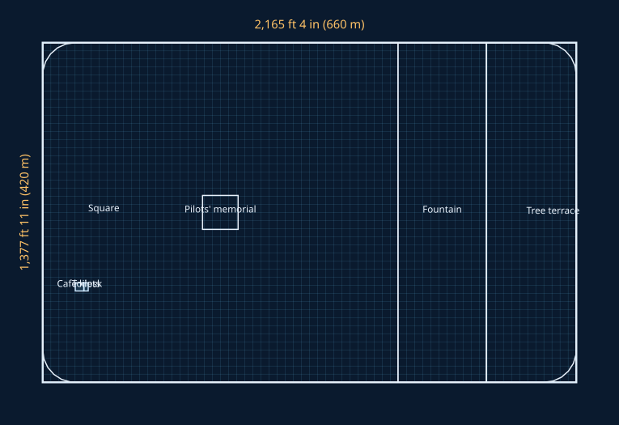

# P3-02 Commons Square: plan

Footprint 2,165 ft 4 in (660 m) × 1,377 ft 11 in (420 m) · structural grid 32 ft 10 in (10 m)

## Levels

| Level | Floor above deck | Height | Floor area |
|---|---|---|---|
| Level 1 · Ground | 0 ft (0 mm) | 13 ft 1 in (4,000 mm) | 1,722 sq ft (160 m²) |

## Elements

| ID | Designation | Type | Name | Level(s) | Size / length | Area | Status |
|---|---|---|---|---|---|---|---|
| E001 | D5F6P3B2A1R1 | zone | Square | L1 | 1,441 ft 7 in (439 m) × 1,377 ft 7 in (420 m) | 1,976,283 sq ft (183,603 m²) | proposed |
| E002 | D5F6P3B2A1R2 | room | Café kiosk | L1 | 34 ft 9 in (11 m) × 32 ft 10 in (10 m) | 1,141 sq ft (106 m²) | proposed |
| E003 | D5F6P3B2A1R3 | room | Toilets | L1 | 17 ft 9 in (5,400 mm) × 32 ft 10 in (10 m) | 581 sq ft (54 m²) | proposed |
| E004 |  | fixture | Pilots' memorial | L1 | 144 ft 4 in (44 m) × 137 ft 10 in (42 m) | 19,892 sq ft (1,848 m²) | proposed |
| E005 | D5F6P3B2A1R4 | zone | Fountain | L1 | 358 ft 11 in (109 m) × 1,377 ft (420 m) | 494,168 sq ft (45,910 m²) | proposed |
| E006 | D5F6P3B2A1R5 | zone | Tree terrace | L1 | 364 ft 10 in (111 m) × 1,377 ft (420 m) | 493,987 sq ft (45,893 m²) | proposed |

## Drawings

### Level 1 · Ground

