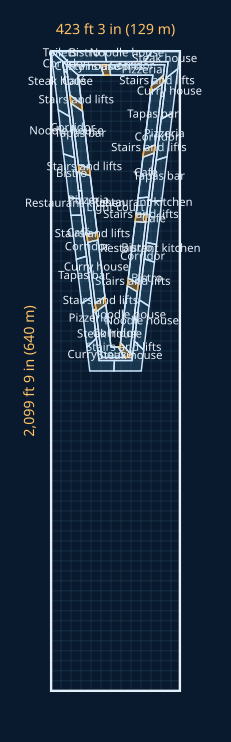
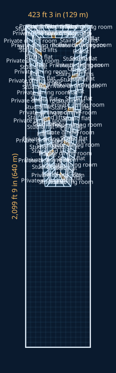

# P3-04 Restaurants Row: plan

Footprint 423 ft 3 in (129 m) × 2,099 ft 9 in (640 m) · structural grid 32 ft 10 in (10 m)

## Levels

| Level | Floor above deck | Height | Floor area |
|---|---|---|---|
| Level 1 · Ground floor | 0 ft (0 mm) | 16 ft 5 in (5,000 mm) | 155,764 sq ft (14,471 m²) |
| Level 2 · Upper floor | 16 ft 5 in (5,000 mm) | 13 ft 1 in (4,000 mm) | 155,796 sq ft (14,474 m²) |

## Elements

| ID | Designation | Type | Name | Level(s) | Size / length | Area | Status |
|---|---|---|---|---|---|---|---|
| E001 | D5F6P3B4A1L1R1 | zone | Light court | L1 | 245 ft 5 in (75 m) × 892 ft 5 in (272 m) | 122,674 sq ft (11,397 m²) | proposed |
| E002 | D5F6P3B4A1L1R2 | zone | Corridor | L1 | 345 ft 10 in (105 m) × 68 ft 3 in (21 m) | 3,883 sq ft (361 m²) | proposed |
| E003 | D5F6P3B4A1L1R3 | zone | Corridor | L1 | 57 ft 9 in (18 m) × 395 ft 8 in (121 m) | 3,879 sq ft (360 m²) | proposed |
| E004 | D5F6P3B4A1L1R4 | zone | Corridor | L1 | 56 ft 9 in (17 m) × 394 ft 8 in (120 m) | 3,873 sq ft (360 m²) | proposed |
| E005 | D5F6P3B4A1L1R5 | zone | Corridor | L1 | 144 ft (44 m) × 169 ft 7 in (52 m) | 3,909 sq ft (363 m²) | proposed |
| E006 | D5F6P3B4A1L1R6 | zone | Corridor | L1 | 57 ft 1 in (17 m) × 395 ft (120 m) | 3,909 sq ft (363 m²) | proposed |
| E007 | D5F6P3B4A1L1R7 | zone | Corridor | L1 | 57 ft 9 in (18 m) × 396 ft (121 m) | 3,854 sq ft (358 m²) | proposed |
| E008 | D5F6P3B4A1L1R8 | zone | Corridor | L1 | 14 ft 5 in (4,400 mm) × 37 ft 5 in (11 m) | 274 sq ft (25 m²) | proposed |
| E009 | D5F6P3B4A1L1R9, D5F6P3B4A1L2R1 | core | Stairs and lifts | L1, L2 | 34 ft 9 in (11 m) × 34 ft 5 in (10 m) | 904 sq ft (84 m²) | proposed |
| E010 | D5F6P3B4A1L1R10, D5F6P3B4A1L2R2 | core | Stairs and lifts | L1, L2 | 41 ft 8 in (13 m) × 57 ft 1 in (17 m) | 909 sq ft (84 m²) | proposed |
| E011 | D5F6P3B4A1L1R11, D5F6P3B4A1L2R3 | core | Stairs and lifts | L1, L2 | 39 ft 8 in (12 m) × 40 ft 8 in (12 m) | 909 sq ft (84 m²) | proposed |
| E012 | D5F6P3B4A1L1R12, D5F6P3B4A1L2R4 | core | Stairs and lifts | L1, L2 | 37 ft 9 in (12 m) × 27 ft 7 in (8,400 mm) | 902 sq ft (84 m²) | proposed |
| E013 | D5F6P3B4A1L1R13, D5F6P3B4A1L2R5 | core | Stairs and lifts | L1, L2 | 35 ft 9 in (11 m) × 44 ft (13 m) | 902 sq ft (84 m²) | proposed |
| E014 | D5F6P3B4A1L1R14, D5F6P3B4A1L2R6 | core | Stairs and lifts | L1, L2 | 38 ft 1 in (12 m) × 48 ft 7 in (15 m) | 905 sq ft (84 m²) | proposed |
| E015 | D5F6P3B4A1L1R15, D5F6P3B4A1L2R7 | core | Stairs and lifts | L1, L2 | 35 ft 1 in (11 m) × 48 ft 11 in (15 m) | 910 sq ft (85 m²) | proposed |
| E016 | D5F6P3B4A1L1R16, D5F6P3B4A1L2R8 | core | Stairs and lifts | L1, L2 | 37 ft 1 in (11 m) × 32 ft 6 in (9,900 mm) | 906 sq ft (84 m²) | proposed |
| E017 | D5F6P3B4A1L1R17, D5F6P3B4A1L2R9 | core | Stairs and lifts | L1, L2 | 39 ft 1 in (12 m) × 36 ft 1 in (11 m) | 906 sq ft (84 m²) | proposed |
| E018 | D5F6P3B4A1L1R18, D5F6P3B4A1L2R10 | core | Stairs and lifts | L1, L2 | 41 ft (12 m) × 52 ft 2 in (16 m) | 900 sq ft (84 m²) | proposed |
| E019 | D5F6P3B4A1L1R19 | room | Toilets | L1 | 55 ft 9 in (17 m) × 34 ft 5 in (10 m) | 650 sq ft (60 m²) | proposed |
| E020 | D5F6P3B4A1L1R20 | room | Bistro | L1 | 161 ft 5 in (49 m) × 34 ft 5 in (10 m) | 4,843 sq ft (450 m²) | proposed |
| E021 | D5F6P3B4A1L1R21 | room | Noodle house | L1 | 154 ft 10 in (47 m) × 34 ft 5 in (10 m) | 4,843 sq ft (450 m²) | proposed |
| E022 | D5F6P3B4A1L1R22 | room | Steak house | L1 | 114 ft 10 in (35 m) × 88 ft 3 in (27 m) | 4,842 sq ft (450 m²) | proposed |
| E023 | D5F6P3B4A1L1R23 | room | Curry house | L1 | 54 ft 9 in (17 m) × 165 ft 4 in (50 m) | 4,855 sq ft (451 m²) | proposed |
| E024 | D5F6P3B4A1L1R24 | room | Pizzeria | L1 | 53 ft 10 in (16 m) × 155 ft 10 in (47 m) | 4,853 sq ft (451 m²) | proposed |
| E025 | D5F6P3B4A1L1R25 | room | Tapas bar | L1 | 52 ft 2 in (16 m) × 146 ft 4 in (45 m) | 4,834 sq ft (449 m²) | proposed |
| E026 | D5F6P3B4A1L1R26 | room | Café | L1 | 51 ft 2 in (16 m) × 144 ft (44 m) | 4,825 sq ft (448 m²) | proposed |
| E027 | D5F6P3B4A1L1R27 | room | Restaurant kitchen | L1 | 40 ft 4 in (12 m) × 65 ft (20 m) | 1,942 sq ft (180 m²) | proposed |
| E028 | D5F6P3B4A1L1R28 | room | Bistro | L1 | 49 ft 10 in (15 m) × 155 ft 2 in (47 m) | 4,846 sq ft (450 m²) | proposed |
| E029 | D5F6P3B4A1L1R29 | room | Noodle house | L1 | 48 ft 3 in (15 m) × 164 ft 8 in (50 m) | 4,817 sq ft (447 m²) | proposed |
| E030 | D5F6P3B4A1L1R30 | room | Steak house | L1 | 98 ft 5 in (30 m) × 98 ft 5 in (30 m) | 4,840 sq ft (450 m²) | proposed |
| E031 | D5F6P3B4A1L1R31 | room | Curry house | L1 | 90 ft 7 in (28 m) × 106 ft 11 in (33 m) | 4,842 sq ft (450 m²) | proposed |
| E032 | D5F6P3B4A1L1R32 | room | Pizzeria | L1 | 48 ft 7 in (15 m) × 164 ft 1 in (50 m) | 4,852 sq ft (451 m²) | proposed |
| E033 | D5F6P3B4A1L1R33 | room | Tapas bar | L1 | 49 ft 10 in (15 m) × 154 ft 6 in (47 m) | 4,855 sq ft (451 m²) | proposed |
| E034 | D5F6P3B4A1L1R34 | room | Café | L1 | 50 ft 10 in (16 m) × 145 ft 4 in (44 m) | 4,840 sq ft (450 m²) | proposed |
| E035 | D5F6P3B4A1L1R35 | room | Restaurant kitchen | L1 | 41 ft 8 in (13 m) × 57 ft 9 in (18 m) | 1,933 sq ft (180 m²) | proposed |
| E036 | D5F6P3B4A1L1R36 | room | Bistro | L1 | 52 ft 6 in (16 m) × 147 ft 4 in (45 m) | 4,863 sq ft (452 m²) | proposed |
| E037 | D5F6P3B4A1L1R37 | room | Noodle house | L1 | 53 ft 10 in (16 m) × 156 ft 6 in (48 m) | 4,858 sq ft (451 m²) | proposed |
| E038 | D5F6P3B4A1L1R38 | room | Steak house | L1 | 60 ft 8 in (18 m) × 214 ft 7 in (65 m) | 6,463 sq ft (600 m²) | proposed |
| E039 | D5F6P3B4A1L1R39 | room | Curry house | L1 | 123 ft (38 m) × 34 ft 5 in (10 m) | 3,357 sq ft (312 m²) | proposed |
| E040 | D5F6P3B4A1L1R40 | room | Pizzeria | L1 | 182 ft 9 in (56 m) × 67 ft 3 in (20 m) | 6,722 sq ft (624 m²) | proposed |
| E041 | D5F6P3B4A1L1R41 | room | Tapas bar | L1 | 61 ft (19 m) × 216 ft 2 in (66 m) | 6,741 sq ft (626 m²) | proposed |
| E042 | D5F6P3B4A1L1R42 | room | Café | L1 | 52 ft 10 in (16 m) × 148 ft (45 m) | 4,841 sq ft (450 m²) | proposed |
| E043 | D5F6P3B4A1L1R43 | room | Restaurant kitchen | L1 | 41 ft 4 in (13 m) × 56 ft 1 in (17 m) | 1,883 sq ft (175 m²) | proposed |
| E044 | D5F6P3B4A1L1R44 | room | Bistro | L1 | 57 ft 1 in (17 m) × 203 ft 5 in (62 m) | 6,740 sq ft (626 m²) | proposed |
| E045 | D5F6P3B4A1L1R45 | room | Noodle house | L1 | 55 ft 1 in (17 m) × 219 ft 10 in (67 m) | 6,744 sq ft (627 m²) | proposed |
| E046 | D5F6P3B4A1L1R46 | room | Steak house | L1 | 91 ft 6 in (28 m) × 174 ft 3 in (53 m) | 6,712 sq ft (624 m²) | proposed |
| E047 | D5F6P3B4A1L1R47 | room | Curry house | L1 | 56 ft 5 in (17 m) × 208 ft (63 m) | 6,720 sq ft (624 m²) | proposed |
| E048 | D5F6P3B4A1L1R48 | room | Pizzeria | L1 | 58 ft 5 in (18 m) × 200 ft 9 in (61 m) | 6,717 sq ft (624 m²) | proposed |
| E049 | D5F6P3B4A1L1R49 | room | Tapas bar | L1 | 60 ft 4 in (18 m) × 211 ft 7 in (64 m) | 6,721 sq ft (624 m²) | proposed |
| E050 | D5F6P3B4A1L1R50 | room | Café | L1 | 50 ft 2 in (15 m) × 127 ft 7 in (39 m) | 3,372 sq ft (313 m²) | proposed |
| E051 | D5F6P3B4A1L2R11 | zone | Corridor | L2 | 345 ft 10 in (105 m) × 68 ft 3 in (21 m) | 3,883 sq ft (361 m²) | proposed |
| E052 | D5F6P3B4A1L2R12 | zone | Corridor | L2 | 57 ft 9 in (18 m) × 395 ft 8 in (121 m) | 3,879 sq ft (360 m²) | proposed |
| E053 | D5F6P3B4A1L2R13 | zone | Corridor | L2 | 56 ft 9 in (17 m) × 394 ft 8 in (120 m) | 3,873 sq ft (360 m²) | proposed |
| E054 | D5F6P3B4A1L2R14 | zone | Corridor | L2 | 144 ft (44 m) × 169 ft 7 in (52 m) | 3,909 sq ft (363 m²) | proposed |
| E055 | D5F6P3B4A1L2R15 | zone | Corridor | L2 | 57 ft 1 in (17 m) × 395 ft (120 m) | 3,909 sq ft (363 m²) | proposed |
| E056 | D5F6P3B4A1L2R16 | zone | Corridor | L2 | 57 ft 9 in (18 m) × 396 ft (121 m) | 3,854 sq ft (358 m²) | proposed |
| E057 | D5F6P3B4A1L2R17 | zone | Corridor | L2 | 14 ft 5 in (4,400 mm) × 37 ft 5 in (11 m) | 274 sq ft (25 m²) | proposed |
| E058 | D5F6P3B4A1L2R18 | room | Flat | L2 | 81 ft (25 m) × 34 ft 5 in (10 m) | 1,616 sq ft (150 m²) | proposed |
| E059 | D5F6P3B4A1L2R19 | room | Studio flat | L2 | 71 ft 6 in (22 m) × 34 ft 5 in (10 m) | 1,616 sq ft (150 m²) | proposed |
| E060 | D5F6P3B4A1L2R20 | room | Private dining room | L2 | 53 ft 6 in (16 m) × 34 ft 5 in (10 m) | 1,288 sq ft (120 m²) | proposed |
| E061 | D5F6P3B4A1L2R21 | room | Flat | L2 | 54 ft 6 in (17 m) × 34 ft 5 in (10 m) | 1,616 sq ft (150 m²) | proposed |
| E062 | D5F6P3B4A1L2R22 | room | Studio flat | L2 | 51 ft 6 in (16 m) × 34 ft 5 in (10 m) | 1,616 sq ft (150 m²) | proposed |
| E063 | D5F6P3B4A1L2R23 | room | Private dining room | L2 | 47 ft 11 in (15 m) × 34 ft 5 in (10 m) | 1,294 sq ft (120 m²) | proposed |
| E064 | D5F6P3B4A1L2R24 | room | Flat | L2 | 65 ft 7 in (20 m) × 34 ft 5 in (10 m) | 1,611 sq ft (150 m²) | proposed |
| E065 | D5F6P3B4A1L2R25 | room | Studio flat | L2 | 75 ft 2 in (23 m) × 34 ft 5 in (10 m) | 1,611 sq ft (150 m²) | proposed |
| E066 | D5F6P3B4A1L2R26 | room | Private dining room | L2 | 64 ft 4 in (20 m) × 43 ft 4 in (13 m) | 1,288 sq ft (120 m²) | proposed |
| E067 | D5F6P3B4A1L2R27 | room | Flat | L2 | 44 ft (13 m) × 78 ft 9 in (24 m) | 1,622 sq ft (151 m²) | proposed |
| E068 | D5F6P3B4A1L2R28 | room | Studio flat | L2 | 44 ft (13 m) × 75 ft 6 in (23 m) | 1,608 sq ft (149 m²) | proposed |
| E069 | D5F6P3B4A1L2R29 | room | Private dining room | L2 | 42 ft 4 in (13 m) × 63 ft 8 in (19 m) | 1,301 sq ft (121 m²) | proposed |
| E070 | D5F6P3B4A1L2R30 | room | Flat | L2 | 43 ft 4 in (13 m) × 69 ft 11 in (21 m) | 1,609 sq ft (150 m²) | proposed |
| E071 | D5F6P3B4A1L2R31 | room | Studio flat | L2 | 42 ft 8 in (13 m) × 66 ft 11 in (20 m) | 1,614 sq ft (150 m²) | proposed |
| E072 | D5F6P3B4A1L2R32 | room | Private dining room | L2 | 41 ft 4 in (13 m) × 54 ft 9 in (17 m) | 1,288 sq ft (120 m²) | proposed |
| E073 | D5F6P3B4A1L2R33 | room | Flat | L2 | 42 ft (13 m) × 61 ft 4 in (19 m) | 1,614 sq ft (150 m²) | proposed |
| E074 | D5F6P3B4A1L2R34 | room | Studio flat | L2 | 41 ft 8 in (13 m) × 58 ft 1 in (18 m) | 1,617 sq ft (150 m²) | proposed |
| E075 | D5F6P3B4A1L2R35 | room | Private dining room | L2 | 40 ft 4 in (12 m) × 45 ft 7 in (14 m) | 1,294 sq ft (120 m²) | proposed |
| E076 | D5F6P3B4A1L2R36 | room | Flat | L2 | 41 ft 4 in (13 m) × 52 ft 2 in (16 m) | 1,626 sq ft (151 m²) | proposed |
| E077 | D5F6P3B4A1L2R37 | room | Studio flat | L2 | 40 ft 8 in (12 m) × 48 ft 11 in (15 m) | 1,616 sq ft (150 m²) | proposed |
| E078 | D5F6P3B4A1L2R38 | room | Private dining room | L2 | 39 ft 1 in (12 m) × 38 ft 9 in (12 m) | 1,296 sq ft (120 m²) | proposed |
| E079 | D5F6P3B4A1L2R39 | room | Flat | L2 | 40 ft (12 m) × 49 ft 6 in (15 m) | 1,610 sq ft (150 m²) | proposed |
| E080 | D5F6P3B4A1L2R40 | room | Studio flat | L2 | 39 ft 4 in (12 m) × 52 ft 10 in (16 m) | 1,609 sq ft (149 m²) | proposed |
| E081 | D5F6P3B4A1L2R41 | room | Private dining room | L2 | 38 ft 1 in (12 m) × 46 ft 3 in (14 m) | 1,283 sq ft (119 m²) | proposed |
| E082 | D5F6P3B4A1L2R42 | room | Flat | L2 | 38 ft 9 in (12 m) × 58 ft 9 in (18 m) | 1,611 sq ft (150 m²) | proposed |
| E083 | D5F6P3B4A1L2R43 | room | Studio flat | L2 | 38 ft 5 in (12 m) × 61 ft 8 in (19 m) | 1,608 sq ft (149 m²) | proposed |
| E084 | D5F6P3B4A1L2R44 | room | Private dining room | L2 | 37 ft 1 in (11 m) × 55 ft 5 in (17 m) | 1,301 sq ft (121 m²) | proposed |
| E085 | D5F6P3B4A1L2R45 | room | Flat | L2 | 38 ft 1 in (12 m) × 67 ft 3 in (20 m) | 1,620 sq ft (150 m²) | proposed |
| E086 | D5F6P3B4A1L2R46 | room | Studio flat | L2 | 37 ft 5 in (11 m) × 70 ft 6 in (22 m) | 1,616 sq ft (150 m²) | proposed |
| E087 | D5F6P3B4A1L2R47 | room | Private dining room | L2 | 36 ft 1 in (11 m) × 64 ft (20 m) | 1,296 sq ft (120 m²) | proposed |
| E088 | D5F6P3B4A1L2R48 | room | Flat | L2 | 36 ft 9 in (11 m) × 76 ft 1 in (23 m) | 1,617 sq ft (150 m²) | proposed |
| E089 | D5F6P3B4A1L2R49 | room | Studio flat | L2 | 36 ft 5 in (11 m) × 79 ft 5 in (24 m) | 1,617 sq ft (150 m²) | proposed |
| E090 | D5F6P3B4A1L2R50 | room | Private dining room | L2 | 59 ft 1 in (18 m) × 35 ft 5 in (11 m) | 1,285 sq ft (119 m²) | proposed |
| E091 | D5F6P3B4A1L2R51 | room | Flat | L2 | 57 ft 5 in (18 m) × 34 ft 5 in (10 m) | 1,616 sq ft (150 m²) | proposed |
| E092 | D5F6P3B4A1L2R52 | room | Studio flat | L2 | 63 ft 4 in (19 m) × 34 ft 5 in (10 m) | 1,611 sq ft (150 m²) | proposed |
| E093 | D5F6P3B4A1L2R53 | room | Private dining room | L2 | 41 ft (12 m) × 62 ft (19 m) | 1,290 sq ft (120 m²) | proposed |
| E094 | D5F6P3B4A1L2R54 | room | Flat | L2 | 36 ft 9 in (11 m) × 77 ft 5 in (24 m) | 1,621 sq ft (151 m²) | proposed |
| E095 | D5F6P3B4A1L2R55 | room | Studio flat | L2 | 36 ft 9 in (11 m) × 74 ft 2 in (23 m) | 1,609 sq ft (149 m²) | proposed |
| E096 | D5F6P3B4A1L2R56 | room | Private dining room | L2 | 36 ft 5 in (11 m) × 62 ft (19 m) | 1,297 sq ft (120 m²) | proposed |
| E097 | D5F6P3B4A1L2R57 | room | Flat | L2 | 37 ft 5 in (11 m) × 68 ft 7 in (21 m) | 1,609 sq ft (150 m²) | proposed |
| E098 | D5F6P3B4A1L2R58 | room | Studio flat | L2 | 38 ft 1 in (12 m) × 65 ft 3 in (20 m) | 1,609 sq ft (149 m²) | proposed |
| E099 | D5F6P3B4A1L2R59 | room | Private dining room | L2 | 37 ft 1 in (11 m) × 53 ft 6 in (16 m) | 1,288 sq ft (120 m²) | proposed |
| E100 | D5F6P3B4A1L2R60 | room | Flat | L2 | 38 ft 9 in (12 m) × 60 ft (18 m) | 1,619 sq ft (150 m²) | proposed |
| E101 | D5F6P3B4A1L2R61 | room | Studio flat | L2 | 39 ft 4 in (12 m) × 56 ft 9 in (17 m) | 1,625 sq ft (151 m²) | proposed |
| E102 | D5F6P3B4A1L2R62 | room | Private dining room | L2 | 38 ft 5 in (12 m) × 44 ft 3 in (14 m) | 1,291 sq ft (120 m²) | proposed |
| E103 | D5F6P3B4A1L2R63 | room | Flat | L2 | 40 ft (12 m) × 50 ft 10 in (16 m) | 1,622 sq ft (151 m²) | proposed |
| E104 | D5F6P3B4A1L2R64 | room | Studio flat | L2 | 40 ft (12 m) × 47 ft 11 in (15 m) | 1,613 sq ft (150 m²) | proposed |
| E105 | D5F6P3B4A1L2R65 | room | Private dining room | L2 | 39 ft 8 in (12 m) × 39 ft 1 in (12 m) | 1,299 sq ft (121 m²) | proposed |
| E106 | D5F6P3B4A1L2R66 | room | Flat | L2 | 40 ft 8 in (12 m) × 50 ft 10 in (16 m) | 1,613 sq ft (150 m²) | proposed |
| E107 | D5F6P3B4A1L2R67 | room | Studio flat | L2 | 41 ft 4 in (13 m) × 54 ft 2 in (16 m) | 1,615 sq ft (150 m²) | proposed |
| E108 | D5F6P3B4A1L2R68 | room | Private dining room | L2 | 40 ft 4 in (12 m) × 47 ft 7 in (14 m) | 1,292 sq ft (120 m²) | proposed |
| E109 | D5F6P3B4A1L2R69 | room | Flat | L2 | 42 ft (13 m) × 59 ft 9 in (18 m) | 1,614 sq ft (150 m²) | proposed |
| E110 | D5F6P3B4A1L2R70 | room | Studio flat | L2 | 42 ft 4 in (13 m) × 62 ft 8 in (19 m) | 1,615 sq ft (150 m²) | proposed |
| E111 | D5F6P3B4A1L2R71 | room | Private dining room | L2 | 41 ft 8 in (13 m) × 56 ft 5 in (17 m) | 1,292 sq ft (120 m²) | proposed |
| E112 | D5F6P3B4A1L2R72 | room | Flat | L2 | 43 ft (13 m) × 68 ft 7 in (21 m) | 1,613 sq ft (150 m²) | proposed |
| E113 | D5F6P3B4A1L2R73 | room | Studio flat | L2 | 43 ft 4 in (13 m) × 71 ft 10 in (22 m) | 1,617 sq ft (150 m²) | proposed |
| E114 | D5F6P3B4A1L2R74 | room | Private dining room | L2 | 42 ft 8 in (13 m) × 65 ft 3 in (20 m) | 1,288 sq ft (120 m²) | proposed |
| E115 | D5F6P3B4A1L2R75 | room | Flat | L2 | 44 ft (13 m) × 77 ft 5 in (24 m) | 1,629 sq ft (151 m²) | proposed |
| E116 | D5F6P3B4A1L2R76 | room | Studio flat | L2 | 42 ft 4 in (13 m) × 61 ft 8 in (19 m) | 972 sq ft (90 m²) | proposed |
| E117 | D5F6P3B4A1L2R77 | room | Private dining room | L2 | 71 ft 2 in (22 m) × 34 ft 5 in (10 m) | 1,288 sq ft (120 m²) | proposed |
| E118 | D5F6P3B4A1L2R78 | room | Flat | L2 | 80 ft 5 in (25 m) × 34 ft 5 in (10 m) | 2,068 sq ft (192 m²) | proposed |
| E119 | D5F6P3B4A1L2R79 | room | Studio flat | L2 | 53 ft 2 in (16 m) × 34 ft 5 in (10 m) | 1,616 sq ft (150 m²) | proposed |
| E120 | D5F6P3B4A1L2R80 | room | Private dining room | L2 | 50 ft 2 in (15 m) × 34 ft 5 in (10 m) | 1,288 sq ft (120 m²) | proposed |
| E121 | D5F6P3B4A1L2R81 | room | Flat | L2 | 71 ft 6 in (22 m) × 34 ft 5 in (10 m) | 1,622 sq ft (151 m²) | proposed |
| E122 | D5F6P3B4A1L2R82 | room | Studio flat | L2 | 64 ft 4 in (20 m) × 67 ft 3 in (20 m) | 2,195 sq ft (204 m²) | proposed |
| E123 | D5F6P3B4A1L2R83 | room | Private dining room | L2 | 42 ft 8 in (13 m) × 65 ft 7 in (20 m) | 1,291 sq ft (120 m²) | proposed |
| E124 | D5F6P3B4A1L2R84 | room | Flat | L2 | 43 ft 8 in (13 m) × 72 ft 2 in (22 m) | 1,626 sq ft (151 m²) | proposed |
| E125 | D5F6P3B4A1L2R85 | room | Studio flat | L2 | 43 ft (13 m) × 68 ft 7 in (21 m) | 1,620 sq ft (150 m²) | proposed |
| E126 | D5F6P3B4A1L2R86 | room | Private dining room | L2 | 41 ft 8 in (13 m) × 56 ft 1 in (17 m) | 1,287 sq ft (120 m²) | proposed |
| E127 | D5F6P3B4A1L2R87 | room | Flat | L2 | 40 ft (12 m) × 42 ft 8 in (13 m) | 911 sq ft (85 m²) | proposed |
| E128 | D5F6P3B4A1L2R88 | room | Studio flat | L2 | 42 ft (13 m) × 58 ft 5 in (18 m) | 1,614 sq ft (150 m²) | proposed |
| E129 | D5F6P3B4A1L2R89 | room | Private dining room | L2 | 40 ft 4 in (12 m) × 45 ft 11 in (14 m) | 1,299 sq ft (121 m²) | proposed |
| E130 | D5F6P3B4A1L2R90 | room | Flat | L2 | 41 ft (12 m) × 52 ft 2 in (16 m) | 1,620 sq ft (150 m²) | proposed |
| E131 | D5F6P3B4A1L2R91 | room | Studio flat | L2 | 42 ft 8 in (13 m) × 65 ft 7 in (20 m) | 2,200 sq ft (204 m²) | proposed |
| E132 | D5F6P3B4A1L2R92 | room | Private dining room | L2 | 38 ft 9 in (12 m) × 41 ft 4 in (13 m) | 1,295 sq ft (120 m²) | proposed |
| E133 | D5F6P3B4A1L2R93 | room | Flat | L2 | 39 ft 8 in (12 m) × 53 ft 10 in (16 m) | 1,623 sq ft (151 m²) | proposed |
| E134 | D5F6P3B4A1L2R94 | room | Studio flat | L2 | 39 ft 1 in (12 m) × 57 ft 1 in (17 m) | 1,613 sq ft (150 m²) | proposed |
| E135 | D5F6P3B4A1L2R95 | room | Private dining room | L2 | 37 ft 5 in (11 m) × 51 ft 2 in (16 m) | 1,294 sq ft (120 m²) | proposed |
| E136 | D5F6P3B4A1L2R96 | room | Flat | L2 | 36 ft 1 in (11 m) × 42 ft (13 m) | 903 sq ft (84 m²) | proposed |
| E137 | D5F6P3B4A1L2R97 | room | Studio flat | L2 | 37 ft 9 in (12 m) × 67 ft 3 in (20 m) | 1,613 sq ft (150 m²) | proposed |
| E138 | D5F6P3B4A1L2R98 | room | Private dining room | L2 | 36 ft 5 in (11 m) × 61 ft (19 m) | 1,294 sq ft (120 m²) | proposed |
| E139 | D5F6P3B4A1L2R99 | room | Flat | L2 | 37 ft 1 in (11 m) × 73 ft 6 in (22 m) | 1,617 sq ft (150 m²) | proposed |
| E140 | D5F6P3B4A1L2R100 | room | Studio flat | L2 | 38 ft 9 in (12 m) × 94 ft 2 in (29 m) | 2,197 sq ft (204 m²) | proposed |
| E141 | D5F6P3B4A1L2R101 | room | Private dining room | L2 | 56 ft 5 in (17 m) × 34 ft 5 in (10 m) | 1,294 sq ft (120 m²) | proposed |
| E142 | D5F6P3B4A1L2R102 | room | Flat | L2 | 40 ft 4 in (12 m) × 68 ft 7 in (21 m) | 1,612 sq ft (150 m²) | proposed |
| E143 | D5F6P3B4A1L2R103 | room | Studio flat | L2 | 36 ft 9 in (11 m) × 76 ft 9 in (23 m) | 1,620 sq ft (151 m²) | proposed |
| E144 | D5F6P3B4A1L2R104 | room | Private dining room | L2 | 36 ft 1 in (11 m) × 64 ft 4 in (20 m) | 1,297 sq ft (121 m²) | proposed |
| E145 | D5F6P3B4A1L2R105 | room | Flat | L2 | 34 ft 9 in (11 m) × 50 ft 6 in (15 m) | 897 sq ft (83 m²) | proposed |
| E146 | D5F6P3B4A1L2R106 | room | Studio flat | L2 | 38 ft 1 in (12 m) × 66 ft 3 in (20 m) | 1,614 sq ft (150 m²) | proposed |
| E147 | D5F6P3B4A1L2R107 | room | Private dining room | L2 | 37 ft 1 in (11 m) × 54 ft 2 in (16 m) | 1,290 sq ft (120 m²) | proposed |
| E148 | D5F6P3B4A1L2R108 | room | Flat | L2 | 38 ft 9 in (12 m) × 60 ft 4 in (18 m) | 1,616 sq ft (150 m²) | proposed |
| E149 | D5F6P3B4A1L2R109 | room | Studio flat | L2 | 41 ft 4 in (13 m) × 73 ft 2 in (22 m) | 2,205 sq ft (205 m²) | proposed |
| E150 | D5F6P3B4A1L2R110 | room | Private dining room | L2 | 38 ft 9 in (12 m) × 41 ft (12 m) | 1,288 sq ft (120 m²) | proposed |
| E151 | D5F6P3B4A1L2R111 | room | Flat | L2 | 40 ft 4 in (12 m) × 48 ft 7 in (15 m) | 1,623 sq ft (151 m²) | proposed |
| E152 | D5F6P3B4A1L2R112 | room | Studio flat | L2 | 40 ft 8 in (12 m) × 49 ft 3 in (15 m) | 1,621 sq ft (151 m²) | proposed |
| E153 | D5F6P3B4A1L2R113 | room | Private dining room | L2 | 40 ft (12 m) × 42 ft 8 in (13 m) | 1,295 sq ft (120 m²) | proposed |
| E154 | D5F6P3B4A1L2R114 | room | Flat | L2 | 39 ft 1 in (12 m) × 34 ft 1 in (10 m) | 906 sq ft (84 m²) | proposed |
| E155 | D5F6P3B4A1L2R115 | room | Studio flat | L2 | 42 ft (13 m) × 59 ft 1 in (18 m) | 1,620 sq ft (151 m²) | proposed |
| E156 | D5F6P3B4A1L2R116 | room | Private dining room | L2 | 41 ft 4 in (13 m) × 53 ft 2 in (16 m) | 1,295 sq ft (120 m²) | proposed |
| E157 | D5F6P3B4A1L2R117 | room | Flat | L2 | 42 ft 8 in (13 m) × 65 ft 7 in (20 m) | 1,621 sq ft (151 m²) | proposed |
| E158 | D5F6P3B4A1L2R118 | room | Studio flat | L2 | 45 ft 3 in (14 m) × 86 ft 3 in (26 m) | 2,202 sq ft (205 m²) | proposed |
| E159 | D5F6P3B4A1L2R119 | room | Private dining room | L2 | 42 ft 8 in (13 m) × 65 ft 11 in (20 m) | 1,296 sq ft (120 m²) | proposed |
| E160 | D5F6P3B4A1L2R120 | room | Flat | L2 | 45 ft 11 in (14 m) × 91 ft 10 in (28 m) | 2,072 sq ft (192 m²) | proposed |

## Drawings

### Level 1 · Ground floor

### Level 2 · Upper floor

